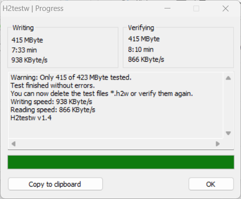
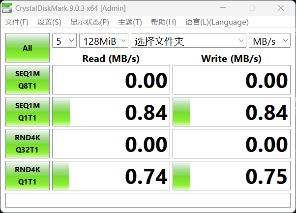

# BASESSD — 开源低成本端到端 SSD 主控固件

> **BASESSD** = **B**are-metal, **A**ffordable, **S**imple, **E**nd-to-end **SSD**。

STM32H743 + MT29F4G08（4 Gb SLC NAND）上的 **DRAM-less 软 SSD 固件原型**：
主机经 USB MSC 把它当作 U 盘访问，固件内部按 HIL / FTL / FC-NAND 分层实现。

> 这是**学习存储主控设计**的原型项目，不是产品固件。验证范围以本文「状态」表为准。

## 架构

| 层 | 目录 | 职责 |
|---|---|---|
| HIL | `src/hil/` | 主机接口（USB MSC、UART CLI）、请求拆分与排队 |
| FTL | `src/ftl/` | L2P 映射、GC、WL、Journal、Checkpoint、掉电恢复 |
| FC-NAND | `src/fc/` + `src/nand/` | 命令/描述符/缓冲池、UOP 引擎、ECC/CRC、FMC 时序 |
| DRAM | 无独立层 | DRAM-less：元数据常驻 AXI_RAM / SRAM2 |

分层说明见 `docs/architecture.md`；行业对照与分层判据见 `docs/design/fc_nand_design.md` §26。

## 硬件假设

- MCU：STM32H743（Cortex-M7），FMC bank 3 接 NAND
- NAND：Micron MT29F4G08（ONFI 1.0，4 Gb，x8），单颗、单 LUN
- 主机接口：`USB2_OTG_FS` device mode，全速 12 Mbps，MSC/BOT，单 LUN，512 B 块，主机可见容量约 424 MiB
- 串口：USART1，115200 8N1（CLI 与日志）
- 调试：J-Link（SWD）
- 板卡资料：[正点原子 Apollo V2 资料页](https://www.openedv.com/docs/boards/stm32/zdyz_stm32h743_apolloV2.html)（硬件手册 / 原理图在页面所列 A 盘）

引脚、时钟与内存布局见 `docs/hardware_contract.md`。USB 引脚已由 Apollo V2 原理图 2.2.10.1 确认：
Type-C 的 D-/D+ 经 22R 接 `PA11/PA12`（OTG_FS），SBU 未接，无 ULPI PHY，只有 FS 12 Mbps。

## 主控 SoC 模块与本平台取舍

下表按「主控物理硬件块」列模块、常见形态、功能和本平台的选择/替代。
详细说明见 `docs/design/controller_target_features.md` §3/§6；下一平台选择见同文档 §7。

| 主控 SoC 模块 | 常见种类 / 形态 | 功能简略 | 本平台选择 / 替代 |
|---|---|---|---|
| 主机 PHY / 链路 | PCIe、SATA、SAS、UFS（M-PHY+UniPro）、eMMC、USB | 电气、串行/并行、链路训练、速率/lane | **USB2 OTG_FS device，12 Mbps**（板载限制）；无链路训练/多 lane 可学 |
| 主机控制器 | PCIe controller（RC/EP）、AHCI、UFS、USB、eMMC | 队列、命令搬运、中断、DMA | STM32 USB OTG controller；**HIL 软件请求拆分/排队/完成回执**；无 SQ/CQ/doorbell |
| 命令 / 队列协议 | NVMe、AHCI+ATA、SCSI、UFS UTP、MMC、USB MSC/UASP | 命令语义、队列、完成、描述符 | **USB MSC BOT 单命令**；替代：软件请求生命周期；无 NVMe 队列 |
| 描述符 / 主机 DMA | PRP/SGL（NVMe）、PRD（AHCI）、UPIU（UFS） | 数据缓冲怎么指、DMA 搬运 | 无 host 描述符；USB FIFO/软件缓冲；替代：HIL 请求 + 缓冲池 |
| CPU | 单核 MCU、多核 AP、AP+实时核 | 协议解析、FTL、调度、后台 | **单 Cortex-M7**；轮询 + 后台时间预算；无多核并行 |
| SRAM / DRAM | 片上 SRAM、DDR3/4、HBM（少） | L2P 驻留、命令/数据缓冲 | **DRAM-less**：32 MB SDRAM 未用，元数据在 AXI_RAM/SRAM2；替代：region cache + journal/CP |
| FC（NAND 通道控制器） | 硬 FC（多通道/队列/DMA/ECC）、软 FC | 通道/CE/LUN/plane 时序、描述符链、ECC | **软件 FC**：cmd/desc/buf 三池 + UOP；单 ch/1 CE/1 LUN/2 plane；无硬 FC 并行 |
| NAND 接口 | ONFI、Toggle；SDR/NV-DDR；多 timing mode | 命令/地址/数据、R/B#、时序、multi-plane | **ONFI 1.0 SDR Mode 5**，FMC bank3；单颗 MT29F4G08；无 NV-DDR/multi-channel |
| ECC | BCH、LDPC（硬/软判决）、RAID/XOR | 纠错、坏块判定、数据恢复 | **BCH(13,4) 硬判决**；无 LDPC/软判决/RAID |
| 加扰 / CRC / E2E | LFSR 加扰、CRC、DIF/DIX | 数据随机化、完整性校验、端到端保护 | **LFSR16 + CRC**；无 DIF/DIX/主机 E2E |
| DMA / 数据通路 | host DMA、NAND DMA、描述符/SG、cache 一致 | 数据搬运、减少 CPU 占用 | **NAND 侧 PIO（FMC 逐字节）**；UART DMA；无 NAND DMA/描述符链 |
| 安全 | AES-XTS/SED、secure boot、OPAL、sanitize | 加密、密钥、访问控制、安全擦除 | **未实现**；SWD 开放；替代：无（明确缺口） |
| 电源 / PLP | PMIC、hold-up 电容、PFail | 掉电保持、电源时序 | **无 PLP**；替代：Journal + Checkpoint + PFR；VWC 撤销 |
| 热 / 功耗 | 温度传感器、throttle、DVFS | 热保护、功耗管理 | **无专门热管理**；无 DVFS/风扇；替代：软件限流/日志 |
| 调试 / telemetry | JTAG/SWD、trace、ILA、SMART/telemetry | 可观测性、故障捕获、健康 | **SWD + UART**；`stats`/`smart`/日志/fault capture；无 trace/ILA |
| 可靠性 / 可用性 | ECC/RAID、双端口、热插拔、SR-IOV | 故障恢复、冗余、多租户 | **单 LUN/单端口**；无 RAID/双端口/热插拔；替代：ECC/BBT/WL/PFR |

## 构建

依赖：`arm-none-eabi-gcc`、`make`、`clang-format`（`make all` 前置格式检查）、`python3`（`make types-check`）。

```sh
make all            # debug 构建（含 format + types-check）
make release        # release 构建
make tests UT=FTL   # UT 编译/链接；UT=FC|FTL|HIL，留空 = 全部
```

产物在 `build/<debug|release>/`。`make tests` **只证明编译与链接**；UT 必须在目标板上运行，
本项目不做 host 模拟。CI（`.github/workflows/build.yml`）只跑构建与链接，不上板。

## 烧写与上板

```sh
./sh/debug_env.sh    # WSL 下启动 JLink 链路
# 之后在 VS Code 用对应 launch 配置烧写 / 调试
```

完整调试链（WSL ↔ JLink ↔ 串口）见 `docs/guides/wsl_debug_environment.md`。
串口 CLI 命令见 `src/hil/cli.c`（`format`、`test`、统计类命令等）。

## 状态

| 项目 | 状态 | 证据 / 说明 |
|---|---|---|
| debug / release 构建 | 已验证 | 2026-11-21，本机 arm-none-eabi-gcc，零新告警 |
| UT 编译（FC/FTL/HIL） | 已验证 | 2026-11-21，`make tests UT=FTL` 链接通过；仅证链接 |
| 板端 UT（release 全量） | 已验证 | 2026-11-22，318/318 通过，3 SKIP |
| 板端 H2testw | 已验证 | 见下「最新测试结果」 |
| `CONFIG_FC_RAID` | 关闭，未验证 | `include/fc/fc_interface.h`；功能代码完成但未上板 |
| IWDG 看门狗 | 关闭，待上板决策 | `src/main.c`（`SSD_WATCHDOG_ENABLE=0`） |
| read recovery `0x89` | 保留地址，空转 | `src/ftl/read_recovery.c`；本器件无读电压重试表，不处理 |

> 「已验证」仅覆盖表中证据对应的范围；未列出的分支与配置均为未验证。
> H2testw 证据对应 2026-11-21 22:58 镜像；UT 证据对应 2026-11-22 01:04 镜像。

## 最新测试结果

### UT（release 全量，2026-11-22）

| 项 | 值 |
|---|---|
| 镜像 | `built Nov 22 2026 01:04:14` |
| 结果 | **318/318 通过，3 SKIP** |
| seed | `0x81a7c024` |
| 耗时 | 697.30 s |
| 3 SKIP | `/fc-nand/lifecycle/init_sequence`、`feature_write_read`、`chain_priority_lock` |
| 原始日志 | [`2026-11-22_release_ut_full.log`](docs/archive/test_logs/2026-11-22_release_ut_full.log) |
| 复现 | 串口执行 `test --seed 0x81a7c024` |

```text
318 of 318 (100%) tests successful, 3 (0%) test skipped. Total wall-clock: 697.30 s
```

内部 speed 用例（同一轮，0 错误）：

| 用例 | 写 KB/s | 读 KB/s |
|---|---:|---:|
| `ftl_rw` chunk=8 / depth=4 | 3516 | 3083 |
| `ftl_rw` chunk=16 / depth=2 | 3338 | 3033 |
| `ftl_rw` chunk=32 / depth=1 | 2386 | 2993 |
| `fc_nand_rw` normal | 3578 | 3298 |
| `fc_nand_rw` cache | 4194 | 3356 |

### H2testw（USB MSC 端到端，2026-11-21）

| 写 KB/s | 读 KB/s | 数据量 | 结果 |
|---:|---:|---|---|
| **938** | **866** | 415/423 MB | `Test finished without errors` |

> 镜像 `built Nov 21 2026 22:58:18`（FTL request scheduler + 双副本预留 + CP headroom）；
> H2testw 0 错误；串口侧 `bad_status=0`、`complete_err=0`、`buf_fail=0`、`flush_fail=0`，
> 调度计数全部闭合。截图与原始记录见下节。

### CrystalDiskMark 9（USB MSC 端到端，2026-11-21）

| 项目 | 读 MB/s | 写 MB/s |
|---|---:|---:|
| SEQ1M Q1T1 | **0.84** | **0.84** |
| RND4K Q1T1 | **0.74** | **0.75** |
| SEQ1M Q8T1 / RND4K Q32T1 | 0.00 | 0.00 |

> 镜像 `built Nov 21 2026 22:58:18`；CDM9、5 线程、128 MiB。
> Q8T1 / Q32T1 为 0.00：USB MSC BOT 是**单命令串行**模型，没有多 outstanding 队列，
> 队列深度 >1 的测试不成立；有效口径是 Q1T1。

## 测试证据

### H2testw 截图



### CrystalDiskMark 9 截图



### 原始记录

- UT 原始日志：[`2026-11-22_release_ut_full.log`](docs/archive/test_logs/2026-11-22_release_ut_full.log)
- H2testw 截图：[`h2testw_938_866.png`](docs/archive/test_logs/h2testw_938_866.png)
- CDM9 截图：[`cdm9_20261121.png`](docs/archive/test_logs/cdm9_20261121.png)
- 测试方法与吞吐结论：[`docs/guides/testing_guide.md`](docs/guides/testing_guide.md)

## 已知限制

- **DRAM-less**：L2P 等元数据常驻片上 SRAM，容量与性能受 AXI_RAM / SRAM2 预算约束。
- 主机接口是 **USB MSC BOT**（单命令）+ UART CLI；没有 NVMe SQ/CQ/doorbell，也没有原生多队列。
- RAID 关闭；看门狗关闭。
- NAND 层尚未完全走平台抽象：`src/nand/nand_fmc.c` 直接访问 FMC 窗口。
- 只支持 STM32H743 + MT29F4G08 这一目标；没有 host 侧模拟。
- 板端为单颗 NAND（单 LUN）；多 LUN 路径未上板验证。

## 文档地图

| 入口 | 内容 |
|---|---|
| `docs/README.md` | 按任务索引的文档地图 |
| `docs/architecture.md` | 分层与平台抽象 |
| `docs/hardware_contract.md` | 硬件契约、内存布局、USB 配置 |
| `docs/design/ftl_design.md` | FTL 主设计 |
| `docs/design/fc_nand_design.md` | FC-NAND 主设计（§26 行业对照） |
| `docs/design/hil_design.md` | 主机接口层 |
| `docs/design/controller_target_features.md` | 存储主控 SoC 介绍（硬件/FTL 功能块 + 当前平台 + 下一平台选择） |
| `docs/guides/wsl_debug_environment.md` | WSL / JLink / 串口调试链 |
| `docs/design/known_open_items.md` | 未闭合风险与残余项（维护者账本） |
| `docs/design/known_closed_items.md` | 已闭合 / 不实现条目（维护者账本，只追加） |
| `CLAUDE.md` | 工程规则与评审判据（不是用户手册） |

## License

项目代码采用 Apache-2.0，见 `LICENSE`。第三方组件（TinyUSB、STM32H743 HAL/CMSIS、μnit）
遵循各自上游条款，见 `THIRD_PARTY_NOTICES.md`。ST 组件的许可原文见
`third_party/stm32h743/LICENSE`。

## 问题反馈

仓库公开后，问题与建议请开 GitHub issue。安全敏感问题请先在 issue 中只说明「希望私下沟通」，
不要在公开区贴利用细节。
