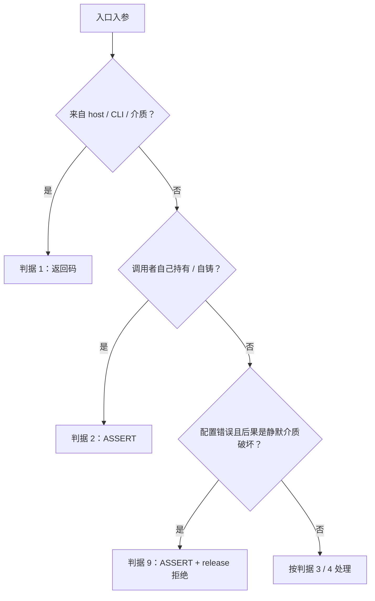

# 全工程断言判据（ASSERT / ASSUME）

断言设施见 `include/common/assertion.h`。本文是**全工程**判据，各层（FC / NAND / FTL / controller / platform / common）共用同一套规则。FC 层最初在 `docs/design/fc_nand_design.md` §24 定稿，本轮推广到这里；§24 保留 FC 特有的例外说明并指向本文。

> **测试源口径（2026-10-24）**：本文引用的 `tests/unit/test_ftl.c` / `test_ftl_bg.c` /
> `ftl_test_common.*` 是**已删除的旧套件**。这些用例名与行号保留为当时的审计证据，不再指向
> 现存文件；现役 FTL UT 见 `docs/design/ftl_ut_design.md`。判据 4 中「被 UT 钉住」的结论，
> 在新套件里复核后才能继续沿用。

## 一、四条判据

1. **外部输入校验保留返回码**
   只有**来自外部**的输入才需要返回错误码：host 的 opcode/LBA、UART CLI 的参数、从介质读回的字节（见 §六辨析 C）。这些值的合法范围由外部世界决定，损坏/非法是**预期情形**，必须返回 `FC_STATUS_INVALID_ARGUMENT` / `FTL_ERROR` / `SSD_STATUS_INVALID_ARGUMENT` / `NAND_RESULT_INVALID_ARGUMENT` 等让上层处置。
   **参数是不是"层对外头文件的入口"不再是判据**——关键在**值从哪来**：调用者（哪怕是跨层的 FTL/controller）用自己铸出的句柄、自己算出的索引、自己持有的指针调进来的，一律算前置条件（判据 2），即使该函数声明在 `fc_nand_dispatch.h` / `fc_interface.h` / `mt29f___g08a.h` 这类"边界头"里。
   （本判据原先把"边界头的全部入口"整体划为外部边界，属**过度概括**，见 §七辨析 D。）

2. **调用者已保证的前置条件转断言**
   `static` 函数、层内模块头里的接口，以及**跨层入口中调用者必然传有效值的指针/索引参数**，前置条件由调用者保证。守卫一律写成 `ASSERT(条件)`，并**删掉原来的 `return` 与恢复/降级分支**（"跳过坏 ID 继续找"、"回滚分配再返回"、"防御性降级"这类）。
   层内模块头指：`src/fc/fc_nand_engine.h`、`src/nand/nand_fmc.h`；`src/ftl/*.h`（模块内部头；`ftl_config.h` / `ftl_type.h` 是公共头）。
   **`static inline` 的纯 getter/setter 一并适用**（2026-10-17 C 批明确）：判据**不是**"它是不是模块入口"，
   而是**该函数的 NULL 语义有没有被文档化或被 UT 钉住** —— 有 ⇒ 是契约，保留（辨析 B / 判据 4）；
   没有 ⇒ 指针就是前置条件，`if (p != NULL)` 是**恒真的静默吞**（判据 1 的反面）⇒ 转 `ASSERT`。
   ⚠ 转 `ASSERT` 是 **release 的净收益**：`if (p != NULL)` 在 `NDEBUG` 下仍是活分支，
   `ASSERT` 被裁成 `((void)0)` ⇒ 零开销。见 `docs/archive/assertion_rounds.md` 的 §二十八。
   **跨层入口一并适用**：`fc_nand_dispatch_submit/submit_chain/poll`、`nand_fmc_init` / `nand_phy_backend_get`、`fc_nand_init/start/step/enable_high_speed`、`fc_submit`、`fc_command_configure_descriptor[_with_buffer]`、`fc_command_release`、`fc_data_path_*`、`fc_cw_status_*`、`fc_ecc_*`、`fc_crc_*`、`fc_random_*`、`fc_raid_*`、`ftl_cmd_write/read_data`、`fc_get_cmd_data_ptr`、`fc_get_cmd_cw_bitmap`、`fc_get_resource_stats` 的**指针/索引参数**。唯一的调用者都是层内代码（FTL/controller/fc.c），且已持有有效值。

3. **资源类结果保留返回码**
   池耗尽（`FC_STATUS_RESOURCE_EMPTY`）、队列满背压（`QUEUE_FULL` / `IO_ERROR`）、`fc_command_alloc()` 返回 `NULL`、`mem_alloc` 返回 `NULL`、NAND 报告的错误——都是**预期内**的运行结果，不是不变量破坏，必须返回给上层。
   同理**运行时状态**保留返回码：`g_nand_dispatch_armed == 0U`（异步路径未放行）、`g_initialized == 0U`（惰性初始化未完成）、`ctx->active == 0U`、`fc_buffer_is_occupied(...) == 0U`（生命周期）、`map->uops == NULL`（操作表缺项）——这些是"此刻能不能做"，不是"调用者传错"。（原条目还列了 `g_crc_ready == 0U`——**v33 起该标志随 CRC 改走 HAL 驱动整体删除**，CRC 自检失败转 `ASSERT`，不再有「静默降级」这条运行结果，见 `docs/archive/changelog/fc_crc_hal_driver_v33.md`。）

4. **单测固化为契约的守卫保留返回码**
   这是判据 2 的例外，但**只在测试是被测函数的正当调用者时成立**。`tests/` 里拿**文档化合法输入**调内部函数验证行为（如 `allocator_remove_from_free(..., 越界)` 是文档化的 no-op、`md_block_is_metadata(NULL,…)` 是文档化分类——两者都是 `../archive/ftl_ut_munit.md §4.1/§4.6` 的用例）的，按判据 1 保留返回码。
   反之，**只有测试会走"传非法参数"这条分支**（生产调用者从不传）的，按判据 2 转断言并**删掉对应用例**——见 §四。


### 判据选择图



## 二、两条辨析（最容易搞错的地方）

**辨析 A：`ptr == NULL` 要看指针来源。**
来自 `fc_command_alloc()` / `mem_alloc` 的是**资源**（判据 3，保留）；来自函数入参的才是**前置条件**（判据 2，转断言）。FTL 里满屏的 `cmd == NULL` 绝大多数是前者。

**辨析 B：语义分支不是前置条件。**
用 `NULL` 表达"这个可选参数没给"的，是有意设计的语义，不是调用者的编程错误。例：`md_block_is_metadata(md_dir == NULL, …)`（固定区间照常分类）、`fc_ecc_decode(..., err_bits == NULL)`（不取纠正位数）、`fc_bch_encode(ecc == NULL)`（跳过 ECC 写入）。

## 三、`ASSUME` 的取舍

**全工程不用 `ASSUME`。** 理由（FC 层定稿时已论证）：
- 恢复分支既然已经手工删掉，`ASSUME` 的 `__builtin_unreachable()` 换不来额外代码生成收益——工程未开 LTO，跨 TU 调用点无从利用该假设；
- 它会把"违反即 UB"引入一条本来只会 HardFault 的路径——同样是崩，`ASSERT` 的现场更可定位。

`ASSUME` 宏保留在 `assertion.h` 里，留给将来确有热路径需要向编译器证明的场合。确需表达"逻辑不可达"时用 `ASSERT_UNREACHABLE()`。

## 四、什么时候可以删用例而不是保留守卫

判据 4 只适用于"这个函数在别的场景下确实需要优雅返回"的情况。反例是 FC 的 `fc_queue.c` 指针判空：生产调用者只有 `fc.c` 与 `fc_nand_dispatch.c`，**全部传有效指针**——唯一会传 `NULL` 的就是测试自己。这种"只有测试会走的分支"应当按判据 2 转 `ASSERT`，并**删掉对应用例**，而不是为了让用例继续通过而保留返回码。

FC 层已按此原则删除多批「只有测试会走」的 `*_null` / 越界用例；具体清单见 archive。

## 五、落地注意

> 本节历史修订引用中的 `archive §N` 均指 [`docs/archive/assertion_rounds.md`](../../archive/assertion_rounds.md) 的原节号。

- `make tests` 走 `BUILD_TYPE=debug`（`-DDEBUG`，无 `NDEBUG`），**断言在板上测试固件里是活的**：任何一条误判都会让板子停机而不是报失败。改动守卫后必须上板跑套件。
- `release`（`-DNDEBUG`）下 `ASSERT` 被完全裁掉。若某处实际可达，表现会从"返回错误码"变成 HardFault——所以转断言的前提是"调用者已保证"，必须逐处核对调用链。
- 每处改动在注释里保留原判据的语义（如 `/* 队列只存 fc_command_alloc() 产出的 ID */`），避免下一个人以为是误删。
- **故障路径禁止断言**：`src/platform/fault.c` / `src/platform/stm32h743/fault_port.c` 的故障打印、`assertion.c` 自身的终端路径、`syscalls.c` 的堆守卫、`src/common/crash.c` 的崩溃记录路径——这些必须能在任何状态下继续运行。`crash.c` 的 `crash_copy(source == NULL)` 因此**保留返回式降级**（写空串），不转断言。
- 本仓链接**完整 newlib**：`%llu`/`%hhu`/`%zu` 均可用；QWORD 直接用 `%llu`，DWORD 用 `%lu`。

## 六、辨析 C：校验"不可信持久化数据"不是前置条件

判据 2 只适用于**调用者编程错误**造成的违反。若某处的"异常值"来自**上电/掉电后从介质读回的字节**，那它属于判据 3——损坏数据是掉电的**预期情形**，必须返回错误码让上层走恢复流程，不能断言。

典型：`journal.c` 回放时 `count > JRN_ENTRIES_PER_PAGE`——回放读的是 NAND 上的 journal 页，页头可能因掉电撕裂而非法。这里返回错误、停止回放才是正确行为。同理，`journal.c` 里页/块翻转的控制流（`page++`、`block` 切换）也只是普通分支，不是守卫。

> ⚠️ **2026-10-17 收窄**：本节原结论写作「**`journal.c` 整个文件不转断言**」——那是把
> **文件**当成了豁免单位，而判据的适用面是**值从哪来**，不是**代码在哪个文件**。
> 同一次落地的 `docs/archive/assertion_rounds.md` §二十六 已经给出正确口径：「边界 = host 入口返回码 + 子模块公开入口 ASSERT」。
> 按该口径重扫 `journal.c`，其中的**句柄类守卫**（`journal == NULL`、`cache == NULL`、
> `out_addr == NULL` …）收的是**调用者自己持有的指针**，属判据 2，**已全部转 `ASSERT`**
> （9 处，见 `docs/archive/assertion_rounds.md` §二十八）；只有**下面这两类**留在本节豁免内：
>
> 1. **回放读回的字节**（`count > JRN_ENTRIES_PER_PAGE` 一类）——数据来自介质，
>    坏数据是掉电的**预期情形**（判据 3，H29）；
> 2. **页/块翻转的控制流**（`page++`、`block` 切换）——普通分支，不是守卫。
>
> **结论（收窄后）：`journal.c` 中「校验回放内容」与「环翻转控制流」不转断言；
> 其余入口守卫按判据 2 转 `ASSERT`。**

## 七、辨析 D：FC 自铸句柄的越界检查是判据 2，不是判据 1

判据 1 的"公共 API 参数校验"针对的是**外部输入**——host 的 opcode/LBA、CLI 参数、介质读回的字节。但 `fc_interface.h` 里有一类入口，收到的是 **FC 自己铸出来的句柄**：

- `fc_command_id_to_command(command_id)` 的 `command_id` 只来自 `fc_command_alloc()`（队列里只存分配产出的 ID）；
- `fc_descriptor_id_to_descriptor(descriptor_id)` 的 `descriptor_id` 只来自命令的 desc 链（`fc_command_configure_descriptor` 铸出）。

调用者**不可能**传入越界值——越界即不变量破坏。因此这类"句柄越界 → 返回 NULL/错误码"的守卫按判据 2 转 `ASSERT`，并同步修掉头文件里"越界返回 NULL"的契约描述。同理，FC 内部对句柄的越界检查（`fc_stripe_release_parity` 的 `parity_id`、完成路径的 `completed_id`、desc 链遍历里的 `desc_id`）一律转 `ASSERT`。

**历史例外（已撤销）**：`fc_submit` / `fc_command_release` 等顶层生命周期入口曾保留
身份/状态返回码；2026-10-08 起全部退出本例外（配置错误一律 `ASSERT`）。推导过程见
[`../../archive/assertion_rounds.md`](../../archive/assertion_rounds.md)。

> 判据 1 原先把"`fc_interface.h` 的全部入口"整体划为边界，属**过度概括**；按句柄来源细分：外部输入（host / CLI / 介质）→ 判据 1，FC 自铸句柄 → 判据 2。

## 八、判据 11：控制流位置必须可测

当一条约定是「某函数**不得**在某上下文里被调用」时，把该上下文做成可查询的**深度计数**
（如 `ftl_op_is_in_dispatch()`），并在被禁函数的入口写 `ASSERT(... == 0)`。

这类约定没有单一调用点，违反后常表现为**偶发的命令丢失 / 进度错乱**，靠上板猜成本极高；
深度计数把它变成 debug 档当场可测的事实。当前落点：`ftl_op_drain` 的 `g_dispatch_depth`，
`l2p_sync_pump` 入口断言。它守的是**控制流位置**，不是入参值，因此 release 档不额外加分支。

## 九、落地记录与当前状态

- FC / FTL / allocator 的逐轮入口守卫收口记录在
  [`../../archive/assertion_rounds.md`](../../archive/assertion_rounds.md)（历史，按轮次保留）。
- 当前判据以本文 §一~§八 为准：外部输入（host / CLI / 介质）返回码；调用者自有指针/索引
  用 `ASSERT`；配置错误且后果是静默介质破坏时，`ASSERT` + release 运行期拒绝。
- `src/ftl/*` 的入口守卫按「模块边界一次检查、内部免检」执行；新增代码不复制历史结论，
  需要背景时查 archive。

## 十、断言现场终端（ASSERT / abort）

**断言不是 CPU 异常。** 两条终端路径必须分开：

| 来源 | 路径 | 行为 |
|---|---|---|
| HardFault / MemManage / BusFault / UsageFault | `platform/fault.c` | dump 后停机；异常入口不能返回 |
| `ASSERT` / `ASSERT_REJECT` / munit `abort()` | `assertion.c` | 正常日志打印 → flush → 现场 CLI 循环 |

断言路径**不接管故障控制台**（不调 `fault_port_console_init`）：那是异常路径的轮询
UART 接管，会关掉 TX DMA/TXE，导致正常 CLI 断掉。断言保留当前调用栈（不做
`longjmp`/复位），只做：

```text
assertion_platform_context()   ← FC 资源快照
ftl_assert_context()
log_flush()
assertion_console_run()        ← cli.c 强符号：while (1) { cli_service_poll(); }
```

### 现场 CLI 的边界

- 跑**正常** `cli_service_poll()`，命令表全部可用；不另起只读 shell。
- 进入现场 CLI 前先清 CLI 行状态（`g_cli_length` / `g_cli_discarding` /
  `g_cli_line`）：断言可能发生在 `uart_execute_command` 内部，外层还没清行；
  残留的 CR/LF 会把同一条命令再提交一次（板端现象：`test` 断言后自动重跑整套）。
- `wr/rd/tr/fl/wp` 的 handler **自带** `ssd_runtime_pump()` 同步等待；`format` /
  `bbt erase` / `test` 原本就自带同步泵 ⇒ 命令在 assert 循环里也能独立跑完，
  不依赖主循环。
- 断言现场循环本身不推进后台泵；泵发生在命令 handler 内。若 assert 发生在 FTL/FC
  内部，storage 命令的泵会重入刚失败的状态，可能二次断言——这是恢复语义的边界，
  需要复位/重新初始化，而不是靠 CLI 修复。
- UART 仍走正常异步日志通路，输入走 `uart_rx_read`（USART IRQ 生产者）。
- 断言点以下的调用栈保持不动，JTAG/SWD 仍可回溯；CLI 命令使用更低的栈空间。
- 无 HIL CLI 的镜像使用弱默认 `for (;;) {}`。

### 验证状态

`make all` / `make release` / `make tests UT=FTL` 均 `rc=0`、零新告警。
**未上板**（R1）：断言后 CLI 是否保持可用、异常路径是否仍停机，需板端确认。
