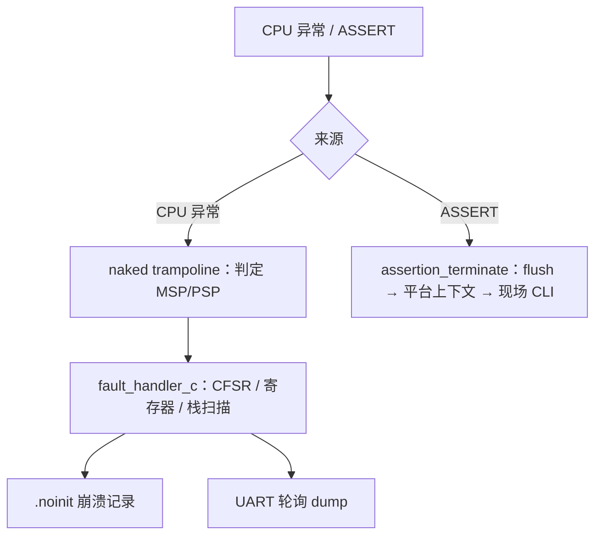

# 故障捕获与取证（Cortex-M7）

> 设计文档：CPU 异常 / 断言的捕获、记录与现场输出。当前 target：STM32H743 + MT29F4G08。
> 历史落地与上板验证记录见 [`../../archive/fault_capture_landing.md`](../../archive/fault_capture_landing.md)。
## 1. 问题：故障无声无息

跑板端 UT（UART CLI `test`）时经常"进系统级错误、断函数"，但串口上**什么都没打印**。原因有两层：

1. **异常处理器是空的**。`src/platform/stm32h743/stm32h7rsxx_it.c` 里 5 个 CPU 异常处理器全是裸 `while(1) {}` —— 无任何诊断输出，只能接 SWD 看寄存器。
2. **断言失败信息会丢**。断言路径打印后**不 flush 就停机**；日志走的是异步 UART TX 队列，由 DMA/中断排出，停机后队列再也不会被排空 —— 失败信息就卡在队列里，表现同样是"什么都没打印就断了"。修复后这一顺序收敛到断言设施 `assertion_terminate()` 里（`munit_errorf_ex` 经 `abort()` 重定向进入同一路径，见 `docs/design/common/munit_adapter.md` v1.2）。

## 2. 目标与范围

任何 CPU 故障或断言失败，都要在 UART 上打出**可读原因 + 出错地址 + 寄存器现场**，并写一份**跨软复位保留**的崩溃记录。

| 项 | 范围 |
|----|------|
| CPU 异常 | NMI / HardFault / MemManage / BusFault / UsageFault |
| 断言 | `ASSERT` / `ASSUME`（产品代码）+ munit 断言失败（测试代码，经 `abort()` 重定向） |
| 输出 | 轮询 UART（绕开 DMA/IRQ），不依赖 libc 格式化 |
| 持久化 | `.noinit` 崩溃记录，软复位后仍可读 |
| 停机语义 | dump 后 `while(1)` **保留现场**交给 SWD；IWDG 若开启则超时复位 |

**本次不做**（明确划界）：

- 不接 ITM/SWO/RTT（全工程无该通路）
- 不开 `CCR.DIV_0_TRP / UNALIGN_TRP`（会把除零/非对齐访问变成 UsageFault，可能影响既有代码）
- 不接线 SDRAM（`sdram_init()` 零调用且未上板验证）
- 不自动复位（保留现场优先；要看复位后记录就靠 `.noinit` + 手动 `NVIC_SystemReset`）

## 3. 架构

```
CPU 异常 (NMI/Hard/Mem/Bus/Usage)
      │  naked 蹦床：按 EXC_RETURN 选 MSP/PSP + 取 EXC_RETURN
      ▼
fault_handler_c(frame, exc_return)          [src/platform/stm32h743/fault.c]
      ├─ 读 SCB->CFSR/HFSR/MMFAR/BFAR/AFSR/SHCSR
      ├─ 解码为可读原因 + 打印堆栈帧 R0-R3/R12/LR/PC/xPSR
      ├─ 有界栈扫描 → 候选返回地址（poor-man's backtrace）
      ├─ 轮询 UART 同步输出（中断/DMA 已死也能出）
      ├─ 写崩溃记录（kind=FAULT）→ .noinit
      └─ weak fault_hook() → while(1) 停机

ASSERT/ASSUME 失败 (assertion_fail) ─┐
munit 断言失败 → abort() 重定向 ──────┴─→ 同一 crash_record_s + 同一 dump 格式
                                          （先 flush 异步日志，再轮询 dump）

开机：fault_report_boot() → RCC->RSR 复位原因 + 上次崩溃记录（走异步日志）
```




## 4. 模块清单

| 文件 | 角色 |
|------|------|
| `include/platform/stm32h743/fault.h` | `fault_kind_t`、`fault_ctx_s`、`fault_init/fault_report_boot/fault_hook` 声明 |
| `src/platform/stm32h743/fault.c` | 5 个 naked 入口 + 蹦床 + 主处理 + 轮询控制台 + 解码 + 开机报告 |
| `include/common/crash.h` | `crash_kind_t{NONE,ASSERT,FAULT,ABORT}`、`crash_fault_record_s`、`crash_record_s` |
| `src/common/crash.c` | `.noinit` 记录存储 + 校验和 |
| `include/common/assertion.h` | 生产断言 `ASSERT`/`ASSUME` + 富断言集 `ASSERT_*` + 失败入口声明 |
| `src/common/assertion.c` | 写记录 → 异步日志 → `assertion_terminate`（flush → 平台上下文 → `assertion_console_run` 现场 CLI）；固件 `abort()` 重定向 |
| `src/hil/cli.c` | 覆盖弱钩子 `assertion_console_run()`：正常 CLI 循环，不推进 FTL/FC 后台泵 |
| `src/fc/fc_assert_context.c` | 覆盖弱钩子 `assertion_platform_context()`，进入现场 CLI 前追加 `[RES]` FC 资源快照 |
| `linker/stm32h743xx_flash.ld` | 新增 `.noinit (NOLOAD)` 段，落 DTCM |
| `src/platform/stm32h743/sys.c` | `sys_init()` 末尾调 `fault_init()` |
| `src/platform/stm32h743/stm32h7rsxx_it.c` | 删除 5 个裸 `while(1)` 处理器（改由 fault.c 提供） |
| `src/main.c` | `sys_init()` + sink 绑定之后调 `fault_report_boot()` |

## 5. 关键设计

### 5.1 naked 蹦床：必须在 C 序言之前确定栈

异常入栈是硬件做的，但**入哪个栈**由 `EXC_RETURN`（进入异常时的 LR）决定。任何 C 函数的序言（压寄存器、调整 SP）都会覆盖寄存器，所以读栈指针这一步必须在 naked 函数里、用汇编完成：

```c
static void fault_trampoline(void) __attribute__((naked, used));
static void fault_trampoline(void)
{
    __asm volatile("tst   lr, #4          \n"   /* EXC_RETURN bit2：0=MSP 1=PSP */
                   "ite   eq              \n"
                   "mrseq r0, msp         \n"
                   "mrsne r0, psp         \n"
                   "mov   r1, lr          \n"   /* r1 = EXC_RETURN，供上层判 FPU 帧 */
                   "b     fault_handler_c \n");
}
```

5 个入口各自 `b fault_trampoline`（宏 `FAULT_ENTRY` 生成）。反汇编核对：

```
080182ec <fault_trampoline>:
 80182ec:  f01e 0f04   tst.w  lr, #4
 80182f0:  bf0c        ite    eq
 80182f2:  f3ef 8008   mrseq  r0, MSP
 80182f6:  f3ef 8009   mrsne  r0, PSP
 80182fa:  4671        mov    r1, lr
 80182fc:  f000 b810   b.w    8018320 <fault_handler_c>
```

**EXC_RETURN 相关位**：

| 位 | 含义 | 本工程取值 |
|----|------|-----------|
| bit2 | 0=MSP，1=PSP | 线程模式用 MSP（无 RTOS） |
| bit3 | 0=返回 Handler 模式，1=返回 Thread 模式 | — |
| bit4 | 0=叠加 FPU 扩展帧，1=无 FPU 帧 | **硬浮点（`-mfpu=fpv5-d16 -mfloat-abi=hard`），常态为 0** |

FPU 扩展帧（S0-S15/FPSCR/保留字）**排在**基本帧（R0-R3,R12,LR,PC,xPSR）**之后**，所以 `frame[0..7]` 的取法在有/无 FPU 帧时都成立；`fp_frame` 只作提示。

> **栈扫描窗口（2026-10-30）**：原 32 词只覆盖硬件异常帧（FP 扩展帧 0x88 B），
> 被中断函数自己的栈帧（含保存的 LR = 真正调用者）在它之上、落不进窗口。
> 已扩到 96 词，并把 **ITCM 热代码**（`.ssd_code_high`，VMA 0x0）也纳入候选，
> 行尾标 `[itcm]`。ITCM 区间的小整数噪声用「≥0x1000 且 Thumb 位为 1」压低。

> **出处（2026-10-14 核实）**：Zephyr `include/zephyr/arch/arm/cortex_m/exception.h` 的 `struct arch_esf` 把
> `struct __basic_sf {r0,r1,r2,r3,r12,lr,pc,xpsr}` 放在 `struct __fpu_sf {s[16],fpscr,undefined}` **之前**，
> 且故障路径直接用 `esf->basic.pc` 取出错 PC ⇒ **基本帧在低地址、SP 指向 R0**，FPU 帧在高地址。
> 这条结论是「PC/LR 可作证据」的前提：若排布反过来，`frame[6]` 读到的是 S6 而不是 PC，整个故障现场就是垃圾。
> 2026-10-30 板端按此解码得到的 PC/LR/R0..xPSR 与代码语义自洽，验证成立。

> **打印项（2026-10-30）**：除 R0-R3/R12/LR/PC/xPSR 外，现场还打三项，专门用于拆「对齐指令报
> UNALIGNED」这类不自洽的故障：
> - `R7(f)`：蹦床在 C 序言之前抓的出错上下文 R7（硬件只压 R0-R3/R12/LR/PC/xPSR，**不压 R4-R11**），
>   行尾直接标 8 字节对齐与否 —— 帧指针是普通 `ldr [r7,#off]` 的地址来源。
> - `code:`：PC 附近 10 个字的**实时内存内容**（ITCM/Flash/SRAM，不是 ELF 里的那份），行尾标 `<- PC`。
>   野写踩 ITCM 会让「跑着的指令」与符号表不一致 —— **2026-10-30 实测就抓到一次**：
>   `0x4220` 实时 `0x22016801` vs ELF `0x220168BB`（一字节 `BB→01`），`ldr r3,[r7,#8]`
>   变成 `ldr r1,[r0]`，而 `r0=0xFFFFFFFF` ⇒ 非对齐字读 ⇒ UNALIGNED。**帧、CCR、R7 全部正常，
>   唯一异常是指令字节**：没有这条打印，现场会一直指向被踩的受害者而不是写方。
> - 教训：`CONTROL.FPCA` 在 handler 态**恒被清零**（入异常时由硬件清），不能用来判扩展帧，
>   故不打；判扩展帧只看 `EXC_RETURN` bit4。

### 5.2 轮询控制台：故障时中断通路已不可信

正常日志走 `uart_log_write()` → 软件 TX 环 → DMA/USART 中断。故障现场可能就死在中断/DMA 里，这条通路必须绕开：

1. `fault_console_init()`：清 `USART1->CR1.TXEIE`、清 `USART1->CR3.DMAT`、abort `DMA1_Stream0`（有界自旋等 `EN` 清零），再按 `USART1->CR1.UE` 判断控制台是否可用。
2. `fault_putc()`：有界自旋等 `USART1->ISR.TXE` 后写 `USART1->TDR`。
3. `fault_console_drain()`：有界自旋等 `USART1->ISR.TC`，确保最后一位离开引脚再停机。

全部自包含，**不用 libc 格式化**（`fault_hex32`/`fault_dec`/`fault_puts` 自己实现），因此不依赖堆、不依赖 newlib。

> 若故障发生在 `usart_init()` 之前（`UE=0`），控制台不可用 —— 此时仍然照常写崩溃记录，只是不打印。

### 5.3 寄存器解码表

**HFSR**（`0xE000ED2C`）：

| 位 | 名称 | 含义 |
|----|------|------|
| 31 | FORCED | 由可配置故障升级而来 → **必须再看 CFSR 定位真因** |
| 1 | VECTTBL | 取向量时总线故障 |
| 0 | DEBUGEVT | 调试事件 |

**CFSR**（`0xE000ED28`）分三段：

| 段 | 位 | 名称 | 含义 |
|----|----|------|------|
| MMFSR (bit7:0) | 0 | IACCVIOL | 取指违反 MPU/XN |
| | 1 | DACCVIOL | 数据访问违反 MPU |
| | 3 | MUNSTKERR | 异常返回时出栈失败 |
| | 4 | MSTKERR | 异常入栈失败 |
| | 7 | MMARVALID | MMFAR 有效 |
| BFSR (bit15:8) | 0 | IBUSERR | 取指总线错误 |
| | 1 | PRECISERR | 精确数据总线错误（**PC 就是出错指令**） |
| | 2 | IMPRECISERR | 不精确（写缓冲，PC 可能已跑远） |
| | 3 | UNSTKERR | 出栈总线错误 |
| | 4 | STKERR | 入栈总线错误 |
| | 7 | BFARVALID | BFAR 有效 |
| UFSR (bit31:16) | 0 | UNDEFINSTR | 未定义指令 |
| | 1 | INVSTATE | 非法状态（如 EPSR.T=0） |
| | 2 | INVPC | 非法 PC 装载 |
| | 3 | NOCP | 无协处理器（未使能 FPU 却用 FP） |
| | 8 | UNALIGNED | 非对齐访问 |
| | 9 | DIVBYZERO | 除零 |

`fault_decode_cfsr()` 会把非零位打印成名字，`BFARVALID/MMARVALID` 置位时额外打印 `BFAR`/`MMFAR`。

> ⚠ **PC 落在 `0x5354414A` / `0x5354414B` 是栈哨兵 pattern**（`STACK_GUARD_PATTERN`
> = `0x5354414B`，"STAK" 的 ASCII），不是代码地址：说明某个保存的 LR / 函数指针
> 被栈填充值覆盖。已知案例：`stack_guard_init` 用入口 SP 作 `paint_hi`，release `-O2`
> 下会覆盖自己 `push` 的保存 LR（RISK-PLAT-04；PC 报 `0x5354414A` 是 Thumb 位清零）。

### 5.4 有界栈扫描

从出错 SP 向上扫 32 个字，落在 Flash 区间 `0x08000000..0x08200000` 的值当作候选返回地址打印（穷人的 backtrace）。

**安全约束**：SP 不在 DTCM（`0x20000000.._estack`）内就整个跳过 —— 避免用一个可疑的 SP 去读内存，触发二次故障进 Lockup。

### 5.5 持久化：`.noinit` 而不是 BKPSRAM

链接脚本新增：

```ld
.noinit (NOLOAD) : { . = ALIGN(8); KEEP(*(.noinit)) KEEP(*(.noinit.*)) } > DTCM
```

- `NOLOAD` → 不占 Flash、启动代码不清零（启动只清 `_sbss.._ebss`，在 AXI_RAM）
- 落 DTCM → 普通 SRAM，**软复位（`NVIC_SystemReset`）后保留**，硬复位/掉电不保留

为什么不用 BKPSRAM：`sys.c` 里已记录，本板 VBAT 未供电，备份稳压器永远无法就绪，使能它会卡死。

记录带 `magic + version + checksum`，`crash_record_get()` 三者都过才返回，否则视为脏数据。`version=2` 起 `checksum` 覆盖 `version/kind/line + 两段文本 + fault 负载全部字段`。

> 构建产物确认：`.noinit 248 0x20000000`（248 B = 5×4 + 96 + 96 + 9×4）。

### 5.6 异常停机语义

仅 CPU 异常（HardFault/MemManage/BusFault/UsageFault）走这里；ASSERT/abort 走
`assertion_console_run()` 的现场 CLI，不复位也不接管轮询控制台。

dump 完 `for(;;)`，**不主动复位**：

- 保留现场 → SWD 可继续看寄存器/内存
- IWDG 若开启 → 超时自然复位，复位后 `fault_report_boot()` 会打印 `RCC->RSR` 的 `IWDG` 标志 + `.noinit` 里的上次记录

### 5.7 开机报告

`fault_report_boot()` 在 `main()` 里 sink 绑定之后调用（**必须**，因为它走异步日志）：

- 打印 `RCC->RSR` 解码后的复位原因：`POR / PIN / BOR / SFT / IWDG / WWDG / LPWR`
- 有上次记录时打印摘要（FAULT：类型 + PC/LR/CFSR/HFSR；ASSERT：表达式 + file:line）
- 最后 `RCC->RSR |= RCC_RSR_RMVF` 清标志，让**下次**复位的原因不被这次污染

> 开机报告**不用**轮询控制台：`fault_console_init()` 会关掉 TX DMA/中断，在开机阶段这么干会把正常异步日志打断。

### 5.8 扩展点

```c
void fault_hook(const fault_ctx_s *ctx);   /* 弱符号，默认空实现 */
```

捕获到故障、落完记录、停机之前调用。留给上层接：复位前落 Flash、点亮故障灯、喂最后的看门狗等。

## 6. 已知限制

- **栈溢出型故障可能打不出来**：处理器本身跑在 MSP 上。若故障根因就是栈已经压穿 DTCM（`STKERR/MSTKERR` 或 SP 越界），入异常时压帧会再次失败 → 双重故障 → Lockup，连 dump 的机会都没有。这类只能靠 SWD 看 `CFSR`。`_sbrk` 堆守卫（`syscalls.c`）挡的是堆撞栈，不是栈自己溢出。
- **故障发生在 `usart_init()` 之前**：`UE=0`，控制台不可用，只写记录不打印。
- **`.noinit` 只跨软复位**：硬复位/掉电后记录丢失（VBAT 未供电，BKPSRAM 用不了）。
- **烧录 / 软复位都不清 `.noinit`**：记录只在**断电**时丢失。由此有两个陷阱：
  ① 同一份 dump 在多次复位后**原样重复打印**（连 SP/寄存器都相同）——这**不构成**
     「又崩了一次」；§3.3 的「又看到同一行」判据即指此。
  ② 重新烧录后看到的 dump 可能属于**上一份镜像**：用当前 ELF 解 `PC`/`LR` 会落在
     错的位置（症状：LR 落在毫无间接调用的函数中间）。
  复现步骤必须是：**烧录 → 拔电（不是按复位）→ 上电确认 `crash` 无记录 → 再跑**。
  ⚠ 横幅的 `__DATE__/__TIME__` 只在 **main.c 重编**时更新，增量构建下会过期，
  **不能**用它证明当前镜像（待引入真正的 build id）。
- **IMPRECISERR**：写缓冲导致的不精确总线错误，栈里的 PC 可能已经跑远，`PC` 不一定是出错指令。
- **轮询输出期间中断是关的**：dump 期间若还有别的故障源在跑，会直接锁死。这是"停机保留现场"语义的必然代价。
## 7. 日志设计（预期 / 条件预期 / 非预期）

> 来源：原独立文档 `logging_design.md`，已归档到 `docs/archive/logging_design.md`。
> 本节回答「哪些信息该打、哪些不该打、格式与落地状态」；故障取证流程仍见本文前九节。

> 目的：把「首次故障带全上下文、重复事件只留计数、状态变化立即打、周期性一行摘要」固化成规则。
> 样本来自 2026-10-21 H2testw 失败：Mode 5 运行期读回 UNC → GC 逐个 victim 标 BAD →
> `free` 耗尽 → host 读 FAT 元数据失败 → Windows Code 21；日志同时刷屏。

### 10.1 分类：预期 / 条件预期 / 非预期

- **E（预期）**：健康盘或已知降级状态下设计内会发生，代码有明确处置路径。
- **C（条件预期）**：只有明确前提成立时才算预期；前提不成立即升级为 U。日志必须带前提字段。
- **U（非预期）**：实现缺陷、系统性时序/介质问题，或设计没预料到的状态。

级别原则：**分类决定「要不要查」，级别决定「现在要不要人动手」**。预期但造成 host 可见失败的，仍可为 ERROR。

### 10.2 需要打的信息

| 类别 | 内容 | 级别 | 频率 |
|---|---|---|---|
| 启动 | reset reason、NAND ID/ONFI、**实际 timing mode**、FC 拓扑、FTL boot type、`[CAP ]`、`[BLK ] bad areas`、USB mounted | INFO | 一次 |
| 格式/体检 | start、每 512 块进度、done tested/bad、`old_bad/recovered/new_bad` | INFO/WARN | 进度 + 汇总 |
| 首次故障 | RR UNC/CRC：lba/pba/paa/g/plane/block/page/cw/retry/解码状态；program-fail；GC victim；erase-fail；dangling（非 BAD）；候选池/BBT 失败；CP abort；USB CSW | ERROR/WARN | 首次全上下文 |
| 状态变化 | format required/done、FORMAT_IN_PROGRESS、REBUILD_REQUIRED、GC pause/resume、free/spare/OP 跨水位、journal 水位、L2P degrade、timing switch | INFO/WARN | 变化时 |
| 搬移进度 | `[GC] start` 一行带触发上下文；逐 victim 的 `[MIG] move` 只在 DEBUG 打变化字段 | INFO / DEBUG | start 每会话一次；move 仅 `moved>0` |
| 周期摘要 | `[STAT]`：ch/t/free/bad/mig（活跃/暂停）；op/spare/cp/jrn/wr/dng/rrab/mode 见 `info`/`diag` | INFO | **10 s** |
| DEBUG | per-CP done、per-GC trig、wbuf flush、per-region load、ECC 趋势 | DEBUG | 默认关闭 |

### 2.1 `[STAT]` 字段

```
[STAT] ch=0 t=123s free=199 bad=284 mig=1/0 mv=0 nop=0
```

- `free`/`bad`：块分配与坏块；
- `mig`：active/paused（**不是 GC 次数**；GC 见 `[GC  ] progress/end` 与 `[MIG ] move`）；
- `mv`/`nop`：累计搬移 CW / 空块回收数；
- `op`/`spare`/`cp`/`jrn`/`wr`/`dng`/`rrab`/`mode` 已移到 `info`/`diag` 按需查看。

### 2.2 写轨迹飞行记录器

`alc_s` 内 64 条环形记录（`alc_trace_s`：seq/lba/pba/plane/block/page/cw/kind）。

- `kind=0` 写确认成功；`1` program fail；`2` GC 写。
- 首次 UNC（好块）或 program-fail 时 `alc_trace_dump(lba,pba)`：
  - 同一 PBA 出现两次 ⇒ **同页二次编程**；
  - 只出现一次 ⇒ 写后读坏（时序/介质）；
  - `kind=1` ⇒ 该次 program 失败。
- 平时不打印，RAM 约 1.3 KB。

### 2.3 事件日志（GC / MIG 生命周期）

> 文本格式是**本仓自拟**（没有公开的主控日志格式出处）；事件分层沿用本文档的
> “首次故障全上下文、重复事件只留计数、状态变化立即打、周期摘要一行”。

日志只带 `lba` / `pba` / `gblock` 身份和本事件结果；`ch/ce/lun/plane/block/page/cw/paa`
由串口 `map` / `addr` 按需展开（见 `../../guides/testing_guide.md`）。

| 事件 | 级别 | 落点 | 字段 | 频率 |
|---|---|---|---|---|
| `[GC  ] start` | INFO | `mig_gc_begin` | `reason trig mode free` | 每会话一次（仅选中有效 victim 时） |
| `[GC  ] progress` | INFO | `mig_handle` | `jobs moved rec noop abort free` | 仅会话有实际搬移时，5 s |
| `[GC  ] end` | INFO | `mig_handle` | `jobs moved rec noop abort elapsed` | 仅 `moved>0` 的会话收尾 1 行 |
| `[WL  ] start` | INFO | `mig_wl_begin` | `free writes` | 每个静态 WL job 1 行（只在 host 空闲档启动） |
| `[MIG ] move` | DEBUG（仅 `vcw>0`；空块完全不生成） | `mig_job_finish` | `k r trig src0 src1 dst0 dst1 v mv t` | 每个真实 victim 1 行，默认不输出 |
| `[MIG ] abort` | WARN（限流） | `mig_job_abort` | `kind g0 g1 phase page plane cause fc supp` | 首次/限流 |
| `[L2P ] job inflight` | INFO | `l2p_owner_flush_kick` | `load flush dirty` | 有在飞时 1 s |
| `[TRIM] start/done` | INFO | `ftl_trim_begin/step` | start `lba n`；done `n elapsed` | 每次控制面 TRIM |
| `[RR  ] unc` | ERROR（限流） | `rr_settle_plane` | `lba pba paa g pl bk pg cw retry st supp` | 首次故障 |
| `[RR  ] job` | INFO | `rr_handle` | `stage plane attempt retry stall age` | 卡住后 5 s |
| `[FTL ] predictive relocate retired` | WARN | `mig_job_finish` | `g` | 每次 predict 命中 |

空 victim（`vcw==0`）**不产生任何** `[MIG ] move`，也不会开启可见的 GC
会话；`[GC  ] progress/end` 只在 `moved>0` 时出现。`[GC  ] start` 每会话只打一次，
带 `reason/trig/mode/free`；逐 victim 的 `[MIG ] move` 降为 DEBUG，且只保留
`src/dst/v/mv/t` 等变化字段，避免大批搬移时重复打印同一上下文。
⚠ 不能用 `sel.best_valid_pct` 判断：它是域内**最低**有效率，存在任一空块就为 0。

CP / Journal 是高频元数据维护（CP 每次水位触发、JRN 每页/换块）：**不逐次打
start/rotate**；当前序号看 `info` 的 `cp=` / `jrn=`，异常仍按原 ERROR/WARN 输出。

### 10.3 不需要打（或降级/聚合）

| 事件 | 处理 |
|---|---|
| `[CP  ] start/done` 每次 CP | **不打**；`info` 给 `cp=` |
| `[JRN ] rotate` 每次换块 | **不打**；`info` 给 `jrn=`；仅错误行保留 |
| `[GC  ] trig` 每次评估 | DEBUG，5 s 一行（`GC_LOG_INTERVAL_MS`） |
| `[MIG ] read` / 逐页/逐 CW 细节 | **不打**（debug 也不打）；地址用 `map`/`addr` 查 |
| `[JRN ] flush` 每页 | **不打**（debug 也不打）；只保留 `rotate` 与错误行 |
| `[RR  ] start/done` 每次恢复 | **不打**；失败现场由 `[RR  ] unc`（限流）承担，卡住由 `[RR  ] job` 心跳承担 |
| `[GC  ] no-gain` | **DEBUG 边沿**：仅在首次进入「无可回收收益」时打；之后由写入/紧急状态解除，不得每次选块重试都打 |
| `[MIG ] victim read failed` 每块 | 单块 WARN；连续 ≥8 个不同 victim ⇒ **熔断** `mig.paused`（ERROR 一行） |
| `[FTL ] dangling` 每个 LBA | `st=BAD`：每个旧 gblock 一行 + `lbas=` 聚合；`FREE/LOG/NONE`：ERROR（缺陷） |
| `read unrecoverable ... already-BAD` | 每个 gblock 只打一次；其余计数进 `rrab` |
| `[L2P ] load start failed` | 按 cause 聚合，5 s 一行 |
| 每页/每 CW 读成功、ECC 趋势 | 只计数，不打 |
| `[MIG ] abort` / `write retry` | 保留限流；`no free block` 且 `moved==0` 不打印（满盘死路，不是搬移进展）；计数进 `info`/`diag` |

### 3.1 刷屏预算（本仓自拟）

- 115200 8N1 ≈ 11.5 KB/s；一条 100–150 B 的 INFO ≈ 9–13 ms 线速。
- 稳态 INFO 目标 ≤5 行/s（≤~600 B/s，约 5% 串口带宽）；突发必须由真实事件驱动。
- 一个 128 KiB victim 的搬移受 NAND 读/写/擦物理速率约束，真实 victim 的
  `[MIG ] move` 不会成为稳态刷屏源。
- 空 victim 只进 `noop=` 计数；DEBUG 也不做 per-page/per-CW。
- 重复异常继续用 `supp=` / `count=`。

### 10.4 消息格式

- 级别前缀固定 3 字符：`[ERR]` / `[WRN]` / `[INF]` / `[DBG]`。
- 模块标签固定 **4 字符宽**，右括号对齐，不足补空格：`[GC  ]` / `[MIG ]` /
  `[L2P ]` / `[JRN ]` / `[CP  ]` / `[RR  ]` / `[STAT]` / `[TRIM]` / `[PRED]` 等。
  `[FAULT]` / `[BOUND]` 是断言/故障类别，不参与模块标签对齐。
- 固定字段序：`lba pba paa g pl bk pg cw st retry count supp`；事件行只带本事件
  相关字段，其余靠紧邻行推导或 `map`/`addr` 查。
- FC 状态必须解码：`fc=0x48(READY|UNC)`，不裸给 hex。
- 每条 ≤ 192 B（`log_vprintf` 缓冲），超了会截断。
- 重复事件带 `supp=` 或 `count=`；关键事件带 `t=` / `wr=` 便于与 H2testw 进度对齐。

### 7.5 验证判据


1. H2testw 失败时，日志只出现：首次 UNC 一行（全字段）+ 最多 8 条 `[TRC ]` + 10 s 一条 `[STAT]`；不再逐 LBA/逐 CP/逐 GC 刷屏。
2. 已退役块被 host 反复读时，每个 gblock 只出现一次 `[RR  ] retired ...`，`rrab` 增长。
3. `[TRC ] dup>0` ⇒ 同页二次编程；`dup=0` ⇒ 写后读坏/时序。
4. 系统性读失败时，`[MIG ] victim read failed` 最多 8 行后出现 `suspend GC until reboot`，之后不再有 GC 触发。
5. GC 正常（INFO 档）只出现：每会话一行 `[GC  ] start`、5 s 一行 `[GC  ] progress`、有实际搬移的会话一行 `[GC  ] end`；逐 victim 的 `[MIG ] move` 只在 `log level debug` 出现，空 victim/无搬移会话不打印。
6. `log level debug` 下也不出现逐页/逐 CW 的 `[MIG ] read/move`、逐页 `[JRN ] flush`、逐次 `[RR  ] start/done`；`[GC  ] trig` ≤1 行/5 s。
7. 所有模块标签右括号在同一列（`[GC  ]` / `[MIG ]` / `[STAT]`）；`[FAULT]`/`[BOUND]` 例外。

## 8. 历史验证记录

- 落地日期、涉及模块、同期改动、上板验证步骤与验证清单见
  [`../../archive/fault_capture_landing.md`](../../archive/fault_capture_landing.md)。
- 本文只保留当前设计、已知限制与日志设计；验证结论以 archive 记录为准。
