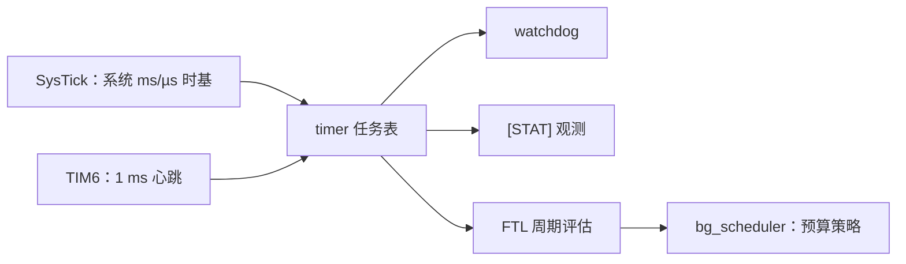

# 统一定时调度器（timer）

> 平台层只提供时间源（SysTick / TIM6）；任务表与派发在 timer，`bg_scheduler` 只负责预算，
> 不决定执行顺序。历史迁移过程见 [`../../archive/timer_migration.md`](../../archive/timer_migration.md)。
>
> 当前状态：已实现（未上板）；登记见
> [`../known_open_items.md`](../known_open_items.md) 的 `ISS-PLAT-04`。
## 1. 目标架构

```
platform：系统 ms/µs 时基 = ARM 核心 SysTick（HAL tick + VAL/LOAD）；
          timer 调度器心跳 = 基本定时器 TIM6（只 tick++）
timer    ：一张任务表 { fn, ctx, first_due, period, enabled, runs }
           main loop → timer_poll()
注册者  ：watchdog（静态）、[STAT]（动态）、FTL 每实例的周期评估（动态，ctx=ftl）
ftl_service：前台流水线保持显式顺序（confirm → cache confirm → host 补发 → …）
bg_scheduler：降级为**预算策略子引擎**（由 ftl_service 每轮调用，决定「做多少」）
```

分工：

- **timer 管「何时」**：一次性、周期、绝对时刻、取消/暂停/改周期；
- **bg_scheduler 管「做多少」**：档位、掩码、工作量配额、must-run；
- **`ftl_service` 管「按什么顺序」**：前台流水线的顺序不变量不交给调度器。




## 2. API

```c
typedef void (*timer_task_fn)(void *ctx, DWORD now_ms);

/* 相对首次延迟 + 周期；period_ms == 0 ⇒ 一次性 */
bool timer_add(timer_task_fn fn, void *ctx, DWORD first_delay_ms, DWORD period_ms, DWORD *out_id);

/* 绝对时刻（相位对齐用）；内部换算成 first_delay */
bool timer_add_at(timer_task_fn fn, void *ctx, DWORD first_abs_ms, DWORD period_ms, DWORD *out_id);

bool timer_cancel(DWORD id);
bool timer_set_period(DWORD id, DWORD period_ms);
bool timer_enable(DWORD id, bool enabled);
void timer_poll(void);
DWORD timer_now_ms(void);
WORD timer_task_count(void);
```

语义：

| 需求 | 参数 |
|---|---|
| 延迟 N ms 执行一次 | `first=N, period=0` |
| 每 M ms 周期执行 | `first=首次相位, period=M` |
| 绝对时刻 T 执行一次 | `timer_add_at(T, 0)` |
| 取消 / 暂停 / 改周期 | `cancel` / `enable` / `set_period` |

约束：

- **回调在 main 上下文执行**，不在 ISR；到期后在**下一次 `timer_poll()`** 执行。
  抖动 = 主循环一轮 + 前序任务耗时；不提供硬实时。
- **周期重装**：`next_due = prev_due + period`；落后超过一个周期时钳到 `now + period`，
  不追赶风暴（沿用 `btim.c` 的既有策略）。
- **一次性**：执行后 `enabled = 0`；动态槽可 `cancel` 回收。
- **ID**：`index + 1`，0 = 无效；`cancel` 后 ID 失效，复用槽位后旧 ID 属编程错误
  （debug `ASSERT`）。单线程 main 上下文，不引入 generation 计数。
- **重入**：回调可 `add/cancel`；`timer_poll` 每轮重新读槽位，已取消项（`fn == NULL`）跳过；
  回调内新增且 `first_delay=0` 的任务允许在同一轮稍后执行，文档写明。

## 3. 数据结构与时间基准

```c
#define TIMER_MAX_TASKS (64U)   /* 8 实例 × 4 个 FTL 周期任务 + 平台任务，留余量 */

typedef struct
{
    timer_task_fn fn;
    void         *ctx;
    DWORD         next_due_ms;
    DWORD         period_ms;   /* 0 = 一次性 */
    DWORD         runs;
    BYTE          enabled;
} timer_task_t;
```

- **系统时基 = ARM 核心 SysTick（ms + µs）**：ms 读 `HAL_GetTick()`，µs 在 1 ms
  窗口内用 `SysTick->LOAD/VAL` 插值（`delay_time_now_us` / `delay_time_now_us64`）。
  delay / usart / watchdog / TinyUSB / FTL 平台 `time_ms` 全部用它。
- **timer 调度器心跳 = 基本定时器 TIM6**：`g_timer_tick_ms` 只服务 timer 任务表的
  到期判定与 `timer_scheduler_now_ms()`；ISR 只 `tick++`，到期扫描在主循环。
  它与系统时基是**不同语义**：前者是「何时跑后台任务」，后者是「现在的系统时间」。
- **DWT 已删除**：DWT 是调试/跟踪单元，不是存储主控的产品块；本仓不再把
  `CYCCNT` 当时间源。NAND 忙期 / USB 分段计时改用 SysTick µs 时间戳。
- 回绕：32 位毫秒约 49.7 天；比较一律用有符号差 `(int32_t)(now - due) >= 0`
  （`timer.c` 的既有写法）。32 位 µs 约 71.6 min 回绕；超时一律用无符号差值。

### 4.1 定时器选型判据（TIM6 vs TIM2/TIM5）

- **「基本定时器 / 通用定时器」是 STM32 器件分类（RM0433），不是存储主控的架构判据。**
  本仓 `docs/reference/` 没有「SSD 主控只有基本定时器」的出处，不能把它写成行业标准。
  主控真正需要的是：单调时间源、周期 tick、watchdog、超时时间戳；这些由**功能**决定，
  不由定时器类别决定。
- **本仓选型**：timer 调度器只需要「能产生周期中断」，TIM6（basic）是满足要求的最小
  外设，不占用带输入捕获/比较输出的通用定时器。系统 ms/µs 时基由 ARM 核心 SysTick
  提供，不额外占定时器。**不使用 TIM2/TIM5。**
- **T2/T5 的唯一合理场景**：需要 32-bit 自由运行计数器（例如长周期 µs 时间戳）。
  本仓 µs 测量已由 SysTick 覆盖（1 ms 窗口插值 + 软件 ms 扩展），不需要 T2/T5。
  只有在「需要不依赖 SysTick 的 32-bit µs 自由计数器」时才重新评估，届时作为独立
  设计项登记。
- 测试：`ftl_ut_clock_install/set_ms/restore` 注入 `time_us` 与 `time_ms`
  （`tests/unit/ftl_ut_common.c`），纯 UT 可确定性地推进到期/周期/回绕。
- 容量：64 × sizeof(timer_task_t) ≈ 1.8 KiB `.bss`（DTCM/`.dtcm_data` 预算需复核）。
## 4. 不在本计划内

| 项 | 原因 |
|---|---|
| 抢占式调度 | 协作式主循环是数据面 poll-mode 的既有选择；需要抢占时另选 RTOS |
| ISR 上下文回调 | H21 已改为能力判据；本仓无 ISR-safe API 子集，现有回调仍放主循环 |
| µs 级硬实时 | 需要硬件比较中断 + ISR-safe 子集，单独设计 |
| flush/trim/待入账超时 | 事件 deadline，不是周期；继续用「起点 + 每轮比 elapsed」 |
| cache 序列 idle guard | 顺序约束：必须在 host 补发之前跑，留在 `ftl_service` |

## 5. 验证判据汇总

| 层级 | 判据 |
|---|---|
| 编译 | `make all` / `make release` / `make tests UT=FTL`，零新告警 |
| 纯 UT | 一次性/周期/绝对时刻/取消/暂停/改周期/回绕/落后钳位/回调内自取消；注入 `time_ms` / `time_us`（两者的产品来源都是 SysTick） |
| 上板：看门狗 | watchdog 不复位；`[STAT]` 每 10 s 一行（抖动 ≤1 轮）；CLI `timer` 表项与注册一致 |
| 上板：后台节拍 | `[GC] trig` ≥10 ms/次；WL 5 s、RR 1 s 仅 IDLE；`mv/nop/abort` 正常；H2testw 415/423 MB 0 错误；读写吞吐不低于基线；无 `confirm park timeout` 回归 |
| 上板：TIM6 心跳 | TIM6 1 ms 中断只 `tick++`；30 min 无 IWDG 复位；上述节拍不变 |
| 机械检查 | `grep -rn "btim" src include` 为 0；`timer` 头文件无同名冲突 |

## 6. 风险与登记

- **系统时基 = SysTick，timer 心跳 = TIM6**：`time_ms` / `time_us` 同源 SysTick；
  TIM6 只驱动 timer 任务表。**DWT 删除**，避免把调试/跟踪单元当产品时间源。
  登记到 `../known_open_items.md`（平台层 RISK-PLAT-09 / RISK-PLAT-12）。
- **`mig_handle` 拆分**：GC/WL/predict 的评估节拍从「handler 内部」变为「调度器行」，
  上板必须确认触发频率与 IDLE 条件不变（GC/性能风险条）。
- **容量 64**：`.bss` 约 +1.8 KiB，需复核 DTCM 预算；不足时降到 48 或静态/动态分池。
- **回调重入**：回调内 `cancel/add` 的边界要写进 `timer.h` 契约；UT 覆盖自取消与新增。
- **顺序**：`timer_poll()` 固定在主循环末尾；任何需要「在 host 补发之前」的步骤不得迁移。

---

## 7. 历史迁移

原 `btim` → `timer` 的迁移背景、逐阶段步骤与验收记录见
[`../../archive/timer_migration.md`](../../archive/timer_migration.md)；本文只保留当前设计。
