# FC 与 NAND 设计（软件 FCC）

> 本文描述 BASESSD 的 FC（Flash Controller）层与 NAND 底层——两者合起来是**一个硬件
> Flash Controller Core (FCC, 闪存控制器核心) 的软件替身**：它要解决的问题、模块边界、
> 数据结构、状态流转与失败语义。上游是 FTL（见 `docs/design/ftl_design.md`），
> 下游是 MT29F4G08ABADAWP 器件。
>
> 本文**只描述当前设计**。变更史与逐版本决策见 `docs/design/README.md` 的文档地图；
> 缺陷、未验证项与风险状态见 `docs/design/known_open_items.md`；测试覆盖见
> `docs/design/fc_nand_ut.md`。
>
> 图只表达结构与顺序，不替代不变量；表中的值必须能从代码推导。

---

## 目录

<!-- doc-policy: allow platform -->
- [0. 摘要](#s0)
  - [0.1 问题与约束](#s0-1)
  - [0.2 方案要点](#s0-2)
  - [0.3 范围与非目标](#s0-3)
  - [0.4 文档约定](#s0-4)
- [1. 需求、约束与总体设计](#s1)
  - [1.1 FC-NAND 在系统中的位置](#s1-1)
  - [1.2 分层模型与行业坐标](#s1-2)
  - [1.3 设计原则与导出约束](#s1-3)
  - [1.4 模块全景与数据流](#s1-4)
  - [1.5 接口总览与重要路径](#s1-5)
- [2. 介质、地址与数据布局](#s2)
  - [2.1 器件几何与容量](#s2-1)
  - [2.2 三套地址空间](#s2-2)
  - [2.3 PAA 编码](#s2-3)
  - [2.4 CW 布局与字段保护](#s2-4)
  - [2.5 flat CW 编号与位图](#s2-5)
  - [2.6 加扰与统计独立](#s2-6)
- [3. 模块设计](#s3)
  - [3.1 FC 控制面与公共接口](#s3-1)
  - [3.2 资源池与缓冲模型](#s3-2)
  - [3.3 命令、描述符与完成项](#s3-3)
  - [3.4 队列与完成队列](#s3-4)
  - [3.5 调度器与命令链](#s3-5)
  - [3.6 数据路径](#s3-6)
  - [3.7 Dispatch 桥接与防火墙](#s3-7)
  - [3.8 NAND UOP 引擎](#s3-8)
  - [3.9 FMC 硬件后端](#s3-9)
  - [3.10 ONFI 命令表与协议属性](#s3-10)
  - [3.11 器件模型、探针与器件级操作](#s3-11)
  - [3.12 Multi-plane 与器件扩展操作](#s3-12)
  - [3.13 拓扑、并发与多 LUN](#s3-13)
  - [3.14 ONFI 时序模式与 FMC PCC](#s3-14)
- [4. 端到端场景](#s4)
  - [4.1 上电初始化](#s4-1)
  - [4.2 一条命令的生命周期](#s4-2)
  - [4.3 按 CW 子集读](#s4-3)
  - [4.4 cache run 与同步等待](#s4-4)
  - [4.5 Feature 4B 内联读](#s4-5)
  - [4.6 Multi-plane 批次与页缓冲拼装](#s4-6)
- [5. 数据与状态模型](#s5)
  - [5.1 结构体关系](#s5-1)
  - [5.2 字段所有权与单写者](#s5-2)
  - [5.3 状态机总表](#s5-3)
  - [5.4 不变量清单](#s5-4)
  - [5.5 内存口径](#s5-5)
  - [5.6 断言与 release 拒绝判据](#s5-6)
- [6. 设计取舍索引](#s6)
  - [6.1 取舍索引](#s6-1)
  - [6.2 分层模型与接口判据](#s6-2)
  - [6.3 与行业主控的差距](#s6-3)
- [7. 已知限制与待办](#s7)
  - [7.1 未验证状态](#s7-1)
  - [7.2 已知限制](#s7-2)
- [8. 附录](#s8)
  - [8.A 常量、阈值与编译开关](#s8-a)
  - [8.B 结构索引](#s8-b)
  - [8.C 静默失效与证据判据清单](#s8-c)
  - [8.D 术语速查](#s8-d)

<a id="s0" name="s0"></a>

## 0. 摘要

<a id="s0-1" name="s0-1"></a>

### 0.1 问题与约束

主机与 NAND 之间隔着的不是一条命令通路，而是一整套主控机制：排队、描述符、缓冲生命周期、
编解码、时序与多平面。FC 层与 NAND 层要把这套机制在一个 MCU 上实现出来，并让上层 FTL
只看到「提交一条命令、拿回一份完成」。

目标器件是单 die SLC NAND：1 通道 × 1 片选 × 1 LUN × 2 plane × 2048 block × 64 page，
每页 4 个 code word (CW, 码字)，1 CW = 528 B（512 B 用户数据 + 16 B 保护字段），
ONFI 1.0 协议。

约束来自三端：

- **主机 / FTL**：按 512 B 扇区覆盖写；命令异步，要求完成可关联、失败可定位到 CW；
- **NAND**：按页编程、按块擦除，命令只能按 ONFI / 器件 datasheet 的时序与序列发出；
- **平台**：无外置 DRAM，片上 SRAM 有限；并口总线没有 DMA 请求线，也没有硬件 ECC 外设。

因此 FC + NAND 必须在软件里复现一个硬件 FCC 的执行模型：固定资源池、描述符链、
提交/完成队列、数据路径引擎、微码解释器与按 LUN 的调度。

<a id="s0-2" name="s0-2"></a>

### 0.2 方案要点

| 编号 | 要点 | 设计选择 |
|---|---|---|
| P1 | 分层替身 | FC 固件 + NAND 固件 = 一个硬件 FCC；策略（访问哪些 CW、数据怎么搬）全部在 FTL |
| P2 | 固定资源 | 命令 / 描述符 / 缓冲三池 + 空闲链表，16 位 ID 引用，分配释放 O(1)，无动态内存 |
| P3 | 执行模型 | SQ / HSQ / CQ + 门铃式提交 + 显式服务泵；单线程轮询，不用中断推进 NAND |
| P4 | 数据面 | 描述符链 → Dispatch 防火墙 → UOP 微码；数据阶段固定 PIO |
| P5 | 器件契约 | ONFI 1.0 命令表 + 器件扩展操作 + multi-plane；boot 后切 ONFI Mode 5 时序 |
| P6 | 并发 | 每 LUN 一条定深 4 的 FIFO + ISSUE / WAIT / FETCH 相位机，只重叠等待时间 |
| P7 | 可靠性 | 软件 BCH + CRC-32 + 加扰；RAID 功能代码完成但不编译（`CONFIG_FC_RAID = 0`） |

| 要点 | 主要章节 |
|---|---|
| P1 | §1、§6.2 |
| P2 | §3.2、§3.3 |
| P3 | §3.1、§3.4、§3.5、§4.2 |
| P4 | §3.6~§3.9 |
| P5 | §2、§3.10~§3.14 |
| P6 | §3.5、§3.13 |
| P7 | §3.6、§7 |

<a id="s0-3" name="s0-3"></a>

### 0.3 范围与非目标

本文描述 FC-NAND 的当前设计：需求背景、模块边界、数据结构、状态流转、失败语义与不变量。

不描述：

- FTL 的映射、GC、掉电恢复 → `docs/design/ftl_design.md`；
- 公共接口的逐字段契约 → `include/fc/fc_interface.h` 与 NAND 公共头（签名以头文件为准）；
- 测试套件、用例与运行方式 → `docs/design/fc_nand_ut.md`；
- 缺陷、风险与未验证项的当前状态 → `docs/design/known_open_items.md`；
- 变更史与逐版本决策 → `docs/design/README.md` 的文档地图。

**非目标**：不把平台边界当作实现选择来「优化」——单通道共享总线、无 DMA、无硬件 ECC
是目标平台的物理上限（§6.3、§7.2）。

<a id="s0-4" name="s0-4"></a>

### 0.4 文档约定

**单一权威**：同一事实只在本表指定的一处维护。

| 内容 | 唯一权威 | 本文写法 |
|---|---|---|
| 函数签名 / 结构定义 / 宏值 | FC 公共头与新 NAND 公共头 | 只给语义、字段分组与设计含义 |
| 器件几何 / 命令码 / 时序参数 | NAND 器件描述头 + `docs/hardware_contract.md` | 只给推导与用法；值标「定义在器件头」 |
| 测试项 / 用例 / 覆盖缺口 | `docs/design/fc_nand_ut.md` | 不写，§7.1 给链接 |
| 风险 / 未闭合项 | `docs/design/known_open_items.md` | §7.1 只给类别与链接 |
| 通用 FCC 知识与架构 ADR | `docs/design/controller_target_features.md`、`docs/design/storage_controller_design.md` | §6.2 只留本层接口判据 |
| HIL 分层细节 | `docs/design/hil_design.md` | §6.2.2 一行映射 |
| 阅读顺序 | `docs/design/README.md` | 本文不列 |

- **主流 / 本仓自选**：写「主流」必须能给出出处；说不出出处标「本仓自选」，不得写成
  行业标准。
- **平台细节**：FMC、PCC、器件时序属于本层的器件契约，保留在本文，用段内
  `doc-policy` 标注；板级事实（引脚、bank、时钟树）在 `docs/hardware_contract.md`。
- **章节引用**：`§x.y` 指向本文自身；跨文档引用写全文件名。

---

<a id="s1" name="s1"></a>

## 1. 需求、约束与总体设计

> 支撑摘要：P1、P3——FC-NAND 是什么、为什么这样分层、对外提供什么。

<a id="s1-1" name="s1-1"></a>

### 1.1 FC-NAND 在系统中的位置

FC 固件层是硬件 FCC 的**软件替身**：它提供槽位 / 描述符 / 队列 / 数据路径，
**不含策略**——访问哪些 CW 由 FTL 决定，数据搬运也由 FTL 做。

```text
┌──────────────────────────────────────────────────────────────┐
│ 上层：FTL（见 docs/design/ftl_design.md）                     │
├──────────────────────────────────────────────────────────────┤
│ FC 固件层                                                     │
│   公共接口     唯一公共头：类型 / 命令 / CQ / 布局 / API       │
│   FC 控制面    初始化、提交 / 填充 / 完成调度、服务主循环、诊断 │
│   资源与数据面 三池、空闲链表、建链与链释放、编解码管线         │
├──────────────────────────────────────────────────────────────┤
│ NAND 调度桥接   每 LUN 一条定深 FIFO（深 4）                   │
├──────────────────────────────────────────────────────────────┤
│ NAND 执行引擎   UOP 微序列解释器 + 异步事务                   │
│   器件级操作    RESET / READ_ID / 参数页 / 时序模式切换         │
├──────────────────────────────────────────────────────────────┤
│ NAND 协议与后端 ONFI 命令表、FMC 后端、器件模型                │
└──────────────────────────────────────────────────────────────┘
```

NAND 公共面规则：

- FC 只 include NAND 公共入口（几何 / 协议 / 器件 / 板级 / ONFI 的 umbrella）；
- FTL 只 include NAND 几何契约与 ONFI 协议头取几何与命令常量；
- 时序后端契约、NAND 板级私有契约等私有头留在 NAND 模块，FC 与 FTL 不得 include。

<a id="s1-2" name="s1-2"></a>

### 1.2 分层模型与行业坐标

行业 FCC 拿到的永远是**已解析的请求**：地址、数据缓冲与操作类型已经定好，
「访问哪些物理单元」「数据怎么搬」归固件。本仓照这个模型拆分：

| 行业部件 | 本项目 | 说明 |
|---|---|---|
| HIL | HIL 模块 + 主循环 | 主机前端、请求表示与路由；架构见 `docs/design/hil_design.md` |
| FTL | FTL 模块 | L2P、GC、磨损均衡、掉电恢复 |
| FCC（硬件） | **FC 模块 + NAND 模块** | 两者合起来才等于行业的一个硬件 FCC |
| DRAM | FC 缓冲池 + FTL 的 SRAM 数组 | DRAM-less：缓冲池就是片上页缓冲 |

FC 与 NAND 的分界是 FCC 的内部再拆分：

| 部分 | 职责 |
|---|---|
| NAND 模块（命令表 + 时序后端 + 器件模型） | 时序执行单元：发命令、等 R/B#、搬数据 |
| FC 模块（三池 + 描述符链 + 队列 + 数据路径） | FCC 前端：描述符链、队列、ECC / 加扰 / RAID |

完整的分层论证与接口判据见 §6.2。

<a id="s1-3" name="s1-3"></a>

### 1.3 设计原则与导出约束

五条设计原则：

1. **固定资源池 + 空闲链表**：三池在静态存储里，O(1) 分配释放，无动态内存。
2. **ID 引用代替指针**：池内资源一律 16 位 ID（全 1 = 无效）；跨模块接口传 ID，
   ID→指针转换只在 FC 内部发生。
3. **内部状态不外泄**：控制器结构与池账本只在 FC 内部契约可见，对外只有函数接口。
4. **异步非阻塞**：提交立即返回，推进全部发生在服务轮次里；取得完成由上层轮询。
5. **分层防火墙**：FC 只消费硬件真正需要的字段，FTL 概念（策略、数据搬运、
   完成路由）不进入 FC（§3.7、§6.2）。

约束来自平台：

| 约束 | 后果 |
|---|---|
| 无外置 DRAM，1 MB 内 SRAM | 缓冲池即页缓冲；池深度是硬预算（§5.5） |
| FMC 是共享总线控制器，无 NAND 专用 DMA 请求线 | 数据阶段只能 PIO；单通道无并行搬运（§3.9、§7.2） |
| 无硬件 ECC 外设 | 软件 BCH；纠错能力与吞吐受 CPU 限制（§3.6） |
| 主循环单线程、NAND 不用中断推进 | 服务泵必须显式、可重入性由单线程保证（§3.1） |

<a id="s1-4" name="s1-4"></a>

### 1.4 模块全景与数据流

| 模块 | 职责 | 章节 |
|---|---|---|
| FC 控制面与公共接口 | 初始化编排、服务入口、状态查询、公共契约 | §3.1 |
| 资源池与缓冲模型 | 三池、空闲链表、ID 与 buffer 归属 | §3.2 |
| 命令、描述符与完成项 | 命令配置、per-CW 描述符、状态与 CQ 条目 | §3.3 |
| 队列与完成队列 | SQ / HSQ / CQ 环形队列 | §3.4 |
| 调度器与命令链 | 填充轮次、链原子提交、链锁 | §3.5 |
| 数据路径 | 编码 / 解码管线与单 CW 原语 | §3.6 |
| Dispatch 桥接与防火墙 | 预解析请求、每 LUN FIFO、完成聚合 | §3.7 |
| NAND UOP 引擎 | 微码解释器与异步事务 | §3.8 |
| FMC 硬件后端 | 三个窗口、R/B# 轮询、PIO | §3.9 |
| ONFI 命令表与协议属性 | OP 码、UOP 序列、属性 helper | §3.10 |
| 器件模型、探针与器件级操作 | 几何、时序、RESET / READ_ID / 参数页 | §3.11 |
| Multi-plane 与器件扩展操作 | two-plane、cache、copy-back、页缓冲拼装 | §3.12 |
| 拓扑、并发与多 LUN | ISSUE / WAIT / FETCH 相位机 | §3.13 |
| ONFI 时序模式与 FMC PCC | 时序换算与切换 | §3.14 |

数据流：

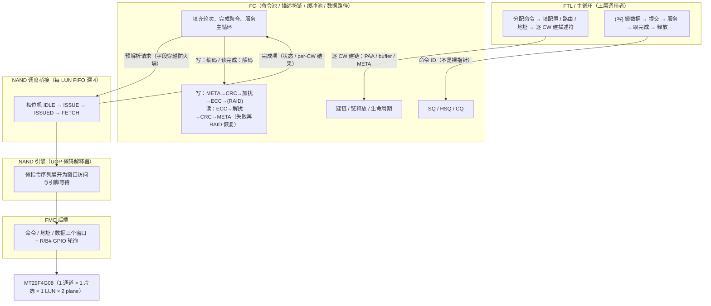

**读图要点**：越往下越贴近硬件；跨越 FC 与 NAND 引擎的只有硬件要消费的字段（§3.7 的防火墙）
——数据路径（编码 / 解码）留在 FC，不随请求过边界；完成项沿反向边回到填充分支。

<a id="s1-5" name="s1-5"></a>

### 1.5 接口总览与重要路径

外部只 include FC 公共接口。接口按语义分七组：

| 组 | 接口语义 |
|---|---|
| ① 初始化 | FC 初始化 |
| ② 命令生命周期 | 命令分配、建描述符（含带 buffer 版）、链释放、提交 / 批量提交、取完成、命令释放 |
| ③ buffer 访问 | buffer 分配 / 释放、取 USER 首址、取 CW 基址、取 META |
| ④ 数据查询 | 取命令数据指针、读命令 CW 位图、命令级 ECC 最大值、全 CW 空判据 |
| ⑤ 查询工具 | ID→命令 / 描述符、资源统计、调试状态快照、开机资源报告 |
| ⑥ 服务入口 | FC 服务 |
| ⑦ 启动编排 | NAND 初始化、NAND 高速模式、启动放行 |

三处边界语义：

- **失败只看「申请不到」**：资源耗尽 / 队列满返回资源码；参数与状态错误在 release 档
  返回 `INVALID_ARGUMENT`（debug 档先 `ASSERT`），配置错误绝不发到硬件。
- **建链失败不回滚**：链上已分配的 desc 全部属于该命令，调用方沿链释放即完整回收。
- **命令释放幂等**：重复释放 FREE 命令允许；越界或仍在飞的命令由池闸门拒绝且不释放资源。

**策略层不在 FC**：按掩码一次性建链与数据搬入 / 搬出都在 FTL。判据是硬件 FCC 的
寄存器表（§6.2.3）。

重要路径：

| 路径 | 入口 | 关键机制 | 场景 |
|---|---|---|---|
| 主机读 | FTL 组读命令 | 数据路径解码、CW 子集读 | §4.2、§4.3 |
| 主机写 | FTL 组写命令 | 编码管线、页缓冲拼装 | §4.6 |
| cache run | FTL cache 批次 | 命令链 + 链锁 | §3.5、§4.4 |
| 上电 | 主函数 | 初始化级联、探针、放行闩锁 | §4.1 |
| 恢复 | FTL boot / read retry | 高优先级队列、同步等待 | §4.4 |

---


<!-- /doc-policy -->
<a id="s2" name="s2"></a>

## 2. 介质、地址与数据布局

> 支撑摘要：P5、P7——器件几何、三套地址、CW 内布局与加扰目标；模块章只引用本章。

<a id="s2-1" name="s2-1"></a>

### 2.1 器件几何与容量

| 量 | 值 | 说明 |
|---|---|---|
| 页大小 | 2112 B | 主区 2048 B + 备区 64 B |
| 每页 CW | 4 | 每 CW 528 B（512 B 用户数据 + 16 B 保护） |
| 每块页数 | 64 | 擦除单位 |
| 每 plane 块数 | 2048 | 出厂坏块另计 |
| plane 数 | 2 | 行地址 BA6 选择 |
| LUN 数 | 1 | LUN 字段宽度为 0 |
| 通道 × 片选 | 1 × 1 | 命令级路由，不在介质地址内 |
| 原始容量 | 512 MiB | SLC，无 MLC/TLC 页类型差异 |

器件事实（几何 / 拓扑 / 地址位宽 / 行地址编码 / 器件 ID）定义在 NAND 器件描述头，
由构建选择器件；本文不复制宏值。软件布局常量（CW 数与 CW 大小、页缓冲大小）由几何契约
从器件事实推导，单一来源。

<a id="s2-2" name="s2-2"></a>

### 2.2 三套地址空间

同一颗芯片上有三套地址，**位序刻意不同**：

| | 低位优先布局 | 用途 | 定义方 |
|---|---|---|---|
| **PAA**（physical array address，物理阵列地址） | `[cw:2][page:6][plane:1][block:11][lun]` | 芯片地址；FC 层唯一的物理地址 | MT29F4G08 的 BA6 / PA 规则，不可改 |
| **PBA**（physical block address，物理块地址） | `[cw:2][plane:1][page:6][block:11][lun][ce:2][ch:2]` | 系统物理地址，FTL 内部使用 | 本仓自选 |
| **LBA**（logical block address，逻辑块地址） | `[ch:ce:lun:block:page:plane:cw]` | 逻辑地址，主机寻址单位 = 512 B 扇区 | 本仓自选 |

PBA 的字段序单独画一张（与上表逐字段一致；本器件 LUN 宽度为 0）：

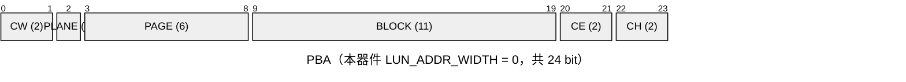

| 字段 | 位宽 | 本器件 bit 偏移 |
|---|---:|---:|
| CW | 2 | 0–1 |
| PLANE | 1 | 2 |
| PAGE | 6 | 3–8 |
| BLOCK | 11 | 9–19 |
| LUN | 0（本器件） | — |
| CE | 2 | 20–21 |
| CH | 2 | 22–23 |

> `packet-beta` 按网络约定 **bit 0 在左**。LBA 不单独画：它与 PBA 逐位同构，
> 区别只在视角（主机 LBA vs 系统 PBA）。

- **分界**：FTL 交 **命令 + PAA**。PBA 在 FTL 侧组合，在边界 PBA→PAA 转换一次转出；
  FC 层内不出现 PBA——PBA 带 ch/ce，而 FC 的路由独立走命令对象的
  `ch` / `ce` / `lun`；两套编码并存只会制造静默算错地址的机会。
- **PBA 与 LBA 逐位同构**：取 LBA 去掉 CW 位必须逐位等于 FTL 的内部逻辑地址，
  所以 PBA 的 plane 在 page **之下**（与 PAA 相反）。PAA 布局不动，PAA→行地址的
  器件编码保持 datasheet 要求。
- **PBA→PAA 转换是真正的字段重排**，不是掩码截取。
- **低 3 位共享编码**：`[plane:1][cw:2]` 在 PBA / LBA 空间通用，故描述符的 META 低 3 位
  与其 PAA 的 plane / cw 天然一致，数据路径拿它做自洽校验。PAA 的 plane 与 cw 不相邻，
  不参与这条技巧；建链用现成 helper 替换 plane 字段 / 替换 CW 字段。

**单一坐标**：跨层只允许一个转换漏斗（FTL 边界的 PBA→PAA）。现场手写位操作 = 缺陷。

<a id="s2-3" name="s2-3"></a>

### 2.3 PAA 编码

> 下方 `packet-beta` 按网络约定 **bit 0 在左**，与 C 代码低位在右相反；读图时注意方向。

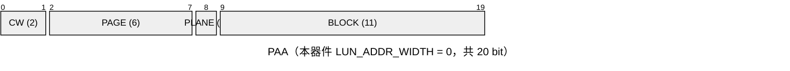

| 字段 | 位宽来源 | 本器件取值 |
|---|---|---|
| `cw` | 每页 CW 数的 log2 | 2 位，0..3 |
| `page` | 器件页地址宽度 | 6 位，0..63 |
| `plane` | 器件 plane 地址宽度 | 1 位，0..1 |
| `block` | 器件块地址宽度 | 11 位，0..2047 |
| `lun` | 器件 LUN 地址宽度 | **0 位**（LUN 数 = 1） |

**读图要点**：CW 在最低位、LUN 在最高位；LUN 宽度随器件推导，本器件为 0。

- **ch / ce 不在 PAA 内**：它们是命令级路由，住在命令对象的 `ch` / `ce` / `lun`。
- **命令对象只有一个物理地址字段**。凡需要行地址的地方（擦除 / Feature / 读 META /
  单 plane 数据 / 无描述符加载）都从它取；逐 plane 换 plane 位用替换字段 helper。
- **构造一律走具名字段结构体**：五个同型小整数按位置传参，写反了仍落在合法值域内
  （page < 64、plane < 2、block < 2048），会静默算出错地址；具名字段把这类错误变成编译错误。
- **PBA 构造在 FTL 层**：PBA 打包与字段视图也是具名字段结构体；PBA→PAA 是唯一
  跨层转换器。
- **PAA→行地址**产出三个行周期：页地址低 6 位、plane 进 bit 6、块地址进高位。
  CW 位在这个编码里被丢弃——列地址单独经列周期发送。

<a id="s2-4" name="s2-4"></a>

### 2.4 CW 布局与字段保护

一个 buffer 就是一个完整 CW，布局固定：

```text
┌────────────────────────── 528 B CW ──────────────────────────┐
│ [0:4)   [4:8)      [8:520)              [520:528)            │
│  META    CRC       USER（512 B）          PARITY              │
│ FC 管理  CRC-32    FTL 可见区             ECC 生成            │
└──────────────────────────────────────────────────────────────┘
   ▲                  ▲
   取 CW 基址          取 USER 首址（+8 偏移）
```

| 字节区间 | 字段 | 写入方 | 保护者 |
|---|---|---|---|
| `[0,4)` | META：本 CW 的扇区 LBA | FC 数据路径 | ECC + 步骤 4 自洽 / 精确比对 +（加扰开启时）种子耦合 |
| `[4,8)` | CRC-32（覆盖 USER） | FC 数据路径 | ECC——CRC 字段本身不自我覆盖 |
| `[8,520)` | USER 512 B | FTL 搬入 | ECC + CRC-32 |
| `[520,528)` | ECC parity | FC 数据路径 | ECC（它本身就是 ECC 的产物，没有第二层） |

各模块处理的数据范围——**边界不同，因为各自要解决的问题不同**：

| 模块 | 范围 | 写入 / 读取位置 | 理由 |
|---|---|---|---|
| CRC-32 | USER 512 B | 值写 `[4,8)` | 只保护用户数据 |
| 加扰 | `[8,520)` | 原地 | META / CRC 必须保持明文，读路径才能自举种子（§2.6） |
| ECC（BCH） | `[0,520)` → `[520,528)` | 输入 520 B，parity 写 8 B | 覆盖 META / CRC / USER |
| RAID XOR | 全 528 B | 原地读 | 保护含 parity 的整条 CW |

- 取 USER 首址返回 USER 区首址（FTL 用）；取 CW 基址返回 CW 首址（FC 数据路径用）。
- **加扰不含 parity**：parity 在 ECC 编码后才生成；加扰它会在解码前被 ECC 覆盖，白做。
- **"CRC 只盖 USER"是分工，不是漏**：误纠是整码字事件，落在 USER 的由 CRC 抓，
  落在 META 的由步骤 4 抓；步骤 4 在期望值已知时用逐位精确比对，检出率 100%，
  比 CRC-32 的 1 − 2⁻³² 更强。

四条读取路径的 META 保护矩阵：

| 路径 | 加扰 | CRC | 期望 META | META 靠什么查 |
|---|---|---|---|---|
| 主机数据读 | ON | ON | 已知 | 步骤 4 精确比对 |
| GC / 搬移读 | ON | ON | 未知 | 步骤 4 自洽 + 种子耦合 ⇒ CRC 失败 |
| 元数据页读 | OFF | OFF | 期望值 = plane / cw | 步骤 4 精确比对 |
| RAW 读 | OFF | OFF | — | 无——**刻意**（坏页也要原始数据） |

**行业对照**：T10 PI / DIF 的 guard 用 CRC-16，也只盖逻辑块数据；「地址对不对」靠
reference tag 与期望值比对，不靠 CRC——与本仓步骤 4 同一思路。判据不是「CRC 该盖哪些字节」，
而是「**这个字段出错时，能不能用别的手段发现**」：期望值已知 → 比对；期望值未知 →
需要**独立**校验；字段本身无冗余 → 只能靠 ECC。

⚠ **本仓差异点**：GC / 掉电重建路径（期望值未知）靠的是**种子耦合**这一加扰副产品，
没写进契约，加扰关闭即失效。行业在这里会放显式校验（独立 CRC / 序号 / 冗余存储）。

**`EMPTY` 的判据**：整条 CW（528 B）的 1 比特占比 ≥ 99%。阈值来自上界推导——
加扰页 ≈50%，不加扰的元数据页即便 USER 全 0xFF 也必写非 FF ⇒ 上界 ≈97%，擦除页 100%；
取 99% 既容忍擦除页读扰动，也不误判编程过的页。

`EMPTY` 只在**解码路径**产生：全 0xFF 不是合法 BCH 码字，解码必然失败；若不单独识别就会
报成 `UNC`，GC 读到半写块的空洞页时会把整块误标坏块。识别在解码失败之后进行，置
`EMPTY` 并跳过解扰 / CRC / META 三项校验。RAW 读跳过 ECC，不产生本状态。

<a id="s2-5" name="s2-5"></a>

### 2.5 flat CW 编号与位图

跨 FC / dispatch 边界只有**一个** CW 坐标：

```text
n = plane * CW_NUM + cw          （0 .. CW_TOTAL_MAX-1）
```

CW 位图是**字面位图**，编号用上面的 flat 绝对号：

| 项 | 取值 |
|---|---|
| 编号 | bit `n = plane * CW_NUM + cw`，覆盖全部 8 位（2 plane × 4 CW） |
| `0` | **空集**，不是「全部」。擦除命令就是空集；整段访问必须写整段位图 |
| 校验 | 位图校验唯一定义在两个整段入口共用；越出本命令 plane 位段 = 编程错误 |
| 消费点 | 请求的 `cw_bitmap` 与 `cw_buffers[n]`；完成的 `cw_status[n]` 与 `ecc_bit_count[n]` |
| 派生 | 列地址 = `(n % CW_NUM) * CW_SIZE`；行地址 = `plane_paa[n / CW_NUM]` |

示例：只读 plane 1 的 4 个 CW 是 `0xF0`；plane 0 取 {CW0, CW3} + plane 1 取 {CW1} 是
`0b0010_1001 = 0x29`。

描述符链的**建立顺序**是 plane-major，但没有任何消费点把它当坐标；落位按 `n` 独立进行
（§4.3）。

<a id="s2-6" name="s2-6"></a>

### 2.6 加扰与统计独立

加扰的唯一目标是让写入 NAND 的位串**统计独立**——给定全部历史，下一位仍是 1/2：

```text
P(bit = 1 | 前面所有位) = 1/2
```

这是**条件**概率。「无条件 1/2」（整串里 1 占一半，均衡）不等于独立：`0101…` 均衡，
但「上一位是 0」就必然推出「下一位是 1」——历史一暴露未来就定了。

| 序列（4096 bit） | 1 的个数 | 段数 | 平均段长 | 判定 |
|---|---|---|---|---|
| 全 0 / 全 1 | 0 / 4096 | 1 | 4096 | 极端有序 |
| `0101…` | 2048 | **4096** | 1.0 | **极端有序**（另一个方向） |
| 随机 | ≈2048 | **≈2048** | 2.0 | **目标** |

随机数据每一步有 1/2 概率翻转，故段数 ≈ 位数的一半、段长服从几何分布
`P(段长 = k) = 2^-k`——「均衡、游程均值 2、长游程稀少」全是独立的副产品，不是目标。

**为什么 `0101…` 对 NAND 反而有害**：

1. 零结构——用固定周期图案替换另一个固定图案，结构一点没少。
2. 单元间耦合（CCI）最坏——每个单元的邻居都与它状态相反。
3. 与阵列物理周期谐振——固定周期的图案与位线 / 字线 pitch 共振，产生**系统性、可复现**
   的错误；ECC 擅长随机错，系统性错误会整片超限。

实现上，加扰器（线性反馈移位寄存器）造一条「给定历史、下一位仍是 1/2」的伪随机序列，
与数据 XOR；种子取本 CW 的扇区 LBA（描述符的 META），读路径可从页内明文 META 自举。
游程统计的测法与判据盲区见 `docs/design/fc_nand_ut.md`。

---

<a id="s3" name="s3"></a>

## 3. 模块设计

> 支撑摘要：P1~P7。模块按依赖排序：上层调用者在前，被调用者与硬件在后。
> 每个模块固定七段：背景与需求 / 职责与边界 / 结构与不变量 / 流程 / 失败语义 /
> 设计取舍 / 常量与阈值。

<!-- doc-policy: allow platform -->
| 层次 | 模块 | 一句话 |
|---|---|---|
| 控制面 | 3.1 FC 控制面与公共接口 | 初始化、服务入口、状态查询、公共契约 |
| 资源 | 3.2 资源池与缓冲模型 | 三池、空闲链表、ID 与 buffer 归属 |
| 命令 | 3.3 命令、描述符与完成项 | 命令配置、per-CW 描述符、状态与 CQ 条目 |
| 队列 | 3.4 队列与完成队列 | SQ / HSQ / CQ |
| 调度 | 3.5 调度器与命令链 | 填充轮次、链原子提交、链锁 |
| 数据面 | 3.6 数据路径 | 编码 / 解码管线与单 CW 原语 |
| 桥接 | 3.7 Dispatch 桥接与防火墙 | 预解析请求、每 LUN FIFO、完成聚合 |
| NAND 执行 | 3.8 NAND UOP 引擎 | 微码解释器与异步事务 |
| NAND 执行 | 3.9 FMC 硬件后端 | 三个窗口、R/B# 轮询、PIO |
| NAND 协议 | 3.10 ONFI 命令表与协议属性 | OP 码、UOP 序列、属性 helper |
| NAND 器件 | 3.11 器件模型、探针与器件级操作 | 几何、时序、RESET / READ_ID / 参数页 |
| NAND 扩展 | 3.12 Multi-plane 与器件扩展操作 | two-plane、cache、copy-back、页缓冲 |
| 并发 | 3.13 拓扑、并发与多 LUN | ISSUE / WAIT / FETCH 相位机 |
| 时序 | 3.14 ONFI 时序模式与 FMC PCC | 时序换算与切换 |
<!-- /doc-policy -->

<a id="s3-1" name="s3-1"></a>

### 3.1 FC 控制面与公共接口

#### 3.1.1 背景与需求

FTL 需要一个单一入口：初始化、提交、取完成、查询状态。FC 内部有多个编译单元
（池、队列、调度、数据路径、诊断），但对外只能有一条契约面——否则私有结构会泄漏到
FTL，边界逐渐消失。

#### 3.1.2 职责与边界

**做**：初始化编排、提交与填充轮的驱动、完成聚合、服务主循环、状态查询、公共头的维护。
**不做**：不决定访问哪些 CW（FTL 建链）、不搬用户数据（FTL 拷贝）、不实现 ECC 算法
（数据路径与引擎）、不直接碰 NAND 器件（dispatch 与引擎）。
**上游**：FTL / HIL / 主循环；**下游**：池、队列、调度器、数据路径、dispatch。

#### 3.1.3 结构与不变量

- **控制器单例**只存指针：三池、三条队列、调度器、统计计数器的本体都是文件作用域
  静态数组，地址在链接期固定；控制器结构本身定义在 FC 内部契约，FTL 不可见。
- **公共头是唯一契约面**：基础类型、命令 / 描述符 / CQ 结构、池与队列深度、布局常量、
  对外 API 与启动入口。接口组见 §1.5。
- **私有头不对外**：池、队列、控制器、数据路径、引擎、NAND 契约各自独立；构建只给
  FC 对象加私有 include 路径。

**不变量**：

1. **先清零后挂指针**：初始化先 memset 控制器与静态数组，再挂指针；上电残留不进入池状态。
2. **无软件寄存器影子**：队列用量与池用量直接读实时结构，不维护第二份计数。
3. **统计只读**：资源统计的 used 字段来自分配 / 释放闸门的 O(1) 计数器；debug 档额外
   全池扫描校验，但**不得用于断言或故障路径**（不一致时二次断言会让终端递归）。
4. **服务入口唯一**：所有推进都经 FC 服务；没有“只推进某条命令”的旁路。

#### 3.1.4 流程

**FC 初始化**（单次，无失败路径）：

| 步 | 动作 | 之后 |
|---|---|---|
| ① | 控制器与统计清零；三池 memset、挂静态数组指针、串三条空闲链表、命令状态表清零（`fc_pool_init`） | 资源内存干净、池可分配 |
| ② | 队列存储与返回暂存清零；SQ(64) / HSQ(16) / CQ(64) 初始化 | 队列可用 |
| ③ | 调度器绑定 SQ / HSQ 指针 | 可填充 |
| ④ | dispatch 初始化（纯 memset + 关放行闩锁）；`CONFIG_FC_RAID` 开启时初始化 LUN RAID 上下文 | **唯一 NAND 侧依赖**，不碰总线 |
| ⑤ | CRC 引擎初始化 | 数据路径可用 |
| ⑥ | `CONFIG_FC_RAID` 开启时清零 stripe 积累状态 | 编译期分支 |
| ⑦ | 统计注册（`SSD_STATS_ENABLE`） | 观测可用 |

**服务轮次**（一次 FC 服务）：

```text
① 推进 NAND：dispatch 轮询 → 完成回写（本轮完成数计入 delivered）
② 同一轮继续填充：先 HSQ 再 SQ，按 LUN 保序提交（不因有完成而提前返回）
③ 无完成且两队列皆空 → QUEUE_EMPTY；无完成、队列非空但无 LUN 可放 → NOT_READY
④ 下发失败 / CQ 满 / 时间源缺失 → IO_ERROR；失败命令统一合成 NAND_FAIL 完成
```

调用方三选一：主循环泵（controller 非 READY 时裸调）、FTL 实例服务（每轮 ≤ 服务预算）、
FTL 同步提交等待（仅结构性顺序路径：boot / format / 扫描 / CLI）。

#### 3.1.5 失败语义

| 情形 | 行为 |
|---|---|
| 初始化 | 无失败路径；NAND 初始化失败由启动级联处理（§4.1） |
| 队列空闲 | 返回 `QUEUE_EMPTY`，不是错误 |
| CQ 满 | 完成回写标记命令 COMPLETED 防泄漏，置 sticky fatal，返回 `IO_ERROR`——后续服务轮次只报 fatal |
| 时间源不可用 | dispatch 报 fatal；服务轮次不再推进 |
| 未放行 | dispatch 提交返回 `INVALID_ARGUMENT`；初始化探针走直连路径（§4.1） |
| controller 非 READY | 主循环退化为裸 FC 服务，FC / NAND 裸路径保持可用 |

#### 3.1.6 设计取舍

| 选择 | 主流对照 | 理由 |
|---|---|---|
| 显式服务泵，单线程轮询 | 企业主控是硬件队列 + 固件调度器 / 中断 | MCU 无多队列硬件；显式泵使推进可确定、可重放，符合「控制器自跑」在软件里的显式化 |
| 单一公共头 | 主控对外是一组寄存器表 | 判据是硬件 FCC 寄存器表（§6.2.3）；不按「裸池原语」重构（反例见 §6.2.5） |
| 无影子寄存器 | 主流控制器用状态寄存器 | 软硬件同源时，影子寄存器会变成第二套真值；直接读结构更短 |
| 不把 FC 整体下沉到 FTL | DRAM-less 主控的 buffer manager 在控制器侧 | 请求自包含要求「造请求者拥有 buffer 池」（§3.7） |

#### 3.1.7 常量与阈值

| 常量 | 值 | 含义 |
|---|---|---|
| 命令池深度 | 64 | 覆盖一个块的全部页，支持流水提交 |
| 描述符池深度 | 256 | 最多 32 条满额命令同时在链 |
| 缓冲池深度 | 128 | 最多 16 条满额命令同时持有数据 |
| 链长上限 | 4 | 等于每 LUN FIFO 深度 |
| 服务预算 | 4 次 FC 服务 / 轮 | 单轮不让后台饿死前台 |

<a id="s3-2" name="s3-2"></a>

### 3.2 资源池与缓冲模型

#### 3.2.1 背景与需求

NAND 命令是异步的：命令、描述符与数据缓冲的生命周期跨越多次服务轮次。没有动态内存，
又要 O(1) 分配释放、可校验的归属——固定池 + 空闲链表是唯一同时满足三者的做法。

#### 3.2.2 职责与边界

**做**：三池的分配 / 释放、三本账、建链与链释放、buffer 归属（谁申请、谁释放）。
**不做**：不决定某条命令需要几个 CW（FTL 建链）、不编码用户数据（数据路径）、
不推进硬件（dispatch）。

#### 3.2.3 结构与不变量

| 资源池 | 深度 | 元素 | 用途 |
|---|---|---|---|
| 命令池 | 64 | 24 B 命令控制块 | 对应一个提交槽位 |
| 描述符池 | 256 | 20 B per-CW 描述 | 地址 + buffer + 状态 |
| 缓冲池 | 128 | 528 B（一个 CW） | CW 数据缓冲 |

- **64 命令**覆盖一个块的全部 64 页，支持流水提交。
- **256 描述符**：一条命令的 desc 数 = CW 位图置位数（最多 8）⇒ 最多 32 条满额命令同时在链。
  真正的并发上限由 desc / buffer 决定，不是命令池的 64。
- **128 缓冲**：与描述符 1:2；一条满额命令占 8 个 buffer ⇒ 并发上限 16 条满额命令。

池外还有一组**簿记数组**（本体是池模块的文件作用域数组，控制器只存指针）：

| 数组 | 深度 | 用途 |
|---|---|---|
| 三条空闲链的 next | 64 / 256 / 128 | 下标即 ID；分配取头、释放头插 |
| 命令状态表 | 64 | 生命周期状态（FREE / ALLOCATED / QUEUED / ACTIVE / COMPLETED） |
| 描述符归属表 | 256 | desc → 归属命令 ID，提交校验与统计的 O(1) 反查 |
| buffer 状态 / 归属表 | 128 | 占用状态与归属命令（未挂链 = 无效），释放闸门用它拒绝双释放 |

**不变量**：

1. **desc 出池即挂链**。建链顺序是 *分配 desc → 填字段 → 挂链 → 分配 buffer*。
   buffer 池（128）小于 desc 池（256），「desc 成功而 buffer 失败」是最现实的失败路径；
   把挂链放在 buffer 分配之前，链就恒是「所有已分配 desc 的完整记录」——任何一步失败后
   沿链释放即完整回收，**不需要回滚逻辑**。代价是链上允许出现「无 buffer」的 desc，
   走链的读者必须容忍。
2. **池闸门单点**：入池 / 出池只经池模块的闸门与账本访问器；四本账不得各自手工维护。
3. **ID 唯一且可校验**：16 位 ID，全 1 为无效；ID→指针只在 FC 内部发生。
4. **命令释放幂等**：FREE 状态重复释放允许；越界或仍在飞的命令由闸门拒绝且不释放资源。

**buffer 归属**（命令配置的两位字段记录「谁申请、谁释放」）：

| 值 | 申请 | 释放 | 用途 |
|---|---|---|---|
| `00` | FC | 上层 | 读命令，上层拿到 buffer 并掌控生命周期（**默认**） |
| `01` | FC | FC | 读命令，只要命令状态 |
| `10` | 上层 | 上层 | 上层把控数据的场景 |
| `11` | 上层 | FC | 写命令等，只要命令状态 |

- **`00` 是默认值**：命令出池整体清零 ⇒ 未显式设置的命令恒走 `00`，即既有生产行为。
- **申请方 = 上层**时，调用者先 buffer 分配，再经带 buffer 建描述符传入；FC 建链时不申请。
  申请位与实参必须一致，否则是配置错误。
- **释放方 = FC** 时，完成回写在组装完 CQ 条目之后沿 desc 链归还全部 buffer，
  并把各 desc 的 buffer 引用抹成无效。抹无效使归还**幂等**：完成时已归还 ⇒ 随后的命令释放
  跳过；命令没走到完成 ⇒ buffer 仍有效 ⇒ 链释放照常归还。
- **命令释放恒归还链上所有未归还 buffer**，不管谁申请的。

⚠ **契约**：`01` / `11` 档命令完成之后，上层不得再取该命令的数据指针或 CW 基址——
buffer 已归还、引用已失效。

#### 3.2.4 流程

```text
分配命令：取命令池 head → 推进 next → 置 ALLOCATED
建链：逐 CW 分配 desc → 填 PAA / meta / 配置副本 → 挂到链尾 → 分配 buffer → 填 buffer_id
提交：命令 → QUEUED；描述符归属表可反查
释放：沿 desc 链 → 归还未归还 buffer → 归还 desc → 归还命令 → 置 FREE
```

#### 3.2.5 失败语义

| 情形 | 行为 |
|---|---|
| 池耗尽 | 返回资源耗尽码；不产生半成品资源 |
| 建链中途失败 | 链上已有 desc 属于该命令，调用方沿链释放即完整回收；链释放本身不释放命令槽位 |
| buffer 申请失败 | 链上已有「无 buffer」desc；链仍完整，释放路径容忍 |
| 双释放 | 闸门按归属表拒绝，不改变任何账 |
| buffer 泄漏 | 症状不是报错，而是可用 buffer 越来越少 ⇒ 上层表现为持续 `AGAIN`；池账本是唯一判据 |

#### 3.2.6 设计取舍

| 方案 | 判据 | 结论 |
|---|---|---|
| `buffer_id` + ID 池 | 生命周期有主：buffer 池是唯一 owner，ID 在池内可校验 | **采用** |
| 裸数据指针 | 上层持指针跨异步完成，完成时 buffer 可能已归还（UAF） | 否决 |
| 双模（ID 或指针二选一） | 两套生命周期语义并存，调用点必须知道自己在哪一档 | 否决 |

这也是 DRAM-less 主控的主流做法：内部 SRAM buffer pool + ID，控制器在命令 retire 时
归还 free list；有 DDR 的企业级方案传物理地址 / SGL、控制器从不 free——那需要主机侧内存语义，
本仓没有。

**为什么不需要引用计数**：真实主控的 buffer manager 通常带 refcount，因为同一个 buffer 被
流水线多级引用（ECC 引擎 / DMA 引擎 / 固件）。本仓 buffer 是**单引用**——只有 desc 链持有它，
所以「0/1 占用位 + 一次显式归还」就够。

**buffer 与 desc 解耦**：通过 buffer 引用关联，buffer 可先于 desc 释放（如不可纠读时）。

#### 3.2.7 常量与阈值

| 常量 | 值 |
|---|---|
| 命令 / 描述符 / 缓冲池深度 | 64 / 256 / 128 |
| buffer 单元 | 528 B（一个 CW） |
| ID 位宽 / 无效值 | 16 位 / 全 1 |
| USER 区偏移 / 长度 | 8 B / 512 B |
| 加扰与 ECC 输入长度 | 520 B |

<a id="s3-3" name="s3-3"></a>

### 3.3 命令、描述符与完成项

#### 3.3.1 背景与需求

一条命令要同时表达三件事：执行什么（操作与编码配置）、访问哪里（路由与物理地址）、
数据在哪（逐 CW 的描述符链）。完成后还要回答：成功与否、哪个 CW 失败、纠正了多少位。

#### 3.3.2 职责与边界

**做**：命令控制块与配置位域、创建 / 链接描述符、per-CW 状态与 ECC 回写、命令级聚合、
完成项结构。
**不做**：不决定命令类型与位图（FTL）、不搬数据（FTL）、不执行操作（dispatch / 引擎）。
**上游**：FTL；**下游**：池、调度、数据路径、dispatch。

#### 3.3.3 结构与不变量

**命令控制块**（24 B，静态断言钉住）：

| 分组 | 字段 | 含义 |
|---|---|---|
| 身份 | 命令 ID / 链头 desc ID | 槽位号；链头全 1 = 无 |
| 控制 / 路由 | 高优先级位、Feature 地址、ch / ce / lun | Feature 地址经列周期发送 |
| 配置 | 32 位打包配置 | 见下表 |
| 地址 | PAA | 芯片物理地址（§2.3） |
| 元数据 | 扇区 LBA | 全 1 = 未知（GC / 重建） |
| 参数 | 4 B 联合体 | 内联参数 / 返回段；位域不能取地址，故用联合体 |

**命令级配置位域**：

| 字段 | 位宽 | 含义 |
|---|---|---|
| 操作码 | 8 | ONFI 操作码 |
| CW 数 | 2 | 每 plane 的 CW 数减一；**只有 RAID stripe 读它** |
| CRC 模式 | 1 | 0 = 使能 |
| ECC 模式 | 2 | 0 = 正常（BCH） |
| RAID 模式 | 3 | 0 = 正常；ENCODE = 条带累积 |
| 加扰模式 | 1 | 0 = 使能 |
| 链模式 | 1 | 0 = END / 1 = MORE |
| 页类型 | 2 | LP / MP / UP / TP；解码阈值预留 |
| multi-plane | 3 | 0 = 单 plane；N = N-plane |
| buffer 归属 | 2 | 谁申请、谁释放（§3.2.3） |
| 保留 | 7 | 必须为 0 |

**描述符**（20 B）：per-CW 的 PAA、配置副本、buffer 引用、链 next、META、平面内 CW 号、
状态与 ECC 位数。

- **平面内 CW 号与命令的 CW 数语义不同**：前者是索引，后者是数量减一；两者都由 2 位域承载。
- **META 每 CW 独立**：建链时由扇区 LBA 铸出，把 plane 写进低 3 位，使同页 4 条 CW 的 META
  互不相同；程序时写入 META 区，读回时由数据路径比对，不等即 `META_ERROR`。
- **状态与 ECC 回写**：NAND 完成时 FC 把 per-CW 的状态与纠正位数回写到描述符，
  **对所有带 desc 的命令（含 program）都做**。FTL 遍历链即可拿到逐 CW 细节——
  Read Retry 与 RAID 恢复都靠它，CQ 不携带。
- **buffer 与 desc 解耦**：通过 buffer 引用关联，buffer 可先于 desc 释放。

**per-CW 状态位**：

| 位 | 名 | 含义 |
|---|---|---|
| 0 | `FC_CW_STATUS_FAIL` | 70h FAIL（后一次读状态）：该 CW 的 NAND 操作失败 |
| 3 | `FC_CW_STATUS_RAID_ERROR` | RAID 恢复失败 |
| 4 | `FC_CW_STATUS_META_ERROR` | META 校验错误 |
| 5 | `FC_CW_STATUS_CRC_ERROR` | CRC 校验错误 |
| 6 | `FC_CW_STATUS_UNC` | 不可纠正错误 |
| 7 | `FC_CW_STATUS_EMPTY` | 空页（从未编程）；**不是错误位** |

错误掩码 = FAIL | RAID | META | CRC | UNC，**不含 EMPTY**。判成败一律经 CW 状态判错。

**命令级状态位**：

| 位 | 名 | 含义 |
|---|---|---|
| 0 | `FC_CMD_STATUS_NAND_FAIL` | 70h FAIL（后一次读状态） |
| 1 | `FC_CMD_STATUS_FAIL_CACHE` | 70h FAILC（上一页 cache program） |
| 2 | `FC_CMD_STATUS_TIMEOUT` | 忙等超时 |
| 3 | `FC_CMD_STATUS_DATA_ERROR` | 任一 CW：UNC / CRC / RAID（类别看 desc） |
| 4 | `FC_CMD_STATUS_META_ERROR` | 任一 CW：META |
| 5 | `FC_CMD_STATUS_AREADY` | 70h ARDY（器件状态，不参与成败） |
| 6 | `FC_CMD_STATUS_RDY` | 70h RDY（器件状态，不参与成败） |
| 7 | `FC_CMD_STATUS_WP` | 0 = protected，1 = not protected（器件状态） |

命令错误掩码 = NAND_FAIL | FAIL_CACHE | TIMEOUT | DATA_ERROR | META_ERROR。

**成功判据**：后一次读状态的 FAIL / FAILC 全 0，且无超时与数据路径错误，
**不是 RDY**。

**两个 70h 采样点**：操作前读状态给 RDY / ARDY / WP，操作后读状态给 FAIL / FAILC。
⚠ 后一次读状态不一定是 70h：块锁状态命令的 7Ah 字节也经状态输出进 `nand_status`，
其 bit0 是锁状态而不是 FAIL，FC 不按 FAIL / FAILC 映射该操作，只由执行结果判成败。

**完成项**（8 B）：命令 ID、命令级状态、保留、4 B 返回段。CQ 条目**只带命令级信息**：

- 不带完成服务函数选择器——FTL 用命令 ID 从自己的请求表取上下文与操作类型；
- 不带 per-CW 状态 / ECC / 失败位图——这些都在描述符链上；
- SQ 提交后不可变：GET_FEATURES 一类返回值经控制器侧暂存中转进返回段（§3.7.4）。

**返回码**分三层：

| 码 | 谁的问题 | 该怎么办 |
|---|---|---|
| `OK` | — | — |
| `INVALID_ARGUMENT` | 调用者写错（bug） | 不重试 |
| `QUEUE_FULL` / `QUEUE_EMPTY` / `NOT_READY` / `RESOURCE_EMPTY` | 此刻不行，条件会变 | 可以等 / 重试 |
| `IO_ERROR` | 数据 / 硬件真的坏了 | 重试同一操作没用，换手段（read retry / RAID / 换块） |
| `NOT_SUPPORTED` | 这条路没实现 | **不是失败**（如 ECC 无可纠能力时按「成功但零纠正」处理） |

本仓返回 `IO_ERROR` 的情形分四类：

| 类 | 情形 |
|---|---|
| 介质 / ECC | 读路径有 CW 不可纠（短路返回）；RAID 重建后仍失败；BCH 无 ≤ t 的解 |
| NAND 驱动 | 请求提交进不了 FIFO；RAID 条带提交失败（先合成失败完成让 FTL 感知） |
| FC 基础设施 | CQ 满（数据路径已处理、desc 已更新，但完成项塞不进 ⇒ sticky fatal）；调度内部错误；初始化失败 |
| 上一层 | FTL 另有一套枚举，给主机的是翻译后的码 |

两个易混点：

1. **FC 的 `IO_ERROR` ≠ 主机的 `IO_ERROR`**，中间隔着 FTL 的翻译。
2. **数据路径的返回值在生产里被显式丢弃**——生产只看描述符状态；
   返回值是给单测钉「步骤 1 失败即短路」契约用的。

#### 3.3.4 流程

一条命令从分配到回收：

```text
分配 → 填配置 / 路由 / PAA → 按 CW 建链（§4.3）→ 提交 → QUEUED
→ 填充轮次 → 构建请求 → 执行 → 完成回写 → COMPLETED → CQ → FTL 取完成 → 释放
```

**完成回写**：

1. 沿 desc 链按每个 desc 自己的 PAA 算出 flat 号，写状态与纠正位数；
2. 页读再跑数据路径解码（即使返回 `IO_ERROR`，已解码的 desc 状态已更新）；
3. 组装完成项：命令 ID、命令级聚合、Feature 返回值；
4. `buf_own` 为 01 / 11（FC 负责释放）时沿链归还 buffer，把引用抹成无效（§3.2.3）；
5. 入 CQ；CQ 满按 §3.1.5 处理。

聚合规则：FAIL → NAND_FAIL，META → META_ERROR，UNC / CRC / RAID → DATA_ERROR；
命令级 ECC 取全链最大值。

#### 3.3.5 失败语义

| 情形 | 行为 |
|---|---|
| 参数 / 状态错误 | debug 先 `ASSERT`，release 返回 `INVALID_ARGUMENT`，不进硬件 |
| 资源不足 | 返回资源码，无副作用 |
| 完成项放不进 CQ | sticky fatal + `IO_ERROR`；命令状态强制 COMPLETED 防泄漏 |
| 失败 CW 定位 | CQ 不带失败位图；上层遍历链取首个错误描述符，或求交集 |
| 数据路径失败 | 返回值被丢弃，判据是描述符状态 |

#### 3.3.6 设计取舍

| 取舍 | 选择 | 理由 |
|---|---|---|
| 命令的 CW 数 vs 描述符的 CW 号 | 数量减一 / 当前索引 | 命令侧省位宽；描述符侧要逐 CW 定位，语义不同 |
| META 放命令 vs 放描述符 | 每 CW 独立 | 同页 4 CW 的 META 必须可区分（plane 编码进低 3 位） |
| CQ 只带命令级 | 主流完成项只带 ID / status | 命令类型与完成服务由固件请求上下文保存；本仓 FTL 按命令 ID 索引自己的请求表 |
| 双重交付（CQ + desc 回写） | 保留 | Read Retry 定位失败 CW、RAID 逐 CW 恢复、长链命令 CQ 已出队后仍可查、错误注入分析 |
| ≤ 4 B 返回不分配描述符 | 控制器侧暂存 | 为 4 字节分配 desc + buffer 是浪费；暂存与命令体分离，保持 SQ 不可变 |

#### 3.3.7 常量与阈值

| 常量 | 值 |
|---|---|
| 命令控制块 / 描述符 / 完成项大小 | 24 B / 20 B / 8 B |
| META 长度 | 4 B |
| ECC 纠正位数宽 | 8 位（0..255） |
| ECC 位数编码依据 | 硬解码约 80~120 bit/1 KB，软解码约 200~300 bit/1 KB；8 位覆盖硬解码全范围，软解码超限直接标 UNC |
| `EMPTY` 判据 | 整 CW 1 比特占比 ≥ 99%（推导见 §2.4） |

<a id="s3-4" name="s3-4"></a>

### 3.4 队列与完成队列

#### 3.4.1 背景与需求

命令是异步的：提交与执行分离，完成按顺序回收。队列模型让上层只关心「进」与「出」，
不必知道内部何时推进。行业主控的 SQ / CQ + 门铃就是这个模型。

#### 3.4.2 职责与边界

**做**：环形 FIFO 的入队 / 出队 / 回推、深度查询、CQ 条目存取。
**不做**：不选择下一条命令（调度器）、不做优先级仲裁（HSQ 优先在填充轮次）、
不解释完成语义（完成回写）。

#### 3.4.3 结构与不变量

| 队列 | 深度 | 内容 |
|---|---|---|
| SQ（提交队列） | 64 | 普通优先级命令 ID |
| HSQ（高优先级提交队列） | 16 | 高优先级命令 ID（Read Retry、恢复类） |
| CQ（完成队列） | 64 | 8 B 完成项 |

- 环形 FIFO，存储由 FC 内部静态数组提供；入队顺序即命令 ID 顺序。
- **CQ 只存命令级完成项**：逐 CW 细节在描述符链（§3.3）。
- **队列深度是唯一背压来源**：没有额外的“在飞计数”表。

#### 3.4.4 流程

```text
提交：fc_submit / 批量提交 → 入 SQ 或 HSQ（按命令高优先级位）
填充：pop 队头 → 下发成功则出队；放不下则回推队尾（一次旋转，相对顺序不变）
完成：完成回写 → CQ push
回收：FTL 取完成 → 释放命令（§3.2）
```

#### 3.4.5 失败语义

| 情形 | 行为 |
|---|---|
| 提交时队列满 | 返回 `QUEUE_FULL`，命令仍在 ALLOCATED，可重试 |
| 批量提交有任一放不下 | 批内原子失败：一个都不入队 |
| 取完成时 CQ 空 | 返回 `QUEUE_EMPTY` |
| CQ 满 | 完成回写置 sticky fatal（§3.1.5）——这是 FC 基础设施失败，不是上层能重试的背压 |

#### 3.4.6 设计取舍

| 选择 | 主流对照 | 理由 |
|---|---|---|
| 软件三队列 + 单线程轮询 | 硬件多队列 + 门铃 + 中断 | 平台无多队列硬件；单线程下门铃语义由入队函数表达 |
| 高优先级队列单独成环 | 主流按 QoS / 优先级分队列 | 恢复类命令要绕过普通写；HSQ 只影响扫描顺序（§3.5） |
| CQ 深 64 | 主流 CQ 深度 ≥ 在飞命令数 | 与命令池同深，避免完成堆积 |

#### 3.4.7 常量与阈值

| 常量 | 值 |
|---|---|
| SQ / HSQ / CQ 深度 | 64 / 16 / 64 |
| 完成项大小 | 8 B |
| 批量提交粒度 | 最多链长（4） |

<a id="s3-5" name="s3-5"></a>

### 3.5 调度器与命令链

#### 3.5.1 背景与需求

命令进入 SQ / HSQ 后需要一个确定的选择规则：哪些先走、一条链能否被另一条队列插队、
某个 LUN 暂时放不下时怎么办。FTL 的 cache read / cache program run 会把多条连续页命令
组成一条链，链的正确性依赖「连续槽位」这一不变量——调度器必须保住它。

#### 3.5.2 职责与边界

**做**：填充轮次（扫描、选命令、按 LUN 保序）、链长统计、链原子提交、链锁、挂起表。
**不做**：不执行命令（dispatch）、不决定链的内容（FTL）、不做读写混合的 QoS 策略（§7.2）。

#### 3.5.3 结构与不变量

调度器只持有三样东西：SQ、HSQ、每 LUN 的链锁。**没有任何 busy 表**——
「忙」由 NAND 侧 LUN 剩余槽查询表达。

| 结构 | 粒度 | 生命周期 |
|---|---|---|
| 链锁 | 每 (ch, ce, lun) | **跨填充轮次持久**，直到链尾 END 下发 |
| 挂起表 | 每 (ch, ce, lun) | 每趟填充清零；HSQ 与 SQ 共用 |
| 链长 | 每次填充现算 | 从队头数连续 chain=MORE 段，上限 4 |

**链 = 同一 LUN FIFO 里的连续槽位**，按 FIFO 顺序逐条执行，中间不会被同 LUN 的其他命令插入。
一条 N 条命令的链回 N 份完成，每条的成败独立上报。

**不变量**：

1. **链成员必须在同一条提交队列里连续入队**（批量提交保证原子入队）。
2. **链原子提交**：`count + N > 深度` 时**一个槽都不写**，返回 `NOT_READY`；放得下才整批追加。
3. **链锁只回推、不置挂起**：链所在队列要能继续喂续批；置挂起会把链自己锁死。
4. **批尾决定锁**：下发成功后看**批尾**的 chain 位——MORE 继续持有，END 解锁。
5. **失败清锁**：整链注失败时清链锁，免留残锁把 LUN 永久锁死。

#### 3.5.4 流程

**填充轮次**（一次扫描）：

```text
快照 HSQ / SQ 数量 → 先扫 HSQ，再扫 SQ：
  链锁准入：owner == NONE 或 == 本队列，否则回推跳过（不置挂起）
  need = 链长（连续 MORE 段，上限 4；单命令为 1）
  LUN 剩余槽 >= need ? 是 → 下发（单条 / 链）；否 → 本 LUN 本轮挂起
```

**链的原子提交与填充决策**（一张图：准入 → 批长 → 槽位 → 锁的更新）：

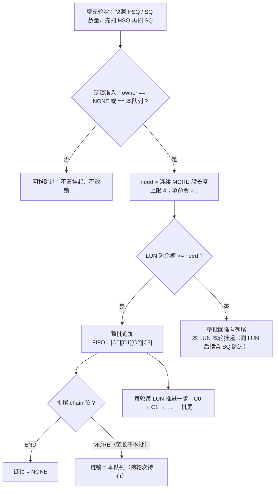

**读图要点**：

- 链要么整批进去、要么整批不进；放不下是「挂起」，不是错误。
- 锁跟着批尾的 chain 位走，与挂起表正交；HSQ 优先只体现在扫描顺序，不抢已进 FIFO 的命令。
- 挂起表每趟清零：同 LUN 后续命令（含 SQ）本轮一律跳过，避免优先级倒挂。

**为什么需要链锁**：一条链可能长于 FIFO 深度（跨多个填充轮次），批与批之间若无跨轮次
状态，另一条队列的命令就会插进链的「已下发部分」与「未下发部分」之间，破坏「链 = 连续槽」。
生产路径上 FTL 的 cache read / cache program run 会组链，因此链锁是正确性前提，不是可选项。

锁的粒度是「**哪条提交队列能喂这个 LUN**」，不是「LUN 不能用」：链所在队列照常能喂
（续批正是从这条队列取），另一条队列一律回推。

#### 3.5.5 失败语义

| 情形 | 行为 |
|---|---|
| LUN 下一批放不下 | 整批回推，本 LUN 本轮挂起；不是错误 |
| 链锁冲突 | 回推跳过，不置挂起，不改锁 |
| 下发失败 | 统一走失败命令处理，合成失败完成；**清链锁** |
| 生产路径出现提交 `NOT_READY` | 填充前已查剩余槽，出现即 `ASSERT`（保留 `NOT_READY` 只给「链放不下」的重试语义兜底） |
| 填充饥饿 | 当前单 LUN 下写 / 擦占住唯一 LUN 时读本来就要等；无专门饥饿保护（§7.2） |

#### 3.5.6 设计取舍

| 选择 | 主流对照 | 理由 |
|---|---|---|
| 填充轮次 + 每 LUN 保序 | 主控调度器按通道 / die 并行 | 单通道下保序是硬件顺序的软件表达；多 LUN 时按 die 并发（§3.13） |
| HSQ 优先只影响扫描顺序 | 主流按 QoS / 优先级仲裁 | 不抢已进 FIFO 的命令，避免同 LUN 顺序倒挂 |
| 链 = 连续槽 + 跨轮次锁 | 主流描述符链本身即原子单元 | 本仓 FIFO 是软件定深队列，链必须靠锁维持连续性 |
| 无 busy 表 | 主流有 per-channel busy 寄存器 | 「忙」可从 LUN 剩余槽查询导出，第二份表必然漂移 |
| 不做读写混合 QoS | 企业级做读写调度 | 单 LUN 下无第二个 LUN 可切，保护近乎无效（§7.2） |

#### 3.5.7 常量与阈值

| 常量 | 值 |
|---|---|
| 链长上限 | 4（等于每 LUN FIFO 深度） |
| 每 LUN FIFO 深度 | 4（每槽一条命令） |
| 挂起表生命周期 | 每趟填充清零 |

<a id="s3-6" name="s3-6"></a>

### 3.6 数据路径

#### 3.6.1 背景与需求

NAND 介质会出错：随机位错、误纠、地址错位、系统性图样。FC 必须在写入前布置多层保护，
在读回后按顺序验证，并在失败时给出**可定位到 CW** 的结果。平台没有硬件 ECC 外设，
全部由软件完成。

#### 3.6.2 职责与边界

**做**：编码管线（META → CRC → 加扰 → ECC → RAID）与解码管线（ECC → 解扰 → CRC → META，
失败再 RAID）；单 CW 原语；逐 CW 状态回填。
**不做**：不搬用户数据（FTL）、不决定是否重读（FTL 读恢复）、不管理坏块（FTL）。
**上游**：完成回写；**下游**：CRC / 加扰 / BCH / RAID 引擎。

#### 3.6.3 结构与不变量

两个方向，对 FTL 完全透明：

- **写（encode）**：编程前由 FC 内部执行——META → CRC → 加扰 → ECC →（RAID）。
- **读（decode）**：两阶段——
  - **Stage 1**（FC 内部，CQ push 前）：ECC 解码 → 全成功则解扰 → CRC → META 校验；
    有 CW 不可纠则在步骤 1 短路（**不解扰**，供 RAID 在 scrambled domain 恢复）。
  - **Stage 2**（FTL 触发）：RAID 恢复重建失败 CW。

**单 CW 原语**只操作一块 528 B 裸 CW，不碰命令 / 描述符 / 链：

| 原语 | 步骤 | 行为 |
|---|---|---|
| 写 META | 写 Stage 0 | 把 4 B META 写入 CW 头 |
| 写 CRC | 写 Stage 1a | 对 USER 区计算 CRC 并写入头 |
| 加扰 | 写 Stage 1b / 读步骤 2 | 对 USER 区加扰；自反 ⇒ 加解扰同一原语 |
| ECC 编码 | 写 Stage 2 | 生成 ECC 校验位 |
| ECC 解码 | 读步骤 1 | 解码并回填纠正位数 |
| CRC 校验 | 读步骤 3 | 重算值是否等于头中的 CRC |
| META 校验 | 读步骤 4 | 自洽 + 与期望值比对 |

**为什么拆原语**：让「调了哪些步骤」直接等于「开了哪些功能」。步骤级单测拿一块 buffer
调这些原语就能验算法，不必建链，也不必用配置位组合出「只开 CRC」这类状态。
ECC 配置由引擎自身持有，原语不带配置参数——管线与单测看到同一个入口。

⚠ 留在管线里（原语覆盖不到）的：gate 判断、全成功分支、链遍历、META 写回、
状态赋值、错误码透传——这些要验必须建链。

⚠ **提交出去的命令绝不能再手工调这些原语**：FC 自己会跑整条管线，重复编码 = 数据损坏。

#### 3.6.4 流程

**编码**：

```text
USER 数据填入各 CW buffer 的 [8,520)
  → META：描述符的扇区 LBA 写到 [0,4)
  → CRC：CRC-32 覆盖 USER，值写 [4,8)
  → 加扰：种子由 META 派生，变换 [8,520)
  → ECC：BCH 编码 520 B → 8 B parity，写 [520,528)
  → (RAID)：数据命令累积到 PLANE_NUM-1 条后跨命令 XOR → parity 独立 plane
  → 数据命令 + parity 命令一起以 Multi-Plane PROGRAM 提交
```

**解码**：

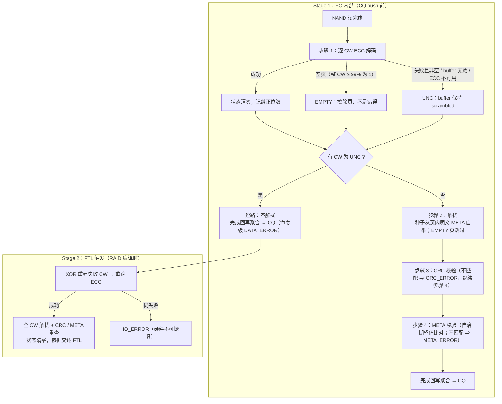

**读图要点**：Stage 1 在 FC 内部、CQ push 前；Stage 2 由 FTL 触发，FC 只提供 desc 上的
per-CW 结果。ECC 失败即短路，绝不在「已纠错但仍加扰」的状态下解扰；三道校验各抓一类错误。

**三道校验各抓什么**：

| 校验 | 抓什么 | 抓不到什么 |
|---|---|---|
| 步骤 1（ECC） | 介质里随机散布的位错（≤ t = 4） | 误纠（报成功但解错，§8.C）；超能力 → `UNC` |
| 步骤 3（CRC） | ECC 误纠落在 USER 的部分 + 数据路径逻辑错（buffer / 加扰 / 搬运任一环出错） | 只盖 `[8,520)`；对系统性错误图样有线性盲区 |
| 步骤 4（META） | META 损坏——自洽 + 与期望值逐位精确比对 | 期望值未知时跳过精确比对（GC / 掉电重建不知道 LBA） |

加扰开启时还有一道**隐式**校验：步骤 2 的种子取自页内明文 META，META 错 ⇒ 种子错 ⇒
USER 解成垃圾 ⇒ 步骤 3 必然失败。这是 GC 路径跳过步骤 4 精确比对仍然安全的原因，
但它是加扰的**副产品**，加扰关闭时失效（§2.4）。

**RAID（编译时关闭）**：parity 独立占用最后一个 plane（plane 数为 2 的幂）：

| Plane 数 | 数据命令 | parity 命令 |
|---|---|---|
| 2 | D0（plane 0） | P0（plane 1） |
| 4 | D0 / D1 / D2 | P0（plane 3） |
| 8 | D0 … D6 | P0（plane 7） |

1. 累积条带成员（2 plane 时在单次 FC 服务内同步完成）；
2. 内部分配 parity 命令资源；
3. 跨命令 XOR——数据为各 CW 的 scrambled `[0,520)`；
4. parity 不经过 META / CRC / 加扰：它已在 scrambled domain，只靠 ECC 保护；
5. 数据命令 + parity 命令一次提交为 Multi-Plane PROGRAM；
6. 完成时 parity 资源自动释放，**FTL 只感知数据命令的完成**。

#### 3.6.5 失败语义

| 情形 | 行为 |
|---|---|
| 任一 CW 不可纠 | 步骤 1 短路，返回 `IO_ERROR`；其余 CW 保持 scrambled，供 RAID |
| 空页 | 解码失败后识别为 `EMPTY`，跳过其余校验；不是错误 |
| META 未知 | 跳过精确比对，只做自洽 + 种子耦合 |
| 误纠 | ECC 报成功，CRC 或 META 步骤抓住；**CRC 不是可选项** |
| RAID 重建后仍不可纠 | `IO_ERROR`，交 FTL 的 BBT / read retry |
| 手工重跑原语 | 数据损坏——管线已跑过，原语只给单测 |

#### 3.6.6 设计取舍

| 选择 | 主流对照 | 理由 |
|---|---|---|
| 软件 BCH（m=13, t=4） | 企业级硬件 LDPC | MCU 无 ECC 外设；纠错能力只够 SLC，吞吐受 CPU 限制（§6.3） |
| CRC-32 独立校验 | 企业级硬件 CRC / T10 PI guard | 「ECC 报成功不等于数据对」：误纠必须被独立校验变成可检测失败；UBER 靠 P(误纠) × 2⁻³² 达标 |
| 加扰种子 = 扇区 LBA | 主流用 LBA / 序号派生种子 | 读路径可从页内明文 META 自举；同时把种子耦合变成隐式校验 |
| RAID 在 scrambled domain | 企业级硬件 XOR | 失败 CW 尚未解扰，XOR 结果与它同 domain；重建后再统一解扰 |
| 单 CW 原语 | 主流数据路径按 code word 处理 | 算法与编排分离，步骤级可验 |
| RAID 不编译 | 企业级默认启用 | 功能代码完成但未验证，开关保持 0（§7） |

> 误纠与 CRC 必性的出处：Koopman, *32-Bit Cyclic Redundancy Codes for Internet Applications*,
> DSN 2002；*Error Characterization, Mitigation, and Recovery in Flash-Memory-Based SSDs*
>（arXiv:1706.08642）；USENIX FAST'13 *LDPC-in-SSD*。

#### 3.6.7 常量与阈值

| 常量 | 值 |
|---|---|
| BCH 参数 | m = 13，t = 4；输入 520 B，parity 8 B |
| CRC | CRC-32，覆盖 USER 512 B |
| 加扰多项式 | x¹⁶ + x¹⁴ + x¹³ + x¹¹ + 1；种子 = 本 CW 扇区 LBA |
| 加扰范围 | `[8,520)`，META / CRC 明文 |
| RAID 范围 | 全 528 B；parity 占最后一个 plane |
| ECC 位数宽 | 8 位 |
| `EMPTY` 阈值 | 1 比特占比 ≥ 99% |

<a id="s3-7" name="s3-7"></a>

### 3.7 Dispatch 桥接与防火墙

#### 3.7.1 背景与需求

FC 固件与 NAND 硬件引擎（软件模拟）之间必须有一条明确的边界：哪些字段是硬件真正消费的，
哪些是固件的内部概念。边界越模糊，FTL 的策略就越容易漏进硬件层——最终 FC 变成一个
「什么都做」的层，失去与硬件 FCC 的对应关系。

#### 3.7.2 职责与边界

**做**：按 ch / ce / lun 路由、每 LUN 定深 FIFO、一条命令内部的多 CW 分段、请求预解析、
完成转换与聚合。
**不做**：不回调 FC（请求自包含）、不解释 RAID、不感知编解码模式、不搬数据。
**上游**：调度器；**下游**：NAND 引擎。

这条边界是 **FC 固件与 NAND 硬件引擎之间的防火墙**。FC 内部处理固件层面的功能
（加扰 / ECC / RAID / CRC），**只有硬件真正消费的字段才跨越 dispatch**。

四条原则：

| 原则 | 说明 |
|---|---|
| 硬件消费 | 只有 NAND 硬件引擎实际消费的字段才跨越 |
| 固件封装 | FC 固件内部处理的功能不在 dispatch 层暴露 |
| RAID 透明 | dispatch 感知不到 RAID——它看到的是标准 PROGRAM 命令 |
| ECC 反馈 | 硬件解码结果（纠正位数、per-CW 状态）必须带回 FC |

#### 3.7.3 结构与不变量

**请求**（FC → NAND）是自包含的扁平结构：

| 字段组 | 内容 | 说明 |
|---|---|---|
| 标识 | 命令 ID、操作码 | 完成关联与 ONFI 操作 |
| 路由 | ch / ce / lun | 目标 LUN |
| 访问集合 | CW 位图、plane 数、单 plane 号 | 位图 bit n = flat 绝对号；0 = 空集 |
| 地址 | 每 plane 行地址数组 | plane 集合内每格都填 |
| 数据 | 每 CW buffer 指针数组 | FC 预解析，dispatch 不再查池 |
| 协议参数 | 页类型、Feature 地址、显式列地址 | 页类型给解码阈值；列地址只有读列命令用 |

**完成**（NAND → FC）：命令 ID、执行结果、操作后状态字节、操作前状态字节、
per-CW 状态数组、per-CW 纠正位数数组。两个数组与请求位图同一 flat 空间。

几条容易踩的约定：

- **`cw_bitmap == 0` 是空集**，不是「全部」。擦除命令就是空集（没有 CW）。
- **multi-plane 时单 plane 号恒 0**：多 plane 序列的 row 下标硬编码 0 / 1，plane 维从 0 起。
- **每 plane 行地址必须为集合内每个 plane 都填**，即使该 plane 一个 CW 都没选中——
  多 plane 序列固定读 row[0] / row[1]，空 plane 不填会退化成 block 0 / page 0。
- **Feature 地址不能复用列地址**：8 位装不下 spare 区列号（2048 需 12 位），两者语义不同。

**两张函数指针表**（都在 dispatch 内，按操作码直接索引，无 `switch`）：

| 表 | 职责 | 典型 handler |
|---|---|---|
| 请求表 | 把任务拼成引擎请求（列 / 行地址、数据指针、长度） | 无数据 / 单页 / 读页 / 编程页 / 随机读 / cache 读 / multi-plane / feature / meta 读 / 列读 / ONFI 签名 / 擦除 |
| 完成表 | 把引擎结果折叠成 per-CW 状态 | 全 CW 同状态 / 逐 CW / 加载型 |

完成策略：

| 策略 | 语义 | 用于 |
|---|---|---|
| 全 CW 同状态 | 所有选中 CW 同状态；空掩码写 0 号槽 | 无 CW 概念的命令、编程 / 擦除、整页 cache 读、ISSUE / WAIT 段 |
| 逐 CW | 逐 CW 独立状态（下标 = flat 号） | 随机数据读（含 multi-plane）的取数链 |
| 加载型 | 成功**不写**任何 CW 状态，失败时刷满 | 加载型读（33 / 29 / 35 / 43 / 36） |

**新增操作码必须同时改三处**：协议操作表（协议属性）、请求表、完成表。
漏一处不会编译失败——漏请求表项会在运行时空指针调用。表按下标初始化；下标不连续不影响。

#### 3.7.4 流程

```text
FC 服务
  ├─ 填充轮次：扫描 HSQ / SQ，按 LUN 保序选命令
  ├─ 预解析描述符链：行地址、buffer 指针、CW 位图在 FC 侧解析完
  ├─ 提交 / 链提交：按剩余槽追加；放不下一律整体拒收
  └─ 调度轮询：遍历 (ch, ce, lun)，每 LUN 每轮恰好推进一步
        ├─ 队头未启动 → 构建请求 → 引擎事务发起 → UOP 引擎
        ├─ 已启动     → 引擎事务推进（非阻塞）
        └─ 完成       → 出队，经 sink 当场交出一份完成
```

**相位机**：每 LUN FIFO 队头带相位——IDLE → ISSUE → ISSUED（忙期只比较时间）→ FETCH → 出队。

**完成回写与 CQ 组装**：

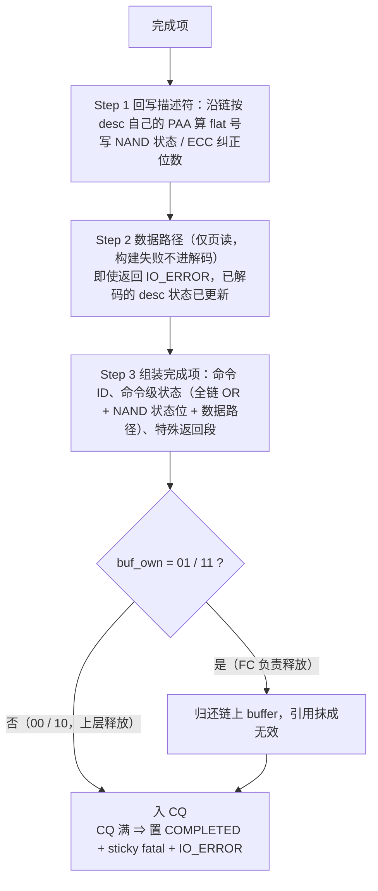

**读图要点**：四步严格串行——Step 3 的聚合读 Step 1 写入的 desc 状态与 Step 2 写入的纠正
位数，所以数据路径失败也保留逐 CW 结果；Step 4 只在 FC 负责释放 buffer 时执行，且在 CQ
push 之前（抹无效使随后的命令释放自然跳过）；CQ 满是一条独立失败路径。

**Feature 4B 内联数据路径**：Feature 寄存器只有 4 字节，为它分配 desc 链 + buffer 是浪费。
FC 让这类小返回走**控制器侧暂存**（不可缓存段，按命令 ID 索引）：

| 方向 | 动作 |
|---|---|
| SET_FEATURES | 建请求时把命令参数里的 4 字节拷进暂存；数据指针指向暂存 |
| GET_FEATURES | 建请求时清零暂存；引擎把寄存器值写进暂存 |
| 完成 | 完成回写把暂存拷进 CQ 条目的返回段 |

同一机制服务四条无描述符的 4 字节读：GET_FEATURES、READ_META、READ_ONFI_SIGNATURE、
READ_COLUMN。

**为什么按命令 ID 索引**：SQ 里的命令体提交后不可变。把返回值写回命令参数会破坏这条
不变量（命令可能已被复用）；暂存是控制器侧状态，与命令体分离，CQ 组装时再取值。

**字段级映射**（哪些字段过边界）：

| 命令侧字段 | 过边界？ | 理由 |
|---|---|---|
| 操作码、ch / ce / lun、页类型、multi-plane（作为 plane 数）、Feature 地址 | ✅ | 硬件要知道执行什么、访问哪个 LUN、如何解码 |
| CW 位图、每 plane 行地址、每 CW buffer 指针 | ✅ | 由描述符链预解析而来；硬件目标寻址与取数 |
| CRC / ECC 模式、RAID 模式、加扰模式 | ❌ | 数据路径在 FC 固件完成，硬件不感知 |
| 链模式、buffer 归属、CW 数 | ❌ | FC 侧资源与调度策略；硬件只看已解析请求 |
| 描述符的链 next、状态、纠正位数 | ❌ | 链是 FC 内部结构；完成方向才回写 |

#### 3.7.5 失败语义

| 情形 | 行为 |
|---|---|
| FIFO 放不下 | `NOT_READY` 且无副作用（一个槽都不写） |
| 未放行（初始化中） | 返回 `INVALID_ARGUMENT`；探针走直连路径 |
| 引擎事务报错 | 不是失败出口，而是「带错误状态的完成」，照常走完成处理 |
| CQ 满 | sticky fatal + `IO_ERROR`（§3.1.5） |
| 多 plane 命令 + 部分 plane 位图为 0 | 双档拦截：`ASSERT` + release 返回 `INVALID_ARGUMENT`（§3.12） |
| 页读完成但解码失败 | 描述符已更新，CQ 带 DATA_ERROR；上层按 desc 定位 |

#### 3.7.6 设计取舍

| 取舍 | 选择 | 主流对照 / 理由 |
|---|---|---|
| 页类型过边界、编解码模式不过 | 页类型给硬件，模式留 FC | 多页类型器件的不同页类型原始 BER 不同，解码器必须知道；LDPC / decode 模式是固件策略 |
| RAID 在 FC 内部 | dispatch 看到标准 PROGRAM | parity 写哪个 plane 由 FC 派生；恢复时 FC 读全部 plane |
| 逐 CW 状态回写描述符 | 双重交付（CQ + desc） | 参见 §3.3.6 的五个场景表 |
| CQ 不带操作类型 | 主流完成项只带 ID / status | 命令类型与完成服务由 FTL 请求表保存；CQ 保持最小 |
| 请求自包含 | 硬件 FCC 的已解析请求寄存器组 | dispatch 之后不再回调 FC——它必须拥有 buffer 池（§6.2.2 下界） |

#### 3.7.7 常量与阈值

| 常量 | 值 |
|---|---|
| 操作码总数 | 51（0..50） |
| 每 LUN FIFO 深度 | 4 |
| flat CW 空间 | 8（2 plane × 4 CW） |
| 每 CW 纠正位数宽 | 8 位（0..255） |

<!-- doc-policy: allow platform -->
<a id="s3-8" name="s3-8"></a>

### 3.8 NAND UOP 引擎

#### 3.8.1 背景与需求

一条 ONFI 命令不是「发一个字节」：它是若干命令字节、列 / 行地址、数据阶段、时间延时的
固定序列。企业主控用硬件 micro-sequencer 把这些序列展开成寄存器操作与引脚等待。
本仓要在软件里等价复现，并保持异步非阻塞——等待时让出，而不是占住 CPU。

#### 3.8.2 职责与边界

**做**：解释 UOP 微序列、控制流（END / JUMP）、超时判定、让出与恢复、事务级推进。
**不做**：不直接访问硬件（handler 在后端）、不建请求（dispatch）、不判数据对错（数据路径）。
**上游**：dispatch、器件初始化；**下游**：FMC 后端的 handler 表。

#### 3.8.3 结构与不变量

设计理念是**软件微码**：每条 UOP 自包含——命令值、列 / 行地址、延时都由 operand 或
请求携带，不查外部表、不含隐式逻辑。这模仿硬件 micro-sequencer 的组织方式。

```text
硬件微码（企业主控）：                本仓软件微码：
  INST_0: SET_CMD(0x00)                { COMMAND,      READ_PAGE_SETUP }
  INST_1: SET_ADDR(col0/row…)          { COLUMN_0,     0 }
  INST_2: SET_CMD(0x30)                { COLUMN_1,     0 }
  INST_3: WAIT_RB#                     { ROW_0/1/2,    0 }
                                       { COMMAND,      READ_PAGE_CONFIRM }
                                       { DELAY_TIMING, TWB }
                                       { WAIT_READY,   0 }
```

**UOP 类型**（15 种 + 总数）：

| UOP | 操作数 | 语义 |
|---|---|---|
| WAIT_READY | — | 纯 R/B# GPIO 轮询，超时检测 |
| COMMAND | 命令字节 | 写命令窗口 |
| COLUMN_0 / COLUMN_1 | — | 写列地址低 / 高字节（列取自请求） |
| ROW_0 / ROW_1 / ROW_2 | plane 下标 | 写行地址低 / 中 / 高字节，取该 plane 的行地址 |
| DATA_IN | buffer 偏移 | CPU → NAND |
| DATA_OUT | buffer 偏移 | NAND → CPU |
| DATA_OUT_STATUS | — | 直读状态字节（70h） |
| JUMP_IF_NOT_READY | 回跳步数 | busy 则回跳重发 70h 轮询 |
| CHECK_FAIL | — | 状态 FAIL ⇒ 终止序列 |
| CHECK_FAIL_CACHE | — | 检查 FAIL **与 FAILC**（上一页 cache program） |
| DELAY_TIMING | 时序参数 | 按当前操作时序表延时（tWB / tWHR / tADL） |
| END | — | 序列结束，交出执行结果 |

**时效**：延时值来自每个操作的时序参数条目（写恢复 / 读延时 / 地址延时 / 忙等上限），
**延时是协议参数，不是写死的微秒常量**，换器件或换时序档只改表。

**handler 归属**：13 个 UOP 有后端 handler；JUMP_IF_NOT_READY 由引擎直接处理（表项为空），
END 无 handler（引擎处理）。`NAND_UOP_COUNT` 是数组长度。

**三个 static helper**（引擎内部）：锁存 SysTick 微秒起点、饱和递增计数后判双条件、
按类型白名单打成功日志。抽出的目的是让解释器骨架只留控制流——END / JUMP 是控制流，
其余一律走 handler 表。

#### 3.8.4 流程

**解释器骨架**：

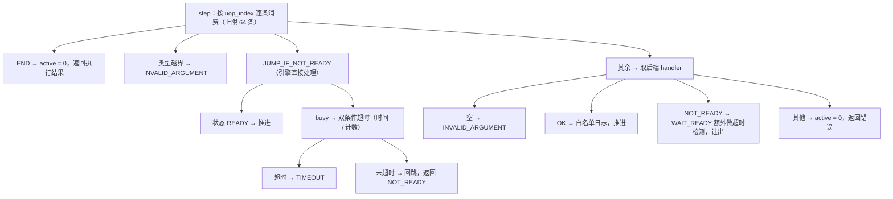

**读图要点**：END / JUMP 是控制流，不进 handler 表；NOT_READY 是协作式让出点。

**WAIT_READY**：handler 内部完成轮询与超时——读 R/B# GPIO，低则按步 spin-wait 直到高或超时；
高直接返回 OK。**不检查器件状态位、不查表、不含 tWB 保护**——tWB（CONFIRM 后到 R/B# 拉低）
由序列中 CONFIRM 之后的显式延时保证。

**70h 轮询循环**（几乎所有序列的开头）：

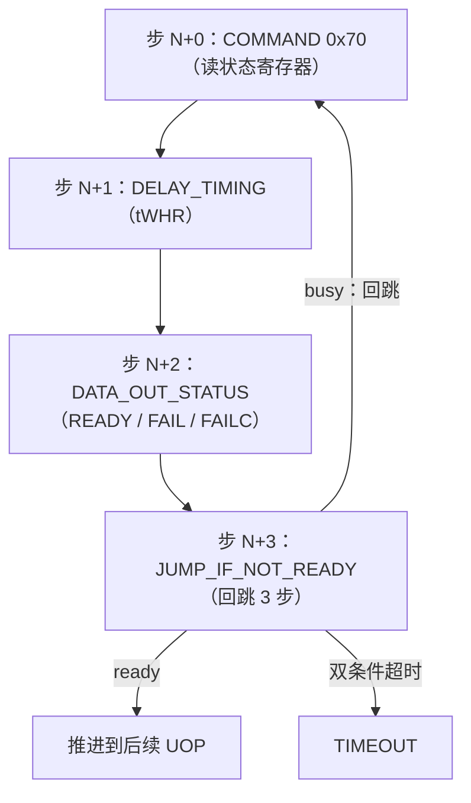

页加载后的 tR、编程后的 tPROG、擦除后的 tBERS 都靠这个循环等到 ready；
随后 `CHECK_FAIL` 检查 FAIL 位，失败即终止序列。

**JUMP 与 WAIT_READY 各用一组独立的超时状态**：JUMP 回跳体会重跑若干返回 OK 的 UOP，
而 OK 分支会清零等待计数；若共用一组，计数每轮回跳都被清零，双条件超时永不触发
（器件卡忙时死循环）。

**CHECK_FAIL 的使用规则**：

| 需要 | 理由 |
|---|---|
| 含 10h / D0h 的程序 / 擦除 | CONFIRM 后器件可能内部烧录 / 擦除失败 |
| SET_FEATURES | 写寄存器可能被拒绝 |
| RESET | 复位后检查状态 |
| 含 30h 的读（含 multi-plane） | 页加载可能内部出错 |
| 内部数据搬移读（35h）、cache 读序列（31h / 3Fh） | 内部操作可能出错 |

| 不需要 | 理由 |
|---|---|
| GET_FEATURES / READ_ID / 参数页 / UNIQUE_ID | 只读芯片信息，无「内部操作失败」概念 |
| RANDOM_DATA_READ | 只读已加载的页缓冲 |
| READ_STATUS / 状态增强读 | 读状态本身 |
| 块锁 / 解锁 / 锁状态 | 锁操作不经 FAIL 位报告 |

**执行模型**：

| 入口 | 行为 |
|---|---|
| NAND 事务发起 | 异步发起：复位游标、绑定后端 / 请求 / 完成，推进第一步 |
| UOP 引擎发起 | 同上，直接给 UOP 序列 |
| UOP 引擎推进 | 消费若干 UOP；`NOT_READY` = 让出 |
| NAND 事务推进 | 事务级推进，完成时填完成结构 |

同步路径（器件初始化）就是「循环推进到 OK 或错误为止」。

#### 3.8.5 失败语义

| 情形 | 行为 |
|---|---|
| UOP 类型越界 / handler 为空 | `INVALID_ARGUMENT`，引擎停机 |
| handler 返回 NOT_READY | 让出；调用者下一轮再来 |
| 忙等超时 | 双条件（时间 + 计数）任一超限 → `TIMEOUT` |
| 序列超过步数上限 | `INVALID_ARGUMENT`（序列不收敛） |
| CHECK_FAIL 命中 | 终止序列，执行结果失败，携带状态字节 |

#### 3.8.6 设计取舍

| 选择 | 主流对照 | 理由 |
|---|---|---|
| 软件微码，每 UOP 自包含 | 硬件 micro-sequencer | 值与延时随指令走，不查外部状态；新增器件只换序列表 |
| 延时来自操作参数表 | 硬件寄存器常量 | 协议参数化：换器件 / 换时序档只改表，不改解释器 |
| END / JUMP 免查表 | 硬件指令译码 | 控制流不进数据表，解释器骨架保持最小 |
| 协作式让出 | 硬件状态机自动推进 | 单线程下「让出」可被上层调度复用，不阻塞整机 |

#### 3.8.7 常量与阈值

| 常量 | 值 |
|---|---|
| UOP 类型 | 15 种 + 总数 |
| 后端 handler | 13 个 |
| 单次推进步数上限 | 64 |
| 超时判据 | 时间 + 轮询计数双条件 |
| WAIT_READY 步进 | 1 µs / 步 |

<a id="s3-9" name="s3-9"></a>

### 3.9 FMC 硬件后端

#### 3.9.1 背景与需求

UOP 引擎只描述「做什么」，不描述「怎么写寄存器」。平台用 FMC 并口访问 NAND：
命令、地址、数据各有一个窗口，另有一根 R/B# 输入。后端负责把所有 UOP 落到这些访问上。

#### 3.9.2 职责与边界

**做**：UOP handler 表（写窗口、读数据、轮询 R/B#、延时）、每 (ch, ce) 的后端实例。
**不做**：不做路由判断（上下文由请求与实例配置提供）、不做时序换算（板级初始化完成）、
不决定序列（协议表）。
**上游**：UOP 引擎；**下游**：FMC 外设与 GPIO。

#### 3.9.3 结构与不变量

后端实例按 **(ch, ce)** 组织——不是按 LUN：FMC 的时序配置是 bank 级，同一 bank 各 LUN
共用同一组窗口与时序，按 LUN 分化只会产生 N 份同值拷贝（改一处漏三处）。

每个实例持有 handler 表与一份窗口配置：

| 配置项 | 内容 |
|---|---|
| 数据窗口 | FMC 数据基址 |
| 命令窗口 | 基址 + 命令线偏移 |
| 地址窗口 | 基址 + 地址线偏移 |
| R/B# 端口 / 引脚 | 本 target 的忙闲输入 |

时序配置（PCC）不在配置结构里——它是 FMC 寄存器，由板级模块在初始化时按器件时序表换算并
写死（§3.14）。

handler 表覆盖 13 个 UOP（下表 10 行：COLUMN_0/1 与 ROW_0/1/2 各合一行）：

| UOP 类型 | 后端 handler 行为 |
|---|---|
| WAIT_READY | R/B# 轮询：低则按 1 µs 步进等待，高则返回 OK |
| COMMAND | 写命令窗口 |
| COLUMN_0 / COLUMN_1 | 写列地址低 / 高字节 |
| ROW_0 / ROW_1 / ROW_2 | 写行地址；操作数选 plane |
| DATA_IN | CPU → NAND（逐字节写数据窗口） |
| DATA_OUT | NAND → CPU |
| DATA_OUT_STATUS | 直读状态字节 |
| CHECK_FAIL | 检查 70h FAIL |
| CHECK_FAIL_CACHE | 检查 FAIL + FAILC |
| DELAY_TIMING | 按参数延时 |

`JUMP_IF_NOT_READY` 的表项为空、`END` 无表项：两者由引擎控制流直接处理，不在上表。
`NAND_UOP_COUNT` 是数组长度——新增 UOP 必须同时补表项与这个计数断言。

#### 3.9.4 流程

**数据阶段固定 PIO**：CPU 逐字节读写数据窗口；写方向每字节后插内存屏障
（`volatile` 不保证连续外部写的顺序）。

**WAIT_READY**：GPIO 轮询，低则按 1 µs 步进等待，高则返回；超时由引擎的等待状态判定。

#### 3.9.5 失败语义

| 情形 | 行为 |
|---|---|
| 访问窗口无硬件响应 | 由上层超时判定（引擎），后端不自行重试 |
| R/B# 一直忙 | 引擎 `TIMEOUT` |
| 无 DMA（当前实现） | **本仓选择**：FMC 没有专用 DMA 请求线，当前固定 PIO。无请求线不等于不能 DMA——mem2mem DMA 可用固定地址访问数据窗口（`0x8000_0000`），由 FMC 时序 / AHB 等待状态自然节流；但需先验证 NWAIT、DMA 控制器阻塞、cache/MPU 与完成时序。 |

#### 3.9.6 设计取舍

| 选择 | 主流对照 | 理由 |
|---|---|---|
| 固定 PIO（当前） | 企业级每通道 DMA | 无请求线不等于不能 DMA：可用 mem2mem 固定地址访问数据窗口；本仓优先 PIO 简化。真正每通道 DMA + 硬件 ECC 需 GPMI / FMC2 一类外设。 |
| 后端按 (ch, ce) | 主控每通道一个引擎实例 | 时序是 bank 级；按 LUN 复制只会制造同值副本 |
| handler 表 | 硬件译码器 | 新 UOP 只加表项；解释器不变 |
| 上下文由实例 + 请求提供 | 硬件上下文寄存器 | 路由判断移出 handler，handler 只做访问 |

#### 3.9.7 常量与阈值

| 常量 | 值 |
|---|---|
| FMC 窗口 | 3 个（命令 / 地址 / 数据） |
| 后端实例 | 按 (ch, ce) |
| handler 数 | 13 |
| R/B# 轮询步进 | 1 µs |

<a id="s3-10" name="s3-10"></a>

### 3.10 ONFI 命令表与协议属性

#### 3.10.1 背景与需求

NAND 操作的种类多（读 / 写 / 擦 / 状态 / Feature / 探针 / 扩展），每种的命令字节、
地址周期与 UOP 序列都不同。用 `switch` 散落在各模块会把「协议事实」复制到多个调用点；
本仓用一张按操作码索引的表作为唯一来源。

#### 3.10.2 职责与边界

**做**：操作码 → 名称 / 命令字节 / 地址与数据周期 / UOP 序列 / 时序参数 / 并发属性。
**不做**：不执行序列（引擎）、不做路由（dispatch）、不判完成（完成表）。

#### 3.10.3 结构与不变量

操作码总数为 51（0..50），操作码常量直接作为表下标，O(1) 查表。表项字段：

| 字段组 | 内容 |
|---|---|
| 标识 | 操作码、调试名 |
| 命令字节 | 命令字节 1 / 2（0 = 无） |
| 周期数 | 地址周期、数据输入周期 |
| 并发约束 | 忙期有效 / 非忙期有效的标志 |
| 序列 | UOP 序列指针 |
| 时序 | 写恢复 / 读延时 / 地址延时 / 忙等上限 |

**协议属性由 helper 从表项派生，不在代码里散落 `switch`**：

| 属性问题 | helper |
|---|---|
| 有数据阶段吗 | 有无数据 |
| 是页读 / 页写吗 | 页读 / 页写 |
| 数据长度多少 | 数据长度 |
| 是 ISSUE 型吗 | ISSUE 判定 |
| 是 WAIT / FETCH 型吗 | 等待 / 取数判定 |
| 可拆分成 ISSUE + WAIT 吗 | 可拆分判定 |
| 对应的 ISSUE / WAIT 操作是谁 | 转 ISSUE / 取配对 |

**ONFI 1.0 没有 multi-plane**（Rev 1.0 Table 14 全文无 plane）；操作表里的 multi-plane /
two-plane cache 码全部来自器件 datasheet（§3.12）。文档与代码不得把它写成「ONFI 规定」。

#### 3.10.4 流程

新增一个操作码：

```text
① 协议操作表加一行（命令字节 / 周期 / UOP 序列 / 时序 / 属性）
② dispatch 请求表加 handler（怎么拼请求）
③ dispatch 完成表加 handler（怎么折叠 per-CW 状态）
```

三步缺一不可；漏 ② 不会编译失败，会在运行时空指针调用。

#### 3.10.5 失败语义

| 情形 | 行为 |
|---|---|
| 操作码越界 | 所有属性 helper 返回到界判定；dispatch 拒绝 |
| 表项缺请求 handler | 运行时按空指针调用——新增操作码的主要风险 |
| 表项缺完成 handler | 完成折叠缺失，per-CW 状态错 |
| 下标不连续 | 合法：表按操作码下标初始化，空位显式为 0 |

#### 3.10.6 设计取舍

| 选择 | 主流对照 | 理由 |
|---|---|---|
| 单张协议表 | 主控固件常按命令族分表 | 单一来源消除「同一命令三处定义」；属性从表派生 |
| 属性 helper 而非 `switch` | 硬件译码表 | 调用点不复制协议事实；加操作只改表 |
| 器件扩展码也在同一表 | 主流把厂商扩展与标准码同表管理 | 操作码空间只有一张；差异在文档标注「来源：datasheet」 |

#### 3.10.7 常量与阈值

| 常量 | 值 |
|---|---|
| 操作码总数 | 51 |
| 地址周期上限 | 5（列 2 + 行 3） |
| 表项数量等于操作码总数 | 是 |

<a id="s3-11" name="s3-11"></a>

### 3.11 器件模型、探针与器件级操作

#### 3.11.1 背景与需求

协议层描述「ONFI 命令」，但几何、器件 ID、参数页内容与时序是**器件事实**——不同器件
不一样，甚至同一族的两个型号也不一样。初始化还必须先于命令队列可用，因此探针需要一条
绕过队列的直连路径。

#### 3.11.2 职责与边界

**做**：器件几何与时序表、硬件初始化（外设与 GPIO）、探测（RESET / READ_ID / 参数页）、
异步事务 API、时序模式切换。
**不做**：不做协议序列表（§3.10）、不做调度（§3.7）、不碰 FTL。
**上游**：FC 初始化、主函数；**下游**：UOP 引擎与 FMC 后端。

#### 3.11.3 结构与不变量

**事务三件套**：

| 结构 | 内容 |
|---|---|
| 请求 | 操作码、显式列地址、按 plane 索引的行地址、数据指针、数据长度 |
| 完成 | 操作后状态字节、操作前状态字节、执行结果 |
| 事务 | 引擎状态 + 请求 + 完成 |

**`nand_status` 与执行结果语义不同**：前者是器件回读的原始字节，后者是引擎的执行结果
（OK / NOT_READY / TIMEOUT / OPERATION_FAILED …）。失败判定两者都要看（§3.3.3）。

**目标表**按 (ch, ce) 记录探测成功的器件；**引擎放行闩锁**控制命令提交是否放行：

| 门控 | 位置 | 作用 |
|---|---|---|
| 放行闩锁 | NAND 引擎 | 提交 / 链提交的放行条件；轮询不检查 |
| controller 状态 | 主循环 | 非 READY = 裸 FC 服务；READY = 全局泵 + 逐实例服务 |

#### 3.11.4 流程

**NAND 初始化**：

```text
器件硬件初始化：FMC 句柄 / 8 位总线 / ECC 关闭 / 保守时序参数
              → 首次碰硬件：MspInit 配时钟 / GPIO / 片选
              → 板级 target 装配：校验 (ch, ce) 在板级通路表内、占用 FMC bank
              → 组装三个窗口 + R/B# GPIO → per-(ch, ce) 后端实例
目标探测（逐 (ch, ce)）：延时 → RESET(FFh) → READ_ID(90h)
              → 空片判据 + 与期望 ID 比对 → 参数页(ECH) 核对签名 / 周期数 / LUN 数
              → 成功记入目标表
```

**当前硬件初始化不做 RESET / READ_ID**：器件侧只碰外设与 GPIO；ONFI 探针由 FC 侧编排。
这样器件驱动只负责「这块板怎么接」，命令序列仍留在协议层。

**探针走直连**：探针经「NAND 事务发起 / 推进」直连引擎，**绕过命令队列**；此时放行闩锁为 0，
提交接口一律拒绝。

**事务**：发起后由调用者循环推进（同步路径）或由 dispatch 轮询推进（异步路径）。

#### 3.11.5 失败语义

| 情形 | 行为 |
|---|---|
| RESET / READ_ID 失败 | 目标不入表；启动级联跳过放行 / FTL boot（§4.1） |
| ID 不匹配 | 视为无器件或器件错误，按失败处理 |
| 参数页签名不符 | 几何不可信，按失败处理 |
| 初始化期间提交 | 放行闩锁为 0，返回 `INVALID_ARGUMENT` |
| 事务超时 | 引擎返回 `TIMEOUT`，完成结构携带状态字节 |

#### 3.11.6 设计取舍

| 选择 | 主流对照 | 理由 |
|---|---|---|
| 驱动只做「板怎么接」 | 主流器件驱动也含命令序列 | 命令序列集中在协议表，换器件只换几何 / 时序 / ID；序列复用 |
| 探针绕过队列 | 主控启动期也有旁路通道 | 队列尚未放行；探针必须能先于 FC 提交可用 |
| 双门控（放行 + controller 状态） | 主控有独立的「通道使能」与「固件就绪」 | 两个语义不同：前者放行硬件命令，后者切主循环行为 |

#### 3.11.7 常量与阈值

| 常量 | 值 |
|---|---|
| 探针序列 | RESET → READ_ID → 参数页 |
| 地址周期上限 | 5 |
| 时序模式开关 | 见 §8.A |

<a id="s3-12" name="s3-12"></a>

### 3.12 Multi-plane 与器件扩展操作

#### 3.12.1 背景与需求

ONFI 1.0 只有单 plane 命令；器件 datasheet 提供了 multi-plane、two-plane cache 与
copy-back 等扩展。用它们可以在一次命令里并行操作两个 plane，或在器件内部搬页。
这些操作的语义、失败位与前提条件都由 datasheet 定义，不是行业标准协议的一部分。

#### 3.12.2 职责与边界

**做**：multi-plane 读写擦、two-plane cache、copy-back 操作码、页缓冲拼装与拆分、
plane 切换。
**不做**：不决定何时用 multi-plane（FTL 配置）、不决定 cache run（FTL 组链）、
不管理坏块。
**上游**：dispatch；**下游**：UOP 引擎与器件。

#### 3.12.3 结构与不变量

Multi-plane 操作需要两组行地址，plane 由行地址的 **BA6** 选择（PAA→行地址把从 PAA 解出的
plane 编进 bit 6）。dispatch 侧因此有每 plane 行地址数组与行地址数组，
ROW_0/1/2 的操作数选行地址下标——**不新增 UOP 类型**，plane 数变化只改数组长度。

| 操作码 | 值 | 序列要点 | 数据长度 |
|---|---|---|---|
| 普通读页带数据输出 | 12 | 70h → 00h → 地址 → 30h → tR → Dout | 一页 |
| 普通读页不带数据输出 | 33 | 同上，末尾无 Dout（只加载进页缓冲） | 一页 |
| Multi-plane 读（加载） | 29 | 00h（plane 0）→ 00h（plane 1）→ 30h → tR，不输出 | 双页缓冲 |
| Multi-plane 读（带输出） | 30 | 同上，tR 后双页输出 | 双页缓冲 |
| Multi-plane 编程 | 31 | 80h（plane 0）→ Din（plane 0）→ 11h → 80h（plane 1）→ Din（plane 1）→ 10h | 双页缓冲 |
| Multi-plane 擦除 | 32 | 60h（plane 0）→ 60h（plane 1）→ D0h | 0 |
| 随机数据读 | 8 | 05h → 列 → E0h → tR → Dout（单 CW） | 一个 CW |
| 随机数据读（multi-plane） | 41 | 06h → 列 → 行（plane）→ E0h → tR → Dout | 一个 CW |

加载型读（29）与 LUN 相位机的 ISSUE 型加载（43）是两条操作：前者是「原子加载 + 70h 状态
检查」，后者是 ISSUE 段（无 70h 轮询，由 WAIT 收尾）。单 plane 同理有 33 与 35。

**页缓冲**按 (ch, ce, lun) 各持一块（大小 = 页 × plane 数），先拼 / 读到页缓冲，再按 flat 号
拆回各 CW。

**为什么不能全通道共用一块**：program 的 ISSUE 常被 70h 忙轮询挡下——数据已拼好、
数据输入却要等下一轮；同一时刻另一个 LUN 也可能在拼自己的页。共用会被后驱动的 LUN 覆盖。

#### 3.12.4 流程

**Multi-plane 编程**：

1. 页缓冲先 memset 为全 1；
2. 对位图内每个 CW：页缓冲对应段 = 该 CW 的 buffer；未选中的 CW 保持全 1；
3. 每个 plane 的行地址 = 该 plane 的 PAA→行地址；
4. 80h（plane 0）+ Din → 11h → 80h（plane 1）+ Din → 10h → tPROG → 70h。

**Multi-plane 读**：页缓冲清零；数据输出每次一个 plane；双页到齐后按 flat 号拆回各 CW buffer。


**读图要点**：写方向未选中的 CW 是「保持全 1」，不是跳过；读方向拆回按 flat 号定位。

**11h：多 plane 切换**：

```text
80h → 列 / 行（plane 0）→ Din（plane 0）→
11h → 列 / 行（plane 1）→ Din（plane 1）→      ← 11h 切换 plane
10h → tPROG（两 plane 同时烧录）
```

`11h` 在 ONFI 里的标准名是 **Multi-Plane COPYBACK READ**；器件在 multi-plane PROGRAM 时序中
把它用作 plane 切换。这不是本仓的自造用法，是器件 datasheet 的序列。

**Two-plane cache**（器件扩展，非 ONFI 1.0）：

| 操作码 | 值 | 序列 | 状态检查 |
|---|---|---|---|
| two-plane cache 编程 | 44 | 80h（plane 0）→ Din → 11h → 80h（plane 1）→ Din → 15h | FAIL + **FAILC** |
| two-plane cache 编程结束 | 48 | 同 44，末页用 10h（非 15h） | FAIL + FAILC |
| two-plane cache 首页 | 49 | 同 44，首页只查 FAIL | FAIL |
| cache 读启动（multi-plane） | 45 | 00h（plane 0）→ 00h（plane 1）→ 30h → 31h → tR | FAIL |
| cache 读序列（multi-plane） | 46 | 31h → tR → 06h（plane 0）→ E0h → Dout（plane 0）→ 06h（plane 1）→ E0h → Dout（plane 1） | FAIL |
| cache 读末页（multi-plane） | 47 | 3Fh → tR → 同上双 plane 取数 | FAIL |

**FAILC 是「上一页 cache program」的成败**（状态寄存器 bit1），FAIL（bit0）只反映当前页。
中间页只查 FAIL 会漏掉上一页的失败 ⇒ 44 / 48 用「检查 FAIL + FAILC」；首页前没有本批的
上一页（残留 FAILC 不可归因）⇒ 49 只查 FAIL。

**片上 Copy-Back**：

| 操作码 | 值 | 用途 |
|---|---|---|
| 内部搬移读 | 19 | 00h + 地址 → 35h：源页读进 NAND 内部缓存 |
| 内部搬移写 | 10 | 85h + 地址 → 10h：缓存直接写入目标页，无数据输入 |

两者成对使用即可在 NAND 内部搬页，数据不经过总线。有数据标志只为分配描述符链提供 PAA，
数据长度为 0。**当前 GC 不走 copy-back**（走普通读 + 普通写，因为需要在搬移中改写页内数据）；
这两个操作只保留为能力。

#### 3.12.5 失败语义

| 情形 | 行为 |
|---|---|
| 未覆盖的 plane 仍是编程目标 | multi-plane handler 无条件遍历全部 plane，既不看位图也不看 plane 数 ⇒「多 plane 命令 + 部分 plane 位图为 0」是调用者错误。FC 在请求构建时双档拦截（`ASSERT` + release 返回 `INVALID_ARGUMENT`），否则静默给该 plane 编一页全 1。只访问一个 plane 请用单 plane 操作（multi-plane = 0） |
| 中间页只查 FAIL | 漏掉上一页 cache program 的失败；44 / 48 必须查 FAILC |
| 首页查 FAILC | 残留 FAILC 不可归因，会误报失败；49 只查 FAIL |
| copy-back 需要改写页内数据 | 不适用；GC 走普通读改写 |

#### 3.12.6 设计取舍

| 选择 | 主流对照 | 理由 |
|---|---|---|
| 用器件扩展操作 | 企业主控也用 multi-plane / cache | 一次命令并行两个 plane，降低命令开销；语义以 datasheet 为准 |
| 不新增 UOP 类型 | 硬件按行地址选择 plane | plane 维只是行地址数组下标，序列不变 |
| 页缓冲按 (ch, ce, lun) | 主控每 LUN 独立页缓冲 | ISSUE 段数据已拼好但要等下一轮；共用会被其他 LUN 覆盖 |
| copy-back 保留不用 | 主控 GC 常用 copy-back | 本仓 GC 需要改写页内数据，copy-back 不适用；保留为能力 |

#### 3.12.7 常量与阈值

| 常量 | 值 |
|---|---|
| multi-plane 操作码 | 29 / 30 / 31 / 32 / 41 |
| two-plane cache 操作码 | 44 / 45 / 46 / 47 / 48 / 49 |
| copy-back 操作码 | 19 / 10 |
| 页缓冲大小 | 页大小 × plane 数 |

<a id="s3-13" name="s3-13"></a>

### 3.13 拓扑、并发与多 LUN

#### 3.13.1 背景与需求

企业主控把 NAND 操作拆成三段：ISSUE（发命令，不等）、WAIT（等忙）、FETCH（取数据）。
调度器在 WAIT 段切到其他 LUN，从而把等待时间重叠起来。本仓的共享总线无法并行搬数据，
但可以在软件里重叠**等待**。

#### 3.13.2 职责与边界

**做**：按 (ch, ce, lun) 的 FIFO、页缓冲、相位机、ISSUE / WAIT 操作改写。
**不做**：不做通道并行仲裁（平台无多通道）、不做 DMA（无请求线）、不做 QoS（§7.2）。
**上游**：dispatch；**下游**：引擎。

#### 3.13.3 结构与不变量

```text
STM32H743 FMC（单条并行总线）
  └─ MT29F4G08ABADAWP
       1 ch × 1 ce × 1 lun × 2 plane × 2048 block × 64 page × 4 CW
```

软件按 `[CH][CE][LUN]` 组织：

| 结构 | 维度 | 说明 |
|---|---|---|
| 每 LUN FIFO（深 4） | ch / ce / lun | FC/NAND 桥接 |
| 页缓冲 | ch / ce / lun / 页 × plane | 同上 |
| FMC 后端实例 | ch / ce | §3.9 |
| 命令 / 描述符 / buffer 池 | 控制器级（不分 LUN） | §3.2 |

**相位机**（每 LUN FIFO 队头）：

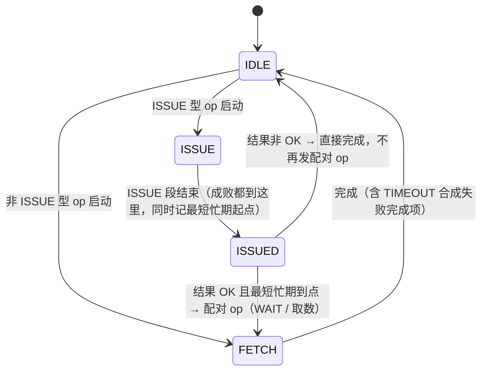

**读图要点**：四个相位是枚举，不是进度百分比；`ISSUED` 段只做时间比较，不占总线，
所以 dispatch 在这段时间可以推进其他 LUN 的 `ISSUE`。失败与超时都合成完成项后回 `IDLE`，
命令照常出队，不卡住队列。

**ISSUE / WAIT / FETCH 的落地**：

| 操作 | ISSUE | WAIT / FETCH |
|---|---|---|
| 读 | 加载型读（35 / 43） | 等待型读（36）+ 逐 CW 随机读（05h / 06h） |
| 编程 | 编程 ISSUE（37） | 编程 WAIT（38） |
| 擦除 | 擦除 ISSUE（39） | 擦除 WAIT（40） |

LUN 数 > 1 时，请求构建末段把可拆分的原子操作改写成 ISSUE；单 LUN 保持原子。
原子操作的配对操作取自身，不拆分。

#### 3.13.4 流程

**多 LUN 重叠等待**：

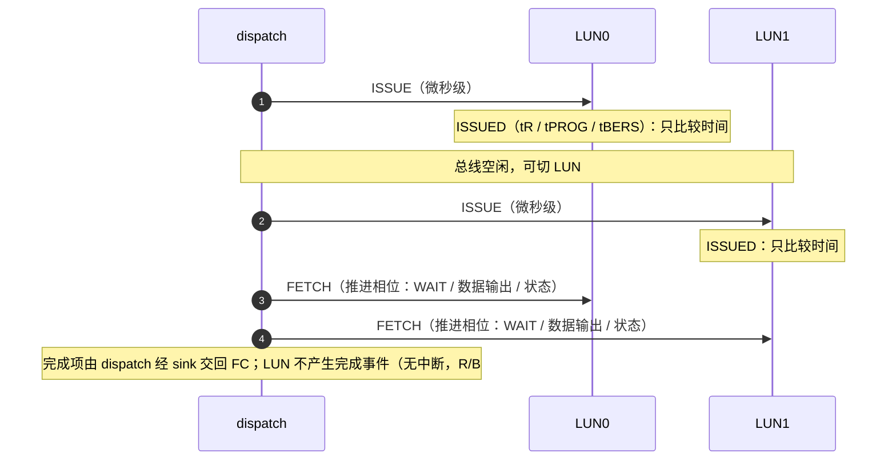

**读图要点**：两个 ISSUE 先后发出，等待段重叠；总耗时 ≈ tR + FETCH，而不是
2 × (tR + FETCH)。

dispatch 轮询逐个 LUN 推进（每 LUN 每轮一条）；`ISSUED` 段只比较时间，不占总线。

> ⚠ 当前通道 / 片选 / LUN 数都是 1：没有第二个 LUN，相位机退化为单 LUN 顺序
> `ISSUE → ISSUED → FETCH`。上面表达的是**设计能力**，不是当前实测行为。

**多通道还差什么**：

| 项 | 现状 | 改多通道需要 |
|---|---|---|
| 调度层 / FIFO / poll 遍历 | 已按三维数组编写 | 改通道数即可 |
| FMC 后端 | 按 (ch, ce) 实例 | 每通道 base 表 + 各 bank 初始化 + MPU 区 |
| DMA | 无（PIO） | 换带 DMA 请求线的 SoC |
| 引擎状态 | 无通道 id，靠后端上下文 | 事务里带 target id |
| R/B# 中断 | 无（GPIO 轮询） | 每通道独立中断或控制器内置采样 |

#### 3.13.5 失败语义

| 情形 | 行为 |
|---|---|
| 单 LUN 平台 | 相位机退化；多 LUN 重叠逻辑存在但不被触发 |
| 总线忙 | 同一时刻只有一个 LUN 能发 ISSUE；其余等待轮次 |
| 拆分改写失败 | 不出现：改写只按操作属性与 LUN 数决定 |
| 多通道 | 当前不支持；不是失败，是平台边界（§7.2） |

#### 3.13.6 设计取舍

| 选择 | 主流对照 | 理由 |
|---|---|---|
| ISSUE / WAIT / FETCH 软件近似 | 主控硬件通道引擎 | 只重叠等待，不并行搬数据；受共享总线限制 |
| 每 LUN 每轮推进一步 | 主控事件驱动 | 轮询公平性依赖「每个 LUN 每轮都被走到」 |
| 单通道拓扑 | 企业级 8~32 通道 | 目标平台是 MCU + 一颗 NAND；单通道是物理上限 |

#### 3.13.7 常量与阈值

| 常量 | 值 |
|---|---|
| 通道 / 片选 / LUN | 1 / 1 / 1 |
| 每 LUN FIFO 深度 | 4 |
| 相位值 | 0 = IDLE，1 = ISSUE，2 = ISSUED，3 = FETCH |
| 每 LUN 每轮推进步数 | 1 |

<a id="s3-14" name="s3-14"></a>

### 3.14 ONFI 时序模式与 FMC PCC

#### 3.14.1 背景与需求

NAND 异步接口的时序参数按 ONFI timing mode 给出；平台用 FMC 的可编程时序寄存器
（PCC）产生这些波形。两者必须一一换算，且启动早期必须用保守时序，避免在器件尚未确认前
跑高速。

#### 3.14.2 职责与边界

**做**：选择电压域对应的时序表、把 ONFI 参数换算成 PCC 字段、boot 完成后切换模式。
**不做**：不决定器件（器件头给出）、不做运行时动态调频、不重试失败切换。
**上游**：主函数 / FTL boot；**下游**：FMC 外设。

#### 3.14.3 结构与不变量

本板是 **3.3 V** 器件。数据手册 **Table 29 / 31 的 AC 参数按 ONFI timing mode 5 给出**
（Table 29 Note 1：「Operating mode timings meet ONFI timing mode 5 parameters」），
且 Mode 5 是 3.3 V only（Table 15 Note 3）。1.8 V 的 Table 32 Note 1 才是 Mode 4。
**两套 AC 表必须按电压域选**，不能混用。

PCC 换算约束：

| PCC 字段 | 约束 |
|---|---|
| Setup | (SET+1)·tHCLK ≥ max(tCS, tCLS, tALS, tCLR, tAR) − tWP；**另有 SET·tHCLK ≥ tCS 下限**（纯精确式会把 Setup 压到 1 周期，地址 / 擦除命令会失败） |
| Wait | (WAIT+1)·tHCLK ≥ max(tWP, tRP) |
| Hold | HOLD·tHCLK ≥ max(tCH, tCLH, tALH, tDH) |
| HiZ | **写方向**：HiZ·tHCLK ≥ max(tCS, tCLS, tALS) + (tWP − tDS) |

⚠ `HiZSetupTime` 是**写访问**期间的总线高阻窗口（FMC 控制寄存器 MEMHIZ 位），
不是读方向的 tRHZ（RE# 上升沿 → 输出高阻）——两者方向相反，不可混用。

换算按 ST 的精确式，用 FMC 内核时钟实算 tHCLK，不硬编码。

#### 3.14.4 流程

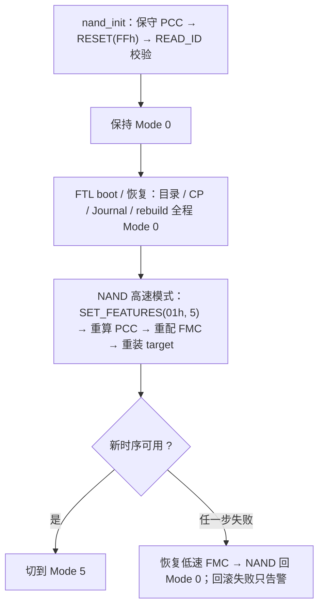

**读图要点**：切高速发生在 FTL 启动之后，启动与恢复路径不依赖高速时序；FMC 重配失败时先
恢复低速 FMC、再把 NAND 回 Mode 0，回滚失败只告警、不宣称低速仍有效；余量不足的表征是
地址 / 擦除命令失败（§3.14.5）。

#### 3.14.5 失败语义

| 情形 | 行为 |
|---|---|
| 切高速失败 | 先恢复低速 FMC、再把 NAND 回 Mode 0；回滚失败只告警；FTL 启动已在此之前完成，不依赖高速 |
| 时序余量不足 | 地址 / 擦除命令失败；表现为探针或编程错误 |
| 电压域选错 AC 表 | 时序参数整体偏差；无编译期判据，只能靠 datasheet 核对 |

#### 3.14.6 设计取舍

| 选择 | 主流对照 | 理由 |
|---|---|---|
| ONFI 参数 → PCC 精确换算 | 主控有自己的时序表 | 换电压域或器件只换参数表；不硬编码周期数 |
| Setup 加下限 | 多数控制器也留固定下限 | 纯精确式会把 Setup 压到 1 周期，地址 / 擦除失败 |
| boot 后一次性切换 | 主控按温度 / 电压动态调档 | 本仓无运行时调频需求；启动路径保持保守 |
| 固定 1 周期余量 | 主流按误码率反馈收紧 | 需擦 / 写 / 读压力确认；稳定后再评估（§7.2） |

#### 3.14.7 常量与阈值

| 常量 | 值 |
|---|---|
| 时序模式 | 5（3.3 V only）；0 = 全程低速 |
| PCC 选值（Mode 5） | SET = 4 / WAIT = 3 / HOLD = 2 / HiZ = 5 |
| TCLR / TAR | 3 / 3 |
| FMC 内核时钟 | 200 MHz（PLL2 VCO 400 MHz / R = 2；D1 域上限 200 MHz） |
| 相对手册最小值的余量 | ≥ 5 ns（Setup / Wait 各留 1 周期板级余量） |

<!-- /doc-policy -->

---

<!-- doc-policy: allow platform -->
<a id="s4" name="s4"></a>

## 4. 端到端场景

> 支撑摘要：P1~P7——从复位到命令完成、按 CW 读、cache run、Feature 内联读、multi-plane 批次。
> 每条场景给「谁在什么时刻被调、失败时停在哪里」。

<a id="s4-1" name="s4-1"></a>

### 4.1 上电初始化

**三道硬约束决定初始化的顺序**，不是工程整洁度问题：

1. **探针先于队列**：命令队列尚未放行时，探针必须走直连（§3.11）。
2. **时序保守启动**：器件未确认前不跑高速；Mode 0 贯穿正常 / 异常 / 重启全部启动路径。
3. **顺序在每一个 restart 之后重新执行**：任何失败都回到同一套固定起点，不存在「接着上次状态接着跑」。

**两道门**（运行期）：

| 门 | 语义 |
|---|---|
| 放行闩锁 | 命令提交是否放行；轮询不检查。探针期间为 0 |
| controller 状态 | 非 READY = 只做裸 FC 服务；READY = 全局泵 + 逐实例服务（§3.7） |

**启动级联**：

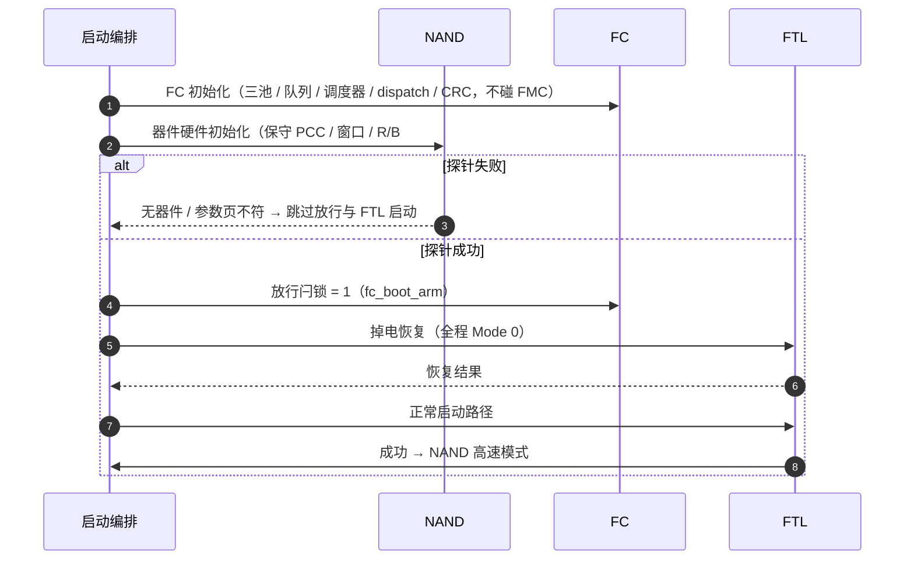

**读图要点**：探针失败不是「继续跑」也不是「重试」，是干净跳过——放行和 FTL boot 都不做。

**FC 侧资源装配**（初始化只建立资源与绑定，不放行提交；放行在启动级联的放行闩锁）：

```text
① 控制器 / 统计清零；三池 memset、挂指针、串三条空闲链表、命令状态表清零
② 队列存储 / 返回暂存清零；SQ / HSQ / CQ 初始化
③ 调度器绑定 SQ / HSQ 指针
④ dispatch 初始化（纯 memset + 关放行闩锁）；可选 RAID 上下文
⑤ CRC 引擎初始化               ⑥ 可选 RAID stripe 状态清零
⑦ 统计注册
```

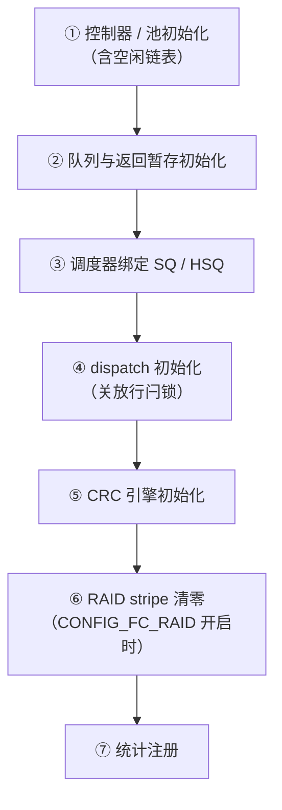

**读图要点**：初始化全程不碰 FMC 硬件——dispatch 只清 NAND 侧软件队列与链状态，器件硬件
初始化由 `fc_nand_init` 在本函数之后单独做；提交放行由启动级联里的 `fc_boot_arm` 置闩锁，
不是 `fc_init` 的职责。

**冷启动的资产优先级**（NAND 侧，按 time-to-live 递减）：

| 资产 | 优先 | 说明 |
|---|---|---|
| 参数页 | 最高 | 器件自报几何 / 时序，无法重建，只能从硅片读 |
| 块信息 | 第二 | 每 plane 4 KB 备份；数据未被覆盖时恢复 |
| FTL 目录 | 第三 | 大量块信息的主要来源 |
| Checkpoint | 高 | 电压差失败后的第二落点 |
| Journal | 中 | 损坏时块信息接管 |
| FTAB | 低 | 仅在 Journal 损坏且目录不可用时参与 |
| 主机数据 | — | 不可重建 |

掉电恢复入口（`pfr_boot_recovery`）只在探针成功后调用，全程 Mode 0；高速切换在恢复成功之后。

<!-- /doc-policy -->

---

<!-- doc-policy: allow platform -->
<a id="s4-2" name="s4-2"></a>

### 4.2 一条命令的生命周期

**驱动模型**：只有一个驱动源——主函数的无限循环。没有任何 ISR 调用 FC 服务或实例服务；
R/B# 等待是纯 GPIO 轮询，无中断参与。

```text
while (1)
{
    stack_guard_check();     // 栈哨兵，每轮
    cli_service_poll();      // CLI / test 入口
    runtime pump();          // 存储推进
}
```

runtime pump 的顺序：

| 顺序 | 调用 | 说明 |
|---|---|---|
| ① | 全局泵 | FC 服务（≤ 4 次）+ FTL 完成排空 |
| ② | 实例服务 | 每实例：元数据池 / 确认结算 / 补发 / 后台调度 |
| ③ | controller 服务 | FLUSH / TRIM 异步命令推进 |
| ④ | USB MSC 任务 → USB 设备任务 | 先检查在飞请求，再跑协议栈 |
| ⑤ | timer 调度 | CP / GC / BBT / 状态周期任务 |

controller 非 READY 时只跑裸 FC 服务，保持 FC/NAND 裸路径可用。

**写路径**：

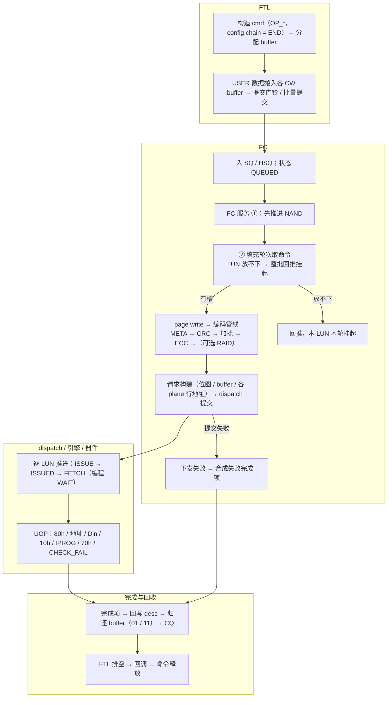

**读路径**：

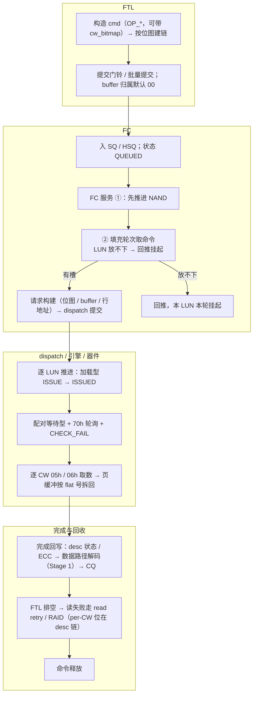

**读图要点**：两条路径只在两处不同——写多一步编码管线（FC 内部，硬件不感知），读多一步
解码（Stage 1，CQ push 前）；失败一律体现为「合成完成项」或 desc 链上的逐 CW 状态，FTL
只拿完成，不知道 UOP 与相位机。

**命令状态机**：

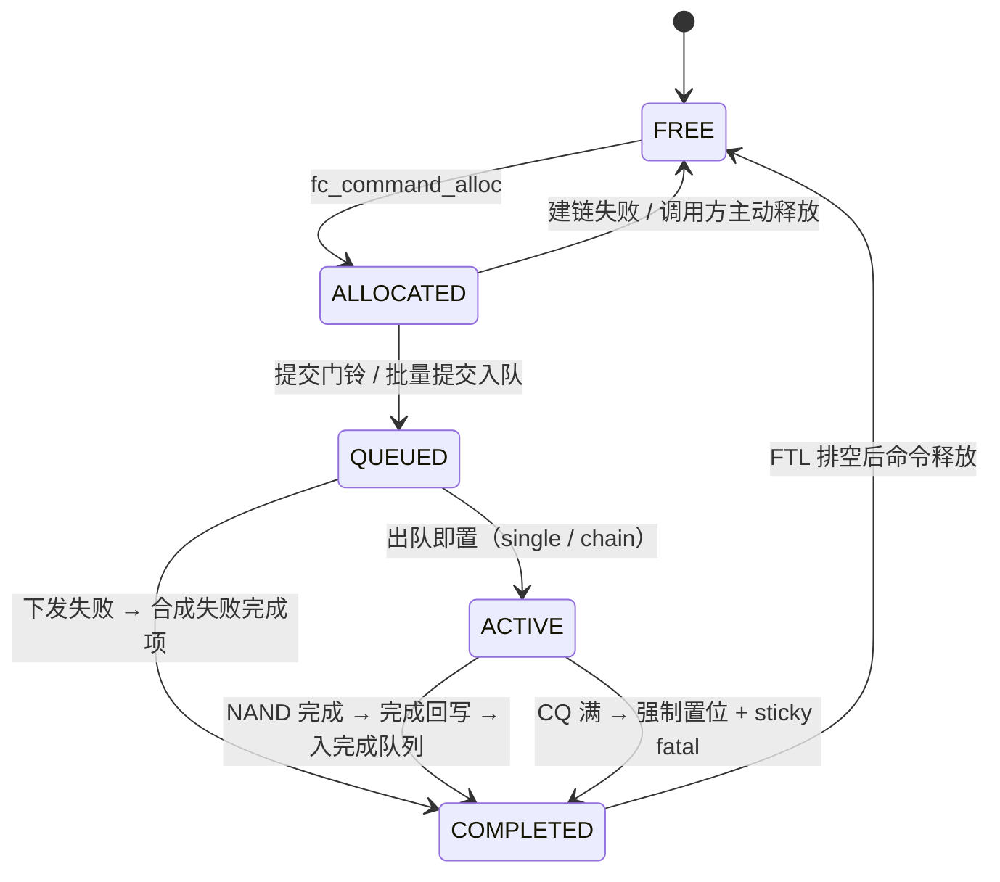

| 旁路 | 行为 |
|---|---|
| 失败命令 | 合成 NAND_FAIL 完成项（QUEUED → COMPLETED），不阻塞后续 |
| 完成队列满 | 强制置 COMPLETED + sticky fatal + 返回 `IO_ERROR`（§3.4） |

状态存放在命令状态表（FC 池模块），**不是命令体字段**——SQ 里的命令体提交后不可变（§4.5）。

**FC 服务单步**：

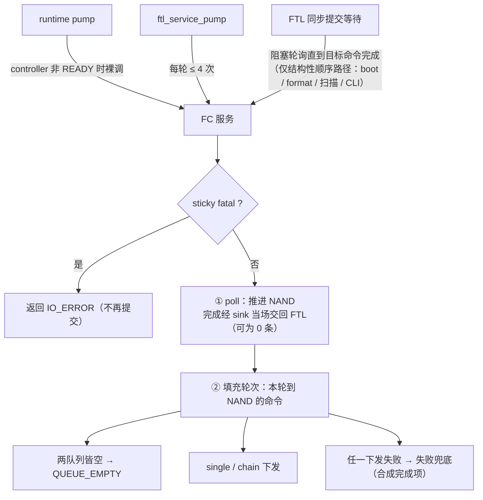

**读图要点**：① poll 与 ② 填充在同一轮都执行——有完成也不提前返回，否则持续有完成时
提交会被一直让位；sticky fatal 在入口与 poll 之后各查一次；下发失败不丢命令，一律合成
完成项。

**填充决策**见 §3.5.4（同一套准入与链锁）。**HSQ 优先只体现在扫描顺序**，不抢已进 FIFO 的命令（FIFO 严格先进先出）；HSQ / SQ 共用
同一张挂起表（HSQ 挂起的 LUN，SQ 本轮也跳过，避免优先级倒挂）；「忙」由 LUN 剩余槽查询
表达，没有 FC 侧 busy 表。

**一次读命令的走读**：

| 跳 | 位置 | 发生了什么 |
|---|---|---|
| 1 | FTL | 分配 command / desc / buffer，入 SQ；QUEUED |
| 2 | pump | 驱动 |
| 3 | FC 服务 ① | 先推进 NAND（首轮无完成） |
| 4 | FC 服务 ② | 扫描队列，按 LUN 剩余槽取命令 |
| 5 | single → 请求构建 | 置 ACTIVE；构建请求 |
| 6 | dispatch 提交 | 门控通过 → 入 per-LUN FIFO → 加载型任务 |
| 7 | 下一轮 poll | 队头事务发起（加载型）→ ISSUE |
| 8 | UOP 引擎 | 00h / 地址 / 30h / CONFIRM → END |
| 9 | 逐 LUN 推进 | 等最短忙期到点，切等待型 + 取数型 |
| 10 | UOP 引擎 | WAIT_READY + 70h + DATA_OUT + CHECK_FAIL |
| 11 | 页缓冲拆分 | 页缓冲按 flat 号拆回各 CW buffer |
| 12 | 完成回写 | 写状态 / ECC；读解码（ECC / 解扰 / CRC / META） |
| 13 | 完成队列 | 入队；COMPLETED |
| 14 | FTL 排空 | 回调表推进状态机；命令释放 |

<a id="s4-3" name="s4-3"></a>

### 4.3 按 CW 子集读

**用途**：一页 4 个 CW，读恢复只需重读失败的那几个，不必重读整页。FC 提供「访问哪个 CW
集合」的表达能力；恢复流程的接线在 FTL（读恢复）。

**入口与语义**：按位图建链；`cw_bitmap` 是**建链形参**，不是命令字段。编号是 flat 绝对号
（§2.5），`0` = 空集。**两个整段入口共用同一套位图校验**：

```text
plane 位段 [plane_first, plane_last)：
  multi-plane：从 plane 0 起覆盖 plane_count 个
  单 plane：只覆盖命令 PAA 解出的 plane
允许位 = ((1 << (plane_count * CW_NUM)) - 1) << (plane_first * CW_NUM)
拒绝：位图为 0（忘填 = 空集，无隐式展开）；越出本命令 plane 位段（编程错误）
```

**建链约束**：

| 约束 | 行为 |
|---|---|
| 行地址 | 实参给出该 plane 的 page / block / lun；其 plane 位必须等于 `plane` |
| 同 plane 一致 | 同一 plane 的所有 CW 必须给同一行地址——一个 plane 一次只访问一个物理位置 |
| plane 段 | 必须落在本命令段内，越段拒绝 |
| CW 范围 | `cw >= CW_NUM` 拒绝 |
| 重复 flat 号 | 同一 `(plane, cw)` 追加两次 → 拒绝（位图是集合，重复置位会静默丢数据） |

`config.cw` 不参与建链、也不回写：链长、完成折叠、落位位图一律走 desc 链。

**读 op 的选择**（FC 命令保持「带数据输出」语义——建链、数据路径、完成判定都用它；
进入引擎前由选择逻辑改写成实际 op）：

| 条件 | 选用 op |
|---|---|
| 完整页位图 + 单 LUN（单 plane 12 / multi-plane 30 / OTP 28） | 保留原 op，30h 后直接整页输出 |
| 稀疏位图 + 单 LUN | 33（单 plane）/ 29（multi-plane）：只加载 |
| 多 LUN | 35（单 plane）/ 43（multi-plane）：ISSUE 型加载 |

**逐 CW 取数**：

| 场景 | 取数 op |
|---|---|
| 单 plane | 随机数据读（8）：05h-列-E0h |
| multi-plane | 随机数据读（41）：06h-列-行-E0h |

链推进：加载型 op 完成**不推进**槽位，从首个置位 bit 起发取数；取数型 op 完成后推进到下一个
置位 bit，直到总数哨兵。plane 与 CW 号都从同一个 flat 号算出。

**一次按 CW 子集读的时序**（读恢复重读 2 个 CW 为例）：

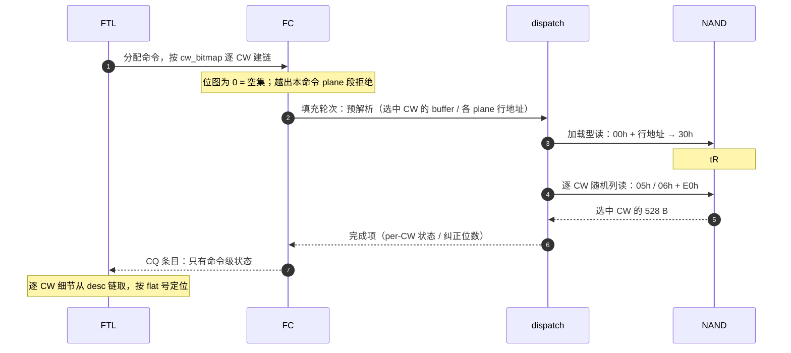

**读图要点**：位图是建链形参，不是命令字段——链长与完成折叠都由链推出来；加载型 op 只
加载一次，取数按置位 bit 逐个发；失败的 flat 号与请求位图同空间，FTL 可直接求交集。

**cache 读族不受影响**（13 / 14 / 15 / 45 / 46 / 47）：它们是 cache 管线机制，不是
「加载进页缓冲再逐 CW 取」。

**06h 取数的协议前提**：

```text
70h 轮询 → 06h → C1 → C2 → R1 → R2 → R3 → E0h → tR → Dout → 70h 轮询
```

Micron datasheet 三条前提：

1. `06h` 必须紧跟 two-plane 页读（00h-00h-30h）——本流程正是如此；
2. plane 由行地址 BA6 选择（PAA→行地址把 plane 编在 bit 6）；
3. two-plane 命令族要求器件内部 on-die ECC 关闭——本仓从不写 ECC feature（90h），
   内部 ECC 保持默认关闭。
   ⚠ 第 3 条的 datasheet 出处**待重核**（§7.1 与台账）。

**完成折叠**：

| 层 | 行为 |
|---|---|
| dispatch | 加载型：成功不写任何 per-CW 状态；失败刷满全部槽（加载失败后取数链不再启动） |
| FC | 沿 desc 链全链 OR 折叠状态；记录首个失败 CW 的 desc 号 |
| FC | **不聚合失败位图**——上层遍历 desc 链自取；位图编号与请求位图同空间，可直接求交集 |
| FC | 完成队列**不携带** per-CW ECC；命令级聚合取全链最大值（含两个 plane） |
| FC | Feature / META / ONFI 签名 / 列读的 4 字节返回值经控制器暂存拷进完成项（§4.5） |

<a id="s4-4" name="s4-4"></a>

### 4.4 cache run 与同步等待

| 路径 | 行为 |
|---|---|
| host I/O | 异步：FTL 完成登记后由排空回调完成 |
| cache 读 / cache program run | 按窗口组成链（MORE … END），可跨填充轮次、跨 USB chunk |
| boot / format / 出厂扫描 / CLI | FTL 同步提交等待，阻塞轮询（结构性顺序路径） |
| Read Retry | 三条独立命令 + 同步等待，**不是**链 |

**谁在组链**：

| 命令 | 链 | 说明 |
|---|---|---|
| host 读 / 写单条 | END | 单命令路径 |
| FTL cache 读 run / cache 写 run | MORE … END | 一条 USB chunk 内的连续页；可跨填充轮次 |
| GC 批量迁移（≥2 页 cache program 序列） | MORE … END | 一批一条链 |
| 元数据 / Checkpoint / Journal / 单页迁移 | END | 单命令 |
| Read Retry | END × 3 | 三条独立提交 + 同步等待 |

<a id="s4-5" name="s4-5"></a>

### 4.5 Feature 4 字节内联读

Feature 寄存器只有 4 字节，为它分配 desc 链 + buffer 是浪费。FC 让这类小返回走
**控制器侧暂存**——按 `cmd_id` 索引的 4 字节数组，位于 non-cacheable 段：

| 方向 | 动作 |
|---|---|
| SET_FEATURES | 建请求时把命令参数区的 4 字节拷进暂存；请求的第一个 CW buffer 指向暂存 |
| GET_FEATURES | 建请求时清零暂存；引擎把寄存器值写进暂存 |
| 完成 | 完成回写把暂存的 4 字节拷进完成项的参数字段 |

同一机制服务四条无 desc 的 4 字节读：GET_FEATURES、READ_META、READ_ONFI_SIGNATURE、
READ_COLUMN。

**为什么按 `cmd_id` 索引**：SQ 里的命令体提交后不可变。把返回值写回命令体会破坏这条
不变量（命令可能已被复用）；暂存是控制器侧状态，与命令体分离，完成队列组装时再取值。

<a id="s4-6" name="s4-6"></a>

### 4.6 Multi-plane 批次与页缓冲拼装

**两种数据传输模式**：

| 模式 | 操作 | 做法 |
|---|---|---|
| 直读（逐 CW） | 逐 CW 取数（8 / 41） | 每 CW 528 B 直接进该 CW buffer；不经页缓冲 |
| 页缓冲中转 | 单 LUN 完整页读（12 / 28）、所有编程、cache 读、multi-plane 带输出读 | 先拼 / 读到 (ch, ce, lun) 页缓冲，完成后按 flat 号拆回各 CW |

**拼装与拆分**见 §3.12.4 的流程图：写方向未选中的 CW 是「保持全 1」，不是跳过——器件要求
每个 plane 都有完整页；页缓冲路径的读方向按 flat 号拆回各 CW buffer，与建链顺序无关
（逐 CW 直读不经过这一步）。

**页缓冲为什么按 (ch, ce, lun) 各持一块**：编程的 ISSUE 常被 70h 忙轮询挡下——数据已拼好、
数据输入却要等下一轮；同一时刻另一个 LUN 也可能在拼自己的页。共用会被后驱动的 LUN 覆盖。

**multi-plane 的部分 plane 拦截**见 §3.12.5：器件无条件遍历全部 plane，调用者只给部分
plane 会静默编一页全 1；FC 在请求构建时双档拦截。

<!-- /doc-policy -->

---

<a id="s5" name="s5"></a>

## 5. 数据与状态模型

> 支撑摘要：P1~P4——结构体关系、字段归属、状态机、不变量、静态内存与断言判据。
> 本章是「改一个字段前先看谁在写」的索引。

<a id="s5-1" name="s5-1"></a>

### 5.1 结构体关系

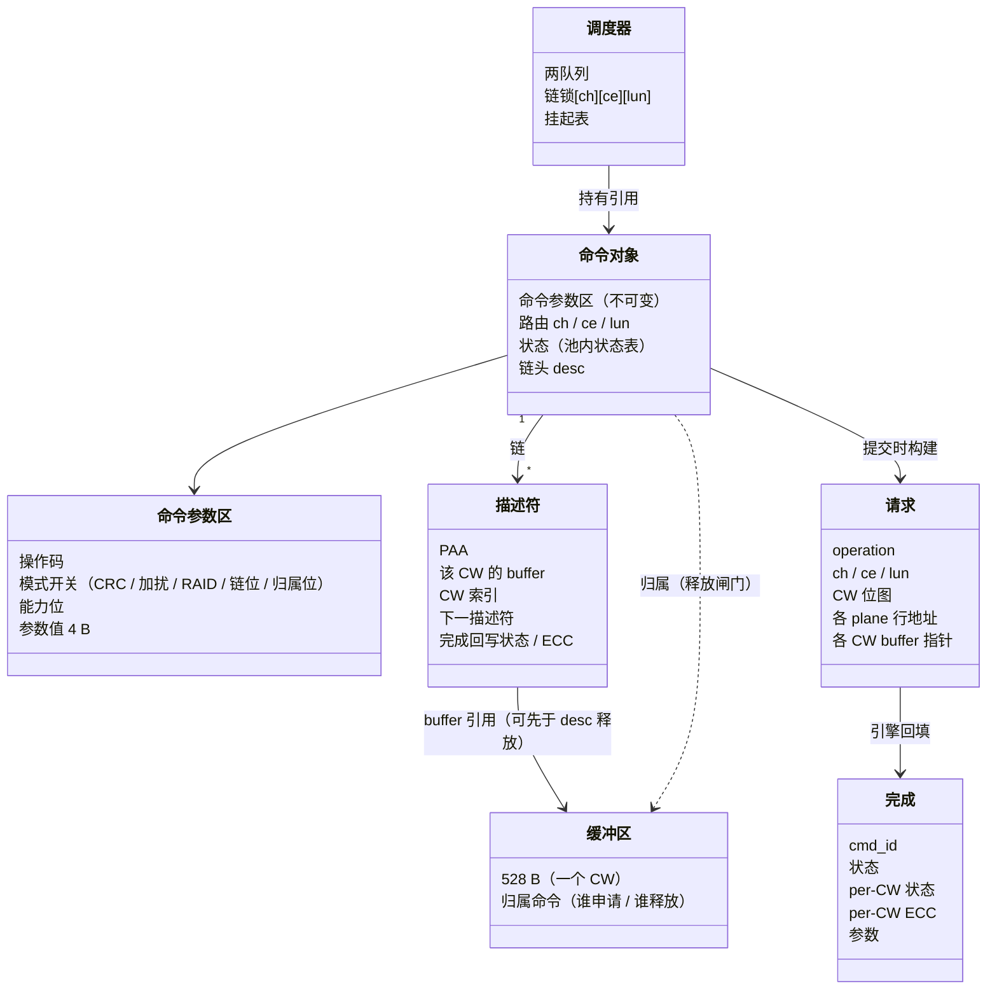

**读图要点**：命令对象拥有描述符链；buffer 只被 desc 引用、归属命令——单引用，所以「占用位 +
一次显式归还」就够，不需要引用计数；请求与完成是跨 dispatch 边界的一次性快照，不反指 FC 内部。

<a id="s5-2" name="s5-2"></a>

### 5.2 字段归属与单一写者

| 数据 | 唯一写者 | 唯一读者 / 消费点 |
|---|---|---|
| 命令参数区 | 上层（提交前） | FC 提交路径；**提交后不可变** |
| 命令状态 | 池内状态表（FC 池模块） | 调度器 / 完成 / 释放 |
| 描述符 PAA / 链 | 建链入口 | 请求构建 |
| 描述符状态 / ECC | 完成回写 | FTL |
| 池空闲链 | 池闸门 | 池闸门 |
| 池计数账本 | 池访问器 | 诊断 / 断言 |
| 链锁 | 调度器 | 调度器 |
| 配置暂存 | 请求构建 / 完成回写 | 完成队列 |
| 页缓冲 | dispatch | dispatch |

**判据**：同一语义的字段只有一个写者；出现第二个写者即缺陷（不变量靠外部手工维护，§5.4）。

<a id="s5-3" name="s5-3"></a>

### 5.3 状态机总表

| 对象 | 状态 | 迁移 |
|---|---|---|
| 命令 | 空闲 → 已分配 → 排队 → 执行 → 完成 → 空闲 | 见 §4.2 状态图 |
| LUN 槽 | 空闲 → ISSUE → ISSUED（最短忙期）→ FETCH → 空闲 | 见 §3.13 |
| UOP 引擎 | 未激活 / 激活 | 激活于事务发起；END 或错误停机 |
| 放行闩锁 | 0 / 1 | 探针成功后置 1，此后不变 |
| 完成队列 | 非满 / 满（sticky fatal） | 满即停机，不自动恢复 |
| buffer | 池内 / 已分配 / 已归还 | 归还幂等：`buffer_id` 抹成无效 |
| 描述符 | 池内 / 已挂链 / 已释放 | 出池即挂链（§5.4） |

<a id="s5-4" name="s5-4"></a>

### 5.4 不变量

- **链是 CW 集合的唯一真值**。命令拥有哪些 CW 只看描述符链；FC 没有第二套掩码。
  破坏后：两套坐标靠「链序 == plane-major」隐式对齐，空 plane 需要回填才不会误寻址。
- **描述符出池即挂链**。分配 → 填字段 → 挂链 → 分配 buffer；失败无需回滚。
  破坏后：出现「已出池未挂链」中间态，必须靠所有权链兜底，易漏。
- **三套地址单一漏斗**。PBA→PAA 只在 FTL 边界发生；FC 内只认 PAA 与命令对象的路由字段。
  破坏后：现场手写位操作 = 静默算错地址。
- **池闸门单点**。入池 / 出池只经池模块的闸门与账本访问器。
  破坏后：多本账各自手工维护，任一漏掉就永久漏账。
- **SQ 提交后不可变**。命令配置完即冻结；运行期返回值一律走完成队列。
  破坏后：命令被复用后上层读到脏值。
- **请求自包含**。dispatch 收到请求后不再回调 FC。
  破坏后：跨层回调把策略拖回硬件边界。

支撑这些不变量的两条附加约束：

- **链锁**：跨批的链在批边界上不被另一队列插队（§3.5）；没有它「链 = 连续槽」不成立。
- **池水位**：三个池的占用数只能由闸门改变，诊断读到的水位与实际空闲链一致。

<a id="s5-5" name="s5-5"></a>

### 5.5 静态内存模型

| 对象 | 数量 × 单项大小 | 性质 |
|---|---|---|
| 命令池 | 64 × 24 B | 固定数组，空闲链 O(1) |
| 描述符池 | 256 × 20 B | 固定数组，空闲链 O(1) |
| buffer 池 | 128 × 528 B | 固定数组，CW 即 buffer |
| 命令状态表 | 64 × 1 B | 与命令池同下标（`-fshort-enums`） |
| 提交队列 / 主机队列 / 完成队列 | 64 / 16 / 64 项 | 环形 |
| 每 LUN FIFO | 4 项 | 与链长上限一致 |
| 页缓冲 | 1 ×（页 × plane 数） | 按 (ch, ce, lun) 一份 |
| 配置暂存 | 64 × 4 B | 按 `cmd_id` 索引，non-cacheable |

**全部静态分配**：没有堆上分配；容量在编译期确定，池耗尽是可判定状态而非内存失败
（DRAM-less 主控的常规做法）。

<a id="s5-6" name="s5-6"></a>

### 5.6 断言判据

全工程判据在断言指南；本节只记 FC 层落点：

| # | 判据 | 落点 |
|---|---|---|
| 1 | **外部输入校验保留返回码** | 只有来自 host / CLI / 介质读回的字节才返回错误码。判定标准是「值从哪来」，不是「声明在哪个头文件」 |
| 2 | **调用者已保证的前置条件转断言** | `static` 函数、内部头、跨层入口中调用者必然传有效值的指针 / 索引 ⇒ 断言；删掉 `return` 与恢复分支 |
| 3 | **资源类结果与运行时状态保留返回码** | 池耗尽、完成队列满、NAND 报告错误、实例未激活这类「此刻能不能做」的状态 ⇒ 返回状态 |
| 4 | **单测固化为契约的守卫保留返回码** | 仅当测试是被测函数的正当调用者（校验器、文档化 no-op） |

**不用 ASSUME**：恢复分支既已手工删掉，编译器不可达标记在未开 LTO 时换不来代码生成收益；
而它把「违反即 UB」引入一条本来只会 HardFault 的路径——同样是崩，断言的现场更可定位。

**判据 2 的补丁：release 档必须另有拒绝**。判据 2 假设「断言消失后坏状态会以别的方式暴露」；
有一类配置错误不满足——违反之后程序照常跑完、不报错，只是**悄悄写坏介质**（首例：multi-plane
窄位图，§3.12.5）。对这类错误，断言之外必须再补一道 release 运行期拒绝（返回
`INVALID_ARGUMENT`，由调用者转成命令失败并合成 NAND_FAIL 完成项），否则 release 档等于没有守卫。

**写断言前先问「它能否失败」**：恒真断言比没有更糟；每条断言必须能构造一个必然失败的负例。
只在测试会走的分支按判据 2 转断言时，相应用例一并删除——用例验证的行为届时已不存在。

> 测试固件走 debug 档，断言在板上是活的：任何误判会让板子停机而不是报用例失败。
> 改动这些守卫后必须上板跑对应套件。

---

<!-- doc-policy: allow platform -->
<a id="s6" name="s6"></a>

## 6. 设计取舍索引

> 支撑摘要：P1、P4、P5——每个取舍的判据与主流对照集中在 §6.2；§6.3 给与行业主控的整体差距，
> 逐项限制与代价在 §7.2。

<a id="s6-1" name="s6-1"></a>

### 6.1 决策索引

| # | 决策 | 判据 | 正文 |
|---|---|---|---|
| 1 | 空闲链而非遍历查找 | 分配 / 释放 O(1)，池加深时性能不退化 | §3.2 |
| 2 | buffer 与描述符解耦 | 不可纠时先归还 buffer，只保留描述符做错误处理 | §3.2 |
| 3 | 命令计数是「数量减一」，描述符索引是「当前索引」 | 命令侧省位宽；描述符侧需要逐 CW 定位 | §3.3 |
| 4 | PAA 不含 ch / ce | 通道与片选是命令级路由；PAA 只编码芯片内地址 | §2.3 |
| 5 | ≤ 4 B 的返回值不分配描述符 | 走控制器侧 4 字节暂存；命令体提交后不可变 | §4.5 |
| 6 | 完成路由不进完成队列 | FTL 概念由 FTL 请求表按 `cmd_id` 保存；完成队列只带标识 / 状态 / 参数 | §3.4 |
| 7 | 数据搬运与建链策略在 FTL | 判据是硬件 FCC 寄存器表（§6.2.3） | §6.2 |
| 8 | 软件微码 + 协作式让出 | 无硬件 micro-sequencer；单线程轮询模型 | §3.8 |
| 9 | 页缓冲按 (ch, ce, lun) | ISSUE 段数据已拼好但要等下一轮；共用会被其他 LUN 覆盖 | §3.12 |
| 10 | 时序参数化 + PCC 精确换算 | 换器件 / 电压域只换表，不硬编码周期数 | §3.14 |

<a id="s6-2" name="s6-2"></a>

### 6.2 分层模型与接口判据

本节是**防止 FC 接口再次长胖**的判据：每加一个对外函数，先拿它比对「硬件 FCC 寄存器表」。

<a id="s6-2-1" name="s6-2-1"></a>

#### 6.2.1 行业分层

```text
   Host
    │  NVMe SQ/CQ + doorbell + MSI-X（或 eMMC CMDQ Task Descriptor List）
    ▼
 ┌─────────────┐
 │  HIL        │  协议解析、队列管理、doorbell 响应
 ├─────────────┤
 │  FTL        │  L2P、GC、WL、坏块管理、掉电恢复、缓冲调度
 ├─────────────┤
 │  FCC        │  硬件：通道 / CE / LUN / plane 时序、描述符链执行、ECC、加扰、DMA
 ├─────────────┤
 │  DRAM       │  映射表 / 命令队列 / 数据缓冲
 └─────────────┘
    │  ONFI / toggle 总线
    ▼
  NAND die ── channel → chip → die → plane → block → page → CW
```

**主机接口三种代表，本质相同**：

| 形态 | 提交 | 完成 | 描述符 |
|---|---|---|---|
| NVMe | SQ 写命令 + doorbell | CQ + MSI-X | PRP / SGL |
| eMMC CMDQ | Task Descriptor List（CMD44 / 45） | Task 完成 + 中断 | 数据地址 / 方向 / 块数 |
| OCSSD / ZNS | 裸写指针 / zone 追加 | 完成队列 | 极简，设备侧几乎无 FTL |

共同点：设备侧固件拿到的是**已解析的请求**（地址 + 数据缓冲 + 操作类型）；「访问哪些物理单元」
「数据怎么搬」归固件，硬件接口只负责排队、执行、回完成。

<a id="s6-2-2" name="s6-2-2"></a>

#### 6.2.2 本项目的映射

| 行业部件 | 本项目 | 说明 |
|---|---|---|
| HIL | HIL 模块 + 主循环 | 主机前端、请求表示与路由、完成回执；主循环只做泵 |
| FTL | FTL 模块 | L2P、GC、WL、Journal、Checkpoint、BBT |
| FCC（硬件） | FC 模块 + NAND 模块 | **两者合起来才等于行业的一个硬件 FCC** |
| DRAM | FC buffer 池（128 × 528 B）+ FTL 的片上数组 | DRAM-less：buffer 池就是片上页缓冲 |

FC 模块与 NAND 模块的分界是 **FCC 的内部再拆分**：

| 部分 | 职责 |
|---|---|
| NAND 模块（UOP 序列表 + 时序后端 + 器件模型）= 时序执行单元 | 发命令、等 R/B#、搬数据 |
| FC 模块（三池 + 描述符链 + 队列 + 数据路径）= FCC 前端 | 描述符链、队列、ECC / 加扰 / RAID |

两者之间的请求结构就是行业 FCC 内部的「已解析请求」寄存器组。它携带的语义只有四组：

| 语义组 | 内容 |
|---|---|
| 操作类型 | 操作码（含 multi-plane / cache 族） |
| 目标 | 通道 / 片选 / LUN；各 plane 的行地址 |
| 数据面 | CW 位图（flat 绝对号，0 = 空集）；各 CW 的数据缓冲指针 |
| 状态面 | 页类型（解码阈值选择）；Feature 寄存器地址 |

**下界**：FC 模块必须在提交时把描述符链解析完并交出各 CW 缓冲指针，dispatch 之后**不再回调 FC**。
故「造请求者必须拥有 buffer 池」——FC 不能整体下沉到 FTL。

<a id="s6-2-3" name="s6-2-3"></a>

#### 6.2.3 判据：硬件 FCC 寄存器表

> 拿 FC 的每个对外函数去比对硬件 FCC 的寄存器表——**有对应项则保留，无对应项则剔除。**

| 对外函数 | 硬件 FCC 的对应物 | 判定 |
|---|---|---|
| FC 初始化 | 复位 / 配置寄存器 | 保留 |
| 命令槽取 / 还 | 命令槽取 / 还 | 保留 |
| 填描述符（含带 buffer 版） | 填一条描述符 | 保留（**唯一建链入口**） |
| 描述符链释放 | 描述符链释放（链在 FC 的池里） | 保留（建链失败回滚入口） |
| 提交门铃 / 批量提交 | 写门铃 | 保留 |
| FC 服务 | 控制器自跑（软件必须显式化） | 保留 |
| 取完成 / 批量取完成 | 读完成队列 | 保留 |
| buffer 分配 / 释放 / 取 USER 首址 / 取 CW 基址 / 取 META | 数据缓冲（下界强制 FC 持有） | 保留 |
| 取命令数据指针 | 读第 n 条描述符取缓冲地址 | 保留 |
| 读命令 CW 位图 / 全 CW 空判据 | 读描述符链 | 保留 |
| 命令级 ECC 最大值 | 完成聚合寄存器（纠错计数） | 保留 |
| 按 ID 取命令 / 取描述符 | ID→指针（软件模拟必需） | 保留 |
| 资源统计 / 调试快照 / 开机资源报告 | 状态寄存器 / 诊断 | 保留 |
| 测试完成 seam | 测试 seam（测试开关下编译） | 保留 |
| 按位图建链（FTL 侧，非 FC API） | **无此寄存器**（描述符链是固件填的） | 归 FTL |
| 数据搬入 / 数据搬出（FTL 侧，非 FC API） | **无此寄存器**（数据是固件搬的） | 归 FTL |

<a id="s6-2-4" name="s6-2-4"></a>

#### 6.2.4 为什么这两件事在固件侧

硬件 FCC 拿到的描述符链已经决定好「访问哪些 CW」、数据已经在某个缓冲里——它**不解释位图**
（位图是固件的策略产物），也**不搬数据**（数据搬运由 DMA 引擎按描述符地址做，「往哪个缓冲拷、
按什么顺序拷」由固件决定）。OCSSD / ZNS 这类设备侧极简 FTL 的设计方向印证同一点：

> **越靠近硬件，接口越只谈机制；策略越往上放。**

<a id="s6-2-5" name="s6-2-5"></a>

#### 6.2.5 反例：为什么不按「六原语」重构

曾考虑把 FC 收敛成「申请 / 释放命令、申请 / 释放描述符、申请 / 释放 buffer」六个裸池原语。
按 §6.2.3 判据这是**反向**的：行业 FCC 是「队列 + 门铃 + 完成」模型，裸池原语会把 FC 变成
内存分配器，偏离硬件形态。故不做。

<a id="s6-3" name="s6-3"></a>

### 6.3 与行业主控的差距

本项目的目标平台是通用 MCU + 1 颗 SLC NAND，与专用 SSD 主控存在硬件代差。本节给**整体对比**；
逐项「差异 → 限制 → 本仓选择」与由此产生的限制见 §7.2。这些是**平台边界**，不是实现选择——
写代码时不要试图「优化掉」这些差异。

| 维度 | 企业级 NVMe | 消费级 NVMe / SATA | 本仓 |
|---|---|---|---|
| 控制器 | 专用 ASIC + 多核 | 专用 ASIC + CPU | **通用 MCU** |
| DRAM | 数 GB DDR | 256 MB 级 / HMB | **0（DRAM-less，片上 SRAM）** |
| NAND 通道 | 8~32 | 4~8 | **1 ch × 1 ce × 1 lun** |
| ECC | 硬件 LDPC（Gbps 级） | 硬件 LDPC / BCH | **软件 BCH** |
| 数据搬运 | 硬件 DMA 多通道 | 硬件 DMA | **无 DMA 请求线，PIO** |
| 加扰 / RAID | 硬件 inline / XOR 引擎 | 部分硬件 | **软件 LFSR / 软件 XOR** |
| 调度 | 硬件队列 + 固件调度器 | 同 | **软件三队列 + 单线程轮询** |
| 中断 | 命令完成中断 + MSI-X | 同 | **纯主循环轮询（R/B# GPIO）** |

**定位**：本仓在一颗 MCU 上复现 FCC 的分层、队列 + 门铃 + 完成、数据面轮询与通道并行仲裁的
**软件形态**。硬件代差不可能消除，能对齐的是**结构**——谁拥有描述符链、谁解释位图、谁搬数据、
完成怎么回。判据始终是「主流主控怎么做」，不是「Linux 怎么做」。

<!-- /doc-policy -->

---

<!-- doc-policy: allow platform -->
<a id="s7" name="s7"></a>

## 7. 未验证状态与已知限制

> 支撑摘要：§0 的「范围与非目标」落到具体条目。设计文档只给**结论**；缺陷与风险的台账见
> 未闭合台账，测试矩阵见 FC→NAND UT 文档。

<a id="s7-1" name="s7-1"></a>

### 7.1 未验证状态

| 项 | 状态 | 判据 / 出口 |
|---|---|---|
| RAID | 代码完成，编译开关保持关闭 | 开关打开后需上板验证；设计上已按「RAID 透明」隔离（§3.7） |
| 多 LUN 相位机 | 能力已实现，平台只有 1 个 LUN ⇒ 从未被触发 | 换多 LUN 器件后上板验证（§3.13） |
| 06h 取数的 on-die ECC 前提 | datasheet 出处待重核 | 当前从不写 ECC feature（90h），默认关闭；上板行为是最终判据（§4.3） |
| 时序余量 | 固定 1 周期余量，未做擦 / 写 / 读压力确认 | 稳定后再评估收紧（§3.14.6） |
| QoS | 没有专门读饥饿保护 | 单 LUN 下近乎无效，多 LUN 平台重启（§7.2） |

测试入口、套件与运行方式见 `docs/design/fc_nand_ut.md`；分层测试流程见
`docs/guides/testing_guide.md`。UT 先构建后测试，构建目标未按测试开关重编时测试是空操作——
完整命令以 UT 文档为准。

<a id="s7-2" name="s7-2"></a>

### 7.2 已知限制

**平台代差逐项**（差异 → 限制 → 本仓选择与代价）：

| 维度 | 行业做法 | 本仓限制 | 选择与代价 |
|---|---|---|---|
| L2P 表 | DRAM 常驻全表 | 无 DRAM | 全表落 NAND，片上用 region cache + CLOCK 替换；miss 时读一个 region |
| 通道并行 | 命令级并发 | 单条并行总线 | ISSUE / WAIT / FETCH 软件近似：只重叠等待时间，不并行搬数据 |
| ECC | 硬件 LDPC 引擎 | MCU 无 ECC 外设 | 软件 BCH；吞吐受 CPU 限制，纠错能力只够 SLC |
| 数据搬移 | per-channel DMA | 无 DMA 请求线 | PIO 逐字节读写；占用 CPU 周期 |
| 加扰 | DMA 内 inline | 无 | 软件 LFSR，种子 = 本 CW 扇区 LBA |
| RAID | 硬件 XOR | 无 | 软件 XOR（加扰域内），当前未启用 |
| 命令队列 | 硬件多队列 + 中断 | 无 | 软件三队列 + 单线程 FC 服务；中断只用于 UART / USB，不推进 NAND |
| 页缓冲 | 控制器 SRAM + 硬件拼接 | 无 | 软件页缓冲按 (ch, ce, lun) + CPU 拷贝拼 / 拆 |

**QoS 现状**：没有专门的读饥饿保护。填充轮次只按「HSQ 优先 + 按 LUN 保序」选命令，不做读写
计数，也不做读优先旋转——当前平台只有一个 LUN，写 / 擦命令占住唯一 LUN 时读命令本来就要等，
软件层没有「切到另一个 LUN」的余地。与优先级有关的机制只有两条：

| 机制 | 作用 | 边界 |
|---|---|---|
| HSQ 优先 | 填充轮次先扫 HSQ 再扫 SQ | 只影响**扫描顺序**，不抢已进 FIFO 的命令 |
| 同 LUN 保序 | per-LUN FIFO 严格先进先出 | 同 LUN 后到的命令不能插队；跨 LUN 可并发（待多 LUN 平台） |

多 LUN / 多通道平台若要重启 QoS，先确认「WAIT 段可切 LUN」（§3.13.4），再决定是否需要额外
的读写混合策略。

**多通道缺口**：调度层已按三维数组编写，改通道数即可复用；缺的是后端 base 表与各 bank 初始化、
MPU 区、DMA、事务级 target id、每通道 R/B# 中断（§3.13.4）。

**按 CW 子集读的风险**：

| # | 风险 | 后果 / 当前缓解 |
|---|---|---|
| 1 | 生产者忘填 CW 位图 | 0 = 空集。debug 有断言；release 下断言裁空 ⇒ **静默空操作**，命令「成功」但没访问任何 CW。整段访问必须用整段位图 |
| 2 | multi-plane 部分 plane 位图为 0 | 器件会把点名 plane **全部编程** ⇒ 静默写一页全 1。已双档拦截（断言 + release 返回无效参数，§3.12.5） |
| 3 | 同一 (plane, cw) 重复建链 | 断言；release 裁空 ⇒ 后一个描述符覆盖前一个的数据槽。可达路径是两个 LBA 解析到同一 plane |
| 4 | 06h 的 on-die ECC 前提出处未核对 | 若器件默认开启内部 ECC，多 plane 路径失效。当前不写 90h，默认关闭；上板行为是最终判据 |
| 5 | multi-plane 不属于 ONFI 1.0 | ONFI 1.0 全文无 plane；multi-plane 来自器件 datasheet。文档与代码不得把它写成「ONFI 规定」 |

**平台边界不是 TODO**：上表里的「限制」多数来自硬件代差（单总线、无 DMA、无 DRAM、单 LUN），
不是尚未实现的软件功能。真正可做而没做的只有 §7.1 列出的少数几项。

<!-- /doc-policy -->

---

<!-- doc-policy: allow platform -->
<a id="s8" name="s8"></a>

## 8. 附录

<a id="s8-a" name="s8-a"></a>

### 8.A 常量与阈值

数值的**来源**在器件描述头、几何契约与 FC 公共头；本章只汇总，不复制定义。

| 组 | 项 | 值 / 规则 |
|---|---|---|
| 几何 | 页 / CW / 块 / plane / LUN / 通道 | 2112 B / 每页 4 个 528 B / 每块 64 页 / 每 plane 2048 块 / 2 plane / 1 LUN / 1 ch × 1 ce |
| 池 | 命令 / 描述符 / buffer | 64 × 24 B / 256 × 20 B / 128 × 528 B |
| 队列 | 提交 / 主机 / 完成 / 每 LUN FIFO | 64 / 16 / 64 / 4 |
| 链 | 长度上限 | 4（= 每 LUN FIFO 深度） |
| 微码 | UOP 类型 / 后端 handler / 单次步数 | 15 / 13 / 64 |
| 协议 | 操作码总数 | 51 |
| 超时 | 判据 | 时间 + 轮询计数双条件 |
| 介质 | 空页判据 | 全 CW 的 1 比特占比 ≥ 99% |
| 时序 | 模式 / PCC / FMC 内核时钟 | Mode 5（boot 后切换）/ SET = 4、WAIT = 3、HOLD = 2、HiZ = 5、TCLR = 3、TAR = 3 / 200 MHz |
| 时序 | 相对手册最小值余量 | ≥ 5 ns（Setup / Wait 各留 1 周期板级余量） |
| 编译开关 | 时序模式 | `CONFIG_NAND_TIMING_MODE`，默认 5（0 = 全程低速） |
| 编译开关 | RAID | `CONFIG_FC_RAID`，**保持 0**（功能完成但未验证） |
| 编译开关 | 测试 seam | `FC_NAND_TEST_ENABLE`，只在测试档定义 |

<a id="s8-b" name="s8-b"></a>

### 8.B 结构索引

字段语义与单一写者见 §5.2；类型定义与函数签名以头文件为准。

| 结构 | 归属 | 用途 |
|---|---|---|
| 命令对象 / 命令参数区 | FC | 上层提交的不可变配置 + 运行期链头 |
| 描述符 | FC | 一个 CW 的 PAA / buffer / 链指针 / 完成回写 |
| 调度器 | FC | 两队列、链锁、挂起表 |
| 池控制块 | FC | 空闲链 + 水位账本 |
| dispatch 请求 | 跨边界 | 一次已解析的操作快照 |
| dispatch 完成 | 跨边界 | 引擎回填的状态与 per-CW 结果 |
| 协议表项 | NAND | 操作码的命令字节 / 周期 / 序列 / 时序 |
| UOP | NAND | 一条微指令 |
| FMC 后端实例 | NAND | per-(ch, ce) 的窗口配置与 handler 表 |
| NAND 事务 | NAND | 引擎状态 + 请求 + 完成 |
| LUN 槽 | NAND | 相位机状态与 FIFO |

<a id="s8-c" name="s8-c"></a>

### 8.C 静默失效与证据清单

**本层主导失效模式是「静默失效」**：跑通、零告警、断言全绿，但功能从未生效。改动后逐条自查：

| 症状 | 自查问题 |
|---|---|
| CRC 恒通过 | 校验范围覆盖了 USER 吗？有失败负例吗？ |
| 状态字节被丢弃 | 完成结构里回读的状态与器件实际状态一致吗？ |
| 各 plane 行地址未填 | 每 plane 的行地址都填了吗，还是只有 plane 0？ |
| 断言恒真 | 能否构造一个必然让它失败的负例？ |
| 只验一条就宣称全验过 | 位图 / plane / 命令族的分支各验了吗？ |
| 加载成功但没人取数 | 取数链真的启动了，还是完成即结束？ |

**编译期无声的三类量**：建链语义、位图、地址。碰这三类必须上板；纯路径 / 文件名移动且脚本
内容不变时，构建加链接器参数确认即可。

**「看起来像证据」不是证据**：调试器读可缓存内存、未断电的保留段、完整 banner 都不证明
行为正确。证据必须是可复现的板端输出或带负例的检查器结果。

<a id="s8-d" name="s8-d"></a>

### 8.D 术语表

| 缩写 | 全称 | 含义 |
|---|---|---|
| HIL | Host Interface Layer (主机接口层) | 协议解析、队列管理、完成回执 |
| FTL | Flash Translation Layer (闪存转换层) | 映射、GC、掉电恢复 |
| FCC | Flash Channel Controller (闪存通道控制器) | 本仓用软件复现的硬件控制器 |
| L2P | logical-to-physical (逻辑到物理映射表) | 逻辑地址 → 物理地址的映射 |
| PAA | physical array address (物理阵列地址) | FC 层唯一的芯片内地址；不含 ch / ce |
| PBA | physical block address (物理块地址) | 系统物理地址，FTL 内部使用；带 ch / ce |
| LBA | logical block address (逻辑块地址) | 主机寻址单位，512 B 扇区 |
| CW | codeword (码字) | 528 B 编解码单位：META + CRC + USER + ECC parity |
| META | metadata (元数据) | 每个 CW 前 4 字节，存该 CW 的扇区 LBA |
| SB | super block (超级块) | 跨 plane 的逻辑擦除单元 |
| BBT | bad block table (坏块表) | 坏块记录 |
| GC | garbage collection (垃圾回收) | 回收无效页、搬移有效页 |
| WL | wear leveling (磨损均衡) | 均衡各块擦写次数 |
| CP | checkpoint (检查点) | 映射表与状态的周期落盘 |
| VWC | volatile write cache (易失写缓存) | 写先回执、后落盘的缓存语义 |
| ECC | error correction code (纠错码) | 本仓为软件 BCH |
| RAID | redundant array of independent disks (独立磁盘冗余阵列) | 本仓为 CW 间 XOR 条带 |
| ONFI | Open NAND Flash Interface (NAND 开放接口标准) | 命令集与时序标准 |
| LUN | logical unit number (逻辑单元号) | 器件内独立寻址单元 |
| CE | chip enable (片选) | 器件级选通信号 |
| R/B# | Ready/Busy# (忙闲输出) | 低 = 忙 |

<!-- /doc-policy -->
