# FC-NAND 层设计

> **范围**：FC（Flash Controller）固件层与 NAND 底层驱动——`include/fc/`、`src/fc/`、
> `include/nand/`、`src/nand/`。上游是 FTL（`docs/design/ftl_design.md`），
> 下游是 MT29F4G08ABADAWP 器件（FMC 并口）。
>
> **目标硬件**：STM32H743 + MT29F4G08ABADAWP；1 ch × 1 CE × 1 LUN × 2 plane ×
> 2048 block × 64 page，2112 B/page（4 × 528 B CW），512 MiB SLC，ONFI 1.0。
>
> **本文只写当前设计**：分层、结构体、契约、机制与取舍理由。
> 演进过程、被否方案、版本与验证记录见 `docs/design/revision_history/fc_nand_revision_history.md`；
> 缺陷与未验证项见 `docs/design/known_open_items.md` / `docs/design/known_open_items.md`。
> §26 的分层对照同时是 `docs/reference/` 的判据。
>
> 图目录与源码锚点见附录 A，推荐阅读顺序见附录 B。

---

## 1. 整体架构层次

FC 层是硬件 FCC（Flash Controller Core，SSD 主控里负责 NAND 通道与编解码的硬件块）的
**软件替身**：它提供槽位 / 描述符 / 队列 / 数据路径，**不含策略**——访问哪些 CW 由 FTL 决定，
数据搬运也由 FTL 做。

```
┌────────────────────────────────────────────────────────────────┐
│ 上层：FTL（`src/ftl/`，设计见 ftl_design.md）                     │
├────────────────────────────────────────────────────────────────┤
│ FC 固件层（`include/fc/` + `src/fc/`）                            │
│   fc.h             公共 umbrella（只 include，不定义）            │
│   fc_interface.h   对外 API + 池/队列/布局常量                    │
│   fc_types.h       状态码 fc_status_e + 资源 ID 类型              │
│   fc_command.h     命令/描述符/CQ 结构 + 状态位 + CW 位图工具      │
│   fc_queue.h       SQ / HSQ / CQ 环形队列                        │
│   fc_data_path.h   编解码编排（META→CRC→加扰→ECC→RAID）           │
│   *_engine.h       crc / random / bch / ecc / raid 引擎           │
│   internal/        池与控制器私有契约（`fc_pool.h`、`fc_internal.h`）│
│   fc.c             初始化、提交/填充/完成调度、服务主循环、诊断    │
│   fc_pool.c        三池、空闲链表、生命周期、建链与链释放          │
├────────────────────────────────────────────────────────────────┤
│ NAND 调度桥接（`src/fc/fc_nand_dispatch.c`）                      │
│   每 LUN 一条定深 FIFO（深 4），FC 请求 → NAND 执行 → 完成回传    │
├────────────────────────────────────────────────────────────────┤
│ NAND 执行引擎（`src/fc/fc_nand_engine.c`）                        │
│   UOP 微序列解释器（`fc_uop_engine_*`）+ 事务（`fc_nand_*`）      │
│   器件级操作：RESET / READ_ID / 参数页 / 时序模式切换              │
├────────────────────────────────────────────────────────────────┤
│ NAND 协议与硬件后端（`src/nand/`）                                │
│   onfi_1_0.c     51 个 OP 码的 UOP 序列表 + 协议属性              │
│   nand_fmc.c     FMC 后端，13 个 UOP handler，数据阶段固定 PIO     │
│   devices/mt29f___g08a.c  器件几何、时序表、探针                   │
└────────────────────────────────────────────────────────────────┘
```

设计原则：

1. **固定资源池 + 空闲链表**：Command / Descriptor / Buffer 三池在 `.bss` 静态分配，
   O(1) 分配释放，无动态内存。
2. **ID 引用代替指针**：池内资源一律 16 位 ID（0xFFFF = 无效）；跨模块接口传 ID，
   ID→指针转换只在 FC 内部发生。
3. **内部状态不外泄**：`fc_ctl_s` 定义在 `src/fc/internal/fc_internal.h`，仅 `fc.c` /
   `fc_pool.c` 可见；对外只有函数接口。
4. **异步非阻塞**：提交立即返回，推进全部发生在 `fc_service()` 轮询里；
   `fc_poll_completion[_s]()` 取完成。
5. **分层防火墙**：FC 只消费硬件真正需要的字段，FTL 概念（策略、数据搬运、完成路由）
   不进入 FC（§13）。

### 图 1：分层与数据流总览

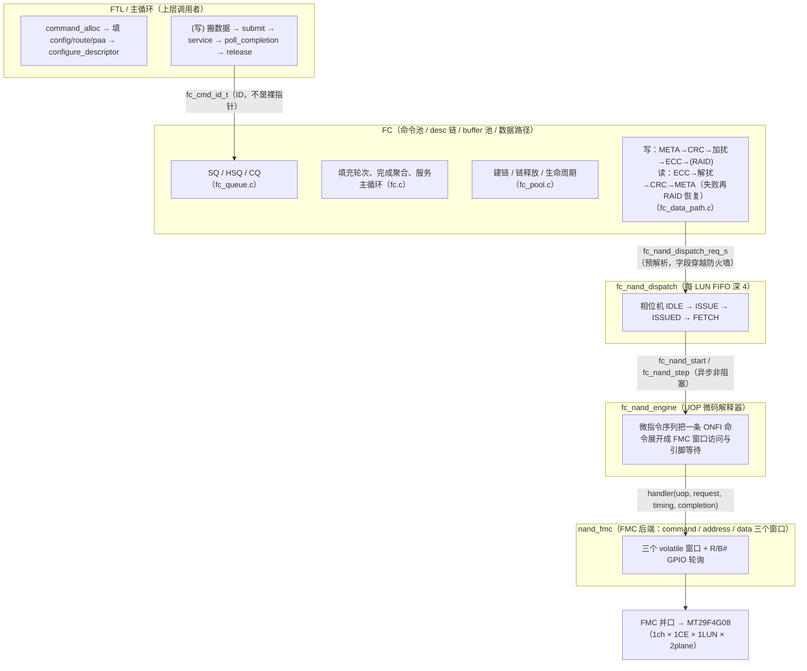

**阅读要点**：越往下越贴近硬件。`fc_nand_dispatch_req_s` 是 FC 固件与 NAND 硬件引擎之间的
防火墙——只有硬件要消费的字段才跨越（§13）。

---

## 2. FC 模块详细设计

### 2.1 资源池

| 资源池 | 深度 | 元素 | 用途 |
|--------|------|------|------|
| Command Pool | 64 | `fc_cmd_s`（24 B） | 命令控制块，对应一个 SQ 槽位 |
| Descriptor Pool | 256 | `fc_desc_s`（20 B） | per-CW 描述（PAA + buffer + 状态） |
| Buffer Pool | 128 | 528 B（一个 CW） | CW 数据缓冲 |

- **64 命令**：覆盖一个 block 的全部 64 页，支持流水提交。
- **256 描述符**：一条命令的 desc 数 = `cw_bitmap` 置位数（最多 `CW_TOTAL_MAX = 8`：2 plane × 4 CW）⇒ 最多 **32 条**满额命令同时在链。真正的并发上限由 desc / buffer 决定，不是命令池的 64；见 `known_open_items.md` RISK-POOL-12。
- **128 缓冲**：与描述符 1:2，一条满额命令占 8 个 buffer；并发上限 16 条满额命令。

每个 Buffer 是一个完整 CW，布局固定：

```
[META:4][CRC:4][USER:512][PARITY:8] = 528 B
 ^ 0     ^ 4     ^ 8        ^ 520
```

- `FC_BUFFER_USER_OFFSET (8U)`：USER 区偏移；`FC_BUFFER_USER_SIZE (512U)`：暴露给 FTL；
  `FC_BUFFER_DATA_SIZE (520U)`：META+CRC+USER，加扰与 ECC 的输入长度。
- `fc_buffer_get_user_data()` 返回 USER 首址（FTL 用）；`fc_buffer_get_base()` 返回 CW 基址
  （META 开头，FC 数据路径用）。

各模块处理的数据范围——**边界不同，因为各自要解决的问题不同**：

| 模块 | 范围 | 写入/读取位置 | 理由 |
|------|------|---------------|------|
| CRC-32 | USER 512 B | 值写 `[4,8)` | 只保护用户数据 |
| 加扰 | `[8,520)` | 原地 | META/CRC 必须保持明文，读路径才能自举种子（§5.4） |
| ECC（BCH） | `[0,520)` → `[520,528)` | 输入 520 B，parity 写 8 B | 覆盖 META/CRC/USER |
| RAID XOR | 全 528 B | 原地读 | 保护含 parity 的整条 CW |

池外还有一组**簿记数组**（本体是 `fc_pool.c` 文件作用域数组，控制器只存指针）：

| 数组 | 深度 | 用途 |
|------|------|------|
| `command_free_next[]` / `descriptor_free_next[]` / `buffer_free_next[]` | 64/256/128 | 三条空闲链的 next（下标即 ID） |
| `command_state[]` | 64 | 命令生命周期状态（FREE/ALLOCATED/QUEUED/ACTIVE/COMPLETED） |
| `descriptor_owner[]` | 256 | desc → 归属命令 ID，提交校验与统计的 O(1) 反查 |
| `buffer_state[]` / `buffer_owner[]` | 128 | buffer 占用状态与归属命令（未挂链时 = INVALID），释放闸门用它拒绝双释放 |

**建链不变量：desc 出池即挂链。** 建链顺序是 *分配 desc → 填字段 → 挂链 → 分配 buffer*。
buffer 池（128）小于 desc 池（256），"desc 成功而 buffer 失败"是最现实的失败路径；把挂链放在
buffer 分配之前，链就恒是"所有已分配 desc 的完整记录"——任何一步失败后沿链释放即完整回收，
**不需要回滚逻辑**。代价是链上允许出现 `buffer_id == FC_BUF_ID_INVALID` 的 desc，走链的读者
必须容忍（释放侧已按此实现）。

### 2.2 命令结构 `fc_cmd_s`

```c
typedef struct FC_COMMAND_S
{
    /* identity */
    DWORD cmd_id  : 16; /* 命令池槽位号；FREE 状态仍保留 */
    DWORD desc_id : 16; /* 链头 descriptor ID；0xFFFF = 无 */

    /* control / route */
    DWORD high_priority : 1;
    DWORD feature_addr  : 8; /* SET/GET_FEATURES 寄存器地址，经 COLUMN_0 发送 */
    DWORD ch            : 2;
    DWORD ce            : 2;
    DWORD lun           : 4;
    DWORD reserved      : 15;

    fc_cmd_cfg_s config;
    DWORD        paa;   /* 芯片物理地址（PAA） */
    DWORD        meta;  /* 本命令的扇区 LBA；FC_META_UNKNOWN = 无 */
    fc_param_u   param; /* 4 字节内联参数 / 返回段 */
} fc_cmd_s;
```

`sizeof(fc_cmd_s) == 24 B`（`_Static_assert` 钉住，见 `fc_command.h`）。

命令级配置位域 `fc_cmd_cfg_s`（32 位打包，4 B）：

| 字段 | 位宽 | 含义 |
|------|------|------|
| `operation` | 8 | ONFI 操作码（`OP_*`） |
| `cw_count` | 2 | 每 plane 的 CW 数减一；**只有 RAID stripe 读它** |
| `crc` | 1 | `fc_crc_mode_e`：0 = 使能 |
| `ldpc` | 2 | `fc_ecc_mode_e`：0 = 正常（BCH） |
| `raid` | 3 | `fc_raid_mode_e`：0 = NORMAL |
| `random` | 1 | `fc_random_mode_e`：0 = 使能 |
| `chain` | 1 | `fc_chain_mode_e`：0 = END / 1 = MORE |
| `page_type` | 2 | `fc_page_type_e`：LP/MP/UP/TP |
| `multi_plane` | 3 | 0 = 单 plane；N = N-plane |
| `buf_own` | 2 | `fc_buf_own_e`：buffer 谁申请、谁释放（§12） |
| `reserved` | 7 | 必须为 0 |

`fc_param_u`（4 B）：`parameter0..3` 字节视图 + `value` 字视图。SET/GET_FEATURES 的
4 字节内联数据需要取地址交给 NAND 引擎，所以用联合体而不是位域——位域不能取地址。

### 2.3 描述符结构 `fc_desc_s`

```c
typedef struct FC_DESCRIPTOR_S
{
    DWORD        paa;    /* 本 CW 的 PAA */
    fc_cmd_cfg_s config; /* 命令级配置副本（错误恢复上下文） */
    DWORD        buffer_id : 16;
    DWORD        next_id   : 16; /* 0xFFFF = 链尾 */
    DWORD        meta;           /* 本 CW 的扇区 LBA；读后存放读回值 */

    DWORD cw_index : 2;
    DWORD status   : 8; /* FC_CW_STATUS_* */
    DWORD ecc_bits : 8;
    DWORD reserved : 14;
} fc_desc_s;
```

`sizeof(fc_desc_s) == 20 B`。

- **`cw_index` 是 plane 内 CW 号**，与命令的 `cw_count`（数量减一）语义不同。两者都由 2 位域承载。
- **`meta` 每 CW 独立**：建链时由 `lba_to_meta(command->meta, plane, cw)` 铸出，把 plane 写进
  低 3 位（`PLANE_CW_MASK`），使同页 4 条 CW 的 meta 互不相同；程序时写入 CW 的 META 区，
  读回时由数据路径比对，不等即 `META_ERROR`。
- **状态与 ECC 回写**：NAND 完成时 FC 把 per-CW 的 `status` / `ecc_bit_count` 回写到
  `desc->status` / `desc->ecc_bits`，**对所有带 desc 的命令（含 program）都做**。
  FTL 遍历 desc 链即可拿到逐 CW 细节——Read Retry 与 RAID 恢复都靠它，CQ 不携带。
- **buffer 与 desc 解耦**：通过 `buffer_id` 引用，buffer 可先于 desc 释放（如 UNC 时）。

#### 2.3.1 三套地址空间

同一颗芯片上有三套地址，**位序刻意不同**（PAA / `nand_addr_s` 在 `include/nand/nand_config.h`，
PBA 在 `include/ftl/ftl_config.h` §三.2）：

| | 低位优先布局 | 用途 | 定义方 |
|---|---|---|---|
| **PAA** | `[cw:2][page:6][plane:1][block:11][lun]` | 芯片地址；**FC 层唯一的物理地址** | MT29F4G08 的 BA6/PA 规则，不可改 |
| **PBA** | `[cw:2][plane:1][page:6][block:11][lun][ce:2][ch:2]` | 系统物理地址，**FTL 内部**使用 | 本仓自定 |
| **LBA** | `[ch:ce:lun:block:page:plane:cw]` | 逻辑地址，主机寻址单位 = 512 B 扇区 | 本仓自定 |

- **分界**：FTL 交 **LBA + PAA**（PBA 在 FTL 侧由 `pba_to_paa()` 一次转出）。
  FC 层内不出现 PBA——PBA 带 ch/ce，而 FC 的路由独立走 `cmd->ch/ce/lun`；两套编码并存
  只会制造静默算错地址的机会。
- **PBA 与 LBA 逐位同构**：取 `LBA >> CW_WIDTH` 必须逐位等于 FTL 的 `internal_lba`，
  所以 PBA 的 plane 在 page **之下**（与 PAA 相反）。PAA 布局不动，`paa_to_nand_row()`
  的行编码 `PA[5:0] | BA6<<6 | BA[17:7]` 保持器件要求。
- **`pba_to_paa()` 是真正的字段重排**，不是掩码截取。
- **低 3 位共享编码**：`PLANE_CW_MASK = 0x7`（`[plane:1][cw:2]`）在 PBA / LBA 空间通用，
  故 `desc->meta` 的低 3 位与 `desc->paa` 的 plane/cw 天然一致，数据路径拿它做自洽校验。
  PAA 的 plane 与 cw 不相邻，不参与这条技巧；建链用现成 helper
  `paa_with_plane()` / `paa_with_cw()`。

### 2.4 状态位：descriptor 与 command 分开

NAND 每个 OP 有**前后两次读状态**（70h）：

- **OP 前**：`RDY`(bit6) / `ARDY`(bit5)——命令下发时的器件状态；忙轮询超时 ⇒ `TIMEOUT`。
- **OP 后**：`FAIL`(bit0) / `FAILC`(bit1)——本次操作结果；`FAILC` 是**上一页** cache program 的结果。

**命令成功 = 后一次读状态的 `FAIL/FAILC` 全 0（且无 `TIMEOUT` / 数据路径错误），不是 `RDY`。**

per-CW 状态（descriptor，`FC_CW_STATUS_*`）：

| 位 | 名 | 含义 |
|---|---|---|
| 0 | `FAIL` | 70h FAIL（后一次读状态）：该 CW 的 NAND 操作失败 |
| 3 | `RAID_ERROR` | RAID 恢复失败 |
| 4 | `META_ERROR` | META 校验错误 |
| 5 | `CRC_ERROR` | CRC 校验错误 |
| 6 | `UNC` | 不可纠正错误 |
| 7 | `EMPTY` | 空页（从未编程）；**不是错误位** |

`FC_CW_STATUS_ERROR_MASK` = FAIL | RAID | META | CRC | UNC，**不含 EMPTY**。
判成败一律经 `fc_cw_status_has_error()`。

命令级状态（`FC_CMD_STATUS_*`）：

| 位 | 名 | 含义 |
|---|---|---|
| 0 | `NAND_FAIL` | 70h FAIL（后一次读状态） |
| 1 | `FAIL_CACHE` | 70h FAILC（上一页 cache program） |
| 2 | `TIMEOUT` | 忙等超时 |
| 3 | `DATA_ERROR` | 任一 CW：UNC / CRC / RAID（类别看 desc） |
| 4 | `META_ERROR` | 任一 CW：META |
| 5 | `AREADY` | 70h ARDY（器件状态，不参与成败） |
| 6 | `RDY` | 70h RDY（器件状态，不参与成败） |
| 7 | `WP` | 0 = protected，1 = not protected（器件状态） |

`FC_CMD_STATUS_ERROR_MASK` = NAND_FAIL | FAIL_CACHE | TIMEOUT | DATA_ERROR | META_ERROR。
判成败一律经 `fc_cmd_status_has_error()`。

**`EMPTY` 的判据**：整条 CW（528 B）的 1 比特占比 ≥ 99%。阈值来自上界推导——加扰页 ≈50%，
不加扰的元数据页即便 USER 全 0xFF 也必写非 FF ⇒ 上界 ≈97%，擦除页 100%；取 99% 既容忍
擦除页读扰动，也不误判编程过的页。

`EMPTY` 只在**解码路径**产生：全 0xFF 不是合法 BCH 码字，解码必然失败；若不单独识别就会
报成 `UNC`，GC 读到半写块的空洞页时会把整块误标坏块。识别在解码失败之后进行，置 `EMPTY`
并跳过解扰 / CRC / META 三项校验。RAW 读跳过 ECC，不产生本状态。

⚠ `post` 不一定是 70h：`BLOCK_LOCK_STATUS` 的 7Ah 字节也经 `DATA_OUT_STATUS` 进
`nand_status`（bit0 是 LT，不是 FAIL），FC 不按 FAIL/FAILC 映射该 op，只由其执行结果判成败。

**谁在读**：

- FC 侧：`FC_CW_STATUS_ERROR_MASK` 挑出首个失败 CW；`fc_complete_from_nand` 把 per-CW 结果
  并进 desc，再聚合为命令状态（FAIL→`NAND_FAIL`，META→`META_ERROR`，UNC/CRC/RAID→`DATA_ERROR`）。
- FTL 侧：一律用 `fc_cmd_status_has_error()` 判成败；要具体类别时沿 desc 链读 `desc->status`。

### 2.5 完成项与返回码

```c
typedef struct FC_COMMAND_STATUS_S
{
    DWORD      cmd_id   : 16;
    DWORD      status   : 8;  /* FC_CMD_STATUS_* */
    DWORD      reserved : 8;
    fc_param_u param;         /* 命令级返回段：GET_FEATURES = 寄存器值 */
} fc_cmd_status_s;
```

`sizeof == 8 B`（`param` 位于偏移 4），CQ 满深 64 条共 512 B。

CQ 条目**只带命令级信息**：

- 不带完成服务函数选择器——FTL 用 `cmd_id` 从自己的 request 表取 `{ctx, op}`。
- 不带 per-CW 状态 / ECC / 失败位图——这些都在 desc 链上。
  上层要定位失败 CW，遍历链 OR `desc->status`；命令级 ECC 走 `fc_get_cmd_ecc_max()`。
- SQ 不可变：命令提交后不再被写。GET_FEATURES 的寄存器值经控制器级暂存
  `g_fc_return_staging[cmd_id]` 中转进 CQ 的 `param.value`。

**返回码 `fc_status_e`** 分三层——成功 / 调用者写错 / 运行结果：

| 码 | 值 | 谁的问题 | 该怎么办 |
|---|---|---|---|
| `OK` | 0 | — | — |
| `INVALID_ARGUMENT` | 1 | 调用者写错（bug） | 不重试 |
| `QUEUE_FULL` / `QUEUE_EMPTY` / `NOT_READY` / `RESOURCE_EMPTY` | 2/3/4/7 | 此刻不行，条件会变 | 可以等 / 重试 |
| `IO_ERROR` | 5 | 数据/硬件真的坏了 | 重试同一操作没用，换手段（read retry / RAID / 换块） |
| `NOT_SUPPORTED` | 6 | 这条路没实现 | **不是失败**（如 ECC 无可纠能力时按"成功但零纠正"处理） |

本仓返回 `IO_ERROR` 的情形分四类：

| 类 | 情形 |
|---|---|
| 介质 / ECC | 读路径有 CW 不可纠（短路返回）；RAID 重建后仍失败；BCH 无 ≤ t 的解；LDPC 不收敛 |
| NAND 驱动 | 请求提交进不了 FIFO；RAID stripe 提交失败（先合成 `NAND_FAIL` completion 让 FTL 感知） |
| FC 基础设施 | **CQ 满**（数据路径已处理、desc 已更新，但完成项塞不进 ⇒ sticky fatal）；调度状态机内部错误；初始化失败 |
| 上一层 | FTL 另有一套枚举（`SSD_STATUS_IO_ERROR`），给主机的是翻译后的码 |

两个易混点：

1. **FC 的 `IO_ERROR` ≠ 主机的 `IO_ERROR`**，中间隔着 FTL 的翻译。
2. **数据路径的返回值在生产里被显式丢弃**（`(void)fc_data_path_process_read(cmd_id)`）——
   生产只看 `desc->status`；返回值是给单测钉"步骤 1 失败即短路"契约用的。

### 2.6 队列

| 队列 | 深度 | 内容 |
|------|------|------|
| SQ（Submission Queue） | 64 | 普通优先级命令 ID |
| HSQ（High-priority SQ） | 16 | 高优先级命令 ID（Read Retry、恢复类） |
| CQ（Completion Queue） | 64 | `fc_cmd_status_s` |

环形 FIFO，存储由 FC 内部静态数组提供；入队顺序即命令 ID 顺序。

### 2.7 调度器

调度规则是**填充轮次**：`fc_poll_fill()`（`src/fc/fc.c`）一次扫描 HSQ/SQ，按 LUN
保序把能放下的命令（含链）提交进 NAND 侧 per-LUN FIFO。

- **HSQ 优先**：先扫 HSQ 再扫 SQ，两者走同一套逻辑。
- **按 LUN 保序 + room 判定**：命令的 `need` = 链长（链头 = 连续 `chain=1` 段长度，否则 1）；
  `fc_nand_dispatch_lun_free(lun) >= need` 才取，否则该 LUN 本轮挂起，后续同 LUN 命令一律跳过。
- **一次扫描**：按本轮快照数量扫描；取不走的命令 pop 后回推队尾（等价一次旋转，
  未取命令的相对顺序不变）。
- **共享挂起表**：HSQ 挂起某 LUN 后，SQ 本轮也跳过该 LUN——否则同 LUN 的 SQ 命令会插到
  HSQ 命令之前，优先级倒挂。挂起表每趟清零。
- **链锁 `chain_owner[ch][ce][lun]`**：一条链可能长于 per-LUN FIFO（`FC_SCHEDULER_CHAIN_MAX`
  = `NAND_DISPATCH_CHAIN_DEPTH` = 4），被拆成多批、分多次填充轮次下发。批与批之间若无跨轮次
  状态，另一条队列的命令就会插进链的"已下发部分"与"未下发部分"之间。故链一旦开始，
  该 LUN 的**填充权归链所在队列独占**，直到链的 END 下发。

链锁的三条规则（`fc_poll_fill_queue`）：

| 时机 | 规则 |
|---|---|
| 准入 | `chain_owner != NONE && != 本队列` ⇒ **只回推、不置 `suspended`**（置了会把链自己的续批一起锁死） |
| 更新 | 下发成功后看**批尾** `chain` 位：MORE ⇒ 锁继续（转本队列），END ⇒ 解锁 |
| 失败 | 整链注 `NAND_FAIL` 时清 `chain_owner`，免留残锁把 LUN 永久锁死 |

锁的粒度是"**哪条提交队列能喂这个 LUN**"，不是"LUN 不能用"：链所在队列照常能喂（续批正是
从这条队列取），另一条队列一律回推。它与挂起表正交——挂起表管"本趟 room 不足"、每趟清零；
链锁管"链没完"、跨趟保留。

⚠ **前置契约**：链成员必须在**同一条提交队列**里连续入队（`fc_submit_batch` 保证原子入队）。

`fc_sched_s` 只有 `{sq, hsq, chain_owner[][][]}`——"忙"由 NAND 侧
`fc_nand_dispatch_lun_free()` 表达，没有第二份 busy 表。

### 2.8 状态查询

FC 不维护任何"软件寄存器影子"。队列用量与池用量直接读实时结构：

| 接口 | 给出 |
|------|------|
| `fc_get_resource_stats()` | sq/hsq/cq 占用、三池 used、三池高水位（`fc_resource_stats_s`） |
| `fc_debug_state_get()` | 两个队列的头命令快照、`chain_owner`、NAND per-LUN FIFO 已用槽与相位、填充轮次计数 |
| `fc_boot_report()` | 开机横幅：池/队列深度、通道拓扑、数据通路配置（全编译期常量） |

`fc_get_resource_stats()` 的 used 字段来自分配/释放闸门的 O(1) 计数，debug 档会额外扫描
全池校验计数与真值一致；**不得用于断言/故障路径**（不一致时二次断言会让终端递归）。

### 2.9 对外接口

外部只 `#include "fc/fc.h"`；`fc.h` 只 include `fc_command.h` + `fc_interface.h`。
`internal/` 下两个头是 FC 私有契约，FTL 不得 include。

| 文件 | 内容 |
|------|------|
| `include/fc/fc.h` | 公共 umbrella，不定义配置与函数 |
| `include/fc/fc_interface.h` | 对外 API + 池/队列/布局常量 |
| `include/fc/fc_command.h` | 命令 / 描述符 / CQ 结构、状态位、CW 位图工具 |
| `include/fc/fc_queue.h` | 队列类型与操作 |
| `src/fc/internal/fc_pool.h` | 池私有契约（状态枚举、buffer 行、池原语） |
| `src/fc/internal/fc_internal.h` | `fc_ctl_s`、`fc_sched_s`、全局单例 |
| `src/fc/fc.c` | 初始化编排、提交/填充/完成、服务主循环、Stripe RAID、诊断 |
| `src/fc/fc_pool.c` | 三池、空闲链表、生命周期、建链与链释放 |

接口分组（完整契约见 `fc_interface.h`，签名以头文件为准）：

| 组 | 接口 |
|---|---|
| ① 初始化 | `fc_init()` |
| ② 命令生命周期 | `fc_command_alloc`、`fc_command_configure_descriptor` / `_with_buffer`、`fc_descriptor_release_head`、`fc_descriptor_chain_release_all`、`fc_submit`、`fc_submit_batch`、`fc_poll_completion` / `fc_poll_completions`、`fc_command_release` |
| ③ buffer 访问 | `fc_buffer_alloc`、`fc_buffer_release`、`fc_buffer_get_user_data`、`fc_buffer_get_base`、`fc_buffer_get_meta` |
| ④ 数据查询 | `fc_get_cmd_data_ptr`、`fc_get_cmd_cw_bitmap`、`fc_get_cmd_ecc_max`、`fc_get_cmd_all_cw_empty` |
| ⑤ 查询工具 | `fc_command_id_to_command`、`fc_descriptor_id_to_descriptor`、`fc_get_resource_stats`、`fc_debug_state_get`、`fc_boot_report` |
| ⑥ 服务入口 | `fc_service()` |

三处边界语义：

- **失败只看"申请不到"**：`RESOURCE_EMPTY` / `QUEUE_FULL` 是运行期资源码；
  参数/状态错误在 release 档返回 `INVALID_ARGUMENT`（debug 档先 `ASSERT`），配置错误绝不发到硬件。
- **建链失败不回滚**：`fc_command_configure_descriptor` 失败时链上可能已有 desc（含本条）；
  "已分配 desc 全部在链上"是不变量，调用方沿链释放即完整回收。
- **`fc_command_release` 幂等**：FREE 状态重复释放是允许的；越界或仍在飞（QUEUED/ACTIVE）
  在 debug 断言，release 由池闸门拒绝且不释放任何资源。

**策略层不在 FC**：按掩码一次性建链（`ftl_cmd_configure_descriptors()`）与数据搬运
（`ftl_cmd_write_data()` / `ftl_cmd_read_data()`）都在 FTL。判据是硬件 FCC 寄存器表——
硬件 FCC 既不提供"按掩码建链"寄存器（描述符链是固件填的），也不提供"数据拷贝"寄存器
（数据是固件搬的）。详见 §26。

### 2.10 命令生命周期

```text
1. fc_command_alloc() → fc_cmd_s*（句柄 = cmd->cmd_id）
2. 填 config / ch,ce,lun / paa / meta
3. 建 desc 链（策略层在 FTL：ftl_cmd_configure_descriptors(cmd_id, cw_bitmap)）
   · 机制入口是 fc_command_configure_descriptor(cmd_id, plane, cw, row_paa)：
     分配 desc + buffer、填 PAA/config/meta、挂到链尾
   · 链序即数据布局顺序；FTL 侧拷贝按此顺序遍历链
   · 失败 → 沿链释放（fc_descriptor_chain_release_all）
3b.（仅写）ftl_cmd_write_data() → 按链把数据搬进各 CW 的 USER 区
4. fc_submit(cmd_id) / fc_submit_batch() → 进 SQ 或 HSQ
5. 主循环 fc_service() → 填充轮次 → NAND FIFO → 完成聚合 → CQ
6. fc_poll_completion() / fc_poll_completions() → 取 CQ 条目
7. 读操作在此之后 ftl_cmd_read_data() 拷出；成败用 fc_cmd_status_has_error()
8. fc_command_release(cmd_id) → 回收命令 + desc 链 + 各 CW buffer
```

### 图 2：命令生命周期

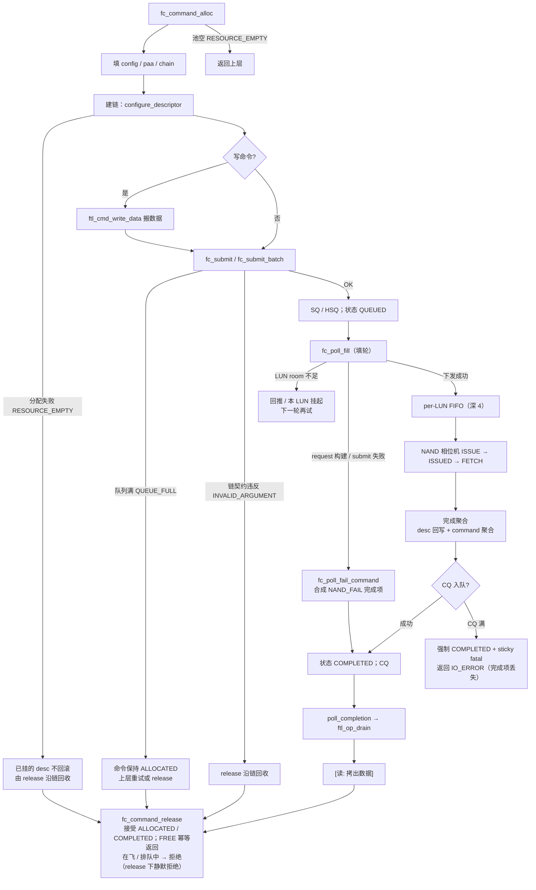

### 图 3：`fc_service()` 服务主循环

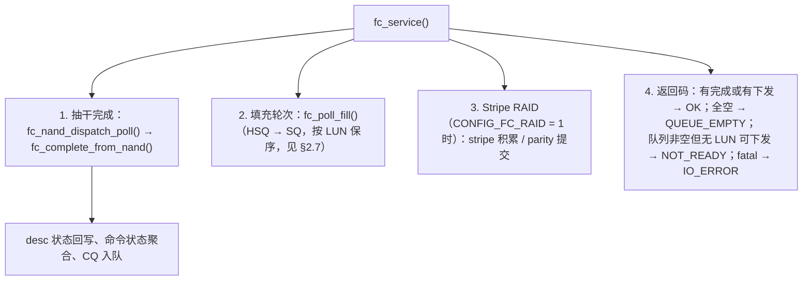

---


## 3. NAND 底层模块详细设计

### 3.1 微操作引擎（software microcode）

设计理念：**软件微码（software microcode）**。每条 UOP（micro-operation）自包含——命令值、列/行地址、
延时都由 operand 或请求携带，不查外部表、不含隐式逻辑。这模仿企业级 SSD 控制器里硬件
micro-sequencer 的组织方式：微指令序列把一条 ONFI 命令展开成 FMC 窗口访问与引脚等待。

```text
硬件微码（Intel / Samsung / Kioxia 类主控）：
  INST_0: SET_CMD(0x00)       ← 指令自带命令值
  INST_1: SET_ADDR(col0/row…) ← 值随指令走
  INST_2: SET_CMD(0x30)
  INST_3: WAIT_RB#

本仓软件微码：
  { COMMAND,      NAND_CMD_READ_PAGE_SETUP   }   // 自包含
  { COLUMN_0,     0U }
  { COLUMN_1,     0U }
  { ROW_0/1/2,    0U }
  { COMMAND,      NAND_CMD_READ_PAGE_CONFIRM }
  { DELAY_TIMING, NAND_TIMING_TWB }
  { WAIT_READY,   0U }
```

**UOP 类型**（`nand_uop_type_e`，15 种 + `COUNT`）：

| UOP | operand | 语义 |
|-----|---------|------|
| `WAIT_READY` | — | 纯 RB# GPIO spin-wait，超时检测 |
| `COMMAND` | 命令字节 | 写 FMC 命令窗口 |
| `COLUMN_0` / `COLUMN_1` | — | 写列地址低/高字节（列取自 `request->column`） |
| `ROW_0` / `ROW_1` / `ROW_2` | plane 下标 | 写行地址低/中/高字节，取 `request->row[operand]` |
| `DATA_IN` | buffer 偏移 | CPU → NAND |
| `DATA_OUT` | buffer 偏移 | NAND → CPU |
| `DATA_OUT_STATUS` | — | 直读状态字节（70h） |
| `JUMP_IF_NOT_READY` | 回跳步数 | busy 则 `uop_index -= operand` 重发 70h 轮询 |
| `CHECK_FAIL` | — | `nand_status & FAIL` ⇒ 终止序列 |
| `CHECK_FAIL_CACHE` | — | 检查 FAIL **与 FAILC**（cache program 前一页） |
| `DELAY_TIMING` | `NAND_TIMING_*` | 按当前 op 的 timing 表延时（tWB / tWHR / tADL） |
| `END` | — | 序列结束，交出 `execution_status` |

时序值来自 `nand_op_timing_s`（`twb_us` / `twhr_us` / `tadl_us` / `busy_timeout_us`），
由每个 OP 的条目携带——**延时是协议参数，不是写死的 µs 常量**，换器件/换时序档时只改表。

**handler 表**在 `src/nand/nand_fmc.c`，13 个 UOP 有实现；`JUMP_IF_NOT_READY` 由引擎直接处理
（表项 NULL），`END` 无 handler（引擎处理）。`NAND_UOP_COUNT` 是数组长度。

#### WAIT_READY —— 纯 RB# GPIO 轮询

handler 内部完成轮询与超时：读 RB# GPIO，LOW 则 1 µs/步 spin-wait 直到 HIGH 或超时；
HIGH 直接返回 OK。**不检查器件状态位、不查表、不含 tWB 保护**——tWB（CONFIRM 后到 RB# 拉低）
由序列中 CONFIRM 之后的 `{ DELAY_TIMING, NAND_TIMING_TWB }` 显式保证。

#### JUMP_IF_NOT_READY —— 70h 轮询循环

引擎直接处理，不走 handler：

1. `nand_status & NAND_STATUS_READY` 为真 ⇒ 推进到下一 UOP。
2. busy ⇒ 双条件超时判定（SysTick µs 起点 + 轮询计数，任一超限即 `TIMEOUT`）；未超时则回跳。

**JUMP 与 WAIT_READY 各用一组独立的超时状态**（`jump` / `wait`）：JUMP 回跳体会重跑若干返回
OK 的 UOP，而 OK 分支会清零 `wait`；若共用一组，计数每轮回跳都被清零，双条件超时永不触发
（NAND 卡忙时死循环）。

#### CHECK_FAIL 的使用规则

`CHECK_FAIL` 检查 `nand_status` 的 FAIL 位，失败即终止序列。不是所有 OP 都需要：

| 需要 CHECK_FAIL | 理由 |
|---|---|
| 含 10h/D0h 的程序 / 擦除 | CONFIRM 后器件可能内部烧录 / 擦除失败 |
| SET_FEATURES | 写寄存器可能被拒绝 |
| RESET | 复位后检查状态 |
| 含 30h 的读（含 multi-plane） | 页加载可能内部出错 |
| 内部数据搬移读（35h）、cache 读序列（31h/3Fh） | 内部操作可能出错 |

| 不需要 | 理由 |
|---|---|
| GET_FEATURES / READ_ID / 参数页 / UNIQUE_ID | 只读芯片信息，无"内部操作失败"概念 |
| RANDOM_DATA_READ | 只读已加载的页缓冲 |
| READ_STATUS / 状态增强读 | 读状态本身 |
| BLOCK LOCK / UNLOCK / LOCK_STATUS | 锁操作不经 FAIL 位报告 |

#### 引擎执行模型

| 入口 | 模式 | 行为 |
|------|------|------|
| `fc_nand_start(txn, op, req)` | 异步发起 | 复位游标、绑定 backend/request/completion，推进第一步 |
| `fc_uop_engine_start(state, uops, timing)` | 异步发起 | 同上，直接给 UOP 序列 |
| `fc_uop_engine_step(state)` | 异步推进 | 消费若干 UOP；`NOT_READY` = 让出 |
| `fc_nand_step(txn, comp)` | 异步推进 | 事务级推进，完成时填 `nand_cmd_comp_s` |

`NOT_READY` 是**协作式让出点**：引擎不阻塞，调用者循环 `while(NOT_READY) step()` 或由 dispatch
轮询推进。同步路径（器件初始化）就是"循环到 OK/错误为止"。

### 图 4：`fc_uop_engine_step()` 解释器骨架

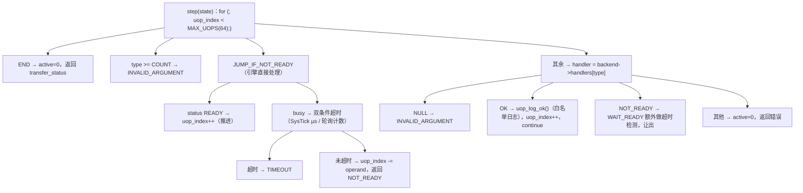

三个 static helper（`fc_nand_engine.c`）：`wait_latch` 一次锁存 SysTick µs 起点、`wait_timeout`
饱和递增计数后判双条件、`uop_log_ok` 按类型白名单打成功日志。抽出的目的是让解释器骨架只留
控制流——END / JUMP 是控制流（不查表），其余一律走 handler 表。

### 图 5：70h 状态轮询循环

几乎所有 UOP 序列都以这个循环开头，`operand=3` 表示回跳 3 步重发：

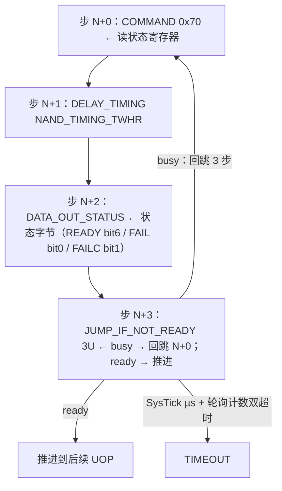

读 30h 后的页加载、编程 10h 后的 tPROG、擦除 D0h 后的 tBERS 都靠这个循环等到 ready；
随后 `CHECK_FAIL` 检查 FAIL 位，失败即终止序列。

### 3.2 FMC 硬件后端（`src/nand/nand_fmc.c`）

后端实例按 **(ch, ce)** 组织：`g_nand_fmc_instances[CH_NUM][CE_NUM]`。每个实例持有
`nand_phy_backend_s`（handler 表）与一个 `nand_fmc_cfg_s`：

```c
typedef struct NAND_FMC_CONFIG_S
{
    volatile BYTE *data;    /* FMC 数据窗口（base） */
    volatile BYTE *command; /* 命令窗口（base | A16） */
    volatile BYTE *address; /* 地址窗口（base | A17） */
    GPIO_TypeDef  *rb_port; /* 本 target 的 R/B# 端口 */
    WORD           rb_pin;  /* 本 target 的 R/B# 引脚 */
} nand_fmc_cfg_s;
```

handler 通过三个 volatile 窗口访问 FMC；上下文由 request 与实例配置提供，不在 handler 内做
路由判断。PCC 时序不在 cfg 里——它是 FMC 寄存器，由 `nand_board.c` 在初始化时按器件
`g_nand_timing_high` 换算并写死。

#### DATA_IN / DATA_OUT —— 固定 PIO

数据阶段**只有 PIO**：CPU 逐字节读写 FMC 数据窗口，写方向每字节后 `__DMB()`
（`volatile` 不保证连续写 FMC 的顺序，见 `src/nand/nand_fmc.c`）。

**为什么没有 DMA**：STM32H743 的 FMC NAND 控制器**没有专用 DMA 请求线**（DMAMUX1 映射表无
FMC/NAND 条目），memory-to-memory 模式也无法与 FMC 的等待状态握手。需要 DMA + 硬件 ECC 的
NAND 控制器应换带 GPMI 一类外设的 SoC——这是平台边界，不是可优化的实现细节。

平台的 `src/platform/stm32h743/dma_port.c` 是 **USART1 TX** 专用，与 NAND 无关。

### 图 6：FMC 后端 handler 表

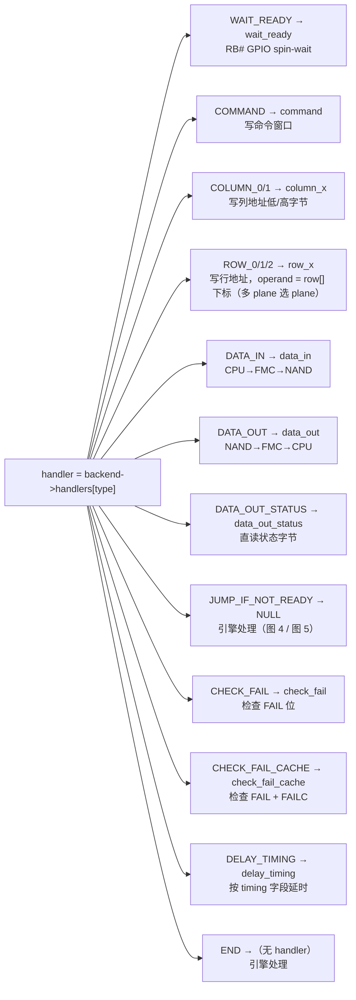

### 3.3 ONFI 1.0 命令表（`include/nand/onfi_1_0.h`）

`OP_COUNT = 51`（0..50），`OP_*` 常量直接作为 `g_nand_operation_map[OP_COUNT]` 的下标，
O(1) 查表。表项结构：

```c
typedef struct NAND_OPERATION_MAP_S
{
    BYTE                operation;      /* OP_* */
    const char         *name;           /* 调试名 */
    BYTE                command_1;      /* 命令字节 1 */
    BYTE                command_2;      /* 命令字节 2（0 = 无） */
    BYTE                address_cycles; /* 地址周期数 */
    BYTE                data_input_cycles;
    BYTE                valid_while_*_busy; /* 并发约束 */
    const nand_uop_s   *uops;           /* UOP 序列 */
    nand_op_timing_s    timing;         /* tWB / tWHR / tADL / 忙等超时 */
} nand_op_map_s;
```

协议属性由 helper 从表项派生，**不在代码里散落 switch**：
`nand_operation_has_data` / `is_page_read` / `is_page_write` / `data_length` /
`is_issue` / `is_wait_or_fetch` / `is_splittable` / `to_issue` / `get_pair`。

**ONFI 1.0 没有 multi-plane**（Rev 1.0 Table 14 全文无 "plane"）；`OP_*` 里的 multi-plane /
two-plane cache 码全部来自器件 datasheet，见 §17。

### 3.4 器件级操作（`fc_nand_*`）

`fc_nand_engine.c` 对上提供异步事务与初始化，器件几何/时序/探针由
`src/nand/devices/mt29f___g08a.c` 提供（经 `nand_device_get()` 返回描述符）：

| 接口 | 用途 |
|------|------|
| `fc_nand_init()` | 初始化 FMC、枚举 target：RESET → READ_ID → READ_PARAMETER_PAGE → 几何校验；**此路径绕过 dispatch**（`armed = 0`） |
| `fc_nand_start(txn, op, req)` / `fc_nand_step(txn, comp)` | 一条 ONFI 命令的异步事务 |
| `fc_nand_enable_high_speed(fmc_hz)` | 切 ONFI timing mode 并重算 FMC 时序（§19） |
| `fc_nand_engine_set_armed(BYTE)` / `fc_nand_engine_is_armed()` | 异步放行闩锁：0 = 只允许初始化同步路径 |

关键类型：

```c
typedef struct NAND_COMMAND_REQUEST_S
{
    BYTE  operation;
    WORD  column;
    DWORD row[NAND_PLANE_MAX]; /* 按 plane 索引，ROW handler 用 operand 选 */
    BYTE *buffer;
    WORD  data_length;
} nand_cmd_req_s;

typedef struct NAND_COMMAND_COMPLETION_S
{
    BYTE          nand_status; /* 70h 原始状态（OP 后：FAIL/FAILC） */
    BYTE          pre_status;  /* 70h 原始状态（OP 前：RDY/ARDY/WP） */
    nand_result_e execution_status;
} nand_cmd_comp_s;

typedef struct FC_NAND_TXN_S
{
    fc_uop_engine_state_s engine;
    nand_cmd_req_s        request;
    nand_cmd_comp_s       completion;
} fc_nand_txn_s;
```

**`nand_status` 与 `execution_status` 语义不同**：前者是器件回读的原始字节，后者是引擎的
执行结果（OK / NOT_READY / TIMEOUT / OPERATION_FAILED …）。失败判定两者都要看，见 §2.4。

---

## 4. FC ↔ NAND 调度桥接层（`fc_nand_dispatch`）

### 4.1 职责

- 按 ch / ce / lun 路由命令到目标 LUN。
- 每个 LUN 一条定深 FIFO（`NAND_DISPATCH_CHAIN_DEPTH = 4`，**每槽一条命令**）。
- 处理一条命令内部的多 CW 分段执行（与命令链无关）。
- 把 NAND 完成转换为 `fc_nand_dispatch_comp_s`。

### 4.2 提交与推进

```text
fc_service()
  ├─ fc_poll_fill()            一次扫描 HSQ/SQ，按 LUN 保序挑出可下发命令（含链）
  ├─ 预解析 desc 链            PAA、buffer 指针、CW 位图在 FC 侧解析
  ├─ fc_nand_dispatch_submit[_chain]()
  │                            按 room 追加到目标 LUN FIFO；放不下一律整体拒收
  └─ fc_nand_dispatch_poll()
       遍历 (ch, ce, lun)，每 LUN 每轮恰好推进一步
         ├─ 队头未启动 → fc_nand_start() → UOP 引擎 → FMC
         ├─ 已启动     → fc_nand_step()  非阻塞推进
         └─ 完成       → 出队，经 sink 当场交出一份 completion
```

**请求是自包含的**：FC 在提交时把所有 desc 链信息解析完，dispatch 收到请求后**不再回调 FC**。

**每槽一条命令、链 = 连续 N 槽**：一条命令（含链中的每一条）各回一份 completion，中间命令
的状态独立上报。FIFO 严格先进先出，所以链占据队头期间不会被同 LUN 的后续命令插入。

**提交语义**：`submit` / `submit_chain` 只在 FIFO 装不下（`count + N > DEPTH`）时返回
`NOT_READY`，**且无副作用**（一个槽都不写）。FC 填充前先查 `fc_nand_dispatch_lun_free()`，
因此生产路径上 `NOT_READY` 不会出现（出现即 `ASSERT`）；保留它是给"链放不下"的重试语义兜底。
两个入口共用同一道放行闩锁（`fc_nand_engine_is_armed()`）：初始化未完成时返回 `INVALID_ARGUMENT`。

### 4.3 多 CW 处理策略

| 方向 | 步骤 |
|---|---|
| **PROGRAM** | 1. 首次执行：遍历 desc 链，把各 CW buffer 拷到 LUN 页缓冲<br>2. 发 `OP_NORMAL_PROGRAM_PAGE`（80h-地址-数据-10h），一次写整页 |
| **READ** | 单 LUN + 完整页位图：保留 `OP_NORMAL_READ_PAGE_WITH_DATA_OUT`（12h），30h 后整页 `Dout` 直送 page buffer，再拆回各 CW<br>稀疏位图或多 LUN：改写为加载型（`OP_NORMAL_READ_PAGE_WITHOUT_DATA_OUT` 33h / 多 plane 29h / 多 LUN `OP_READ_PAGE_LOAD` 35h），再按 CW 位图逐 CW 取数（05h-列-E0h；多 plane 用 06h 版）<br>每个 CW 的数据写入对应 desc 的 buffer |

### 图 7：poll 遍历模型（per-LUN 相位机）

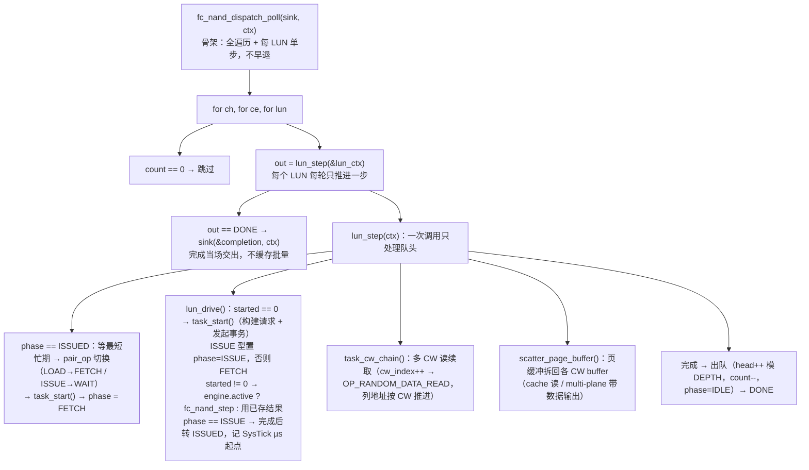

**要点**：一条命令占住队头直到自身完成；每个 LUN 每轮最多完成一条；poll **不早退**——
公平性依赖"每个 LUN 每轮都被走到"。

`lun_step` 的返回值由三个具名枚举表达：`fc_nand_dispatch_lun_outcome_e`（WAIT / DONE）、
`fc_nand_dispatch_start_outcome_e`（ASYNC / SYNC）、`fc_nand_dispatch_cw_outcome_e`（ASYNC / DONE）。
请求构建没有失败路径，故 `start_outcome_t` 只区分"启动即返回"与"start 内同步完成"；
`fc_nand_start` 的错误码不是失败出口，而是"带错误状态的完成"，照常走完成处理链。

### 4.4 接口

```c
void          fc_nand_dispatch_init(void);            /* 纯软件复位（memset + disarm），无失败路径 */
BOOL          fc_nand_dispatch_fatal(void);           /* µs 时间源不可用等调度层 fatal */
nand_result_e fc_nand_dispatch_submit(const fc_nand_dispatch_req_s *request);
nand_result_e fc_nand_dispatch_submit_chain(const fc_nand_dispatch_req_s *requests, BYTE count);
DWORD         fc_nand_dispatch_poll(fc_nand_dispatch_sink_fn_t sink, void *ctx);
BYTE          fc_nand_dispatch_lun_free(BYTE ch, BYTE ce, BYTE lun);  /* 剩余槽 0..4 */
BYTE          fc_nand_dispatch_lun_used(BYTE ch, BYTE ce, BYTE lun);  /* 诊断 */
BYTE          fc_nand_dispatch_lun_phase(BYTE ch, BYTE ce, BYTE lun); /* 0=IDLE 1=ISSUE 2=ISSUED 3=FETCH */
```

请求与完成结构（**唯一 CW 索引空间 = flat 绝对号** `n = plane*CW_NUM + cw`）：

```c
typedef struct FC_NAND_DISPATCH_REQUEST_S
{
    WORD  cmd_id;
    BYTE  operation;
    BYTE  ch, ce, lun;
    DWORD cw_bitmap;          /* 字面位图：bit n = plane*CW_NUM + cw；0 = 空集（合法） */
    BYTE  plane_count;        /* 0 = 单 plane；N = multi-plane */
    BYTE  plane;              /* 单 plane = paa_to_plane(paa)；multi-plane 恒 0 */
    BYTE  page_type : 2;      /* LDPC 解码阈值预留；当前无读者 */
    BYTE  reserved  : 6;
    BYTE  feature_addr;       /* SET/GET_FEATURES 寄存器地址 */
    WORD  column;             /* 显式列地址；只有 OP_READ_COLUMN 读它，其余恒 0 */
    DWORD plane_paa[PLANE_NUM];     /* 每 plane 行地址（CW 位丢弃）；plane 集合内每格都填 */
    BYTE *cw_buffers[CW_TOTAL_MAX]; /* [n]，仅 n ∈ cw_bitmap 有效 */
} fc_nand_dispatch_req_s;

typedef struct FC_NAND_DISPATCH_COMPLETION_S
{
    WORD          cmd_id;
    nand_result_e execution_status;
    BYTE          nand_status;                 /* OP 后读状态（FAIL/FAILC） */
    BYTE          pre_status;                  /* OP 前读状态（RDY/ARDY/WP） */
    BYTE          cw_status[CW_TOTAL_MAX];     /* [n]，与请求位图同空间 */
    BYTE          ecc_bit_count[CW_TOTAL_MAX]; /* [n]；FC 数据路径解码后回填 */
} fc_nand_dispatch_comp_s;
```

几条容易踩的约定：

- **`cw_bitmap == 0` 是空集**，不是"全部"。擦除命令就是空集（没有 CW）。
- **`plane` 在 multi-plane 时恒 0**：多 plane UOP 的 `row[]` 下标硬编码 0/1，plane 维从 0 起。
- **`plane_paa[]` 必须为 plane 集合内每个 plane 都填**，即使该 plane 一个 CW 都没选中——
  多 plane op 的 UOP 固定读 `row[0]`/`row[1]`，空 plane 不填会退化成 block 0 / page 0。
- **`feature_addr` 不能复用 `column`**：8 位装不下 spare 区列号（2048 需 12 位），两者语义不同。

完成处理：`fc_complete_from_nand()` 把 `fc_nand_dispatch_comp_s` 聚合进 CQ 条目，同时逐 CW
回写 desc 的 `status` / `ecc_bits`；命令级 ECC 走 `fc_get_cmd_ecc_max()`，命令级状态走
`FC_CMD_STATUS_ERROR_MASK`。

---

## 5. 数据路径

两个方向，对 FTL 完全透明：

- **写（encode）**：NAND Program 前由 FC 内部执行——META → CRC → 加扰 → ECC →（RAID）。
- **读（decode）**：两阶段——
  - **Stage 1**（FC 内部，CQ push 前）：ECC 解码 → 全成功则解扰 → CRC → META 校验；
    有 CW 不可纠则在步骤 1 短路（**不解扰**，供 RAID 在 scrambled domain 恢复）。
  - **Stage 2**（FTL 触发）：`fc_data_path_raid_recover()` 重建失败 CW。

### 5.1 编码（Page Pack）

```text
USER 数据填入各 CW buffer 的 [8,520)
  → [META]  desc->meta（本 CW 扇区 LBA）写到 buffer[0,4)
  → [CRC]   CRC-32 覆盖 USER 512 B，值写 buffer[4,8)
  → [加扰]  seed = fc_random_seed_from_meta(desc->meta)，变换 buffer[8,520)
  → [ECC]   BCH 编码 520 B → 8 B parity，写 buffer[520,528)
  → (RAID)  数据命令累积到 PLANE_NUM-1 条后，跨命令 XOR → parity 独立 plane
  → 数据命令 + parity 命令一起以 Multi-Plane PROGRAM 提交
```

**加扰范围是 `[8,520)`**：META 与 CRC 保持明文，读路径才能从页内自举种子、并在解扰前
校验地址。**META/CRC 在加扰前写入，受加扰 + ECC 两层保护**。

**RAID 不覆盖用户数据**：parity 独立占用最后一个 plane（PLANE_NUM 为 2 的幂）：

| Plane 数 | 数据命令 | parity 命令 |
|---|---|---|
| 2 | D0 (plane 0) | P0 (plane 1) |
| 4 | D0/D1/D2 | P0 (plane 3) |
| 8 | D0..D6 | P0 (plane 7) |

FTL 只提交 `PLANE_NUM-1` 条数据命令（`config.raid = ENCODE`），FC 内部：

1. 累积 stripe 成员（`PLANE_NUM = 2` 时在单次 `fc_service()` 内同步完成）。
2. 内部分配 parity 命令资源（command + desc 链 + buffer）。
3. `fc_data_path_generate_stripe_parity()` 做跨命令 XOR——数据为各 CW 的 scrambled
   `[0,520)`，parity 同样经过 ECC 编码。
4. parity 命令**不经过 META / CRC / 加扰**：它已在 scrambled domain，META 是 XOR 结果，
   只靠 ECC 保护完整性。
5. 数据命令 + parity 命令一次提交为 Multi-Plane PROGRAM。
6. 完成时 parity 资源自动释放，**FTL 只感知数据命令的 completion**。

`CONFIG_FC_RAID` 当前为 **0**（功能代码完成但未验证），RAID 路径不编译。

### 图 8：CW 布局与各模块处理范围

```text
┌────────────────────────── 528 B CW ──────────────────────────┐
│ [0:4)   [4:8)      [8:520)              [520:528)            │
│  META    CRC       USER（512 B）          PARITY              │
│ FC 管理  CRC-32    FTL 可见区             ECC 生成            │
└──────────────────────────────────────────────────────────────┘
   ▲                  ▲
   fc_buffer_get_base  fc_buffer_get_user_data（+8 偏移）

处理范围：
  CRC    USER 512 B        → 值写 [4,8)
  加扰   [8,520)           → 原地（META/CRC 明文）
  ECC    [0,520) → 8 B     → 写 [520,528)（BCH m=13, t=4）
  RAID   全 528 B          → 跨命令 XOR
```

加扰不含 parity 是因为 parity 在 ECC 编码后才生成；加扰它会在解码前被 ECC 覆盖，白做。

### 图 9：写路径（encode）


`fc_data_path_encode()` 是管线编排，实际算法由单 CW 原语完成。

### 5.2 解码（Page Unpack）

```text
NAND 读取完成
  ├─ Stage 1（FC 内部，CQ push 前）fc_data_path_process_read()
  │   步骤 1  ECC 解码每个 CW
  │     ├─ 全部成功 → desc->status = 0，记录 ecc_bits
  │     └─ 有 CW 不可纠 → desc->status = UNC
  │                        保持"已纠错但仍加扰"（供 RAID 恢复）
  │                        短路返回，跳过步骤 2~4
  │   步骤 2  解扰（seed 从页内明文 META 自举，范围 [8,520)）
  │   步骤 3  CRC 校验 → 不匹配置 CRC_ERROR
  │   步骤 4  META 校验：低 3 位自洽（== 本 desc 的 plane/cw）
  │           + 与 command->meta 精确比对（command->meta == FC_META_UNKNOWN 时跳过后者）
  │           → 不匹配置 META_ERROR
  ├─ 完成状态经 fc_complete_from_nand() 聚合进 CQ
  └─ Stage 2（FTL 触发，status == UNC 时）fc_data_path_raid_recover()
       ├─ 收集全 CW buffer（解扰种子仍从各 buffer 的明文 META 自举）
       ├─ XOR 重建失败 CW（scrambled domain 内）
       ├─ ECC 重试：重建后仍不可纠 → IO_ERROR（硬件不可恢复）
       ├─ 解扰所有 CW
       └─ 全部 desc->status = 0
             └─ 仍失败 → BBT / read retry 等其他恢复策略（FTL 侧）
```

**三道校验各抓什么**：

| 校验 | 抓什么 | 抓不到什么 |
|---|---|---|
| 步骤 1（ECC） | 介质里随机散布的位错（≤ t = 4） | 误纠（报成功但解错，见 §21.3）；超能力 → `UNC` |
| 步骤 3（CRC） | ECC 误纠落在 USER 的部分 + 数据路径逻辑错（buffer / 加扰 / 搬运任一环出错） | 只盖 `[8,520)`；对系统性错误图样有线性盲区 |
| 步骤 4（META） | META 损坏——低 3 位自洽 + 与 `command->meta` 逐位精确比对 | `command->meta == FC_META_UNKNOWN` 时跳过精确比对（GC / 掉电重建不知道 LBA） |

加扰开启时还有一道**隐式**校验：步骤 2 的种子取自页内明文 META，META 错 ⇒ 种子错 ⇒
USER 解成垃圾 ⇒ 步骤 3 必然失败。这是 GC 路径跳过步骤 4 精确比对仍然安全的原因，但它是
加扰的**副产品**，`random = OFF` 时失效（§5.3）。

### 图 10：读路径（decode）

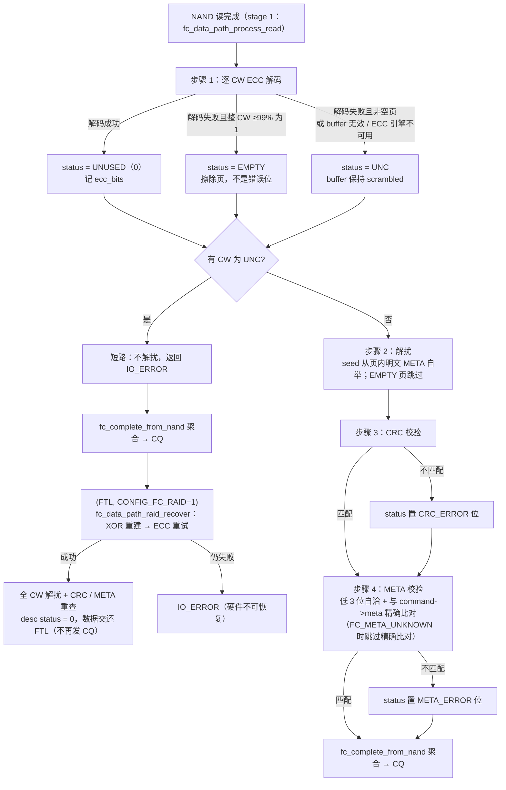

#### 单 CW 步骤原语

两条管线中每个算法步骤都是**单 CW 原语**（`include/fc/fc_data_path.h`），管线本身只做编排
（取 buffer + 调原语）。原语只操作一块 528 B 裸 CW，不碰 command / descriptor / 链：

| 原语 | 步骤 | 行为 |
|---|---|---|
| `fc_data_path_meta_write(cw, meta)` | 写 Stage 0 | `memcpy(cw, &meta, 4)` |
| `fc_data_path_crc_write(cw)` | 写 Stage 1a | `fc_crc_compute(cw + 8)` → 写 `cw[4..8)` |
| `fc_data_path_scramble(cw, seed)` | 写 Stage 1b / 读步骤 2 | `fc_random_transform(cw + 8, 512, seed)`；自反 ⇒ 加解扰同一函数 |
| `fc_data_path_ecc_encode(cw)` | 写 Stage 2 | `fc_ecc_encode(cw, FC_BUFFER_DATA_SIZE)` |
| `fc_data_path_ecc_decode(cw, &ecc_bits)` | 读步骤 1 | `fc_ecc_decode(cw, FC_BUFFER_DATA_SIZE, ecc_bits)` |
| `fc_data_path_crc_check(cw)` | 读步骤 3 | 1 = 重算值 == `cw[4..8)` |
| `fc_data_path_meta_check(cw, command_meta, paa)` | 读步骤 4 | `FC_CW_STATUS_META_ERROR` 或 0 |

**为什么拆**：让"调了哪些步骤"直接等于"开了哪些功能"。步骤级单测拿一块 buffer 调这些原语
就能验算法，不必建链、也不必用 `config` 位组合出"只开 CRC"这类状态。ECC 配置由引擎自身持有，
原语不带配置参数——管线与单测看到的是同一个入口。

⚠ 留在管线里（原语覆盖不到）的：gate 判断、`if (all_ok)`、链遍历、`desc->meta` 写回、
`desc->status` 赋值、错误码透传——这些要验必须建链。

⚠ **提交出去的命令绝不能再手工调这些原语**：FC 自己会跑整条管线，重复编码 = 数据损坏。

**RAID 在 scrambled domain 进行**：ECC 失败时其余 CW 处于"已纠错但仍加扰"状态，XOR 重建
的结果与被恢复 CW 同 domain，重建后 ECC 解码再统一解扰。加解扰对 FTL 完全透明。

### 5.3 CW 布局与字段保护

```text
[0:4)     META    FC 管理（本 CW 的扇区 LBA）
[4:8)     CRC     FC 计算（CRC-32 覆盖 USER）
[8:520)   USER    FTL 读写的 512 B
[520:528) PARITY  ECC 生成的 8 B
```

| 字段 | 保护者 |
|---|---|
| META `[0,4)` | ECC（在 `[0,520)` 码字内）+ 步骤 4 自洽 / 精确比对 +（加扰开启时）种子耦合 |
| CRC `[4,8)` | ECC——CRC 字段本身不自我覆盖 |
| USER `[8,520)` | ECC + CRC-32 |
| PARITY `[520,528)` | ECC（它本身就是 ECC 的产物，没有第二层） |

**"CRC 只盖 USER"是分工，不是漏**：CRC 在这里的职责是抓 ECC 误纠——误纠是整码字事件，
落在 USER 的由 CRC 抓，落在 META 的由步骤 4 抓；步骤 4 在期望值已知时用逐位精确比对，
检出率 100%，比 CRC-32 的 1−2⁻³² 更强。

四条读取路径的 META 保护矩阵：

| 路径 | `random` | `crc` | `command->meta` | META 靠什么查 |
|---|---|---|---|---|
| 主机数据读（`FTL_PAGE_CFG_DATA`） | ON | ON | 已知 | 步骤 4 精确比对 |
| GC / 搬移读 | ON | ON | `FC_META_UNKNOWN` | 步骤 4 自洽 + 种子耦合 ⇒ CRC 失败 |
| 元数据页读（`FTL_PAGE_CFG_META`） | OFF | OFF | `0`（期望值 = plane_cw） | 步骤 4 精确比对 |
| RAW 读（`LDPC_RAW`） | OFF | OFF | — | 无——**刻意**（坏页也要原始数据） |

**行业对照**：T10 PI / DIF 的 guard 用 CRC-16，也只盖逻辑块数据；"地址对不对"靠
reference tag 与期望值比对，不靠 CRC——与本仓步骤 4 同一思路。判据不是"CRC 该盖哪些字节"，
而是"**这个字段出错时，能不能用别的手段发现**"：期望值已知 → 比对；期望值未知 → 需要
**独立**校验；字段本身无冗余 → 只能靠 ECC。

⚠ **本仓差异点**：GC / 掉电重建路径（期望值未知）靠的是**种子耦合**这一加扰副产品，没写进
契约，`random = OFF` 即失效。行业在这里会放显式校验（独立 CRC / 序号 / 冗余存储）。

### 5.4 加扰的目标：统计独立

加扰的唯一目标是让写入 NAND 的位串**统计独立**——给定全部历史，下一位仍是 1/2：

```text
P(bit = 1 | 前面所有位) = 1/2
```

这是**条件**概率。"无条件 1/2"（整串里 1 占一半，均衡）不等于独立：`0101…` 均衡，但
"上一位是 0"就必然推出"下一位是 1"——历史一暴露未来就定了。

| 序列（4096 bit） | ones | 段数 | 平均段长 | 判定 |
|---|---|---|---|---|
| 全 0 / 全 1 | 0 / 4096 | 1 | 4096 | 极端有序 |
| `0101…` | 2048 | **4096** | 1.0 | **极端有序**（另一个方向） |
| 随机 | ≈2048 | **≈2048** | 2.0 | **目标** |

随机数据每一步有 1/2 概率翻转，故段数 ≈ 位数的一半、段长服从几何分布
`P(段长 = k) = 2^-k`——"均衡、游程均值 2、长游程稀少"全是独立的副产品，不是目标。

**为什么 `0101…` 对 NAND 反而有害**：

1. 零结构 —— 用固定周期图案替换另一个固定图案，结构一点没少。
2. 单元间耦合（CCI）最坏 —— 每个单元的邻居都与它状态相反。
3. 与阵列物理周期谐振 —— 固定周期的图案与位线/字线 pitch 共振，产生**系统性、可复现**
   的错误；ECC 擅长随机错，系统性错误会整片超限。

实现上，加扰器（LFSR）造一条"给定历史、下一位仍是 1/2"的伪随机序列，与数据 XOR；
种子取本 CW 的扇区 LBA（`desc->meta`），读路径可从页内明文 META 自举。
游程统计的测法与判据盲区见 `docs/design/fc_nand_ut.md`。

---


## 6. PAA（Physical Array Address）设计

### 6.1 编码布局

```text
PAA 位布局（DWORD，低位优先）：
[cw:2][page:6][plane:1][block:11][lun:LUN_ADDR_WIDTH]
```

| 字段 | 位宽来源 | 本器件取值 |
|---|---|---|
| `cw` | `CW_WIDTH = log2(CW_NUM)` | 2 位，0..3 |
| `page` | `PAGE_ADDR_WIDTH` | 6 位，0..63 |
| `plane` | `PLANE_ADDR_WIDTH` | 1 位，0..1 |
| `block` | `BLOCK_ADDR_WIDTH` | 11 位，0..2047 |
| `lun` | `LUN_ADDR_WIDTH` | **0 位**（`LUN_NUM = 1`） |

⚠ `LUN_ADDR_WIDTH = 0` 时 `lun` 字段不存在，PAA 有效宽度 20 位。多 LUN 器件按 `LUN_NUM`
推导宽度（`nand_config.h` 的 `LUN_ADDR_WIDTH` 分支），宏另有上限 `LUN_ADDR_WIDTH <= 4` 档。

**ch / ce 不在 PAA 内**：它们是命令级路由，住在 `fc_cmd_s.ch/ce/lun`。
`fc_cmd_s.paa` 是 FC 层**唯一**的物理地址字段——FTL 在自己的空间里组合 PBA，在边界
`pba_to_paa()` 一次转出；`src/fc/**` 中 `pba_to_paa()` / `pba_to_*()` 零引用。
凡需要行地址的地方（erase / Feature / READ_META / 单 plane 数据 / 无 desc 加载）都从
`command->paa` 取，逐 plane 换 plane 位用 `paa_with_plane()`。

### 6.2 地址 helper 与构造入口

全部是 `include/nand/nand_config.h` 的 `static inline`：

```c
/* 取字段 */
static inline BYTE  paa_to_page(DWORD paa);
static inline BYTE  paa_to_plane(DWORD paa);
static inline WORD  paa_to_block(DWORD paa);
static inline BYTE  paa_to_lun(DWORD paa);
static inline BYTE  paa_to_cw(DWORD paa);
static inline DWORD paa_from_addr(const nand_addr_s *addr);   /* 展开 → 打包（忽略 ch/ce） */
static inline nand_addr_s addr_from_paa(BYTE ch, BYTE ce, DWORD paa); /* 打包 → 展开 */

/* 替换字段 / 结构判断 */
static inline DWORD paa_with_cw(DWORD paa, DWORD cw);
static inline DWORD paa_with_page(DWORD paa, DWORD page);
static inline DWORD paa_with_plane(DWORD paa, DWORD plane);
static inline DWORD paa_with_block(DWORD paa, DWORD block);
static inline DWORD paa_with_lun(DWORD paa, DWORD lun);
static inline DWORD paa_page_base(DWORD paa);  /* 清 CW 位 */
static inline BYTE  paa_same_page(DWORD a, DWORD b);

/* 值域检查 / 行地址编码 */
static inline BYTE  paa_is_valid_addr(const nand_addr_s *addr);
static inline BYTE  paa_is_valid_paa(DWORD paa);
static inline DWORD paa_to_nand_row(DWORD paa); /* 器件行地址编码 */
```

**构造一律走 `nand_addr_s` 具名字段**：五个同型小整数按位置传参，写反了仍落在合法值域内
（`page < 64`、`plane < 2`、`block < 2048`），会静默算出错地址；具名字段把这类错误变成编译错误。

**PBA 构造在 FTL 层**（`include/ftl/ftl_config.h`）：`pba_make()` / `pba_pack()` + `pba_fields()`
具名字段结构体；`pba_to_paa()` 是 FTL→FC 的唯一边界转换器。

`paa_to_nand_row()` 产出 MT29F4G08 的三个行周期：`PA[5:0] → bit[5:0]`、`BA6(plane) → bit[6]`、
`BA[17:7] → bit[17:7]`。CW 位在这个编码里被丢弃——列地址单独经 `COLUMN_0/1` 发送。

---

## 7. 编译期配置

器件事实（几何 / 拓扑 / 地址位宽 / 行地址编码 / FMC / ID）在
`include/nand/devices/mt29f___g08a.h`，由 makefile 的 `NAND_DEVICE` 宏选择
（默认 `MT29F___G08A`）。

```c
/* devices/mt29f___g08a.h（器件事实） */
#define PAGE_SIZE        (2112)   /* 主区 2048 + 备区 64 */
#define PAGES_PER_BLOCK  (64)
#define BLOCKS_PER_PLANE (2048)
#define PLANE_NUM        (2)
#define LUN_NUM          (1)

/* nand_config.h（板级拓扑与通用软件布局） */
#define CH_NUM           NAND_BOARD_CH_NUM   /* 1 */
#define CE_NUM           NAND_BOARD_CE_NUM   /* 1 */
#define CW_NUM           (4U)                /* 每页 CW 数 */
#define CW_SIZE          (PAGE_SIZE / CW_NUM) /* 528 B */
#define CW_TOTAL_MAX     (CW_NUM * PLANE_NUM)
```

其余编译开关：

| 开关 | 默认 | 作用 |
|---|---|---|
| `CONFIG_NAND_TIMING_MODE` | 5 | ONFI timing mode（3.3 V，Table 29/31）；§19 |
| `CONFIG_FC_RAID` | **0** | Stripe RAID 不编译（功能完成但未验证） |
| `FC_NAND_TEST_ENABLE` | 测试档 | 暴露测试专用 seam |

---

## 8. 未实现 / 未验证项

见 `docs/design/known_open_items.md`（设计项）与 `docs/design/known_open_items.md`（缺陷与残余风险）。
本文不复制清单。

---

## 9. 测试

FC→NAND UT 的套件、入口、编写规范与运行方式见 `docs/design/fc_nand_ut.md`；分层测试流程见
`docs/guides/testing_guide.md`。

> ⚠ `make all` 之后直接 `make tests` 是空操作（目标未按测试 flag 重编）⇒ 必须先 `make clean`。
> 完整命令见 `docs/design/fc_nand_ut.md` §5.1。

---

## 10. 设计决策记录

1. **空闲链表而非遍历查找**：分配/释放 O(1)，池加深时性能不退化的企业级做法。
2. **buffer 与 descriptor 解耦**：UNC 时可先归还 buffer，只保留 descriptor 做错误处理。
3. **命令的 `cw_count` 是"数量减一"，desc 的 `cw_index` 是当前索引**：命令侧省位宽，
   描述符侧需要逐 CW 定位，语义不同。
4. **PAA 不含 ch/ce**：通道与片选是命令级路由；PAA 只编码芯片内地址。
5. **≤ 4 B 的返回值不分配 descriptor**：GET_FEATURES 一类走控制器侧 4 字节暂存，完成时写进
   CQ 的 `param.value`（§14）；SQ 命令体提交后保持不可变。
6. **完成路由不进 CQ**：FTL 概念（哪个功能拥有这条命令）由 FTL 的 request 表按 `cmd_id` 保存；
   CQ 只带 `cmd_id` / `status` / `param`。
7. **数据搬运与建链策略在 FTL**：判据是硬件 FCC 寄存器表（§26）。

## 11. 接口分层与不变量

FC 对外的接口按 §2.9 的六组分。支撑它的是六条不变量——改动前先确认不破坏哪一条：

| 不变量 | 含义 | 破坏后的症状 |
|---|---|---|
| **链是 CW 集合的唯一真值** | 命令拥有哪些 CW 只看 `desc_id` + `next_id`；FC 没有第二套掩码 | 两套坐标靠"链序 == plane-major"隐式对齐，空 plane 需回填才不会误寻址 |
| **desc 出池即挂链** | 分配 → 填字段 → 挂链 → 分配 buffer；失败无需回滚 | 出现"已出池未挂链"中间态，必须靠所有权链兜底（640 B 且易漏） |
| **三套地址单一漏斗** | PBA→PAA 只在 FTL 边界发生；FC 内只认 PAA 与 `cmd->ch/ce/lun` | 现场手写位操作 = 静默算错地址 |
| **池闸门单点** | 入池/出池只经 `fc_pool.c` 的闸门与账本访问器 | 四本账各自手工维护，任一漏掉就永久漏账 |
| **SQ 提交后不可变** | 命令配置完即冻结；运行期返回值一律走 CQ | 命令被复用后上层读到脏值 |
| **请求自包含** | dispatch 收到请求后不再回调 FC | 跨层回调把策略拖回硬件边界 |

---

## 12. 数据 buffer 模型

### 12.1 方案与判据

FTL 与 FC 之间传 **16 位 buffer ID**，不传裸指针：

| 方案 | 判据 | 结论 |
|---|---|---|
| `buffer_id` + ID 池 | 生命周期有主：buffer 池是唯一 owner，ID 在池内可校验 | **采用** |
| `data_ptr` 裸指针 | 上层持指针跨异步完成，完成时 buffer 可能已归还（UAF） | 否决 |
| 双模（ID 或指针二选一） | 两套生命周期语义并存，调用点必须知道自己在哪一档 | 否决 |

这也是 DRAM-less 主控的主流做法：内部 SRAM buffer pool + ID，控制器在命令 retire 时
归还 free list；有 DDR 的企业级方案传 PRP/SGL 物理地址、控制器从不 free——那需要
主机侧内存语义，本仓没有。

**为什么不需要引用计数**：真实主控的 buffer manager 通常带 refcount，因为同一个 buffer 被
流水线多级引用（ECC 引擎 / DMA 引擎 / 固件）。本仓 buffer 是**单引用**——只有 desc 链持有它，
所以"0/1 占用位 + 一次显式归还"就够。

### 12.2 buffer 归属 `buf_own : 2`

`fc_cmd_cfg_s.buf_own` 记录"谁申请、谁释放"，两位独立编码：

| 值 | 申请 | 释放 | 用途 |
|---|---|---|---|
| `00` | FC | 上层 | 读命令，上层拿到 buffer 并掌控生命周期（**默认**） |
| `01` | FC | FC | 读命令，只要命令状态 |
| `10` | 上层 | 上层 | 上层把控数据的场景 |
| `11` | 上层 | FC | 写命令等，只要命令状态 |

- **`00` 是默认值**：命令出池整体清零 ⇒ 未显式设置的命令恒走 `00`，即既有生产行为
  （FC 建链时申请、上层 `fc_command_release` 时归还）。
- **申请方 = 上层**（`10`/`11`）时，调用者先 `fc_buffer_alloc()`，再经
  `fc_command_configure_descriptor_with_buffer(..., buffer_id)` 传入；FC 建链时不申请。
  申请位与实参必须一致，否则是配置错误。
- **释放方 = FC**（`01`/`11`）时，`fc_complete_from_nand` 在组装完 CQ 条目之后沿 desc 链归还
  全部 buffer，并把各 desc 的 `buffer_id` 抹成 `INVALID`。抹 `INVALID` 使归还**幂等**：
  完成时已归还 ⇒ 随后的 `fc_command_release` 跳过；命令没走到完成 ⇒ buffer 仍有效 ⇒ 链释放
  照常归还。
- **`fc_command_release` 恒归还链上所有未归还 buffer**，不管谁申请的。

⚠ **契约**：`01`/`11` 档命令完成之后，上层不得再调 `fc_get_cmd_data_ptr` /
`fc_buffer_get_base`——buffer 已归还、`buffer_id` 已 `INVALID`。

---

## 13. Dispatch 边界（防火墙）

### 13.1 边界在哪

```text
FTL → FC（固件） → [fc_nand_dispatch_req_s]  → NAND 引擎（硬件状态机）
NAND 引擎 → [fc_nand_dispatch_comp_s] → FC（固件） → FTL
```

这条边界是 **FC 固件与 NAND 硬件引擎之间的防火墙**。FC 内部处理固件层面的功能
（加扰 / LDPC 编解码 / RAID XOR / CRC），**只有硬件真正消费的字段才跨越 dispatch**。

### 13.2 四条原则

| 原则 | 说明 |
|------|------|
| **硬件消费** | 只有 NAND 硬件引擎（解码器、状态机）实际消费的字段才跨越 |
| **固件封装** | FC 固件内部处理的功能不在 dispatch 层暴露 |
| **RAID 透明** | dispatch 感知不到 RAID——它看到的是标准 PROGRAM 命令 |
| **ECC 反馈** | 硬件解码结果（纠正比特数、per-CW 状态）必须带回 FC |

### 13.3 字段级映射

#### 13.3.1 `fc_cmd_s` / `fc_cmd_cfg_s` → dispatch 请求

| 字段 | 来源 | 过边界？ | 理由 |
|---|---|---|---|
| `operation` | cfg | **✅** | 硬件要知道执行哪个 ONFI 操作 |
| `ch` / `ce` / `lun` | `fc_cmd_s` | **✅** | 三个路由字段在命令对象上，不在 cfg 里 |
| `page_type` | cfg | **✅** | 多页类型器件的解码阈值选择；当前 SLC 恒 LP，字段保留 |
| `multi_plane` | cfg | **✅**（作为 `plane_count`） | scatter 与 CW 取数链要按 plane 数选 op |
| `feature_addr` | `fc_cmd_s` | **✅** | SET/GET_FEATURES 的寄存器地址 |
| `cw_bitmap` | desc 链 | **✅** | 硬件要知道访问哪些 CW；**字面位图**，0 = 空集 |
| `plane_paa[]` | desc 链 | **✅** | 每 plane 行地址；plane 集合内每格都填 |
| `cw_buffers[]` | desc 链（ID 解析） | **✅** | 预解析成指针，硬件直接用 |
| `crc` | cfg | **❌** | CRC 在 FC 固件完成，硬件不感知 |
| `ldpc` | cfg | **❌** | 编解码模式是 FC 数据路径参数；硬件侧只用 `page_type` |
| `raid` | cfg | **❌** | RAID 是 FC 内部功能，parity 写入哪个 plane 由 FC 推导 PAA |
| `random` | cfg | **❌** | 加扰 / 解扰在 FC 数据路径完成 |
| `chain` | cfg | **❌** | 命令链是 FC 调度器概念，NAND 单条执行 |
| `buf_own` | cfg | **❌** | 纯 FC 侧资源策略；硬件只看到已解析的指针 |
| `cw_count` | cfg | **❌** | 只有 RAID stripe 读它，属 FC 内部 |

#### 13.3.2 `fc_desc_s` → dispatch 请求

| 字段 | 过边界？ | 理由 |
|---|---|---|
| `paa` | **✅ 拆两路**：plane 位 → `cw_bitmap` 的 bit n；行地址 → `plane_paa[plane]` | 硬件目标寻址 |
| `buffer_id` | **✅ 解析为指针 → `cw_buffers[n]`** | FC 预解析，dispatch 不再查池 |
| `cw_index` | **→ 编入 flat 号 n** | `n = plane*CW_NUM + cw`，与请求位图同一空间 |
| `next_id` | **❌** | 链表是 FC 内部结构，提交时已遍历解析 |
| `status` / `ecc_bits` | **❌** | 完成方向才回写 |
| `meta` | **❌** | META 内容由数据路径写进 buffer，不经 dispatch |

#### 13.3.3 dispatch 完成 → CQ 条目

| 完成字段 | 去向 | 说明 |
|---|---|---|
| `cmd_id` | `fc_cmd_status_s.cmd_id` | CQ 条目标识 |
| `execution_status` | FC 聚合判据 | `NAND_RESULT_*`；`OK` 之外还要看 `nand_status` |
| `nand_status` / `pre_status` | 聚合进 command 状态 | 70h 后 / 前读状态字节 |
| `cw_status[n]` | 回写 `desc->status` **+** 聚合进 command `status` | CQ 只带命令级聚合，per-CW 细节留 desc 链 |
| `ecc_bit_count[n]` | 回写 `desc->ecc_bits` | 聚合走 `fc_get_cmd_ecc_max()` |

**失败 CW 的定位**：CQ 不携带 `desc_id`。上层遍历 desc 链，取首个 `status` 含错误位的描述符；
FC 聚合时同样按链 OR 出命令级 `DATA_ERROR` / `META_ERROR`。

### 13.4 关键决策

#### 13.4.1 `page_type` 过、`ldpc` 不过

多页类型器件（TLC/QLC）的不同页类型原始 BER 不同，解码器必须按页类型选阈值——这是硬件
必须的信息。`ldpc`（full/hard/soft/raw）是 FC 固件控制解码策略的参数，硬件状态机不需要知道。

#### 13.4.2 RAID 在 FC 内部

```text
FTL: config.raid = ENCODE
FC 固件：数据命令累积 → XOR（scrambled domain）→ 派生 parity 的 PAA
dispatch 看到：D0 PROGRAM(plane 0)、D1 PROGRAM(plane 1)、…、P0 PROGRAM(plane N-1)
```

dispatch 不感知 RAID 模式；parity 写哪个 plane 由 FC 决定；恢复时 FC 读全部 plane，
某 CW 失败则 XOR 重建。

#### 13.4.3 ECC 纠正比特数反馈

```text
硬件解码 → cw_status[n] / ecc_bit_count[n]
        → fc_nand_dispatch_comp_s
        → fc_complete_from_nand() → desc->status / desc->ecc_bits
        → FTL 走 fc_get_cmd_ecc_max() 取全链最大值
```

用途：BER 监测、磨损均衡触发、Read Retry 阈值、RAID 恢复决策。

**字段宽度 8 位（0..255）**：主流 LDPC 硬解码约 80~120 bit/1 KB、软解码约 200~300 bit/1 KB；
8 位覆盖硬解码全范围，软解码超限直接标 `UNC`。

#### 13.4.4 descriptor 状态回写

NAND 完成后 FC 逐 CW 回写 desc：

```c
desc_id = command->desc_id;
while (desc_id < FC_DESCRIPTOR_POOL_DEPTH)
{
    desc             = &controller->descriptor_pool[desc_id];
    n                = paa_to_plane(desc->paa) * CW_NUM + paa_to_cw(desc->paa);
    desc->status     = completion->cw_status[n];
    desc->ecc_bits   = completion->ecc_bit_count[n];
    desc_id          = desc->next_id;
}
```

**为什么双重交付（CQ + desc 回写）**：

| 场景 | CQ 快照够吗 | 需要 desc 回写吗 |
|---|---|---|
| 正常完成，只看成败 | ✅ | 可选 |
| Read Retry：定位失败 CW | ❌ | **✅** |
| RAID 恢复：逐 CW 解码状态 | ❌ | **✅** |
| 长链命令，CQ 已出队 | ❌ 状态已丢 | **✅** |
| 错误注入 / 调试分析 | ❌ | **✅** |

#### 13.4.5 CQ 不带 op

主流完成项只带 CID / status；命令类型与完成服务由固件 request context 保存。本仓：

- `fc_cmd_s` 与 `fc_cmd_status_s` 都不携带 FTL 的 `ftl_op_id_e`；
- FTL 在 `ftl_op_submit()` 时按 `cmd_id` 索引自己的 request 表，保存 `{ctx, op}`；
- `ftl_op_drain()` 收到 CQE 后按 `cmd_id` 取 request，再按 `op` 查 `g_op_callbacks[]`。

### 13.5 请求 / 完成方向总览

请求（FC → NAND）：

| 字段 | 来源 | 说明 |
|---|---|---|
| `cmd_id` | 命令 | 完成关联 |
| `operation` | cfg | ONFI 操作 |
| `ch/ce/lun` | 命令 | 路由 |
| `cw_bitmap` | desc 链 | 选中 CW 集合（flat 绝对号；字面位图） |
| `plane_count` | cfg.multi_plane | 0 = 单 plane |
| `plane` | 命令 PAA | 单 plane 命令的目标 plane |
| `page_type` | cfg | LP/MP/UP/TP |
| `feature_addr` | 命令 | FEATURES 寄存器地址 |
| `column` | 命令 `param` | 仅 `OP_READ_COLUMN` 使用 |
| `plane_paa[]` | desc 链 | 各 plane 行地址 |
| `cw_buffers[]` | desc 链（buffer_id 解析） | 数据指针；FEATURES 指向控制器暂存 |

完成（NAND → FC）：

| 字段 | 说明 |
|---|---|
| `cmd_id` | 关联命令 |
| `execution_status` | `NAND_RESULT_OK` / `NOT_READY` / `TIMEOUT` / `OPERATION_FAILED` |
| `nand_status` | OP 后 70h 状态（FAIL/FAILC） |
| `pre_status` | OP 前 70h 状态（RDY/ARDY/WP） |
| `cw_status[]` | per-CW 状态，下标 = flat 绝对号 |
| `ecc_bit_count[]` | per-CW 纠正比特数（0..255），同下标空间 |

### 图 11：完成回写与 CQ 组装

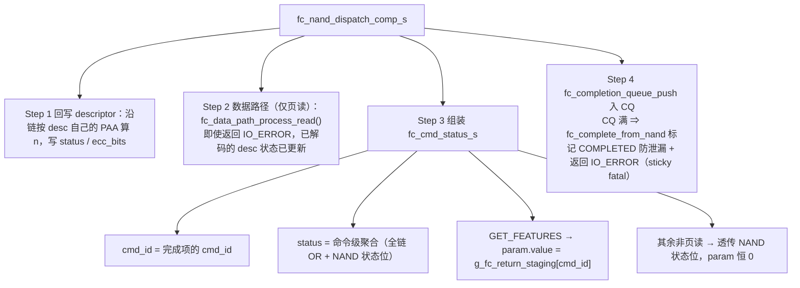

### 13.6 内存口径

| 结构 | 单条 | 数量 | 合计 |
|---|---|---|---|
| `fc_cmd_s` | 24 B | 64 | 1.5 KiB |
| `fc_desc_s` | 20 B | 256 | 5 KiB |
| buffer（一个 CW） | 528 B | 128 | 66 KiB |
| `fc_cmd_status_s` | 8 B | 64 | 512 B |

descriptor 回写与 per-CW 反馈带来的能力（BER 监测、Read Retry 触发、RAID 恢复、无 CQ 的
逐 CW 状态查询）是主控设计的必要功能，成本相对 1 MB SRAM 可忽略。

### 13.7 与行业方案对比

| 维度 | 企业级（Intel/Samsung 类） | 消费级（Phison/SMI 类） | 本仓 |
|---|---|---|---|
| ECC 比特数反馈 | ✅ 硬件上报 | ✅ | ✅ 8 bit/CW |
| descriptor 回写 | ✅ 硬件自动 | ✅ 固件回写 | ✅ FC 回写 |
| page_type 解码阈值 | ✅ | ✅ | ✅ 字段就位 |
| RAID in firmware | ✅ | ✅ | ✅（当前关闭） |
| 完成路由 | ✅ tag | ✅ | ✅ FTL request 表 |
| 双重交付（CQ + desc） | ✅ | ✅ | ✅ |

---


## 14. SET / GET_FEATURES 的内联数据路径

Feature 寄存器只有 4 字节，为它分配 desc 链 + buffer 是浪费。FC 让这类小返回走
**控制器侧暂存**：

```c
/* src/fc/fc.c —— noncacheable 段，按 cmd_id（= 命令池槽位号）索引 */
static BYTE g_fc_return_staging[FC_COMMAND_POOL_DEPTH][4] NONCACHEABLE_BUFFER;
```

| 方向 | 动作 |
|---|---|
| SET_FEATURES | 建 request 时把 `cmd->param.value` 的 4 字节拷进暂存；`cw_buffers[plane*CW_NUM]` 指向暂存 |
| GET_FEATURES | 建 request 时清零暂存；引擎把寄存器值写进暂存 |
| 完成 | `fc_complete_from_nand` 把暂存的 4 字节拷进 CQ 条目的 `param.value` |

同一机制服务四条无 desc 的 4 字节读：`OP_GET_FEATURES`、`OP_READ_META`、
`OP_READ_ONFI_SIGNATURE`、`OP_READ_COLUMN`（`fc_request_use_staging()`）。

**为什么按 `cmd_id` 索引**：SQ 里的命令体提交后不可变。把返回值写回 `cmd->param` 会破坏
这条不变量（命令可能已被复用）；暂存是控制器侧状态，与命令体分离，CQ 组装时再取值。

---

## 15. Dispatch 的两张函数指针表

`src/fc/fc_nand_dispatch.c` 用两张 `OP_COUNT` 大小的表，按 `operation` 直接索引，无 `switch`：

| 表 | 职责 | 典型 handler |
|---|---|---|
| `g_fc_nand_dispatch_req_table` | 把 task 拼成引擎请求（列/行地址、数据指针、长度） | `req_no_data` / `req_single` / `req_read_page` / `req_program_page` / `req_random_read` / `req_cache_read` / `req_multi_plane_*` / `req_feature` / `req_meta_read` / `req_read_column` / `req_onfi_signature` / `req_erase` |
| `g_fc_nand_dispatch_completion_table` | 把引擎结果折叠成 per-CW 状态 | `completion_all_cws` / `completion_per_cw` / `completion_load` |

完成策略的选择依据：

| 策略 | 语义 | 用于 |
|---|---|---|
| `completion_all_cws` | 所有选中 CW 同状态；空掩码写 `cw_status[0]` | 无 CW 概念的命令、编程/擦除、整页 cache 读、ISSUE/WAIT 段 |
| `completion_per_cw` | 逐 CW 独立状态（取数下标 = flat `n`） | `OP_RANDOM_DATA_READ` / `_MULTI_PLANE` 的取数链 |
| `completion_load` | 成功**不写**任何 CW 状态，失败时刷满 | 加载型读（33/29/35/43/36） |

**新增 OP 必须同时改三处**：`g_nand_operation_map[]`（协议属性）、req 表、completion 表。
漏一处不会编译失败——漏 req 表项会在运行时空指针调用。表用设计初始化器（`[OP_X] = ...`），
下标不连续也不影响。

---

## 16. 命令链执行

### 16.1 链的定义

**链 = 同一 LUN FIFO 里的连续槽位**，按 FIFO 顺序逐条执行，中间不会被同 LUN 的其他命令插入。
一条 N 条命令的链回 N 份 completion，每条的成败独立上报。

- FC 侧：`fc_poll_chain_length()` 从队头数连续的 `config.chain = MORE` 段，上限
  `FC_SCHEDULER_CHAIN_MAX = NAND_DISPATCH_CHAIN_DEPTH`（4）。
- 提交：`fc_nand_dispatch_submit_chain()` 先判 `count + N > DEPTH`，放不下就**一个槽都不写**
  返回 `NOT_READY`；放得下才整批追加。
- 提交后按**批尾**的 chain 位更新 `chain_owner[ch][ce][lun]`：`MORE` → 本队列继续持有，
  `END` → `NONE`。

### 16.2 链锁

链可能长于 FIFO 深度（跨多个填充轮次），批与批之间必须防插队。`fc_sched_s` 里的
`chain_owner[ch][ce][lun]` 是**跨轮次持久**的 per-LUN 锁：

| 当前 owner | 本队列 | 另一队列 | 处理 |
|---|---|---|---|
| `NONE` | 任意 | 任意 | 正常取命令 |
| HSQ | HSQ | SQ | SQ 回推跳过（不置 suspended） |
| SQ | SQ | HSQ | HSQ 回推跳过 |
| 任意 | 链尾 `END` 下发后 | — | owner 清零 |

**为什么需要**：没有它，一条跨批的链在批边界上会被另一队列的命令插进来，破坏"链 = 连续槽"。
生产路径上 FTL 的 cache read / cache program run 会组链，因此这条锁是正确性前提，不是可选项。

### 图 12：链的原子提交与逐条完成

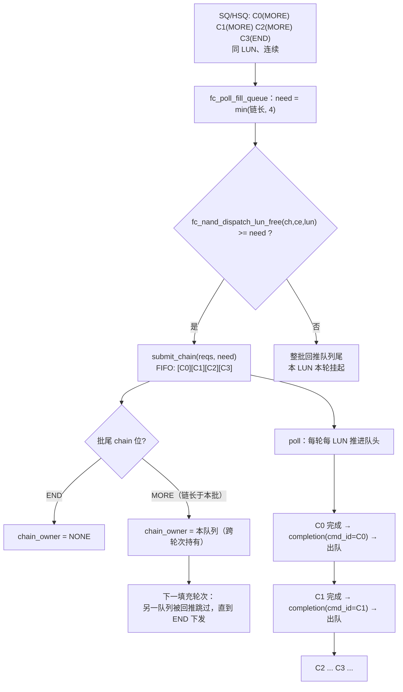

### 16.3 运行时谁在组链

| 命令 | 链 | 说明 |
|---|---|---|
| host 读 / 写单条 | `END` | 单命令路径 |
| FTL cache read run / cache program run | `MORE`…`END` | 一条 USB chunk 内的连续页；可跨填充轮次（`cache_batch.c`） |
| GC 批量迁移（≥2 页 cache program 序列） | `MORE`…`END` | 一批一条链（`migrate.c:mig_batch_build_cmds`） |
| 元数据 / Checkpoint / Journal / 单页迁移 | `END` | 单命令 |
| Read Retry | `END` × 3 | 三条独立提交 + 同步等待，不是链 |
| 测试用例 | 可构造长链 | `chain_priority_lock` 等 |

---

## 17. Multi-Plane 与器件扩展操作

### 17.1 地址与 OP 码

Multi-plane 操作需要两组行地址，plane 由行地址的 **BA6** 选择（`paa_to_nand_row()` 把
`paa_to_plane()` 编进 bit 6）。dispatch 侧因此有 `plane_paa[PLANE_NUM]` 与 `row[]` 数组，
`ROW_0/1/2` 的 UOP operand 选行地址下标——**不新增 UOP 类型**，plane 数变化只改数组长度。

| OP 码 | 值 | 序列要点 | 数据长度 |
|---|---|---|---|
| `OP_NORMAL_READ_PAGE_WITH_DATA_OUT` | 12 | 70h→00h→地址→30h→tR→Dout | `PAGE_SIZE` |
| `OP_NORMAL_READ_PAGE_WITHOUT_DATA_OUT` | 33 | 同上，末尾无 Dout（只加载进页缓冲） | `PAGE_SIZE` |
| `OP_READ_PAGE_MULTI_PLANE_WITHOUT_DATA_OUT` | 29 | 00h(P0)→00h(P1)→30h→tR，不输出 | `PAGE_BUFFER_SIZE` |
| `OP_READ_PAGE_MULTI_PLANE_WITH_DATA_OUT` | 30 | 同上，tR 后双页输出 | `PAGE_BUFFER_SIZE` |
| `OP_PROGRAM_PAGE_MULTI_PLANE` | 31 | 80h(P0)→Din(P0)→11h→80h(P1)→Din(P1)→10h | `PAGE_BUFFER_SIZE` |
| `OP_ERASE_BLOCK_MULTI_PLANE` | 32 | 60h(P0)→60h(P1)→D0h | 0 |
| `OP_RANDOM_DATA_READ` | 8 | 05h→列→E0h→tR→Dout（单 CW） | `CW_SIZE` |
| `OP_RANDOM_DATA_READ_MULTI_PLANE` | 41 | 06h→列→行(plane)→E0h→tR→Dout | `CW_SIZE` |

`OP_READ_PAGE_MULTI_PLANE_WITHOUT_DATA_OUT`（29）与 `OP_READ_PAGE_MULTI_PLANE_LOAD`（43）
是两条 op：前者是"原子加载 + 70h 状态检查"，后者是 LUN 相位机的 ISSUE 段（无 70h 轮询，
由 `OP_READ_PAGE_WAIT` 收尾）。单 plane 同理有 33 与 35。

### 17.2 Two-Plane Cache 操作（器件扩展，非 ONFI 1.0）

MT29F4G08ABADAWP 的 datasheet（Rev. N）支持 two-plane cache：

| OP 码 | 值 | 序列 | 状态检查 |
|---|---|---|---|
| `OP_TWO_PLANE_PROGRAM_CACHE` | 44 | 80h(P0)→Din→11h→80h(P1)→Din→15h | FAIL + **FAILC** |
| `OP_TWO_PLANE_PROGRAM_CACHE_END` | 48 | 同 44，末页用 10h（非 15h） | FAIL + FAILC |
| `OP_TWO_PLANE_PROGRAM_CACHE_FIRST` | 49 | 同 44，首页只查 FAIL | FAIL |
| `OP_READ_PAGE_CACHE_START_SEQ_MP` | 45 | 00h(P0)→00h(P1)→30h→31h→tR | FAIL |
| `OP_READ_PAGE_CACHE_SEQ_MP` | 46 | 31h→tR→06h(P0)→E0h→Dout(P0)→06h(P1)→E0h→Dout(P1) | FAIL |
| `OP_READ_PAGE_CACHE_LAST_MP` | 47 | 3Fh→tR→同上双 plane 取数 | FAIL |

**FAILC 是"上一页 cache program"的成败**（状态寄存器 bit1），FAIL（bit0）只反映当前页。
中间页只查 FAIL 会漏掉上一页的失败 ⇒ op 44/48 用 `CHECK_FAIL_CACHE`。首页前没有本批的
上一页（残留 FAILC 不可归因）⇒ op 49 只查 FAIL。

### 17.3 片上 Copy-Back

| OP 码 | 值 | 用途 |
|---|---|---|
| `OP_READ_FOR_INTERNAL_DATA_MOVE` | 19 | `00h + addr → 35h`：源页读进 NAND 内部缓存 |
| `OP_PROGRAM_FOR_INTERNAL_DATA_MOVE` | 10 | `85h + addr → 10h`：缓存直接写入目标页，无 DATA_IN |

两者成对使用即可在 NAND 内部搬页，数据不经过 FMC 总线。`has_data = 1` 只为分配 desc 链
提供 PAA，`data_length = 0`。**当前 GC 不走 copy-back**（走普通读 + 普通写，因为需要在
搬移中改写页内数据）；这两个 op 只保留为能力。

### 17.4 数据传输模式

| 模式 | 操作 | 做法 |
|---|---|---|
| **直写/直读** | 单 LUN 完整页读（op 12）、逐 CW 取数（op 8 / 41） | 数据直接进 `cw_buffers[n]`；05h/06h 随机列读每 CW 528 B |
| **页缓冲中转** | 所有 PROGRAM、cache 读、multi-plane 带输出读 | 先拼/读到 `g_nand_channel_page_buffer[ch][ce][lun]`，再按 flat `n` 拆回各 CW |

页缓冲按 **(ch, ce, lun)** 各持一块（`PAGE_BUFFER_SIZE = PAGE_SIZE * PLANE_NUM`）：

```c
BYTE g_nand_channel_page_buffer[CH_NUM][CE_NUM][LUN_NUM][PAGE_BUFFER_SIZE] NONCACHEABLE_BUFFER;
```

**为什么不能全通道共用一块**：program 的 ISSUE 常被 70h 忙轮询挡下——数据已拼好、
DATA_IN 却要等下一轮；同一时刻另一个 LUN 也可能在拼自己的页。共用会被后驱动的 LUN 覆盖。

### 图 13：Multi-plane 页缓冲的拼装与拆分

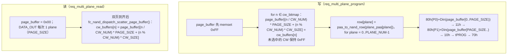

⚠ **未覆盖的 plane 仍是器件编程目标**：multi-plane handler 无条件遍历 `PLANE_NUM` 下行地址，
既不看位图也不看 `plane_count`。因此"多 plane 命令 + 部分 plane 位图为 0"是调用者错误，
FC 在 `fc_build_request_data_planes` 双档拦截（`ASSERT` + release 返回
`FC_STATUS_INVALID_ARGUMENT`）——否则会静默给该 plane 编一页全 0xFF。
只访问一个 plane 请用单 plane op（`multi_plane = 0`）。

### 17.5 11h：多 plane 切换

```text
80h → 列/行(P0) → Din(P0) →
11h → 列/行(P1) → Din(P1) →       ← 11h 切换 plane
10h → tPROG（两 plane 同时烧录）
```

`11h` 在 ONFI 里的标准名是 **Multi-Plane COPYBACK READ**；器件在 multi-plane PROGRAM
时序中把它用作 plane 切换。这不是本仓的自造用法，是器件 datasheet 的序列。

---

## 18. 拓扑、队列与多 LUN 并发

### 18.1 当前拓扑

```text
STM32H743 FMC（单条并行总线）
  └─ MT29F4G08ABADAWP
       1 ch × 1 ce × 1 lun × 2 plane × 2048 block × 64 page × 4 CW
```

软件按 `[CH_NUM][CE_NUM][LUN_NUM]` 组织：

| 结构 | 维度 | 位置 |
|---|---|---|
| 每 LUN FIFO（深 4） | `[CH][CE][LUN]` | `src/fc/fc_nand_dispatch.c` |
| 页缓冲 | `[CH][CE][LUN][PAGE_BUFFER_SIZE]` | 同上 |
| FMC 后端实例 | `[CH][CE]` | `src/nand/nand_fmc.c` |
| 命令 / desc / buffer 池 | 控制器级（不分 LUN） | `src/fc/fc.c` |

**FMC 后端按 (ch, ce)，不按 LUN**：FMC PCC 时序是 bank 级，同一 bank 各 LUN 共用同一组
窗口与时序——按 LUN 分化只会产生 N 份同值拷贝（改一处漏三处），因此表结构不含 LUN 维。

### 18.2 硬件的本质限制

STM32H743 的 **FMC 是共享总线控制器**，不是多通道 NAND 控制器：

| 对比 | FMC（当前） | 专用 NAND 控制器 |
|---|---|---|
| 总线 | 单条并行总线，CLE/ALE/RE/WE 共用 | 每通道独立 |
| 并行度 | 一次只能操作一个设备 | 各通道独立并发 |
| R/B# | GPIO 轮询 | 控制器内置，每通道 |
| 多片 | CE 分时复用同一条总线 | 独立通道，无总线争用 |
| 数据搬运 | **无 DMA 请求线，只能 PIO** | 内置 per-channel DMA |

接多片 NAND 只能 CE 分时复用——是"多片"不是"多通道并行"。

### 18.3 ISSUE / WAIT / FETCH：软件模拟的 LUN 并发

企业主控把 NAND 操作拆成三段，调度器在 WAIT 段切到其他 LUN：

| 原语 | 内容 | 阻塞 |
|---|---|---|
| ISSUE | 发命令 + 地址（+ 数据），不等完成 | 否（µs 级） |
| WAIT | 等 R/B# 或 70h 状态 | 是（tR / tPROG / tBERS） |
| FETCH | 读数据 / 查最终状态 | 是（~10 µs） |

本仓的落地：

| 操作 | ISSUE | WAIT/FETCH |
|---|---|---|
| 读 | `OP_READ_PAGE_LOAD` 35 / `OP_READ_PAGE_MULTI_PLANE_LOAD` 43 | `OP_READ_PAGE_WAIT` 36 + 逐 CW 05h/06h |
| 编程 | `OP_PROGRAM_PAGE_ISSUE` 37 | `OP_PROGRAM_PAGE_WAIT` 38 |
| 擦除 | `OP_ERASE_BLOCK_ISSUE` 39 | `OP_ERASE_BLOCK_WAIT` 40 |

`LUN_NUM > 1` 时 `fc_build_dispatch_request` 末段把可拆分的原子 op 改写成 ISSUE
（`nand_operation_is_splittable()` → `nand_operation_to_issue()`）；单 LUN 保持原子。
原子 op 的 `pair_op` 取自身，不拆分。

dispatch 的每 LUN FIFO 队头带 `phase`：

```text
IDLE → ISSUE（发命令）→ ISSUED（tR/tPROG/tBERS，min_busy_us 到点）
     → FETCH（WAIT/FETCH + 数据）→ 出队 → IDLE
```

`ISSUED` 段只做 `delay_time_elapsed_us()` 比较，不占总线——这段时间 dispatch 可以推进
其他 LUN 的 ISSUE。

> ⚠ 当前 `CH_NUM = CE_NUM = LUN_NUM = 1`：没有第二个 LUN，相位机退化为单 LUN 顺序
> `ISSUE → ISSUED → FETCH`。图 14 表达的是**设计能力**，不是当前实测行为。

### 图 14：多 LUN ISSUE/WAIT/FETCH 时序

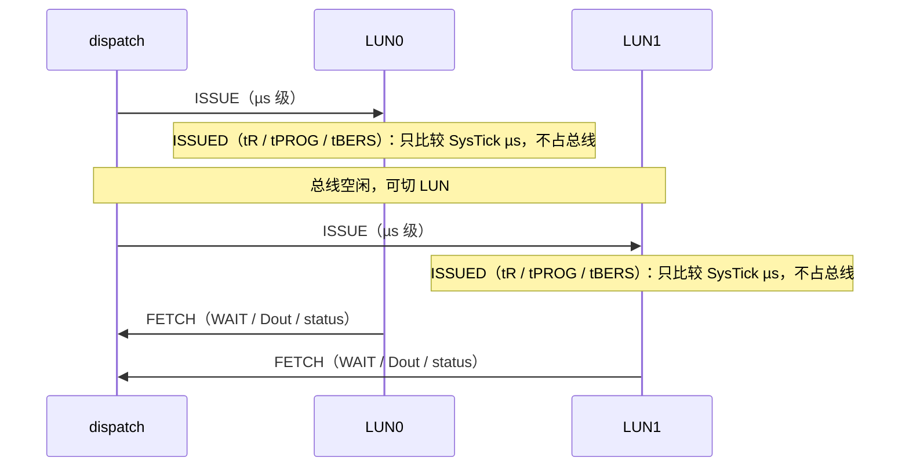

dispatch 轮询逐个 LUN 推进（每 LUN 每轮一条）；`ISSUED` 段只比较 SysTick µs，不占总线。
设计目标：总耗时 ≈ tR + FETCH，而非 2 × (tR + FETCH)。

### 18.4 多通道还差什么

| 项 | 现状 | 改多通道需要 |
|---|---|---|
| 调度层 / FIFO / poll 遍历 | 已按三维数组编写 | 改 `CH_NUM` 即可 |
| FMC 后端 | per-(ch,ce) 实例 | per-通道 base 表 + 各 bank `HAL_NAND_Init` + MPU 区 |
| DMA | 无（PIO） | 换带 DMA 请求线的 SoC |
| 引擎状态 | 无通道 id，靠 backend 上下文 | 事务里带 target id |
| R/B# 中断 | 无（GPIO 轮询） | 每通道独立 EXTI 或控制器内置采样 |

---

## 19. ONFI 时序模式

### 19.1 电压域与模式

本板是 **3.3 V** 器件。数据手册 **Table 29/31 的 AC 参数按 ONFI timing mode 5 给出**
（Table 29 Note 1："Operating mode timings meet ONFI timing mode 5 parameters"），
且 Mode 5 是 3.3 V only（Table 15 Note 3）。1.8 V 的 Table 32 Note 1 才是 Mode 4。
**两套 AC 表必须按电压域选**，不能混用。

### 19.2 启动与切换

```text
nand_init:
  HAL_NAND_Init(保守 PCC) → RESET(FFh) → READ_ID 校验 → 保持 Mode 0
FTL boot / 恢复:
  全程 Mode 0（目录、Checkpoint、Journal、rebuild 都在保守时序下完成）
boot 完成后:
  fc_nand_enable_high_speed(fmc_hz):
    SET_FEATURES(01h, 5) → 重算 PCC → HAL_NAND_Init(快速) → nand_fmc_init_target
```

切高速失败只告警并保持 Mode 0；启动路径不依赖高速时序。

### 19.3 编译开关

```c
/* include/nand/devices/mt29f___g08a.h */
#define CONFIG_NAND_TIMING_MODE (5U)   /* 0 = 全程低速；5 = boot 后切 Mode 5 */
```

`CONFIG_NAND_TIMING_MODE = 0` 时 `fc_nand_enable_high_speed()` 是 no-op。

### 19.4 ONFI → FMC PCC 换算

`nand_fmc_timing_to_pcc(const nand_fmc_timing_s *onfi, FMC_NAND_PCC_TimingTypeDef *pcc, DWORD fmc_hz)`
按 ST 的精确式换算，FMC kernel clock = **200 MHz**（PLL2 VCO 400 MHz / R=2；D1 域 FMC
上限 200 MHz），`tHCLK = 1e12 / fmc_hz ps` 实算，不硬编码：

| PCC 字段 | 约束 |
|---|---|
| `SetupTime` | `(SET+1)·tHCLK ≥ max(tCS, tCLS, tALS, tCLR, tAR) − tWP`；**另有 `SET·tHCLK ≥ tCS` 下限**（纯精确式会把 Setup 压到 1 周期，地址/擦除命令会失败） |
| `WaitSetupTime` | `(WAIT+1)·tHCLK ≥ max(tWP, tRP)` |
| `HoldSetupTime` | `HOLD·tHCLK ≥ max(tCH, tCLH, tALH, tDH)` |
| `HiZSetupTime` | **写方向**：`HiZ·tHCLK ≥ max(tCS, tCLS, tALS) + (tWP − tDS)` |

⚠ `HiZSetupTime` 是**写访问**期间的总线高阻窗口（`MEMHIZ`），不是读方向的 `tRHZ`
（`RE#↑ → 输出高阻`）——两者方向相反，不可混用。

当前 Mode 5 选值：**SET=4 / WAIT=3 / HOLD=2 / HiZ=5**，`TCLR = TAR = 3`；各相相对手册最小值
至少 +5 ns（Setup/Wait 各留 1 周期板级余量）。init 打印
`[NAND] Mode 5 PCC ... (fmc=...Hz tHCLK=...ps)` 供核对。

### 19.5 已知限制

- 余量固定 1 个 FMC 周期，需用擦/写/读压力确认；稳定后可评估收紧。
- 3.3 V 器件最高异步模式是 Mode 5；Mode 4 不使用。

---

## 20. QoS 现状

**没有专门的读饥饿保护。** 填充轮次只按「HSQ 优先 + 按 LUN 保序」选命令，不做读写计数，
也不做读优先旋转——当前平台只有一个 LUN，写/擦命令占住唯一 LUN 时读命令本来就要等，
软件层没有「切到另一个 LUN」的余地（见本章末尾）。

当前与"优先级/饥饿"有关的机制只有两条：

| 机制 | 作用 | 边界 |
|---|---|---|
| HSQ 优先 | `fc_poll_fill()` 先扫 HSQ 再扫 SQ | 只影响**扫描顺序**，不抢已进 FIFO 的命令 |
| 同 LUN 保序 | per-LUN FIFO 严格先进先出 | 同 LUN 后到的命令不能插队；跨 LUN 可并发（待多 LUN 硬件） |

在 `CH_NUM = CE_NUM = LUN_NUM = 1` 的当前平台上，写/擦命令占住唯一的 LUN，读命令本来就要
等——软件层没有"切到另一个 LUN"的余地，读饥饿保护即便存在也近乎无效。多 LUN / 多通道
平台若要重启 QoS，先按 §18.3 的相位机确认"WAIT 段可切 LUN"，再决定是否需要额外的读写混合
策略。

---

## 21. 与行业主控的差距

本项目的目标平台是 **STM32H743 MCU + 1 颗 SLC NAND**，与专用 SSD 主控存在硬件代差。
本章列的是**平台边界**，不是实现选择——写代码时不要试图"优化掉"这些差异。

### 21.1 总体对比

| 维度 | 企业级 NVMe | 消费级 NVMe/SATA | 本仓（STM32H743） |
|---|---|---|---|
| 控制器 | 专用 ASIC + 多核 | 专用 ASIC + CPU | **通用 MCU（Cortex-M7）** |
| DRAM | 数 GB DDR | 256 MB~1 GB / HMB | **0（DRAM-less，1 MB SRAM）** |
| NAND 通道 | 8~32 | 4~8 | **1 ch × 1 ce × 1 lun** |
| ECC | 硬件 LDPC（Gbps 级） | 硬件 LDPC/BCH | **软件 BCH(m=13,t=4)** |
| 数据搬运 | 硬件 DMA 多通道 | 硬件 DMA | **FMC 无 DMA 请求线，只能 PIO** |
| 加扰 / RAID | 硬件 inline / XOR 引擎 | 部分硬件 | **软件 LFSR / 软件 XOR** |
| 调度 | 硬件队列 + 固件调度器 | 同 | **软件 SQ/HSQ/CQ + 单线程轮询** |
| 中断 | 命令完成中断 + MSI-X | 同 | **纯主循环轮询（R/B# GPIO）** |

### 21.2 逐项：差异 → 限制 → 本仓选择

| 维度 | 行业做法 | 本仓限制 | 选择与代价 |
|---|---|---|---|
| L2P 表 | DRAM 常驻全表 | 无 DRAM | L2P 全表落 NAND，SRAM 用 region cache + CLOCK 替换；miss 时读一个 region |
| 通道并行 | 命令级并发 | FMC 单总线 | Phase V 的 ISSUE/WAIT/FETCH 软件近似：只重叠等待时间，不并行搬数据 |
| ECC | 硬件 LDPC 引擎 | MCU 无 ECC 外设 | 软件 BCH(m=13,t=4)；吞吐受 CPU 限制，纠错能力只够 SLC |
| 数据搬移 | per-channel DMA | FMC NAND 无 DMA 请求线 | PIO 逐字节读写；占用 CPU 周期（§3.2） |
| 加扰 | DMA 内 inline | 无 | 软件 LFSR（x¹⁶+x¹⁴+x¹³+x¹¹+1），种子 = 本 CW 扇区 LBA |
| RAID | 硬件 XOR | 无 | 软件 XOR（scrambled domain），`CONFIG_FC_RAID = 0` 未启用 |
| 命令队列 | 硬件多队列 + 中断 | 无 | 软件三队列 + 单线程 `fc_service()`；中断只用于 UART/USB，不推进 NAND |
| 页缓冲 | 控制器 SRAM + 硬件拼接 | 无 | 软件页缓冲 `[ch][ce][lun]` + CPU memcpy 拼/拆 |

### 21.3 「ECC 报成功不等于数据对」

ECC 超能力时有两种表现，只有第一种可被上层发现：

| 失败模式 | 表现 | 可检测 |
|---|---|---|
| 不可纠 | 解码器报失败（`FC_CW_STATUS_UNC`） | ✅ 重读 / 换页 / RAID |
| **误纠**（miscorrection） | 解码器**报成功**，但输出的是另一个合法码字 | ❌ **静默错误** |

迭代解码在小 trapping set / absorbing set 里会卡在"校验子恰好为 0 的错误码字"上
（deceptively satisfied checks）；BCH 有界距离解码在错误数 ≥ t+1 且落进另一码字的 t 球内
同样会误纠。**推论：CRC 不是可选项**——独立校验把误纠变成可检测的失败，UBER 靠
`P(误纠) × P(CRC 漏检) ≈ P(误纠) × 2⁻³²` 才能达标。本仓读路径的 CRC 步骤（§5.3）就是这道闸。

> 出处：Koopman, *32-Bit Cyclic Redundancy Codes for Internet Applications*, DSN 2002；
> *Error Characterization, Mitigation, and Recovery in Flash-Memory-Based SSDs*（arXiv:1706.08642）；
> USENIX FAST'13 *LDPC-in-SSD: Making Advanced Error Correction Codes Work Effectively in Solid State Drives*。

### 21.4 定位

FC-NAND 在软件层面完整对齐了主控的分层模型：命令池 / 描述符 / 缓冲池、SQ/HSQ/CQ、
数据路径、ECC/加扰/RAID 引擎、ISSUE/WAIT/FETCH 原语。

受 MCU 硬件限制，所有需要硬件引擎加速的部分（ECC、DMA、加扰、XOR、页缓冲拼接、命令队列）
退化为软件实现，单通道总线是物理上限。性能与专用主控不在一个数量级；架构正确性与功能
完整性是这一层的目标。

---


## 22. 初始化：从复位到 FTL 就绪

### 22.1 启动级联与三条硬约束

`main()`（`src/main.c`）的初始化是一条 **if/else-if 级联**，不是循环：

```text
sys_init → TIM6 毫秒心跳 → log 绑定 → stack_guard_init → banner
        → fc_init → fc_nand_init
        → fc_nand_engine_set_armed(1) → stm32_platform_register
        → ssd_ftl_boot_all → [g_ftl_ready] fc_nand_enable_high_speed
        → usb_msc_init → usb_device_init → while(1)
```

| # | 约束 | 原因 |
|---|---|---|
| ① | `fc_init()` 先于 `fc_nand_init()` | `fc_init` 内唯一的 NAND 依赖是 `fc_nand_dispatch_init()`——纯 `memset` + disarm，不碰 FMC |
| ② | `else if` 级联从 `fc_nand_init()` 开始 | `fc_init` 无失败路径；NAND 初始化失败 ⇒ 跳过 set_armed / platform_register / FTL boot，主循环退化为裸 `fc_service()` |
| ③ | `fc_nand_engine_set_armed(1)` 在 `fc_nand_init()` **之后** | 探针（RESET / READ_ID / 参数页）走 `fc_nand_start/step` **直连引擎、绕过命令队列**；`submit`/`submit_chain` 由 armed 闩锁门控，初始化期间必须为 0（`fc_nand_dispatch_init()` 末尾显式 disarm） |

两个门控位不要混淆：

| 门控 | 位置 | 作用 |
|---|---|---|
| armed 闩锁 | `fc_nand_engine_set_armed()`（`src/fc/fc_nand_engine.c`） | `fc_nand_dispatch_submit*` 放行条件；`poll` 不检查 |
| `g_ftl_ready` | `src/main.c` | 主循环切换点：0 = 裸 `fc_service()`，1 = `ftl_service_pump()` + 逐实例 `ftl_service()` |

### 图 15：上电初始化分层调用时序

```mermaid
sequenceDiagram
    participant M as main() src/main.c
    participant FC as fc_init()
    participant NE as fc_nand_init()
    participant BOOT as ssd_ftl_boot_all()
    M->>M: sys_init() / TIM6 / log / stack_guard / banner
    M->>FC: fc_init()
    FC->>FC: fc_init(fc.c)
    Note over FC: ① 三池 + 队列存储 + 命令状态位图 memset<br/>② controller 清零后挂各静态数组指针<br/>③ SQ(64) / HSQ(16) / CQ(64) init<br/>④ 调度器 init（chain_owner / 挂起表清零）<br/>⑤ fc_nand_dispatch_init() ★唯一 NAND 依赖（纯 memset + disarm）<br/>⑥ CRC 引擎 init<br/>⑦ 串三条空闲链表
    M->>NE: else if fc_nand_init()
    NE->>NE: mt29f_hw_init（HAL_NAND_Init 低速 PCC + board target 装配）<br/>fc_nand_scan_targets → fc_nand_target_probe（RESET / READ_ID / 参数页）
    M->>M: else fc_nand_engine_set_armed(1) ★放行 submit / submit_chain
    M->>M: stm32_platform_register() 注册 time_us（FTL 的 CP / GC 定时依赖）
    M->>BOOT: ssd_ftl_boot_all()
    BOOT->>BOOT: ① 逐实例 ssd_ftl_boot → ftl_init / boot_recovery<br/>② 建 g_ftl_ptrs 三维指针表<br/>③ ftl_op_route_set(g_ftl_ptrs)<br/>④ ssd_controller_init(&amp;g_ctrl, g_ftl_ptrs)<br/>⑤ g_ftl_ready = 1 ★主循环切换点
    Note over M,BOOT: ★ NAND 初始化失败 ⇒ set_armed / platform_register / FTL boot 全跳过
```

### 图 16：FC 控制面资源装配

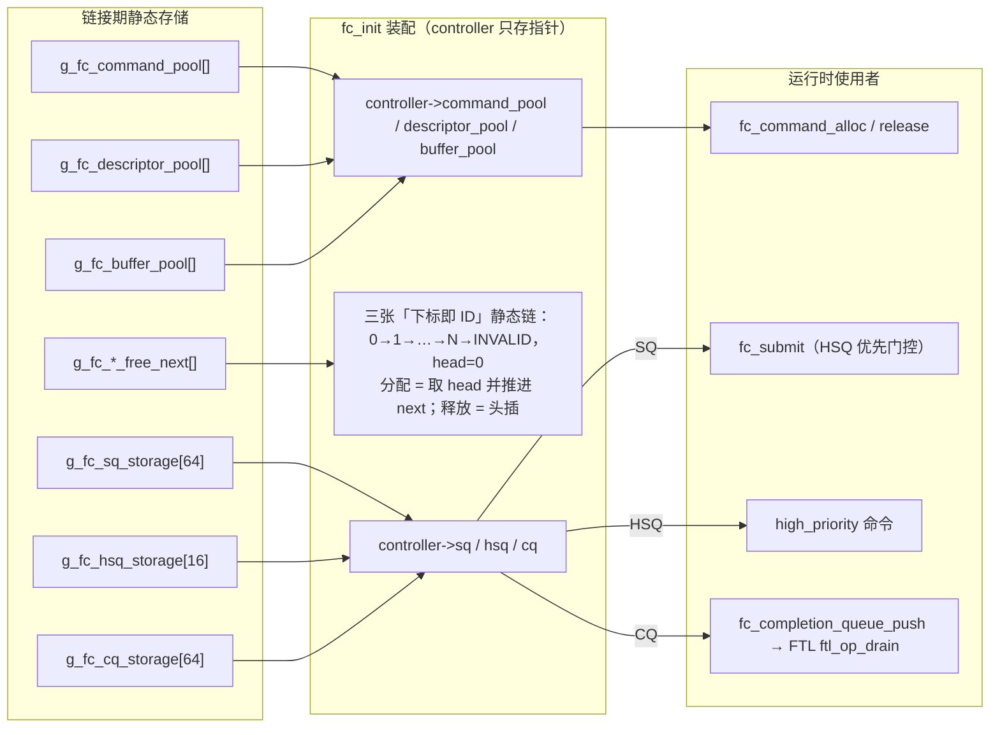

三池与队列存储都是文件作用域静态数组，地址在链接期固定；`fc_ctl_s` 只存指向它们的**指针**。
"先 `memset` 归零、后挂指针"的顺序保证上电残留不会进入池状态。

### 图 17：NAND 芯片初始化

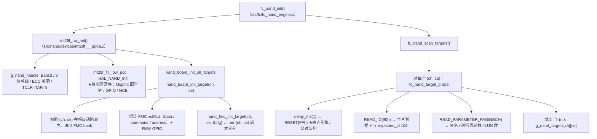

**当前 `hw_init` 不做 RESET/READ_ID**：器件侧只碰 HAL/FMC/GPIO；ONFI 探针由 FC 侧
`fc_nand_init()` 编排。这样器件驱动只负责"这块板怎么接"，命令序列仍留在协议层。

### 22.2 冷启动走读

| 跳 | 位置 | 这一步之后…… |
|---|---|---|
| 1 | `main` → `sys_init` / log / stack_guard / banner | 时钟与 UART 可用，FC/NAND 尚不存在 |
| 2 | `fc_init` ①–③ | 三池、三条队列就绪；命令可 alloc/配置，还不能提交 |
| 3 | `fc_init` ④–⑦ | 调度器、CRC、空闲链表就绪；dispatch 状态已清零并 disarm |
| 4 | `fc_nand_init` → `mt29f_hw_init` | FMC 引脚/时钟、per-(ch,ce) 后端就绪；armed 仍为 0 |
| 5 | `fc_nand_init` → 探针 | 芯片已复位、ID 与参数页已核对 |
| 6 | `set_armed(1)` | `submit`/`submit_chain` 放行——FC 才能向 NAND 派发命令 |
| 7 | `stm32_platform_register` | `time_us` 就绪，FTL 的 CP / GC 定时有依据 |
| 8 | `ssd_ftl_boot_all` ①–④ | 每个 (ch,ce,lun) 完成 `ftl_init` + `boot_recovery`；controller 绑定 FTL |
| 9 | `ssd_ftl_boot_all` ⑤ | `g_ftl_ready = 1`，主循环切到 `ftl_service_pump()` |
| 10 | `fc_nand_enable_high_speed` | SET_FEATURES(01h, 5) + 重算 PCC + 重配 FMC；失败告警并回滚低速 |

### 22.3 编译期开关

| 开关 | 当前值 | 影响 |
|---|---|---|
| `CONFIG_FC_RAID` | 0 | stripe 积累与 RAID 编解码不参与；`fc_stripe_submit` 分支编掉 |
| `CONFIG_NAND_TIMING_MODE` | 5 | boot 完成后切 Mode 5；0 = 不切，全程低速 |
| `FC_NAND_TEST_ENABLE` | 测试构建 | 编译 `/fc-nand/` 与 HIL 用例入口 |

---

## 23. 运行时：从 FTL 提交到完成回收

### 23.1 驱动模型

只有一个驱动源：`main()` 的 `while(1)`。没有任何 ISR 调用 `fc_service()` / `ftl_service()`；
R/B# 等待是纯 GPIO 轮询，无中断参与。

```text
while (1)
{
    stack_guard_check();     // 栈哨兵，每轮
    cli_service_poll();      // CLI / test 入口
    ssd_runtime_pump();      // 存储推进
}
```

`ssd_runtime_pump()`（`src/main.c`）的顺序：

| 顺序 | 调用 | 说明 |
|---|---|---|
| ① | `ftl_service_pump()` | 全局泵：`fc_service()` ×≤ `NAND_SUBMIT_BUDGET`(4) + `ftl_op_drain()` |
| ② | `ftl_service(ssd_ftl_die_get(die))` × `DIE_MAX` | 每实例：元数据池 / 确认结算 / 补发 / 后台调度 |
| ③ | `ssd_controller_service(&g_ctrl)` | FLUSH / TRIM 异步命令推进 |
| ④ | `usb_msc_task()` → `usb_device_task()` | 先检查在飞 MSC 请求，再跑协议栈 |
| ⑤ | `timer_scheduler_poll()` | CP / GC / BBT / [STAT] 周期任务 |

`g_ftl_ready == 0` 时只跑裸 `fc_service()`，保持 FC/NAND 裸路径可用。

### 图 18：一条命令的端到端生命周期

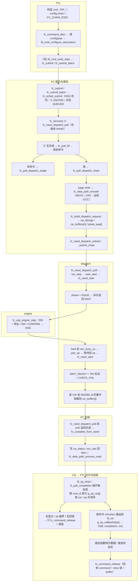

### 图 19：命令生命周期状态机

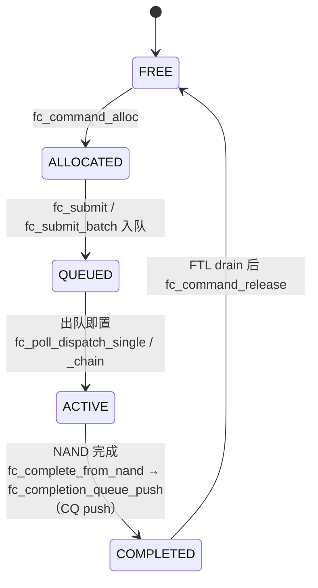

失败旁路：`fc_poll_fail_command` → 合成 NAND_FAIL 完成项（QUEUED → COMPLETED）；
CQ 满旁路：`fc_complete_from_nand` 见 push 返回 `QUEUE_FULL` ⇒ 强制置 COMPLETED + sticky fatal + 返回 IO_ERROR。
状态存储在 `g_fc_command_state[]`（`src/fc/fc_pool.c`）。

### 图 20：`fc_service()` 单步全景

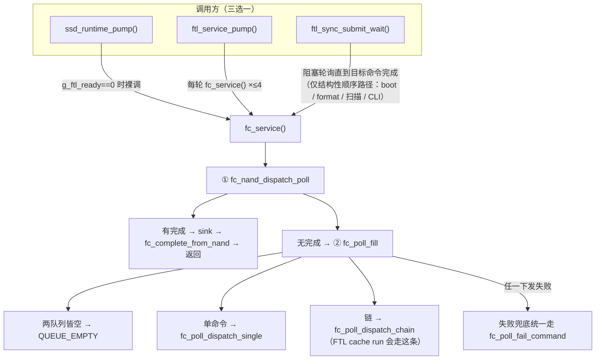

### 图 21：调度器填充决策

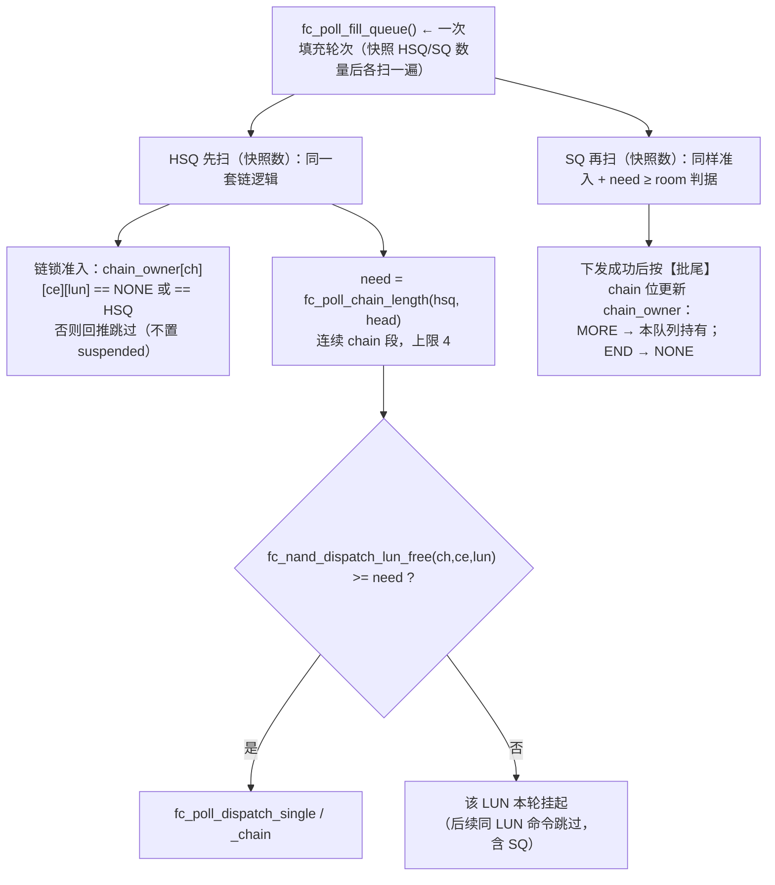

**HSQ 优先只体现在扫描顺序**，不抢已进 FIFO 的命令（FIFO 严格先进先出）；
HSQ/SQ 共用同一张挂起表（HSQ 挂起的 LUN，SQ 本轮也跳过，避免优先级倒挂）；
"忙"由 `fc_nand_dispatch_lun_free()` 表达，没有 FC 侧 busy 表。

### 图 22：一次读命令的时序走读

| 跳 | 位置 | 发生了什么 |
|---|---|---|
| 1 | FTL | 分配 command/desc/buffer，入 SQ；QUEUED |
| 2 | `ftl_service_pump` | 驱动 |
| 3 | `fc_service()` ① | 先推进 NAND（首轮无完成） |
| 4 | `fc_service()` ② → `fc_poll_fill_queue` | 扫描 HSQ/SQ，按 LUN room 取命令 |
| 5 | `fc_poll_dispatch_single` → `fc_build_dispatch_request` | 置 ACTIVE；构建 request |
| 6 | `fc_nand_dispatch_submit` | 门控通过 → 入 per-LUN FIFO → `task_load` |
| 7 | 下一轮 `fc_nand_dispatch_poll` → `lun_step` | 队头 `fc_nand_start`（加载型 op）→ ISSUE |
| 8 | 引擎 | 00h / 地址 / 30h / CONFIRM → END |
| 9 | `lun_step` | 等 `min_busy_us` 到点，`pair_op` 切等待型 + 取数型 |
| 10 | 引擎 | WAIT_READY + 70h 轮询 + DATA_OUT + CHECK_FAIL |
| 11 | `fc_nand_dispatch_scatter_page_buffer` | 页缓冲拆回各 CW buffer |
| 12 | `fc_complete_from_nand` | 写 desc status/ecc；`fc_data_path_process_read` 解扰/ECC/CRC/META |
| 13 | `fc_completion_queue_push`（`fc_complete_from_nand` 内） | CQ push；COMPLETED |
| 14 | `ftl_op_drain` | FTL 拿数据 |

### 23.2 cache run 与同步等待

| 路径 | 行为 |
|---|---|
| host I/O | 异步：`ftl_op_submit*` 后由 drain 回调完成 |
| cache read / cache program run | 按窗口组成链（`MORE`…`END`），可跨填充轮次、跨 USB chunk |
| boot / format / 出厂扫描 / CLI | `ftl_sync_submit_wait()` 阻塞轮询（结构性顺序路径） |
| Read Retry | 三条独立命令 + 同步等待，**不是**链 |

---

## 24. FC 层断言判据

全工程判据在 `docs/design/common/assertion_guidelines.md`；本节只记 FC 层落点。断言设施见
`include/common/assertion.h`。

| # | 判据 | 落点 |
|---|---|---|
| 1 | **外部输入校验保留返回码** | 只有来自 host / CLI / 介质读回的字节才返回错误码。判定标准是「值从哪来」，不是「声明在哪个头文件」 |
| 2 | **调用者已保证的前置条件转断言** | `static` 函数、内部头（`fc_internal.h` / `fc_pool.h` / `fc_queue.h`）、跨层入口中调用者必然传有效值的指针/索引 ⇒ `ASSERT`，删掉 `return` 与恢复分支 |
| 3 | **资源类结果与运行时状态保留返回码** | 池耗尽、CQ 满背压、NAND 报告错误、`ctx->active == 0` 这类「此刻能不能做」的状态 ⇒ 返回状态 |
| 4 | **单测固化为契约的守卫保留返回码** | 仅当测试是被测函数的正当调用者（校验器、文档化 no-op） |

**不用 `ASSUME`**：恢复分支既然已手工删掉，`__builtin_unreachable()` 在未开 LTO 时换不来
代码生成收益；而它把「违反即 UB」引入一条本来只会 HardFault 的路径——同样是崩，`ASSERT`
的现场更可定位。宏保留在 `assertion.h`，留给确有热路径证明需求的场合。

### 24.1 判据 4 的边界

`fc_submission_queue_*` / `fc_completion_queue_*` 的生产调用者只有 `fc.c`，全部传有效指针；
唯一会传 `NULL` 的是测试。这类「只有测试会走」的分支按判据 2 转 `ASSERT`，并**删掉对应用例**
——用例验证的行为届时已不存在。两轮补扫共删除 `test_fc_level1.c` 13 个 `*_null`/越界用例、
`test_fc_level2.c` 3 个。

### 24.2 判据 2 的补丁：release 档必须另有拒绝

判据 2 假设「断言消失后坏状态会以别的方式暴露」。有一类配置错误不满足：违反之后程序照常跑完、
不报错，只是**悄悄写坏介质**（首例：multi-plane 窄位图，§17.4）。对这类错误，`ASSERT` 之外
**必须**再补一道 release 运行期拒绝（`return FC_STATUS_INVALID_ARGUMENT`，由调用者转成命令失败
并注 `NAND_FAIL` 完成项），否则 release 档等于没有守卫。判据原文见
`common/assertion_guidelines.md` 判据 9。

> `make tests` 走 debug 档（无 `NDEBUG`），断言在板上测试固件里是活的：任何误判会让板子停机
> 而不是报用例失败。改动这些守卫后必须上板跑三套 munit 套件。

---

## 25. 按 CW 子集读

### 25.1 用途

一页 4 个 CW，读恢复只需要重读失败的那几个，不必重读整页。FC 为此提供「访问哪个 CW 集合」
的表达能力；恢复流程的接线在 FTL（`src/ftl/read_recovery.c`）。

### 25.2 位图语义

| 项 | 取值 |
|---|---|
| 入口 | `ftl_cmd_configure_descriptors(cmd, cw_bitmap)`；`cw_bitmap` 是**建链形参**，不是命令字段 |
| 编号 | **flat 绝对号**：bit `n = plane * CW_NUM + cw`，覆盖 `CW_TOTAL_MAX = 8` 位 |
| `0` | **空集**，不是「全部」。整段访问写 `fc_command_plane_span_cw_bitmap(cmd)` |
| 校验 | `ftl_cmd_validate_cw_bitmap()`（`src/ftl/ftl_fc_interface.c`，static）唯一定义，两个整段入口共用 |

```c
/* 命令能触及的 plane 位段 [plane_first, plane_last)：
 *   multi-plane：从 plane 0 起覆盖 plane_count 个
 *   单 plane：只覆盖 paa_to_plane(command->paa) 那一个 */
plane_first = (plane_count == 1U) ? paa_to_plane(command->paa) : 0U;
plane_last  = plane_first + plane_count;
allowed     = ((1U << (plane_count * CW_NUM)) - 1U) << (plane_first * CW_NUM);

ASSERT(bitmap != 0U);                /* 忘填 = 空集，无隐式展开 */
ASSERT((bitmap & ~allowed) == 0U);   /* 越出本命令 plane 位段 = 编程错误 */
```

示例：只读 plane 1 的 4 个 CW 是 `0xF0`；plane 0 取 {CW0,CW3} + plane 1 取 {CW1} 是
`0b0010_1001 = 0x29`。

### 25.3 唯一索引空间

跨 FC / dispatch 边界只有一个 CW 坐标：

```text
n = plane * CW_NUM + cw          （0 .. CW_TOTAL_MAX-1）
```

| 消费点 | 字段 |
|---|---|
| 请求 | `cw_bitmap` / `cw_buffers[n]` |
| 完成 | `cw_status[n]` / `ecc_bit_count[n]` |
| 列地址 | `column = (n % CW_NUM) * CW_SIZE` |
| 行地址 | `plane_paa[n / CW_NUM]` |

```
bitmap = 0b1011（CW0/CW1/CW3）单 plane 读
  desc 链：desc#0 → desc#1 → desc#2      （链序无关：位图是集合）
  desc->paa：  CW0     CW1     CW3
  flat 号 n：   0       1       3         （= 置位 bit = cw_status 下标）
```

desc 链的**建立顺序**是 plane-major，但没有任何消费点把它当坐标；落位按 `n` 独立进行。

### 25.4 建链

公共入口（`src/fc/fc_pool.c`）：

```c
fc_status_e fc_command_configure_descriptor(fc_cmd_id_t cmd_id, BYTE plane, BYTE cw, DWORD row_paa);
fc_status_e fc_command_configure_descriptor_with_buffer(fc_cmd_id_t cmd_id, BYTE plane, BYTE cw,
                                                        DWORD row_paa, fc_buf_id_t buffer_id);
```

`_with_buffer` 版供上层自行 `fc_buffer_alloc()` 后传入（`buf_own` 上层申请模式），
常规路径由 FC 为每个 CW 自动分配 desc + buffer。

| 约束 | 行为 |
|---|---|
| 行地址 | `row_paa` 实参给出该 plane 的 page/block/lun；其 plane 位必须等于 `plane` |
| 同 plane 一致 | 同一 plane 的所有 CW 必须传同一行地址——一个 plane 一次只访问一个物理位置 |
| plane 段 | `plane` 必须落在本命令段内（单 plane = `paa_to_plane(cmd->paa)`；multi-plane = `[0, multi_plane)`），越段拒绝 |
| CW 范围 | `cw >= CW_NUM` 拒绝 |
| 重复 `n` | 同一 `(plane, cw)` 追加两次 → `ASSERT`（掩码是集合，重复置位会静默丢数据） |

`config.cw` **不参与建链**、也不回写：链长、完成折叠、落位位图一律走 desc 链。当前唯一
生产读者是 RAID stripe 的 `cw_count`（`CONFIG_FC_RAID = 0`，不编译）。

### 25.5 读路径

FC 命令保持 `WITH_DATA_OUT` 语义（desc 建链、`fc_is_page_read`、数据路径、完成判定都用它）；
进入引擎前由 `fc_nand_dispatch_select_read_op()` 决定实际 op：

| 条件 | 选用 op |
|---|---|
| 完整页位图 + `LUN_NUM == 1`（单 plane 12 / multi-plane 30 / OTP 28） | 保留原 op，30h 后直接整页 Dout |
| 稀疏位图 + `LUN_NUM == 1` | 33（单 plane）/ 29（multi-plane）：只加载 |
| `LUN_NUM > 1` | 35（单 plane）/ 43（multi-plane）：ISSUE 型加载 |

逐 CW 取数：

| 场景 | 取数 op |
|---|---|
| 单 plane | `OP_RANDOM_DATA_READ` 8：`05h-列-E0h` |
| multi-plane | `OP_RANDOM_DATA_READ_MULTI_PLANE` 41：`06h-列-行-E0h` |

链推进：加载型 op 完成**不推进**槽位，从首个置位 bit 起发取数；取数型 op 完成后推进到
下一个置位 bit，直到 `CW_TOTAL_MAX` 哨兵。plane 与 CW 号都从同一个 `n` 算出。

**cache 读族不受影响**（13 / 14 / 15 / 45 / 46 / 47）：它们是 cache 管线机制，不是
「加载进页缓冲再逐 CW 取」。

### 25.6 `06h` 取数 op 的协议前提

```
70h 轮询 → 06h → C1 → C2 → R1 → R2 → R3 → E0h → tR → Dout → 70h 轮询
```

| 项 | 值 |
|---|---|
| OP 码 | 41（`OP_RANDOM_DATA_READ_MULTI_PLANE`） |
| `data_length` | `CW_SIZE` |
| 命令常量 | `NAND_CMD_RANDOM_DATA_READ_MULTI_PLANE (0x06U)`（Micron 文档称 random data read two-plane） |

Micron MT29F4G08 datasheet 的三条前提：

1. `06h` 必须紧跟 TWO-PLANE PAGE READ（`00h-00h-30h`）——本流程正是如此；
2. plane 由**行地址 BA6** 选择（`paa_to_nand_row()` 把 plane 编在 bit 6）；
3. two-plane 命令族要求器件内部 on-die ECC 关闭——本仓从不写 ECC feature（`0x90`），
   内部 ECC 保持默认关闭。
   ⚠ 第 3 条的 datasheet 位置**出处待重核**（见 §17.2 与 `docs/design/known_open_items.md`）。

### 25.7 完成项折叠

| 层 | 行为 |
|---|---|
| dispatch | `completion_load`：成功不写任何 `cw_status`；失败刷满 8 槽（加载失败后取数链不再启动） |
| FC | 沿 desc 链全链 OR 折叠 status；首个失败 CW 的 desc_id |
| FC | **不聚合失败位图**——上层遍历 desc 链自取；位图编号与请求位图同空间，可直接求交集 |
| FC | CQ **不携带** per-CW ECC；命令级聚合走 `fc_get_cmd_ecc_max()`（全链最大值，含两个 plane） |
| FC | GET_FEATURES / READ_META / READ_ONI_SIGNATURE / READ_COLUMN 的 4 字节返回值经控制器暂存拷进 `param.value`（§14） |

### 25.8 风险

| # | 风险 | 后果 / 当前缓解 |
|---|---|---|
| 1 | 生产者忘填 `cw_bitmap` | 0 = 空集。debug 有 `ASSERT`；release 下 `ASSERT` 裁空 ⇒ **静默空操作**，命令"成功"但没访问任何 CW。整段访问必须用 `fc_command_plane_span_cw_bitmap()` |
| 2 | multi-plane 部分 plane 位图为 0 | 器件会把点名 plane **全部编程** ⇒ 静默写一页 0xFF。已双档拦截（`ASSERT` + release 返回 `INVALID_ARGUMENT`，§17.4） |
| 3 | 同一 `(plane,cw)` 重复建链 | `ASSERT`（release 裁空 ⇒ 后一个 desc 覆盖前一个的数据槽）。可达路径是 `ftl_cmd_setup_ppa_pair`：两个 LBA 解析到同一 plane |
| 4 | `06h` 的 on-die ECC 前提出处未核对 | 若器件默认开启内部 ECC，多 plane 路径失效。当前不写 `0x90`，默认关闭；上板行为是最终判据 |
| 5 | multi-plane 不属于 ONFI 1.0 | ONFI 1.0 全文无 `plane`；multi-plane 来自器件 datasheet。文档与代码不得把它写成"ONFI 规定" |

历史演进、逐版验证记录与文件变更表见 `docs/design/revision_history/fc_nand_revision_history.md`。

---

## 26. 与行业分层模型的对照

本章是**防止 FC 接口再次长胖**的判据：每加一个对外函数，先拿它比对「硬件 FCC 寄存器表」。

### 26.1 行业分层

```text
   Host
    │  NVMe SQ/CQ + doorbell + MSI-X（或 eMMC CMDQ Task Descriptor List）
    ▼
 ┌─────────────┐
 │  HIL        │  协议解析、队列管理、doorbell 响应
 ├─────────────┤
 │  FTL        │  L2P、GC、WL、坏块管理、掉电恢复、缓冲调度
 ├─────────────┤
 │  FCC        │  **硬件**：通道/CE/LUN/plane 时序、描述符链执行、ECC、加扰、DMA
 ├─────────────┤
 │  DRAM       │  映射表 / 命令队列 / 数据缓冲
 └─────────────┘
    │  ONFI / toggle 总线
    ▼
  NAND die ── channel → chip → die → plane → block → page → CW
```

**主机接口三种代表，本质相同**：

| 形态 | 提交 | 完成 | 描述符 |
|---|---|---|---|
| NVMe | SQ 写命令 + doorbell | CQ + MSI-X | PRP/SGL |
| eMMC CMDQ | Task Descriptor List（`CMD44/45`） | Task 完成 + 中断 | 数据地址 / 方向 / 块数 |
| OCSSD / ZNS | 裸写指针 / zone 追加 | 完成队列 | 极简，设备侧几乎无 FTL |

共同点：设备侧固件拿到的是**已解析的请求**（地址 + 数据缓冲 + 操作类型）；
"访问哪些物理单元""数据怎么搬"归固件，硬件接口只负责排队、执行、回完成。

### 26.2 本项目的映射

| 行业部件 | 本项目 | 说明 |
|---|---|---|
| HIL | `src/hil/`（`controller.c` / `request.c` / `host_queue.c` / `cli.c` / `usb_msc.c`）+ `src/main.c` 超级循环 | 主机前端、请求表示与路由、完成回执；主循环只做泵。架构见 `docs/design/hil_design.md` |
| FTL | `src/ftl/` | L2P、GC、WL、Journal、Checkpoint、BBT |
| FCC（硬件） | `src/fc/` + `src/nand/` | **两者合起来才等于行业的一个硬件 FCC** |
| DRAM | `g_fc_buffer_pool`（128 × 528 B）+ FTL 的 SRAM 数组 | DRAM-less：缓冲池就是片上页缓冲 |

`src/fc/` 与 `src/nand/` 的分界是 **FCC 的内部再拆分**：

| 部分 | 职责 |
|---|---|
| `src/nand/`（UOP 序列表 + FMC 后端 + 器件模型）= 时序执行单元 | 发命令、等 R/B#、搬数据 |
| `src/fc/`（三池 + desc 链 + 队列 + 数据路径）= FCC 前端 | 描述符链、队列、ECC / 加扰 / RAID |

两者之间的 `fc_nand_dispatch_req_s` 就是行业 FCC 内部的「已解析请求」寄存器组：

```c
DWORD cw_bitmap;                 /* 访问哪些 CW（flat 绝对号；0 = 空集） */
DWORD plane_paa[PLANE_NUM];      /* 每个 plane 的行地址 */
BYTE *cw_buffers[CW_TOTAL_MAX];  /* 每个 CW 的数据缓冲指针 */
```

**下界**（`include/fc/fc_nand_dispatch.h`）：`src/fc/` 必须在 submit 时把 desc 链解析完并交出
`cw_buffers[]`，dispatch 之后**不再回调 FC**。故「造请求者必须拥有 buffer 池」——
FC 不能整体下沉到 FTL。

### 26.3 判据：硬件 FCC 寄存器表

> 拿 FC 的每个对外函数去比对硬件 FCC 的寄存器表——**有对应项则保留，无对应项则剔除。**

| 对外函数 | 硬件 FCC 的对应物 | 判定 |
|---|---|---|
| `fc_init` | 复位 / 配置寄存器 | 保留 |
| `fc_command_alloc` / `fc_command_release` | 命令槽取 / 还 | 保留 |
| `fc_command_configure_descriptor` / `_with_buffer` | 填一条描述符 | 保留（**唯一建链入口**） |
| `fc_descriptor_release_head` / `fc_descriptor_chain_release_all` | 描述符链释放（链在 FC 的池里） | 保留（建链失败回滚入口） |
| `fc_submit` / `fc_submit_batch` | 写门铃 | 保留 |
| `fc_service` | 控制器自跑（软件必须显式化） | 保留 |
| `fc_poll_completion` / `fc_poll_completions` | 读 CQ | 保留 |
| `fc_buffer_alloc` / `fc_buffer_release` / `fc_buffer_get_user_data` / `fc_buffer_get_base` / `fc_buffer_get_meta` | 数据缓冲（下界强制 FC 持有） | 保留 |
| `fc_get_cmd_data_ptr` | 读第 n 条描述符取缓冲地址 | 保留 |
| `fc_get_cmd_cw_bitmap` / `fc_get_cmd_all_cw_empty` | 读描述符链 | 保留 |
| `fc_get_cmd_ecc_max` | 完成聚合寄存器（ECC 纠错计数） | 保留 |
| `fc_command_id_to_command` / `fc_descriptor_id_to_descriptor` | ID→指针（软件模拟必需） | 保留 |
| `fc_get_resource_stats` / `fc_debug_state_get` / `fc_boot_report` | 状态寄存器 / 诊断 | 保留 |
| `fc_test_complete_nonactive` | 测试 seam（`FC_NAND_TEST_ENABLE` 下编译） | 保留 |
| `ftl_cmd_configure_descriptors`（FTL 侧，非 FC API） | **无此寄存器**（描述符链是固件填的） | 归 FTL |
| `ftl_cmd_write_data` / `ftl_cmd_read_data`（FTL 侧，非 FC API） | **无此寄存器**（数据是固件搬的） | 归 FTL |

### 26.4 为什么这两件事在固件侧

硬件 FCC 拿到的描述符链已经决定好「访问哪些 CW」、数据已经在某个缓冲里——它**不解释位图**
（位图是固件的策略产物），也**不搬数据**（数据搬运由 DMA 引擎按描述符地址做，"往哪个缓冲拷、
按什么顺序拷"由固件决定）。OCSSD / ZNS 这类设备侧极简 FTL 的设计方向印证同一点：

> **越靠近硬件，接口越只谈机制；策略越往上放。**

### 26.5 反例：为什么不按「6 原语」重构

曾考虑把 FC 收敛成「申请/释放命令、申请/释放 desc、申请/释放 buffer」六个裸池原语。
按 §26.3 判据这是**反向**的：行业 FCC 是「队列 + 门铃 + 完成」模型，裸池原语会把 FC 变成
内存分配器，偏离硬件形态。故不做。

---

## 附录 A：图 → 源码定位

| 图 | 内容 | 定位 |
|---|---|---|
| 图 1 | 分层与数据流总览 | `src/fc/fc.c` 头注释；`include/fc/fc_nand_dispatch.h` |
| 图 2 | 命令生命周期 | `include/fc/fc_interface.h`；`src/fc/fc_pool.c` |
| 图 3 | `fc_service()` 主循环 | `fc_service` / `fc_poll_fill`（`src/fc/fc.c`） |
| 图 4 | `fc_uop_engine_step()` 骨架 | `src/fc/fc_nand_engine.c` |
| 图 5 | 70h 状态轮询 | `nand_fmc_exec_wait_ready`（`src/nand/nand_fmc.c`）；`JUMP_IF_NOT_READY`（`src/nand/onfi_1_0.c`） |
| 图 6 | FMC 后端 handler 表 | `g_nand_fmc_handlers`（`src/nand/nand_fmc.c`） |
| 图 7 | per-LUN 相位机 | `LUN_PHASE_*`（`src/fc/fc_nand_dispatch.c`） |
| 图 8 | CW 布局与模块范围 | `FC_BUFFER_*` 常量（`include/fc/fc_interface.h`）；`src/fc/fc_data_path.c` |
| 图 9 | 写路径 encode | `fc_data_path_encode`（`src/fc/fc_data_path.c`） |
| 图 10 | 读路径 decode | `fc_data_path_process_read`（`src/fc/fc_data_path.c`） |
| 图 11 | 完成回写与 CQ 组装 | `fc_complete_from_nand`（`src/fc/fc.c`）；`g_fc_return_staging` |
| 图 12 | 链的原子提交与逐条完成 | `fc_poll_dispatch_chain`（`src/fc/fc.c`）；`fc_nand_dispatch_submit_chain` |
| 图 13 | Multi-plane 页缓冲拼装/拆分 | `req_multi_plane_program` / `fc_nand_dispatch_scatter_page_buffer` |
| 图 14 | ISSUE/WAIT/FETCH 时序 | `min_busy_us` / `LUN_PHASE_ISSUED`（`src/fc/fc_nand_dispatch.c`） |
| 图 15 | 上电初始化调用时序 | `main`（`src/main.c`） |
| 图 16 | FC 资源装配 | `fc_init`（`src/fc/fc.c`） |
| 图 17 | NAND 芯片初始化 | `mt29f_hw_init`（`src/nand/devices/mt29f___g08a.c`）；`fc_nand_target_probe` |
| 图 18 | 命令端到端生命周期 | `fc_poll_dispatch_single` / `fc_complete_from_nand`；`fc_nand_dispatch_submit` |
| 图 19 | 命令生命周期状态机 | `FC_COMMAND_STATE_*`（`src/fc/fc_pool.c`） |
| 图 20 | `fc_service()` 单步全景 | `fc_service` / `fc_poll_fail_command`（`src/fc/fc.c`） |
| 图 21 | 填充轮次决策 | `fc_poll_fill_queue` / `fc_poll_chain_length` / `chain_owner` |
| 图 22 | 读命令时序走读 | 图 18 的分段展开；`fc_nand_dispatch_scatter_page_buffer` |

## 附录 B：建议阅读顺序

```text
第一步（整体）  §1 → 图 1 → 图 2 → 图 3
第二步（硬件）  §3 → 图 4 → 图 5 → 图 6
第三步（数据）  §5 → 图 8 → 图 9 → 图 10
第四步（并发）  §4/§18 → 图 7 → 图 14 → 图 21
第五步（缓存）  §12/§17 → 图 11 → 图 12 → 图 13
第六步（启动）  §22 → 图 15 → 图 16 → 图 17
第七步（运行）  §23 → 图 18 → 图 19 → 图 20
第八步（边界）  §25 → §26
```
