# FTL 设计（DRAM-less / STM32H743 + MT29F4G08）

> 本文描述 soft_ssd 的 FTL（Flash Translation Layer）**当前设计**：它要解决的问题、
> 模块边界、数据结构、状态流转与掉电语义。与 [`fc_nand_design.md`](fc_nand_design.md)
> （FC + NAND 底层）平行，共同构成 SSD 固件设计。
>
> 本文**只描述当前设计**。演进史与逐版本决策见
> [`ftl_revision_history.md`](ftl_revision_history.md)，逐版本落地与上板记录见
> [`docs/archive/changelog/`](../archive/changelog/)。正文不承载变更叙事。

---

## 目录

- [0. 本文定位与阅读路径](#s0)
- [1. 需求、约束与总体设计](#s1)
  - [1.4 模块全景与主流程图](#s1-4)
  - [1.5 重要数据/状态流转路径](#s1-5)
- [2. 介质与地址模型](#s2)
- [3. 模块设计](#s3)
  - [3.1 引导与掉电恢复](#s3-1)
  - [3.2 分配器 / BST / Super Block](#s3-2)
  - [3.3 坏块表 BBT](#s3-3)
  - [3.4 磨损计数持久化与静态磨损均衡](#s3-4)
  - [3.5 元数据目录](#s3-5)
  - [3.6 L2P Cache](#s3-6)
  - [3.7 Journal](#s3-7)
  - [3.8 Checkpoint](#s3-8)
  - [3.9 Host 提交 / group / pending](#s3-9)
  - [3.10 完成路由与 op dispatch](#s3-10)
  - [3.11 页打包写缓冲 wbuf](#s3-11)
  - [3.12 FTL service 与后台调度器](#s3-12)
  - [3.13 GC 策略与迁移引擎](#s3-13)
  - [3.14 读恢复](#s3-14)
  - [3.15 FTL↔FC 接口](#s3-15)
- [4. 端到端场景](#s4)
- [5. 数据与状态模型](#s5)
- [6. 策略决策记录（ADR）](#s6)
- [7. 已知限制与待办](#s7)
- [8. 附录](#s8)

---

<a id="s0" name="s0"></a>

## 0. 本文定位与阅读路径

### 0.1 本文回答什么、不回答什么

| 回答 | 不回答 |
|---|---|
| FTL 为什么存在、要满足哪些约束 | 对外 API 的逐字段契约（见 §0.2 两份接口文档） |
| 每个模块的**需求背景**、职责边界、结构、流程 | 某个版本何时改了什么（见 revision history） |
| 数据与状态在模块之间怎么流转 | FC/NAND 内部的命令链、ECC/CRC 实现（见 `fc_nand_design.md`） |
| 掉电时哪些状态会丢、怎么恢复 | 板级外设与时序（见 `platform` / `boot_flow.md`） |
| 策略取舍与主流对照（ADR） | 未验证功能的“已完成”声明（验证状态见 §7） |

### 0.2 文档分工

| 想知道 | 读 |
|---|---|
| **FTL 对外接口**（`ftl_init` / `ftl_submit_*` / 调用约束 / 接口级 UT 设计） | [`ftl_api_usage.md`](ftl_api_usage.md) + [`ftl_host_interface.md`](ftl_host_interface.md) |
| 逐版本决策史 | [`ftl_revision_history.md`](ftl_revision_history.md) |
| 多 LUN / 共享 cache / 内存域 | [`multi_lun_generalization.md`](multi_lun_generalization.md) |
| CW 级映射的来由与介质布局 | [`cw_level_mapping_design.md`](cw_level_mapping_design.md) |
| FC / NAND 命令、ECC/CRC、地址层 | [`fc_nand_design.md`](fc_nand_design.md) |
| 存储主控学习路线 | [`storage_controller_learning.md`](storage_controller_learning.md) |
| 断言判据 | [`assertion_guidelines.md`](assertion_guidelines.md) |

⚠ **签名以头文件为准**。本文给结构形状与字段语义，不复制完整函数原型——接口改动频繁，
文档复制签名必然漂移。当前公共入口见 `include/ftl/ftl.h`。

### 0.3 推荐阅读顺序

先读 **§1.4 总图 + §1.5 路径表**，建立“一次 host 读写从哪进、经过谁、从哪出”的地图。
然后按下面的顺序读，**不要从 §3.5 metadata 开始**：

| 顺序 | 模块 | 为什么先看它 |
|---:|---|---|
| 1 | **§3.9 Host 提交 / group / pending** | 整个 FTL 的入口。先理解“一条 host 请求如何拆成子操作、如何用一个组聚合完成”，后面所有异步 job 都是同一套骨架 |
| 2 | **§3.10 完成路由 / op dispatch** | 与 §3.9 配对：提交与完成解耦，op tag 决定谁收尾。不懂这条链路，后面每个 job 的 `waiting/phase` 都会显得莫名其妙 |
| 3 | **§3.11 写缓冲 wbuf** | 一次 512 B 写如何攒成一页、双 plane 如何合并。写路径最直观的一层 |
| 4 | **§3.2 分配器 / BST / Super Block** | 页从哪来、块状态怎么变、Free/OP/Spare 四本账。GC/WL 的前提 |
| 5 | **§3.6 L2P Cache** | 读命中/未命中、异步加载、脏行回写。**这是 metadata 的前置** |
| 6 | **§3.5 元数据目录** | 现在再看：region 为什么不在固定位置、append/commit 为什么分离、`l2p_live` 干什么、Anchor 为什么存在 |
| 7 | **§3.7 Journal + §3.8 Checkpoint** | 写回之后的掉电一致性：增量日志 + 全量快照 + 截断顺序 |
| 8 | **§3.13 GC / 迁移 + §3.4 WL + §3.3 BBT** | 后台如何回收空间、均衡磨损、处理坏块 |
| 9 | **§3.12 service / 后台调度** | 回头看这些 job 如何在单线程 superloop 里被调度、为什么有 must-run |
| 10 | **§3.14 读恢复 + §3.1 启动恢复** | 异常路径：读失败怎么救、掉电后怎么重建 |

最后用 **§4.5 主机写**、**§4.6 L2P 回写**、**§4.7 Checkpoint** 三个场景把前面串一遍；
状态机记不住时查 §5.2。

#### 如果只想先攻克 metadata

按这个最小闭环读：

1. §2.2 地址模型（LBA / region / PBA）
2. §3.6.4 读路径、§3.6.5 写路径与写回
3. §3.5.5 ring / locate / prepare
4. §3.5.6 lookup 与启动加载
5. §3.5.7 append → 写页 → commit
6. §3.5.8 `l2p_live` / 回收 / 压缩
7. §3.5.9 Anchor

原因：`metadata.c` 里的 `append_slot` / `commit_region` / `l2p_live` 不是凭空出现的——
它们是 **L2P cache 脏行回写**的落盘端。先看 §3.6 的 `l2p_cache_flush_kick` 怎么调用它们，
再回头看 §3.5，顺序就顺了。

#### 其它三条快速路径

| 路径 | 顺序 |
|---|---|
| **按上电顺序**（想知道盘怎么活过来） | §1.1~1.3 → §2 → §3.1 引导恢复 → §3.2 分配器 → §3.3 BBT → §3.4 磨损 → §3.5 元数据目录 |
| **按写路径**（想知道一次 host 写经过谁） | §1.4 总图 → §3.9 提交/组 → §3.11 wbuf → §3.2 分配 → §3.10 完成路由 → §3.6 L2P cache → §3.7 Journal → §3.5 元数据目录 → §4.5 |
| **按后台任务**（想知道空闲时在做什么） | §3.12 调度器 → §3.13 GC/迁移 → §3.4 WL → §3.8 Checkpoint → §3.14 读恢复 |

### 0.4 术语速查

#### 地址与映射

| 术语 | 含义 |
|---|---|
| **LBA** | 主机逻辑地址；本项目 1 LBA = 1 CW = 512 B 用户数据 |
| **PBA** | FTL 内部物理地址：`CH/CE/LUN + block/plane/page/CW`，L2P 的存储单位 |
| **PAA** | NAND 命令层物理地址（芯片内）；**位序与 PBA 不同**，只在 FTL↔FC 边界转换 |
| **L2P** | LBA → PBA 映射表；全表 4 MiB，存 NAND，SRAM 只缓存少量 region |
| **region** | L2P 分片：1 页 = 512 条 entry；`region_id = LBA / 512` |
| **IU** | 映射单元；本项目 IU = 1 CW（512 B） |
| **PBA / PAA / META** | PBA = FTL 地址；PAA = 芯片地址；META = 页内每 CW 头 4 B 记录的本 CW 扇区 LBA |

#### 介质与块管理

| 术语 | 含义 |
|---|---|
| **plane / block / page / CW** | 平面 / 擦除单位（64 页）/ 读写单位（4 CW）/ ECC 码字（512 B 用户 + 校验） |
| **Super Block（SB）** | 跨各 plane 的逻辑写入单元；各 plane 取一个物理块配对 |
| **gblock** | 全局块号 `plane * BLOCKS_PER_PLANE + block`；BST 的唯一索引 |
| **Open / Closed** | 正在追加写的 SB / 写满封口、等待 GC 的 SB |
| **Free Pool** | 一个**已擦除**池；三级是水位，不是三个池 |
| **OP / Spare** | OP = 性能缓冲预留；Spare = 坏块替换储备；两者都按 plane 各留一份 |
| **BST** | Block State Table：每块状态、温度、有效 CW 数、擦除/读计数、ECC 健康 |
| **BBT** | 坏块表；NAND 上持久化坏块位图 |
| **GC / victim** | 垃圾回收 / 被选中搬移的块 |
| **WL** | 磨损均衡；动态 WL 在分配时选低擦除块，静态 WL 主动搬冷数据 |
| **WA** | 写放大 = 实际 NAND 写入 / 主机写入 |

#### 一致性与恢复

| 术语 | 含义 |
|---|---|
| **DRAM-less** | 无外置 DRAM：L2P 全表在 NAND，SRAM 只做 region cache |
| **Write-back** | L2P cache 延迟写回；脏行由 Journal 保掉电一致性 |
| **Journal** | L2P 增量日志（环形块）；掉电后回放 post-checkpoint 的更新 |
| **块元数据快照** | per-block metadata snapshot（旧文档曾用自拟名「块账快照」）。每 gblock 一个 16-bit word（有效 CW 数 / 状态 / 温度 / 池归属），随 Checkpoint 记录落盘。主流资料称 per-block metadata / block descriptor；本仓粒度是物理 gblock、放 CP record（SPDK 的 Chunk 是 band 级、放 nvcache） |
| **Checkpoint（CP）** | L2P 全量快照 + 块元数据快照 + 截断 Journal |
| **Anchor** | Metadata Directory 的全量快照，存在固定 Anchor 池 |
| **modify-after-confirm** | 先等 NAND PROGRAM 成功，再改 L2P/Journal；失败则 L2P 不动 = 自动回滚 |
| **F2** | 掉电重建：全盘扫描、逐 CW 读 META 反查 L2P，重建 Closed 列表与有效计数 |
| **F4** | 按 Checkpoint 的 region 位图局部预载 L2P region |
| **F10** | 搬移条目先落 Journal，再擦 victim（数据安全屏障） |
| **Read Recovery** | 读失败恢复：读重试电压 → 邻居页辅助 → 标坏/搬移 |

#### 调度与执行

| 术语 | 含义 |
|---|---|
| **bg_scheduler** | 时间预算后台调度器：must-run 集 + interval/预算任务 |
| **must-run** | 每轮无条件执行、不占预算的正确性关键任务 |
| **op tag** | 完成服务函数选择器；`g_op_service[]` 的下标 |
| **completion table** | 完成路由表：`command_id → ctx` + `(ch,ce,lun) → 实例` |
| **pending / group** | 子操作追踪表 / 一条 host 请求的完成组 |
| **owners** | 一个 pending 子操作由哪些组贡献的位掩码 |
| **FTL_AGAIN** | 瞬态资源不足（池空 / 背压 / region 加载中），调用者稍后重试 |
| **thrashing** | L2P cache 工作集远大于容量，miss 率持续极高 |

### 0.5 标注约定

- **「主流」** = 有出处的主流主控做法（出处见 §6 每条 ADR）。
- **「本仓自定」** = 没有可引用的公开出处，是本项目的实现选择；不得写成行业标准。
- 阈值/常量均标 `file:line` 来源；代码与文档冲突时**以代码为准**。
- 本文的 `§x.y` 引用均指向本文自身章节。
- **GitHub 渲染约束**：GitHub 的 viewscreen 用 Mermaid **12.1.0**，
  `securityLevel: antiscript`，`flowchart.diagramPadding: 48`，`sequence.diagramMarginY: 40`。
  图里不要用 `click`、`%%{init}%%` 覆盖 `securityLevel/maxTextSize`、FontAwesome/Emoji、
  裸 HTML、反引号；标签统一加引号；`subgraph` ID 不要当节点/连线端点。
  GitHub 报 “Unable to render rich display” 时先硬刷新/无痕窗口，再查
  `viewscreen.githubusercontent.com` 是否可达。

---

<a id="s1" name="s1"></a>

## 1. 需求、约束与总体设计

### 1.1 为什么需要 FTL

NAND 有四个物理事实，主机语义（按 LBA 覆盖写）与它们直接冲突：

| NAND 事实 | 对主机的后果 | FTL 的职责 |
|---|---|---|
| **擦后写**：编程只能 1→0，改写必须先擦整块 | 不能原地覆盖 512 B | 写新位置 + 更新 L2P（异地更新） |
| **擦除单位远大于写单位**：块 64 页，页 4 CW | 改 1 个 CW 也要占新页 | 页打包写缓冲、CW 级映射、GC |
| **块会坏**：出厂坏块 + 运行时坏块 | 坏块上的数据不可恢复 | BBT 扫描/隔离/替换（Spare） |
| **磨损与读干扰**：P/E 有限，反复读会扰动邻近单元 | 写集中会提前耗尽某些块 | 动态/静态 WL、read disturb 计数、读恢复 |

FTL 因此承担四件事：**地址映射**（L2P）、**空间管理**（Allocator / GC / WL）、
**掉电一致性**（Journal / Checkpoint）、**介质健康**（BBT / Read Recovery）。
FTL 不直接碰 NAND，一律经 FC 接口下发命令，由 FC 保证 CRC + ECC + 加扰的数据保护链。

### 1.2 为什么是 DRAM-less

本仓没有外置 DRAM，片上 SRAM 也装不下 4 MiB 的 L2P 全表：

| 量 | 值 |
|---|---|
| 用户容量 | 512 MiB = 1,048,576 个 IU（512 B） |
| L2P 每条 entry | 4 B（`nand_pba_t`） |
| L2P 全表 | 4 MiB |
| SRAM region cache | 64 行 × 2 KiB ≈ 128 KiB |
| 覆盖的工作集 | 64 × 512 = 32,768 个 LBA = 16 MiB LBA 空间 |

⇒ **L2P 全表存 NAND，SRAM 只缓存最近访问的 region**。读 miss 时按需加载；
写命中时只改 RAM（write-back），脏行由 Journal 保掉电一致性。

这与 UFS/eMMC 等 DRAM-less 主控同构：表在 NAND、SRAM 做 cache、用日志/快照恢复。
**不是**把表放 SDRAM 的“伪 DRAM-less”，也不是有 DRAM 的企业级形态（见 §1.6）。

### 1.3 设计目标与导出约束

| 目标 | 导出约束 | 落点 |
|---|---|---|
| 主机写不丢映射 | 映射变更先入 Journal；Checkpoint 截断前 Journal 不得擦 | §3.7、§3.8 |
| 掉电恢复时间有界 | Journal 容量有界 + 定期 Checkpoint；块元数据快照避免全盘 F2 | §3.8、§3.1 |
| 前台不会被后台饿死 | 单线程 superloop；后台按负载分档 + 时间预算；must-run 只放防死锁动作 | §3.12 |
| 写放大可控 | CW 级映射 + 页打包 + 只搬有效 CW + 冷热分离 | §3.11、§3.13 |
| 容量不无声流失 | 池账本唯一闸门；坏块/退役块不得留在 Free Pool；块���快照 | §3.2、§3.8 |
| 坏块不扩散 | 出厂扫描先读后擦；运行时隔离 + Spare 按 plane 补充 | §3.3 |
| 读失败可恢复 | 读重试 → 邻居页 → 标坏搬移；ECC 趋势预测 | §3.14 |

**不可协商的约束**：

- FTL 只经 FC 访问 NAND，不直接操作 NAND 寄存器/引擎（§3.15）。
- `CONFIG_FC_RAID` 保持 0；当前不实现 RAID（§7.4）。
- 单线程 superloop + ISR，无 RTOS；所有异步性由状态机 + 完成回调表达。
- 介质格式由 `FTL_MEDIA_LAYOUT_VERSION` 标记；版本不符时首启自动格式化（§2.5）。

<a id="s1-4" name="s1-4"></a>

### 1.4 模块全景与主流程图

下图是**覆盖全部 FTL 模块与真实场景**的总图：上电恢复、主机读、主机写、
元数据落盘、后台回收都画在一起。节点方括号里的 `S3.x` 是对应模块章节。

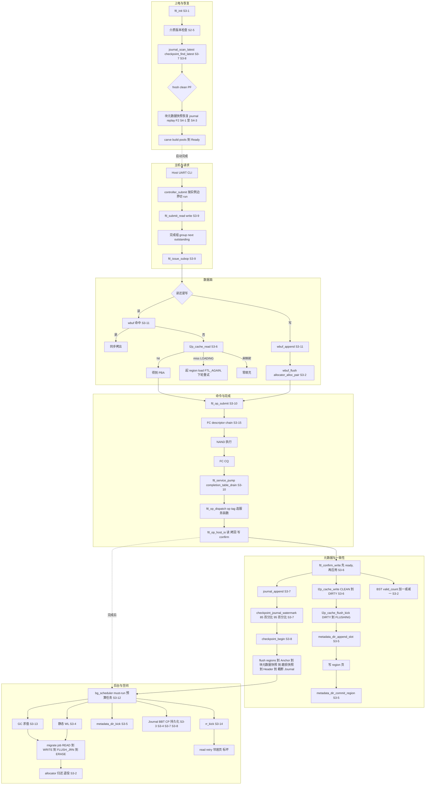

读图要点：

- **实线**是数据/控制流；**虚线**是阶段切换（启动完成、一次 IO 完成后进入后台）。
- 主机写路径在 `C7` 之后**只改 RAM 元数据**（Journal + L2P cache + BST）；
  真正的 NAND 元数据写发生在后台（`M5` 起）或 Checkpoint（`M10`）。
- 所有 NAND 命令最终都走 `C1→C2→C3→C4→C5→C6`：**提交与完成解耦**，
  完成由 op tag 选择服务函数（§3.10）。
- 上电路径 `P1→P6` 在进入 superloop 之前完成；`P5` 的 F2 是兜底，优先走快照/回放。

<a id="s1-5" name="s1-5"></a>

### 1.5 重要数据/状态流转路径

| 路径 | 入口 | 经过模块 | 持久状态变化 | 失败分支 | 场景 |
|---|---|---|---|---|---|
| **P1** 读命中 | `ftl_submit_read` | §3.9 → §3.11（wbuf）或 §3.6（cache）→ §3.10 → §3.15 | 无持久变化（读计数随下一次 CP 的磨损快照落盘） | ECC 失败 → §3.14 | §4.4 |
| **P2** 读 miss | 同上 | §3.6 region load → 下轮重试 | 无（cache 行 CLEAN） | load 失败 → 行 INVALID，重试 | §4.4 |
| **P3** 主机写 | `ftl_submit_write` | §3.11 wbuf → §3.2 分配 → §3.10 → §3.15 → 完成 §3.6/§3.7/§3.2 | Journal 追加；L2P 行 DIRTY；BST valid ±1 | 编程失败 → 关 SB + 标坏，L2P 不动 | §4.5 |
| **P4** 脏 region 回写 | 缓存驱逐 / 后台 flush / CP | §3.6 → §3.5 append → 写页 → commit | L2P region 新位置；Directory 更新；`l2p_live` 增减 | 写失败 → 行回 DIRTY，Directory 不登记 | §4.6 |
| **P5** Checkpoint | 水位/写入量/定时/紧急 | §3.8：快照 → flush regions → Anchor → 块元数据 → 磨损 → Header → 截断 | 新 CP record；Anchor；Journal 水位标志/预擦 | flush 失败 → 中止，不写 Header | §4.7 |
| **P6** GC / WL / 预测迁移 | 后台触发 / 写路径紧急 GC | §3.13：选 victim → 读 → 反查有效 → 写新页 → 改 L2P/Journal → 屏障 → 擦 | 新位置映射；journal 条目；源块擦除/归还或退役 | 分配不到目标页 → 中止且不擦 victim | §4.8 |
| **P7** 读恢复 | host 读 ECC 失败 | §3.14：托管 pending → 读重试 → 邻居页 → 标坏/搬移 | 成功则拷回；失败则 BBT 标坏 + 迁移 | 提交侧长期无进展 → 按失败收尾 | §4.9 |
| **P8** 上电恢复 | `ftl_init` 后 | §3.1 → §2.5 版本 → §3.7 scan → §3.8 find → §3.1 三分支 → F2 | 块元数据/映射/cache 从介质重建 | 快照/探测不一致 → F2 兜底 | §4.1~4.3 |

### 1.6 DRAM 型 vs DRAM-less / 企业级 vs 消费级

| 维度 | 本仓（DRAM-less） | 消费级 DRAM-less（UFS/eMMC 类） | 企业级（有 DRAM） |
|---|---|---|---|
| L2P 表位置 | NAND | NAND | DRAM 全表 |
| SRAM 角色 | 64 region 的 cache | 32~256 region cache | 表常驻，cache 不是瓶颈 |
| 替换策略 | CLOCK | CLOCK / 2Q | 不需要 |
| 写策略 | Write-back + Journal | Write-back + Journal | 直写 DRAM |
| 映射粒度 | CW（512 B） | 4 KiB（通常） | 4 KiB |
| 元数据位置 | 固定池 + 动态日志块 | 固定池 + 动态 | 跨 Die 动态 + RAID1 |
| OP | 10% | 7~15% | 7~28% |
| 掉电 | 无电容，软件恢复 | 通常无电容 | 电容/PLP |

**本仓对齐的是 DRAM-less 这一支**。引用“主流”时指 DRAM-less 主控的形态
（DFTL / UFS / eMMC / 开源 DRAM-less FTL），不是有 DRAM 的企业级形态。
两边共有的概念（页级映射、GC、WL、Journal）可以对照；但“表常驻 DRAM”“硬件 PLP”
这类前提在本仓不成立，不能照搬。

---

<a id="s2" name="s2"></a>

## 2. 介质与地址模型

### 2.1 NAND 几何与容量预算

| 参数 | 值 | 来源 |
|---|---|---|
| NAND 型号 | MT29F4G08ABADAWP（SLC） | `include/nand/devices/mt29f___g08a.h` |
| Page main / spare | 2048 B / 64 B | 同上 |
| CW 布局 | `[META:4][CRC:4][USER:512][PARITY:8]` = 528 B | `include/fc/fc.h` |
| CW / Page | 4 | 器件参数 + `CW_NUM` |
| Page / Block | 64 | `PAGES_PER_BLOCK` |
| Block / Plane | 2048 | `BLOCKS_PER_PLANE` |
| Plane / LUN | 2 | `PLANE_NUM` |
| 每 LUN 块数 | 4096（2 plane × 2048） | `FTL_BLOCK_TOTAL` |
| 用户容量 | 512 MiB | 1,048,576 个 512 B IU |
| 拓扑维度 | `CH_NUM × CE_NUM × LUN_NUM` | `ftl_config.h` §一 |

**实例模型**：每个 `(ch, ce, lun)` 是一个**完整独立**的 FTL 实例，各有一份
L2P 表、Anchor/Checkpoint/BBT/Journal 分区与块池。主机 LBA 空间按 **region**
切分到各实例（`lba_route_*`，见 §5.4）；`FTL_DIM_TOTAL = CH × CE × LUN`。

当前构建 `CH = CE = LUN = 1` ⇒ `FTL_DIM_TOTAL = 1`，下面所有“每实例”的量就是全设备量。
多 LUN 的地址/内存设计见 [`multi_lun_generalization.md`](multi_lun_generalization.md)。

### 2.2 LBA / region / PBA / PAA / META

#### 映射单位

```
1 LBA = 1 IU = 1 CW = 512 B 用户数据
region_id = LBA >> 9          // 每 region 512 条 entry
entry_idx = LBA & 0x1FF
1 region = 512 × 4 B = 2048 B = 1 个 NAND 页主区
L2P 全表 = 2048 region × 2 KiB = 4 MiB（每实例）
```

CW 级而非 4 KiB 级的理由：FC 的数据通路、加扰、CRC、ECC 都以 CW（512 B）为单位；
映射粒度与码字粒度一致，GC 搬移可以只搬页内仍有效的 CW，不产生粒度折算。

#### PBA 位布局（FTL 内部唯一地址货币）

```
PBA(uint32_t)，低位 → 高位：
  CW(2) | PLANE(1) | PAGE(6) | BLOCK(11) | LUN(LUN_ADDR_WIDTH) | CE(2) | CH(2)
  bit0     bit2      bit3      bit9        bit20 ...
```

当前 LUN 用 2 bit；`LUN_ADDR_WIDTH` 由器件头选择（0~4 bit），PBA 的 LUN 字段宽度随之
变化，但 `pba_make()` / `pba_to_*()` 是唯一入口，上层不手写移位。

#### PAA 位布局（NAND 命令层）

```
PAA(uint32_t)，低位 → 高位：
  CW(2) | PAGE(6) | PLANE(1) | BLOCK(11) | LUN(...)
  bit0     bit2      bit8       bit9
```

⚠ **PBA 与 PAA 的 PLANE/PAGE 位序相反**。`pba_to_paa()` 是字段重排，不是掩码截取；
跨层转换只允许在 `pba_to_cmd()` / `ftl_cmd_pba()` 这个单一漏斗发生（§2.4）。

#### META（页内反向映射）

每个 CW 头 4 B 存**本 CW 的扇区 LBA**（由 FC 写入 `cmd->meta`）。它使 DRAM-less
的有效性判定成为可能：GC/重建逐页读回后，用 META 得到每 CW 的 LBA，再反查 L2P——
**L2P 仍指向本物理 CW 才算有效**。不维护任何常驻逐页位图。

### 2.3 固定元数据区布局

固定元数据区在每个实例的每 plane 上占**相同的块号**（分片模型），块号由
`include/ftl/metadata.h` 的几何公式推出，不手写：

| 块号 | 分区 | 块数 | plane | 用途 |
|---|---:|---:|---|---|
| 0..31 | Anchor | 32 | P0+P1 镜像 | Metadata Directory 的全量快照池，块内轮转 |
| 32..39 | Checkpoint | 8 | P0+P1 镜像 | Checkpoint Header + 块元数据快照 + 磨损快照池 |
| 40..41 | BBT | 2 | P0+P1 镜像 | 坏块位图池 |
| 42..45 | Journal | 4 | P0+P1 交错（单副本） | L2P 增量日志，环形 |
| 46.. | 用户数据 | — | P0+P1 | Free Pool / Open SB / Closed SB / OP / Spare |

各分区的**落盘结构 / 记录几何**见下表（结构体定义分别在
`include/ftl/metadata.h` / `checkpoint.h` / `bbt.h` / `journal.h`；
尺寸与页数全部由宏推导，`_Static_assert` 校验）：

| 分区 | 副本方式 | 落盘结构 | 条目/页 | 一条 record | 每块 record | 池内总量 |
|---|---|---|---:|---:|---:|---:|
| Anchor | **P0+P1 镜像** | `metadata_anchor_page_t` + `metadata_entry_t` | 256 条 | 8 页 | 8 | 32 块 × 8 = **256 条** |
| Checkpoint | **P0+P1 镜像** | Header + 块元数据快照 + **磨损快照** | Header 1 + 块元数据 4 + 磨损 16 页 | 21 页 | 3（64/21 向下取整） | 8 块 × 3 = **24 条** |
| BBT | **P0+P1 镜像** | `bbt_header_t` | 1 条 | 1 页 | 64 | 2 块 × 64 = **128 条** |
| Journal | P0+P1 交错（单副本） | `l2p_journal_entry_t` + 12 B 页头 | 127 条 | 1 页（页即写单位） | 64 页 | 4 块 × 64 页 = **256 页 / 32,512 条** |

运行期可枚举视图是 `g_ftl_partitions[]`（`src/ftl/metadata.c`），每项
`ftl_partition_t { name, first_block, block_count, plane_mask, redundancy, kind, table_bytes }`；
`ftl_is_metadata_block()` 与 CLI 都读这张表。`redundancy` = 每块容纳的 record 数，
Journal 不是 record 池，填 1。`plane_mask` 决定固定块在哪些 plane 上占用：
Anchor/CP/BBT/Journal = `0x03`。

⚠ 镜像池（Anchor/CP/BBT）的**逻辑 record 数**与上表一致；每个 record 在 P0/P1 各存
一份 ⇒ **物理页用量与元数据写放大 ×2**（换的是单 plane 损坏仍可恢复）。Journal 是
单副本交错。**磨损计数（erase/read/ECC 健康）在 CP 记录里**（介质版本 9），不再有
独立 Wear 块。

#### 2.3.1 Anchor —— Metadata Directory 的全量快照

**用途**：持久化「region → 当前位置」索引。一份完整 Directory = 一条 record。

**`metadata_entry_t`（7 B，`__attribute__((packed))`）**

| 字段 | 大小 | 含义 |
|---|---:|---|
| `type` | 1 B | 元数据类型（当前只有 `METADATA_TYPE_L2P_REGION`） |
| `id` | 2 B | L2P region_id |
| `pba` | 4 B | 该 region 页当前位置；`NAND_PBA_INVALID` = 未映射 |

**`metadata_anchor_page_t`（恰好 2048 B = 一页主区）**

| 字段 | 大小 | 含义 |
|---|---:|---|
| `magic` | 4 B | `ANCHOR_MAGIC`（"ANDIR"） |
| `sequence` | 4 B | 同一份 Directory 的各 chunk 相同；单调递增 |
| `chunk_index` / `chunk_count` | 2 + 2 B | 页序 / 总页数（= `ANCHOR_PAGE_COUNT` = 8） |
| `entry_count` | 4 B | 本页有效条目数（≤ 256） |
| `layout_version` | 4 B | 介质布局版本；不符 ⇒ 本页作废 |
| `entries[256]` | 1792 B | 256 × 7 B |
| `padding` | 236 B | 补齐到一页主区 |

**几何**：2048 条 Directory ⇒ 8 页/record；每块 8 条 record；池 32 块 ⇒ 256 个槽位。
**副本**：P0+P1 镜像——同一页用 multi-plane program 写两个 plane；读侧任一副本有效。
读取时扫池找「整条校验通过」中 sequence 最大者；任一条完整 record 都能独立重建
整个 Directory。SRAM 常驻副本是 `metadata_dir_cache_t.entries[2048]`（2048 × 7 B =
14,336 B），启动时从 Anchor 加载。

#### 2.3.2 Checkpoint —— L2P 水位 + 块元数据快照

**用途**：记录「Journal 回放起点」和「块元数据快照」，让开机不必全盘重建。

**`l2p_checkpoint_header_t`（恰好 2048 B = 一页主区，94 字）**

| 字段 | 大小 | 含义 |
|---|---:|---|
| `magic` / `sequence` | 4 + 4 B | `CHECKPOINT_MAGIC` / 本池单调序号（最新有效胜） |
| `timestamp` | 4 B | 写 Header 时的毫秒时钟快照 |
| `region_count` | 4 B | 本次 CP 覆盖的 region 数 |
| `region_bitmap[64]` | 256 B | 本 die 的 2048-bit 局部脏位图（哪些 region 在本次 CP 中） |
| `journal_sequence` | 4 B | Journal 截断水位：回放只取 sequence 之后 |
| `layout_version` | 4 B | 介质布局版本 |
| `block_word_count` / `block_word_bytes` / `block_page_count` | 4 + 4 + 4 B | 块元数据快照几何（4096 / 2 / 4；0 = 无快照） |
| `block_crc32` | 4 B | 块元数据快照 words 的 CRC32 |
| `wear_entry_count` / `wear_entry_bytes` / `wear_page_count` | 4 + 4 + 4 B | 磨损快照几何（4096 / 8 / 16；0 = 无快照） |
| `wear_page_crc[16]` | 64 B | 磨损快照每页的 CRC32（16 页各一枚） |
| `record_pages` | 4 B | 本条 record 页数（= 1 + 块元数据页数 + 磨损页数 = 21） |
| `padding` | 1672 B | 补齐到一页主区 |

**块元数据快照（4 页 = 8 KB）**：每块一个 **16-bit word**，位域
`valid_count[10] | state[3] | temp[1] | pool[2]`；按 4096 块顺序打包。

**磨损快照（16 页 = 32 KB）**：每块一个 **8 B 条目**（`erase 4 / read 2 /
last_ecc 1 / flags 1`，`flags = rising_count:4 | health:2 | rsv:2`），按 gblock 稠密排列；
每页 256 条，页内 CRC 写在 Header 的 `wear_page_crc[]`。

**顺序不可倒**：块元数据页 + 磨损页先写，Header 最后写（Header 是 commit 页）。

**几何**：一条 record = 21 页；每块 3 条（64/21 向下取整，块尾 1 页不用）；池 8 块 ⇒ 24 条。
**副本**：P0+P1 镜像，Header、块元数据页、磨损页都写两份；读侧整条快照从同一个 plane 读，
CRC/读失败再换另一个 plane。

#### 2.3.3 BBT —— 坏块位图

**用途**：持久化坏块表；开机加载后重建 BST 的 BAD 位。

**`bbt_header_t`（540 B，packed）**

| 字段 | 大小 | 含义 |
|---|---:|---|
| `magic` / `sequence` | 4 + 4 B | `BBT_MAGIC` / 单调序号 |
| `total_blocks` / `bad_count` | 4 + 4 B | 总块数 / 坏块数 |
| `reserved[3]` | 12 B | 保留（写 0） |
| `bad_map[512]` | 512 B | 4096 bit，一位一个 gblock（1 = 坏） |

**几何**：一条 record = 1 页（540 B ≤ 2048 B）；每块 64 条；池 2 块 ⇒ 128 条。
**副本**：P0+P1 镜像；读侧任一副本有效。

#### 2.3.4 Journal —— L2P 增量日志（环形）

**用途**：写确认路径先追加一条 L2P 更新；掉电后回放恢复「Anchor 之后的增量」。

**页头（12 B）**：`magic(4) + page_seq(4) + entry_count(2) + block_seq(2)`。

**`l2p_journal_entry_t`（16 B，packed）**

| 字段 | 大小 | 含义 |
|---|---:|---|
| `lba` | 4 B | 逻辑地址（全局 LBA） |
| `old_pba` | 4 B | 更新前位置（回放不读；仅首条保留供诊断） |
| `new_pba` | 4 B | 更新后位置（回放按此写 L2P） |
| `sequence` | 4 B | 全局单调序号（回放按 `(page_seq, 页内下标)` 定序） |

**几何**：每页 127 条（⌊(2048−12)/16⌋）；每块 64 页；**4 块环形**（`JOURNAL_BLOCKS =
CW_NUM`）⇒ 总容量 4 × 64 × 127 = **32,512 条**。块写满 ⇒ 擦环形下一块再续写；
Checkpoint 成功后按 `journal_sequence` 截断/回收。
**副本**：**单副本**，页号奇偶交错到 P0/P1（不是镜像——日志写频率最高，镜像会 2× 写放大）。
因此换块擦除必须用 `OP_ERASE_BLOCK_MULTI_PLANE`，否则 P1 的页不会被擦。

#### 2.3.5 磨损/读计数 —— 并入 Checkpoint（软状态）

**用途**：持久化每块的擦除计数、读计数和 ECC 健康，供动态/静态 WL 与 Read Recovery 使用。

**介质版本 9 起不再有独立 Wear 块**：计数随 Checkpoint 一起落盘（块元数据 4 页 +
磨损 16 页 + Header 1 页 = 21 页/record）。这样计数与块元数据**原子提交**，且随 CP 池
轮转（不是固定热点）。CP 间隔就是持久化窗口：CP 期间的计数变化允许漏到下一个 CP。

**`cp_wear_entry_t`（8 B，按 gblock 稠密排列，下标即块号）**

| 字段 | 大小 | 含义 |
|---|---:|---|
| `erase_count` | 4 B | 擦除计数（动态/静态 WL 的唯一输入） |
| `read_count` | 2 B | 主机读 + GC/WL 搬移读累加（read disturb） |
| `last_ecc` | 1 B | 上次读的 ECC 纠正 bit 数 |
| `flags` | 1 B | `rising_count:4`（bit0..3）+ `health:2`（bit4..5）+ 保留 2 bit |

> **主流对照（有出处）**：擦除计数必须持久化，否则跨重启归零、WL 失效
> （`docs/design/storage_controller_design_essentials.md` §5.5）；read disturb 用
> 读计数/刷新/GC 搬移（同文档失效模式表）。**"计数随 CP 快照落盘"的具体形态是本仓
> 设计**——主流也会把 per-block 元数据放进 block descriptor/checkpoint，但具体布局
> 无统一标准。

#### 2.3.6 L2P region 日志块（动态，不属于固定分区）

Directory 指向的 region 页不占固定分区，而是从 Free Pool 动态取整块：

- **一页 = 一个 region**：2048 B = 512 × 4 B `nand_pba_t`（无页头）；
  每条目是一个 CW 的物理位置，`NAND_PBA_INVALID` = 未映射。
- **一块 = 64 页 = 64 个 region**；只追加，块满换新块；旧块由 `l2p_live` 归零后
  经 `reclaim_pending` 位图交给后台 job 异步擦除（§3.5）。
- **未映射不占闪存**：Directory 为每个 region 预登记 `NAND_PBA_INVALID`，读取该
  region 时 L2P cache 直接合成全 `INVALID` 的行，**不发 NAND 读**。

#### 2.3.7 共同写模型

- **只追加**：元数据页只写擦除态页；对已编程页二次编程 = 新数据 AND 旧数据 = 静默损坏。
- **带 sequence**：每条 record 带单调序号；池内写序 == sequence 序；读取取
  「整条校验通过」中 sequence 最大者（**不取半条**）。
- **池内轮转**：块满 ⇒ 擦池内下一块 ⇒ 从页 0 续写；`block_count >= 2` 是硬要求。
- **完整性**：元数据页统一用 `FTL_PAGE_CFG_META` 写（FC per-CW CRC + ECC）；
  结构体本身**无独立 CRC**（例外：Checkpoint 的块元数据快照有 `block_crc32`）。
- **版本**：Anchor 页与 Checkpoint Header 都带 `layout_version`；不符 ⇒ 该 record
  作废，开机自动全片格式化。
- **只有 L2P region 日志块是动态的**；Anchor/Checkpoint/BBT/Journal 都是固定块池。
- **固定池的副本策略**（介质版本 9）：
  - **Anchor / Checkpoint / BBT：P0+P1 镜像**。同一条 record/页用 multi-plane program
    一次写进两个 plane 的同 block/page（`ftl_async_write_page_mirror`）；读侧任一副本
    有效即可，一个 plane 损坏仍能恢复。运行期写走异步提交 + 完成服务；同步镜像写只在
    开机/格式化（没有服务泵可等）使用。
  - **Journal：P0+P1 页号奇偶交错**（偶页 P0、奇页 P1），是**单副本**而不是镜像——
    日志写频率最高，镜像会 2× 写放大。因此它的换块擦除**必须**用
    `OP_ERASE_BLOCK_MULTI_PLANE`（否则 P1 页不会被擦，回绕后二次编程）。
  - **磨损计数不再占独立块**：随 Checkpoint 记录一起落盘（§2.3.5），块号 46 起全部是用户数据。
- 这条布局满足"预留必用"：P1 的 Anchor/CP/BBT 块是**真实副本**，不是闲置。
  `ftl_is_metadata_block()` 按 `(plane & plane_mask)` 判固定块。

#### 2.3.8 结构分布图（一）：空间布局

> 表给精确尺寸，图给空间关系。**尺寸/字段以本章表格与 `include/ftl/*.h` 为准**；
> 改布局时两处同步（H6）。

**① 每个 die 的 plane / 块号分布**

```text
P0  [ Anchor 0..31 ][ Checkpoint 32..39 ][ BBT 40..41 ][ Journal 42..45 ][ User 46..2047 ]
P1  [ Anchor'0..31 ][ CP'32..39         ][ BBT'40..41 ][ Journal 42..45 ][ User 46..2047 ]
     \____ mirror ____/\_____ mirror _____/\____ mirror __/\__ interleave _/
```

- **镜像**：同一条 record/页在 P0、P1 各存一份；读侧任一副本有效即可。
- **交错**：Journal 的逻辑页 i 落在 plane `i & 1`（偶页 P0、奇页 P1），是**单副本**。
- **用户区**：块号 46 起在两个 plane 都是用户数据（磨损计数已并入 CP）。

**② 池 → 块 → 页 → record → entry（Anchor 示例）**

```text
Anchor 池
├─ 32 个块号（每个块号在 P0、P1 各一个物理块；两份内容相同）
│  └─ 块 b（64 页，128 KiB）
│     ├─ record 0   pages  0.. 7
│     ├─ record 1   pages  8..15
│     ├─ ...
│     └─ record 7   pages 56..63        ← 8 条 record/块（8 页/条）
│
├─ 每条 record = 8 页 = chunk 0..7（页序 = chunk 序）
│  ├─ chunk 0: page 0 → entry   0..255
│  ├─ chunk 1: page 1 → entry 256..511
│  ├─ ...
│  └─ chunk 7: page 7 → entry 1792..2047
└─ 一条 record = 整份 Directory 快照（2048 条 entry）
```

一个 chunk 的页内布局：

```text
offset   0      4      8      10     12     16     20                          1812     2048
         [magic][seq  ][chunk_i][chunk_c][cnt  ][ver  ][ entries 256 × 7 B    ][ pad  ]
bytes      4      4      2       2      4      4            1792                 236
```

**③ 其余池的块内排布**

```text
Checkpoint 块（64 页；一条 record = 21 页）
├─ page  0..20   record 0   (page 0 = Header；page 1..4 = 块元数据；page 5..20 = 磨损快照)
├─ page 21..41   record 1
├─ page 42..62   record 2
└─ page 63       未用（64 / 21 向下取整）

BBT 块（64 页；一条 record = 1 页）
└─ page 0..63 = record 0..63（每页 540 B header + padding）

Journal 块（4 个块号 × 64 页；页是写单位）
├─ page 0..63；逻辑页 i 的 plane = i & 1（偶页 P0、奇页 P1）
└─ 每页：12 B 页头 + 127 × 16 B entry = 2032 B + 4 B 余量

CP 磨损快照（16 页 × 256 条 × 8 B；随 Checkpoint 记录落盘）
├─ 每条：erase 4 / read 2 / last_ecc 1 / flags 1
├─ page p 覆盖 gblock p×256 .. p×256+255
└─ 每页 CRC 存在 Header 的 wear_page_crc[p]

L2P region（动态块，非固定分区）
├─ 一页 = 512 × 4 B nand_pba_t = 2048 B（无页头）
└─ 一块 = 64 页 = 64 个 region
```

**④ 关键结构的字节偏移尺**

```text
l2p_checkpoint_header_t（2048 B；94 字 = 376 B + padding）
offset   0      4      8      12     16                     272    276    280    284    288    292    296    300    304    308    312                     376     380     2048
         [magic][seq  ][ts   ][rgn_cnt][ region_bitmap 64×4 ][jseq ][ver  ][wcnt ][wbytes][pcnt ][crc32 ][w_ent][w_byt][w_pg][ wear_page_crc 16×4 ][rpages][ pad ]
bytes      4      4      4      4            256              4      4      4      4      4      4      4      4      4      64            4     1668

bbt_header_t（540 B，packed）
offset   0      4      8      12     16          28            540
         [magic][seq  ][total ][bad_cnt][reserved 12][ bad_map 512 ]
bytes      4      4      4      4         12           512

Journal 页（2048 B）
offset   0      4      8      10     12                     2044   2048
         [magic][p_seq ][e_cnt ][b_seq ][ 127 × 16 B entries ][ 余 ]
bytes      4      4      2      2             2032            4
entry    [ lba 4 ][ old_pba 4 ][ new_pba 4 ][ sequence 4 ] = 16 B

CP 磨损条目 cp_wear_entry_t（8 B；每页 256 条）
offset   0      4      6      7      8
         [erase 4][read 2][ecc 1][flags 1] = 8 B
flags    bit0..3 rising_count | bit4..5 health | bit6..7 保留

L2P region 页（2048 B）
offset   0                                                         2048
         [ 512 × nand_pba_t（4 B） = 2048 B；NAND_PBA_INVALID = 未映射 ]
```

> 尺上的字段名是缩写（为了排版）；完整字段名/类型见 2.3.1~2.3.5 的表与
> `include/ftl/*.h`。

**⑤ 镜像写 / 读回退（运行期 async）**

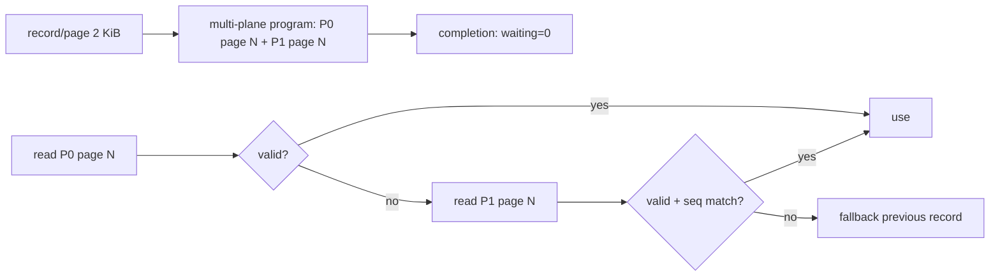

#### 2.3.9 结构分布图（二）：池间流转

> 本节回答"数据从哪来、什么时候被替换、掉电后从哪恢复"，把各池串起来。
> 精确时序以 `src/ftl/metadata_job.c` / `checkpoint.c` / `journal.c` 与
> §3.5 / §3.7 / §3.8 为准。

**① 各池的"产生 → 消费 → 替换/回收 → 恢复"**

| 池 | 产生（谁写） | 消费（谁读） | 替换 / 回收 | 掉电后 |
|---|---|---|---|---|
| **Anchor** | `commit_region` 置脏 → CP/后台 job 组页写 | 开机 `metadata_dir_load` | 池内 ring：块满轮转；最新 sequence 胜；旧块整块擦 | 重建 Directory；缺页回退"未映射" |
| **Checkpoint** | CP job：快照 bitmap → flush region → flush Anchor → 写块元数据快照 + 磨损快照 → 写 Header | 开机 `checkpoint_find_latest` + `checkpoint_load_block_table` / `checkpoint_load_wear_table` | 池内 ring：8 块 × 3 条（21 页/条）；最新 sequence 胜 | Header 给 Journal 水位；块元数据快照给 state/valid/temp/池归属；磨损快照给 erase/read/rr |
| **BBT** | 出厂扫描 / 运行时 `bbt_mark_bad` → BBT job | `bbt_init`（开机） | 池内 ring：2 块 × 64 条；最新 sequence 胜 | 坏块图；无有效 BBT 时按空片/拒扫策略 |
| **Journal** | 每次 host 写确认 `journal_append` | 开机 `journal_replay`；CP 截断 | 4 块环形：页满换块；CP 按水位截断 | 回放 `seq > CP journal_sequence` 的条目 |
| **磨损计数（CP 内）** | 运行时 `erase/read/rr` 更新 BST → CP job 组页 | 开机 `checkpoint_load_wear_table` | 随 CP record 轮转覆盖；无独立回收 | 从 CP 磨损快照回填；丢失只退化 WL（软状态） |
| **L2P region log** | L2P cache 刷脏 → `append_slot` + FC 写 | cache miss 读回；GC/compaction | 块满换块；`l2p_live==0` → `reclaim_pending`；冷热混合 → compaction | Directory 指向最新页；Journal 补差量 |
| **Directory（SRAM）** | `commit_region` / journal replay 写入 cache 后 flush | L2P lookup；Anchor 快照源 | 覆盖 entry；Anchor 全量落盘 | Anchor 重建 Directory；Journal 回放补 L2P cache 增量 |

**② 上电恢复顺序（逻辑依赖）**

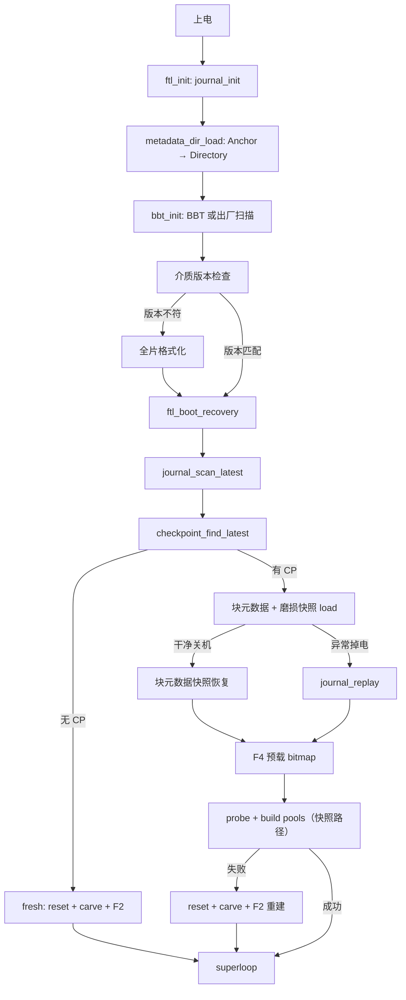

**③ 运行期写入 + Checkpoint 流转**

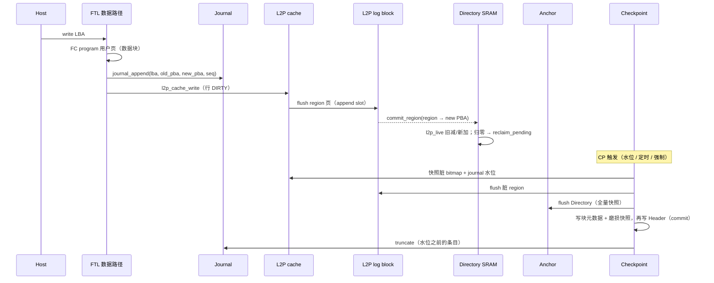

**④ GC / 回收 / 压缩如何影响各池**

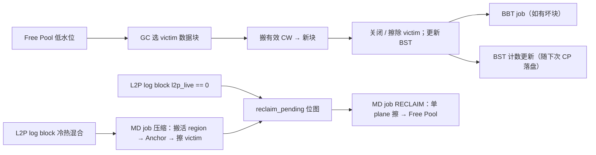

**⑤ 掉电持久性映射**

| 数据 | 最后落点 | 掉电后怎么恢复 |
|---|---|---|
| 用户数据 | data block 页 + 页内 META（CW 的 LBA） | ECC / read retry / RAID（若启用） |
| L2P 增量 | Journal（lba / old_pba / new_pba / seq） | replay `seq > CP journal_sequence` |
| L2P region 页 | L2P log block（Directory 指向最新页） | Directory 加载后按 PBA 读回 |
| Directory | Anchor（全量快照，P0+P1 镜像） | `metadata_dir_load` 取最新完整 record |
| 块元数据快照 | Checkpoint（4 页 word，P0+P1 镜像） | `checkpoint_load_block_table`；失败走 F2 |
| 坏块图 | BBT（P0+P1 镜像） | `bbt_init`；运行时 `bbt_mark_bad` 兜底 |
| 磨损/读计数 | Checkpoint 磨损快照（16 页，P0+P1 镜像，软状态） | `checkpoint_load_wear_table`；丢失只退化 WL |

**⑥ 池内轮转 / 替换的时间线**

```text
Anchor / BBT（record 池）
  slot 0 → slot 1 → … → slot N-1 → slot 0 → …
  写满一块 ⇒ 擦池内下一块 ⇒ 从该块 slot 0 续写
  读：扫池，取「整条校验通过 + sequence 最大」；旧 record 不单独擦，随块轮转一起擦

Journal（页环形）
  page 0 → … → page 63 → block+1 page 0 → … → block 0（先擦环形下一块）
  CP 成功后按 journal_sequence 截断/预擦；回放只取 seq > CP 水位

Checkpoint（21 页/record：Header 1 + 块元数据 4 + 磨损 16）
  slot 0 → slot 1 → slot 2 → 下一块 slot 0 → …
  每条 record 覆盖一块元数据 + 一份磨损快照；磨损计数随 CP 覆盖式更新

L2P region log（追加块）
  region 页追加到当前块 page 0..63 → 换新块 page 0
  l2p_live 归零 ⇒ reclaim_pending ⇒ job 异步擦除归还
  冷热混合且池吃紧 ⇒ compaction：搬活 region 到当前块 → Anchor 落盘 → 擦 victim
```

### 2.4 单一坐标与转换漏斗

| 坐标 | 值域/含义 | 谁拥有 |
|---|---|---|
| **全局 LBA** | `0 .. FTL_LBA_MAX-1`；host 与数据通路使用 | `ftl_config.h` / `l2p_cache.h` |
| **局部 region** | 每实例 `0 .. L2P_REGIONS_PER_INSTANCE-1`；映射页落盘位置 | `l2p_global_to_local_region()` |
| **gblock** | `plane × BLOCKS_PER_PLANE + block`；BST/池的唯一索引 | `bst.h` 的 `ftl_gblock*` |
| **PBA** | FTL 物理地址（含 ch/ce/lun） | `ftl_config.h` §三.2 |
| **PAA** | 芯片内地址 | `nand_config.h` |

规则（C9）：

- 同一语义只允许一套坐标。`gblock` 与“per-plane block + plane”不得在业务代码里各算各的；
  一律 `ftl_gblock()` / `ftl_gblock_plane()` / `ftl_gblock_block()`。
- 全局 region 与局部 region 的转换只在 `l2p_global_to_local_region()` /
  `lba_route_*` 发生；现场手写 `region / FTL_DIM_TOTAL` 是缺陷。
- PBA↔PAA 只在 FTL↔FC 边界转换；FC 层不认 PBA，FTL 业务层不手写 PAA 位运算。
- 方向相反的转换（例如 `pba_with_page`）必须用构造函数，不用掩码拼装。

### 2.5 介质布局版本与自动格式化

介质格式（块位置、记录格式、字段语义）会随设计变化。若固件不认识旧介质，直接启动会在
旧数据上分配 Free Pool 里的**未擦块**——allocator 不做擦除（“Free Pool 保证已擦除”是
隐式前提）⇒ 新数据 AND 旧数据 = **静默损坏**。因此：

```c
#define FTL_MEDIA_LAYOUT_VERSION_BASE (9U)
#define FTL_MEDIA_LAYOUT_VERSION \
    (FTL_MEDIA_LAYOUT_VERSION_BASE + ((FTL_DIM_TOTAL > 1U) ? 1U : 0U))
```

- 版本写在**两处**：Checkpoint Header 与 Anchor 页；两处独立校验，任一不符即该记录作废。
- **触发判据**（唯一、自终止）：本实例 `checkpoint_find_latest() != FTL_OK` ⇒ 需要格式化。
  版本校验已包含在该函数内，所以判据自动覆盖“有当前版本 / 有但版本不符 / 完全没有”三种情况。
- **执行**（`ftl_media_format`）：擦本实例全部块（**空片**的出厂标记已由 `bbt_init` 读入 BST；
  已用介质的出厂标记早已被写操作覆盖，坏块表依赖已持久化的 BBT）→ 重新持久化 BBT →
  复位 Directory → 写一条当前版本的空 Checkpoint 标记。标记使判据下次命中，格式化只发生一次。
- **钩子位置**：`ssd_ftl_boot()` 内、`ftl_init` 之后、Free Pool 回填之前。
- **判据不是“结构体字节数变没变”**，而是“老固件的介质在新固件下会不会被误读/误用”。
  例如 OP/Spare 池改为按 plane 预留时结构体布局没变，但预留块集合变了 ⇒ 必须升版本。

---

<a id="s3" name="s3"></a>

## 3. 模块设计

> **本节模板**：每个模块按「背景与需求 → 职责与边界 → 结构与不变量 → 流程图 →
> 关键流程 → 失败语义 → 常量与出处 → 主流对照」组织。背景写“没有它会怎样”，
> 不是“它实现了什么”。

**模块地图**：

| 模块 | 主要文件 | 章节 |
|---|---|---|
| 引导与掉电恢复 | `power_failure_recovery.c/h` | §3.1 |
| 分配器 / BST / Super Block | `allocator.c/h`、`bst.h` | §3.2 |
| 坏块表 | `bbt.c/h` | §3.3 |
| 磨损计数持久化 / 静态 WL | `checkpoint.c`（磨损快照）、`wear_leveling.c/h` | §3.4 |
| 元数据目录 | `metadata.c/h` | §3.5 |
| L2P cache | `l2p_cache.c/h` | §3.6 |
| Journal | `journal.c/h` | §3.7 |
| Checkpoint | `checkpoint.c/h` | §3.8 |
| Host 提交 / 组 / pending | `ftl.c`、`pending.c/h` | §3.9 |
| 完成路由 / op dispatch | `completion_table.c/h`、`ftl_op.c/h` | §3.10 |
| 页打包写缓冲 | `ftl.c`、`ftl.h` | §3.11 |
| Service / 后台调度 | `ftl.c`、`bg_scheduler.c/h` | §3.12 |
| GC / 迁移 | `gc.c/h`、`migrate.c/h` | §3.13 |
| 读恢复 | `read_recovery.c/h` | §3.14 |
| FTL↔FC 接口 | `ftl_fc_interface.c/h`、`ftl_config.h` | §3.15 |
| 观测性 | `ftl_job.h`、各 job 心跳 | 并入 §3.12 |

<a id="s3-1" name="s3-1"></a>

### 3.1 引导与掉电恢复（power_failure_recovery）

#### 3.1.1 背景与需求

FTL 的运行时状态分两类：

| 状态 | 掉电后 |
|---|---|
| L2P cache（64 行）、Block State Table、Free/OP/Spare 池、Closed 列表、各类写指针 | **全部丢失**（RAM） |
| 用户数据、页内 META、L2P region 页、Anchor、Checkpoint、Journal、BBT、CP 磨损快照 | 留在 NAND |

没有恢复模块，开机后 L2P cache 是空的、Closed 列表是空的、Free Pool 可能把**写过的块**
当空白块分配——第一次写就会 AND 掉旧数据。恢复模块要回答三个问题：

1. 上一次是**干净关机**还是**异常掉电**？
2. L2P 映射从哪恢复到哪（Checkpoint 快照 + Journal 增量）？
3. 块元数据（状态/有效计数/池归属）从快照恢复，还是全盘扫描重建？

#### 3.1.2 职责与边界

- **做**：判定启动类型；编排“扫描 → 分类 → 恢复块元数据 / 回放 Journal / F2 → 建池”的顺序；
  维护恢复结果与统计。
- **不做**：不定义 Journal/Checkpoint/Anchor 的记录格式（各模块自己拥有）；不做介质格式化
  （`ftl_media_format` 在版本判据命中时调用）；不处理 host IO。
- **上游**：`main.c` 的 `ssd_ftl_boot()`；**下游**：Journal、Checkpoint、Metadata、Allocator、L2P cache。

#### 3.1.3 结构与不变量

| 结构 | 关键字段 | 说明 |
|---|---|---|
| `ftl_boot_type_t` | `FRESH / CLEAN / POWER_FAILURE` | 启动分类 |
| `ftl_boot_result_t` | `boot_type`、`cp_sequence`、`journal_entries`、`blocks_restored` | 观测/日志 |
| `ftl_rebuild_stats_t` | `blocks_rebuilt`、`partial_blocks`、`valid_cw` | F2 结果 |
| `cp_job_t.block_words` | 16-bit/块 × 4096 | Checkpoint 的块元数据快照，boot 时复用为加载缓冲 |
| `cp_job_t.wear_page` / `wear_page_crc[16]` / `wear_page_buf` | 8 B/块 × 4096 → 16 页 | 磨损快照写进度 / 每页 CRC / 组页缓冲 |

不变量：

1. **块元数据快照先于 Journal 回放恢复**：回放要同步维护 `valid_count`，没有块元数据就没有记账对象。
2. **判型用整页**：`page_seq + entry_count <= cp.journal_sequence` 才是干净关机；
   只比页首页序号会漏掉跨水位那一页的新条目。
3. **三条路径都要 `journal_resume`**：环形块没有被擦，写指针/序号必须接回；
   否则二次编程或序号回退。
4. **Open SB 不续写**：快照/F2 都把 OPEN 降级为 CLOSED，整块交 GC。掉电可能留下半编程页，
   续写会二次编程；Policy B 下两 plane 的配对也无法可靠恢复。
5. **快照失败只回退 F2，不格式化**：格式化只由介质版本判据触发。

#### 3.1.4 启动判定流程

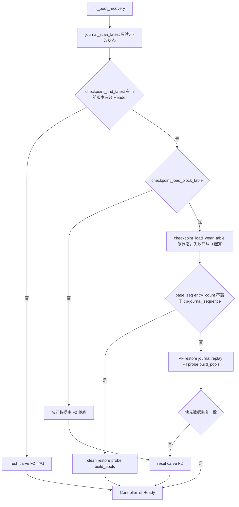

#### 3.1.5 关键流程

1. **扫描**：`journal_scan_latest()` 只读环形池，取 `(block, page, page_seq, entry_count)`；
   `checkpoint_find_latest()` 用 `metadata_ring_locate` 扫 Checkpoint 池，取最新有效 Header，
   同时恢复本实例的 CP 序号与写游标。
2. **分类**：
   - 无有效 CP → **fresh**；
   - `page_seq + entry_count <= cp.journal_sequence` → **clean**（Journal 已全部落入 L2P）；
   - 否则 → **power failure**（有未回放的增量）。
3. **fresh**：失效本 owner 的 cache 行/脏位 → carve 池 → F2 重建 Closed 列表 →
   `journal_resume(floor=1)`。
4. **clean**：块元数据快照有效时 `restore_blocks` → 按 CP 位图预载 region（F4）→ probe 池块 →
   `build_pools`；任一步失败 → reset + carve + F2。最后 `journal_resume(floor=cp_seq)`。
5. **PF**：先恢复块元数据 → `journal_replay`（所有 `page_seq+entry_count > cp_seq` 的页，
   按 `(page_seq, entry_idx)` 递增，last-write-wins；同步维护 valid_count）→ F4 →
   probe + `build_pools`；失败 → F2。
6. **F2**：逐 plane/块扫 page 0 判空、找写指针；坏块/元数据块跳过；写过的块从 Free Pool 拉出、
   建成退化单 plane 的 Closed 条目；逐页读 META + 反查 L2P 回填 `valid_count`。

**启动时间量级**（观测值，不是编译期常量）：

| 路径 | 量级 | 说明 |
|---|---:|---|
| clean + 块元数据快照 | ~150 ms | 不跑 F2；probe 只读池块 page 0 |
| power failure | ~250 ms | 多 Journal 回放 |
| F2 兜底 | ~400~550 ms | 全盘扫描 + 逐页反查 |

#### 3.1.6 失败语义

| 失败点 | 结果 | 数据影响 |
|---|---|---|
| 无有效 CP | fresh + F2 | 旧映射不可达（介质已被格式化/版本不符时这是预期） |
| 块元数据快照 CRC 失败 | 该快照丢弃，F2 重建 | 用户数据不丢；恢复时间变长 |
| Journal 回放某页读失败 | 跳过该页，继续其余页 | 该页条目丢失；映射可能回退到上一版本 |
| 块元数据恢复与 probe 不一致 | reset + carve + F2 | 以介质为准；块元数据重新计算 |
| F2 中某块读失败 | 跳过该块 | 该块数据不可恢复；后续由 GC 处理 |

⚠ **恢复路径不在完成派发里**：它在 superloop 之前运行，无人 drain CQ，所以允许使用
`*_sync` 逃生口（内部自旋泵）。服务函数禁止调用这些同步口（会嵌套泵）。

#### 3.1.7 常量与出处

| 常量 | 值 | 来源 |
|---|---|---|
| 判型口径 | `page_seq + entry_count` | `src/ftl/power_failure_recovery.c` |
| Journal 回放缓冲 | 栈上 `replay_pages[256]`（2 KiB） | `src/ftl/journal.c` |
| 介质版本 | 9（DIM=1）/ 10（DIM>1） | `include/ftl/metadata.h` |

#### 3.1.8 主流对照

DRAM-less 主控普遍采用「快照 + 增量日志 + 全盘扫描兜底」三段式：快照限定恢复上界，
日志补 post-snapshot 增量，扫描处理元数据损坏。**本仓自定**的部分是块元数据快照的
16-bit/块编码与 fresh/clean/PF 的判型口径；快照/日志/扫描的分工是 DRAM-less 的通用形态
（DFTL 等，见 `docs/reference/README.md`）。

---

<a id="s3-2" name="s3-2"></a>

### 3.2 分配器 / BST / Super Block（allocator + bst）

#### 3.2.1 背景与需求

NAND 的写必须落在**已擦除**的页上，而擦除以块为单位。FTL 因此需要一套块元数据：

- 哪些块是空闲且已擦除的（Free Pool）；
- 哪些块正在写（Open SB）、写满了（Closed SB）、是坏块、是元数据日志块、已退役；
- 每个块擦了多少次、读了多少次、还有多少有效 CW；
- 坏块替换的储备（Spare）与 GC 的性能缓冲（OP）。

没有统一账本，同一不变量会被多个模块各自手工维护，任一处漏掉就是**永久漏账**：
容量无声流失、GC 选错 victim、坏块被重新分配、`FREE` 字段说谎。

#### 3.2.2 职责与边界

- **做**：持有 BST（每块 20 B）与四个池（Free / OP / Spare / Closed 列表）；提供唯一的
  进出闸门；按 plane 选块、配对成 SB；维护 SB 写指针与关闭；提供磨损/有效性统计访问器。
- **不做**：不决定“什么时候 GC”（`gc.c` 的策略）；不执行搬移（`migrate.c`）；不定义坏块
  持久化格式（`bbt.c`）；不定义元数据布局（`metadata.h`）。
- **下游**：GC/WL/migrate、元数据目录、BBT、掉电恢复都读它。

#### 3.2.3 结构与不变量

`ftl_block_t`（20 B × 4096 = 80 KiB，`_Static_assert` 钉住）：

| 字段 | 大小 | 含义 |
|---|---:|---|
| `erase_count` | 4 B | 擦除次数；动态 WL 选块、静态 WL 触发、GC 的 erase 项 |
| `last_pe_ts` | 4 B | 最近擦除时间戳；GC 的 age 项（刻意不持久化） |
| `read_count` | 2 B | read disturb 计数；预测搬移 |
| `valid_count` | 2 B | **CW 级**有效计数（0..512），GC/WL 的 valid 项 |
| `state` | 1 B | 互斥枚举：NONE/FREE/OPEN/CLOSED/LOG/RETIRED/BAD |
| `temp` | 1 B | HOT/COLD，正交于状态 |
| `sb_id` | 2 B | 反向索引到 SB；`UINT16_MAX` = 无 |
| `rr` | 3 B | `last_ecc` / `rising_count` / `health` |

`ftl_tables_t`（每实例，落 SRAM12）：

| 数组 | 大小 | 作用 |
|---|---:|---|
| `blocks[FTL_BLOCK_TOTAL]` | 80 KiB | BST |
| `free_blocks[FTL_BLOCK_TOTAL]` | 8 KiB | Free Pool（全局块号） |
| `op_blocks[PLANE_NUM][204]` | 816 B | OP 池，每 plane 独立 |
| `spare_blocks[PLANE_NUM][50]` | 200 B | Spare 池，每 plane 独立 |
| `closed_sb_list[FTL_BLOCK_TOTAL]` | 32 KiB | Closed SB 列表（swap-remove） |

`super_block_t`（8 B）：`plane_blocks[PLANE_NUM]`（可为 `FTL_BLOCK_NO_PLANE` 哨兵）、
`next_page`、`temperature`、`is_open`。

**池的分工**：

| 池 | 容量 | 用途 | 消费/补充 |
|---|---:|---|---|
| Free | 全部已擦除块 | 写分配、GC 归还 | 三级水位（下表） |
| OP | 204 块/plane | GC 性能缓冲，防止前台等 GC | 该 plane 的 Free 给出不块时补入 |
| Spare | 50 块/plane | 坏块替换，只出不进 | `bbt_spare_pool_refill(plane)` |

| 水位 | 条件 | 动作 |
|---|---|---|
| ① 正常 | `free_count ≥ 32` | 不做后台 GC |
| ② 补池 | `8 < free_count < 32` | 后台 GC（T1） |
| ③ 紧急 | `free_count ≤ 8` | 强制 GC（T4），写路径也兜底 |

**两个同值哨兵**（C11：同值 ≠ 同一坐标）：

- `FTL_BLOCK_NO_PLANE`（`UINT16_MAX`）：`plane_blocks[]` 里“该 plane 无块”的**存储态**，
  会写进 Closed 列表；
- `FTL_GBLOCK_INVALID`（`UINT16_MAX`）：选块失败的**瞬时返回值**，从不落盘。

**不变量**（`include/ftl/allocator.h` 文件头）：

1. **四本账各有唯一闸门**：Free 只走 `allocator_free_block` / `allocator_remove_from_free`；
   OP/Spare 只走 `allocator_*_try_push/pop`；Closed 只走 `allocator_add_closed_sb` /
   `allocator_remove_closed_sb`。外部模块不裸写数组，读走访问器。
2. **`state == FREE` ⟺ 在 Free Pool 里**。入池置 FREE；出池只校验、不赋态，新态由转移
   归属者紧随其后赋值。**BAD 永不进池**（入池闸门 debug ASSERT + release 拒绝）。
3. **`closed_sb_list` 是 swap-remove 活列表**：借出的指针不跨调用有效；跨调用按值拷贝
   （migrate 的 victim 副本）。
4. **无归属的块是 NONE**：固定元数据区、OP 池、Spare 池不参与分配。
5. **选块以 Free Pool 数组为准**：选中即 `remove_from_free` 必命中，避免“选中→移除失败→重选”死循环。

#### 3.2.4 块状态机

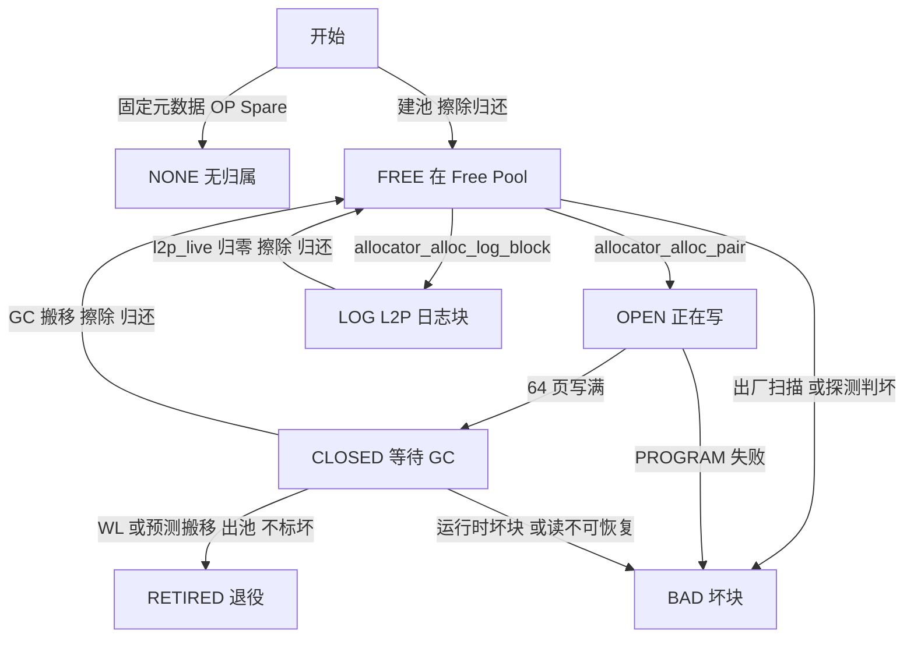

#### 3.2.5 关键流程

1. **分配一页**（`allocator_alloc_pair`）：
   - 取对应温度的 Open SB；写满 → `allocator_close_open_sb` → Closed 列表；
   - 从 Free Pool 逐 plane 独立选擦除次数最少的块（Policy B，不要求同号）；
   - 填 `out[plane]` 为当前页 PBA，`next_page++`；
   - Free Pool 空 → `FTL_AGAIN`（写路径触发紧急 GC 后重试）。
2. **关闭 SB**：`is_open=false` → 加入 Closed 列表；各 plane 块状态 CLOSED + `sb_id`。
3. **归还**：搬移擦除成功后 `allocator_free_block` 入池并置 FREE；退役走
   `allocator_remove_from_free` + RETIRED，**不得**先入池。
4. **日志块**：`allocator_alloc_log_block` 从指定 plane 的 Free Pool 取一块，出池 + 置 LOG；
   归还走 `allocator_free_block`（调用者保证已擦除）。

#### 3.2.6 失败语义

| 情况 | 结果 | 后果 |
|---|---|---|
| Free Pool 空 | `FTL_AGAIN` | 写路径起紧急 GC；持续为空则写失败 |
| 入池块是 BAD | debug 停机；release 拒绝 | 防止把 BAD 覆盖成 FREE |
| 出池块不在池 | no-op（文档化契约） | 幂等；不制造反向分叉 |
| 退役块先入池 | 会被再次分配 | 违反不变量 2，必须出池后置 RETIRED |
| Closed 列表满 | 结构上不可能（容量 = 全部块） | 真满即断言，不静默丢条目 |

#### 3.2.7 常量与出处

| 常量 | 值 | 来源 |
|---|---|---|
| `FREE_POOL_TARGET` | 32 | `include/ftl/allocator.h` |
| `FREE_POOL_EMERGENCY` | 8 | 同上 |
| `FTL_OP_PERCENT` | 10%（204 块/plane） | 同上 |
| `FTL_SPARE_POOL_PER_PLANE` | 50 | 同上 |
| `SUPER_BLOCK_LIST_MAX` | `FTL_BLOCK_TOTAL`（4096） | 同上 |
| `ftl_block_t` 尺寸 | 20 B | `include/ftl/bst.h` |
| 温度 | HOT=0 / COLD=1 | `allocator.h` |

#### 3.2.8 主流对照

每块一个 metadata/descriptor、Free Pool + OP + Spare 的池化、Super Block 跨 plane 条带化，
是主流 SSD 控制器的共同形态（OpenSSD 全局表、SPDK `spdk_ftl_dev` 内嵌表；见
`docs/design/ftl_optimization_plan.md` 的 descriptor/表指针对照）。**本仓自定**的是
`valid_count` 的 CW 粒度与“无逐页位图”（DRAM-less approach ③，见 §3.13）。

---

<a id="s3-3" name="s3-3"></a>

### 3.3 坏块表（BBT）

#### 3.3.1 背景与需求

NAND 的坏块有两类：

- **出厂坏块**：厂商在每块 page 0 的 spare 区写非 `0xFF` 标记；**擦除会永久毁掉标记**
  （Micron AN1819）。
- **运行时坏块**：PROGRAM/ERASE 失败、读恢复耗尽后判定。

没有 BBT：开机可能把坏块分给用户；坏块上的数据写到一半就丢；重启后不知道哪些块坏。
另一个更隐蔽的坑：**用过的芯片不能再做出厂扫描**——页编程 2112 B 会把 CW3 尾巴写进 spare，
spare[0] 变成 FTL 自己的数据；此时重扫会把所有写过的块（含 Anchor/Checkpoint）判成坏块。

#### 3.3.2 职责与边界

- **做**：坏块的持久化（`bbt_header_t.bad_map`）、出厂扫描（仅在空片）、运行时标记、
  Spare Pool 按 plane 补充。
- **不做**：不维护 RAM 块状态（BST 是唯一数据源）；不决定替换哪个块（调用方给 plane）；
  不做数据迁移（migrate）。
- **调用点**：`bbt_init`（boot）、写失败（`ftl.c`）、GC 擦除失败（`migrate.c`）、
  读恢复失败（`read_recovery.c`）、格式化（`ftl_media_format`）。

#### 3.3.3 结构与不变量

| 结构 | 字段 | 说明 |
|---|---|---|
| `bbt_header_t` | magic / sequence / total_blocks / bad_count / `bad_map[512]` | 540 B，一条 record = 1 页 |
| `bbt_state_t`（在 `allocator_t`） | sequence / write_idx / cursor_valid / dirty / job | 每实例一份池游标 |
| `bbt_job_t` | phase / waiting / 心跳 | 异步持久化 |

不变量：

1. **出厂扫描只在空片执行**：`bbt_medium_has_ftl_data()` 命中 ⇒ 拒绝扫描 + LOGE。
2. **先读后擦**：出厂标记必须在任何 PROGRAM/ERASE 之前读。
3. **标坏先出池、再置 BAD**：`allocator_remove_from_free` 的断言要求块此刻仍是 FREE。
4. **RAM 只信 BST**：`bbt_is_bad()` 只用于读持久化位图；运行时判定一律 `ftl_block_is_bad()`。

#### 3.3.4 流程图

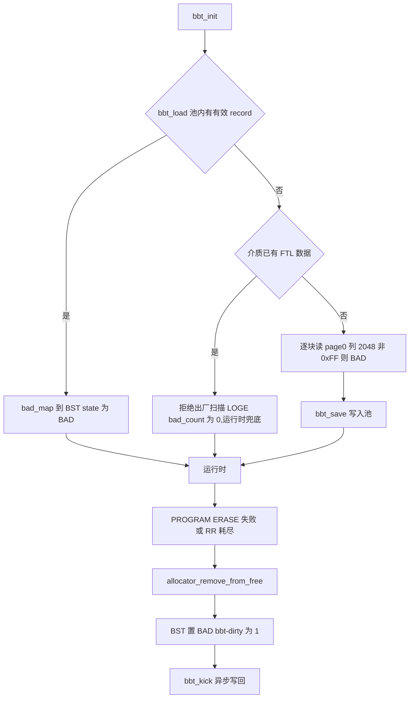

#### 3.3.5 关键流程

1. **加载**：`bbt_load` 用 `metadata_ring_locate` 扫 2 块池，取 magic 正确且 sequence 最大者；
   恢复 `alloc->bbt` 游标与序号。
2. **出厂扫描**：逐块（跳过块 0）读 `OP_READ_COLUMN` 列 2048 的 spare 首字节；
   非 `0xFF` ⇒ 坏块。**只读不擦**。
3. **运行时标记**：`bbt_mark_bad(alloc, gblock)`：出池 → 置 BAD → 清 valid → 置 dirty。
4. **持久化**：`bbt_kick` 装配 job；换块先异步擦，再写 1 页 record；完成由
   `ftl_op_bbt` 推进游标。失败保留 dirty，下轮重试。
5. **补充**：`bbt_spare_pool_refill(alloc, plane)` 从**坏块所属 plane** 的 Spare 池取一块，
   归还 Free Pool；池空则容量自然减少。

#### 3.3.6 失败语义

| 情况 | 结果 | 数据影响 |
|---|---|---|
| 无有效 BBT 且介质已用过 | 拒绝扫描，坏块表从空开始 | 已知坏块靠运行时失败兜底；不会误标活块 |
| 出厂扫描读列失败 | 保守判坏 | 可能多标；不会少标 |
| Spare 池耗尽 | 新坏块直接减少可用容量 | 用户容量下降，不丢已写数据 |
| BBT 写失败 | dirty 保留，下轮重试 | 掉电后可能丢最后一次坏块更新 |

#### 3.3.7 常量与出处

| 常量 | 值 | 来源 |
|---|---|---|
| `BBT_MAGIC` | `0x424254AB` | `include/ftl/bbt.h` |
| BBT 池块数 | 2（块 40..41） | `include/ftl/metadata.h` |
| `bad_map` | 512 B = 4096 bit | 同上 |
| 出厂标记列 | 2048（`PAGE_MAIN_SIZE`） | 器件页布局 |
| Spare / plane | 50 | `allocator.h` |

#### 3.3.8 主流对照

坏块表 + 预留替换块（sparing）而不是 block remap 表，是主流做法：ONFI Multi-Plane 命令
每个 plane 有独立行地址，坏块导致两块编号不同不影响并行操作，因此不需要“两层映射”。
出厂标记“先读后擦”的判据来自 Micron AN1819（见 `bbt.c` 的引文）。

---

<a id="s3-4" name="s3-4"></a>

### 3.4 磨损计数持久化与静态磨损均衡（checkpoint + wear_leveling）

#### 3.4.1 背景与需求

BST 里的 `erase_count` / `read_count` / `rr` 是**纯 RAM**，`ftl_init` 的 memset 会清零。
如果不持久化，重启后：

- 动态 WL 不知道哪块擦得少，可能继续用已经磨损的块；
- 静态 WL 的 `max-min` 差值归零，永远不会触发；
- read disturb / 慢死预测的记录归零，劣化块被当成新块。

> **出处**：`docs/design/storage_controller_design_essentials.md` §5.5 —— "擦除计数必须
> 持久化，否则跨重启归零、WL 失效"；失效模式表：read disturb → "定期刷新、读计数、
> GC 搬移"。

静态 WL 的需求是另一个方向：GC 只回收"有效数据少"的块，冷数据所在的低擦除块
可能长期不被擦到；需要主动把冷数据搬走一次，让这些块进入磨损轮转。

#### 3.4.2 职责与边界

- **checkpoint.c**：`checkpoint_wear_page_build` 从 BST 组 16 页磨损快照；
  `checkpoint_load_wear_table` 开机逐页校验并回填 BST。计数随 CP 记录**原子落盘**，
  不再有独立 Wear 块。
- **wear_leveling.c**：静态 WL 的触发判定与 victim 选择；搬移交给 `migrate.c`。
- **不做**：不执行擦除/搬移；不决定 GC（`gc.c`）；不维护 BST（`allocator.h`）。
- **动态 WL** 不在本模块：它是 `allocator_select_plane_block_from_pool` 的选块策略
  （选擦除最少者）。

#### 3.4.3 结构与不变量

| 结构 | 字段 | 说明 |
|---|---|---|
| `cp_wear_entry_t` | erase(4) / read(2) / last_ecc(1) / flags(1) | 8 B，按 **gblock 下标**存 |
| CP Header 磨损字段 | `wear_entry_count` / `wear_entry_bytes` / `wear_page_count` / `wear_page_crc[16]` | 几何 + 每页 CRC |
| `wl_victim_t` | found / plane_blocks / avg_erase / valid_cw / read_count | WL 选块结果 |

不变量：

1. **绝对值 + CP 快照**：每次 CP 写整份磨损快照（不是增量），读回直接覆盖 BST。
2. **软状态**：两次 CP 之间掉电只丢一个 CP 窗口的计数，不丢用户数据；
   快照损坏只退化 WL/read-disturb 精度，**不得**触发格式化。
3. **WL 只选 Closed 块**：跳过 Open；只选低擦除区 + 有效 CW ≥ 70% 的块；
   同有效数下 `read_count` 高者优先（read disturb 冷块优先搬）。
4. **WL 与 GC 共用一台迁移引擎**：WL 只改 victim 来源与收尾方式（RETIRED，不入池）。

#### 3.4.4 流程图

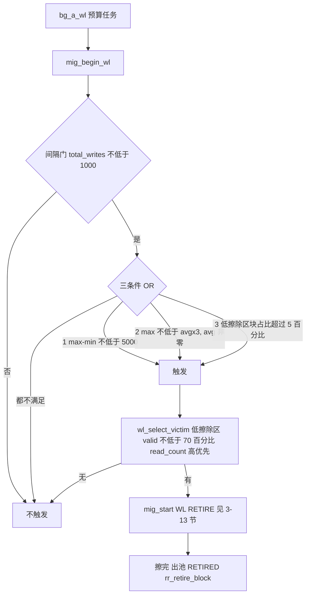

#### 3.4.5 关键流程

1. **开机**：`checkpoint_load_wear_table` 逐页读 16 页磨损快照（P0/P1 任一副本），
   每页用 Header 的 `wear_page_crc[p]` 校验，回填 BST 的 erase/read/rr 三组字段。
   无快照 / CRC 错 / 读失败 ⇒ 计数从 0 开始（软状态，非致命）。
2. **落盘**：CP job 在块元数据快照之后、Header 之前，逐页调用
   `checkpoint_wear_page_build` 从 BST 组页并写入；每页 CRC 存进 Header 的
   `wear_page_crc[]`。Header 是 commit 页——它落盘才代表整条 record 有效。
   **持久化窗口 = CP 间隔**（水位/定时/强制触发）。
3. **静态 WL 触发**：`wl_should_trigger` 三条件 OR（差值 / 比值 / 低区占比）；
   间隔门 `total_writes ≥ WL_MIN_INTERVAL`。
4. **选 victim**：遍历 Closed 列表，要求 `sb_ec <= min_ec + WL_LOW_ZONE_WIDTH`、
   `valid >= 70%`；按有效 CW 最多者优先，平手看 `read_count`。
5. **搬移**：`mig_begin_wl` 起 job；收尾 `MIG_POST_RETIRE`：出池 + RETIRED，
   **不得**先入 Free Pool（否则会被再次分配）。

#### 3.4.6 失败语义

| 情况 | 结果 | 数据影响 |
|---|---|---|
| 磨损快照读失败 / CRC 错 | 计数从 0 开始 | WL/read-disturb 精度下降；用户数据不丢 |
| 磨损页写失败 | `block_ok=0`，整条 CP record 作废（不写 Header），游标推进一槽 | 下一 CP 重试；计数窗口延长 |
| WL 无 victim | 不触发，下轮再试 | 磨损继续累积 |
| WL 搬移中分配不到目标页 | 中止且不擦 victim | 数据无损，下轮重来 |
| 擦除失败 | 标坏，不退役 | 数据由 GC/BBT 处理 |

#### 3.4.7 常量与出处

| 常量 | 值 | 来源 |
|---|---|---|
| `FTL_CHECKPOINT_WEAR_ENTRY_BYTES` | 8 | `include/ftl/metadata.h` |
| `FTL_CHECKPOINT_WEAR_PAGES` | 16 | 同上 |
| `CP_WEAR_RISING_MASK` / `CP_WEAR_HEALTH_MASK` | 0x0F / 0x03 | `include/ftl/checkpoint.h` |
| `WL_DELTA_THRESHOLD` | 5000 | `include/ftl/wear_leveling.h` |
| `WL_MAX_AVG_RATIO` | 3 | 同上 |

### 3.5 元数据目录（metadata.c / metadata.h）

> **本节怎么读**：先看 §3.5.1 的背景（为什么位置会变、为什么需要 Directory），再看
> §3.5.3 的四个结构，然后按 §3.5.5 的写路径读一遍，最后看 §3.5.8 的回收/压缩状态机。
> `metadata.c` 的核心是**唯一的一层位置来源**：Directory 条目。`NAND_PBA_INVALID` =
> 从未写过（未映射），非 INVALID = region 页在日志块上的真实位置。

#### 3.5.1 背景与需求

L2P 表按 region 分片，每个 region 是一页（2 KiB）。如果所有 region 都固定在元数据区，
更新一个 region 就必须**就地重写**那一页——NAND 只能 1→0，二次编程 = 新数据 AND 旧数据
= 静默损坏。所以写过的 region 必须**追加**到新的位置。

于是产生两个问题：

1. **位置会变**：region 从固定页迁到日志块，再从日志块迁到另一个日志块。没有索引，
   每次 L2P 读都要全盘找。
2. **旧位置要回收**：日志块写满后要换块；旧块上的 region 全部搬走后才能擦。没有引用计数，
   擦掉仍被引用的块 = 映射永久丢失。

**Metadata Directory 就是“region → 当前位置”的索引**：
`(type, id) → PBA`。它自己也要持久化，否则重启后索引丢失；但索引不能自己指向自己，
所以它用**固定块池里的全量快照（Anchor）**落盘。

#### 3.5.2 职责与边界

| 做 | 不做 |
|---|---|
| 固定元数据区布局（块号/池大小/记录页数/介质版本） | L2P cache 的替换策略（§3.6） |
| Directory 的查找/更新/落盘（Anchor） | Journal 记录格式与回放（§3.7） |
| L2P 日志块的追加/提交/回收/压缩 | Checkpoint 的阶段编排（§3.8） |
| 通用元数据 record 池原语（`metadata_ring_*`） | 块分配（调用 `allocator_alloc_log_block`，§3.2） |
| `ftl_is_metadata_block()` 判定 | 坏块内容判定（§3.3） |

**上游调用者**：

| 调用者 | 用的接口 |
|---|---|
| `l2p_cache.c` | `lookup` / `append_slot` / `commit_region` / `snapshot` 前的 Directory |
| `checkpoint.c` | `metadata_ring_*`、`anchor_prepare/page/commit` |
| `bbt.c` | `metadata_ring_*`（固定块池） |
| `power_failure_recovery.c` | `metadata_dir_load`、`ftl_is_metadata_block` |
| `ftl.c` | `metadata_dir_kick`（后台 job） |

#### 3.5.3 元数据位置模型

| 对象 | 位置 | 谁写 | 读回含义 |
|---|---|---|---|
| **L2P region（未映射）** | Directory 条目 = `NAND_PBA_INVALID` | 无（`fill_fixed` 预登记） | 该 region 从未写过；不读 NAND |
| **L2P 动态日志块** | Free Pool 取的整块 | `l2p_cache_flush_kick` 追加 | 最新一份 region 页 |
| **Anchor** | 固定池 0..31 | Directory 快照 job / CP | Directory 全量快照 |
| **Checkpoint** | 固定池 32..39 | CP job | L2P 水位 + 块元数据快照 + 磨损快照 |
| **BBT** | 固定池 40..41 | BBT job | 坏块位图 |
| **Journal** | 固定池 42..45 | Journal job | L2P 增量日志 |

两类写模型：

- **固定池（Anchor/CP/BBT）**：record 池，块内轮转，先擦后写，最新有效胜；Journal 是页环形。
  每条 record 带单调 sequence；读 = 找“整条校验通过”中 sequence 最大者。
- **动态日志块（L2P region）**：一页一个 region，只追加；块满换新块；旧块由
  `l2p_live` 归零后回收。未映射的 region 没有物理页，也没有"固定回退位置"。

#### 3.5.4 结构与字段

**`metadata_entry_t`（7 B，packed）**

| 字段 | 大小 | 含义 |
|---|---:|---|
| `type` | 1 B | `METADATA_TYPE_L2P_REGION / JOURNAL / CHECKPOINT / BBT / ERASE_COUNT` |
| `id` | 2 B | L2P region_id；其他类型为 0 |
| `pba` | 4 B | 物理位置（PBA，自带 ch/ce/lun） |

> entry 存 **PBA** 而不是裸 PAA：Directory 不假设“元数据一定在本实例的 ch/ce 上”，
> 换多 die 布局时不需要改记录格式。

**`metadata_anchor_page_t`（恰好 2048 B）**

| 字段 | 大小 | 含义 |
|---|---:|---|
| `magic` | 4 B | `ANCHOR_MAGIC`（"ANDIR"） |
| `sequence` | 4 B | 同一份 Directory 的各 chunk 相同；单调递增 |
| `chunk_index` | 2 B | 0..`ANCHOR_PAGE_COUNT-1` |
| `chunk_count` | 2 B | 总页数（= 8） |
| `entry_count` | 4 B | 本页有效 entry 数（≤ 256） |
| `layout_version` | 4 B | 介质版本；不符 ⇒ 本页作废 |
| `entries[256]` | 1792 B | 256 × 7 B |
| `padding` | 236 B | 补齐到一页 |

**`metadata_ring_t`（固定池几何）**

| 字段 | 含义 |
|---|---|
| `first_block` | 池首块（per-plane 块号） |
| `block_count` | 池块数（≥ 2；1 块的池换块会擦掉唯一有效 record） |
| `pages_per_record` | 一条 record 占几页；块尾不足一条的页不用 |
| `plane` | 池所在 plane |

派生量：`records_per_block = PAGES_PER_BLOCK / pages_per_record`（floor）；
`total_records = block_count × records_per_block`。

**`metadata_dir_cache_t`（每实例，约 24 KiB，落 SRAM4）**

| 字段 | 大小 | 含义 |
|---|---:|---|
| `entries[2048]` | 14 KiB | Directory 本体：每个 region 一条 |
| `count` | 2 B | 有效 entry 数（固定层全填，通常 = 2048） |
| `anchor_sequence` | 4 B | 当前 Anchor 序号 |
| `dirty` | 1 B | 有未写回 Anchor 的变更 |
| `have_dynamic` | 1 B | 是否已有 region 落到动态块（开机加速） |
| `l2p_live[4096]` | 8 KiB | 每个 gblock 上还有多少 region 的**最新位置** |
| `cur_metadata_block` | 2 B | 当前日志块 gblock |
| `cur_metadata_page` | 1 B | 当前日志块下一可用页 |
| `cur_block_valid` | 1 B | 游标是否已建立 |
| `cur_metadata_plane` | 1 B | 下一个新日志块选哪个 plane（轮转） |
| `job` | ~2.2 KiB | 回收/压缩 job（含 `cp_buf[2048]`） |
| `anchor_write_idx` | 2 B | Anchor 池写点槽位 |
| `anchor_cursor_valid` | 1 B | Anchor 游标是否已定位 |
| `topo` | 3 B | 元数据所在芯片路由 |

**`md_job_t` 关键字段**

| 字段 | 含义 |
|---|---|
| `phase` | `md_job_phase_t`（见 §3.5.8） |
| `waiting` | 有命令在飞；完成服务函数清 |
| `compact_wanted` | 换块后池吃紧，请求压缩 |
| `anchor_ok` / `anchor_need_erase` / `anchor_chunk` | Anchor 分页写结果/擦除判定/页序 |
| `victim` / `region_id` / `cur_region` / `moved` | 压缩的 victim / 游标 / 当前 region / 已搬数 |
| `reclaim_gblock` | 在飞擦除的 gblock（待回收集合在 dir 的 `reclaim_pending` 位图里） |
| `stall_rounds` | 连续提交不出去（> 256 中止） |
| `anchor_idx` / `anchor_seq` / `anchor_base` / `anchor_ring` | 本 Anchor record 的槽位/序号/基址/池几何 |
| `slot` | 压缩搬移已取到、待写的槽 |
| `cp_buf[L2P_REGION_SIZE]` | victim region 页搬运缓冲（必须常驻，异步读完成与写之间跨多轮） |

**不变量**

1. **`entries` 容量 = 每实例 region 数**：每个 region 都必须能登记自己的位置；
   容量不足会让“满则丢弃”丢掉已落到动态块的 region，重启后回落到“未映射” = 更新永久丢失。
2. **`l2p_live[g]` = 最新位置在 g 上的 region 数**。归零才可擦；当前日志块除外。
3. **`append_slot` 只取槽、不登记**；`commit_region` 只登记。两者分离是崩溃安全前提。
4. **Anchor 先于 victim 擦除**：压缩的顺序是“搬移 → 登记 → Anchor 落盘 → 擦 victim → 归还”。
5. **`entries` 存 PBA，不存 PAA**；读取一律经 `lookup`，不现场手写位置公式。
6. **未映射没有物理位置**：`append_slot` 分配失败时返回 `NAND_PBA_INVALID`；不存在可回退的固定块。

#### 3.5.5 地址模型：ring / locate / prepare

**`metadata_ring_addr(ring, topo, record_idx, page_in_record)`**

```text
records_per_block = PAGES_PER_BLOCK / pages_per_record
block  = ring->first_block + record_idx / records_per_block
page   = (record_idx % records_per_block) * pages_per_record + page_in_record
plane  = ring->plane
return pba_make(topo->ch, topo->ce, topo->lun, block, plane, page, 0)
```

三个原语的分工：

| 原语 | 输入 | 输出 | 是否碰介质 |
|---|---|---|---|
| `metadata_ring_addr` | 槽位 | 芯片地址 | 否 |
| `metadata_ring_locate` | 池几何 + 探针 | 最新有效槽 + sequence + 下一写槽 | **只读** |
| `metadata_ring_prepare_addr` | 写点槽 | 地址 + 是否需要先擦块 | 否 |
| `metadata_ring_prepare_write` | 写点槽 | 地址（需要时**同步擦**） | 是 |

`locate` 的快路径（利用“record 块内页对齐 + 池内顺序写”两个不变量，只读 O(块数) 页）：

```text
① 逐块读该块“末条 record”的廉价探针（只读第 0 页取 sequence）
② 第一个末条无效的块 = 游标块；所有块末条都有效（写满一圈）⇒ 游标块 = (最大 sequence 块 + 1) % N
③ 游标块内降序找最后一条有效 record
④ 写点 = 该 record 的下一槽；块内无有效 record ⇒ 块槽 0
⑤ 候选 = {全池最大 sequence 的末条, 游标块末条}，按 sequence 降序做整条校验
⑥ 快路径全失败 ⇒ 慢路径全池扫描（只在损坏时付全池代价）
```

**L2P 日志块的地址**不是 ring record：一页一个 region，追加游标是
`(cur_metadata_block, cur_metadata_page, cur_metadata_plane)`。块满时：

```text
metadata_dir_append_slot
  ├─ 当前块还有页 ⇒ 返回当前块下一页的 PBA，page++
  ├─ 块满/无当前块
  │   ├─ 当前块已满且 l2p_live==0 ⇒ 先摘掉当前身份并登记（否则永远换不了块）
  │   ├─ md_reclaim_mark_all：把 l2p_live==0 且非当前的 LOG 块**只登记**进
  │   │                      reclaim_pending 位图（不擦；擦除由后台 job 异步做）
  │   ├─ allocator_alloc_log_block(alloc, cur_metadata_plane) 取整块
  │   ├─ 设置 cur_metadata_block / page=0 / cur_block_valid=1
  │   └─ cur_metadata_plane 轮转到下一 plane
  └─ 分配失败或整理 job 在飞 ⇒ 返回 NAND_PBA_INVALID（上层 FTL_AGAIN，
     等后台 job 擦完待回收块后重试）
```

**plane 由写序轮转决定，与 region_id 无关**。region 落在哪个 plane 完全由 PBA 携带，
读回一律经 Directory 查 PBA，所以不存在“region 奇偶决定 plane”的第二套坐标。

#### 3.5.6 读路径：lookup 与启动加载

**运行期 lookup**：

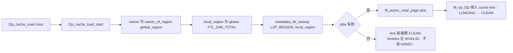

`metadata_dir_lookup` 是 `entries[]` 线性扫描（2048 条）；`have_dynamic == 0` 时跳过
动态块扫描（开机回填数千次调用，这个短路明显缩短启动）。**它不读 NAND**——Directory
是 SRAM 常驻的；读 NAND 的是随后加载 region 页的命令（未映射则根本不发命令）。

**启动加载**（`metadata_dir_load`）：

```text
① metadata_dir_fill_fixed：铺基础层（与 metadata_dir_init 共用）
   对 r = 0..2047：entries[r] = {type=L2P_REGION, id=r, pba=NAND_PBA_INVALID}
   （= 未映射；没有物理页，也没有固定回退位置）
② metadata_ring_locate(Anchor 池) 找最新“整条校验通过”的 record
③ 读胜者各页，逐页校验 chunk_index / sequence / layout_version，装配覆盖对应区间
   - 镜像池：每页先读 P0 副本；不可信时回退 P1 副本（sequence 必须等于被选中的
     record sequence，绝不跨 record 拼页）
④ 由装配后的 entries 重建 l2p_live[] 与 have_dynamic
   - entry 的 pba **不是固定元数据块**（按分区表 plane_mask 判）⇒ 动态日志块；l2p_live[g]++
   - ⚠ 不能用 "block >= FTL_METADATA_BLOCK_END"：P1 的 0..45 是镜像元数据、46 起才是用户区
⑤ 游标全部置无效（cur_block_valid=0 / anchor_cursor_valid=0）
   ——首次追加从 Free Pool 新取块，绝不复用可能已编程的旧页
```

无有效 Anchor ⇒ 返回错误，调用者转 `metadata_dir_init`（fresh）或格式化（版本判据）。

#### 3.5.7 写路径：append → 写页 → commit

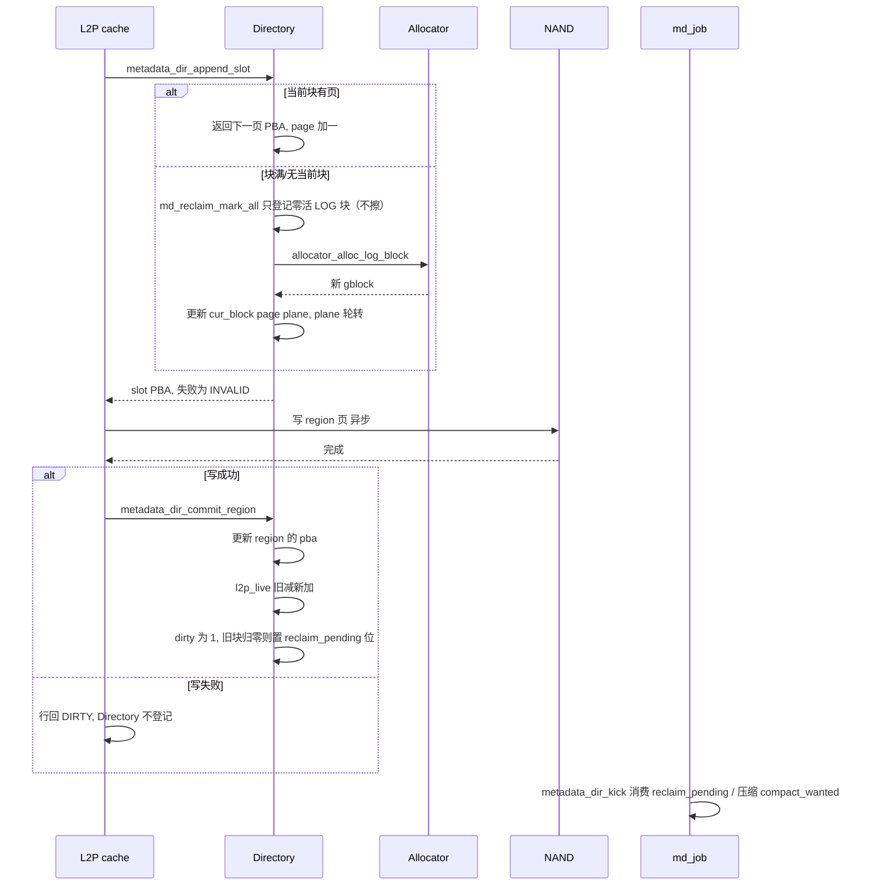

**为什么必须“先写后登记”**：

- 写失败/掉电在写页之前：槽位作废，Directory 仍指旧位置；旧页是上一份完整快照 ⇒ 映射回退一版，
  但 Journal 里有这次更新（写确认路径先 `journal_append`），回放可恢复。
- 写成功但掉电在 commit 之前：新页是“孤儿”，Directory 仍指旧位置；同样由 Journal 恢复。
- **绝不出现**“Directory 指向未写页”——这是掉电安全的关键。

**`metadata_dir_update` 的定位**：它是“直接覆盖 entry”的低层写入，供固定层铺设、
Anchor 装配、测试使用；运行期 L2P region 的更新走 `commit_region`，以维护 `l2p_live`。
两者不要混用。

#### 3.5.8 `l2p_live`、回收与压缩

**为什么需要 `l2p_live`**：一个日志块装 64 页 = 64 个 region 的最新位置。只有当这 64 个
region 全部被改写、最新位置都迁到别处后，这个块才没有活引用，才能擦。`l2p_live[g]`
就是这个计数；它只在 `commit_region` 里增减，并在 `metadata_dir_load` 里重建。

**回收**（`reclaim_pending` 位图 + `MD_JOB_RECLAIM`）：块进入回收前必须满足三条：

1. `l2p_live[g] == 0`；
2. `g != cur_metadata_block`（已满且零活的当前块会先被摘掉当前身份）；
3. BST 状态为 `LOG`（确实是本池独占的日志块，而不是恰好计数为 0 的用户块）。

登记点：`commit_region` 旧位置归零、`append_slot` 换走零活旧块、换块时的
`md_reclaim_mark_all` 扫描、压缩/擦除失败重试。**登记只置位，不碰 NAND**；
`metadata_dir_kick` 的 RECLAIM 阶段逐块异步擦除，成功才清位并归还 Free Pool，
失败保留位下轮重试。运行期没有任何同步 `tERASE`（3 ms 会击穿服务预算）。

**压缩**（抗碎片）：某日志块可能混着“永不再写的冷 region”（63 冷 + 1 热），
`l2p_live` 永远不归零，最坏吃掉近半个 die。压缩挑**活 region 最少**的块做 victim，
把活 region 搬进当前块，落 Anchor 后擦 victim。

`md_job_t` 状态机：

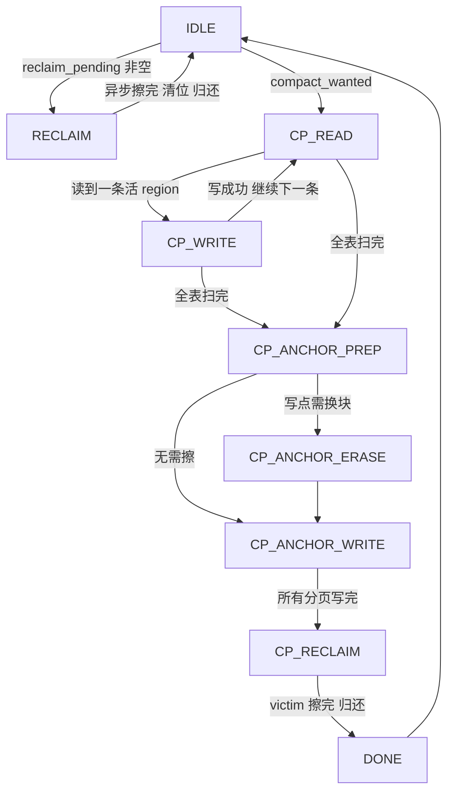

**顺序契约（不可倒）**：

```text
① 搬移 victim 的活 region → ② commit 到新位置 → ③ 写 Anchor（Directory 落盘）
→ ④ 擦 victim → ⑤ 归还 Free Pool
```

③ 必须早于 ④：否则掉电后 Anchor 仍指向已擦块，那些 region 的映射永久丢失。

**失败不回滚**：任一 phase 失败 ⇒ 中止。已登记的 region 指向新页，未搬的仍指向 victim
（victim 不擦）⇒ 两边都有效，下次换块时重来。这是“宁可多占一个块，不丢映射”的取舍。

**服务函数不推进状态机**：`ftl_op_metadata` 只记结果、release、改 phase；推进留给下一轮
`metadata_dir_kick`。原因是 `CP_ANCHOR_PREP` 在游标未建立时会**同步**扫池定位，
在完成派发里跑就是嵌套泵。

#### 3.5.9 Anchor：Directory 的全量快照

| 项 | 值/行为 |
|---|---|
| 一条 record | `ANCHOR_PAGE_COUNT = 8` 页，覆盖全部 2048 条 entry |
| 每页 | 自包含：magic + sequence + chunk_index + chunk_count + entry_count + layout_version + 256 条 entry |
| 池 | 32 块，每块 8 条 record（64 页 / 8 页） |
| 写序 | 池内 ring 轮转；写满一块先擦池内下一块 |
| 读取 | 找“整条校验通过”中 sequence 最大者；不取半条 |
| 触发 | `dirty` 置位后由元数据 job 异步 flush（无变更阈值）；Checkpoint 前也要求 flush；不在 `metadata_dir_update` 里同步做 |
| CRC | 无本层 CRC；完整性由下层 FC 的 per-CW CRC + ECC 保证 |

三段式（所有落盘站点统一）：

```text
metadata_dir_anchor_prepare(dir, &ring, &base, &idx, &seq, &need_erase)
    ├─ 定位游标 + 取槽 + 自增 sequence；判定是否需先擦块
    └─ 返回 READY / CLEAN（不脏，跳过）/ FAILED
[metadata_dir_anchor_erase]  ← 仅 need_erase
metadata_dir_anchor_page(dir, seq, chunk, &page) × 8   ← 纯 RAM 组页
写 8 页（异步命令）
metadata_dir_anchor_commit(dir, &ring, idx, ok)
    ├─ 无论成败推进游标（半编程槽不可复用）
    └─ ok 才清 dirty；失败整条作废，保留 dirty
```

**torn write**：单页损坏只让该页作废；一条 record 要求所有页 sequence 一致，
所以半条 record 不会被采用，旧 record 仍在池里可用。

#### 3.5.10 与 L2P cache / Checkpoint 的交界

| 交界 | 行为 |
|---|---|
| `l2p_cache_flush_kick` | `append_slot` → 写 region 页 → `ftl_op_l2p` 成功 → `commit_region` |
| `l2p_cache_snapshot_owner_bitmap` | Checkpoint 起点取本 die 的局部脏位图；Directory 不参与 |
| `metadata_dir_busy` | CP 的 `cp_flush_regions` 用它区分“压缩在推进”与“真卡死”，不误计 stall |
| CP 的 Anchor 阶段 | `metadata_dir_anchor_prepare/page/commit`，与压缩 job 共用同一套三段式 |
| 共享 cache 的 owner | `owner_of_region(global_region)` 解析到实例；用该实例的 `metadata_dir` / `alloc` |

**`ftl_is_metadata_block` 的三条分支**（F2/建池共用）：

1. **固定分区**：遍历 `g_ftl_partitions[]` 按 `first_block/block_count` 判区间；
   固定块号各 die 相同，**与 plane 无关**。
2. **动态日志块**：扫 `entries[]` 找 `type=L2P_REGION` 且 pba 落在用户区的块；
   必须带 plane 比较（同一块号在另一 plane 可能是用户数据）。
3. **当前游标块**：`cur_metadata_block` 可能还没有任何 region 指向它，entries 扫不到；
   同样必须带 plane 比较。

漏掉 2/3 的 plane 比较会把另一 plane 的同号块一起排除——它既进不了 Free Pool，
又被 F2 跳过，落在任何池之外（容量白丢）。

#### 3.5.11 失败语义与掉电点

| 掉电/失败点 | 介质状态 | 恢复结果 |
|---|---|---|
| `append_slot` 之后、写页之前 | 槽位已推进，页仍是擦除态 | 该槽作废；Directory 指旧位置；Journal 回放恢复映射 |
| 写页成功、`commit_region` 之前 | 新页有数据，Directory 未登记 | 新页成孤儿；Directory 指旧位置；Journal 回放恢复 |
| `commit_region` 之后 | Directory 已指向新页 | Anchor 可能还是旧的 ⇒ boot 从旧 Anchor 加载后，靠 Journal 回放补齐 |
| Anchor 写一半 | 部分页新、部分页旧 | 整条 record 校验失败；旧 record 仍有效 |
| Anchor 已落盘、擦 victim 之前 | 新位置已登记且落盘 | victim 未擦，映射完整；下次压缩重来 |
| 擦 victim 中掉电 | victim 部分块擦除 | `l2p_live == 0` 才擦，且 Anchor 已先落盘 ⇒ 无映射指向 victim |
| 回收日志块时掉电 | 无活 region 的块被擦 | 无映射引用它，安全 |
| Anchor 池/日志块 NAND 读失败 | record/页作废 | 回退到上一个有效 Anchor；最坏走 F2 |
| 介质版本不符 | 记录作废 | `ftl_media_format` 全片格式化（§2.5） |

⚠ **“没有本层 CRC”不是漏洞**：元数据页的 FC CRC 由 `FTL_PAGE_CFG_META` 统一开启；
CRC 覆盖 META+USER，且自身在 ECC 码字内，能消除“ECC 误纠后看似成功”的假阳性。

#### 3.5.12 常量与出处

| 常量 | 值 | 来源 |
|---|---|---|
| `ANCHOR_POOL_BLOCKS` | 32（0..31） | `include/ftl/metadata.h` |
| `ANCHOR_ENTRIES_PER_PAGE` | 256 | 同上 |
| `ANCHOR_PAGE_COUNT` | 8 | 同上 |
| `ANCHOR_RECORDS_PER_BLOCK` | 8 | 同上 |
| `CHECKPOINT_POOL_BLOCKS` | 8（32..39） | 同上 |
| `BBT_POOL_BLOCKS` | 2（40..41） | 同上 |
| `JOURNAL_BLOCKS` | `CW_NUM` = 4（42..45） | 同上 |
| `METADATA_DIR_ENTRIES` | 2048 | 同上 |
| `metadata_entry_t` | 7 B | 同上 |
| `metadata_anchor_page_t` | 2048 B | 同上 |
| 介质版本 | 9（DIM=1）/ 10（DIM>1） | 同上 |
| `MD_SUBMIT_STALL_MAX` | 256 | `src/ftl/metadata_job.c` |
| Anchor 触发 | `dirty` 置位（元数据 job 异步） | `src/ftl/metadata_job.c` |

#### 3.5.13 主流对照

“固定根（root/Anchor）+ 专用元数据块池 + 动态日志块 + Directory”是主控固件的常见形态：
固定根给启动一个确定的查找起点，日志块吸收高频更新，Directory 追踪最新位置。
企业级把日志块也放到全动态池并加 RAID1；本仓保留固定池是为了启动时间与实现可控，
**这是本仓自定**的取舍，不是行业标准形态。

DRAM-less 侧的关键同构是 **flash reverse-mapping**：不常驻逐页有效位图，
靠页内 META + L2P 反查判有效（§3.13）。这与 Directory 是两件事：Directory 管
“region 页在哪”，META 管“页内某 CW 是否仍被 L2P 指向”。

---

<a id="s3-6" name="s3-6"></a>

### 3.6 L2P Cache（l2p_cache）

#### 3.6.1 背景与需求

L2P 全表 4 MiB，片上 SRAM 只能拿出约 128 KiB 做缓存。没有 cache，**每一次** LBA 访问
都要先读一页 NAND 取映射——读放大不可接受，写路径也要先读后改。

Cache 带来三个新问题，模块必须正面回答：

1. **未命中怎么办**：同步等 NAND 会钉住整个完成泵；本仓选择**异步加载**——
   起一条读命令、返回 `FTL_AGAIN`、调用者下轮重试。
2. **脏行什么时候写回**：写回是整页 2 KiB（region 粒度），不能就地覆盖；只能追加到
   日志块（§3.5）。写回在后台做，前台不感知。
3. **工作集远大于 cache 怎么办**：全盘随机访问时 miss 率接近 100%，驱逐→写回→加载
   反复，称为 thrashing。需要检测并降级，把 NAND 带宽让给前台。

#### 3.6.2 职责与边界

- **做**：64 行 cache、CLOCK 替换、三态读/写、异步载入/写回、全局 region 脏位图、
  thrashing 检测、owner 解析（共享 cache 跨 LUN）。
- **不做**：不决定 region 页落在哪个物理位置（§3.5）；不写 Journal（§3.7）；
  不决定 Checkpoint 时机（§3.8）。
- **共享模型**：一个 `(ch, ce)` 一份 cache，同 `(ch,ce)` 下的多个 LUN 共用；
  每行用**全局 region** 作键，load/flush 时通过 `owner_of_region` 解析到 owner 实例。

#### 3.6.3 结构与不变量

`l2p_cache_line_t`：

| 字段 | 大小 | 含义 |
|---|---:|---|
| `entries[512]` | 2 KiB | region 的 512 条 PBA |
| `region_id` | 4 B | **全局** region 编号 |
| `state` | 1 B | INVALID / CLEAN / DIRTY / FLUSHING / LOADING |
| `access_count` | 2 B | CLOCK 访问计数 |
| `fresh` | 1 B | 本次加载正是为当前访问而起；首次触碰不计命中 |

`l2p_cache_t`：

| 字段 | 含义 |
|---|---|
| `lines[64]` | 约 128 KiB |
| `clock_hand` | CLOCK 指针 |
| `hit_count` / `miss_count` | 开机累计（观测） |
| `window_access` / `window_miss` / `miss_pct` / `thrashing` | 窗口 miss 率 + 滞回 |
| `region_dirty_bitmap[]` | **全局** region 脏位；Checkpoint 按 owner 过滤快照 |
| `load_inflight` / `flush_inflight` | 在飞计数；后者是写回背压闸门 |
| `ch` / `ce` | 本 cache 服务范围 |
| `owner_of_region` / `owner_ctx` | 全局 region → owner 实例 |

**状态机**：

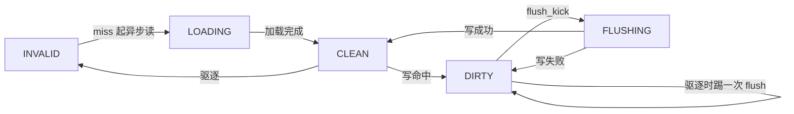

**不变量**：

1. **同一 region 只有一行**。`find` 匹配 CLEAN/DIRTY/FLUSHING/LOADING，只排除 INVALID；
   否则 FLUSHING 窗口会为同一 region 再分配一行 ⇒ 两行分叉。
2. **FLUSHING 可读不可写**：entries 是有效快照，读照常命中；写会让“落盘的是旧快照、
   RAM 是新值”分叉 ⇒ 写一律 `FTL_AGAIN`。
3. **LOADING 不可读不可写**：entries 尚未有效。
4. **写路径两遍式**：先 `ready` 再 `write`；`write` 遇到未驻留的 region 只起加载、不写。
   一遍式会静默丢更新。
5. **`flush_inflight` 是共享 credit 池**：上限 4，防止写回把 FC 命令/缓冲池吃光。
6. **同步逃生口只许结构性同步上下文**：开机、CLI、`fl`、CP；服务函数禁止调用
   （`l2p_sync_pump` 有 `ftl_op_in_dispatch()==0` 断言）。

#### 3.6.4 读路径

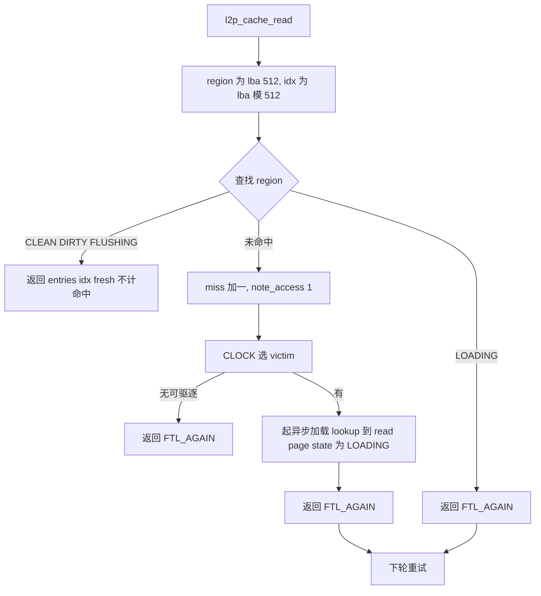

`ftl_op_l2p` 收尾（`ctx = line`）：

- 成功：`ftl_cmd_read_data` 把整页 region 拷进 `entries`；state = CLEAN。
- 失败：entries 保持全 `NAND_PBA_INVALID`（= 该 region 全部未映射），state = **CLEAN**。
  这样后续访问走“未映射”路径，不会每次重试加载。
- 两者都置 `fresh=1`：下一次命中是本次访问的重试，不计 hit（保持 miss 率口径）。

#### 3.6.5 写路径与写回

```text
l2p_cache_ready(lba)  ── 未驻留则起加载、返回 false；命中不记账
l2p_cache_write(lba, pba)
    ├─ 行未就绪（LOADING/FLUSHING）⇒ FTL_AGAIN，不改状态
    ├─ entries[idx] = pba；state = DIRTY；置全局 region 脏位
    └─ fresh? 消费 fresh : access++/hit++

l2p_cache_flush_kick(line)
    ├─ 非 DIRTY / 已在 FLUSHING ⇒ 返回
    ├─ flush_inflight 达上限 ⇒ FTL_AGAIN
    ├─ metadata_dir_append_slot 取槽（失败 ⇒ 行保持 DIRTY）
    ├─ 起异步写 region 页；state = FLUSHING
    └─ 完成：成功 ⇒ commit_region + CLEAN + 清脏位
              失败 ⇒ 回 DIRTY，Directory 不登记
```

**CLOCK 驱逐**：

```text
① FLUSHING / LOADING → 跳过（在飞）
② DIRTY → 踢一次 flush_kick，跳过本行（不等写回）
③ INVALID → 直接占用
④ access_count > 0 → access_count--，下一行
⑤ access_count == 0 → 回收
⑥ 扫完一圈无可驱逐 → -1（调用者 FTL_AGAIN）
```

#### 3.6.6 Thrashing 检测与降级

```text
每 256 次访问结算一次：miss_pct = window_miss * 100 / window_access
进入：>= 90%；退出：< 70%（滞回）
降级动作：停掉后台**主动** flush；脏行只由驱逐路径按需写回
```

持久性不受影响：L2P 更新在写完成路径里先入 Journal；Checkpoint 也会无条件 flush
快照内的脏 region。**刻意不做** write-through（整页追加模型下省不掉 load，反而放弃合并收益）
和预取（thrashing 的成因恰恰是没有空间局部性）。

#### 3.6.7 失败语义

| 情况 | 返回值/结果 | 数据影响 |
|---|---|---|
| `FTL_AGAIN` | 加载中/背压/行在飞 | 调用者下轮重试；不是错误 |
| `FTL_OK` + `NAND_PBA_INVALID` | **未映射**（合法结果） | 读路径零填充；写路径分配新位置 |
| `FTL_ERROR`（越界） | 也回填 `INVALID` | 调用者按未映射处理 |
| 加载失败 | 行 CLEAN + 全 INVALID | 该 region 视为全未映射；不反复重试 |
| 写回失败 | 行回 DIRTY | Directory 仍指旧位置；Journal 可恢复 |
| 所有行在飞 | 驱逐返回 -1 | 调用者 FTL_AGAIN |

#### 3.6.8 常量与出处

| 常量 | 值 | 来源 |
|---|---|---|
| `L2P_CACHE_SIZE` | 64 | `include/ftl/l2p_cache.h` |
| `L2P_FLUSH_MAX_INFLIGHT` | 4 | 同上 |
| `L2P_THRASH_WINDOW` | 256 | 同上 |
| `L2P_THRASH_ENTER_PCT` / `EXIT_PCT` | 90 / 70 | 同上 |
| `L2P_SYNC_GUARD_MAX` | 100,000 轮 | 同上 |
| `L2P_ENTRIES_PER_REGION` | 512 | `include/ftl/ftl_config.h` |

#### 3.6.9 主流对照

DRAM-less 主控的 L2P cache 普遍采用“按需加载 + 近似 LRU（CLOCK/2Q）+ write-back”，
并用日志/快照保一致性；区别在 cache 行数、替换算法与是否共享。**本仓自定**的是
64 行、CLOCK、thrashing 滞回 90/70，以及“加载失败按全未映射处理”的语义。

---

<a id="s3-7" name="s3-7"></a>

### 3.7 Journal（journal）

#### 3.7.1 背景与需求

L2P cache 是 write-back：主机写成功时只改了 RAM，映射还没有写回 NAND。若此时掉电，
数据在 NAND 上、映射却丢了——数据永久不可达。

Journal 是 **L2P 的增量写前日志**：每次映射变更先追加一条 `(lba, old, new)`，
再改 cache。掉电后从 Checkpoint 水位之后回放，恢复映射。

没有 Journal 的替代方案是“每次写都同步把 region 页写回 NAND”，代价是每个 512 B 写
都要写 2 KiB region 页，写放大 4×，且前台等 NAND。Journal 把“持久化”和“写回”解耦：
Journal 追加是小的、顺序的；region 写回可以攒批、后台做。

#### 3.7.2 职责与边界

- **做**：记录格式（页头 + 16 B entry）、RAM 页缓冲、异步刷页 job、环形块切换与擦除、
  回放（两遍扫描）、写指针恢复、截断（plan/commit）。
- **不做**：不决定 Checkpoint 时机（§3.8）；不管理 region 位置（§3.5）；
  不决定 L2P cache 替换（§3.6）。
- **调用者**：写完成路径 `journal_append`、GC/WL 的 `MIG_FLUSH_JRN` 屏障、
  boot 的 `scan/resume/replay`、CP 的 `truncate_plan/commit`。

#### 3.7.3 结构与不变量

**页格式**（恰好 2048 B）：

| 部分 | 大小 | 内容 |
|---|---:|---|
| Header | 12 B | magic（"JOUR"）+ page_seq + entry_count + block_seq |
| Entries | N × 16 B | N ≤ 127；每项 lba / old_pba / new_pba / sequence |
| Padding | 余量 | 0xFF |

`JOURNAL_ENTRIES_PER_PAGE = (2048 - 12) / 16 = 127`（向下取整；写死 128 会写穿 `page_buf`）。

**`l2p_journal_t`**：

| 字段 | 含义 |
|---|---|
| `topo` / `block_pba[4]` | 目标芯片路由 / 4 个环形块基址 |
| `current_block` / `current_page` / `current_entry` | RAM 写游标 |
| `sequence_counter` | 全局单调序号 |
| `merge_floor` | CP 水位；`sequence < merge_floor` 的条目不得原地合并 |
| `pre_erased_block` | 已被 CP 预擦、回切时跳过擦除的块 |
| `page_buf[2048]` | 当前页缓冲 |
| `checkpoint_needed` / `emergency` | 85% / 95% 水位标志 |
| `job` | 异步刷页 job（IDLE/WRITE/ERASE） |

**不变量**：

1. **页是回放单位**：判据是 `page_seq + entry_count > cp_sequence`，不是只看页首页序号。
   只比页首会把跨水位那一页整页跳过，丢掉它的新条目。
2. **同 LBA 合并受 `merge_floor` 约束**：CP 后的覆盖写不能复用 CP 前的 sequence，
   否则块元数据增量回放按 sequence 过滤时漏记。
3. **同一块每圈只擦一次**：CP 预擦的块记 `pre_erased_block`，`journal_flush_page`
   回切时跳过擦除。
4. **单飞行**：`job.phase != IDLE` 时不再起新页写；两条写会争同一页地址。
5. **回放不信任页内容**：Journal 模块整体不转断言——页头可能因掉电撕裂而非法，
   属预期情形，返回错误/跳过。

#### 3.7.4 写路径

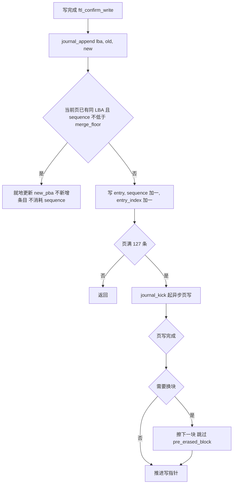

**屏障**：`journal_flush_page` 是同步屏障（排空在飞 job + 立即落盘），只给结构性同步
上下文用（HIL `fl`、开机路径、CLI）。GC/WL 的 F10 屏障走 `MIG_FLUSH_JRN`：
`journal_kick` 冲刷半满页，等 job 空闲即可满足。

#### 3.7.5 回放与恢复

```text
journal_replay(journal, cache, cp_sequence, &entries, block_ctx)
  第一遍：扫 4 × 64 = 256 页，收集 page_seq+entry_count > cp_sequence 的页
          → replay_pages[256]（栈上 2 KiB；下标必须 uint16_t）
  第二遍：按 (page_seq, entry_idx) 递增排序，逐页读、逐条应用
          - l2p_cache_write_sync(lba, new_pba)（开机无人 drain CQ，用同步逃生口）
          - block_ctx 有效时同步维护 valid_count：new +1 / old -1
            （TRIM 只减 old；old == new 跳过）
          - materialize 失败/越界/下溢 ⇒ ok=0，调用者回退 F2
  journal_resume(latest, floor=cp_sequence)：写指针落到最新页之后，序号不回退
```

**为什么必须恢复写指针**：`journal_init` 把游标复位到 `(block0, page0)`、序号复位到 1，
但 NAND 上的环形块**没有被擦**。不接回去会有两个后果：序号从 1 重来 ⇒ 新页排到旧页之后，
下次开机回放过滤把它们整页丢弃；写指针回到已编程页 ⇒ 二次编程（AND 损坏）。

#### 3.7.6 Journal 自身的掉电保护

| 掉电点 | 现象 | 保护 |
|---|---|---|
| A：RAM 缓冲未落盘 | 丢当前页 ≤ 127 条 | 写确认路径已把映射更新交给 Journal；丢的是最近一页，属容忍窗口 |
| B：页编程中途 | 页面部分烧录 | FC per-CW CRC + ECC；坏页整页丢弃 |
| C：编程成功但返回途中掉电 | 不知是否成功 | magic + `entry_count` 精确定位；sequence 连续性检查 |

四层：FC 的 CRC/ECC（下层）、Header magic + entry_count、单调 sequence、
多块环形轮换（不是双写）。Journal 条目本身无独立 CRC——16 B 已被字段占满，
完整性靠整页 CRC/ECC + 页序判定。

#### 3.7.7 失败语义

| 情况 | 结果 | 数据影响 |
|---|---|---|
| 环形写满且 CP 未完成 | `emergency=1`，强制 CP | 前台写入可能被背压 |
| 截断水位不覆盖全部已写条目 | `JRN_TRUNC_NO_TRUNCATE`，不截断 | 最旧块仍持有回放条目，安全 |
| 页写失败 | job 保留待续跑；行仍 DIRTY | 映射由下一次 Journal/CP 恢复 |
| 回放某页读失败 | 跳过该页 | 该页条目丢失；映射回退一版 |
| 序号不连续 | 在该处截断 | 之后的页不应用 |

#### 3.7.8 常量与出处

| 常量 | 值 | 来源 |
|---|---|---|
| `JOURNAL_BLOCKS` | `CW_NUM` = 4 | `include/ftl/metadata.h` |
| `JOURNAL_PAGE_SIZE` | 2048 | `include/ftl/journal.h` |
| `JOURNAL_HEADER_SIZE` | 12 | 同上 |
| `JOURNAL_ENTRIES_PER_PAGE` | 127 | 同上 |
| `JOURNAL_FULL_THRESHOLD` | 85% | 同上 |
| `JOURNAL_CRITICAL` | 95% | 同上 |
| `JOURNAL_MAGIC` | `0x524F554A` ("JOUR") | 同上 |
| `JOURNAL_DRAIN_SPIN_MAX` | 100,000 | `src/ftl/journal.c` |

#### 3.7.9 主流对照

“写前日志 + 定期快照截断”是数据库与闪存 FTL 共用的崩溃恢复形态；DRAM-less FTL
把 L2P 增量写进 Journal、用 Checkpoint 限定回放长度，是主流做法（DFTL 等）。
**本仓自定**的是 4 块环形、127 条/页、85%/95% 水位与同 LBA 合并策略。

---

<a id="s3-8" name="s3-8"></a>

### 3.8 Checkpoint（checkpoint）

#### 3.8.1 背景与需求

Journal 只增不减。如果永远不截断，环形块很快写满，启动回放也越来越长。
Checkpoint 的作用是：

1. 把当前 L2P cache 里的脏 region **全部写回 NAND L2P 表**；
2. 写一条 Header，记录“到此为止的 Journal 水位”；
3. 截断/预擦 Journal 的旧块；
4. 顺带把**块元数据**（每块状态/有效计数/池归属）做成快照，减少开机 F2。

没有 Checkpoint，Journal 会溢出，掉电恢复时间无界；没有块元数据快照，每次开机都要全盘扫描
（约 250~400 ms）。

#### 3.8.2 职责与边界

- **做**：触发判定（水位/写入量/定时/紧急）、CP job 状态机、region 脏位图快照、
  Anchor 协调、块元数据快照编码与落盘、Journal 截断协调。
- **不做**：不定义 Journal 记录格式（§3.7）；不定义 Anchor 页格式（§3.5）；
  不决定 L2P 写回细节（§3.6）。
- **调用者**：后台 `bg_a_cp_trigger` / `bg_a_emergency_cp` / `bg_a_checkpoint`；
  boot 的 `checkpoint_find_latest` / `load_block_table`。

#### 3.8.3 结构与不变量

**`l2p_checkpoint_header_t`（恰好 2048 B）**：

| 字段 | 大小 | 含义 |
|---|---:|---|
| `magic` | 4 B | `CHECKPOINT_MAGIC` |
| `sequence` | 4 B | 本池自己的单调序号 |
| `timestamp` | 4 B | 观测 |
| `region_count` | 4 B | 本 CP 覆盖的 region 数 |
| `region_bitmap[64]` | 256 B | 本 die 的局部 2048-bit 位图 |
| `journal_sequence` | 4 B | 截断/回放水位 |
| `layout_version` | 4 B | 介质版本 |
| `block_word_count` | 4 B | 块元数据 word 数（0 = 无快照） |
| `block_word_bytes` | 4 B | 每 word 字节数（2） |
| `block_page_count` | 4 B | 块元数据页数（4） |
| `block_crc32` | 4 B | 块元数据 words 的 CRC |
| `wear_entry_count` / `wear_entry_bytes` / `wear_page_count` | 4 + 4 + 4 B | 磨损快照几何（4096 / 8 / 16） |
| `wear_page_crc[16]` | 64 B | 每页磨损快照的 CRC |
| `record_pages` | 4 B | 1 + 4 + 16 |
| `padding` | 1672 B | 补齐一页 |

**一条 record = 21 页**：块元数据快照 4 页（16-bit/块 × 4096 = 8 KiB）+ 磨损快照 16 页
（8 B/块 × 4096 = 32 KiB）+ Header 1 页。
**Header 是 commit 页**：块元数据页 + 磨损页必须先写，Header 最后写。

块元数据快照只存**块元数据**需要的量：`valid_count` / `state` / `temp` / 池归属；
磨损快照存 `erase_count` / `read_count` / `rr`（last_ecc / rising_count / health）。
`last_pe_ts` 不存（刻意 volatile，上电后从 0 开始）。

**块元数据 word 位域**（小端、显式移位）：

```text
valid_count(10) | state(3) | temp(1) | pool(2)
pool: 0=NONE / 1=OP / 2=SPARE
```

**`cp_job_t`**：

| 字段 | 含义 |
|---|---|
| `active` / `phase` / `waiting` | 单飞行 / 阶段 / 有命令在飞 |
| `failed` / `fail_phase` / `stall_rounds` | 中止原因与提交背压计数 |
| `region_bitmap[64]` | **job 起点**的本 die 局部脏位图快照 |
| `journal_seq` | job 起点取定的 Journal 水位 |
| `anchor_*` | Anchor 池几何、基址、槽位、序号、页序、擦除判定 |
| `hdr_*` | Header 池几何、地址、槽位、序号、擦除判定 |
| `block_page` / `block_ok` / `block_words[4096]` | 块元数据快照进度与缓冲 |
| `wear_page` / `wear_page_crc[16]` / `wear_page_buf` | 磨损快照进度 / 每页 CRC / 组页缓冲 |
| `trunc_addr` / `trunc_next` | Journal 预擦块 |

**不变量**：

1. **快照点在 job 起点**：脏位图与 `journal_sequence` 一起取定。异步 CP 跨多轮，
   若取“CP 末尾”的水位，CP 期间完成的 host 写会两边都不认（不 flush、不回放）⇒ 丢映射。
2. **顺序不可换**：flush regions → Anchor → 块元数据快照 → 磨损快照 → Header → 截断 Journal。
   Header 一旦落盘，boot 就信 `region_bitmap` 里的 region 已在 NAND 上。
3. **flush 失败 ⇒ 中止**：不写 Header。否则 boot 会预载未落盘的 region。
4. **Header 写无论成败都推进池游标**：半编程槽不可复用。
5. **截断必须覆盖全部已写条目**：水位不足时拒绝截断，最旧块可能仍持有回放条目。
6. **完成服务函数不推进状态机**：`CP_ANCHOR_PREP` / `CP_HDR_PREP` 可能含同步定位，
   在完成泵里跑会嵌套泵；推进留给下一轮 `checkpoint_kick`。

#### 3.8.4 触发条件

| 触发 | 条件 | 行为 |
|---|---|---|
| **T1 水位** | Journal ≥ 85% | 设 `checkpoint_needed`，后台执行 |
| **T1 紧急** | Journal ≥ 95% | 设 `emergency`，任何档位都执行 |
| **T2 写入量** | `total_writes % 1024 == 0` | 后台执行 |
| **T3 定时** | 距上次 ≥ 10 s 且 Journal 增量 ≥ 64 | 后台执行（轻载不写空 CP） |

#### 3.8.5 阶段与顺序契约

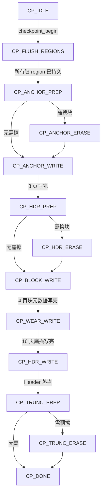

| phase | 动作 | 失败 |
|---|---|---|
| `CP_FLUSH_REGIONS` | 按快照位图逐条 kick L2P flush，等 `flush_inflight` 归零 | 中止，不写 Header |
| `CP_ANCHOR_PREP` | 定位 Anchor 游标 + 取槽 + 判定擦除 | 中止 |
| `CP_ANCHOR_ERASE` | 换块先擦 | 中止 |
| `CP_ANCHOR_WRITE` | 逐页写 8 页 Anchor | 任一分页失败 ⇒ 整条作废，仍推进 |
| `CP_HDR_PREP` / `CP_HDR_ERASE` | 定位 Header 槽 / 换块擦 | 中止 |
| `CP_BLOCK_WRITE` | 逐页写 4 页块元数据快照 | 失败 ⇒ 中止，不写 Header |
| `CP_WEAR_WRITE` | 逐页写 16 页磨损快照（每页 CRC 存 Header） | 失败 ⇒ 中止，不写 Header |
| `CP_HDR_WRITE` | 写 1 页 Header（commit） | 无论成败推进游标；失败中止 |
| `CP_TRUNC_PREP` | 水位判定，算预擦块 | 水位不足 ⇒ 不截断 |
| `CP_TRUNC_ERASE` | 预擦 Journal 最旧块 | 失败仅 LOGW，仍记账（预擦只是磨损优化） |
| `CP_DONE` | 清 active，记日志 | — |

#### 3.8.6 关键流程

1. `checkpoint_begin`：单飞行检查 → memset job → 快照局部脏位图 + `journal_seq` →
   `active=1; phase=CP_FLUSH_REGIONS` → `cp_step` 推进第一步即返回。
2. 每轮 `checkpoint_kick` 续跑；有命令在飞时只打心跳。
3. 完成由 `ftl_op_checkpoint` 按 phase 记结果、release、改 phase；**不**调用 kick。
4. `CP_FLUSH_REGIONS` 用 `metadata_dir_busy` 区分“压缩在推进”与“真卡死”，
   不把正常的长压缩计成 CP stall。

#### 3.8.7 失败语义

| 情况 | 结果 | 数据影响 |
|---|---|---|
| L2P flush 失败 | 中止，不写 Header | boot 用上一个 CP + Journal 回放，一致 |
| Anchor 分页失败 | 整条 Anchor 作废，保留 dirty | 旧 Anchor 仍有效 |
| 块元数据快照失败 | 不写 Header | 本次 CP 未提交；下次重来 |
| 磨损快照失败 | 不写 Header | 本次 CP 未提交；计数窗口延长，用户数据不受影响 |
| Header 写失败 | 游标仍推进；中止 | 旧 Header 仍有效 |
| Journal 截断失败 | 只记日志 | 预擦是磨损优化，不影响一致性 |
| 提交侧长期背压 | `stall_rounds > 256` 中止 | 下轮重试；不丢映射 |

#### 3.8.8 常量与出处

| 常量 | 值 | 来源 |
|---|---|---|
| `CHECKPOINT_MAGIC` | `0xCCCCCCCC` | `include/ftl/checkpoint.h` |
| `CHECKPOINT_POOL_BLOCKS` | 8 | `include/ftl/metadata.h` |
| 一条 record | 21 页（1 Header + 4 块元数据 + 16 磨损） | `include/ftl/checkpoint.h` |
| `CP_WRITE_INTERVAL` | 1024 | `include/ftl/ftl.h` |
| `CP_TIME_INTERVAL_MS` | 10,000 | 同上 |
| `CP_T3_MIN_JOURNAL_DELTA` | 64 | `include/ftl/checkpoint.h` |
| `CP_SUBMIT_STALL_MAX` | 256 | 同上 |

#### 3.8.9 主流对照

“全量快照 + 日志截断 + 崩溃安全的提交顺序”是主流 FTL/数据库的通用恢复模型。
块元数据快照（per-block metadata snapshot）对应企业级 SSD 的 block descriptor/accounting
snapshot。**本仓自定**的是 16-bit/块 + 8 B/块的紧凑编码、21 页/record 与 T1/T2/T3 阈值。

---

<a id="s3-9" name="s3-9"></a>

### 3.9 Host 提交 / group / pending（ftl.c + pending.c）

#### 3.9.1 背景与需求

一条 host 请求可能覆盖很多连续 LBA（CLI 可一次写 8 个 LBA，接口允许更长）。
FTL 不能把它当成一条 NAND 命令：

- 读要按 L2P 映射分组：连续 LBA 可能落在不同页/plane；
- 写要按 wbuf 窗口攒页，一个窗口最多 8 个 LBA；
- 子操作异步完成，完成顺序与提交顺序无关；
- 上层只想要**一次**完成通知，而不是每个子操作一次；
- 资源不足时要能“停泊”，下轮继续，而不是丢请求或阻塞主循环。

**group + pending + owners** 就是为这四件事存在的。

#### 3.9.2 职责与边界

- **做**：参数/LBA 校验、完成组分配、`ftl_drain_group` 循环、`ftl_issue_subop` 读写拆分、
  pending 槽登记、组完成聚合（`next==total && outstanding==0`）、停泊项管理。
- **不做**：不建 FC 命令链（§3.15）；不决定 L2P 映射（§3.6）；不执行搬移/恢复（§3.13/§3.14）。
- **上游**：controller / CLI；**下游**：L2P cache、wbuf、allocator、FC 接口。

#### 3.9.3 结构与不变量

**`ftl_io_request_t`**（`ftl_type.h`）：`lba`（uint64）、`buffer`、`count`、
`complete_flag`、`status_out`、`on_complete`、`ctx`。`count` 是**连续 LBA 数**；
plane 配对由 FTL 内部决定，不暴露 `pages`。

**`ftl_io_group_t`**（32 项）：

| 字段 | 含义 |
|---|---|
| `used` / `op` | 组占用 / READ 或 WRITE |
| `next` / `total` | 已下发到的 LBA 偏移 / 总 LBA 数（uint32，可达 1,048,576） |
| `outstanding` | 已下发、未完成的子操作数 |
| `stalls` | 连续无进展 drain 轮数（上限 8） |
| `agg_status` | 粘性错误：任一子操作失败即非 OK |
| `complete_flag` / `status_out` / `on_complete` / `ctx` | 完成通知 |

**`ftl_pending_req_t`**（32 项）：

| 字段 | 含义 |
|---|---|
| `used` / `command_id` | 槽占用 / FC 命令 id；停泊时 = `FTL_PENDING_CMD_NONE` |
| `owners` | 贡献本子操作的组位掩码（bit gi） |
| `op` | READ / WRITE / READ_RECOVERY / WRITE_CONFIRM |
| `n_cw` / `cw_bitmap` | 搬运的 CW 数 / 写页的有效 CW 位图 |
| `lba` | 子操作起始**全局** LBA；写页打包时是窗口基址 |
| `buffer` | 读的写回地址；写恒 NULL（数据在 wbuf） |
| `new_pba` / `new_pba1` | 新分配的 plane0/plane1 页 PBA |
| `cache_intermediate` | Cache Program 中间页（本仓不使用，保留字段） |

**不变量**：

1. **读写必须显式带 `op`**。不能用 `buffer != NULL` 判别：写请求的 buffer 是数据源，
   对写恒非空；旧实现因此让写分支成死代码。
2. **一条 host 请求 = 一个组**；完成通知只在 `next==total && outstanding==0` 时触发一次。
3. **写页可能由多个组拼成**：`owners` 记录贡献组，完成时逐组递减 outstanding。
4. **停泊项不与 FC 命令挂钩**：`command_id = NONE`，防止命令 id 复用后误撞。
5. **组进度按 LBA 偏移计**，不是“子操作序号”：一个子操作最多消费 8 个 LBA，
   消费几个由 `ftl_issue_subop` 现场决定。

#### 3.9.4 提交流程

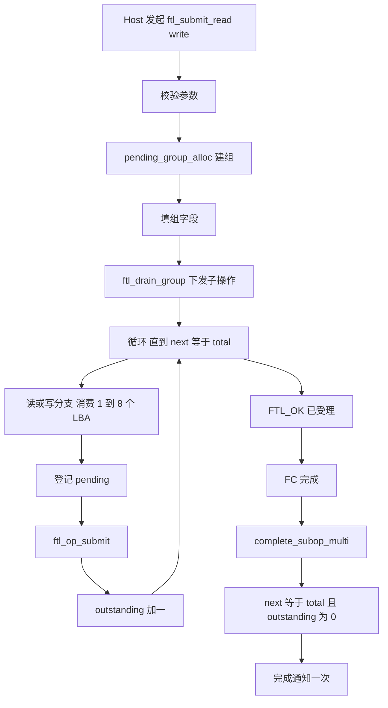

#### 3.9.5 读子操作

```text
ftl_issue_subop(read) 对每个 LBA：
  ① wbuf 命中（该窗口尚未 flush）⇒ 直接从 wbuf.data 拷出，消费 1 个 LBA
  ② 否则 l2p_cache_read(global_lba)
       - FTL_AGAIN（LOADING）⇒ 置 l2p_defer=1，停止本子操作，下轮重试
       - FTL_OK + INVALID（未映射）⇒ 零填充，消费 1 个 LBA
       - FTL_OK + PBA ⇒ 按 (physical plane, page) 分组
  ③ 页变化/plane 变化时收缩子操作范围
  ④ 校验 PBA 的 plane 与 LBA 低 3 位的 plane 位一致
  ⑤ pending_alloc → 填 read 字段 → outstanding++ → ftl_op_submit
```

`l2p_defer` 的作用：region 加载在飞是“有进展”，不能计入 `stalls`；否则一次正常的
随机读会吃掉 8 轮预算，被误判成卡死。

#### 3.9.6 写子操作

写路径不在 `issue_subop` 里建 NAND 命令，而是交给 wbuf（§3.11）：

```text
ftl_issue_subop(write)：
  ftl_wbuf_append(ftl, lba, buffer)
    ├─ 窗口变化 ⇒ 先 flush 旧窗口
    ├─ 打开/复用窗口；逐 CW 拷进 wbuf.data[plane*CW_NUM+cw]
    ├─ occupied 置位；owners |= 1<<gi；group.outstanding 加一
    └─ 页满 ⇒ 尽力 flush（失败不影响已受理）
```

真正的 NAND 写、pending 登记、L2P/Journal 确认都在 `ftl_wbuf_flush` 与完成路径里。

#### 3.9.7 组完成与停泊

```text
pending_group_complete_subop_multi(owners, status)
  ├─ 每个贡献组：agg_status 粘错误；outstanding--
  └─ 每组：used && next==total && outstanding==0
        ⇒ 写 status_out、置 complete_flag、调 on_complete
        ⇒ 最后才 used=0（回调可能重入 submit 再申请组）
```

两个停泊态：

| 停泊态 | 触发 | 谁推进 |
|---|---|---|
| `READ_RECOVERY` | 读 NAND 失败，子操作托管给 RR job | `rr_kick`（§3.14） |
| `WRITE_CONFIRM` | 写 NAND 成功，但 L2P region 未就绪 | `ftl_confirm_kick`（每轮 Phase 2.5） |

停泊项的 `command_id = NONE`、组 `outstanding` 不递减；收尾时由引擎统一结算。

#### 3.9.8 失败语义

| 情况 | 结果 | 数据影响 |
|---|---|---|
| 参数非法 / LBA 越界 | 立即 `FTL_ERROR` | 无 |
| pending/组槽满 | `FTL_ERROR`（隐式背压） | 请求被拒，host 自行重试 |
| 子操作遇到 `FTL_AGAIN` | 保留 `next`，下轮重试 | 无 |
| 连续 8 轮无进展 | 弃未下发子操作，组报 IO_ERROR | 已下发子操作照常完成 |
| 读 NAND 失败 | 停泊 → RR；不递减 outstanding | 恢复成功则拷回，失败则 IO_ERROR |
| 写 NAND 失败 | 关 SB + 标坏；L2P 不动 | 自动回滚到旧数据 |
| 写成功但 L2P 未就绪 | 停泊 → `ftl_confirm_kick` | 下轮补齐，不重复记账 |

#### 3.9.9 常量与出处

| 常量 | 值 | 来源 |
|---|---|---|
| `FTL_PENDING_MAX` / `FTL_GROUP_MAX` | 32 / 32 | `include/ftl/pending.h` |
| `FTL_PENDING_CMD_NONE` | `0xFFFF` | 同上 |
| `FTL_DRAIN_STALL_MAX` | 8 | `include/ftl/ftl.h` |
| `FTL_LBA_PER_PAIR` | 8（2 plane × 4 CW） | `include/ftl/ftl_config.h` |
| `FTL_LBA_MAX` | `FTL_IU_TOTAL` | `include/ftl/ftl.h` |

#### 3.9.10 主流对照

“请求拆分 + 完成组 + 子操作表 + 背压/停泊”是主控固件数据面的标准形态：host 命令被拆成
介质命令，完成按命令 id 回收，组完成只通知一次。**本仓自定**的是 32 项固定表、
8 轮 stall 预算与页打包的 `owners` 位掩码。

---

<a id="s3-10" name="s3-10"></a>

### 3.10 完成路由与 op dispatch（completion_table + ftl_op）

#### 3.10.1 背景与需求

FTL 的命令是异步的：`ftl_op_submit` 返回后，命令在 FC/NAND 里执行，完成后从 CQ 出来。
FTL 需要回答两个问题：

1. 这条完成属于**哪个 FTL 实例**？（多 LUN 下每个实例有自己的 pending/group）
2. 完成后该调用**哪个服务函数**？（host IO、L2P 加载、Journal 刷页、CP、迁移……）

没有这层，提交路径就只能同步等待，前台会被 NAND 延迟钉住；或者在完成回调里靠
“命令类型猜服务函数”，多实例下会路由错。

#### 3.10.2 职责与边界

- **做**：`command_id → ctx` 旁表、`(ch,ce,lun) → ftl_context_t` 路由表、
  `ftl_op_submit`（打 op tag + 登记）、`ftl_op_dispatch`（取 ctx + 路由 + 调服务函数）、
  同步等待器。
- **不做**：不拥有各服务函数（各模块自己实现，`g_op_service[]` 只登记）；不做 NAND 调度
  （FC 层）。
- **入口**：`ftl_service_pump` 的 `completion_table_drain`；**出口**：`g_op_service[tag]`。

#### 3.10.3 结构与不变量

| 结构 | 字段 | 说明 |
|---|---|---|
| `completion_entry_t` | cmd_id / ctx | 32 项旁表 |
| `g_route[CH][CE][LUN]` | `ftl_context_t *` | 实例路由 |
| `ftl_op_id_t` | `FTL_OP_HOST_IO / L2P / JOURNAL / CHECKPOINT / METADATA / GC / WL / BBT / WEAR / READ_RECOVERY / ...` | `g_op_service[]` 下标 |
| `ftl_sync_waiter_t` | cmd_id / done / status | 同步逃生口的等待器 |

**不变量**：

1. **先 take 再 dispatch**：`completion_table_take(cmd_id)` 先摘链，防止服务函数重入踩项。
2. **按命令自身的 ch/ce/lun 路由**，不是按提交者；跨实例命令必须回到正确实例。
3. **op tag 必须是 `g_op_service[]` 的合法下标**；未知 tag 按孤儿处理。
4. **服务函数不得自旋完成泵**：`l2p_sync_pump` 有 `ftl_op_in_dispatch()==0` 断言；
   服务函数只能提交命令或改状态，推进留给下一轮。
5. **ctx 生命周期覆盖命令在飞期**：同步等待器用栈，其余用静态 job/line/pending 槽。

#### 3.10.4 完成路径

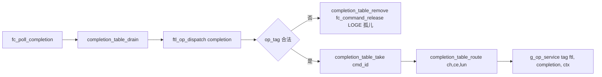

#### 3.10.5 关键流程

1. `ftl_op_submit(cmd, tag, ctx)`：
   - `completion_table_add(cmd->id, ctx)`（ctx 可为 NULL，如 host IO）；
   - 设置命令的 `op_tag`；
   - 提交到 FC SQ；失败则 remove + release。
2. `ftl_op_dispatch`：
   - 读 `completion->op_tag`，查 `g_op_service`；
   - 不合法 ⇒ 孤儿：remove + release + LOGE；
   - 合法 ⇒ take ctx → 按 completion 的 ch/ce/lun 路由到实例 → 调服务函数。
3. 同步等待（只给开机/CLI/`fl`）：`ftl_op_sync_wait` 登记 waiter，自旋泵直到 done 或超时；
   服务函数禁止使用。

#### 3.10.6 失败语义

| 情况 | 结果 | 数据影响 |
|---|---|---|
| 完成是孤儿（无表项/未知 tag） | release + LOGE | 该命令的资源不泄漏；上层 job 可能停摆，由 stall 计数兜底 |
| 路由表项为空 | ASSERT（实例注册漏了） | debug 停机；release 下由上层保守处理 |
| 服务函数里调同步逃生口 | `ASSERT(ftl_op_in_dispatch()==0)` | debug 立刻暴露嵌套泵 |
| 提交失败 | remove + release，返回错误/背压 | 调用者保留状态，下轮重试 |

#### 3.10.7 常量与出处

| 常量 | 值 | 来源 |
|---|---|---|
| `COMPLETION_TABLE_SIZE` | 32 | `include/ftl/completion_table.h` |
| `g_op_service[]` 槽位 | 按 `ftl_op_id_t` 顺序 | `src/ftl/ftl_op.c` |
| 同步自旋预算 | `L2P_SYNC_GUARD_MAX` / 各 job 的 stall 上限 | `include/ftl/l2p_cache.h` 等 |

#### 3.10.8 主流对照

“提交队列 + 完成队列 + 命令 id 旁表 + 按队列/实例路由”是 NVMe/主控数据面的基本模型；
本仓把 NVMe 的 SQ/CQ 简化为 FC 的队列 + 全局完成表，op tag 对应完成服务函数选择器。
**本仓自定**的是 32 项固定旁表与“先 take 再 dispatch”的防重入顺序。

---

<a id="s3-11" name="s3-11"></a>

### 3.11 页打包写缓冲（wbuf）

#### 3.11.1 背景与需求

CW 级映射下，一次 512 B 写只覆盖一个 CW；而 NAND 按**页**编程（4 CW，双 plane 共 8 CW）。
如果每个子操作都分配一对新页，利用率只有 12.5%~50%：

```text
一次 512B 写 ⇒ 分配 plane0 的 4 个 CW 槽，只用 1 个 ⇒ 75% 浪费
plane0/plane1 各写 1 个 CW ⇒ 一对页只用 2/8 ⇒ 75% 浪费
```

页打包写缓冲把**同一 pair 窗口**内的多次 host 写攒成一页，窗口填满/切换/显式 flush/
空闲时一次编程；两 plane 都有数据就走 multi-plane。页内利用率回到 100%，写指针按页推进。

#### 3.11.2 职责与边界

- **做**：按窗口累积 CW（`slot = plane*CW_NUM + cw`）、记录占用位图与贡献组、切换窗口时
  flush、空闲 flush、页满尽力 flush、构造一条页写命令。
- **不做**：不决定 L2P 更新（完成路径做，§3.9）；不分配块（调用 allocator，§3.2）；
  不做 GC（分配失败时起紧急 GC，§3.13）。
- **读路径**也用它：未 flush 的窗口数据还在 wbuf，读要先从这里拿（§3.9）。

#### 3.11.3 结构与不变量

| 字段 | 含义 |
|---|---|
| `data[8][512]` | 4 KiB 页镜像；slot = `plane*CW_NUM + cw` |
| `occupied` | 8 位；bit i = 槽 i 有数据 |
| `open` | 1 = 正持有某窗口 |
| `base` | 窗口基址（低 3 位清零） |
| `owners` | bit gi = 组 gi 贡献过本页 |

**不变量**：

1. `slot` 编码与 LBA 低 3 位同构（plane 位 + CW 位），不另立坐标。
2. **只有提交成功后才清 wbuf**：提交失败（命令池/描述符池满）保留数据，下轮重试。
3. **一页可能由多个组拼成**：`owners` 必须逐组记录，完成时逐组递减。
4. **窗口切换先 flush**：不同窗口的 LBA 不能混进同一页。
5. **页满尽力 flush**：失败不回滚已受理的写，留给后续 flush/空闲 flush。

#### 3.11.4 流程

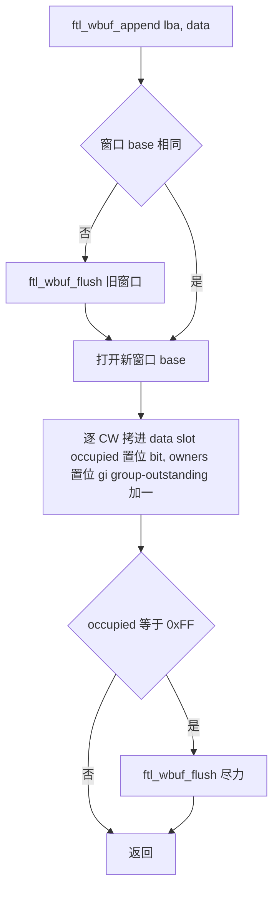

**`ftl_wbuf_flush`**：

```text
① pending 表空间检查（不够 ⇒ FTL_AGAIN）
② allocator_alloc_pair(FTL_TEMP_HOT, new_pba)
     失败 ⇒ mig_begin_gc（紧急 GC）并返回 FTL_AGAIN
③ nplanes = 两 plane 段是否都有数据；n_cw = popcount(occupied)
④ 建 FC 命令：operation = multi-plane / normal；meta = window base
⑤ ftl_cmd_setup_ppa_pair_cw + ftl_cmd_write_data_cw
⑥ pending_alloc：owners、op=WRITE、n_cw、cw_bitmap、lba=base、new_pba/new_pba1
⑦ ftl_op_submit(FTL_OP_HOST_IO)
⑧ 提交成功后才清 wbuf（open=0/occupied=0/owners=0）
```

**空闲 flush**：`ftl_wbuf_maybe_flush_idle` 在 `ftl_service` Phase 2.5 检查“是否还有写组
指向当前窗口”；没有就 flush，确保 host 收尾不会无限等待。

#### 3.11.5 失败语义

| 情况 | 结果 | 数据影响 |
|---|---|---|
| 分配不到页 | `FTL_AGAIN` + 紧急 GC | 数据仍在 wbuf，下轮重试 |
| pending 表满 | `FTL_AGAIN` | 同上 |
| 命令提交失败 | 保留 wbuf | 同上 |
| PROGRAM 失败 | 关 SB + 标坏；L2P 不动 | 自动回滚旧数据 |
| 中途掉电 | wbuf 是 RAM，丢失未提交页 | 这些 host 写尚未 acked，属容忍窗口 |

#### 3.11.6 常量与出处

| 常量 | 值 | 来源 |
|---|---|---|
| `FTL_LBA_PER_PAIR` | 8 | `include/ftl/ftl_config.h` |
| wbuf 数据 | 8 × 512 = 4096 B | `ftl_wbuf_t.data` |
| `occupied` | 8 bit | 同上 |
| `owners` | 32 bit（`FTL_GROUP_MAX`） | 同上 |

#### 3.11.7 主流对照

写缓冲/页打包是主控数据面的常规优化：消费级用 SLC cache/写缓冲，企业级用 write
coalescing。本仓没有 SLC cache（介质本身就是 SLC），只做**同窗口页打包**；
**本仓自定**的是 8-CW 窗口与 owners 位掩码的完成聚合方式。

---

<a id="s3-12" name="s3-12"></a>

### 3.12 FTL service 与后台调度器（ftl.c + bg_scheduler）

#### 3.12.1 背景与需求

FTL 是单线程 superloop：没有 RTOS 任务，没有抢占。它必须同时做三件事：

1. **推进 NAND**：FC 的命令引擎与完成队列是全局的，每轮只能推一次；
2. **服务 host IO**：补发未下发的子操作，处理停泊的写确认；
3. **跑后台**：Journal 刷页、L2P 回写、CP、GC、WL、BBT 持久化、读恢复。

如果后台任务按“每轮全跑”实现，host 忙时会被后台拖慢；如果后台完全让路，GC 不推进，
Free Pool 耗尽后写会永久失败。需要一套**确定性的前台保护**：按负载分档，给每档固定
预算与任务掩码，must-run 只放“不跑就会死锁/挂起”的动作。

#### 3.12.2 职责与边界

- **`ftl_service_pump()`**（实例无关，每轮一次）：`fc_service()` ≤ 4 次 + 完成表抽干。
- **`ftl_service(ftl)`**（每实例一次）：
  - Phase 2.5：`ftl_confirm_kick` → 遍历组 `ftl_drain_group` → `wbuf_maybe_flush_idle`；
  - Phase 3：`ftl_bg_level_select` → `bg_scheduler_run`。
- **`bg_scheduler.c`**：纯引擎（must-run pass + 预算/interval/优先级 pass），策略无关。
- **不做**：不实现各后台任务（各模块的 `*_kick`）；不决定档位（`ftl.c` 的策略表）。

#### 3.12.3 结构与不变量

`bg_task_t`：`func` / `interval_ms` / `last_run_ms` / `budget_us` / `priority` / `must_run`。
`bg_scheduler_t`：`tasks[13]` / `task_count` / `level` / 轮次统计 / `clock_ok`。
`bg_level_cfg_t`：每轮总预算 / L2P flush 条数上界 / 任务掩码。

**13 项任务**：

| 位 | 任务 | 类型 | interval | 预算 | 语义 |
|---:|---|---|---:|---:|---|
| 0 | Checkpoint 推进 | must-run | — | — | 在飞 CP 跨档位走完 |
| 1 | RR 推进 | must-run | — | — | host 读在等结果 |
| 2 | 搬移推进 | must-run | — | — | 写路径紧急 GC 在 BUSY 起，不推进即死锁 |
| 3 | 元数据目录 | must-run | — | — | 压缩请求由前台置位，不推进即永久 FTL_AGAIN |
| 4 | Journal 预擦 | must-run | — | — | 新环形块没擦不能写 |
| 5 | 紧急 CP | must-run | — | — | Journal ≥95% 每轮响应 |
| 6 | GC 求值 | 预算 | 10 ms | 400 µs | 命中起一个 GC job |
| 7 | 静态 WL | 预算 | 0（内部门） | 300 µs | 触发判定在 `mig_begin_wl` |
| 8 | L2P flush | 预算 | 0 | 1500 µs | 条数上界由档位决定 |
| 9 | Journal 刷页 | 预算 | 0 | 700 µs | BUSY 被掩掉 |
| 10 | BBT 持久化 | 预算 | 0 | 700 µs | 攒批写（磨损计数随 CP） |
| 11 | CP 触发 | 预算 | 0 | 100 µs | T1/T2/T3 |
| 12 | RR 巡检 | 预算 | 1 s | 300 µs | 仅 IDLE |

**档位**：

| 档位 | 条件 | 总预算 | 任务掩码 |
|---|---|---:|---|
| IDLE | `pending + groups == 0` | 2000 µs | 位 6..12 全开 |
| NORMAL | 非 IDLE 且 `pending ≤ 16` 且 `queued == 0` | 2000 µs | 位 6..11 |
| BUSY | `pending > 16` 或 `queued != 0` | 700 µs | 仅位 8（L2P flush） |

**不变量**：

1. **pump 每轮只调一次**：NAND 引擎与完成表是全局单份，逐实例调用会重复消耗预算。
2. **每个实例都要调 `ftl_service`**：漏一个，它的 Journal/CP/BBT/GC 永不推进。
3. **must-run 不 gate、不占预算**：它们是防死锁/防 host 挂起的动作。
4. **确定性保护靠“档位 → 条数/掩码”**，不靠 `elapsed` 计时：kick 都是“提交即返回”，
   `elapsed` 只反映 CPU 时间（SysTick 1 ms 量化）。
5. **时钟缺失退化**：`time_us` 缺失或恒 0 ⇒ interval/预算失效，每轮都跑；
   防刷屏靠各任务内部单飞行/事件门。
6. **`bg_suspend` 最先 return**：全片擦除后 RAM 状态已陈旧，任何后台写都是往干净芯片倒垃圾。

#### 3.12.4 主循环

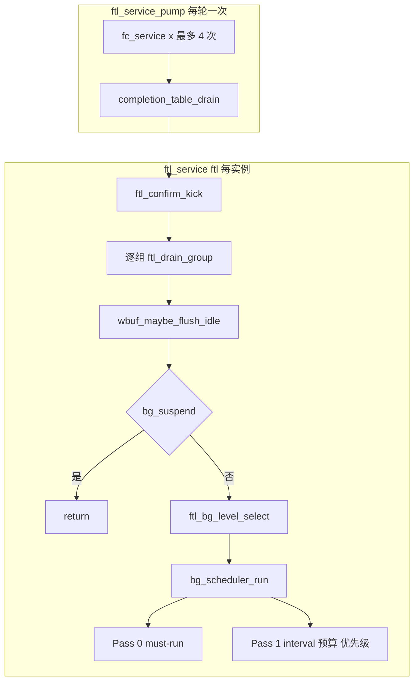

#### 3.12.5 关键流程

1. 主循环：`cli_service_poll` → `ftl_service_pump` → 逐实例 `ftl_service`。
2. 档位选择：`inflight = pending_count + pending_group_count`；0 → IDLE；
   `pending > 16` 或 `queued != 0` → BUSY；否则 NORMAL。
3. Pass 0：按表序跑所有 `must_run`，无条件、不计预算。
4. Pass 1：按优先级扫预算任务；掩码允许、interval 到点才跑；`charge = MIN(elapsed, budget)`；
   剩余预算 < 250 µs 即截断。
5. 每个 kick 只提交一步/一条命令，真正的推进在下一轮或完成回调里。

#### 3.12.6 失败语义

| 情况 | 结果 | 影响 |
|---|---|---|
| 某任务提交被背压 | kick 保留状态，下轮重试 | 后台变慢，不影响正确性 |
| must-run 任务自身卡死 | 心跳日志（job phase/age）暴露 | 由各 job 的 stall 上限中止 |
| 时钟缺失 | 无 interval/预算门控 | 后台更频繁，靠内部事件门防刷屏 |
| `bg_suspend` 置位 | Phase 3 整体跳过 | 只能复位恢复（诊断/擦片后） |

#### 3.12.7 常量与出处

| 常量 | 值 | 来源 |
|---|---|---|
| `NAND_SUBMIT_BUDGET` | 4 | `include/ftl/ftl.h` |
| `BG_NORMAL_FLUSH_COUNT` / `BG_BUSY_FLUSH_COUNT` | 4 / 1 | 同上 |
| `GC_EVAL_INTERVAL_MS` | 10 | 同上 |
| `GC_LOG_INTERVAL_MS` | 1000 | 同上 |
| `RR_SCAN_INTERVAL_MS` | 1000 | `src/ftl/ftl.c` |
| `BG_TASK_COUNT` | 13 | `include/ftl/bg_scheduler.h` |
| 档位预算 | 2000 / 2000 / 700 µs | `src/ftl/ftl.c` |
| `MIN_TASK_BUDGET_US` | 250 | `src/ftl/bg_scheduler.c` |

#### 3.12.8 主流对照

“主循环 + 独立后台调度器 + 每任务 interval/预算/优先级”是主控固件的常见形态
（SPDK core poller、企业级后台核）。**本仓自定**的是 13 项任务表、三级负载→固定预算
（不是连续带宽调节）与 must-run 集合的划分。

---

<a id="s3-13" name="s3-13"></a>

### 3.13 GC 策略与迁移引擎（gc + migrate）

#### 3.13.1 背景与需求

异地更新会不断产生无效数据：一个 Closed SB 里可能只剩 10% 的有效 CW。空间要回收，
就必须把有效 CW 搬到新位置、更新 L2P，再擦掉旧块。没有 GC，Free Pool 只出不进，
写最终永久失败。

搬移本身很贵：最多 64 页 × 2 plane 的读 + 写 + 2 次擦，同步执行会阻塞完成泵数十毫秒。
而它有一个**在完成回调里**的入口（写路径分配不到页时的紧急 GC）。因此搬移必须是
**异步 job**：每轮只推进一条命令，host IO 与后台搬移在 superloop 上重叠。

#### 3.13.2 职责与边界

- **`gc.c`（策略）**：触发判定（空间压力 + 磨损）、victim 四维加权选择、共用读原语
  （`gc_read_page_with_lba` / `gc_decode_cw_lba`）。
- **`migrate.c`（引擎）**：`mig_job_t` 状态机；GC / 静态 WL / 慢死预测共用一台。
- **不做**：不决定块元数据（allocator）；不决定坏块（BBT）；不做读恢复（RR）。
- **入口**：`mig_begin_gc` / `mig_begin_wl` / `mig_begin_predict`；完成服务
  `ftl_op_migrate`（GC 与 WL 共用）。

#### 3.13.3 结构与不变量

`mig_job_t`：

| 字段 | 含义 |
|---|---|
| `active` / `waiting` / `aborted` | 单飞行 / 有命令在飞 / 中止 |
| `phase` | `MIG_READ → READ_SETTLE → WRITE → WRITE_SETTLE → FLUSH_JRN → ERASE → DONE` |
| `kind` / `post` | GC/WL/PREDICT；FREE/RETIRE |
| `page` / `plane` | 当前页/plane |
| `victim` | **按值拷贝**的 SB（closed 列表 swap-remove，不能持指针） |
| `cw_bitmap[plane]` / `base` / `cw_lba` / `src` / `dst` | 本页逐 CW 有效位、页基址、META LBA、源/目标 PBA |
| `migrated` | 已搬有效 CW 数（>0 才需要 F10 屏障） |
| `page_buf[plane][2048]` | 页镜像（异步读落此、写从此取） |

**不变量**：

1. **顺序**：先写新页 → 改 L2P + Journal → 等 Journal 落盘（F10）→ 擦旧块。
2. **分配不到目标页 ⇒ 中止且不擦 victim**。先擦后搬会丢掉尚未搬移的有效页。
3. **擦除失败不退役**：擦不掉的块归 BBT；同时标 RETIRED 自相矛盾。
4. **单飞行**：每实例同时一个 mig job；WL 让 GC 先跑。
5. **有效性唯一真值是 META + L2P 反查**：没有常驻位图；`cw_bitmap` 是本次 job 的临时结果。
6. **源块 gblock 不缓存**：快路径（valid_total==0）不经过 READ；缓存字段会是 0。
   真值始终是 `victim.plane_blocks[plane]`。

#### 3.13.4 触发与选块

| 触发 | 条件 | 语义 |
|---|---|---|
| T1 水位 | `free_count < 32` | 主动补池 |
| T4 紧急 | `free_count ≤ 8` | 最后手段；写路径也兜底 |
| T5 磨损 | `max/min > 10` 且 `max ≥ 64` 且 `min > 0` | 均衡 |

victim 评分（cost 取小）：

```text
cost = 500·valid_ratio + 200·erase_ratio + 200·cold_penalty + 100·youth_penalty
```

- `valid_ratio`：有效 CW 占比（核心项）；
- `erase_ratio`：擦除次数 / 全表最大（避开临近寿命的块）；
- `cold_penalty`：HOT=0 / COLD=1000（HOT 数据自然死亡快，优先回收）；
- `youth_penalty = 1000 - age_ratio`（越久没擦越优先，保证公平）。

平手取 `valid_count` 更小者；退化单 plane 条目跳过哨兵 plane。

#### 3.13.5 搬移状态机

```mermaid
flowchart TD
    IDLE["MIG_IDLE"]
    READ["MIG_READ"]
    RS["MIG_READ_SETTLE"]
    WRITE["MIG_WRITE"]
    WS["MIG_WRITE_SETTLE"]
    FLUSH["MIG_FLUSH_JRN"]
    ERASE["MIG_ERASE"]
    DONE["MIG_DONE"]
    IDLE -- "mig_begin 启动" --> READ
    READ -- "读完当前页所有 plane" --> RS
    RS -- "反查 L2P 得 cw_bitmap" --> WRITE
    RS -- "本页全空洞" --> WRITE
    WRITE -- "写完当前页所有 plane" --> WS
    WS -- "page 加一 未到 64" --> READ
    WS -- "page 等于 64" --> FLUSH
    FLUSH -- "journal job 空闲" --> ERASE
    ERASE -- "两 plane 擦完" --> DONE
    DONE -- "valid_total 为 0 快路径" --> IDLE
    DONE -- "正常收尾" --> IDLE
```

#### 3.13.6 关键流程

1. `mig_begin_gc`：`gc_check_triggers` → `gc_select_victim` → `mig_start(GC, FREE)`。
2. `MIG_READ`：逐页逐 plane 异步读 victim；完成时解 META 得 `cw_lba`，
   记 `rr_record_ecc` / `read_count`（慢死预测闭环）。
3. `MIG_READ_SETTLE`：**先 `l2p_cache_ready` 前置**，全部就绪后才逐 CW 反查 L2P；
   仍指向本物理 CW 才置 `cw_bitmap`。半途而废会让 bitmap 一半有一半没有。
4. `MIG_WRITE`：本页有有效 CW ⇒ `allocator_alloc_pair(COLD)` → 提交 CW 子集写。
5. `MIG_WRITE_SETTLE`：同样先就绪前置，再逐 CW `l2p_cache_write` + `journal_append`
   + 源块 `sub_valid` / 新块 `add_valid`。
6. `MIG_FLUSH_JRN`：等 Journal job 空闲（F10）。`journal_kick` 冲刷半满页，
   所以屏障必然可满足。
7. `MIG_ERASE`：逐 plane 擦；成功 `erase_count++` / `last_pe_ts` / `clear_valid`；
   `post==FREE` ⇒ 归还 Free Pool；`post==RETIRE` ⇒ 出池 + `rr_retire_block`；
   擦除失败 ⇒ `bbt_mark_bad`。
8. `MIG_DONE`：移除 Closed 条目；GC 计数 `gc_reclaimed_count++`；复位 job。

#### 3.13.7 失败语义

| 情况 | 结果 | 数据影响 |
|---|---|---|
| 分配不到目标页 | 中止，不擦 victim | 源数据仍在，L2P 未动，下轮重来 |
| 读失败/全页空洞 | 跳过该 plane/页 | 该页无有效 CW 或数据不可读 |
| 写失败 | 该 plane 的 L2P 不动 | 源数据仍有效，下轮再搬 |
| 提交侧 256 轮无进展 | 中止 | 数据无损；命令在飞由 NAND 超时保证完成 |
| 擦除失败 | 标坏 | 数据由 BBT/GC 处理 |
| 掉电 | 最多一个孤悬块 | Journal 回放恢复映射；victim 未擦或已擦但 L2P 已落盘 |

#### 3.13.8 常量与出处

| 常量 | 值 | 来源 |
|---|---|---|
| `GC_WEIGHT_VALID/ERASE/TEMP/AGE` | 500/200/200/100 | `include/ftl/gc.h` |
| `GC_TRIGGER_WATERMARK/EMERGENCY/WEAR` | 0x01/0x08/0x10 | 同上 |
| `GC_WEAR_LEVEL_RATIO` / `MIN_ERASE` | 10 / 64 | 同上 |
| `MIG_SUBMIT_STALL_MAX` | 256 | `include/ftl/migrate.h` |
| 页镜像 | 2 × 2048 B | `mig_job_t.page_buf` |

#### 3.13.9 主流对照

GC 触发看自由块水位、victim 按有效性比例选、后台异步回收，是主流 FTL 的共同形态
（SPDK 的 free band 水位、DRAM-less 的空间压力触发）。本仓额外加了磨损/温度/年龄三项，
**这是本仓自定**的评分权重；它们不冒充“行业标准公式”。与 SPDK 的一个刻意差异：
本仓写路径在分配不到页时会**就地起紧急 GC**，SPDK 的写路径直接返回 NULL、GC 全在
poller 里——这条差异已登记。

---

<a id="s3-14" name="s3-14"></a>

### 3.14 读恢复（read_recovery）

#### 3.14.1 背景与需求

NAND 读会失败：retention、read disturb、编程干扰都表现为 ECC 纠正位数上升，最终超过
纠错能力。直接向 host 返回 IO 错误太早——很多页换一组读电压、或借邻居页的物理信息
还能读出来；即使读不出来，也应该先搬走其余有效数据、再退役这块，而不是让整块数据
一起坏掉。

读恢复因此是**多级管线**：读重试 → 邻居页辅助 → 标坏/搬移；同时用 ECC 趋势预测
“还没坏但正在变坏”的块，提前搬移。

#### 3.14.2 职责与边界

- **做**：读失败后的异步恢复状态机；per-block ECC 趋势（`rr` 在 BST）；预测巡检；
  退役（RETIRED）。
- **不做**：不做 XOR/RAID 恢复（未实现）；不执行搬移（调用 `mig_begin_predict`）；
  不决定坏块持久化（BBT）。
- **托管模型**：host 读失败时，把 pending 子操作托管给 RR job（保留 pending 项、
  不递减组在飞数）；job 一次只提交一条命令，完成由 `ftl_op_read_recovery` 推进。

#### 3.14.3 结构与不变量

| 结构 | 字段 | 说明 |
|---|---|---|
| `ftl_read_recovery_t` | `stage` / `waiting` / `plane` / `attempt` / `neighbor_i` / `pending_idx` / `page` / `neighbor` / `recovered` / `stall_rounds` | 单 job |
| `rr_ecc_track_t`（BST） | `last_ecc` / `rising_count` / `health` | 每块 |
| `rr_block_health_t` | HEALTHY / WARNING / CRITICAL / DYING | 只升不降 |

**不变量**：

1. **`stage` 表示“当前该做/正在等的那一步”**；判“有无命令在飞”用 `waiting`，
   因为提交可能因背压失败（stage 不变但无命令）。
2. **一次只提交一条命令**；恢复不阻塞完成泵。
3. **托管项不递减组 outstanding**；恢复成功/失败由 job 统一结算。
4. **提交侧 256 轮无进展 ⇒ 按失败收尾**，不标坏块（避免把命令池泄漏当介质问题）。
5. **退役不是坏块**：RETIRED 仍可读、不再分配、不标坏；有效数据已搬走。

#### 3.14.4 状态机

```mermaid
flowchart TD
    IDLE["IDLE"]
    PLANE["PLANE"]
    SFSET["SF_SET"]
    READ["READ"]
    SFREST["SF_RESTORE"]
    NBREAD["NB_READ"]
    NBRETRY["NB_RETRY"]
    PLANEEND["PLANE_END"]
    FINISH["FINISH"]
    ABORT["ABORT"]
    IDLE -- "领走托管的 pending 项" --> PLANE
    PLANE -- "找到本 plane 目标页" --> SFSET
    PLANE -- "本子操作不覆盖本 plane" --> PLANE
    SFSET -- "SET_FEATURES" --> READ
    READ -- "读成功" --> PLANEEND
    READ -- "读失败" --> SFREST
    SFREST -- "attempt 小于 8" --> SFSET
    SFREST -- "重试耗尽" --> NBREAD
    NBREAD -- "邻居页读出" --> NBRETRY
    NBREAD -- "邻居尝试小于 2" --> NBREAD
    NBREAD -- "邻居也失败" --> PLANEEND
    NBRETRY -- "目标页成功或失败" --> PLANEEND
    PLANEEND -- "plane 加一" --> PLANE
    PLANEEND -- "plane 等于 PLANE_NUM" --> FINISH
    PLANE -- "提交侧长期无进展" --> ABORT
    ABORT --> FINISH
```

#### 3.14.5 关键流程

1. host 读完成回调检测到 NAND_FAIL/ECC 超限：pending 项 `op = READ_RECOVERY`、
   `command_id = NONE`，命令释放，`rr_kick`。
2. `rr_kick` 领走托管项，进入 `PLANE`；选本 plane 目标页（L2P region 加载中则原地等）。
3. `SF_SET` → `READ`：`SET_FEATURES(attempt)` 切读重试模式，重读目标页。
4. 重试耗尽（8 次）→ `NB_READ`：读邻居页，成功后再试目标页（最多 2 个邻居）。
5. `PLANE_END`：成功则把 scratch 按 CW 偏移拷回 host buffer；失败则清零并按失败结算。
6. `FINISH`：释放 pending 槽 + 组聚合；失败且确认不可恢复 ⇒ `bbt_mark_bad` + 数据迁移。
7. **预测巡检**：`rr_predictive_scan` 找 health ≥ CRITICAL 的 Closed 块 →
   `mig_begin_predict`（搬空并退役）。

#### 3.14.6 失败语义

| 情况 | 结果 | 数据影响 |
|---|---|---|
| 读重试成功 | 拷回数据；ECC 趋势更新 | host 读成功 |
| 邻居辅助成功 | 同上 | host 读成功 |
| 全部失败 | 清零 + 标坏 + 迁移 | 该页数据不可恢复；其余有效数据被搬走 |
| 提交侧 256 轮无进展 | 按失败收尾，不标坏 | 避免误伤；由上层报 IO 错误 |
| 预测搬移中分配不到页 | 中止，不擦 victim | 数据无损，下轮重来 |
| 退役块被再次分配 | 不变量违例 | `MIG_POST_RETIRE` 必须先出池 |

⚠ **已知限制**：`RR_FEATURE_READ_RETRY = 0x89` 在本器件（MT29F4G08）是**保留地址**，
read-retry 的 SET_FEATURES 路径当前是空转；用户明确不处理这条（见 §7.2）。
因此“读重试”阶段在本板上不会真正改变读电压，恢复实际依赖邻居页/ECC 与标坏搬移。

#### 3.14.7 常量与出处

| 常量 | 值 | 来源 |
|---|---|---|
| `RR_ECC_RISING_THRESHOLD` | 4 | `include/ftl/read_recovery.h` |
| `RR_ECC_HIGH_WATER` | 6 | 同上 |
| `RR_ECC_MAX` | 15 | 同上 |
| `RR_MAX_RETRY` | 8 | 同上 |
| `RR_NEIGHBOR_ATTEMPTS` | 2 | 同上 |
| `RR_READ_DISTURB_THRESHOLD` | 1000 | 同上 |
| `RR_SUBMIT_STALL_MAX` | 256 | 同上 |
| `RR_FEATURE_READ_RETRY` | 0x89（本器件保留） | 同上 |

#### 3.14.8 主流对照

读重试（read retry / soft-decode）、邻居页辅助、坏块预测与提前搬移，是企业级 SSD
读恢复管线的常见组成；RAID/XOR 恢复是更高一级（本仓不实现，ADR-3）。
**本仓自定**的是 4 级健康状态、8 次重试、2 个邻居与 1000 次 read-disturb 阈值。

---

<a id="s3-15" name="s3-15"></a>

### 3.15 FTL↔FC 接口（ftl_fc_interface + ftl_config）

#### 3.15.1 背景与需求

FTL 不能直接操作 NAND：NAND 命令有严格的时序、地址周期、ECC/CRC/加扰配置；
FTL 只应该表达“读写哪一页/哪些 CW、数据在哪”。FC 层负责：

- 把 FTL 的请求翻译成 ONFI 命令链（含 Multi-Plane、ISSUE/WAIT/FETCH）；
- 对数据做 CRC、BCH ECC、随机加扰；
- 管理命令池/描述符池/缓冲池/SQ/CQ；
- 在完成时给出 per-CW 状态（成功/ECC 位数/NAND_FAIL）。

没有这层，FTL 会被 NAND 时序与数据保护细节淹没，且无法复用 FC 的多平面/流水线能力。

#### 3.15.2 职责与边界

- **做**：CW 子集的描述符链构造、数据拷贝、PBA→PAA 转换、同步/异步页原语、
  同步等待器。
- **不做**：不实现 NAND 引擎/时序；不决定 FTL 的映射与空间管理；不拥有完成路由
  （§3.10）。
- **调用者**：FTL 所有需要碰 NAND 的模块（L2P、Journal、CP、Metadata、GC/WL、RR、BBT、PFR）。

#### 3.15.3 结构与约束

| 配置 | 用户数据 | 元数据 |
|---|---|---|
| `operation` | normal/multi-plane program/read | 同左 |
| `crc` | ENABLE | ENABLE |
| `random` | ENABLE（加扰） | DISABLE |
| `ldpc` | BCH | BCH |
| `page_type` | LP（SLC） | LP |
| `meta` | 本命令的扇区 LBA | 不填/0 |

关键字段与易错点：

- **没有 `cmd->lba`**：LBA 走 `cmd->meta`；FC 侧按 `(meta & ~PLANE_CW_MASK) | (plane<<2) | cw`
  铸出逐 CW 的扇区 LBA。
- **`ftl_cmd_configure_descriptors(cmd, cw_bitmap)` 是两参**：位图由 FTL 的
  `ftl_cw_span_mask` / `ftl_cmd_plane_span_cw_bitmap` 算出；`config.cw` 不参与建链。
- **`cmd->paa` 只能是 `pba_to_paa()` 的结果**；FTL 业务层不手写 PAA 位运算。
- **`cmd->config.ch/ce/lun` 从 PBA 高位拆出**；多实例下命令必须回到正确芯片。

#### 3.15.4 写序列

```text
① allocator_alloc_pair → 各 plane 的新 PBA
② cmd->config.operation = (nplanes==2) ? MULTI_PLANE : NORMAL
   cmd->config.multi_plane = nplanes
   cmd->config.crc/random/ldpc/page_type 按上表
   cmd->meta = 窗口基址
③ ftl_cmd_setup_ppa_pair_cw(cmd, new_pba, cw_bitmap)   // desc 链
④ ftl_cmd_write_data_cw(cmd, wbuf.data, cw_bitmap)     // 按页内 CW 偏移散射取数
⑤ ftl_op_submit(cmd, FTL_OP_HOST_IO, NULL)
⑥ 完成：检查 per-CW status/ECC；成功才走 confirm 路径
```

#### 3.15.5 读序列

```text
① l2p_cache_read 得到 PBA（或 wbuf 命中）
② 按 (plane, page) 分组；CW 子集由 LBA 在页内的位置决定
③ ftl_cmd_setup_ppa_pair_cw / ftl_cmd_read_data
④ ftl_op_submit(tag=HOST_IO 或 L2P，ctx=pending/line)
⑤ 完成：数据已拷进 buffer/line；状态检查
```

#### 3.15.6 不变量与禁止项

| 约束 | 原因 |
|---|---|
| 不直接调 `nand_read_page` / `nand_program_page` | 绕过 CRC/ECC/加扰与队列 |
| 不直接操作 NAND 引擎状态机/寄存器 | 破坏 FC 的时序与多命令调度 |
| 不手动分配描述符 | 必须走 `ftl_cmd_configure_descriptors` |
| 不在 FTL 业务层手写 PAA/地址掩码 | PBA/PAA 位序不同，现场转换已多次算错 |
| 不把 `ASSERT` 当运行时错误处理 | FC 配置错误可能静默损坏介质；需要 release 拒绝 |

#### 3.15.7 失败语义

| 情况 | 结果 | 数据影响 |
|---|---|---|
| 命令池/描述符池/缓冲池满 | `FTL_AGAIN` | 调用者保留状态，下轮重试 |
| SQ/HSQ 满 | `FTL_AGAIN` | 同上 |
| per-CW NAND_FAIL | 完成状态返回失败 | 写：关 SB + 标坏；读：进 RR |
| ECC 超限 | 完成状态返回 UNC | 读：进 RR；写：视为失败 |
| 命令超时 | `FC_CW_STATUS_TIMEOUT` | job 的 stall 计数兜底 |
| 建链/配置错误 | debug ASSERT；release 可能静默 | 这是 FC 层最贵的一类，必须用负例验证 |

#### 3.15.8 常量与出处

| 常量 | 值 | 来源 |
|---|---|---|
| 命令池 | 64 | `include/fc/fc.h` |
| 描述符池 | 256 | 同上 |
| 缓冲池 | 128 × 528 B | 同上 |
| SQ / HSQ / CQ | 64 / 16 / 64 | 同上 |
| `FTL_PAGE_CFG_META/DATA/DATA_ANY` | 见头文件 | `include/ftl/ftl_fc_interface.h` |

#### 3.15.9 主流对照

“FTL 只表达逻辑请求、HAL/FC 负责介质命令与数据保护”是主控分层的通用形态；
描述符链 + 完成状态是 NVMe/ONFI 数据面的常见实现。**本仓自定**的是 CW 子集位图建链、
`cmd->meta` 携带扇区 LBA 的方式与 FC 池深度。

---

<a id="s4" name="s4"></a>

## 4. 端到端场景

> 本节把 §3 的模块串起来。每个场景给：**触发条件 → 时序/流程 → 状态变化 → 失败分支**。
> 图中节点省略了错误处理，失败分支在每小节末尾的表里列。

### 4.1 首次上电 / 介质版本不匹配 → 格式化

**触发**：`ssd_ftl_boot` 调 `ftl_media_needs_format()`；判据是
`checkpoint_find_latest()` 失败（含版本不符）。

```mermaid
flowchart TD
    A["上电 ftl_init 完成"] --> B["ftl_media_needs_format"]
    B -- "否" --> C["正常启动 4-2 4-3 节"]
    B -- "是" --> D["ftl_media_format"]
    D --> D1["bbt_erase_all_blocks 空片 出厂标记已在 bbt_init 读入 已用 依赖已持久化 BBT"]
    D1 --> D2["bbt_save 重新持久化坏块图"]
    D2 --> D3["metadata_dir_init 复位 Directory"]
    D3 --> D4["checkpoint_write_initial 写当前版本空快照"]
    D4 --> E["后续正常启动"]
```

**状态变化**：

| 对象 | 变化 |
|---|---|
| BST | 全部块擦除；坏块状态保留（来自 `bbt_init`） |
| BBT | 重新写一条当前坏块图 |
| Directory | 固定层重建，动态层清空 |
| Checkpoint | 写一条当前版本、`sequence=1`、无块元数据快照的 Header |
| Journal | `journal_init` 的初始游标；环形块已被擦 |

**失败分支**：

- 擦除失败 ⇒ 该块标坏；格式化继续。
- `checkpoint_write_initial` 失败 ⇒ 下次开机会再次格式化（判据仍命中）。
- 版本只在 DIM>1 时比 DIM=1 高 1；DIM=1 的旧介质不会被误格式化。

### 4.2 干净启动（clean start）

**触发**：有当前版本 Checkpoint，且
`ring.page_seq + ring.entry_count <= cp.journal_sequence`（Journal 已全部落入 L2P）。

```mermaid
sequenceDiagram
    participant B as boot
    participant J as Journal
    participant C as Checkpoint
    participant A as Allocator
    participant L as L2P cache

    B->>J: journal_scan_latest 只读
    B->>C: checkpoint_find_latest
    C-->>B: Header 池游标
    B->>C: checkpoint_load_block_table
    alt 块元数据快照有效
        C-->>B: block_words
        B->>A: ftl_recovery_restore_blocks
        B->>L: 按 CP region_bitmap 预载 F4
        B->>A: ftl_recovery_probe_blocks 池块 page0
        B->>A: ftl_recovery_build_pools
    else 快照无效
        B->>A: reset carve F2
    end
    B->>J: journal_resume floor 为 cp_seq
    B-->>B: Controller 到 Ready
```

**状态变化**：

| 对象 | 初始状态 |
|---|---|
| L2P cache | 空（INVALID）；按需加载 |
| BST | 来自块元数据快照（state/valid/temp/池归属）；OPEN→CLOSED |
| Free/OP/Spare | 由 `build_pools` 按快照重建 |
| Closed 列表 | 快照恢复；退化单 plane 条目 |
| Journal | 写指针接回最新页之后；序号 ≥ cp_seq |
| Directory | 从 Anchor 池加载（§3.5） |

⚠ **clean 也要 probe 池块**：本仓无关机 journal flush，“末页丢失”与干净关机在介质上
不可区分。probe 只读池块 page 0，成本可控。

**失败分支**：快照 CRC 失败/不一致 ⇒ reset + carve + F2；F2 中读失败 ⇒ 跳过该块。

### 4.3 掉电恢复（power-failure start）

**触发**：有 Checkpoint，但 Journal 有 `page_seq + entry_count > cp_seq` 的页。

```mermaid
sequenceDiagram
    participant B as boot
    participant A as Allocator
    participant J as Journal
    participant L as L2P cache
    participant P as Pools

    B->>A: restore_blocks 若快照有效
    B->>J: journal_replay cp_seq
    J->>J: 第一遍收集晚于 cp_seq 的页
    J->>L: 第二遍按 page_seq 与 entry_idx 应用
    J->>A: block_ctx new 加一 old 减一
    B->>L: F4 按 region_bitmap 预载
    B->>A: probe build_pools
    alt 任一步不一致
        B->>A: reset carve F2
    end
    B->>J: journal_resume floor 为 cp_seq
```

**状态变化**：

| 对象 | 变化 |
|---|---|
| L2P cache | 回放写入的行标 DIRTY；其余空 |
| BST.valid_count | 回放按 `new/old` 增量维护；TRIM 只减 old |
| Closed 列表 | 快照恢复或 F2 重建 |
| Journal | 回放完后 resume；写指针在最新页之后 |

**失败分支**：

- 某页读失败 ⇒ 跳过该页，继续其余页（该页条目丢失）。
- `materialize` 越界/下溢 ⇒ `block_ctx.ok=0`，块元数据回退 F2。
- F2 中某块读失败 ⇒ 跳过；该块数据不可恢复。

⚠ **回放必须覆盖所有 `page_seq > cp_seq` 的页**，不能只回放最大一页；跨多页掉电时
其余条目会静默丢失。

### 4.4 主机读

**入口**：`ftl_submit_read(ftl, req)`。

```mermaid
flowchart TD
    A["ftl_submit_read"] --> B["校验 建组"]
    B --> C["ftl_drain_group 到 issue_subop"]
    C --> D{"该 LBA 在 wbuf"}
    D -- "是" --> E["从 wbuf-data 拷出 消费 1 LBA"]
    D -- "否" --> F["l2p_cache_read"]
    F -- "FTL_AGAIN LOADING" --> G["l2p_defer 为 1 停止本子操作,下轮重试"]
    F -- "FTL_OK INVALID" --> H["零填充 消费 1 LBA"]
    F -- "FTL_OK PBA" --> I["按 plane,page 分组 建 pending 提交读"]
    I --> J["ftl_op_host_io 拷回 buffer rr_record_ecc read_count 加一"]
    J --> K{"NAND_FAIL ECC 超限"}
    K -- "是" --> L["停泊 到 READ_RECOVERY rr_kick 3-14 节"]
    K -- "否" --> M["组完成 递减 outstanding"]
    E --> M
    H --> M
    G --> C
```

**状态变化**：

| 对象 | 读命中 | 读 miss | 未映射 |
|---|---|---|---|
| cache 行 | `access_count++` / `fresh` 消费 | `LOADING → CLEAN` | 不涉及 |
| pending | 登记/释放 | 登记/释放 | 不登记 |
| BST | `read_count++`（数据页） | 同左 | 无 |
| Journal/L2P | 无 | 无（load 只读） | 无 |

**失败分支**：region 加载失败 ⇒ 行 CLEAN + 全 INVALID（视为未映射）；ECC 失败 ⇒ RR；
组连续 8 轮无进展 ⇒ 弃未下发子操作并报 IO_ERROR。

### 4.5 主机写

**入口**：`ftl_submit_write(ftl, req)`。

```mermaid
sequenceDiagram
    participant H as Host
    participant F as ftl_submit_write
    participant W as wbuf
    participant A as Allocator
    participant N as NAND
    participant C as completion
    participant L as L2P cache
    participant J as Journal

    H->>F: req 请求
    F->>F: 校验 建组
    F->>W: wbuf_append 按窗口
    alt 窗口切换 / 页满 / 空闲
        W->>A: allocator_alloc_pair HOT
        A-->>W: new_pba plane
        W->>N: PROGRAM 单 双 plane
        W->>C: 清 wbuf 提交成功后
    end
    N-->>C: 完成
    C->>C: ftl_op_host_io
    alt 写成功且非中间页
        C->>L: 第一遍 ready 所有覆盖 CW
        alt 任一 region 未就绪
            C->>C: 停泊 WRITE_CONFIRM 下轮 ftl_confirm_kick
        else 全部就绪
            loop 每个有效 CW
                C->>J: journal_append
                C->>L: l2p_cache_write
                C->>C: valid_count 新加一 旧减一
            end
            C->>J: checkpoint_journal_watermark
            C->>C: total_writes 加一
        end
    else 写失败
        C->>A: close_open_sb HOT
        C->>C: bbt_mark_bad 失败 plane 块
        C->>C: L2P 不动 为 回滚
    end
```

**状态变化**：

| 对象 | 变化 |
|---|---|
| wbuf | 累积窗口；flush 成功后清空 |
| BST | 新位置 `valid_count +1`；覆盖写旧位置 `-1` |
| L2P cache | 行 `CLEAN/DIRTY → DIRTY`；全局 region 脏位置位 |
| Journal | 追加条目（或同 LBA 合并） |
| Journal 水位 | 85% 设 `checkpoint_needed`；95% 设 `emergency` |

**失败分支**：

- 分配不到页 ⇒ 紧急 GC + `FTL_AGAIN`；数据仍在 wbuf。
- 提交失败 ⇒ 保留 wbuf，下轮重试。
- PROGRAM 失败 ⇒ 关 SB + 标坏；L2P 不动（旧数据仍可达）。
- L2P region 未就绪 ⇒ 停泊 `WRITE_CONFIRM`；`ftl_confirm_kick` 下轮重试，不重复记账。

### 4.6 L2P 脏 region 回写与 Directory commit

**触发**：CLOCK 驱逐、后台 L2P flush、`ftl_flush`（HIL）、Checkpoint 的
`CP_FLUSH_REGIONS`。

```mermaid
sequenceDiagram
    participant S as 触发者
    participant C as L2P cache
    participant D as Directory
    participant A as Allocator
    participant N as NAND

    S->>C: l2p_cache_flush_kick
    C->>C: 非 DIRTY 已在 FLUSHING 则 返回
    C->>C: flush_inflight 达上限 则 FTL_AGAIN
    C->>D: metadata_dir_append_slot
    alt 当前日志块有页
        D-->>C: 下一页 PBA
    else 块满
        D->>D: 登记 l2p_live 为 0 的 LOG 块到 reclaim_pending（不擦）
        D->>A: alloc_log_block
        A-->>D: 新块
        D-->>C: 新块 page 0 PBA
    end
    C->>C: state 为 FLUSHING
    C->>N: 写 region 页 异步
    N-->>C: 完成
    alt 写成功
        C->>D: commit_region
        D->>D: 更新 region 的 pba l2p_live 增减 dirty
        C->>C: state 为 CLEAN, 清全局脏位
    else 写失败
        C->>C: state 为 DIRTY, Directory 不登记
    end
```

**状态变化**：

| 对象 | 成功 | 失败 |
|---|---|---|
| cache 行 | FLUSHING → CLEAN | FLUSHING → DIRTY |
| Directory entry | 指向新 PBA | 保持旧 PBA |
| `l2p_live` | 旧块 -1 / 新块 +1 | 不变 |
| 全局 region 脏位 | 清 | 保持 |
| 旧日志块 | `l2p_live==0` ⇒ 登记回收目标 | — |

**失败分支**：`append_slot` 失败（池空/整理 job 在飞）⇒ 行保持 DIRTY，下轮重试；
写失败 ⇒ 同上；两者都不丢映射（Journal 有记录）。

### 4.7 Checkpoint

**触发**：T1 水位 85%/95%、T2 每 1024 次写、T3 10 s 且 Journal 增量 ≥64。

```mermaid
sequenceDiagram
    participant T as 触发者
    participant CP as cp_job
    participant L as L2P cache
    participant D as Directory
    participant J as Journal

    T->>CP: checkpoint_begin
    CP->>CP: 单飞行检查 memset
    CP->>L: snapshot_owner_bitmap 全局 到 局部
    CP->>J: 记录 journal_seq job 起点
    CP->>L: CP_FLUSH_REGIONS 逐个 kick,等 flush_inflight 为 0
    CP->>D: CP_ANCHOR_PREP 到 可选 ERASE 到 WRITE x8 到 commit
    CP->>CP: CP_HDR_PREP 到 可选 ERASE 到 CP_BLOCK_WRITE x4 到 CP_WEAR_WRITE x16
    CP->>CP: CP_HDR_WRITE commit
    CP->>J: CP_TRUNC_PREP 到 可选 TRUNC_ERASE 到 commit
    CP->>CP: CP_DONE
```

**状态变化**：

| 对象 | 变化 |
|---|---|
| L2P region | 快照内的脏 region 全部落盘 |
| Anchor | 新 record（Directory 全量快照） |
| Checkpoint | 新 Header（含 `journal_sequence`、块元数据 CRC、磨损页 CRC） |
| Journal | 水位标志复位；最旧块预擦 |

**失败分支**：flush 失败 ⇒ 中止，不写 Header；Anchor 分页失败 ⇒ 整条作废；
块元数据/磨损失败 ⇒ 不写 Header；Header 失败 ⇒ 游标仍推进，旧 Header 有效；截断失败只记日志。

### 4.8 GC / WL / 预测性迁移

**触发**：GC 水位/紧急/磨损；WL 三条件；RR 预测巡检。

```mermaid
flowchart TD
    A["bg_a_gc_eval bg_a_wl bg_a_rr_predict"] --> B["选 victim"]
    B --> C["mig_begin_ 拷贝 victim,清 job"]
    C --> D{"valid_total 等于 0"}
    D -- "是" --> E["快到 MIG_ERASE"]
    D -- "否" --> F["MIG_READ 逐页逐 plane 读"]
    F --> G["解 META 得 cw_lba 记 ECC read_count"]
    G --> H["MIG_READ_SETTLE ready 前置 反查 L2P 得 cw_bitmap"]
    H --> I{"本页有有效 CW"}
    I -- "否" --> J["page 加一,继续"]
    I -- "是" --> K["MIG_WRITE alloc_pair COLD 写 CW 子集"]
    K --> L["MIG_WRITE_SETTLE l2p_cache_write journal_append valid 加一或减一"]
    L --> J
    J --> M{"page 等于 64"}
    M -- "否" --> F
    M -- "是" --> N["MIG_FLUSH_JRN 等 journal 空闲 F10"]
    N --> O["MIG_ERASE 逐 plane 擦"]
    O --> P{"post 类型"}
    P -- "FREE" --> Q["allocator_free_block 入池"]
    P -- "RETIRE" --> R["remove_from_free RETIRED"]
    Q --> S["MIG_DONE 移除 closed 条目 计数"]
    R --> S
    E --> N
```

**状态变化**：

| 对象 | 变化 |
|---|---|
| 新页 | 有效 CW 写入；BST `valid_count +1` |
| 源块 | 每搬走一个 CW `valid_count -1`；擦除后清零 |
| L2P | 逐 CW 指向新 PBA |
| Journal | 每条搬移映射一条记录；F10 屏障后落盘 |
| Closed 列表 | victim 移除；GC 计数 +1 |
| BST 状态 | GC：FREE；WL/预测：RETIRED |

**失败分支**：分配不到目标页/提交侧 256 轮无进展 ⇒ 中止，不擦 victim；
写失败 ⇒ 该 plane L2P 不动；擦除失败 ⇒ 标坏；掉电 ⇒ 最多一个孤悬块，Journal 回放恢复。

### 4.9 后台调度一轮

**触发**：每轮 `ftl_service(ftl)` 的 Phase 3。

```mermaid
flowchart TD
    A["Phase 2-5 完成"] --> B{"bg_suspend"}
    B -- "是" --> Z["return"]
    B -- "否" --> C["level 为 select pending groups"]
    C --> D["bg_scheduler_run"]
    D --> E["Pass 0 must-run 按表序"]
    E --> E1["checkpoint_kick"]
    E --> E2["rr_kick"]
    E --> E3["mig_service"]
    E --> E4["metadata_dir_kick"]
    E --> E5["journal need_erase"]
    E --> E6["emergency CP"]
    E1 --> F["Pass 1 预算任务"]
    F --> F1{"掩码允许"}
    F1 -- "否" --> G["下一任务"]
    F1 -- "是" --> F2{"interval 到点"}
    F2 -- "否" --> G
    F2 -- "是" --> F3["执行 kick 提交即返回"]
    F3 --> F4["charge 为 MIN elapsed, budget"]
    F4 --> F5{"剩余预算不足 250µs"}
    F5 -- "是" --> H["截断"]
    F5 -- "否" --> G
    G --> F1
```

**状态变化**：这一轮的 kick 只提交/推进**一步**：GC 可能起一个 job；Journal 可能起一页写；
CP 可能推进一个 phase；RR 可能提交一条命令。真正的完成在下一轮 pump 或完成回调里。

**失败分支**：提交被背压 ⇒ kick 保留状态，下轮重试；must-run 卡死 ⇒ 心跳日志 +
各 job 的 stall 上限；时钟缺失 ⇒ 无门控（每轮跑，内部事件门防刷屏）。

---

<a id="s5" name="s5"></a>

## 5. 数据与状态模型

### 5.1 结构体关系

```mermaid
flowchart TB
    subgraph "设备级 启动时一次"
        ROUTE["g_route CH CE LUN 实例路由"]
        CT["completion_table cmd_id 到 ctx"]
        LC["g_l2p_cache CH CE 共享 L2P cache"]
    end

    subgraph "每实例 g_ftl dim 描述符,AXI"
        CTX["ftl_context_t topo cache pending groups wbuf alloc mig rr bg cp"]
        TAB["ftl_tables_t BST free op spare closed"]
        MD["metadata_dir_cache_t entries l2p_live job"]
        JRN["l2p_journal_t page_buf ring job"]
        CPJ["cp_job_t phase bitmap block_words"]
    end

    subgraph "内存域 main-c 静态数组"
        D12["SRAM12 g_ftl_tables"]
        D3["SRAM3 g_ftl_cp_job g_ftl_journal"]
        D4["SRAM4 g_ftl_md"]
        AX["AXI g_ftl g_l2p_cache CLI buffer"]
    end

    CTX --> TAB
    CTX --> MD
    CTX --> JRN
    CTX --> CPJ
    CTX --> LC
    CTX --> ROUTE
    CT -.->|完成回调| CT
    TAB --- D12
    CPJ --- D3
    JRN --- D3
    MD --- D4
    CTX --- AX
    LC --- AX
```

**所有权**：

- `ftl_context_t` 是描述符：只持有指针与热状态；四个大数组由 `ftl_storage_t` 提供，
  `main.c` 决定落哪个域。
- `alloc` 内部指针直接绑到 `tables`，多数下游走 `ftl->alloc.blocks/...`，不经过 `ftl->tables`。
- 共享 cache 的生命周期覆盖全程；它的 `ctx`（cache line）会进完成表，不能是栈对象。
- 完成表的 `ctx` 可以是 `NULL`（host IO）、cache line、job、pending 槽；生命周期必须覆盖命令在飞期。

### 5.2 状态机总表

| 状态机 | 状态 | 转移条件 | 谁推进 |
|---|---|---|---|
| **完成组** | `used=0 → used=1 → 完成 → used=0` | `next==total && outstanding==0` | `pending_group_*` |
| **pending 项** | READ/WRITE → READ_RECOVERY / WRITE_CONFIRM → 释放 | 读失败 / 写成功但 L2P 未就绪 | `rr_kick` / `ftl_confirm_kick` |
| **L2P 行** | INVALID → LOADING → CLEAN → DIRTY → FLUSHING → CLEAN/INVALID | miss / 写 / flush / 驱逐 | `l2p_cache_*` / `ftl_op_l2p` |
| **Journal job** | IDLE → WRITE → （ERASE）→ IDLE | 页满 / 换块 | `journal_kick` / `ftl_op_journal` |
| **CP job** | IDLE → FLUSH_REGIONS → ANCHOR_* → HDR_* → TRUNC_* → DONE | phase 完成 | `checkpoint_kick` / `ftl_op_checkpoint` |
| **md job** | IDLE → RECLAIM → IDLE；IDLE → CP_READ ⇄ CP_WRITE → ANCHOR_* → CP_RECLAIM → DONE | 回收目标 / 压缩请求 | `metadata_dir_kick` / `ftl_op_metadata` |
| **块** | NONE / FREE / OPEN / CLOSED / LOG / RETIRED / BAD | 分配 / 写满 / 搬移 / 标坏 | allocator / migrate / bbt |
| **mig job** | IDLE → READ → READ_SETTLE → WRITE → WRITE_SETTLE → FLUSH_JRN → ERASE → DONE | 页/plane 推进 | `mig_service` / `ftl_op_migrate` |
| **RR job** | IDLE → PLANE → SF_SET → READ → … → FINISH / ABORT | 读结果 / 重试耗尽 | `rr_kick` / `ftl_op_read_recovery` |
| **后台档位** | IDLE / NORMAL / BUSY | `pending + groups` | `ftl_bg_level_select` |

**状态机的统一约定**：

- “阶段”只表示**当前该做/正在等的那一步**；是否有一条命令在飞，用独立的 `waiting` 判断
  ——提交可能因背压失败（阶段不变但无命令）。
- 纯计算阶段只从 kick/step 进入，跑完立刻转下一个；提交阶段提交命令后原地停留，
  等完成服务函数改写。
- 完成服务函数**不**推进状态机（避免嵌套泵），推进留给下一轮 kick。
- 所有单飞行 job 都有 `stall_rounds` 上限（256），只兜“提交不出去”，不强拆在飞命令。

### 5.3 持久化对象与恢复来源

| 持久对象 | 谁写 | 谁读 | 丢失/损坏后果 | 恢复来源 |
|---|---|---|---|---|
| 用户数据页 | `wbuf_flush` / migrate | host 读 / GC | 数据丢失 | 无（由 ECC/读恢复兜底） |
| 页内 META | FC（`cmd->meta`） | GC / F2 / RR | 无法判有效 CW | 整页作废 |
| L2P region 页 | L2P flush | L2P load | 映射回退一版 | Journal 回放 |
| Directory entry（SRAM） | `commit_region` / load | lookup | 位置丢失 | Anchor（无 Anchor = 全部未映射）|
| Anchor record | CP / md job | boot | Directory 回退到旧快照 | 旧 Anchor / F2 |
| Journal 页 | Journal job | boot replay | 增量丢失 | 旧 L2P 表（回退一版） |
| Checkpoint Header | CP | boot | 水位/块元数据丢失 | 上一个 CP / F2 |
| 块元数据快照 | CP | boot | 块元数据回退 | F2 |
| BBT record | BBT job | boot | 坏块表回退 | 运行时失败兜底 |
| CP 磨损快照 | CP job | boot | 计数回退（软状态） | 从 0 开始（精度下降） |
| 介质版本 | CP Header / Anchor 页 | boot | 误读旧格式 | 自动格式化 |

**恢复顺序**（不可换）：

```text
介质版本检查 → 块元数据快照 → Journal 回放 → F4 预载 → probe + build_pools
```

### 5.4 单实例 / 多实例与全局坐标

| 概念 | 定义 | 用途 |
|---|---|---|
| `FTL_DIM_TOTAL` | `CH_NUM × CE_NUM × LUN_NUM` | 设备实例数 |
| 全局 LBA | host LBA | 数据通路唯一坐标 |
| 全局 region | `LBA >> 9` | cache 行键、脏位图键 |
| 局部 region | `global_region / FTL_DIM_TOTAL` | 映射页在 owner die 的落盘位置 |
| owner | `lba_route_*` / `completion_table_route` | 全局 region → 实例 |
| 实例 | `g_ftl[ch][ce][lun]` | 独立 L2P / 池 / Journal / CP / MD |
| 共享 cache | `g_l2p_cache[ch][ce]` | 同 `(ch,ce)` 下所有 LUN 共用 |

不变量：

1. **数据通路一律全局 LBA**；只有“映射页落盘位置”用局部 region，转换只在
   `l2p_global_to_local_region()`。
2. **cache 行/脏位图用全局 region**；load/flush/commit 解析 owner 后，用 owner 的
   `metadata_dir` / `alloc` / `topo`。
3. **`l2p_cache_init` 是设备级、每个 `(ch,ce)` 一次**；不能放进逐实例 `ftl_init`
   （第二个实例会清掉第一个实例的行）。
4. **介质版本在 DIM>1 时 +1**：同一个 LBA 的编码与旧格式不同，首启格式化一次。

### 5.5 不变量清单

| 模块 | 不变量 | 谁维护 | 违反后果 |
|---|---|---|---|
| Allocator | 四本账各有唯一闸门 | `allocator_*` | 容量无声流失 |
| Allocator | `state == FREE` ⟺ 在 Free Pool | 入池/出池闸门 | 重复分配/漏账 |
| Allocator | BAD 永不进池 | `allocator_free_block` | 坏块被当空闲块 |
| Allocator | Closed 列表 swap-remove，指针不跨调用 | `allocator_*_closed_*` | 悬空指针指向别的条目 |
| Allocator | 退役先出池再 RETIRED | `migrate.c` | 退役块被再次分配 |
| BST | `valid_count` = CW 级真值 | 写/搬移/TRIM/擦除 | GC 选错 victim |
| BST | `state` 与 `temp` 正交 | setter | 温度被状态转移清掉 |
| L2P | 同一 region 只有一行 | `l2p_cache_find` | 两行分叉、映射不一致 |
| L2P | FLUSHING 可读不可写；LOADING 不可读写 | 三态检查 | 落盘旧快照/RAM 新值分叉 |
| L2P | 写路径先 ready 再 write | `ftl_confirm_write` | 静默丢更新 |
| Journal | 回放判据是整页 `page_seq+entry_count` | `journal_replay` | 跨水位条目丢失 |
| Journal | 同 LBA 合并受 `merge_floor` 约束 | `journal_append` | 块元数据增量漏记 |
| Journal | 同一块每圈只擦一次 | `pre_erased_block` | 双倍磨损 |
| CP | 快照点在 job 起点 | `checkpoint_begin` | 两边都不认，丢映射 |
| CP | flush → Anchor → 块元数据 → 磨损 → Header → 截断 | `cp_step` | boot 预载未落盘 region |
| Metadata | append_slot 只取槽；commit 才登记 | `l2p_cache` | Directory 指向未写页 |
| Metadata | Anchor 先于 victim 擦除 | `md_job` phase | 掉电后映射永久丢失 |
| Metadata | 固定层永不写 | `append_slot` | 反向映射到擦除态页 |
| Migrate | 写新页 → 改 L2P/Journal → F10 → 擦旧块 | `mig_step` phase | 掉电丢数据 |
| Migrate | 分配不到目标页 ⇒ 不擦 victim | `mig_abort` | 擦掉未搬的有效页 |
| RR | 托管项不递减组 outstanding | `rr_kick` / `ftl_op_host_io` | 组提前完成/丢通知 |
| wbuf | owners 逐组记录，完成逐组递减 | `wbuf_flush` / pending | 组完成计数错乱 |
| Service | pump 每轮一次；每实例都 service | `main.c` | NAND 预算重复/实例饿死 |

---

<a id="s6" name="s6"></a>

## 6. 策略决策记录（ADR）

> 每条 ADR 只记录**当前选择、理由、代价与重估触发**，不按时间叙事。
> 出处口径：能引公开资料/规范的标出处；不能的标「本仓自定」，不写成行业标准。
> 对齐的是 **DRAM-less** 分支；有 DRAM 的企业级形态只作对照。

### ADR-1 映射粒度：纯 CW 级页映射

| 项 | 内容 |
|---|---|
| 背景 | NAND 只能异地更新；映射粒度决定表大小、写放大、GC 复杂度 |
| 选项 | 块映射 / 混合映射（BAST/FAST）/ 纯页映射（4 KiB 或 CW） |
| 选择 | **纯页映射，粒度 = 1 CW = 512 B** |
| 理由 | 写放大最小（1.0~1.3×）；与 FC 的 ECC/CRC/加扰单位完全对齐，无粒度折算；GC 可只搬页内有效 CW |
| 主流 | 现代 SSD 普遍纯页映射；UFS/eMMC 也是页级（见 §1.6） |
| 代价 | 表最大（4 MiB）；GC 逐 CW 搬移，实现复杂 |
| 重估触发 | 若改用 4 KiB IU，表缩小 8×，但页内小写会放大写放大；当前器件 512 B CW，不换 |

### ADR-2 L2P 存放：NAND 全表 + SRAM region cache

| 项 | 内容 |
|---|---|
| 背景 | 4 MiB 表装不进 SRAM；外置 DRAM 本板不可用 |
| 选项 | 全表 DRAM / 全表 SDRAM / 全表 SRAM / NAND + SRAM cache |
| 选择 | **NAND 存全表 + 64 行 SRAM region cache（DRAM-less）** |
| 理由 | 与 UFS/eMMC 的 DRAM-less 形态同构；SRAM 预算可支撑 64 行；掉电一致性由 Journal/CP 保证 |
| 主流 | UFS 4.0 / eMMC / 消费级 DRAM-less 均为“L2P on NAND + SRAM cache” |
| 代价 | 全盘随机访问命中率低（64 行 ≈ 3%）；需要 thrashing 降级 |
| 寿命核算 | 上界模型：一次全盘写 ≈ 1.8 万次 region flush；L2P 元数据区寿命约 5.7 TB 写入；**Journal（4 块）约 1.6 TB，是更短的瓶颈**。开发/学习负载（≤100 MB/天）有充足余量 |
| 重估触发 | 增加 DRAM/SDRAM；或 cache 行数显著增加（需重算 SRAM 预算） |

### ADR-3 RAID 不实现

| 项 | 内容 |
|---|---|
| 背景 | 跨 die/plane 的 XOR 恢复可提高可靠性，但增加 GC/parity 管理复杂度 |
| 选择 | **`CONFIG_FC_RAID = 0`，不实现** |
| 理由 | 当前 SLC 单盘 BER 较低；学习主控优先把分层/队列/映射做对；RAID 会显著增加 GC 与元数据复杂度 |
| 主流 | 企业级常用；消费级 DRAM-less 通常不做 |
| 代价 | 单 die/页不可纠错时只能标坏/丢数据 |
| 重估触发 | 换 TLC/QLC 或需要企业级可靠性 |

### ADR-4 FTL 通过 FC 接口访问 NAND

| 项 | 内容 |
|---|---|
| 背景 | NAND 时序、地址周期、ECC/CRC/加扰必须统一管理 |
| 选择 | **FTL 只调用 `ftl_fc_interface` 的 helper / 同步异步原语** |
| 理由 | 数据保护链完整；多平面/流水线能力复用；FTL 不感知 NAND 时序 |
| 主流 | 主控固件的标准分层（FTL / HAL / 介质） |
| 代价 | 每次读写有 alloc/submit/poll/release 开销 |
| 重估触发 | 不重估；这是分层底线 |

### ADR-5 Cache 替换：CLOCK

| 项 | 内容 |
|---|---|
| 背景 | 64 行 cache 需要近似 LRU，且不能有动态内存/链表开销 |
| 选项 | LRU（链表）/ FIFO / CLOCK / 2Q |
| 选择 | **CLOCK（二次机会）** |
| 理由 | 命中率接近 LRU；O(1) amortized；只需一个整数字段；无动态分配 |
| 主流 | 嵌入式/DRAM-less 常用 |
| 代价 | 不如 LRU 精确；顺序/随机混合负载下略差 |
| 重估触发 | 若命中率成为瓶颈，可评估 CLOCK-pro / 自适应预取（见 §7.2） |

### ADR-6 Super Block：跨 plane 条带化

| 项 | 内容 |
|---|---|
| 背景 | 双 plane 可并行编程/擦除；按单块管理会浪费并行度 |
| 选择 | **跨各 plane 的逻辑 SB；各 plane 独立选块（Policy B）** |
| 理由 | Multi-Plane 提升吞吐；擦除/GC 以 SB 为粒度；坏块导致两块编号不同不影响并行 |
| 主流 | 企业级跨 die、消费级跨 plane 的通用形态 |
| 代价 | allocator 配对/关闭逻辑更复杂；退化单 plane 条目需要哨兵 |
| 重估触发 | 换多 die 封装或 plane 数变化 |

### ADR-7 温度分区：Hot / Cold 双 Open SB

| 项 | 内容 |
|---|---|
| 背景 | 热数据无效页增长快，冷数据几乎不变；混写会降低 GC 效率 |
| 选择 | **两个 Open SB：HOT（host 写）/ COLD（GC 搬移）** |
| 理由 | HOT 块很快变成高无效比例，GC 回收便宜；COLD 块几乎不用回收；纯软件 |
| 主流 | 消费级 2~4 温区；企业级多级温度 |
| 代价 | allocator 维护两个 SB；写路径要指定温度 |
| 重估触发 | 容量/负载需要更多温区 |

### ADR-8 OP 预留 10%

| 项 | 内容 |
|---|---|
| 背景 | GC 需要空闲块缓冲；坏块替换需要储备；无 OP 时写压力会直接撞 GC |
| 选择 | **10%（每 plane 204 块，共 408）** |
| 理由 | 给 GC 足够缓冲，前台写入不因 GC 断崖；坏块替换后用户容量不变 |
| 主流 | 消费级 7~15%，企业级 7~28% |
| 代价 | 用户可见容量约 456 MiB |
| 重估触发 | 容量/性能目标变化；`FTL_OP_PERCENT` 可配 0~28 |

### ADR-9 Free Pool：一个已擦除池 + 三级水位 + 独立 OP/Spare

| 项 | 内容 |
|---|---|
| 背景 | 需要“前台零等待”和“后台补池”，但不能把擦除放到关键路径 |
| 选项 | 三个物理池（预擦/普通/紧急）/ 一个池 + 水位 + 独立保留池 |
| 选择 | **一个已擦除池 + 三级水位（32/8/0）+ 独立 OP/Spare 池** |
| 理由 | 搬移是“先擦后归还”⇒ 池内没有未擦块，无法按擦除状态分区；前台零等待靠水位，不靠第二个池 |
| 主流 | 真实主控同样是“一个 free pool + 软/硬水位 + 独立保留池” |
| 代价 | 水位阈值是本仓经验值，需要按容量/OP 调整 |
| 重估触发 | 换更大容量或不同 OP 比例 |

### ADR-10 不实现 SLC Cache

| 项 | 内容 |
|---|---|
| 背景 | SLC cache 是 TLC/QLC 的写加速技术 |
| 选择 | **不实现** |
| 理由 | 介质本身就是 SLC；没有“慢速 TLC 写”需要掩盖 |
| 主流 | SLC 介质不需要；TLC/QLC 才用 |
| 代价 | 无 |
| 重估触发 | 换 TLC/QLC 介质 |

### ADR-11 坏块管理：出厂扫描 + 运行时隔离 + Block Sparing

| 项 | 内容 |
|---|---|
| 背景 | 坏块不可用；出厂标记会被擦除毁掉；运行时还会新增坏块 |
| 选项 | Block Skip / Block Remap Table / Block Sparing |
| 选择 | **出厂扫描（仅空片）+ 运行时标坏 + Spare Pool 按 plane 补充** |
| 理由 | 不需要两层映射；PAA 直接物理；坏块配对异号不影响 Multi-Plane；Spare 保容量水位 |
| 主流 | 企业级也用 sparing + 数据迁移，不用 remap 表 |
| 代价 | 出厂扫描约 250 ms；Spare 池占用 100 块 |
| 重估触发 | 坏块率显著高于预期，或需要在线替换策略 |

### ADR-12 多 LUN：共享 L2P cache + 全链路全局 LBA

| 项 | 内容 |
|---|---|
| 背景 | 每个 `(ch,ce,lun)` 一个实例；若每实例一份 cache，SRAM 装不下；若数据通路用局部 LBA，跨实例语义复杂 |
| 选项 | 每实例独立 cache + 局部 LBA / 每 `(ch,ce)` 共享 cache + 全局 LBA |
| 选择 | **每 `(ch,ce)` 一份共享 cache；数据通路全链路全局 LBA；映射页落盘用 owner 的局部 region** |
| 理由 | cache 容量按 `(ch,ce)` 而不是按 LUN 增长；全局 LBA 让 host/Journal/META 只有一套坐标；owner 解析把“落盘位置”收在单一漏斗 |
| 主流 | 主流多 LUN 主控共享 L2P cache；全局 LBA + 分片是常见形态（具体实现本仓自定） |
| 代价 | owner 解析回调、全局脏位图、CP/recovery/flush 都要按 owner 过滤 |
| 重估触发 | 换多 die 芯片；或 cache 命中率需要 per-LUN 隔离 |
| 出处 | [`multi_lun_generalization.md`](multi_lun_generalization.md)；`include/ftl/l2p_cache.h` 的全局坐标注释 |

### ADR-13 实例描述符化 + 内存域散列

| 项 | 内容 |
|---|---|
| 背景 | `ftl_context_t` 原本内嵌大数组；N=2 时约 480 KB，装不进 AXI 384 KB |
| 选项 | 继续内嵌 / 全部放 SDRAM / 描述符 + linker 域散列 |
| 选择 | **描述符只留指针 + 热状态；tables→SRAM12、md→SRAM4、journal/cp_job→SRAM3** |
| 理由 | 片内装下 N=2；表的所有权仍属 FTL；域映射由 linker 决定，代码不感知地址 |
| 主流 | 主控固件用 descriptor + 表指针，由 linker/scatter 决定落 DRAM/SRAM/TCM（OpenSSD/SPDK 同思路） |
| 代价 | NOLOAD 段必须显式 memset；SRAM12 余量小；N=4 仍需表瘦身/SDRAM |
| 重估触发 | 维度继续增加；或表结构显著变大 |
| 出处 | [`multi_lun_generalization.md`](multi_lun_generalization.md) §3.5；`src/main.c` 的域数组与 `_Static_assert` |

### ADR-14 主机背压：三态返回，不内部排队

| 项 | 内容 |
|---|---|
| 背景 | 多个提交者（host / GC / metadata）竞争有限的命令/描述符/缓冲/pending 资源 |
| 选项 | ① 直接返回错误 ② 内部重试队列 ③ 动态 budget ④ 主机级 doorbell 流控 |
| 选择 | **①：pending 表满/资源不足即返回 `FTL_AGAIN` 或 `FTL_ERROR`** |
| 理由 | 零额外 SRAM；资源回滚路径完整；本仓 host 是 UART CLI（两段式等待），不需要 doorbell；内部重试队列与 DRAM-less 目标冲突 |
| 主流 | 消费级 DRAM-less 常见；企业级会用 credit/动态 budget |
| 代价 | 无优先级/公平性；极端竞争下 host 可能看到错误 |
| 重估触发 | 多 LUN 并发导致 pending 经常打满；或接入 NVMe host |
| 出处 | 旧 D6 分析（现并入本节）；`include/ftl/pending.h` 的隐式背压注释 |

### ADR-15 NAND 流水线：Multi-Plane + ISSUE/WAIT/FETCH，不启用 Cache Program

| 项 | 内容 |
|---|---|
| 背景 | 需要重叠 NAND 延迟；三种技术：Multi-Plane、Cache Program、ISSUE/WAIT/FETCH |
| 选项 | 只用单命令 / Multi-Plane / + Cache Program / + ISSUE/WAIT |
| 选择 | **写用 Multi-Plane（窗口覆盖两 plane 时）；读在 LUN>1 时走 ISSUE/WAIT/FETCH；Cache Program 不启用** |
| 理由 | Multi-Plane 收益确定且 FC 已支持；Cache Program 的 15h 完成只代表 cache→data 拷贝，tPROG 仍在后台 ⇒ 掉电窗口与 modify-after-confirm 冲突；ISSUE/WAIT 用于多 LUN 时间片 |
| 主流 | 主流主控用 Multi-Plane + 流水线；Cache Program 有掉电语义代价 |
| 代价 | 单 LUN 大块顺序写少了 Cache Program 的重叠收益 |
| 重估触发 | 需要更高顺序写吞吐，且能接受中间页的掉电语义（`cache_intermediate` 字段已预留） |
| 出处 | ONFI 2.3 / 器件数据手册的 PROGRAM CACHE 说明；FC 的 Phase V 实现 |

### ADR-16 后台调度：时间预算 + must-run

| 项 | 内容 |
|---|---|
| 背景 | 单线程 superloop，后台任务多；既要防饿死，又要防 host 被拖慢 |
| 选项 | 每轮全跑 / 固定顺序三级服务 / 每任务 interval + 预算 + must-run |
| 选择 | **13 项任务表：6 must-run（不 gate、不占预算）+ 7 预算任务；三级负载→固定预算/掩码** |
| 理由 | must-run 只放“不跑会死锁/挂起”的动作；预算任务按 interval/优先级/总预算截断；前台保护是确定性的（条数/掩码），不依赖 µs 计时 |
| 主流 | 主控固件常见“poller + 后台调度器 + 每任务预算”；本仓用固定分档而非连续带宽调节 |
| 代价 | 分档粒度粗；时钟缺失时退化为无门控 |
| 重估触发 | 多核/RTOS；或需要更细的带宽比例控制 |
| 出处 | [`storage_controller_design_essentials.md`](storage_controller_design_essentials.md) 的调度形态；SPDK core poller 对照；`include/ftl/bg_scheduler.h` |

---

<a id="s7" name="s7"></a>

## 7. 已知限制与待办

> 这是全文**唯一的待办出口**。各模块正文只描述当前设计，未实现/未验证项统一列在这里。

### 7.1 未验证状态

| 项 | 状态 | 说明 |
|---|---|---|
| 多 LUN 阶段 A/B/C（器件配置分层 / 共享 cache / 描述符化与域散列） | **已提交、未上板** | DIM=1 的构建与 DIM=2 的影子链接通过；**不得**据此声称多 LUN 可用 |
| 介质版本 9 布局（哨兵层删除 / 固定元数据 P0+P1 镜像 / Journal multi-plane 擦 / 磨损并入 CP） | **已提交、未上板** | 老介质首启自动格式化是预期；**不得**据此声称掉电恢复与磨损持久化已验证 |
| DIM=1 上板回归 | 待做 | fresh/clean/PF 启动、`wr/rd`、`fl`、`map`、Checkpoint、断电重启、GC |
| 阶段 D（审计/文档/验证） | 未开始 | 不是新功能；见 §7.3 |
| FTL UT | **冻结** | `tests/unit/test_ftl.c` 仍引用已删字段；不为让 UT 编过而回退生产代码 |
| 文档重构 | 本文 | 文档改动不涉及固件，不需要上板；不得写成“功能已验证” |

### 7.2 已知限制

**恢复与元数据**

| 限制 | 影响 | 触发条件/备注 |
|---|---|---|
| 同页双 plane 合并回写未实现 | region 写回逐条追加，单 plane 编程 | 当前设计不追求配对；配对会与“尽快落盘”冲突 |
| Checkpoint 批量写未实现 | 每个 region 各写一页，元数据 GC 开销未摊薄 | 与元数据写模型相关，非当前优先级 |
| 无 shutdown journal flush | 干净启动也要 probe 池块 | “末页丢失”与干净关机在介质上不可区分 |
| F2 启动约 400~550 ms | 快照损坏时恢复较慢 | 快照路径约 150~250 ms；F2 是兜底 |
| 压缩最坏占近半个 die | 冷 region 长期占住日志块 | 压缩会搬走活 region；极端冷热分布下收益有限 |
| Anchor/元数据池磨损集中 | Anchor 磨损约为数据块的 8× | 本仓磨损不是约束；池大小是为启动/形态而非磨损优化 |
| 介质版本不符即全片格式化 | 升级会擦掉旧数据 | 判据是“老固件介质在新固件下会否被误读”；这是有意的安全兜底 |

**数据面与性能**

| 限制 | 影响 | 备注 |
|---|---|---|
| CLOCK-pro / 自适应预取未实现 | 热点/顺序负载命中率有提升空间 | 当前 CLOCK 已满足基本形态；见 §3.6 |
| 读路径不查 Journal overlay | thrashing 下多一次 region load | 独立改造，未纳入当前范围 |
| GC Bitmap（Layer 2）未实现 | 掉电后 GC 从头重搬 | 用“擦除前 flush Journal”闭合等价窗口 |
| Cache Program 未启用 | 单 LUN 大块顺序写少一层重叠 | `cache_intermediate` 字段已预留；掉电语义是主因 |
| N=4 未就绪 | SRAM12/3/4 装不下 4 实例 | 需要表瘦身或 SDRAM；N=2 已能链接 |
| SDRAM 未启用 | 无外置大缓冲 | 链接脚本无 SDRAM 段；`sdram_init` 无调用点 |
| 无 NVMe host / RTOS | host 入口是 UART CLI | 有意不实现；学习主控的两段式等待足够 |

**读恢复**

| 限制 | 影响 | 备注 |
|---|---|---|
| `RR_FEATURE_READ_RETRY = 0x89` 在本器件是保留地址 | read-retry 的 SET_FEATURES 路径空转 | **用户明确不处理**；恢复实际依赖邻居页/ECC/标坏搬移 |
| Stage 3（XOR/RAID）未实现 | 单页不可纠错时只能标坏/丢数据 | 与 ADR-3 一致 |
| 预测巡检只扫 Closed 块 | Open 块劣化要等关闭后才搬 | 在写块不搬，避免与写指针冲突 |

**接口与测试**

| 限制 | 影响 | 备注 |
|---|---|---|
| FTL API 未定稿 | `include/ftl/*.h` 的签名/枚举/访问器仍会变 | 用户已明确会换 API；文档不复制签名 |
| UT 冻结 | 部分用例编译失败 | 不为 UT 回退生产代码；测试源由用户维护 |
| 共享 cache 的跨 LUN 公平性未实测 | 某 LUN 可能占满 flush credit | 当前 `flush_inflight` 是共享 credit 池；后续按实测调 |

### 7.3 后续阶段

| 阶段 | 内容 | 出口判据 |
|---|---|---|
| **DIM=1 上板回归** | 启动三分支、读写、flush、map、CP、断电重启、GC | 串口日志 + CLI 结果；覆盖 fresh/clean/PF |
| **阶段 D 审计** | 文档/代码一致性、不变量与负例、未验证分支清单 | 每条不变量有“能失败的输入”；文档引用可解析 |
| **多 LUN 实机** | 多 die/多 LUN 的并发、共享 cache、owner 过滤 | 有对应硬件后再做；当前只有 DIM=2 链接证明 |
| **API 定稿** | 按新接口重构调用点与文档 | 用户发话后再动 |
| **性能/容量优化** | CLOCK 升级、GC bitmap、CP 批量写、N=4 表瘦身 | 有实测瓶颈后再排优先级 |

### 7.4 明确不实现

| 项 | 原因 |
|---|---|
| RAID / XOR 恢复 | `CONFIG_FC_RAID` 保持 0；SLC 单盘优先级低（ADR-3） |
| SLC Cache | 介质本身是 SLC（ADR-10） |
| Cache Program | 中间页掉电语义与 modify-after-confirm 冲突（ADR-15） |
| NVMe host / doorbell 流控 | 学习主控不实现 NVMe；host = UART CLI（ADR-14） |
| RTOS | 单线程 superloop + ISR 足够；主控常见形态 |
| SDRAM 参与 FTL | 当前链接脚本未启用；DRAM-less 设计不依赖它 |
| `RR_FEATURE_READ_RETRY=0x89` 修正 | 本器件保留地址；用户明确不处理 |

---

<a id="s8" name="s8"></a>

## 8. 附录

### 8.A 常量/阈值总表

> 值为当前代码定义；来源给出头文件/源文件。改阈值前先读对应模块的“背景与需求”，
> 确认它解决的是什么问题。

#### 几何与地址

| 常量 | 值 | 来源 |
|---|---|---|
| `PAGE_MAIN_SIZE` | 2048 | `include/nand/nand_config.h` |
| `CW_SIZE` | 528 | 同上 |
| `CW_NUM` | 4 | 同上 |
| `PAGES_PER_BLOCK` | 64 | 同上 |
| `BLOCKS_PER_PLANE` | 2048 | 同上 |
| `PLANE_NUM` | 2 | 同上 |
| `FTL_BLOCK_TOTAL` | 4096 | `include/ftl/bst.h` |
| `FTL_IU_BYTES` | 512 | `include/ftl/ftl_config.h` |
| `FTL_IU_TOTAL` | 1,048,576 | 同上 |
| `FTL_DIM_TOTAL` | `CH_NUM × CE_NUM × LUN_NUM` | 同上 |
| `L2P_REGION_SHIFT` | 9（512 entry/region） | 同上 |
| `FTL_LBA_PER_PAIR` | 8 | 同上 |
| PBA 位序 | `CW(0) / PLANE(2) / PAGE(3) / BLOCK(9) / LUN / CE / CH` | 同上 |
| PAA 位序 | `CW(0) / PAGE(2) / PLANE(8) / BLOCK(9) / LUN` | `include/nand/nand_config.h` |

#### L2P cache

| 常量 | 值 | 来源 |
|---|---|---|
| `L2P_CACHE_SIZE` | 64 | `include/ftl/l2p_cache.h` |
| `L2P_FLUSH_MAX_INFLIGHT` | 4 | 同上 |
| `L2P_SYNC_GUARD_MAX` | 100,000 | 同上 |
| `L2P_THRASH_WINDOW` | 256 | 同上 |
| `L2P_THRASH_ENTER_PCT` / `EXIT_PCT` | 90 / 70 | 同上 |
| `L2P_ENTRIES_PER_REGION` | 512 | `include/ftl/ftl_config.h` |

#### Host / pending

| 常量 | 值 | 来源 |
|---|---|---|
| `FTL_PENDING_MAX` | 32 | `include/ftl/pending.h` |
| `FTL_GROUP_MAX` | 32 | 同上 |
| `FTL_PENDING_CMD_NONE` | `0xFFFF` | 同上 |
| `FTL_DRAIN_STALL_MAX` | 8 | `include/ftl/ftl.h` |
| `FTL_LBA_MAX` | `FTL_IU_TOTAL` | 同上 |
| `COMPLETION_TABLE_SIZE` | 32 | `include/ftl/completion_table.h` |

#### Journal

| 常量 | 值 | 来源 |
|---|---|---|
| `JOURNAL_BLOCKS` | `CW_NUM` = 4 | `include/ftl/metadata.h` |
| `JOURNAL_PAGE_SIZE` | 2048 | `include/ftl/journal.h` |
| `JOURNAL_HEADER_SIZE` | 12 | 同上 |
| `JOURNAL_ENTRIES_PER_PAGE` | 127 | 同上 |
| `JOURNAL_FULL_THRESHOLD` / `CRITICAL` | 85% / 95% | 同上 |
| `JOURNAL_MAGIC` | `0x524F554A` | 同上 |
| `JOURNAL_BLOCK_NONE` | `0xFF` | 同上 |

#### Checkpoint

| 常量 | 值 | 来源 |
|---|---|---|
| `CHECKPOINT_POOL_BLOCKS` | 8 | `include/ftl/metadata.h` |
| `FTL_CHECKPOINT_BLOCK_WORD_BYTES` | 2 | 同上 |
| `FTL_CHECKPOINT_BLOCK_WORDS_PER_PAGE` | 1024 | 同上 |
| `FTL_CHECKPOINT_BLOCK_PAGES` | 4 | 同上 |
| `FTL_CHECKPOINT_RECORD_PAGES` | 21 | 同上 |
| `FTL_CHECKPOINT_WEAR_ENTRY_BYTES` | 8 | 同上 |
| `FTL_CHECKPOINT_WEAR_ENTRIES_PER_PAGE` | 256 | 同上 |
| `FTL_CHECKPOINT_WEAR_PAGES` | 16 | 同上 |
| `CHECKPOINT_MAGIC` | `0xCCCCCCCC` | `include/ftl/checkpoint.h` |
| `CP_WRITE_INTERVAL` | 1024 | `include/ftl/ftl.h` |
| `CP_TIME_INTERVAL_MS` | 10,000 | 同上 |
| `CP_T3_MIN_JOURNAL_DELTA` | 64 | `include/ftl/checkpoint.h` |
| `CP_SUBMIT_STALL_MAX` | 256 | 同上 |
| 块元数据 word 位域 | valid 10 / state 3 / temp 1 / pool 2 | 同上 |

#### Metadata

| 常量 | 值 | 来源 |
|---|---|---|
| `ANCHOR_POOL_BLOCKS` | 32 | `include/ftl/metadata.h` |
| `ANCHOR_ENTRIES_PER_PAGE` | 256 | 同上 |
| `ANCHOR_PAGE_COUNT` | 8 | 同上 |
| `ANCHOR_RECORDS_PER_BLOCK` | 8 | 同上 |
| `BBT_POOL_BLOCKS` | 2 | 同上 |
| `METADATA_DIR_ENTRIES` | 2048 | 同上 |
| `metadata_entry_t` | 7 B | 同上 |
| `metadata_anchor_page_t` | 2048 B | 同上 |
| `FTL_MEDIA_LAYOUT_VERSION` | 9（DIM=1）/ 10（DIM>1） | 同上 |
| Anchor 触发 | `dirty` 置位（元数据 job 异步） | `src/ftl/metadata_job.c` |
| `MD_SUBMIT_STALL_MAX` | 256 | 同上 |

#### Allocator / BST

| 常量 | 值 | 来源 |
|---|---|---|
| `FREE_POOL_TARGET` | 32 | `include/ftl/allocator.h` |
| `FREE_POOL_EMERGENCY` | 8 | 同上 |
| `FTL_OP_PERCENT` | 10%（204 块/plane） | 同上 |
| `FTL_SPARE_POOL_PER_PLANE` | 50 | 同上 |
| `SUPER_BLOCK_LIST_MAX` | `FTL_BLOCK_TOTAL` = 4096 | 同上 |
| `ftl_block_t` | 20 B | `include/ftl/bst.h` |
| 块状态 | NONE/FREE/OPEN/CLOSED/LOG/RETIRED/BAD | 同上 |
| 温度 | HOT=0 / COLD=1 | `allocator.h` |

#### GC / WL / 迁移

| 常量 | 值 | 来源 |
|---|---|---|
| `GC_WEIGHT_VALID/ERASE/TEMP/AGE` | 500/200/200/100 | `include/ftl/gc.h` |
| `GC_TRIGGER_WATERMARK/EMERGENCY/WEAR` | 0x01/0x08/0x10 | 同上 |
| `GC_WEAR_LEVEL_RATIO` / `MIN_ERASE` | 10 / 64 | 同上 |
| `MIG_SUBMIT_STALL_MAX` | 256 | `include/ftl/migrate.h` |
| `WL_DELTA_THRESHOLD` | 5000 | `include/ftl/wear_leveling.h` |
| `WL_MAX_AVG_RATIO` | 3 | 同上 |
| `WL_LOW_ZONE_WIDTH` | 1000 | 同上 |
| `WL_LOW_BLOCK_PCT` | 5% | 同上 |
| `WL_MIN_INTERVAL` | 1000 writes | 同上 |
| `WL_MIN_VALID_RATIO` | 70% | 同上 |

#### CP 磨损快照 / BBT

| 常量 | 值 | 来源 |
|---|---|---|
| `FTL_CHECKPOINT_WEAR_ENTRY_BYTES` | 8 | `include/ftl/metadata.h` |
| `FTL_CHECKPOINT_WEAR_PAGES` | 16 | 同上 |
| `CP_WEAR_RISING_MASK` / `CP_WEAR_HEALTH_MASK` | `0x0F` / `0x03` | `include/ftl/checkpoint.h` |
| `BBT_MAGIC` | `0x424254AB` | `include/ftl/bbt.h` |
| `BBT_BITMAP_SIZE` | 512 B（4096 bit） | `include/ftl/metadata.h` |
| 出厂标记列 | 2048 | `src/ftl/bbt.c` |

#### 读恢复

| 常量 | 值 | 来源 |
|---|---|---|
| `RR_ECC_RISING_THRESHOLD` | 4 | `include/ftl/read_recovery.h` |
| `RR_ECC_HIGH_WATER` / `MAX` | 6 / 15 | 同上 |
| `RR_MAX_RETRY` | 8 | 同上 |
| `RR_NEIGHBOR_ATTEMPTS` | 2 | 同上 |
| `RR_READ_DISTURB_THRESHOLD` | 1000 | 同上 |
| `RR_SUBMIT_STALL_MAX` | 256 | 同上 |
| `RR_FEATURE_READ_RETRY` | 0x89（本器件保留，空转） | 同上 |

#### 后台调度

| 常量 | 值 | 来源 |
|---|---|---|
| `BG_TASK_COUNT` | 13 | `include/ftl/bg_scheduler.h` |
| `NAND_SUBMIT_BUDGET` | 4 | `include/ftl/ftl.h` |
| `BG_NORMAL_FLUSH_COUNT` / `BUSY` | 4 / 1 | 同上 |
| `GC_EVAL_INTERVAL_MS` | 10 | 同上 |
| `GC_LOG_INTERVAL_MS` | 1000 | 同上 |
| `RR_SCAN_INTERVAL_MS` | 1000 | `src/ftl/ftl.c` |
| 档位预算 | IDLE 2000 / NORMAL 2000 / BUSY 700 µs | `src/ftl/ftl.c` |
| `MIN_TASK_BUDGET_US` | 250 | `src/ftl/bg_scheduler.c` |

#### FC 资源

| 常量 | 值 | 来源 |
|---|---|---|
| 命令池 | 64 | `include/fc/fc.h` |
| 描述符池 | 256 | 同上 |
| 缓冲池 | 128 × 528 B | 同上 |
| SQ / HSQ / CQ | 64 / 16 / 64 | 同上 |

#### 内存占用（DIM=1 实测）

| 对象 | 大小 | 域 |
|---|---:|---|
| `g_ftl`（描述符） | 13,584 B | AXI |
| `g_l2p_cache` | 132,136 B | AXI |
| `g_ftl_tables` | 123,896 B | SRAM12 |
| `g_ftl_cp_job` | 10,636 B | SRAM3 |
| `g_ftl_journal` | 2,104 B | SRAM3 |
| `g_ftl_md` | 25,164 B | SRAM4 |
| CLI `g_wr_buf` | 16,384 B | AXI `.bss` |

⚠ `.sram*_data` 是 NOLOAD，启动代码不清零；`ftl_init` 必须显式 memset 四个数组
（`tables` / `metadata_dir` / `journal` / `cp_job`）。漏一个字段就是随机启动行为。

### 8.B 当前结构索引

| 结构 | 定义 | 关键字段/用途 |
|---|---|---|
| `ftl_context_t` | `include/ftl/ftl.h` | 描述符：topo / cache* / pending / groups / wbuf / tables* / alloc / journal* / metadata_dir* / cp / cp_job* / mig / rr / bg |
| `ftl_storage_t` | 同上 | tables* / metadata_dir* / journal* / cp_job* |
| `ftl_io_request_t` | `include/ftl/ftl_type.h` | lba / buffer / count / 完成通知 |
| `ftl_pending_req_t` | `include/ftl/pending.h` | owners / op / n_cw / cw_bitmap / lba / new_pba / new_pba1 |
| `ftl_io_group_t` | 同上 | next / total / outstanding / agg_status |
| `l2p_cache_t` / `l2p_cache_line_t` | `include/ftl/l2p_cache.h` | 行状态 / entries / clock / 脏位图 / owner |
| `l2p_journal_t` / `journal_job_t` | `include/ftl/journal.h` | 页缓冲 / 游标 / sequence / merge_floor / pre_erased_block |
| `l2p_checkpoint_header_t` / `cp_job_t` | `include/ftl/checkpoint.h` | Header / 块元数据快照 / 磨损快照 / phase / 快照位图 |
| `metadata_entry_t` / `metadata_anchor_page_t` / `metadata_ring_t` / `metadata_dir_cache_t` / `md_job_t` | `include/ftl/metadata.h` | Directory / Anchor / 池几何 / 回收压缩 job |
| `ftl_block_t` / `ftl_tables_t` / `ftl_allocator_t` / `super_block_t` | `include/ftl/bst.h` / `allocator.h` | BST / 四本账 / SB |
| `mig_job_t` | `include/ftl/migrate.h` | phase / kind / post / victim / cw_bitmap / page_buf |
| `ftl_read_recovery_t` | `include/ftl/read_recovery.h` | stage / waiting / pending_idx / page |
| `bg_scheduler_t` / `bg_task_t` | `include/ftl/bg_scheduler.h` | 任务表 / 预算 / 档位 |
| `bbt_header_t` / `bbt_state_t` | `include/ftl/bbt.h` / `allocator.h` | 坏块位图 / 池游标 |
| `cp_wear_entry_t` | `include/ftl/checkpoint.h` | CP 磨损快照条目（8 B/块）|

### 8.C 静默失效与证据判据清单

> 这一节是读代码/上板时的“先质疑证据”清单。以下现象**能通过编译、甚至通过断言**，
> 但功能实际未生效。

#### 编译期无声的三类量

| 类型 | 例子 | 为什么编译期无声 | 判据 |
|---|---|---|---|
| **建链** | 描述符链覆盖错 CW / plane | 位图/索引是运行期值 | 必须上板读回数据 |
| **位图** | plane 1 的 CW0 是 `bit 4`，不是 `bit 0` | `1U << cw` 是 plane 盲位图；值错仍合法 | 用负例：plane 1 单 CW 写/读 |
| **地址** | PBA/PAA 位序相反 | 字段类型相同，编译期不校验语义 | 用 `pba_to_paa` 单一漏斗；上板验证 |

#### 常见的“假通过”

| 现象 | 真相 |
|---|---|
| `crc_check` 恒通过 | CRC 基址写错 ⇒ `fc_crc_compute` 恒返 0 ⇒ `0 == 0` |
| 写状态字节被静默丢弃 | `fc_complete_from_nand` 从不读 `nand_status` |
| 所有命令都寻址 block 0 | `plane_paa[]` 未填，`cmd->paa` 白设 |
| 测试“碰巧通过” | `expected_byte` 用 `(block<<8|page<<4|plane)` 后截断成 `uint8_t`，block 参数完全不影响结果 |
| 只验了 page 0 | 其余 63 页的损坏全被漏掉 |
| `ASSERT` 在 release 下“保护”了 | `NDEBUG` 下展开为 `((void)0)`；后果若是静默介质破坏，必须另补 release 拒绝 |
| `ASSERT(HAL_...())` 初始化成功 | `NDEBUG` 下表达式不求值 ⇒ 初始化根本没执行 |
| `.bin` 逐字相同 | 动了 include 图时不成立（CMSIS `optimize("Os")` 会 TU 级泄漏） |
| 调试器读到旧值 | SWD 读可缓存内存绕过 D-Cache |
| “又看到同一行故障记录” | `.noinit` 只有断电才清，不是“又崩了一次” |
| “能打出完整 banner” | 故障处理器 `for(;;)` 从不复位；banner 不代表本次没崩 |
| PC 落在某符号 | 必须用**当场那个镜像**的符号表解 |

#### 平台/工具链的坑

| 坑 | 判据 |
|---|---|
| `HAL_RCCEx_GetPeriphCLKFreq()` 对 FMC/QSPI/USART 恒返 0 | HAL 里没有这三个 case；动 HAL 前先读源码 |
| newlib-nano 的 vfprintf 只认 `h/l/L` | `hh/ll/j/z/t` 会静默错位可变参数 |
| CMSIS 头的 `optimize("Os")` 泄漏 | 只带声明无定义也会影响整个 TU |
| 上位机日志“折行” | CR 数 == LF 数 == 行数，折行不是丢数据 |

#### 断言/守卫的判据

1. **断言必须能失败**：构造一个必然让它失败的输入（负例），否则它只是“已验证”的假象。
2. **无返回码的静默 `if (p == NULL) return;`**：唯一调用点结构性恒非空 ⇒ 收口成 ASSERT；
   host 入口有返回码才保留 if-guard。
3. **release 下没有守卫**：若错误后果是静默介质破坏（漏账/写坏/静默降级），
   `ASSERT` 之外必须再补一道运行期拒绝。
4. **校验必须给出“确实生效过”的证据**：跑通、零告警、断言全绿 ≠ 功能生效；
   必须有可观测的生效证据。

---
