# FTL 设计（DRAM-less / STM32H743 + MT29F4G08）

> 本文描述 soft_ssd 的 FTL（Flash Translation Layer）**当前设计**：它要解决的问题、
> 模块边界、数据结构、状态流转与掉电语义。与 [`fc_nand_design.md`](fc_nand_design.md)
> （FC + NAND 底层）平行，共同构成 SSD 固件设计。
>
> 本文**只描述当前设计**。演进史与逐版本决策见
> [`ftl_revision_history.md`](ftl_revision_history.md)，逐版本落地与上板记录见
> [`docs/archive/changelog/`](../archive/changelog/)。正文不承载变更叙事。

---

## 目录

- [0. 本文定位与阅读路径](#s0)
- [1. 需求、约束与总体设计](#s1)
  - [1.4 模块全景与主流程图](#s1-4)
  - [1.5 重要数据/状态流转路径](#s1-5)
- [2. 介质与地址模型](#s2)
- [3. 模块设计](#s3)
  - [3.1 引导与掉电恢复](#s3-1)
  - [3.2 分配器 / BST / Super Block](#s3-2)
  - [3.3 坏块表 BBT](#s3-3)
  - [3.4 磨损计数持久化与静态磨损均衡](#s3-4)
  - [3.5 元数据目录](#s3-5)
  - [3.6 L2P Cache](#s3-6)
  - [3.7 Journal](#s3-7)
  - [3.8 Checkpoint](#s3-8)
  - [3.9 Host 提交 / group / pending](#s3-9)
  - [3.10 完成路由与 op dispatch](#s3-10)
  - [3.11 页打包写缓冲 wbuf](#s3-11)
  - [3.12 FTL service 与后台调度器](#s3-12)
  - [3.13 GC 策略与迁移引擎](#s3-13)
  - [3.14 读恢复](#s3-14)
  - [3.15 FTL↔FC 接口](#s3-15)
  - [3.16 cache 序列（cache_batch）](#s3-16)
- [4. 端到端场景](#s4)
- [5. 数据与状态模型](#s5)
- [6. 策略决策记录（ADR）](#s6)
- [7. 已知限制与待办](#s7)
- [8. 附录](#s8)

---

<a id="s0" name="s0"></a>

## 0. 本文定位与阅读路径

### 0.1 本文回答什么、不回答什么

| 回答 | 不回答 |
|---|---|
| FTL 为什么存在、要满足哪些约束 | 对外 API 的逐字段契约（见 §0.2 两份接口文档） |
| 每个模块的**需求背景**、职责边界、结构、流程 | 某个版本何时改了什么（见 revision history） |
| 数据与状态在模块之间怎么流转 | FC/NAND 内部的命令链、ECC/CRC 实现（见 `fc_nand_design.md`） |
| 掉电时哪些状态会丢、怎么恢复 | 板级外设与时序（见 `platform` / `boot_flow.md`） |
| 策略取舍与主流对照（ADR） | 未验证功能的“已完成”声明（验证状态见 §7） |

### 0.2 文档分工

| 想知道 | 读 |
|---|---|
| **FTL 对外接口**（`ftl_init` / `ftl_submit_*` / 调用约束 / 接口级 UT 设计） | [`ftl_api_usage.md`](ftl_api_usage.md) + [`../archive/ftl_host_interface.md`](../archive/ftl_host_interface.md) |
| 逐版本决策史 | [`ftl_revision_history.md`](ftl_revision_history.md) |
| 多 LUN / 共享 cache / 内存域 | [`../archive/multi_lun_generalization.md`](../archive/multi_lun_generalization.md) |
| CW 级映射的来由与介质布局 | [`../archive/cw_level_mapping_design.md`](../archive/cw_level_mapping_design.md) |
| FC / NAND 命令、ECC/CRC、地址层 | [`fc_nand_design.md`](fc_nand_design.md) |
| 存储主控学习路线 | [`storage_controller_learning.md`](storage_controller_learning.md) |
| 断言判据 | [`assertion_guidelines.md`](assertion_guidelines.md) |

⚠ **签名以头文件为准**。本文给结构形状与字段语义，不复制完整函数原型——接口改动频繁，
文档复制签名必然漂移。当前公共入口见 `include/ftl/ftl.h`。

### 0.3 推荐阅读顺序

先读 **§1.4 总图 + §1.5 路径表**，建立“一次 host 读写从哪进、经过谁、从哪出”的地图。
然后按下面的顺序读，**不要从 §3.5 metadata 开始**：

| 顺序 | 模块 | 为什么先看它 |
|---:|---|---|
| 1 | **§3.9 Host 提交 / group / pending** | 整个 FTL 的入口。先理解“一条 host 请求如何拆成子操作、如何用一个组聚合完成”，后面所有异步 job 都是同一套骨架 |
| 2 | **§3.10 完成路由 / op dispatch** | 与 §3.9 配对：提交与完成解耦，op tag 决定谁收尾。不懂这条链路，后面每个 job 的 `waiting/phase` 都会显得莫名其妙 |
| 3 | **§3.11 写缓冲 wbuf** | 一次 512 B 写如何攒成一页、双 plane 如何合并。写路径最直观的一层 |
| 4 | **§3.2 分配器 / BST / Super Block** | 页从哪来、块状态怎么变、Free/OP/Spare/Closed 四类池的计数。GC/WL 的前提 |
| 5 | **§3.6 L2P Cache** | 读命中/未命中、异步加载、脏行回写。**这是 metadata 的前置** |
| 6 | **§3.5 元数据目录** | 现在再看：region 为什么不在固定位置、append/commit 为什么分离、`l2p_live` 干什么、目录检查点为什么存在 |
| 7 | **§3.7 Journal + §3.8 Checkpoint** | 写回之后的掉电一致性：增量日志 + 全量快照 + 截断顺序 |
| 8 | **§3.13 GC / 迁移 + §3.4 WL + §3.3 BBT** | 后台如何回收空间、均衡磨损、处理坏块 |
| 9 | **§3.12 service / 后台调度** | 回头看这些 job 如何在单线程 superloop 里被调度、为什么有 must-run |
| 10 | **§3.14 读恢复 + §3.1 启动恢复** | 异常路径：读失败怎么救、掉电后怎么重建 |

最后用 **§4.5 主机写**、**§4.6 L2P 回写**、**§4.7 Checkpoint** 三个场景把前面串一遍；
状态机记不住时查 §5.2。

#### 如果只想先攻克 metadata

按这个最小闭环读：

1. §2.2 地址模型（LBA / region / PBA）
2. §3.6.4 读路径、§3.6.5 写路径与写回
3. §3.5.5 ring / locate / prepare
4. §3.5.6 lookup 与启动加载
5. §3.5.7 append → 写页 → commit
6. §3.5.8 `l2p_live` / 回收 / 压缩
7. §3.5.9 目录检查点

原因：`metadata.c` 里的 `append_slot` / `commit_region` / `l2p_live` 不是凭空出现的——
它们是 **L2P cache 脏行回写**的落盘端。先看 §3.6 的 `l2p_flush_kick` 怎么调用它们，
再回头看 §3.5，顺序就顺了。

#### 其它三条快速路径

| 路径 | 顺序 |
|---|---|
| **按上电顺序**（想知道盘怎么活过来） | §1.1~1.3 → §2 → §3.1 引导恢复 → §3.2 分配器 → §3.3 BBT → §3.4 磨损 → §3.5 元数据目录 |
| **按写路径**（想知道一次 host 写经过谁） | §1.4 总图 → §3.9 提交/组 → §3.11 wbuf → §3.2 分配 → §3.10 完成路由 → §3.6 L2P cache → §3.7 Journal → §3.5 元数据目录 → §4.5 |
| **按后台任务**（想知道空闲时在做什么） | §3.12 调度器 → §3.13 GC/迁移 → §3.4 WL → §3.8 Checkpoint → §3.14 读恢复 |

### 0.4 术语速查

#### 地址与映射

| 术语 | 含义 |
|---|---|
| **LBA** | 主机逻辑地址；本项目 1 LBA = 1 CW = 512 B 用户数据 |
| **PBA** | FTL 内部物理地址：`CH/CE/LUN + block/plane/page/CW`，L2P 的存储单位 |
| **PAA** | NAND 命令层物理地址（芯片内）；**位序与 PBA 不同**，只在 FTL↔FC 边界转换 |
| **L2P** | LBA → PBA 映射表；全表 4 MiB，存 NAND，SRAM 只缓存少量 region |
| **region** | L2P 分片：1 页 = 512 条 entry；`region_id = LBA / 512` |
| **IU** | 映射单元；本项目 IU = 1 CW（512 B） |
| **PBA / PAA / META** | PBA = FTL 地址；PAA = 芯片地址；META = 页内每 CW 头 4 B 记录的本 CW 扇区 LBA |

#### 介质与块管理

| 术语 | 含义 |
|---|---|
| **plane / block / page / CW** | 平面 / 擦除单位（64 页）/ 读写单位（4 CW）/ ECC 码字（512 B 用户 + 校验） |
| **Super Block（SB）** | 跨各 plane 的逻辑写入单元；各 plane 取一个物理块配对 |
| **gblock** | 全局块号 `plane * BLOCKS_PER_PLANE + block`；BST 的唯一索引 |
| **Open / Closed** | 正在追加写的 SB / 写满封口、等待 GC 的 SB |
| **Free Pool** | 一个**已擦除**池；三级是水位，不是三个池 |
| **OP / Spare** | OP = 性能缓冲预留；Spare = 坏块替换储备；两者都按 plane 各留一份 |
| **BST** | Block State Table：每块状态、温度、有效 CW 数、擦除/读计数、ECC 健康 |
| **BBT** | 坏块表；NAND 上持久化坏块位图 |
| **L2P 日志区** | L2P region 页的追加日志；**固定预留** `[46,94)/plane`（96 gblock = 12 MiB，每 region 主+备两份），容量已扣；按活日志块水位压缩 |
| **GC / victim** | 垃圾回收 / 被选中搬移的块 |
| **WL** | 磨损均衡；动态 WL 在分配时选低擦除块，静态 WL 主动搬冷数据 |
| **WA** | 写放大 = 实际 NAND 写入 / 主机写入 |

#### 一致性与恢复

| 术语 | 含义 |
|---|---|
| **DRAM-less** | 无外置 DRAM：L2P 全表在 NAND，SRAM 只做 region cache |
| **Write-back** | L2P cache 延迟写回；脏行由 Journal 保掉电一致性 |
| **Journal** | L2P 增量日志（环形块）；掉电后回放 post-checkpoint 的更新 |
| **块元数据快照** | per-block metadata snapshot（旧文档曾用自拟名「块账快照」）。每 gblock 一个 16-bit word（有效 CW 数 / 状态 / 温度 / 池归属），随 Checkpoint 记录落盘。主流资料称 per-block metadata / block descriptor；本仓粒度是物理 gblock、放 CP record（SPDK 的 Chunk 是 band 级、放 nvcache） |
| **Checkpoint（CP）** | L2P 全量快照 + 块元数据快照 + 截断 Journal |
| **目录检查点** | Metadata Directory 的全量快照，存在固定目录检查点池。主流称 checkpoint（directory checkpoint）；本仓把它做成独立 record、放固定池，与 Checkpoint(CP) job 分开 |
| **待入账** | deferred write completion（DFTL 的 translation page miss 导致映射更新延后）：NAND 已编程、L2P/Journal 未入账的子操作留在 pending 表里每轮重试；100 ms 超时按 IO_ERROR 结算 |
| **预测性退役** | predictive failure analysis（PFA）：ECC 趋势 / read disturb 上升 → 在数据损坏前主动搬移并退役 |
| **先编程后映射（program-before-map）** | 先等 NAND PROGRAM 成功，再改 L2P/Journal；失败则 L2P 不动 = 自动回滚 |
| **full metadata rebuild** | 全盘元数据重建（本仓自述；机制 = full media scan + 逐 CW 读 META 反查 L2P）：重建 Closed 列表与有效计数 |
| **F4** | 按 Checkpoint 的 region 位图局部预载 L2P region |
| **F10** | 搬移条目先落 Journal，再擦 victim（数据安全屏障） |
| **Read Recovery** | 读失败恢复：单次读 + CRC 重读一次 → 标坏/搬移（本器件无 read-retry table） |

#### 调度与执行

| 术语 | 含义 |
|---|---|
| **bg_scheduler** | 工作量配额后台调度器：must-run 集 + 预算任务 |
| **must-run** | 每轮无条件执行、不占配额的正确性关键任务 |
| **op tag** | 完成服务函数选择器；`g_op_callbacks[]` 的下标 |
| **completion table** | 完成路由表：`command_id → ctx` + `(ch,ce,lun) → 实例` |
| **pending / group** | 子操作追踪表 / 一条 host 请求的完成组 |
| **owners** | 一个 pending 子操作由哪些组贡献的位掩码 |
| **FTL_AGAIN** | 瞬态资源不足（池空 / 背压 / region 加载中），调用者稍后重试 |
| **thrashing** | L2P cache 工作集远大于容量，miss 率持续极高 |

### 0.5 标注约定

- **「主流」** = 有出处的主流主控做法（出处见 §6 每条 ADR）。
- **「本仓自定」** = 没有可引用的公开出处，是本项目的实现选择；不得写成行业标准。
- 阈值/常量均标 `file:line` 来源；代码与文档冲突时**以代码为准**。
- 本文的 `§x.y` 引用均指向本文自身章节。
- **GitHub 渲染约束**：GitHub 的 viewscreen 用 Mermaid **12.1.0**，
  `securityLevel: antiscript`，`flowchart.diagramPadding: 48`，`sequence.diagramMarginY: 40`。
  图里不要用 `click`、`%%{init}%%` 覆盖 `securityLevel/maxTextSize`、FontAwesome/Emoji、
  裸 HTML、反引号；标签统一加引号；`subgraph` ID 不要当节点/连线端点。
  GitHub 报 “Unable to render rich display” 时先硬刷新/无痕窗口，再查
  `viewscreen.githubusercontent.com` 是否可达。

---

<a id="s1" name="s1"></a>

## 1. 需求、约束与总体设计

### 1.1 为什么需要 FTL

NAND 有四个物理事实，主机语义（按 LBA 覆盖写）与它们直接冲突：

| NAND 事实 | 对主机的后果 | FTL 的职责 |
|---|---|---|
| **擦后写**：编程只能 1→0，改写必须先擦整块 | 不能原地覆盖 512 B | 写新位置 + 更新 L2P（异地更新） |
| **擦除单位远大于写单位**：块 64 页，页 4 CW | 改 1 个 CW 也要占新页 | 页打包写缓冲、CW 级映射、GC |
| **块会坏**：出厂坏块 + 运行时坏块 | 坏块上的数据不可恢复 | BBT 扫描/隔离/替换（Spare） |
| **磨损与读干扰**：P/E 有限，反复读会扰动邻近单元 | 写集中会提前耗尽某些块 | 动态/静态 WL、read disturb 计数、读恢复 |

FTL 因此承担四件事：**地址映射**（L2P）、**空间管理**（Allocator / GC / WL）、
**掉电一致性**（Journal / Checkpoint）、**介质健康**（BBT / Read Recovery）。
FTL 不直接碰 NAND，一律经 FC 接口下发命令，由 FC 保证 CRC + ECC + 加扰的数据保护链。

### 1.2 为什么是 DRAM-less

本仓没有外置 DRAM，片上 SRAM 也装不下 4 MiB 的 L2P 全表：

| 量 | 值 |
|---|---|
| 用户容量 | **424 MiB = 868,352 个 IU（512 B）**；物理映射空间 1,048,576 IU（含固定元数据/L2P 日志区/OP/Spare） |
| L2P 每条 entry | 4 B（`DWORD`） |
| L2P 全表 | 4 MiB |
| SRAM region cache | 64 行 × 2 KiB ≈ 128 KiB |
| 覆盖的工作集 | 64 × 512 = 32,768 个 LBA = 16 MiB LBA 空间 |

⇒ **L2P 全表存 NAND，SRAM 只缓存最近访问的 region**。读 miss 时按需加载；
写命中时只改 RAM（write-back），脏行由 Journal 保掉电一致性。

这与 UFS/eMMC 等 DRAM-less 主控同构：表在 NAND、SRAM 做 cache、用日志/快照恢复。
**不是**把表放 SDRAM 的“伪 DRAM-less”，也不是有 DRAM 的企业级形态（见 §1.6）。

### 1.3 设计目标与导出约束

| 目标 | 导出约束 | 落点 |
|---|---|---|
| 主机写不丢映射 | 映射变更先入 Journal；Checkpoint 截断前 Journal 不得擦 | §3.7、§3.8 |
| 掉电恢复时间有界 | Journal 容量有界 + 定期 Checkpoint；块元数据快照避免 full metadata rebuild | §3.8、§3.1 |
| 前台不会被后台饿死 | 单线程 superloop；后台按负载分档 + 工作量配额；must-run 只放防死锁动作 | §3.12 |
| 写放大可控 | CW 级映射 + 页打包 + 只搬有效 CW + 冷热分离 | §3.11、§3.13 |
| 容量不无声流失 | 池账本唯一闸门；坏块/退役块不得留在 Free Pool；块元数据快照 | §3.2、§3.8 |
| 坏块不扩散 | 出厂扫描先读后擦；运行时隔离 + Spare 按 plane 补充 | §3.3 |
| 读失败可恢复 | CRC 重读一次 → 标坏搬移；ECC 趋势预测 | §3.14 |

**不可协商的约束**：

- FTL 只经 FC 访问 NAND，不直接操作 NAND 寄存器/引擎（§3.15）。
- `CONFIG_FC_RAID` 保持 0；当前不实现 RAID（§7.4）。
- 单线程 superloop + ISR，无 RTOS；所有异步性由状态机 + 完成回调表达。
- 介质格式由 `FTL_MEDIA_LAYOUT_VERSION` 标记；版本不符时首启自动格式化（§2.5）。

<a id="s1-4" name="s1-4"></a>

### 1.4 模块全景与主流程图

下图是**覆盖全部 FTL 模块与真实场景**的总图：上电恢复、主机读、主机写、
元数据落盘、后台回收都画在一起。节点方括号里的 `S3.x` 是对应模块章节。

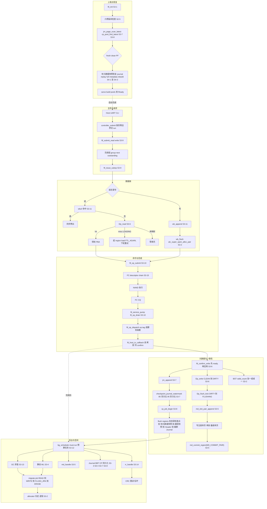

读图要点：

- **实线**是数据/控制流；**虚线**是阶段切换（启动完成、一次 IO 完成后进入后台）。
- 主机写路径在 `C7` 之后**只改 RAM 元数据**（Journal + L2P cache + BST）；
  真正的 NAND 元数据写发生在后台（`M5` 起）或 Checkpoint（`M10`）。
- 所有 NAND 命令最终都走 `C1→C2→C3→C4→C5→C6`：**提交与完成解耦**，
  完成由 op tag 选择服务函数（§3.10）。
- 上电路径 `P1→P6` 在进入 superloop 之前完成；`P5` 的 full metadata rebuild 是兜底，优先走快照/回放。

<a id="s1-5" name="s1-5"></a>

### 1.5 重要数据/状态流转路径

| 路径 | 入口 | 经过模块 | 持久状态变化 | 失败分支 | 场景 |
|---|---|---|---|---|---|
| **P1** 读命中 | `ftl_submit_read` | §3.9 → §3.11（wbuf）或 §3.6（cache）→ §3.10 → §3.15 | 无持久变化（读计数随下一次 CP 的磨损快照落盘） | ECC 失败 → §3.14 | §4.4 |
| **P2** 读 miss | 同上 | §3.6 region load → 下轮重试 | 无（cache 行 CLEAN） | load 失败 → 行 INVALID，重试 | §4.4 |
| **P3** 主机写 | `ftl_submit_write` | §3.11 wbuf → §3.2 分配 → §3.10 → §3.15 → 完成 §3.6/§3.7/§3.2 | Journal 追加；L2P 行 DIRTY；BST valid ±1 | 编程失败 → 关 SB + 标坏，L2P 不动 | §4.5 |
| **P4** 脏 region 回写 | 缓存驱逐 / 后台 flush / CP | §3.6 → §3.5 append → 写页 → commit | L2P region 新位置；Directory 更新；`l2p_live` 增减 | 写失败 → 行回 DIRTY，Directory 不登记 | §4.6 |
| **P5** Checkpoint | 水位/写入量/定时/紧急 | §3.8：快照 → flush regions → 目录检查点 → 块元数据 → 磨损 → Header → 截断 | 新 CP record；目录检查点；Journal 水位标志/预擦 | flush 失败 → 中止，不写 Header | §4.7 |
| **P6** GC / WL / 预测迁移 | 后台触发 / 写路径紧急 GC | §3.13：选 victim → 读 → 反查有效 → 写新页 → 改 L2P/Journal → 屏障 → 擦 | 新位置映射；journal 条目；源块擦除/归还或退役 | 分配不到目标页 → 中止且不擦 victim | §4.8 |
| **P7** 读恢复 | host 读 ECC 失败 | §3.14：托管 pending → 单次读 + CRC 重读 → 标坏/搬移 | 成功则拷回；失败则 BBT 标坏 + 迁移 | 提交侧长期无进展 → 按失败收尾 | §4.9 |
| **P8** 上电恢复 | `ftl_init` 后 | §3.1 → §2.5 版本 → §3.7 scan → §3.8 find → §3.1 三分支 → full metadata rebuild | 块元数据/映射/cache 从介质重建 | 快照/探测不一致 → full metadata rebuild 兜底 | §4.1~4.3 |

### 1.6 DRAM 型 vs DRAM-less / 企业级 vs 消费级

| 维度 | 本仓（DRAM-less） | 消费级 DRAM-less（UFS/eMMC 类） | 企业级（有 DRAM） |
|---|---|---|---|
| L2P 表位置 | NAND | NAND | DRAM 全表 |
| SRAM 角色 | 64 region 的 cache | 32~256 region cache | 表常驻，cache 不是瓶颈 |
| 替换策略 | CLOCK | CLOCK / 2Q | 不需要 |
| 写策略 | Write-back + Journal | Write-back + Journal | 直写 DRAM |
| 映射粒度 | CW（512 B） | 4 KiB（通常） | 4 KiB |
| 元数据位置 | 固定池 + 固定预留 L2P 日志区 | 固定池 + 动态 | 跨 Die 动态 + RAID1 |
| OP | 10% | 7~15% | 7~28% |
| 掉电 | 无电容，软件恢复 | 通常无电容 | 电容/PLP |

**本仓对齐的是 DRAM-less 这一支**。引用“主流”时指 DRAM-less 主控的形态
（DFTL / UFS / eMMC / 开源 DRAM-less FTL），不是有 DRAM 的企业级形态。
两边共有的概念（页级映射、GC、WL、Journal）可以对照；但“表常驻 DRAM”“硬件 PLP”
这类前提在本仓不成立，不能照搬。

---

<a id="s2" name="s2"></a>

## 2. 介质与地址模型

### 2.1 NAND 几何与容量预算

| 参数 | 值 | 来源 |
|---|---|---|
| NAND 型号 | MT29F4G08ABADAWP（SLC） | `include/nand/devices/mt29f___g08a.h` |
| Page main / spare | 2048 B / 64 B | 同上 |
| CW 布局 | `[META:4][CRC:4][USER:512][PARITY:8]` = 528 B | `include/fc/fc.h` |
| CW / Page | 4 | 器件参数 + `CW_NUM` |
| Page / Block | 64 | `PAGES_PER_BLOCK` |
| Block / Plane | 2048 | `BLOCKS_PER_PLANE` |
| Plane / LUN | 2 | `PLANE_NUM` |
| 每 LUN 块数 | 4096（2 plane × 2048） | `FTL_BLOCK_TOTAL` |
| 用户容量（主机可见） | **424 MiB** | 数据块 3392 × 64 页 × 4 CW × 512B；映射空间为 1,048,576 IU |
| 拓扑维度 | `CH_NUM × CE_NUM × LUN_NUM` | `ftl_config.h` §一 |

**实例模型**：每个 `(ch, ce, lun)` 是一个**完整独立**的 FTL 实例，各有一份
L2P 表、目录检查点/Checkpoint/BBT/Journal 分区与块池。主机 LBA 空间按 **region**
切分到各实例（`lba_route_*`，见 §5.4）；`FTL_DIM_TOTAL = CH × CE × LUN`。

当前构建 `CH = CE = LUN = 1` ⇒ `FTL_DIM_TOTAL = 1`，下面所有“每实例”的量就是全设备量。
多 LUN 的地址/内存设计见 `docs/archive/multi_lun_generalization.md`。

**口径表（每实例 vs 全局；混了就会算错）**

| 量 | 口径 | 公式 | dim=1 |
|---|---|---|---|
| `FTL_DIM_TOTAL` | 设备 | `CH_NUM × CE_NUM × LUN_NUM` | 1 |
| `FTL_BLOCK_TOTAL` | **每实例** | `BLOCKS_PER_PLANE × PLANE_NUM` | 4096 |
| `FTL_CW_TOTAL` | **每实例** | `FTL_BLOCK_TOTAL × PAGES_PER_BLOCK × CW_NUM` | 1,048,576 |
| `L2P_REGIONS_PER_INSTANCE` | **每实例** | `FTL_CW_TOTAL ÷ 512` | 2048 |
| `FTL_L2P_TABLE_BYTES` | **每实例** | `L2P_REGIONS_PER_INSTANCE × 512 × 4 B` | 4 MiB |
| `FTL_IU_TOTAL` | **全局** | `L2P_REGIONS_PER_INSTANCE × 512 × FTL_DIM_TOTAL` | 1,048,576（映射寻址空间） |
| `FTL_MAPPING_CAPACITY_BYTES` | **全局** | `FTL_IU_TOTAL × 512 B` | 512 MiB（映射空间，非主机容量） |
| `FTL_LBA_MAX` | **全局** | 数据块 × 64 页 × 4 CW × `FTL_DIM_TOTAL` | 868,352（424 MiB，0 坏块） |

多 dim 时**每实例的数字不变**（2048 region / 1,048,576 LBA），只有设备总量 ×`FTL_DIM_TOTAL`；
条带粒度恒为 1 个 region = 512 LBA = 256 KiB。主机容量还要扣固定元数据 98 块/plane、
OP 204 块/plane、Spare 50 块/plane（§2.3）。

### 2.2 LBA / region / PBA / PAA / META

#### 映射单位

```
1 LBA = 1 IU = 1 CW = 512 B 用户数据
region_id = LBA >> 9          // 每 region 512 条 entry
entry_idx = LBA & 0x1FF
1 region = 512 × 4 B = 2048 B = 1 个 NAND 页主区
L2P 全表 = 2048 region × 2 KiB = 4 MiB（每实例）
```

CW 级而非 4 KiB 级的理由：FC 的数据通路、加扰、CRC、ECC 都以 CW（512 B）为单位；
映射粒度与码字粒度一致，GC 搬移可以只搬页内仍有效的 CW，不产生粒度折算。

#### PBA 位布局（FTL 内部唯一地址货币）

```
PBA(uint32_t)，低位 → 高位：
  CW(2) | PLANE(1) | PAGE(6) | BLOCK(11) | LUN(LUN_ADDR_WIDTH) | CE(2) | CH(2)
  bit0     bit2      bit3      bit9        bit20 ...
```

当前 LUN 用 2 bit；`LUN_ADDR_WIDTH` 由器件头选择（0~4 bit），PBA 的 LUN 字段宽度随之
变化，但 `pba_make()` / `pba_to_*()` 是唯一入口，上层不手写移位。

#### PAA 位布局（NAND 命令层）

```
PAA(uint32_t)，低位 → 高位：
  CW(2) | PAGE(6) | PLANE(1) | BLOCK(11) | LUN(...)
  bit0     bit2      bit8       bit9
```

⚠ **PBA 与 PAA 的 PLANE/PAGE 位序相反**。`pba_to_paa()` 是字段重排，不是掩码截取；
跨层转换只允许在 `pba_to_cmd()` / `ftl_cmd_pba()` 这个单一漏斗发生（§2.4）。

#### META（页内反向映射）

每个 CW 头 4 B 存**本 CW 的扇区 LBA**（由 FC 写入 `cmd->meta`）。它使 DRAM-less
的有效性判定成为可能：GC/重建逐页读回后，用 META 得到每 CW 的 LBA，再反查 L2P——
**L2P 仍指向本物理 CW 才算有效**。

**为什么是 approach ③（flash reverse mapping）**：有效位粒度必须等于映射粒度（per-CW），
但位图放哪有三派（arXiv 1504.01666 的归纳）——①GC 时扫页映射、②常驻逐页位图
（RAM ∝ 页数，DRAM 型常用）、③读页内 OOB/P2L 反查 L2P（RAM = 0，DRAM-less 常用）。
本仓无 DRAM（§1.2）⇒ 选 ③：不维护常驻逐页位图，`gc_read_page_with_lba` 从页内 META
取回 LBA 后反查 L2P；BST 只留 per-CW `valid_count` 聚合（GC 选 victim 用）。
同类实现：DFTL（OOB 存 LBA）、LeaFTL/VPFTL（P2L + L2P 交叉验证）、KIISE（DRAM-less）。

### 2.3 固定元数据区布局

固定元数据区在每个实例的每 plane 上占**相同的块号**（分片模型），块号由
`include/ftl/metadata.h` 的几何公式推出，不手写：

| 块号 | 分区 | 块数 | plane | 用途 |
|---|---:|---:|---|---|
| 0..31 | 目录检查点 | 32 | P0+P1 镜像 | Metadata Directory 的全量快照池，块内轮转 |
| 32..39 | Checkpoint | 8 | P0+P1 镜像 | Checkpoint Header + 块元数据快照 + 磨损快照池 |
| 40..41 | BBT | 2 | P0+P1 镜像 | 坏块位图池 |
| 42..45 | Journal | 4 | P0+P1 交错（单副本） | L2P 增量日志，环形 |
| 46..93 | L2P log | 48 | P0/P1 各自独立（每 region 主+备两份） | **固定预留**的 L2P region 日志区（48/plane，总 96 块 = 12 MiB：两份活数据 + 1× 工作余量） |
| 94..97 | metadata spare | 4 | P0+P1 | **共享**坏块替换池：只补 BBT / Checkpoint / Journal 的 BAD 缺额（BBT + sparing 主流形态） |
| 98.. | 用户数据 | — | P0+P1 | Free Pool / Open SB / Closed SB / OP / Spare |

⚠ v11 起固定元数据分区不再按「编译期块号直接使用」：`md_pool_build_all()` 以名义区间
`[first, first+count)` 中在 plane_mask 所有 plane 上都非 BAD 的块作为候选，不足硬下界
时从 78..81 的 shared spare 补。候选表**不落盘**，每次开机由 BBT 重算；record 仍靠
sequence 扫描定位。运行期元数据块变坏时，`md_pool_service()` 重算候选池并让各池
重新定位（Journal/L2P 日志失块额外置 `REBUILD_REQUIRED`，下次开机 full rebuild）。

各分区的**落盘结构 / 记录几何**见下表（结构体定义分别在
`include/ftl/metadata.h` / `checkpoint.h` / `bbt.h` / `journal.h`；
尺寸与页数全部由宏推导，`_Static_assert` 校验）：

| 分区 | 副本方式 | 落盘结构 | 条目/页 | 一条 record | 每块 record | 池内总量 |
|---|---|---|---:|---:|---:|---:|
| 目录检查点 | **P0+P1 镜像** | `md_dir_ckpt_page_t` + `md_entry_t`（主 8 页 + 备 8 页） | 256 条 | 16 页 | 4 | 32 块 × 4 = **128 条** |
| Checkpoint | **P0+P1 镜像** | Header + 块元数据快照 + **磨损快照** | Header 1 + 块元数据 4 + 磨损 16 页 | 21 页 | 3（64/21 向下取整） | 8 块 × 3 = **24 条** |
| BBT | **P0+P1 镜像** | `bbt_header_t` | 1 条 | 1 页 | 64 | 2 块 × 64 = **128 条** |
| Journal | P0+P1 交错（单副本） | `l2p_jrn_entry_t` + 12 B 页头 | 127 条 | 1 页（页即写单位） | 64 页 | 4 块 × 64 页 = **256 页 / 32,512 条** |
| L2P log | P0/P1 各自独立（每 region 主+备两份） | 裸 region 页（`L2P_REGION_SIZE` = 2 KB，无页头） | 1 region | 1 页 / region | 64 | 96 块 × 64 页 = **6144 region 页（固定预留）** |

⚠ **L2P log 区为什么固定预留**：L2P 表本体 = 2048 region × 2 KB = 4 MiB（32 块）；
每个 region 存**主+备两份副本**（`RISK-BOOT-18` 的 L2）⇒ 活数据 64 块 = 8 MiB，
再留 1× 工作余量（current / 压缩目标 / 坏块）= 96 块 = 12 MiB，并**从用户容量扣除**。
主流主控把元数据放在独立预留区/独立介质（SPDK FTL 的 nvcache + 每 band 尾部 P2L；
spare 在 device formation 时从 surfaced capacity 扣除）。旧版把 L2P 日志块从 Free Pool
动态分配且不扣容量，实测碎片到 1076 块（134 MiB），容量未满即写失败
（`RISK-MD-07` / `RISK-CAP-02`）。

可枚举视图是 `g_ftl_partitions[]`（`src/ftl/metadata.c` 内的 `static const`），每项
`md_partition_t { name, first_block, block_count, plane_mask, redundancy, table_bytes }`；
只有 `md_block_is_metadata()` 读这张表。`redundancy` = 每块容纳的 record 数，
Journal 不是 record 池，填 1。`plane_mask` 决定固定块在哪些 plane 上占用：
目录检查点/CP/BBT/Journal/L2P log = `METADATA_MIRROR_PLANE_MASK`（当前 2 plane ⇒ `0x03`；
L2P log 在每个 plane 上各留一段同号区间，region 页**不按 plane 镜像**，而是每个
region 自持**主+备两份记录**（`L2P_REGION_COPIES = 2`，见 §2.3.6）。

⚠ 上表「池内总量」是**池深策略的结果**，不是容量需求；任意时刻只有 1 条 record
是权威数据，其余是回退历史与磨损预算。池深为什么取 32 / 8 / 2 / 4、环形池如何
摊开磨损，见 §2.3.7。

⚠ 镜像池（目录检查点/CP/BBT）的**逻辑 record 数**与上表一致；每个 record 在 P0/P1 各存
一份 ⇒ **物理页用量与元数据写放大 ×2**（换的是单 plane 损坏仍可恢复）。Journal 是
单副本交错。**磨损计数（erase/read/ECC 健康）在 CP 记录里**（介质版本 9 起，v10 延续），
不再有独立 Wear 块。

#### 2.3.1 目录检查点 —— Metadata Directory 的全量快照

**用途**：持久化「region → 当前位置」索引。一份完整 Directory = 一条 record。

**`md_entry_t`（7 B，`__attribute__((packed))`）**

| 字段 | 大小 | 含义 |
|---|---:|---|
| `type` | 1 B | 元数据类型（当前只有 `METADATA_TYPE_L2P_REGION`） |
| `id` | 2 B | L2P region_id |
| `pba` | 4 B | 该 region 页当前位置；`NAND_PBA_INVALID` = 未映射 |

**`md_dir_ckpt_page_t`（恰好 2048 B = 一页主区）**

| 字段 | 大小 | 含义 |
|---|---:|---|
| `magic` | 4 B | `DIR_CKPT_MAGIC`（"ANDIR"） |
| `sequence` | 4 B | 同一份 Directory 的各 chunk 相同；单调递增 |
| `chunk_index` / `chunk_count` | 2 + 2 B | 页序 / 总页数（= `DIR_CKPT_PAGE_COUNT` = 8） |
| `entry_count` | 4 B | 本页有效条目数（≤ 256） |
| `layout_version` | 4 B | 介质布局版本；不符 ⇒ 本页作废 |
| `dirty_gen` | 4 B | 本页**填充时刻**的 Directory 代数（整条 record 要求 16 页全部相同） |
| `entries[256]` | 1792 B | 256 × 7 B |
| `padding` | 232 B | 补齐到一页主区（头 24 B） |

**记录级一致性（v14，RISK-MD-06）**：一条 record 的 16 页跨多个服务循环写；若写入
期间 Directory 有更新，早写的页是旧代、晚写的是新代，在媒体上看起来完全合法。加载
侧要求 16 页的 `sequence` 与 `dirty_gen` **全部一致**，否则整条作废、回退到上一条
一致记录（丢失的增量由 Journal 回放补回）。这消除了"混代目录被当作最新快照加载 ⇒
两个代次的条目在复用过的页上互相碰撞（两个 region 指向同一页）"的路径。

**几何**：2048 条 Directory ⇒ 8 页/record；每块 8 条 record；池 32 块 ⇒ 256 个槽位。
**副本**：P0+P1 镜像——同一页用 multi-plane program 写两个 plane；读侧任一副本有效。
读取时扫池找「整条校验通过」中 sequence 最大者；任一条完整 record 都能独立重建
整个 Directory。SRAM 常驻副本是 `md_dir_cache_t.entries[2048]`（2048 × 7 B =
14,336 B），启动时从目录检查点加载。

#### 2.3.2 Checkpoint —— L2P 水位 + 块元数据快照

**用途**：记录「Journal 回放起点」和「块元数据快照」，让开机不必全盘重建。

**`cp_header_t`（恰好 2048 B = 一页主区，94 字）**

| 字段 | 大小 | 含义 |
|---|---:|---|
| `magic` / `sequence` | 4 + 4 B | `CP_MAGIC` / 本池单调序号（最新有效胜） |
| `timestamp` | 4 B | 写 Header 时的毫秒时钟快照 |
| `region_count` | 4 B | 本次 CP 覆盖的 region 数 |
| `region_bitmap[64]` | 256 B | 本 die 的 2048-bit 局部脏位图（哪些 region 在本次 CP 中） |
| `journal_sequence` | 4 B | Journal 截断水位：回放只取 sequence 之后 |
| `layout_version` | 4 B | 介质布局版本 |
| `block_word_count` / `block_word_bytes` / `block_page_count` | 4 + 4 + 4 B | 块元数据快照几何（4096 / 2 / 4；0 = 无快照） |
| `block_crc32` | 4 B | 块元数据快照 words 的 CRC32 |
| `wear_entry_count` / `wear_entry_bytes` / `wear_page_count` | 4 + 4 + 4 B | 磨损快照几何（4096 / 8 / 16；0 = 无快照） |
| `wear_page_crc[16]` | 64 B | 磨损快照每页的 CRC32（16 页各一枚） |
| `record_pages` | 4 B | 本条 record 页数（= 1 + 块元数据页数 + 磨损页数 = 21） |
| `padding` | 1672 B | 补齐到一页主区 |

**块元数据快照（4 页 = 8 KB）**：每块一个 **16-bit word**，位域
`valid_count[10] | state[3] | temp[1] | pool[2]`；按 4096 块顺序打包。
编码来源 = BST state + OP/Spare 池归属；**live L2P 日志块以 Directory 为准强制编码
`LOG + no-pool`**（即使 BST 因历史路径停在 NONE），否则下次开机校验会整份拒绝
（`RISK-BOOT-15`）。

**磨损快照（16 页 = 32 KB）**：每块一个 **8 B 条目**（`erase 4 / read 2 /
last_ecc 1 / flags 1`，`flags = rising_count:4 | health:2 | rsv:2`），按 gblock 稠密排列；
每页 256 条，页内 CRC 写在 Header 的 `wear_page_crc[]`。

**顺序不可倒**：块元数据页 + 磨损页先写，Header 最后写（Header 是 commit 页）。

**几何**：一条 record = 21 页；每块 3 条（64/21 向下取整，块尾 1 页不用）；池 8 块 ⇒ 24 条。
**副本**：P0+P1 镜像，Header、块元数据页、磨损页都写两份；读侧整条快照从同一个 plane 读，
CRC/读失败再换另一个 plane。

#### 2.3.3 BBT —— 坏块位图

**用途**：持久化坏块表；开机加载后重建 BST 的 BAD 位。

**`bbt_header_t`（540 B，packed）**

| 字段 | 大小 | 含义 |
|---|---:|---|
| `magic` / `sequence` | 4 + 4 B | `BBT_MAGIC` / 单调序号 |
| `total_blocks` / `bad_count` | 4 + 4 B | 总块数 / 坏块数 |
| `reserved[3]` | 12 B | 保留（写 0） |
| `bad_map[512]` | 512 B | 4096 bit，一位一个 gblock（1 = 坏） |

**几何**：一条 record = 1 页（540 B ≤ 2048 B）；每块 64 条；池 2 块 ⇒ 128 条。
**副本**：P0+P1 镜像；读侧任一副本有效。

**校验**：`magic` + `total_blocks == FTL_BLOCK_TOTAL`（后者是布局兼容性的代理判据）；
无本层 CRC——页完整性由 FC 的 per-CW CRC + ECC 保证。

**写模型**：只追加、环形轮转、最新有效胜。`bbt_mark_bad` 幂等（已 BAD 不重复计数、
不重复消耗 Spare）；dirty 置位同时推进 `dirty_gen`，写 job 完成时只有代际未变才清
dirty（覆盖“写飞行期间又标坏”的丢更新窗口）。同步 `bbt_save`（开机/格式化）与异步
`bbt_handle`（后台攒批）写出的 record 格式一致。

**工厂标记**：只在空片读 Page 0 的 `spare[0]`（列 2048）；用过的介质该字节是 FTL 数据，
`bbt_medium_has_ftl_data` 拒绝重扫。列读失败（含 NAND 错误）保守判坏。

#### 2.3.4 Journal —— L2P 增量日志（环形）

**用途**：写确认路径先追加一条 L2P 更新；掉电后回放恢复「目录检查点之后的增量」。

**页头（12 B）**：`magic(4) + page_seq(4) + entry_count(2) + block_seq(2)`。

**`l2p_jrn_entry_t`（16 B，packed）**

| 字段 | 大小 | 含义 |
|---|---:|---|
| `lba` | 4 B | 逻辑地址（全局 LBA） |
| `old_pba` | 4 B | 更新前位置（回放不读；仅首条保留供诊断） |
| `new_pba` | 4 B | 更新后位置（回放按此写 L2P） |
| `sequence` | 4 B | 全局单调序号（回放按 `(page_seq, 页内下标)` 定序） |

**几何**：每页 127 条（⌊(2048−12)/16⌋）；每块 64 页；**4 块环形**（`JOURNAL_BLOCKS =
CW_NUM`）⇒ 总容量 4 × 64 × 127 = **32,512 条**。块写满 ⇒ 擦环形下一块再续写；
Checkpoint 成功后按 `journal_sequence` 截断/回收。
**副本**：**单副本**，页号奇偶交错到 P0/P1（不是镜像——日志写频率最高，镜像会 2× 写放大）。
因此换块擦除必须用 `OP_ERASE_BLOCK_MULTI_PLANE`，否则 P1 的页不会被擦。

#### 2.3.5 磨损/读计数 —— 并入 Checkpoint（软状态）

**用途**：持久化每块的擦除计数、读计数和 ECC 健康，供动态/静态 WL 与 Read Recovery 使用。

**介质版本 9 起不再有独立 Wear 块**：计数随 Checkpoint 一起落盘（块元数据 4 页 +
磨损 16 页 + Header 1 页 = 21 页/record）。这样计数与块元数据**原子提交**，且随 CP 池
轮转（不是固定热点）。CP 间隔就是持久化窗口：CP 期间的计数变化允许漏到下一个 CP。

**`cp_wear_entry_t`（8 B，按 gblock 稠密排列，下标即块号；定义在 `src/ftl/checkpoint.c`）**

| 字段 | 大小 | 含义 |
|---|---:|---|
| `erase_count` | 4 B | 擦除计数（动态/静态 WL 的唯一输入） |
| `read_count` | 2 B | 主机读 + GC/WL 搬移读累加（read disturb）；擦除成功清零 |
| `last_ecc` | 1 B | 上次读的 ECC 纠正 bit 数 |
| `flags` | 1 B | `rising_count:4`（bit0..3）+ `health:2`（bit4..5）+ 保留 2 bit |

> **主流对照（有出处）**：擦除计数必须持久化，否则跨重启归零、WL 失效
> （`docs/design/storage_controller_design_essentials.md` §5.5）；read disturb 用
> 读计数/刷新/GC 搬移（同文档失效模式表）。**"计数随 CP 快照落盘"的具体形态是本仓
> 设计**——主流也会把 per-block 元数据放进 block descriptor/checkpoint，但具体布局
> 无统一标准。

#### 2.3.6 L2P region 日志区（固定预留，属于固定元数据）

Directory 指向的 region 页优先放在**固定预留的 L2P 日志区** `[46,94)/plane`（48 块/plane，
总 96 gblock = 12 MiB：每 region 主+备两份 = 64 块，再留 1× 工作余量；见 §2.3 主表）；
固定区满时允许从 **OP 池**有界借用（`L2P_LOG_BORROW_MAX = 8` 块 = 512 KiB）：

- **一页 = 一个 region 副本**：2048 B = 512 × 4 B `DWORD`（无页头）；
  每条目是一个 CW 的物理位置，`NAND_PBA_INVALID` = 未映射。每次 flush 取两个相邻槽，
  写主/备两份内容相同的页。
- **一块 = 64 页 = 64 个 region 副本**；只追加，块满先取固定区下一块（`md_log_alloc`），
  固定区无空闲块时再借用户块；`l2p_live` 归零 ⇒ `reclaim_pending` ⇒ 后台擦除后
  `md_log_release`：固定块置 NONE，借来的块回 OP 池（§3.5）。
- **动态块的识别**：`dir->l2p_live[g] != 0`（Directory 条目的账本）是
  `md_block_is_metadata` 的唯一动态判据（C9），借来的块因此不会被当作普通用户块回收，
  full metadata rebuild 也会把它当 LOG 跳过。
- **压缩**：主判据是 **free 水位**（固定区空闲块 ≤ `L2P_LOG_FREE_WATERMARK = 8`），
  辅以 `live > L2P_LOG_COMPACT_TRIGGER`（= 64，两份活数据的理想水位）。一次新生块可连续搬多个稀疏
  victim；日志区取 L2P 表（4 MiB = 32 块）的 **3×**（两份副本 + 1× 余量），余量给
  current / 压缩目标 / 坏块。
- **容量已扣**：`FTL_HOST_DATA_BLOCKS_PER_INSTANCE` 用 `FTL_METADATA_AREA_END`。
  旧实现从 Free Pool **无界**取块且不扣容量，实测碎片到 1076 块（134 MiB），
  导致容量未满即写失败（`RISK-MD-07` / `RISK-CAP-02`）——所以动态借用必须有界。
- **未映射不占闪存**：Directory 为每个 region 预登记 `NAND_PBA_INVALID`，读取该
  region 时 L2P cache 直接合成全 `INVALID` 的行，**不发 NAND 读**。

#### 2.3.7 共同写模型：环形池为什么这样写

**固定元数据块唯一的磨损均衡**

固定元数据块（目录检查点 / Checkpoint / BBT / Journal / **L2P 日志区**）**不在 Free Pool 里**，GC 与 WL
都管理不到它们（§3.2.3：这些块的 pool 归属是 NONE）。因此，对这些块而言，
**池内环形轮转是唯一的磨损均衡手段**。如果只在一个固定块/固定页上反复擦写：

- **不擦就重写**：NAND 只能 1→0，对已编程页二次编程 = 新数据 AND 旧数据
  = **静默损坏**。
- **擦同一块再写**：该块承担全部元数据擦除 ⇒ **单块热点**，先达到 P/E 上限
  ⇒ 早期坏块。

这两类问题的历史记录见 `docs/design/ftl_revision_history.md` 的 v0.50（固定地址
写模型）与 v0.82（独立 Wear 块是固定单副本热点）。

**定量：环形池摊开的是单块磨损，不是总擦除数**

设池 N 块、每块 R 条 record、每条 record 对应 W 次主机写：

| 量 | 公式 | 含义 |
|---|---|---|
| 每条 record 的块擦除 | `1 / R` | 与 N 无关 |
| 写 T 条 record 的总擦除 | `T / R` | 与 N 无关；环形池**不省擦除** |
| 单块擦除次数 | `T / (R × N)` | 随 N 线性下降 |
| 单块擦除间隔（主机写） | `N × R × W` | 池越深，同一块两次擦除隔得越久 |
| 池可承受 record 数 | `≈ N × R × P/E 上限` | N 块各自贡献 P/E 预算 |

所以环形池降低的是「任何单块先到寿命终点」的概率；代价是把 N 个块从用户容量里划走。

**共同写模型：这些规则同时给出掉电安全**

- **只追加**：元数据页只写擦除态页；对已编程页二次编程 = 新数据 AND 旧数据 = 静默损坏。
- **带 sequence**：每条 record 带单调序号；池内写序 == sequence 序；读取取
  「整条校验通过」中 sequence 最大者（**不取半条**）。
- **池内轮转**：块满 ⇒ 擦池内下一块 ⇒ 从页 0 续写；`block_count >= 2` 是硬要求
  —— 1 块池换块时会擦掉唯一有效副本。
- **完整性**：元数据页统一用 `FTL_PAGE_CFG_META` 写（FC per-CW CRC + ECC）；
  结构体本身**无独立 CRC**（例外：Checkpoint 的块元数据快照有 `block_crc32`）。
- **版本**：目录检查点页与 Checkpoint Header 都带 `layout_version`；不符 ⇒ 该 record
  作废，开机自动全片格式化。
- **v10 起所有元数据块都是固定预留的**（含 L2P 日志区 46..93/plane）。区别只在写模型：
  目录检查点/CP/BBT 是 record 池、Journal 是页环形、L2P 日志是 region 追加日志。

**池深是策略旋钮，不是磨损推导**

| 池 | 块数 | 性质 | 依据 |
|---|---:|---|---|
| 目录检查点 | 32 | 策略 | 固定根 + 专用元数据块池的主控形态；本仓磨损不是约束，32 不是按 P/E 算出来的 |
| Checkpoint | 8 | 策略 | 无容量下界论证；`>= 2` 是硬约束 |
| BBT | 2 | **最小合法池** | 2 块是环形池下限；1 页/条 × 64 页/块 ⇒ 128 条，不是"开大了" |
| Journal | 4 = `CW_NUM` | 容量策略 | 容纳两次 Checkpoint 之间的映射更新；85%/95% 水位兜底 |
| L2P log | 64（32/plane） | 容量策略 | 理想表 32 块（4 MiB ÷ 64 页/块）× 2 余量；current / 压缩目标 / 坏块 |

⚠ §2.3 主表的「池内总量」（目录检查点 256 / CP 24 / BBT 128 / Journal 32,512 /
L2P log 4096 region 页）是
上表池深 × 每块 record 数的**结果**，不是容量需求；任意时刻只有 1 条 record 是
权威数据，其余是回退历史与磨损预算。

**代价**

- 容量：固定元数据区（含固定 L2P 日志区）98 个块号 × 2 plane = 196 个物理块 ×
  128 KiB = **24.5 MiB ≈ 原始 512 MiB 的 4.8%**（主机容量还要再扣 OP/Spare，见 §2.1）。
- 启动：`md_ring_locate` 快路径要读每个块的末条 record（O(块数) 次页读），
  池越深启动扫描越久。

**主流对照**

- SPDK FTL 把 Superblock 常驻 cache 并镜像到 base device，nvcache chunk 按顺序写
  （`docs/reference/pages/spdk_ftl.html`）——"固定根 + 顺序 chunk"与本节形态同构。
- 磨损均衡的通用原则见 `docs/design/storage_controller_design_essentials.md §5.5`：
  P/E 有限 ⇒ 必须把擦除摊平。
- **具体深度 32 / 8 / 2 / 4 是本仓自定**——公开资料没有对应的数值。

- **固定池的副本策略**（介质版本 9 起，v10 延续）：
  - **目录检查点 / Checkpoint / BBT：P0+P1 镜像**。同一条 record/页用 multi-plane program
    一次写进两个 plane 的同 block/page（`ftl_async_write_page_mirror`）；读侧任一副本
    有效即可，一个 plane 损坏仍能恢复。运行期写走异步提交 + 完成服务；同步镜像写只在
    开机/格式化（没有服务泵可等）使用。
  - **Journal：P0+P1 页号奇偶交错**（偶页 P0、奇页 P1），是**单副本**而不是镜像——
    日志写频率最高，镜像会 2× 写放大。因此它的换块擦除**必须**用
    `OP_ERASE_BLOCK_MULTI_PLANE`（否则 P1 页不会被擦，回绕后二次编程）。
  - **L2P region log：每 region 主+备两份**（`L2P_REGION_COPIES = 2`）。两份是同一次
    flush 串行写入的两个槽（同页不同位置），Directory 登记两个 PBA；读侧主副本失败
    自动回退备副本并交换主备。不是按 plane 镜像（两份可以落在同一 plane）。
  - **磨损计数不再占独立块**：随 Checkpoint 记录一起落盘（§2.3.5）；用户数据从块号
    `FTL_METADATA_AREA_END`（= 98）起。
- 这条布局满足"预留必用"：P1 的目录检查点/CP/BBT 块是**真实副本**，不是闲置。
  `md_block_is_metadata()` 按 `(plane & plane_mask)` 判固定块。

#### 2.3.8 结构分布图（一）：空间布局

> 表给精确尺寸，图给空间关系。**尺寸/字段以本章表格与 `include/ftl/*.h` 为准**；
> 改布局时两处同步（H6）。

**① 每个 die 的 plane / 块号分布**

```text
P0  [ 目录检查点 0..31 ][ Checkpoint 32..39 ][ BBT 40..41 ][ Journal 42..45 ][ L2P log 46..93 ][ shared spare 94..97 ][ User 98..2047 ]
P1  [ 目录检查点'0..31 ][ CP'32..39         ][ BBT'40..41 ][ Journal 42..45 ][ L2P log'46..93 ][ shared spare 94..97 ][ User 98..2047 ]
     \____ mirror ____/\_____ mirror _____/\____ mirror __/\__ interleave _/\____ per-plane ____/\____ shared ____/
```

- **镜像**：同一条 record/页在 P0、P1 各存一份；读侧任一副本有效即可。
- **交错**：Journal 的逻辑页 i 落在 plane `i & 1`（偶页 P0、奇页 P1），是**单副本**。
- **用户区**：块号 98 起在两个 plane 都是用户数据（磨损计数已并入 CP）。

**② 池 → 块 → 页 → record → entry（目录检查点示例）**

```text
目录检查点池
├─ 32 个块号（每个块号在 P0、P1 各一个物理块；两份内容相同）
│  └─ 块 b（64 页，128 KiB）
│     ├─ record 0   pages  0.. 7
│     ├─ record 1   pages  8..15
│     ├─ ...
│     └─ record 7   pages 56..63        ← 8 条 record/块（8 页/条）
│
├─ 每条 record = 8 页 = chunk 0..7（页序 = chunk 序）
│  ├─ chunk 0: page 0 → entry   0..255
│  ├─ chunk 1: page 1 → entry 256..511
│  ├─ ...
│  └─ chunk 7: page 7 → entry 1792..2047
└─ 一条 record = 整份 Directory 快照（2048 条 entry）
```

一个 chunk 的页内布局：

```text
offset   0      4      8      10     12     16     20                          1812     2048
         [magic][seq  ][chunk_i][chunk_c][cnt  ][ver  ][ entries 256 × 7 B    ][ pad  ]
bytes      4      4      2       2      4      4            1792                 236
```

**③ 其余池的块内排布**

```text
Checkpoint 块（64 页；一条 record = 21 页）
├─ page  0..20   record 0   (page 0 = Header；page 1..4 = 块元数据；page 5..20 = 磨损快照)
├─ page 21..41   record 1
├─ page 42..62   record 2
└─ page 63       未用（64 / 21 向下取整）

BBT 块（64 页；一条 record = 1 页）
└─ page 0..63 = record 0..63（每页 540 B header + padding）

Journal 块（4 个块号 × 64 页；页是写单位）
├─ page 0..63；逻辑页 i 的 plane = i & 1（偶页 P0、奇页 P1）
└─ 每页：12 B 页头 + 127 × 16 B entry = 2032 B + 4 B 余量

CP 磨损快照（16 页 × 256 条 × 8 B；随 Checkpoint 记录落盘）
├─ 每条：erase 4 / read 2 / last_ecc 1 / flags 1
├─ page p 覆盖 gblock p×256 .. p×256+255
└─ 每页 CRC 存在 Header 的 wear_page_crc[p]

L2P region（固定日志区 46..93）
├─ 一页 = 512 × 4 B DWORD = 2048 B（无页头）
└─ 一块 = 64 页 = 64 个 region
```

**④ 关键结构的字节偏移尺**

```text
cp_header_t（2048 B；94 字 = 376 B + padding）
offset   0      4      8      12     16                     272    276    280    284    288    292    296    300    304    308    312                     376     380     2048
         [magic][seq  ][ts   ][rgn_cnt][ region_bitmap 64×4 ][jseq ][ver  ][wcnt ][wbytes][pcnt ][crc32 ][w_ent][w_byt][w_pg][ wear_page_crc 16×4 ][rpages][ pad ]
bytes      4      4      4      4            256              4      4      4      4      4      4      4      4      4      64            4     1668

bbt_header_t（540 B，packed）
offset   0      4      8      12     16          28            540
         [magic][seq  ][total ][bad_cnt][reserved 12][ bad_map 512 ]
bytes      4      4      4      4         12           512

Journal 页（2048 B）
offset   0      4      8      10     12                     2044   2048
         [magic][p_seq ][e_cnt ][b_seq ][ 127 × 16 B entries ][ 余 ]
bytes      4      4      2      2             2032            4
entry    [ lba 4 ][ old_pba 4 ][ new_pba 4 ][ sequence 4 ] = 16 B

CP 磨损条目 cp_wear_entry_t（8 B；每页 256 条）
offset   0      4      6      7      8
         [erase 4][read 2][ecc 1][flags 1] = 8 B
flags    bit0..3 rising_count | bit4..5 health | bit6..7 保留

L2P region 页（2048 B）
offset   0                                                         2048
         [ 512 × DWORD（4 B） = 2048 B；NAND_PBA_INVALID = 未映射 ]
```

> 尺上的字段名是缩写（为了排版）；完整字段名/类型见 2.3.1~2.3.5 的表与
> `include/ftl/*.h`。

**⑤ 镜像写 / 读回退（运行期 async）**

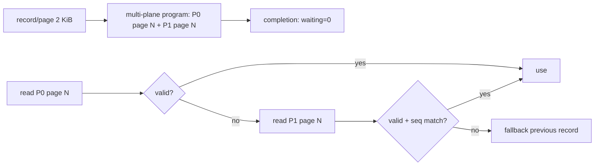

#### 2.3.9 结构分布图（二）：池间流转

> 本节回答"数据从哪来、什么时候被替换、掉电后从哪恢复"，把各池串起来。
> 精确时序以 `src/ftl/metadata_job.c` / `checkpoint.c` / `journal.c` 与
> §3.5 / §3.7 / §3.8 为准。

**① 各池的"产生 → 消费 → 替换/回收 → 恢复"**

| 池 | 产生（谁写） | 消费（谁读） | 替换 / 回收 | 掉电后 |
|---|---|---|---|---|
| **目录检查点** | `commit_region` 置脏 → CP/后台 job 组页写 | 开机 `md_load` | 池内 ring：块满轮转；最新 sequence 胜；旧块整块擦 | 重建 Directory；缺页回退"未映射" |
| **Checkpoint** | CP job：快照 bitmap → flush region → flush 目录检查点 → 写块元数据快照 + 磨损快照 → 写 Header | 开机 `cp_pool_find_latest` + `cp_block_table_load` / `cp_wear_table_load` | 池内 ring：8 块 × 3 条（21 页/条）；最新 sequence 胜 | Header 给 Journal 水位；块元数据快照给 state/valid/temp/池归属；磨损快照给 erase/read/rr |
| **BBT** | 出厂扫描 / 运行时 `bbt_mark_bad` → BBT job | `bbt_init`（开机） | 池内 ring：2 块 × 64 条；最新 sequence 胜 | 坏块图；无有效 BBT 时按空片/拒扫策略 |
| **Journal** | 每次 host 写确认 `jrn_append` | 开机 `jrn_replay`；CP 截断 | 4 块环形：页满换块；CP 按水位截断 | 回放 `seq > CP journal_sequence` 的条目 |
| **磨损计数（CP 内）** | 运行时 `erase/read/rr` 更新 BST → CP job 组页 | 开机 `cp_wear_table_load` | 随 CP record 轮转覆盖；无独立回收 | 从 CP 磨损快照回填；丢失只退化 WL（软状态） |
| **L2P region log**（固定预留区） | L2P cache 刷脏 → `append_slot` + FC 写 | cache miss 读回；GC/compaction | 块满换块（固定区）；`l2p_live==0` → `reclaim_pending`；活块数 >40 → compaction | Directory 指向最新页；Journal 补差量 |
| **Directory（SRAM）** | `commit_region` / journal replay 写入 cache 后 flush | L2P lookup；目录检查点快照源 | 覆盖 entry；目录检查点全量落盘 | 目录检查点重建 Directory；Journal 回放补 L2P cache 增量 |

**② 上电恢复顺序（逻辑依赖）**

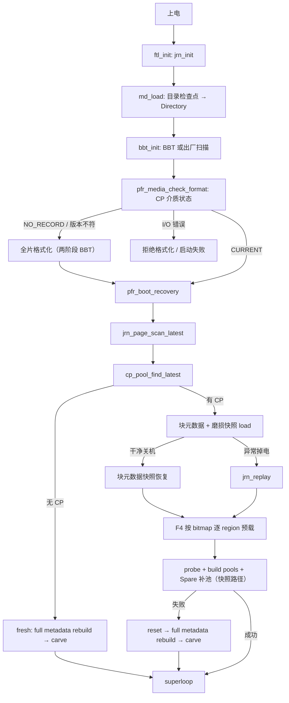

**③ 运行期写入 + Checkpoint 流转**

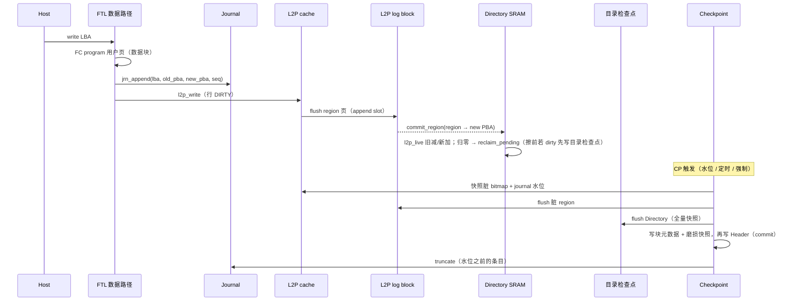

**④ GC / 回收 / 压缩如何影响各池**

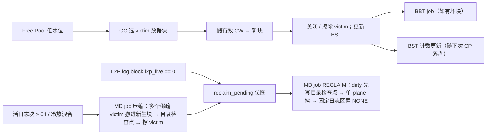

**⑤ 掉电持久性映射**

| 数据 | 最后落点 | 掉电后怎么恢复 |
|---|---|---|
| 用户数据 | data block 页 + 页内 META（CW 的 LBA） | ECC / read retry / RAID（若启用） |
| L2P 增量 | Journal（lba / old_pba / new_pba / seq） | replay `seq > CP journal_sequence` |
| L2P region 页 | L2P log block（Directory 指向最新页） | Directory 加载后按 PBA 读回 |
| Directory | 目录检查点（全量快照，P0+P1 镜像） | `md_load` 取最新完整 record |
| 块元数据快照 | Checkpoint（4 页 word，P0+P1 镜像） | `cp_block_table_load`；失败走 full metadata rebuild |
| 坏块图 | BBT（P0+P1 镜像） | `bbt_init`；运行时 `bbt_mark_bad` 兜底 |
| 磨损/读计数 | Checkpoint 磨损快照（16 页，P0+P1 镜像，软状态） | `cp_wear_table_load`；丢失只退化 WL |

**⑥ 池内轮转 / 替换的时间线**

```text
目录检查点 / BBT（record 池）
  slot 0 → slot 1 → … → slot N-1 → slot 0 → …
  写满一块 ⇒ 擦池内下一块 ⇒ 从该块 slot 0 续写
  读：扫池，取「整条校验通过 + sequence 最大」；旧 record 不单独擦，随块轮转一起擦

Journal（页环形）
  page 0 → … → page 63 → block+1 page 0 → … → block 0（先擦环形下一块）
  CP 成功后按 journal_sequence 截断/预擦；回放只取 seq > CP 水位

Checkpoint（21 页/record：Header 1 + 块元数据 4 + 磨损 16）
  slot 0 → slot 1 → slot 2 → 下一块 slot 0 → …
  每条 record 覆盖一块元数据 + 一份磨损快照；磨损计数随 CP 覆盖式更新

L2P region log（固定预留区，追加块）
  region 页追加到当前块 page 0..63 → 从固定区取下一块 page 0
  l2p_live 归零 ⇒ reclaim_pending ⇒（dirty 先写目录检查点）⇒ job 异步擦除 → 固定区置 NONE
  活日志块 > 64 ⇒ compaction：多个稀疏 victim 搬进同一新生块 → 目录检查点落盘 → 擦 victim
```

### 2.4 单一坐标与转换漏斗

| 坐标 | 值域/含义 | 谁拥有 |
|---|---|---|
| **全局 LBA** | `0 .. FTL_LBA_MAX-1`；host 与数据通路使用 | `ftl_config.h` / `l2p_cache.h` |
| **局部 region** | 每实例 `0 .. L2P_REGIONS_PER_INSTANCE-1`；映射页落盘位置 | `l2p_global_to_local_region()` |
| **gblock** | `plane × BLOCKS_PER_PLANE + block`；BST/池的唯一索引 | `bst.h` 的 `ftl_gblock*` |
| **PBA** | FTL 物理地址（含 ch/ce/lun） | `ftl_config.h` §三.2 |
| **PAA** | 芯片内地址 | `nand_config.h` |

规则（C9）：

- 同一语义只允许一套坐标。`gblock` 与“per-plane block + plane”不得在业务代码里各算各的；
  一律 `ftl_gblock()` / `ftl_gblock_plane()` / `ftl_gblock_block()`。
- 全局 region 与局部 region 的转换只在 `l2p_global_to_local_region()` /
  `lba_route_*` 发生；现场手写 `region / FTL_DIM_TOTAL` 是缺陷。
- PBA↔PAA 只在 FTL↔FC 边界转换；FC 层不认 PBA，FTL 业务层不手写 PAA 位运算。
- 方向相反的转换（例如 `pba_with_page`）必须用构造函数，不用掩码拼装。

### 2.5 介质布局版本与自动格式化

介质格式（块位置、记录格式、字段语义）会随设计变化。若固件不认识旧介质，直接启动会在
旧数据上分配 Free Pool 里的**未擦块**——allocator 不做擦除（“Free Pool 保证已擦除”是
隐式前提）⇒ 新数据 AND 旧数据 = **静默损坏**。因此：

```c
#define FTL_MEDIA_LAYOUT_VERSION_BASE (13U)
#define FTL_MEDIA_LAYOUT_VERSION \
    (FTL_MEDIA_LAYOUT_VERSION_BASE + ((FTL_DIM_TOTAL > 1U) ? 1U : 0U))
```

- 版本写在**两处**：Checkpoint Header 与目录检查点页；两处独立校验，任一不符即该记录作废。
- **触发判据**（唯一、自终止）：`pfr_media_check_format` 调
  `cp_media_status_probe`，只有 **NO_RECORD（空片）/ 版本不符** 才需要格式化；
  读到当前版本 CP 则不格式化；**CP 读不通（IO_ERROR）拒绝格式化**并返回错误——
  一次瞬时读错不能变成整片擦除。
- **执行**（`pfr_media_format`）：`bbt_format_erase` 两阶段——先把当前坏块图（工厂标记 +
  CP 快照并集）追加成一条 BBT record 并置 `FORMAT_IN_PROGRESS`（失败则**不擦用户块**），
  再擦除 **BBT 池之外**的全部块（擦失败标 BAD），随后再落一次 BBT 把新 BAD 并入。
  `FORMAT_IN_PROGRESS` **保持置位**，直到 initial Checkpoint **读回成功**才清除
  （`pfr_format_end_bbt`）——格式化的提交点是 CP 落盘，不是擦除结束；`format --verify`
  的全片擦除体检、目录检查点/CP 写入都在这个窗口内。窗口内任一步复位/掉电，下次开机都按
  「继续格式化」处理（`cp_media_status_probe` 返回 NO_RECORD），不会把「有 BBT、无 CP」
  判成损坏介质而拒绝启动（RISK-BBT-14）。
  随后复位 Directory → 写初始目录检查点 → 写一条当前版本的空 Checkpoint 标记。
- **`format --verify` = 从头识别坏块**：`bbt_format_erase` 之后先清空 allocator 池，
  再 `pfr_format_reset_bad_map` 清空**非 BBT 池**的旧 BAD 集（BBT 池保留本轮
  `FORMAT_IN_PROGRESS` record），然后对所有非 BBT 池块**只做擦除**：擦除命令成功即
  判为好块（包括原先标记 BAD 的块）。结束打印 `old_bad/recovered/new_bad`；`recovered`
  表示旧 BAD 里被本次判为好块的块数。
  不再做「写图样 → 读回比对」：open-card 需要的是**不依赖数据通路的稳定判据**，而
  写/读体检只覆盖单 plane 顺序写，测不到运行期的 pair 写路径（RISK-NAND-06）；
  编程/读失败由运行期的写重试 + `ftl_host_io_write_fail` / RR 标坏兜底。
  ⚠ 单遍筛片可能恢复边缘块（RISK-BBT-16），运行期由 Spare/OP 兜底。
- **钩子位置**：`ssd_ftl_boot()` 内、`ftl_init` 之后、Free Pool 回填之前。
- **判据不是“结构体字节数变没变”**，而是“老固件的介质在新固件下会不会被误读/误用”。
  例如 OP/Spare 池改为按 plane 预留时结构体布局没变，但预留块集合变了 ⇒ 必须升版本。

**版本演进**：当前 `FTL_MEDIA_LAYOUT_VERSION_BASE = 13`（DIM>1 时 +1）。
逐版本变更与"为什么必须 +1"见 [`ftl_revision_history.md`](ftl_revision_history.md)
「介质布局版本」表——那边是**唯一版本表**，本文只保留当前值与判据，避免两处数字漂移。

---

<a id="s3" name="s3"></a>

## 3. 模块设计

> **本节模板**：每个模块按「背景与需求 → 职责与边界 → 结构与不变量 → 流程图 →
> 关键流程 → 失败语义 → 常量与出处 → 主流对照」组织。背景写“没有它会怎样”，
> 不是“它实现了什么”。

**模块地图**：

| 模块 | 主要文件 | 章节 |
|---|---|---|
| 引导与掉电恢复 | `power_failure_recovery.c/h` | §3.1 |
| 分配器 / BST / Super Block | `allocator.c/h`、`bst.h` | §3.2 |
| 坏块表 | `bbt.c/h` | §3.3 |
| 磨损计数持久化 / 静态 WL | `checkpoint.c`（磨损快照）、`wear_leveling.c/h` | §3.4 |
| 元数据目录 | `metadata.c/h` | §3.5 |
| L2P cache | `l2p_cache.c/h` | §3.6 |
| Journal | `journal.c/h` | §3.7 |
| Checkpoint | `checkpoint.c/h` | §3.8 |
| Host 提交 / 组 / pending | `ftl.c`、`pending.c/h` | §3.9 |
| 完成派发面 | `ftl_op.c/h` | §3.10 |
| 页打包写缓冲 | `wbuf.c`、`wbuf.h` | §3.11 |
| Service / 后台调度 | `ftl.c`、`bg_scheduler.c/h` | §3.12 |
| GC / 迁移 | `gc.c/h`、`migrate.c/h` | §3.13 |
| 读恢复 | `read_recovery.c/h` | §3.14 |
| FTL↔FC 接口 | `ftl_fc_interface.c/h`、`ftl_config.h` | §3.15 |
| 观测性 | `ftl_job.h`、各 job 心跳 | 并入 §3.12 |

<a id="s3-1" name="s3-1"></a>

### 3.1 引导与掉电恢复（power_failure_recovery）

#### 3.1.1 背景与需求

FTL 的运行时状态分两类：

| 状态 | 掉电后 |
|---|---|
| L2P cache（64 行）、Block State Table、Free/OP/Spare 池、Closed 列表、各类写指针 | **全部丢失**（RAM） |
| 用户数据、页内 META、L2P region 页、目录检查点、Checkpoint、Journal、BBT、CP 磨损快照 | 留在 NAND |

没有恢复模块，开机后 L2P cache 是空的、Closed 列表是空的、Free Pool 可能把**写过的块**
当空白块分配——第一次写就会 AND 掉旧数据。恢复模块要回答三个问题：

1. 上一次是**干净关机**还是**异常掉电**？
2. L2P 映射从哪恢复到哪（Checkpoint 快照 + Journal 增量）？
3. 块元数据（状态/有效计数/池归属）从快照恢复，还是全盘扫描重建？

#### 3.1.2 职责与边界

- **做**：判定启动类型；编排“扫描 → 分类 → 恢复块元数据 / 回放 Journal / full metadata rebuild → 建池”的顺序；
  维护恢复结果与统计。
- **不做**：不定义 Journal/Checkpoint/目录检查点的记录格式（各模块自己拥有）；不做介质格式化
  （`pfr_media_format` 在版本判据命中时调用）；不处理 host IO。
- **上游**：`main.c` 的 `ssd_ftl_boot()`；**下游**：Journal、Checkpoint、Metadata、Allocator、L2P cache。

#### 3.1.3 结构与不变量

| 结构 | 关键字段 | 说明 |
|---|---|---|
| `pfr_boot_type_e` | `FRESH / CLEAN / POWER_FAILURE` | 启动分类 |
| `pfr_boot_result_t` | `boot_type`、`cp_sequence`、`journal_entries`、`blocks_restored` | 观测/日志 |
| `pfr_rebuild_stats_t` | `blocks_rebuilt`、`partial_blocks`、`valid_cw` | full metadata rebuild 结果 |
| `cp_handle_t.block_words` | 16-bit/块 × 4096 | Checkpoint 的块元数据快照，boot 时复用为加载缓冲 |
| `cp_handle_t.wear_page` / `wear_page_crc[16]` / `wear_page_buf` | 8 B/块 × 4096 → 16 页 | 磨损快照写进度 / 每页 CRC / 组页缓冲 |

不变量：

1. **块元数据快照先于 Journal 回放恢复**：回放要同步维护 `valid_count`，没有块元数据就没有记账对象。
2. **判型用整页**：`page_seq + entry_count <= cp.journal_sequence` 才是干净关机；
   只比页首页序号会漏掉跨水位那一页的新条目。
3. **三条路径都要 `jrn_resume`**：环形块没有被擦，写指针/序号必须接回；
   否则二次编程或序号回退。
4. **Open SB 不续写**：快照/full metadata rebuild 都把 OPEN 降级为 CLOSED，整块交 GC。掉电可能留下半编程页，
   续写会二次编程；Policy B 下两 plane 的配对也无法可靠恢复。
5. **快照失败只回退 full metadata rebuild，不格式化**：格式化只由介质版本判据触发。

#### 3.1.4 启动判定流程

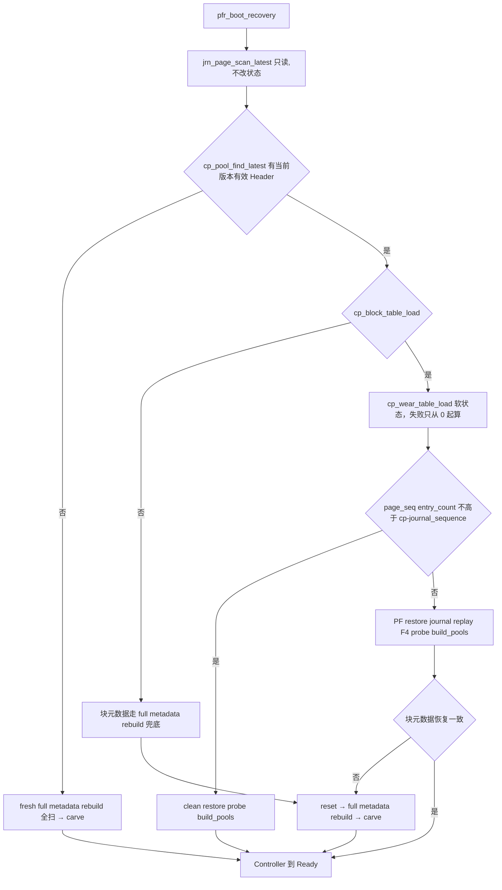

#### 3.1.5 关键流程

1. **扫描**：`jrn_page_scan_latest()` 只读环形池，取 `(block, page, page_seq, entry_count)`；
   `cp_pool_find_latest()` 用 `md_ring_locate` 扫 Checkpoint 池，取最新有效 Header，
   同时恢复本实例的 CP 序号与写游标。
2. **分类**：
   - 无有效 CP → **fresh**；
   - `page_seq + entry_count <= cp.journal_sequence` → **clean**（Journal 已全部落入 L2P）；
   - 否则 → **power failure**（有未回放的增量）。
3. **fresh**：失效本 owner 的 cache 行/脏位 → **full metadata rebuild（重建 Closed 列表）→ carve 池**
   （carve 只把 state==NONE 的块入池）→ Spare 补池 → `jrn_resume(floor=1)`。
4. **clean**：块元数据快照有效时 `restore_blocks`（先全量校验再应用）→ 按 CP 位图
   **逐 region 预载**（F4，不按 INVALID 行的 region_id 反查）→ probe 池块 →
   `build_pools` → Spare 补池；任一步失败 → reset → full metadata rebuild → carve。
   最后 `jrn_resume(floor=cp_seq)`。
   - **live L2P 日志块的自愈**（`RISK-BOOT-15`）：这类块归 `metadata_dir` 所有、
     不在 allocator 池里，合法 word 是 `NONE + no pool tag`。校验阶段对
     `md_live_count_get(dir, g) > 0` 的块放行，第 3 遍按 Directory 修正为 `LOG`
     （Directory 是 live 日志块身份的唯一权威）。否则旧版 full rebuild 留下的
     NONE/no-pool 会让**整份**快照被拒绝，每次冷启动都全盘重建。
5. **PF**：先恢复块元数据 → `jrn_replay`（所有 `page_seq+entry_count > cp_seq` 的页，
   按 `(page_seq, entry_idx)` 递增，last-write-wins；同步维护 valid_count）→ F4 →
   probe + `build_pools` + Spare 补池；失败 → reset → full metadata rebuild → carve。
   ⚠ **降级检测与范围化恢复**（`RISK-BOOT-18`）：`l2p_read_sync` 返回 OK **不等于**
   读到合法映射——连续加载失败后行会降级为“全未映射”。处理分两层：
   - `jrn_replay` 在降级基线上成功写入条目时**不再**清 `block_ctx->ok`：降级只丢该
     region 未被 Journal 覆盖的旧映射，**不影响** valid_count 增量（old/new PBA 来自
     条目本身）⇒ 保留块元数据快照，启动结果标 `bit=scoped`；
   - `pfr_probe_blocks` 把降级 CW 单独计入 `l2p_degraded_cw`，**不再**计入
     `l2p_read_errors`；只有真正的读失败才回退 full metadata rebuild。
   - 丢失的映射由 host 读路径按 `IO_ERROR` 暴露（不零填）；降级 region 记入 cache 级
     `region_degraded_bitmap`，行被驱逐/重载后仍能识别。
   - 代价：该 region 的 pre-CP 旧映射不可恢复；相关块 `valid_count` 仍按快照计（偏高、
     由 GC 迁移时逐 CW 反查自愈），无静默数据损坏。
6. **full metadata rebuild**：逐 plane/块扫 page 0 判空、找写指针；坏块/固定元数据块跳过；
   **live L2P 日志块按 Directory 显式置 `LOG`**（不能留 NONE：`cp_block_snapshot()`
   只按 BST+池编码，NONE/no-pool 会让下一次开机的快照校验整份失败——`RISK-BOOT-15`）；
   写过的块建退化单 plane 的 Closed 条目；逐页读 META + 反查 L2P 回填 `valid_count`。
   full metadata rebuild **先于 carve**：否则被 carve 放进 Spare/OP 的写过块会同时成为 Closed 条目。
   - **空闲块快速判空**：`ftl_page_is_blank(page 0)`（解码路径：ECC 是否成码字 + 整条 CW 的 1 比特占比）⇒ 直接返回 0，**不再扫 64 页**。
     这把空闲块从 64 次读降到 1 次（本板 3392 个空闲块约省 21.7 万次页读）。
   - **写过的块**：从 page 1 继续找第一个空白页，并检测 hole（空白页后又有写过页
     ⇒ 返回整块让调用者逐页反查）。
   - ⚠ 快速判空依赖“顺序追加 + page 0 失败即关闭 SB、不继续写后续页”；若将来开放
     Open SB 续写/失败后继续写，必须恢复全块扫描或在 page 0 空白后补读 page 63
     （见 `RISK-BOOT-14`）。

**启动时间量级**（观测值，不是编译期常量）：

| 路径 | 量级 | 说明 |
|---|---:|---|
| clean + 块元数据快照 | ~150 ms + L2P 日志区恢复 | 不跑 full metadata rebuild；probe 只读池块 page 0 |
| power failure | ~250 ms + L2P 日志区恢复 | 多 Journal 回放 |
| L2P 日志区恢复 | ~0 | 非活块一律置 LOG + 登记回收（**不读介质**）；擦除按 free 水位懒执行（`md_reclaim_is_eager`）|
| full metadata rebuild 兜底 | ~400~550 ms（**空片**） | 全盘扫描 + 逐页反查 |

⚠ 上表 rebuild 行是**空片**量级（page 0 快路径一跳到底）。**写过的介质**上每个写过的
页要读两遍（找写指针 + 计 valid），时间随写入量线性增长：312 MiB 实测约 **2–4 分钟**
（约 2500 个块 × 64 页 × 2 次页读，单次约 0.4–0.6 ms）。因此启动路径应优先命中
快照/回放，rebuild 只作兜底（`RISK-BOOT-15`）。

#### 3.1.6 失败语义

| 失败点 | 结果 | 数据影响 |
|---|---|---|
| 无有效 CP | fresh + full metadata rebuild | 旧映射不可达（介质已被格式化/版本不符时这是预期） |
| 块元数据快照 CRC 失败 | 该快照丢弃，走 full metadata rebuild | 用户数据不丢；恢复时间变长 |
| 快照 word 为 `NONE/no-pool`（live L2P 日志块） | **不丢弃**：Directory 是权威，第 3 遍修正为 LOG（`RISK-BOOT-15`） | 自愈旧版 rebuild 留下的快照；避免每次冷启动全盘 rebuild |
| 快照 word 非法且**不是** live 日志块 | 该快照丢弃，走 full metadata rebuild | 保守：块账本可能不可信（`RISK-BOOT-15`） |
| Journal 回放某页读失败 | 跳过该页，继续其余页 | 该页条目丢失；映射可能回退到上一版本 |
| L2P region 加载降级（两份副本都读失败） | 行 CLEAN + 全 INVALID + `degraded=1`，置 cache 级降级位图 | 保留快照走**范围化恢复**（`bit=scoped`）；该 region 未被 Journal 覆盖的旧映射丢失，host 读该范围返回 `IO_ERROR`；其余数据不受影响（`RISK-BOOT-18`） |
| 块元数据恢复与 probe 不一致 | reset → full metadata rebuild → carve | 以介质为准；块元数据重新计算 |
| full metadata rebuild 中某块读失败 | 跳过该块 | 该块数据不可恢复；后续由 GC 处理 |

⚠ **恢复路径不在完成派发里**：它在 superloop 之前运行，无人 drain CQ，所以允许使用
`*_sync` 逃生口（内部自旋泵）。服务函数禁止调用这些同步口（会嵌套泵）。

#### 3.1.7 常量与出处

| 常量 | 值 | 来源 |
|---|---|---|
| 判型口径 | `page_seq + entry_count` | `src/ftl/power_failure_recovery.c` |
| Journal 回放缓冲 | 栈上 `replay_pages[256]`（2 KiB） | `src/ftl/journal.c` |
| 介质版本 | 12（DIM=1）/ 13（DIM>1） | `include/ftl/metadata.h` |

#### 3.1.8 主流对照

DRAM-less 主控普遍采用「快照 + 增量日志 + 全盘扫描兜底」三段式：快照限定恢复上界，
日志补 post-snapshot 增量，扫描处理元数据损坏。**本仓自定**的部分是块元数据快照的
16-bit/块编码与 fresh/clean/PF 的判型口径；快照/日志/扫描的分工是 DRAM-less 的通用形态
（DFTL 等，见 `docs/reference/README.md`）。

---

<a id="s3-2" name="s3-2"></a>

### 3.2 分配器 / BST / Super Block（allocator + bst）

#### 3.2.1 背景与需求

NAND 的写必须落在**已擦除**的页上，而擦除以块为单位。FTL 因此需要一套块元数据：

- 哪些块是空闲且已擦除的（Free Pool）；
- 哪些块正在写（Open SB）、写满了（Closed SB）、是坏块、是元数据日志块、已退役；
- 每个块擦了多少次、读了多少次、还有多少有效 CW；
- 坏块替换的储备（Spare）与 GC 的性能缓冲（OP）。

没有统一账本，同一不变量会被多个模块各自手工维护，任一处漏掉就是**永久漏账**：
容量无声流失、GC 选错 victim、坏块被重新分配、`FREE` 字段说谎。

#### 3.2.2 职责与边界

- **做**：持有 BST（每块 20 B）与四个池（Free / OP / Spare / Closed 列表）；提供唯一的
  进出闸门；按 plane 选块、配对成 SB；维护 SB 写指针与关闭；提供磨损/有效性统计访问器。
- **不做**：不决定“什么时候 GC”（`gc.c` 的策略）；不执行搬移（`migrate.c`）；不定义坏块
  持久化格式（`bbt.c`）；不定义元数据布局（`metadata.h`）。
- **下游**：GC/WL/migrate、元数据目录、BBT、掉电恢复都读它。

#### 3.2.3 结构与不变量

`bst_block_t`（20 B × 4096 = 80 KiB，`_Static_assert` 钉住）：

| 字段 | 大小 | 含义 |
|---|---:|---|
| `erase_count` | 4 B | 擦除次数；动态 WL 选块、静态 WL 触发、GC 的 erase 项 |
| `last_pe_ts` | 4 B | 最近擦除时间戳；GC 的 age 项（刻意不持久化） |
| `read_count` | 2 B | read disturb 计数（自上次擦除）；预测搬移 |
| `valid_count` | 2 B | **CW 级**有效计数（0..512），GC/WL 的 valid 项 |
| `state` | 1 B | 互斥枚举：NONE/FREE/OPEN/CLOSED/LOG/RETIRED/BAD |
| `temp` | 1 B | HOT/COLD，正交于状态 |
| `sb_id` | 2 B | 反向索引到 SB；`UINT16_MAX` = 无 |
| `rr` | 3 B | `last_ecc` / `rising_count` / `health` |

五张表（每实例；各自独立对象，可单独选内存域；当前全部落 SRAM12）：

| 数组 | 大小 | 作用 |
|---|---:|---|
| `blocks[FTL_BLOCK_TOTAL]` | 80 KiB | BST |
| `free_blocks[FTL_BLOCK_TOTAL]` | 8 KiB | Free Pool（全局块号） |
| `op_blocks[PLANE_NUM][204]` | 816 B | OP 池，每 plane 独立 |
| `spare_blocks[PLANE_NUM][50]` | 200 B | Spare 池，每 plane 独立 |
| `closed_sb_list[FTL_BLOCK_TOTAL]` | 32 KiB | Closed SB 列表（swap-remove） |

`super_block_t`（8 B）：`plane_blocks[PLANE_NUM]`（可为 `FTL_BLOCK_NO_PLANE` 哨兵）、
`next_page`、`temperature`、`is_open`。

**池的分工**：

| 池 | 容量 | 用途 | 消费/补充 |
|---|---:|---|---|
| Free | 全部已擦除块 | 写分配、GC 归还 | 三级水位（下表） |
| OP | 204 块/plane | GC 性能缓冲，防止前台等 GC | 该 plane 的 Free 给出不块时补入 |
| Spare | 50 块/plane | 坏块替换，只出不进 | `bbt_spare_refill(plane)` |

| 水位 | 条件 | 动作 |
|---|---|---|
| ① 正常 | `free_count ≥ 32` | 不做后台 GC |
| ② 补池 | `8 < free_count < 32` **或任一 plane 的 free < 4** | 后台 GC（T1）；单 plane 饥饿也在其中（见 §3.13.4） |
| ③ 紧急 | `free_count ≤ 8` | 强制 GC（T4），写路径也兜底 |

**两个同值哨兵**（C11：同值 ≠ 同一坐标）：

- `FTL_BLOCK_NO_PLANE`（`UINT16_MAX`）：`plane_blocks[]` 里“该 plane 无块”的**存储态**，
  会写进 Closed 列表；
- `FTL_GBLOCK_INVALID`（`UINT16_MAX`）：选块失败的**瞬时返回值**，从不落盘。

**不变量**（`include/ftl/allocator.h` 文件头）：

1. **四类池各有唯一闸门**：Free 只走 `alc_free_push` / `alc_free_remove`；
   OP 只走 `alc_op_push`（出池由 `alc_free_refill_from_op` 内部完成）；Spare 只走 `alc_spare_push/pop`；Closed 只走 `alc_super_closed_add` /
   `alc_super_closed_remove`。外部模块不裸写数组，读走访问器。
2. **`state == FREE` ⟺ 在 Free Pool 里**。入池置 FREE；出池只校验、不赋态，新态由转移
   归属者紧随其后赋值。**BAD 永不进池**（入池闸门 debug ASSERT + release 拒绝）。
3. **`closed_sb_list` 是 swap-remove 活列表**：借出的指针不跨调用有效；跨调用按值拷贝
   （migrate 的 victim 副本）。
4. **无归属的块是 NONE**：固定元数据区、OP 池、Spare 池不参与分配。
5. **选块以 Free Pool 数组为准**：选中即 `remove_from_free` 必命中，避免“选中→移除失败→重选”死循环。

#### 3.2.4 块状态机

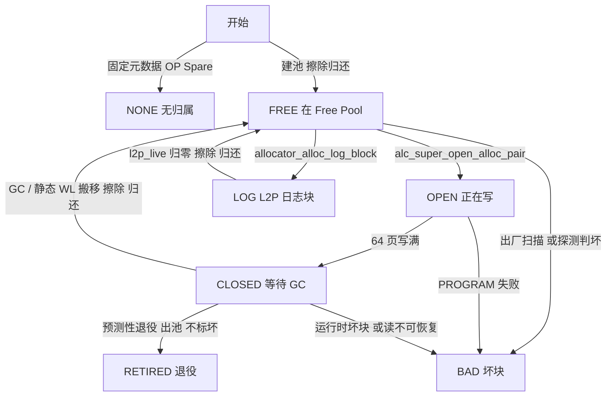

#### 3.2.5 关键流程

1. **分配一页**（`alc_super_open_alloc_pair`）：
   - 取对应温度的 Open SB；写满 → `alc_super_close` → Closed 列表；
   - 从 Free Pool 逐 plane 独立选擦除次数最少的块（Policy B，不要求同号）；
   - 填 `out[plane]` 为当前页 PBA，`next_page++`；
   - Free Pool 空 → `FTL_AGAIN`（写路径触发紧急 GC 后重试）。
2. **关闭 SB**：`is_open=false` → 加入 Closed 列表；各 plane 块状态 CLOSED + `sb_id`。
3. **归还**：搬移擦除成功后 `alc_free_push` 入池并置 FREE；退役走
   `alc_free_remove` + RETIRED，**不得**先入池。
4. **日志块**：`md_log_alloc` 从**固定 L2P 日志区**（`[46,94)/plane`）取一块已擦净的
   空闲块（置 LOG）；擦除完成后 `md_log_release` 置 NONE，**不回 Free Pool**
   （`RISK-MD-07` / `RISK-CAP-02`）。

#### 3.2.6 失败语义

| 情况 | 结果 | 后果 |
|---|---|---|
| Free Pool 空 | `FTL_AGAIN` | 写路径起紧急 GC；持续为空则写失败 |
| 入池块是 BAD | debug 停机；release 拒绝 | 防止把 BAD 覆盖成 FREE |
| 出池块不在池 | no-op（文档化契约） | 幂等；不制造反向分叉 |
| 退役块先入池 | 会被再次分配 | 违反不变量 2，必须出池后置 RETIRED |
| Closed 列表满 | 结构上不可能（容量 = 全部块） | 真满即断言，不静默丢条目 |

#### 3.2.7 常量与出处

| 常量 | 值 | 来源 |
|---|---|---|
| `FREE_POOL_TARGET` | 32 | `include/ftl/allocator.h` |
| `FREE_POOL_EMERGENCY` | 8 | 同上 |
| `FTL_OP_PERCENT` | 10%（204 块/plane） | 同上 |
| `FTL_SPARE_POOL_PER_PLANE` | 50 | 同上 |
| `SUPER_BLOCK_LIST_MAX` | `FTL_BLOCK_TOTAL`（4096） | 同上 |
| `bst_block_t` 尺寸 | 20 B | `include/ftl/bst.h` |
| 温度 | HOT=0 / COLD=1 | `allocator.h` |

#### 3.2.8 主流对照

每块一个 metadata/descriptor、Free Pool + OP + Spare 的池化、Super Block 跨 plane 条带化，
是主流 SSD 控制器的共同形态（OpenSSD 全局表、SPDK `spdk_ftl_dev` 内嵌表；见
`docs/archive/ftl_optimization_plan.md` 的 descriptor/表指针对照）。**本仓自定**的是
`valid_count` 的 CW 粒度与“无逐页位图”（DRAM-less approach ③，见 §3.13）。

---

<a id="s3-3" name="s3-3"></a>

### 3.3 坏块表（BBT）

#### 3.3.1 背景与需求

NAND 的坏块有两类：

- **出厂坏块**：厂商在每块 page 0 的 spare 区写非 `0xFF` 标记；**擦除会永久毁掉标记**
  （Micron AN1819）。
- **运行时坏块**：PROGRAM/ERASE 失败、读恢复耗尽后判定。

没有 BBT：开机可能把坏块分给用户；坏块上的数据写到一半就丢；重启后不知道哪些块坏。
另一个更隐蔽的坑：**用过的芯片不能再做出厂扫描**——页编程 2112 B 会把 CW3 尾巴写进 spare，
spare[0] 变成 FTL 自己的数据；此时重扫会把所有写过的块（含目录检查点/Checkpoint）判成坏块。

#### 3.3.2 职责与边界

- **做**：坏块的持久化（`bbt_header_t.bad_map`）、出厂扫描（仅在空片）、运行时标记、
  Spare Pool 按 plane 补充。
- **不做**：不维护 RAM 块状态（BST 是唯一数据源）；不决定替换哪个块（调用方给 plane）；
  不做数据迁移（migrate）。
- **调用点**：`bbt_init`（boot）、写失败（`ftl.c`）、GC 擦除失败（`migrate.c`）、
  读恢复失败（`read_recovery.c`）、格式化（`pfr_media_format`）。

#### 3.3.3 结构与不变量

| 结构 | 字段 | 说明 |
|---|---|---|
| `bbt_header_t` | magic / sequence / total_blocks / bad_count / `bad_map[512]` | 540 B，一条 record = 1 页 |
| `bbt_state_t`（在 `allocator_t`） | sequence / write_idx / cursor_valid / dirty / handle | 每实例一份池游标 |
| `bbt_handle_t` | phase / waiting / dirty_gen / 心跳 | 异步持久化；status 由 `bbt_status_fill` 从 `alloc->bbt` + handle 汇总 |

不变量：

1. **出厂扫描只在空片执行**：`bbt_medium_has_ftl_data()` 命中 ⇒ 拒绝扫描 + LOGE。
2. **先读后擦**：出厂标记必须在任何 PROGRAM/ERASE 之前读。
3. **标坏先出池、再置 BAD**：`alc_free_remove` 的断言要求块此刻仍是 FREE。
4. **RAM 只信 BST**：`bbt_is_bad()` 只用于读持久化位图；运行时判定一律 `ftl_block_is_bad()`。
5. **候选池（v11）**：BBT 名义块 + shared metadata spare（78..81）中、在 plane_mask 所有
   plane 上都非 BAD 的块组成候选表；自举期间直接扫描「名义块 + 全部 spare」，record 靠
   magic/sequence 校验，坏块/空块自然被忽略。候选表不落盘，每次开机重算。
6. **元数据 BAD 不走用户 Spare**：`block < FTL_METADATA_AREA_END` 或
   `l2p_live[g]/cur_metadata_block` 指向该块（从 OP 借用的 L2P 日志块）⇒ 只置
   `alloc->pools->dirty`，由 `md_pool_service()` 重算候选池；Journal / L2P 日志失块
   额外置 BBT header `reserved[1]` 的 **`REBUILD_REQUIRED`**（本仓自拟），新 CP 落盘后清除。

#### 3.3.4 流程图

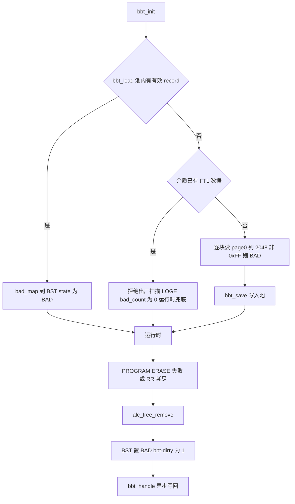

#### 3.3.5 关键流程

1. **加载**：`bbt_load` 用 `md_ring_locate` 扫 2 块池，取 magic 正确且 sequence 最大者；
   恢复 `alloc->bbt` 游标与序号。
2. **出厂扫描**：逐块（跳过块 0）读 `OP_READ_COLUMN` 列 2048 的 spare 首字节；
   非 `0xFF` ⇒ 坏块。**只读不擦**。
3. **运行时标记**：`bbt_mark_bad(alloc, gblock)`：出池 → 置 BAD → 清 valid → 置 dirty。
   ⚠ **清 valid 之后 L2P 仍可能指向该块**（预测性迁移读失败标坏、full metadata rebuild
   漏认）。因此覆盖写旧位置、TRIM、搬离源块的减计数必须走
   `ftl_block_sub_valid_if_live()`（BAD 或 count==0 时跳过）；直接
   `ftl_block_sub_valid()` 会在 debug 撞断言、release 把 uint16 回绕成 65535，
   虚高的 valid_count 会污染 GC/WL 的 victim 评分。dangling 现场由写确认路径的
   `[FTL] dangling` 日志留痕。
4. **持久化**：`bbt_handle` 装配 job；换块先异步擦，再写 1 页 record；完成由
   `ftl_bbt_callback` 推进游标。失败保留 dirty，下轮重试。
5. **补充**：`bbt_spare_refill(alloc, plane)` 从**坏块所属 plane** 的 Spare 池取一块，
   归还 Free Pool；池空则容量自然减少。

#### 3.3.6 失败语义

| 情况 | 结果 | 数据影响 |
|---|---|---|
| 无有效 BBT 且介质已用过 | 拒绝扫描，坏块表从空开始 | 已知坏块靠运行时失败兜底；不会误标活块 |
| 出厂扫描读列失败 | 保守判坏 | 可能多标；不会少标 |
| Spare 池耗尽 | 新坏块直接减少可用容量 | 用户容量下降，不丢已写数据 |
| BBT 写失败 | dirty 保留，下轮重试 | 掉电后可能丢最后一次坏块更新 |

#### 3.3.7 常量与出处

| 常量 | 值 | 来源 |
|---|---|---|
| `BBT_MAGIC` | `0x424254AB` | `include/ftl/bbt.h` |
| BBT 池块数 | 2（块 40..41） | `include/ftl/metadata.h` |
| `bad_map` | 512 B = 4096 bit | 同上 |
| 出厂标记列 | 2048（`PAGE_MAIN_SIZE`） | 器件页布局 |
| Spare / plane | 50 | `allocator.h` |

#### 3.3.8 主流对照

坏块表 + 预留替换块（sparing）而不是 block remap 表，是主流做法：ONFI Multi-Plane 命令
每个 plane 有独立行地址，坏块导致两块编号不同不影响并行操作，因此不需要“两层映射”。
v11 把这个原则同样应用到**固定元数据分区**：分区 = 候选块池（名义区间跳过 BAD + 共享
metadata spare 补缺），record 靠 sequence 扫描定位，不维护 logical→physical 表。
出厂标记“先读后擦”的判据来自 Micron AN1819（见 `bbt.c` 的引文）。
⚠ 本仓的具体候选池算法（4 块/plane shared spare、硬下界、重建顺序）是**本仓自拟实现**，
不冒充行业统一数值；机制本身是主流 BBT + sparing。

---

<a id="s3-4" name="s3-4"></a>

### 3.4 磨损计数持久化与静态磨损均衡（checkpoint + wear_leveling）

#### 3.4.1 背景与需求

BST 里的 `erase_count` / `read_count` / `rr` 是**纯 RAM**，`ftl_init` 的 memset 会清零。
如果不持久化，重启后：

- 动态 WL 不知道哪块擦得少，可能继续用已经磨损的块；
- 静态 WL 的 `max-min` 差值归零，永远不会触发；
- read disturb / 预测性退役的记录归零，劣化块被当成新块。

> **出处**：`docs/design/storage_controller_design_essentials.md` §5.5 —— "擦除计数必须
> 持久化，否则跨重启归零、WL 失效"；失效模式表：read disturb → "定期刷新、读计数、
> GC 搬移"。

静态 WL 的需求是另一个方向：GC 只回收"有效数据少"的块，冷数据所在的低擦除块
可能长期不被擦到；需要主动把冷数据搬走一次，让这些块进入磨损轮转。
方向与 UBI 一致：把**最冷的 used SB** 搬到**擦除次数最多**的空闲块上，低擦除块
空出来给热数据（动态 WL 优先选它）⇒ 擦除计数回升。

#### 3.4.2 职责与边界

- **checkpoint.c**：`cp_wear_page_build` 从 BST 组 16 页磨损快照；
  `cp_wear_table_load` 开机逐页校验并回填 BST。计数随 CP 记录**原子落盘**，
  不再有独立 Wear 块。
- **wear_leveling.c**：静态 WL 的触发判定与 victim 选择；搬移交给 `migrate.c`。
- **不做**：不执行擦除/搬移；不决定 GC（`gc.c`）；不维护 BST（`allocator.h`）。
- **动态 WL** 不在本模块：它是 `alc_free_find_block` 的选块策略
  （选擦除最少者）。

#### 3.4.3 结构与不变量

| 结构 | 字段 | 说明 |
|---|---|---|
| `cp_wear_entry_t` | erase(4) / read(2) / last_ecc(1) / flags(1) | 8 B，按 **gblock 下标**存；定义在 `src/ftl/checkpoint.c` |
| CP Header 磨损字段 | `wear_entry_count` / `wear_entry_bytes` / `wear_page_count` / `wear_page_crc[16]` | 几何 + 每页 CRC |
| `wl_victim_t` | found / plane_blocks / valid_cw / read_count | WL 选块结果 |

不变量：

1. **绝对值 + CP 快照**：每次 CP 写整份磨损快照（不是增量），读回直接覆盖 BST。
2. **软状态**：两次 CP 之间掉电只丢一个 CP 窗口的计数，不丢用户数据；
   快照损坏只退化 WL/read-disturb 精度，**不得**触发格式化。
3. **WL 只选 Closed 块**：跳过 Open / 含坏 plane 的 SB；有效 CW ≥ 70%；
   按**平均擦除次数最少**（最冷）优先，同擦除次数下 valid_cw 多、read_count 高优先。
4. **目标方向固定**：静态 WL 的目的页对取 **Free Pool 中擦除次数最多**的块
   （`alc_super_open_alloc_pair(..., ALC_SUPER_ALLOC_COLD_HIGH_WEAR)`），且不允许 OP 兜底；启动前沿
   `alc_super_prepare_wl_destination` 摘掉当前 cold SB，保证第一页新开 high-wear SB。
5. **WL 与 GC 共用一台迁移引擎与同一收尾（FREE）**：WL 只改 victim 来源；
   擦完归还 Free Pool，源块由动态 WL 优先选中写入，擦除计数回升。
   退役只属于预测性退役 / read recovery。

#### 3.4.4 流程图

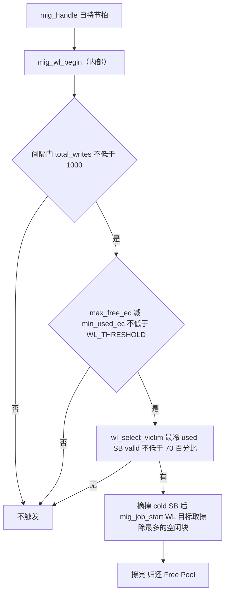

#### 3.4.5 关键流程

1. **开机**：`cp_wear_table_load` 逐页读 16 页磨损快照（P0/P1 任一副本），
   每页用 Header 的 `wear_page_crc[p]` 校验，回填 BST 的 erase/read/rr 三组字段。
   无快照 / CRC 错 / 读失败 ⇒ 计数从 0 开始（软状态，非致命）。
2. **落盘**：CP job 在块元数据快照之后、Header 之前，逐页调用
   `cp_wear_page_build` 从 BST 组页并写入；每页 CRC 存进 Header 的
   `wear_page_crc[]`。Header 是 commit 页——它落盘才代表整条 record 有效。
   **持久化窗口 = CP 间隔**（水位/定时/强制触发）。
3. **静态 WL 触发**（UBI 模型）：判据只有 `max_free_ec − min_used_ec ≥ WL_THRESHOLD`，
   其中 `min_used_ec` = Closed 列表中**有效 CW ≥ 70% 且无坏 plane** 的 SB 平均擦除
   次数最小值，`max_free_ec` = Free Pool 最大擦除次数。启动门
   `total_writes ≥ WL_MIN_WRITES`，求值节拍 `WL_EVAL_INTERVAL_MS = 5000`。
   搬移不改变擦除计数 ⇒ 差值不足时必须停止（否则是纯写放大，RISK-WL-08）。
4. **选 victim**：与触发同门限，选平均擦除次数最小的 SB；平手看 valid_cw / read_count。
5. **搬移**：`mig_wl_begin` 先 `alc_super_prepare_wl_destination` 摘掉当前 cold SB，再起
   job；目标页对走 `alc_super_open_alloc_pair(..., ALC_SUPER_ALLOC_COLD_HIGH_WEAR)`（每 plane 取擦除最多的空闲块，无 OP
   兜底）。收尾 `MIG_POST_FREE`：擦完归还 Free Pool，源块由动态 WL 优先选中写入。

#### 3.4.6 失败语义

| 情况 | 结果 | 数据影响 |
|---|---|---|
| 磨损快照读失败 / CRC 错 | 计数从 0 开始 | WL/read-disturb 精度下降；用户数据不丢 |
| 磨损页写失败 | `block_ok=0`，整条 CP record 作废（不写 Header），游标推进一槽 | 下一 CP 重试；计数窗口延长 |
| WL 无 victim | 不触发，下轮再试 | 磨损继续累积 |
| WL 搬移中分配不到目标页 | 中止且不擦 victim | 数据无损，下轮重来 |
| 擦除失败 | 标坏，不退役 | 数据由 GC/BBT 处理 |

#### 3.4.7 常量与出处

| 常量 | 值 | 来源 |
|---|---|---|
| `FTL_CHECKPOINT_WEAR_ENTRY_BYTES` | 8 | `include/ftl/metadata.h` |
| `FTL_CHECKPOINT_WEAR_PAGES` | 16 | 同上 |
| `CP_WEAR_RISING_MASK` / `CP_WEAR_HEALTH_MASK` | 0x0F / 0x03 | `src/ftl/checkpoint.c` |
| `WL_THRESHOLD` | 200（本仓自拟；判据沿用 UBI） | `include/ftl/wear_leveling.h` |

### 3.5 元数据目录（metadata.c / metadata.h）

> **本节怎么读**：先看 §3.5.1 的背景（为什么位置会变、为什么需要 Directory），再看
> §3.5.3 的四个结构，然后按 §3.5.5 的写路径读一遍，最后看 §3.5.8 的回收/压缩状态机。
> `metadata.c` 的核心是**唯一的一层位置来源**：Directory 条目。`NAND_PBA_INVALID` =
> 从未写过（未映射），非 INVALID = region 页在日志块上的真实位置。

#### 3.5.1 背景与需求

L2P 表按 region 分片，每个 region 是一页（2 KiB）。如果所有 region 都固定在元数据区，
更新一个 region 就必须**就地重写**那一页——NAND 只能 1→0，二次编程 = 新数据 AND 旧数据
= 静默损坏。所以写过的 region 必须**追加**到新的位置。

于是产生两个问题：

1. **位置会变**：region 从固定页迁到日志块，再从日志块迁到另一个日志块。没有索引，
   每次 L2P 读都要全盘找。
2. **旧位置要回收**：日志块写满后要换块；旧块上的 region 全部搬走后才能擦。没有引用计数，
   擦掉仍被引用的块 = 映射永久丢失。

**Metadata Directory 就是“region → 当前位置”的索引**：
`(type, id) → PBA`。它自己也要持久化，否则重启后索引丢失；但索引不能自己指向自己，
所以它用**固定块池里的全量快照（目录检查点）**落盘。

#### 3.5.2 职责与边界

| 做 | 不做 |
|---|---|
| 固定元数据区布局（块号/池大小/记录页数/介质版本） | L2P cache 的替换策略（§3.6） |
| Directory 的查找/更新/落盘（目录检查点） | Journal 记录格式与回放（§3.7） |
| L2P 日志块的追加/提交/回收/压缩 | Checkpoint 的阶段编排（§3.8） |
| 通用元数据 record 池原语（`metadata_ring_*`） | 块分配（调用 `allocator_alloc_log_block`，§3.2） |
| `md_block_is_metadata()` 判定 | 坏块内容判定（§3.3） |

**上游调用者**：

| 调用者 | 用的接口 |
|---|---|
| `l2p_cache.c` | `lookup` / `append_slot` / `commit_region` / `snapshot` 前的 Directory |
| `checkpoint.c` | `metadata_ring_*`、`dir_ckpt_prepare/page/commit` |
| `bbt.c` | `metadata_ring_*`（固定块池） |
| `power_failure_recovery.c` | `md_load`、`md_block_is_metadata` |
| `ftl.c` | `md_handle`（后台 job） |

#### 3.5.3 元数据位置模型

| 对象 | 位置 | 谁写 | 读回含义 |
|---|---|---|---|
| **L2P region（未映射）** | Directory 条目 = `NAND_PBA_INVALID` | 无（`fill_fixed` 预登记） | 该 region 从未写过；不读 NAND |
| **L2P 日志块** | **固定预留区 46..93/plane** | `l2p_flush_kick` 追加 | 最新一份 region 页 |
| **目录检查点** | 固定池 0..31 | Directory 快照 job / CP | Directory 全量快照 |
| **Checkpoint** | 固定池 32..39 | CP job | L2P 水位 + 块元数据快照 + 磨损快照 |
| **BBT** | 固定池 40..41 | BBT job | 坏块位图 |
| **Journal** | 固定池 42..45 | Journal job | L2P 增量日志 |

两类写模型：

- **固定池（目录检查点/CP/BBT）**：record 池，块内轮转，先擦后写，最新有效胜；Journal 是页环形。
  每条 record 带单调 sequence；读 = 找“整条校验通过”中 sequence 最大者。
- **L2P 日志区（固定预留）**：一页一个 region 副本，只追加；每个 region 一次 flush
  写**主+备两页**（`L2P_REGION_COPIES = 2`，两份都成功才提交 Directory）；块满从固定区
  取下一块；旧块由 `l2p_live` 归零后回收（擦后置 NONE）。未映射的 region 没有物理页，
  也没有"固定回退位置"。该区与目录检查点/CP/BBT/Journal 一样属于固定元数据，容量已扣除。

#### 3.5.4 结构与字段

**`md_entry_t`（7 B，packed）**

| 字段 | 大小 | 含义 |
|---|---:|---|
| `type` | 1 B | `METADATA_TYPE_L2P_REGION / JOURNAL / CHECKPOINT / BBT`（当前只写 `L2P_REGION`） |
| `id` | 2 B | L2P region_id；其他类型为 0 |
| `pba` | 4 B | 物理位置（PBA，自带 ch/ce/lun） |

> entry 存 **PBA** 而不是裸 PAA：Directory 不假设“元数据一定在本实例的 ch/ce 上”，
> 换多 die 布局时不需要改记录格式。

**`md_dir_ckpt_page_t`（恰好 2048 B）**

| 字段 | 大小 | 含义 |
|---|---:|---|
| `magic` | 4 B | `DIR_CKPT_MAGIC`（"ANDIR"） |
| `sequence` | 4 B | 同一份 Directory 的各 chunk 相同；单调递增 |
| `chunk_index` | 2 B | 0..`DIR_CKPT_PAGE_COUNT-1` |
| `chunk_count` | 2 B | 总页数（= 8） |
| `entry_count` | 4 B | 本页有效 entry 数（≤ 256） |
| `layout_version` | 4 B | 介质版本；不符 ⇒ 本页作废 |
| `entries[256]` | 1792 B | 256 × 7 B |
| `padding` | 236 B | 补齐到一页 |

**`md_ring_t`（固定池几何）**

| 字段 | 含义 |
|---|---|
| `first_block` | 池首块（per-plane 块号） |
| `block_count` | 池块数（≥ 2；1 块的池换块会擦掉唯一有效 record） |
| `pages_per_record` | 一条 record 占几页；块尾不足一条的页不用 |
| `plane_mask` | 池实际使用的 plane 位图（镜像池 = 全部 plane） |

派生量：`records_per_block = PAGES_PER_BLOCK / pages_per_record`（floor）；
`total_records = block_count × records_per_block`。

**`md_dir_cache_t`（每实例，33,752 B，落 SRAM4）**

| 字段 | 大小 | 含义 |
|---|---:|---|
| `entries[2048]` | 14 KiB | Directory 本体：每个 region 一条 |
| `count` | 2 B | 有效 entry 数（固定层全填，通常 = 2048） |
| `dir_ckpt_sequence` | 4 B | 当前目录检查点序号 |
| `dirty` | 1 B | 有未写回目录检查点的变更 |
| `dirty_gen` | 4 B | Directory 变更代数；每次 `md_entry_update` 自增 |
| `dir_ckpt_gen` | 4 B | 本次目录检查点写入所覆盖的 `dirty_gen` 快照（过期保护） |
| `l2p_live[4096]` | 8 KiB | 每个 gblock 上还有多少 region 的**最新位置**；也是 live 日志块判据（防御分支 / probe） |
| `cur_block[PLANE_NUM]` | 2 B × plane | **每 plane 一个**当前日志块 gblock（主副本→plane0、备副本→plane1） |
| `cur_page[PLANE_NUM]` | 1 B × plane | 该 plane 当前日志块下一可用页 |
| `cur_valid[PLANE_NUM]` | 1 B × plane | 该 plane 游标是否已建立 |
| `reclaim_pending` / `count` / `scan` | ~516 B | 待回收位图 + 计数 + 轮转起点 |
| `handle` | ~2.2 KiB | 回收/压缩 handle（含 `cp_buf[2048]`） |
| `dir_ckpt_write_idx` | 2 B | 目录检查点池写点槽位 |
| `dir_ckpt_cursor_valid` | 1 B | 目录检查点游标是否已定位 |
| `topo` | 3 B | 元数据所在芯片路由 |
| `alloc` / `total_writes` | 2 指针 | allocator + total_writes 窄指针（init 绑定；无端口结构体） |

**`md_handle_t` 关键字段**

| 字段 | 含义 |
|---|---|
| `phase` | `md_handle_phase_e`（见 §3.5.8） |
| `waiting` | 有命令在飞；完成服务函数清 |
| `compact_wanted` | 活日志块数超水位（>64），请求压缩 |
| `dir_ckpt_ok` / `dir_ckpt_need_erase` / `dir_ckpt_chunk` | 目录检查点分页写结果/擦除判定/页序 |
| `victim` / `region_id` / `cur_region` / `moved` | 压缩的 victim / 游标 / 当前 region / 已搬数 |
| `reclaim_gblock` | 在飞擦除的 gblock（待回收集合在 dir 的 `reclaim_pending` 位图里） |
| `stall_ms` | 连续提交不出去（> `FTL_SUBMIT_TIMEOUT_MS` 中止） |
| `timed_out` / `timeout_phase` | 超时归因（status 上报） |
| `reclaimed_count` / `error` | 单调回收计数 / 最近一次中止归因 |
| `start_ms` / `log_ms` | 心跳基准 |
| `dir_ckpt_idx` / `dir_ckpt_seq` / `dir_ckpt_base` / `dir_ckpt_ring` | 本目录检查点记录 的槽位/序号/基址/池几何 |
| `slot` | 压缩搬移已取到、待写的槽 |
| `cp_buf[L2P_REGION_SIZE]` | victim region 页搬运缓冲（必须常驻，异步读完成与写之间跨多轮） |

**不变量**

1. **`entries` 容量 = 每实例 region 数**：每个 region 都必须能登记自己的位置；
   容量不足会让“满则丢弃”丢掉已落到日志块的 region，重启后回落到“未映射” = 更新永久丢失。
2. **`l2p_live[g]` = 最新位置在 g 上的 region 数**。归零才可擦；各 plane 的当前写块除外。
3. **`append_slot` 只取槽、不登记**；`commit_region` 只登记。两者分离是崩溃安全前提。
4. **目录检查点先于 victim 擦除**：压缩的顺序是“搬移 → 登记 → 目录检查点落盘 → 擦 victim → 归还”。
5. **`entries` 存 PBA，不存 PAA**；读取一律经 `lookup`，不现场手写位置公式。
6. **未映射没有物理位置**：`append_slot` 分配失败时返回 `NAND_PBA_INVALID`；不存在可回退的固定块。

#### 3.5.5 地址模型：ring / locate / prepare

**`md_ring_addr(ring, topo, record_idx, page_in_record)`**

```text
records_per_block = PAGES_PER_BLOCK / pages_per_record
block  = ring->first_block + record_idx / records_per_block
page   = (record_idx % records_per_block) * pages_per_record + page_in_record
plane  = ring->plane
return pba_make(topo->ch, topo->ce, topo->lun, block, plane, page, 0)
```

三个原语的分工：

| 原语 | 输入 | 输出 | 是否碰介质 |
|---|---|---|---|
| `md_ring_addr` | 槽位 | 芯片地址 | 否 |
| `md_ring_locate` | 池几何 + 探针 | 最新有效槽 + sequence + 下一写槽 | **只读** |
| `md_ring_prepare_addr` | 写点槽 | 地址 + 是否需要先擦块 | 否 |
| `md_ring_prepare_write` | 写点槽 | 地址（需要时**同步擦**） | 是 |

`locate` 的快路径（利用“record 块内页对齐 + 池内顺序写”两个不变量，只读 O(块数) 页）：

```text
① 逐块读该块“末条 record”的廉价探针（只读第 0 页取 sequence）
② 第一个末条无效的块 = 游标块；所有块末条都有效（写满一圈）⇒ 游标块 = (最大 sequence 块 + 1) % N
③ 游标块内降序找最后一条有效 record
④ 写点 = 该 record 的下一槽；块内无有效 record ⇒ 块槽 0
⑤ 候选 = {全池最大 sequence 的末条, 游标块末条}，按 sequence 降序做整条校验
⑥ 快路径全失败 ⇒ 慢路径全池扫描（只在损坏时付全池代价）
```

**L2P 日志块的地址**不是 ring record：一页一个 region 副本。每次 flush 从**两个
plane 各取一页**（主副本 → plane0 的当前块，备副本 → plane1 的当前块），每 plane
的追加游标是 `(cur_block[p], cur_page[p])`。这样单个 plane 的块被擦/写坏时，另一
plane 的副本仍完整（RISK-BOOT-18 的 L2 冗余）；每个 plane 的块写满 64 页才换块。
任一 plane 的块满/无游标时换**该 plane** 的块：

```text
md_slot_pair_append
  ├─ 两 plane 各剩余 ≥ 1 页 ⇒ 各返回一页 PBA，page[p] += 1
  ├─ 某 plane 剩余不足 1 页/无当前块
  │   ├─ 该 plane 当前块已满且 l2p_live==0 ⇒ 先摘掉当前身份并登记（否则永远换不了块）
  │   ├─ md_reclaim_mark_all：把 l2p_live==0 且非当前的 LOG 块**只登记**进
  │   │                      reclaim_pending 位图（不擦；擦除由后台 job 异步做）
  │   ├─ allocator_alloc_log_block(alloc, plane) 取整块
  │   ├─ 设置 cur_metadata_block / page=0 / cur_block_valid=1
  │   └─ cur_metadata_plane 轮转到下一 plane
  └─ 分配失败或整理 job 在飞 ⇒ 返回 NAND_PBA_INVALID（上层 FTL_AGAIN，
     等后台 job 擦完待回收块后重试）
```

**plane 由写序轮转决定，与 region_id 无关**。region 落在哪个 plane 完全由 PBA 携带，
读回一律经 Directory 查 PBA，所以不存在“region 奇偶决定 plane”的第二套坐标。

#### 3.5.6 读路径：lookup 与启动加载

**运行期 lookup**：

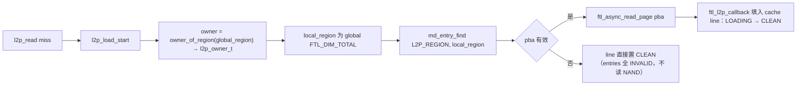

`md_entry_find` 是 `entries[]` 线性扫描（2048 条）。**它不读 NAND**——Directory
是 SRAM 常驻的；读 NAND 的是随后加载 region 页的命令（未映射则根本不发命令）。
`md_block_is_metadata` 的 live 日志块判定改用 `l2p_live[g]`（O(1)，不再扫 entries）。

**启动加载**（`md_load`）：

```text
① md_fixed_fill：铺基础层（与 md_init 共用）
   对 r = 0..2047：entries[r] = {type=L2P_REGION, id=r, pba=NAND_PBA_INVALID}
   （= 未映射；没有物理页，也没有固定回退位置）
② md_ring_locate(目录检查点池) 找最新“整条校验通过”的 record
③ 读胜者各页，逐页校验 chunk_index / sequence / layout_version，装配覆盖对应区间
   - 镜像池：每页先读 P0 副本；不可信时回退 P1 副本（sequence 必须等于被选中的
     record sequence，绝不跨 record 拼页）
④ 由装配后的 entries 重建 l2p_live[]：每个合法 pba 的 region 计数一次。
   - 日志块现在在**固定预留区 46..93/plane**；身份仍按分区表判，**不要**写死
     "block >= 某常量"（布局随介质版本演进）
⑤ 日志游标置无效（cur_block_valid=false）——首次追加从**固定 L2P 日志区**取一个
   已擦净块（`md_log_alloc`），绝不复用可能已编程的旧页；**目录检查点游标反向
   恢复**：locate 已给出 `dir_ckpt_write_idx` / `dir_ckpt_sequence`，直接置
   `dir_ckpt_cursor_valid=true`，避免首次 flush 再扫一遍池
```

无有效目录检查点 ⇒ 返回错误，调用者转 `md_init`（fresh）或格式化（版本判据）。

#### 3.5.7 写路径：append → 写页 → commit

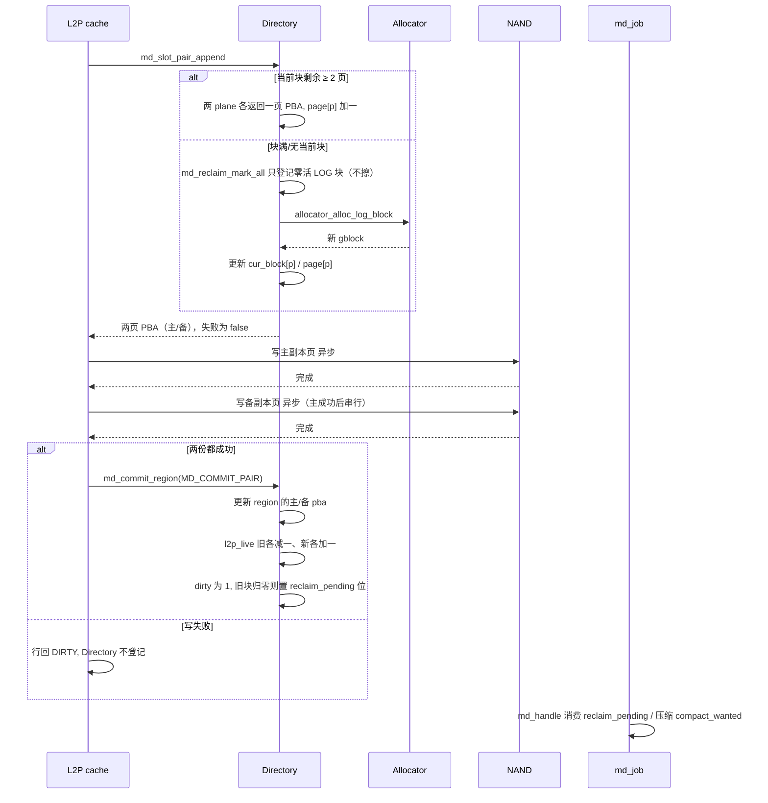

**为什么必须“先写后登记”**：

- 写失败/掉电在写页之前：槽位作废，Directory 仍指旧位置；旧页是上一份完整快照 ⇒ 映射回退一版，
  但 Journal 里有这次更新（写确认路径先 `jrn_append`），回放可恢复。
- 写成功但掉电在 commit 之前：新页是“孤儿”，Directory 仍指旧位置；同样由 Journal 恢复。
- **绝不出现**“Directory 指向未写页”——这是掉电安全的关键。

**`md_entry_update` 的定位**：它是“直接覆盖 entry”的低层写入，供固定层铺设、
目录检查点装配、测试使用；运行期 L2P region 的更新走 `commit_region`，以维护 `l2p_live`。
两者不要混用。

#### 3.5.8 `l2p_live`、回收与压缩

**为什么需要 `l2p_live`**：一个日志块装 64 页 = 64 个 region 的最新位置。只有当这 64 个
region 全部被改写、最新位置都迁到别处后，这个块才没有活引用，才能擦。`l2p_live[g]`
就是这个计数；它只在 `commit_region` 里增减，并在 `md_load` 里重建。

**回收**（`reclaim_pending` 位图 + `MD_JOB_RECLAIM`）：块进入回收前必须满足五条：

1. `l2p_live[g] == 0` **且该块上没有在飞写回的槽位预留**（`md_slot_reserved`，见下）；
2. `g != cur_metadata_block`（已满且零活的当前块会先被摘掉当前身份）；
3. BST 状态为 `LOG`（确实是本池独占的日志块，而不是恰好计数为 0 的用户块）；
4. **`dir->dirty == false`**（on-media 目录检查点已覆盖当前 Directory；见下方 ③→④ 契约）。

⚠ **条件 1 的后半句不可省**：`l2p_live` 只统计**已 commit** 的位置。写回从
`md_slot_pair_append` 取槽到 commit 之间，槽里的数据还在写命令上、Directory 尚未
登记 ⇒ 该块可能 `l2p_live == 0`，但其实马上就会有活 region 落回来。此时换块/擦除
会把在飞数据连同其落点一起丢掉，写完成后的 commit 再把 Directory 指向已擦页
（重启 region 读失败、映射丢失，RISK-MD-06）。所以在飞写回在 `slot_resv[]` 里占一个
表项，块的"可回收"判据同时看它；commit/失败后释放。

登记点：`commit_region` 旧位置归零、`append_slot` 换走零活旧块、换块时的
`md_reclaim_mark_all` 扫描、压缩/擦除失败重试。**登记只置位，不碰 NAND**；
`md_handle` 的 RECLAIM 阶段逐块异步擦除，成功才清位并归还**固定 L2P 日志区**，
失败保留位下轮重试。运行期没有任何同步 `tERASE`（3 ms 会击穿服务预算）。

⚠ **登记 ≠ 可擦**：普通 L2P flush 在 `commit_region` 里登记回收候选时，新位置还只在
RAM Directory 里，on-media 目录检查点仍指向旧块。因此 `MD_JOB_RECLAIM` 在擦除前要求
`dir->dirty == false`；脏则先走 `CP_DIR_CKPT_*` 写一条目录检查点（`dir_ckpt_for_reclaim`），
落盘成功后才回到 RECLAIM。压缩路径原本就是 `CP_DIR_CKPT → CP_RECLAIM`，现在两条路径
共用同一条 ③→④ 契约。`dirty_gen` / `dir_ckpt_gen` 保证写入期间有新 commit 时目录检查点
不会被误标为"已覆盖当前 Directory"；目录检查点成功且未过期后才调用
`md_reclaim_mark_all()`，保证新登记的候选都不在刚写下的目录检查点引用集合里。

**压缩**（抗碎片）：日志区固定 96 块（两份活数据 64 + 工作余量 32）；随机 flush 会让很多块只剩 1–2 个活 region，
`l2p_live` 长期不归零。触发判据是**活日志块数 > `L2P_LOG_COMPACT_TRIGGER`（64）**，
不是用户 Free Pool 水位；压缩挑**活 region 最少**的 victim，把它（以及后续仍能装进
同一新生块的稀疏 victim）连续搬进当前块，落目录检查点后擦 victim。一次新生块可退多个块。
旧实现只在 `free≤32` 且换块时压、一次只搬一个 ⇒ 碎片稳态，日志区把用户容量吃光
（`RISK-MD-07` / `RISK-CAP-02`）。

`md_handle_t` 状态机：

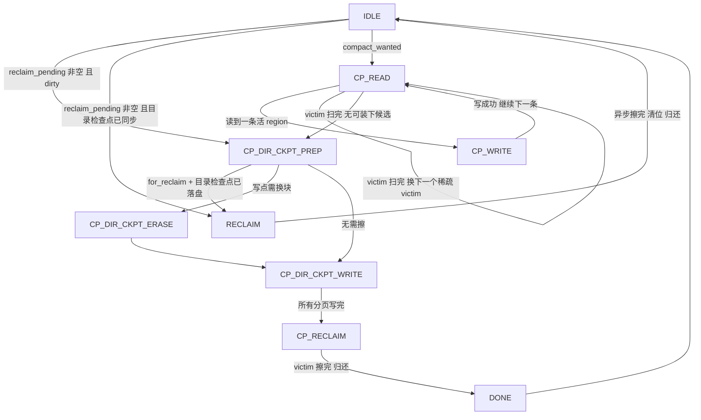

**顺序契约（不可倒）**：

```text
① 搬移 victim 的活 region → ② commit 到新位置 → ③ 写目录检查点（Directory 落盘）
→ ④ 擦 victim → ⑤ 归还固定 L2P 日志区（置 NONE，不回 Free Pool）
```

③ 必须早于 ④：否则掉电后目录检查点仍指向已擦块，那些 region 的映射永久丢失。
**普通回收**（没有搬移，只有 ③→④）同样适用：`commit_region` 释放旧日志块时就会登记
回收候选，但此时新位置只在 RAM Directory 里；所以 RECLAIM 必须先让目录检查点追上
Directory（`dir_ckpt_for_reclaim`），否则就是同一个掉电丢映射。

`dirty_gen / dir_ckpt_gen` 是这条契约的并发保护：目录检查点分 8 页异步写，期间可能有新的
`commit_region`。`dir_ckpt_prepare` 记录当时的 `dirty_gen`，`dir_ckpt_commit` 只有
`ok && dirty_gen == dir_ckpt_gen` 才清 dirty；否则保留 dirty，写下一整条目录检查点。


**失败不回滚**：任一 phase 失败 ⇒ 中止。已登记的 region 指向新页，未搬的仍指向 victim
（victim 不擦）⇒ 两边都有效，下次换块时重来。这是“宁可多占一个块，不丢映射”的取舍。

**服务函数不推进状态机**：`ftl_metadata_callback` 只记结果、release、改 phase；推进留给下一轮
`md_handle`。原因是 `CP_DIR_CKPT_PREP` 在游标未建立时会**同步**扫池定位，
在完成派发里跑就是嵌套泵。

#### 3.5.9 目录检查点：Directory 的全量快照

| 项 | 值/行为 |
|---|---|
| 一条 record | `DIR_CKPT_PAGE_COUNT = 8` 页，覆盖全部 2048 条 entry |
| 每页 | 自包含：magic + sequence + chunk_index + chunk_count + entry_count + layout_version + 256 条 entry |
| 池 | 32 块，每块 8 条 record（64 页 / 8 页） |
| 写序 | 池内 ring 轮转；写满一块先擦池内下一块 |
| 读取 | 找“整条校验通过”中 sequence 最大者；不取半条 |
| 触发 | `dirty` 置位后由元数据 job 异步 flush（无变更阈值），**或** 普通回收在擦除前强制 flush（`dir_ckpt_for_reclaim`）；Checkpoint 前也要求 flush；不在 `md_entry_update` 里同步做 |
| CRC | 无本层 CRC；完整性由下层 FC 的 per-CW CRC + ECC 保证 |

三段式（所有落盘站点统一）：

```text
md_dir_ckpt_prepare(dir, &dir_ckpt)   ← dir_ckpt = {ring, base, idx, seq, need_erase}
    ├─ 定位游标 + 取槽 + 自增 sequence；判定是否需先擦块
    └─ 返回 READY / CLEAN（不脏，跳过）/ FAILED
[metadata_dir_ckpt_erase]  ← 仅 dir_ckpt.need_erase
md_dir_ckpt_page(dir, dir_ckpt.seq, chunk, &page) × 8   ← 纯 RAM 组页
写 8 页（异步命令）
md_dir_ckpt_commit(dir, &dir_ckpt.ring, dir_ckpt.idx, ok)
    ├─ 无论成败推进游标（半编程槽不可复用）
    └─ ok **且** dirty_gen == dir_ckpt_gen 才清 dirty；失败/过期整条作废，保留 dirty
```

**torn write**：单页损坏只让该页作废；一条 record 要求所有页 sequence 一致，
所以半条 record 不会被采用，旧 record 仍在池里可用。

**“过期”保护**：prepare 时记下 `dir_ckpt_gen = dirty_gen`；8 页异步写期间若有新的
`commit_region`，`dirty_gen` 会前进。commit 发现不相等时保留 dirty，下一次 job
在新槽重写整条；**不允许**把“旧快照 + 新变更”误标为已落盘（否则回收会擦掉
目录检查点仍引用的旧块）。

#### 3.5.10 与 L2P cache / Checkpoint 的交界

| 交界 | 行为 |
|---|---|
| `l2p_flush_kick` | `append_slot` → 写 region 页 → `ftl_l2p_callback` 成功 → `commit_region` |
| `l2p_owner_bitmap_snapshot` | Checkpoint 起点取本 die 的局部脏位图；Directory 不参与 |
| `md_is_busy` | CP 的 `cp_regions_flush` 用它区分“压缩在推进”与“真卡死”，不误计 stall |
| CP 的目录检查点阶段 | `md_dir_ckpt_prepare/page/commit`，与压缩 job 共用同一套三段式 |
| 共享 cache 的 owner | `owner_of_region(global_region)` 返回 `l2p_owner_t {dim, metadata_dir, alloc, topo}`；不返回整个 `ftl_ctx_t` |

**`md_block_is_metadata` 的三条分支**（full metadata rebuild / 建池共用）：

1. **固定分区**：遍历 `g_ftl_partitions[]` 按 `first_block/block_count` 判区间；
   固定块号各 die 相同，**与 plane 无关**。v10 起 L2P 日志区（46..93）也在这张表里，
   正常路径由本分支命中。
2. **已登记日志块**（防御分支）：扫 `entries[]` 找 `type=L2P_REGION` 且 pba 落在
   **固定区之外**的块——v10 正常介质不会出现，只用于**旧布局/损坏 Directory** 的
   兼容判定；必须带 plane 比较（同一块号在另一 plane 可能是用户数据）。
3. **当前游标块**（防御分支）：`cur_metadata_block` 可能还没有任何 region 指向它；
   同样必须带 plane 比较。v10 起它也在固定区内，分支 1 已覆盖。

漏掉 2/3 的 plane 比较会把另一 plane 的同号块一起排除——它既进不了 Free Pool，
又被 full metadata rebuild 跳过，落在任何池之外（容量白丢）。

#### 3.5.11 失败语义与掉电点

| 掉电/失败点 | 介质状态 | 恢复结果 |
|---|---|---|
| `append_slot` 之后、写页之前 | 槽位已推进，页仍是擦除态 | 该槽作废；Directory 指旧位置；Journal 回放恢复映射 |
| 写页成功、`commit_region` 之前 | 新页有数据，Directory 未登记 | 新页成孤儿；Directory 指旧位置；Journal 回放恢复 |
| `commit_region` 之后 | Directory 已指向新页 | 目录检查点可能还是旧的 ⇒ boot 从旧目录检查点加载后，靠 Journal 回放补齐；**若该 commit 释放了旧日志块，回收 gate 会先写目录检查点再擦** |
| 目录检查点写一半 | 部分页新、部分页旧 | 整条 record 校验失败；旧 record 仍有效 |
| 目录检查点写入期间有新 commit | 新 entry 不在本条 record 里 | `dirty_gen != dir_ckpt_gen` ⇒ commit 不清 dirty；job 在下一槽重写整条，期间**不允许**回收 |
| 目录检查点已落盘、擦 victim 之前 | 新位置已登记且落盘 | victim 未擦，映射完整；下次压缩重来 |
| 擦 victim 中掉电 | victim 部分块擦除 | `l2p_live == 0` 才擦，且目录检查点已先落盘 ⇒ 无映射指向 victim |
| 回收日志块时掉电 | 无活 region 的块被擦 | 仅在 `l2p_live == 0`、目录检查点已覆盖当前 Directory（`!dirty`）时擦；满足后无映射引用它，安全 |
| 目录检查点池/日志块 NAND 读失败 | record/页作废 | 回退到上一个有效的目录检查点；最坏走 full metadata rebuild |
| 介质版本不符 | 记录作废 | `pfr_media_format` 全片格式化（§2.5） |

⚠ **“没有本层 CRC”不是漏洞**：元数据页的 FC CRC 由 `FTL_PAGE_CFG_META` 统一开启；
CRC 覆盖 META+USER，且自身在 ECC 码字内，能消除“ECC 误纠后看似成功”的假阳性。

#### 3.5.12 常量与出处

| 常量 | 值 | 来源 |
|---|---|---|
| `DIR_CKPT_POOL_BLOCKS` | 32（0..31） | `include/ftl/metadata.h` |
| `DIR_CKPT_ENTRIES_PER_PAGE` | 256 | 同上 |
| `DIR_CKPT_PAGE_COUNT` | 16（主 8 + 备 8） | 同上 |
| `DIR_CKPT_RECORDS_PER_BLOCK` | 4 | 同上 |
| `CHECKPOINT_POOL_BLOCKS` | 8（32..39） | 同上 |
| `BBT_POOL_BLOCKS` | 2（40..41） | 同上 |
| `JOURNAL_BLOCKS` | `CW_NUM` = 4（42..45） | 同上 |
| `L2P_LOG_IDEAL_BLOCKS` | 32（4 MiB 表 ÷ 64 页/块） | 同上 |
| `L2P_LOG_BLOCKS_PER_PLANE` | 48（总 96 gblock = 12 MiB：2 份副本 + 1× 余量） | 同上 |
| `L2P_LOG_BLOCK0` / `FTL_METADATA_AREA_END` | 46 / 98（per-plane） | 同上 |
| `L2P_LOG_COMPACT_TRIGGER` | 64（两份活数据 = 2× ideal 32） | 同上 |
| `METADATA_DIR_ENTRIES` | 2048 | 同上 |
| `md_entry_t` | 7 B | 同上 |
| `md_dir_ckpt_page_t` | 2048 B | 同上 |
| 介质版本 | 12（DIM=1）/ 13（DIM>1） | 同上 |
| `FTL_SUBMIT_TIMEOUT_MS` | 10 | `include/ftl/ftl_module.h`（metadata 提交 deadline） |
| 目录检查点触发 | `dirty` 置位（元数据 job 异步） | `src/ftl/metadata_job.c` |

#### 3.5.13 主流对照

“固定根（root/目录检查点）+ 专用元数据块池 + 日志区 + Directory”是主控固件的常见形态：
固定根给启动一个确定的查找起点，日志区吸收高频更新，Directory 追踪最新位置。
v10 起日志区本身也是**固定预留**（46..93/plane），与目录检查点/CP/BBT 同属固定元数据；
这是“元数据独立、有界、容量扣除”的主流原则（SPDK FTL：nvcache 独立 bdev + 每 band
尾部 P2L；spare 在 device formation 时从 surfaced capacity 扣除）。
旧实现把日志块放在用户 Free Pool 动态分配，已被证明会把用户容量吃光
（`RISK-MD-07` / `RISK-CAP-02`）。具体块数/放置是本仓自定，不冒充行业统一数值。

固定池为什么必须环形轮转、池深如何影响单块磨损与启动扫描，见 §2.3.7。

DRAM-less 侧的关键同构是 **flash reverse-mapping**：不常驻逐页有效位图，
靠页内 META + L2P 反查判有效（§3.13）。这与 Directory 是两件事：Directory 管
“region 页在哪”，META 管“页内某 CW 是否仍被 L2P 指向”。

---

<a id="s3-6" name="s3-6"></a>

### 3.6 L2P Cache（l2p_cache）

#### 3.6.1 背景与需求

L2P 全表 4 MiB，片上 SRAM 只能拿出约 128 KiB 做缓存。没有 cache，**每一次** LBA 访问
都要先读一页 NAND 取映射——读放大不可接受，写路径也要先读后改。

Cache 带来三个新问题，模块必须正面回答：

1. **未命中怎么办**：同步等 NAND 会钉住整个完成泵；本仓选择**异步加载**——
   起一条读命令、返回 `FTL_AGAIN`、调用者下轮重试。
2. **脏行什么时候写回**：写回是整页 2 KiB（region 粒度），不能就地覆盖；只能追加到
   日志块（§3.5）。写回在后台做，前台不感知。
3. **工作集远大于 cache 怎么办**：全盘随机访问时 miss 率接近 100%，驱逐→写回→加载
   反复，称为 thrashing。需要检测并降级，把 NAND 带宽让给前台。

#### 3.6.2 职责与边界

- **做**：64 行 cache、CLOCK 替换、三态读/写、异步载入/写回、全局 region 脏位图、
  thrashing 检测、owner 解析（共享 cache 跨 LUN）、**顺序读触发的下一 region 预取**
  （best-effort，不制造写回）。
- **不做**：不决定 region 页落在哪个物理位置（§3.5）；不写 Journal（§3.7）；
  不决定 Checkpoint 时机（§3.8）。
- **共享模型**：一个 `(ch, ce)` 一份 cache，同 `(ch,ce)` 下的多个 LUN 共用；
  每行用**全局 region** 作键，load/flush 时通过 `owner_of_region` 解析到 `l2p_owner_t`。
- **后台入口**：`l2p_handle(cache, dim, info, status)` 只处理本 owner 的 DIRTY 行；
  档位→`max_kick` 的 `static const` 表在模块内，`thrashing` 降级也在模块内判定。
  同步逃生口 `*_sync` 自己用 drain deadline，不经过本入口。

#### 3.6.3 结构与不变量

`l2p_cache_line_t`：

| 字段 | 大小 | 含义 |
|---|---:|---|
| `entries[512]` | 2 KiB | region 的 512 条 PBA |
| `region_id` | 4 B | **全局** region 编号 |
| `state` | 1 B | INVALID / CLEAN / DIRTY / FLUSHING / LOADING |
| `access_count` | 2 B | CLOCK 访问计数 |
| `fresh` | 1 B | 本次加载正是为当前访问而起；首次触碰不计命中 |
| `load_fail_count` | 1 B | 同一 region 连续加载失败次数（`L2P_LOAD_RETRY_MAX = 3`） |
| `degraded` | 1 B | 最近一次加载在重试耗尽后降级为“全未映射”（`RISK-L2P-04`）；cache 级 `region_degraded_bitmap` 是权威（行驱逐后仍保留） |
| `flush_pba[2]` | 8 B | 双副本写回的两个槽（0=主 / 1=备），一次 pair 预留 |
| `flush_issued` / `flush_done` | 各 1 B | 已提交 / 已完成副数（串行：先主后备） |
| `flush_fail` | 1 B | 任一副本失败 ⇒ 不提交 Directory |
| `load_pba` | 4 B | 在飞/最近一次加载的 PBA |
| `load_use_backup` | 1 B | 本次加载读的是备份副本（成功即交换主备） |
| `prefetch` | 1 B | 本行由顺序读预取发起；完成时 fresh=0，首次 host 命中计 hit 并清标志 |

`l2p_cache_t`：

| 字段 | 含义 |
|---|---|
| `lines[64]` | 约 128 KiB |
| `clock_hand` | CLOCK 指针 |
| `hit_count` / `miss_count` | 开机累计（观测） |
| `window_access` / `window_miss` / `miss_pct` / `thrashing` | 窗口 miss 率 + 滞回 |
| `region_dirty_bitmap[]` | **全局** region 脏位；Checkpoint 按 owner 过滤快照 |
| `load_inflight` / `flush_inflight` | 在飞计数；后者是写回背压闸门 |
| `ch` / `ce` | 本 cache 服务范围 |
| `owner_of_region` / `owner_ctx` | 全局 region → `l2p_owner_t`（dim / metadata_dir / alloc / topo） |

**状态机**：

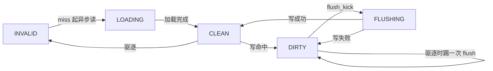

**不变量**：

1. **同一 region 只有一行**。`find` 匹配 CLEAN/DIRTY/FLUSHING/LOADING，只排除 INVALID；
   否则 FLUSHING 窗口会为同一 region 再分配一行 ⇒ 两行分叉。
2. **FLUSHING 可读不可写**：entries 是有效快照，读照常命中；写会让“落盘的是旧快照、
   RAM 是新值”分叉 ⇒ 写一律 `FTL_AGAIN`。
3. **LOADING 不可读不可写**：entries 尚未有效。
4. **写路径两遍式**：先 `ready` 再 `write`；`write` 遇到未驻留的 region 只起加载、不写。
   一遍式会静默丢更新。
5. **`flush_inflight` 是共享 credit 池**：上限 4，防止写回把 FC 命令/缓冲池吃光。
6. **同步逃生口只许结构性同步上下文**：开机、CLI、`fl`、CP；服务函数禁止调用
   （`l2p_sync_pump` 有 `ftl_op_is_in_dispatch()==0` 断言）。
7. **降级不是“合法未映射”**：连续 `L2P_LOAD_RETRY_MAX` 次加载失败（主备两份都读不出）
   后，行置 CLEAN + entries 全 INVALID + `degraded = 1`，并置 cache 级
   `region_degraded_bitmap`（行被驱逐/重载后仍能识别）。
   - **host 读**：`ftl_issue_subop` 在 `p == INVALID` 时查 `l2p_is_region_degraded()`，
     命中返回 `FTL_ERROR`（主机看到读错误），不再静默零填；
   - **开机恢复**：`jrn_replay` / `probe` 用 `l2p_is_region_degraded()` 识别，
     走范围化恢复（保留块元数据快照，`bit=scoped`），不再回退 full metadata rebuild
     （`RISK-BOOT-18`）。
8. **区域写回遵守 WAL 次序（RISK-L2P-09）**：行记录其映射更新依赖的 Journal 序号上界
   `dirty_seq`（= 更新后的 `sequence_counter`）；`l2p_flush_kick` 只有在 Journal 的
   **落盘水位** `persisted_seq ≥ dirty_seq` 时才提交区域页，否则返回 `FTL_AGAIN` 退让
   （计数 `wal_defer`，`info` 的 `wd=`）。理由：掉电时若「区域页已落盘、Journal 页未落盘」，
   region 里的新映射会生效，而 `valid_count` 只有 CP 快照 + 存活回放的数字 ⇒ 计数偏低
   甚至为 0 ⇒ dangling（RISK-ALLOC-10）、GC 按 `valid_cw==0` 误回收仍被 L2P 引用的块
   ⇒ 静默丢数据。同一条规则也保证 F4（`pfr_boot_apply_region_bitmap`）的
   「未置位区 NAND 页更旧」假设成立。
   ⚠ **例外：Journal 页写失败时闸门必须放行**（RISK-L2P-10）。失败页的条目已随
   `page_buf` 清空而丢失，`persisted_seq` 永远覆盖不到那段序号；若继续退让，
   Checkpoint 的区域落盘被永久挡住，而清除失败标记（`write_fail_pending`）的唯一
   途径就是「CP 完成」⇒ 互相等待。此时 CP 本身就是恢复机制：它完成后快照全部 L2P
   并截断 Journal，CP 未提交时新写的区域页无人引用，不产生额外损失。

#### 3.6.4 读路径

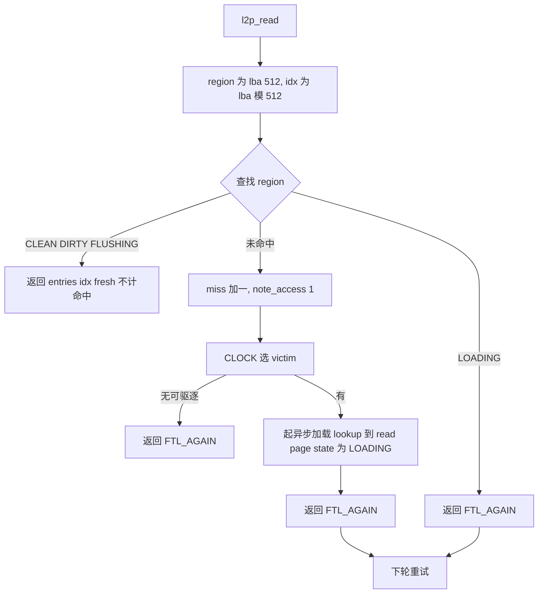

`ftl_l2p_callback` 收尾（`ctx = line`）：

- 成功：`ftl_cmd_read_data` 把整页 region 拷进 `entries`；state = CLEAN。
- 失败：entries 保持全 `NAND_PBA_INVALID`（= 该 region 全部未映射），state = **CLEAN**。
  这样后续访问走“未映射”路径，不会每次重试加载。
- 两者都置 `fresh=1`：下一次命中是本次访问的重试，不计 hit（保持 miss 率口径）。

#### 3.6.5 写路径与写回

```text
l2p_is_ready(lba)  ── 未驻留则起加载、返回 false；命中不记账
l2p_write(lba, pba)
    ├─ 行未就绪（LOADING/FLUSHING）⇒ FTL_AGAIN，不改状态
    ├─ entries[idx] = pba；state = DIRTY；置全局 region 脏位
    └─ fresh? 消费 fresh : access++/hit++

l2p_flush_kick(line)
    ├─ 非 DIRTY / 已在 FLUSHING ⇒ 返回
    ├─ **WAL 闸门**：jrn_persisted_seq < line->dirty_seq 且**无 Journal 写失败**
    │   ⇒ wal_defer++、返回 FTL_AGAIN（写失败时放行，见不变量 8 的例外）
    ├─ flush_inflight 达上限 ⇒ FTL_AGAIN
    ├─ md_slot_pair_append 取两槽（失败 ⇒ 行保持 DIRTY）
    ├─ 起异步写主副本；state = FLUSHING
    ├─ 主副本完成 ⇒ 串行提交备副本
    └─ 完成：两份都成功 ⇒ commit_region_pair + CLEAN + 清脏位
              任一失败 ⇒ 回 DIRTY，Directory 不登记
```

**CLOCK 驱逐**：

```text
① FLUSHING / LOADING → 跳过（在飞）
② DIRTY → 踢一次 flush_kick，跳过本行（不等写回）
③ INVALID → 直接占用
④ access_count > 0 → access_count--，下一行
⑤ access_count == 0 → 回收
⑥ 扫完一圈无可驱逐 → -1（调用者 FTL_AGAIN）
```

#### 3.6.6 Thrashing 检测与降级

```text
每 256 次访问结算一次：miss_pct = window_miss * 100 / window_access
进入：>= 90%；退出：< 70%（滞回）
降级动作：停掉后台**主动** flush；脏行只由驱逐路径按需写回
```

持久性不受影响：L2P 更新在写完成路径里先入 Journal；Checkpoint 也会无条件 flush
快照内的脏 region。**刻意不做** write-through（整页追加模型下省不掉 load，反而放弃合并收益）。
**不做无条件预取**：只做顺序读触发、距 region 末尾 64 LBA 内的下一 region 预取；
`thrashing` / `flush_active` / `trim_active` / 资源不足 / 在飞 load 达 2 时停。
预取只驱逐 INVALID/CLEAN（遇 DIRTY 跳过，不 kick 写回），不计 miss/hit；预取行
第一次被 host 命中时才计 hit。

#### 3.6.7 失败语义

| 情况 | 返回值/结果 | 数据影响 |
|---|---|---|
| `FTL_AGAIN` | 加载中/背压/行在飞 | 调用者下轮重试；不是错误 |
| `FTL_OK` + `NAND_PBA_INVALID` | **未映射**（合法结果） | 读路径零填充；写路径分配新位置 |
| `FTL_ERROR`（越界） | 也回填 `INVALID` | 调用者按未映射处理 |
| 加载失败 | 行 CLEAN + 全 INVALID + `degraded=1` | 该 region 视为全未映射；不反复重试。**boot 恢复**用 `l2p_is_region_degraded()` 区分“合法未映射”与“读失败降级”：后者计入 `l2p_read_errors`，回退 full metadata rebuild，不再报 `restored` |
| 写回失败 | 行回 DIRTY | Directory 仍指旧位置；Journal 可恢复 |
| 所有行在飞 | 驱逐返回 -1 | 调用者 FTL_AGAIN |

#### 3.6.8 常量与出处

| 常量 | 值 | 来源 |
|---|---|---|
| `L2P_CACHE_SIZE` | 64 | `include/ftl/l2p_cache.h` |
| `L2P_FLUSH_MAX_INFLIGHT` | 4 | 同上 |
| `L2P_THRASH_WINDOW` | 256 | 同上 |
| `L2P_THRASH_ENTER_PCT` / `EXIT_PCT` | 90 / 70 | 同上 |
| `L2P_SYNC_GUARD_MAX` | 100,000 轮 | 同上 |
| `L2P_PREFETCH_MAX_INFLIGHT` | 2 | 同上（本仓自定） |
| `FTL_SEQ_PREFETCH_MIN_RUN` / `AHEAD_LBAS` | 2 / 64 | `include/ftl/ftl.h`（本仓自定） |
| `L2P_ENTRIES_PER_REGION` | 512 | `include/ftl/ftl_config.h` |

#### 3.6.9 主流对照

DRAM-less 主控的 L2P cache 普遍采用“按需加载 + 近似 LRU（CLOCK/2Q）+ write-back”，
并用日志/快照保一致性；区别在 cache 行数、替换算法、是否共享与是否做 read-ahead。
**本仓自定**的是 64 行、CLOCK、thrashing 滞回 90/70、“加载失败按全未映射处理”，
以及顺序读触发的单 region 预取（阈值 2 个请求 / 提前 64 LBA / 最多 2 个在飞）。

---

<a id="s3-7" name="s3-7"></a>

### 3.7 Journal（journal）

#### 3.7.1 背景与需求

L2P cache 是 write-back：主机写成功时只改了 RAM，映射还没有写回 NAND。若此时掉电，
数据在 NAND 上、映射却丢了——数据永久不可达。

Journal 是 **L2P 的增量写前日志**：每次映射变更先追加一条 `(lba, old, new)`，
再改 cache。掉电后从 Checkpoint 水位之后回放，恢复映射。

没有 Journal 的替代方案是“每次写都同步把 region 页写回 NAND”，代价是每个 512 B 写
都要写 2 KiB region 页，写放大 4×，且前台等 NAND。Journal 把“持久化”和“写回”解耦：
Journal 追加是小的、顺序的；region 写回可以攒批、后台做。

#### 3.7.2 职责与边界

- **做**：记录格式（两种页型：16 B 通用条目 / 4 B 顺序流条目）、RAM 页缓冲、异步刷页 job、
  环形块切换与擦除、回放（两遍扫描）、写指针恢复、截断（plan/commit）。
- **不做**：不决定 Checkpoint 时机（§3.8）；不管理 region 位置（§3.5）；
  不决定 L2P cache 替换（§3.6）。
- **调用者**：写完成路径 `jrn_reserve` + `jrn_append`（cache 顺序写走 `jrn_seq_ready` +
  `jrn_append_seq`）、GC/WL 的 `MIG_FLUSH_JRN` 屏障、boot 的 `scan/resume/replay`、
  CP 的 `truncate_plan/commit`。

#### 3.7.3 结构与不变量

**页格式**（恰好 2048 B，两种页型由 magic 区分）：

| 页型 | Header | Entries | N |
|---|---:|---|---:|
| `JOUR` · LBA 显式（通用：host 写 / GC / TRIM） | 16 B | N × 16 B：lba / old_pba / new_pba / sequence | 127 |
| `JSEG` · 顺序流映射页（顺序写确认专用） | 16 B | N × 4 B：new_pba（lba = base_lba + 下标） | 508 |
| Padding | — | 余量 0xFF | — |

页头统一 16 B：`magic(4) + page_seq(4) + entry_count(2) + block_seq(2) + base_lba(4)`；
`base_lba` 只对 `JSEG` 有效（`JOUR` 恒 0）。

`JRN_ENTRIES_PER_PAGE = (2048 - 16) / 16 = 127`；
`JRN_SEG_ENTRIES_PER_PAGE = (2048 - 16) / 4 = 508`（都必须推导；写死 128 会写穿 `page_buf`）。

`JSEG` 页的条目坐标全部隐式：`lba = base_lba + k`、`sequence = page_seq + k`。
`base_lba` **由首条 append 落定**（不在序列 START 时定）：顺序确认按提交序到达，上一段
的尾页可能在新 START 之后才确认，按首条确认的 LBA 定基准才能与确认序一致。
两种页型**不混装**：普通条目遇到顺序页会先把它刷出（空页也刷）。

**跨 host 命令续用**：`jrn_seq_begin(lba, need)` 在"顺序页已有条目 + 剩余空间 ≥ need +
`lba == base_lba + 条目数`"时**不刷页**，同一张页继续填到 504 条（63 pair ≈252 KiB）才
在写路径主动 END。`jrn_seq_room()` 是写路径窗口收缩与页满断点的唯一判据；
`jrn_page_writes()` 是页写次数观测口（`info` 的 `jf=`）。依据与端到端取舍见 §3.16.5。

**`l2p_jrn_t` / `jrn_handle_t`**：

| 对象 | 字段 | 含义 |
|---|---|---|
| `l2p_jrn_t` | `topo` | 目标芯片路由 |
| | `alloc` | 坏块查询/标坏走 `allocator_block_is_bad` / `bbt_mark_bad`（无端口结构体） |
| | `handle` | `jrn_handle_t`（本模块全部执行状态，见下） |
| `jrn_handle_t` | `phase` / `need_erase` / `target_*` / `from_*` / `waddr` | 异步刷页 job（IDLE/WRITE/ERASE） |
| | `current_block` / `current_page` / `current_entry` | RAM 写游标（`current_entry` 为 WORD：顺序页可到 508） |
| | `page_kind` / `page_base` | 当前页缓冲的页型 / 顺序页基准 LBA（首条 append 落定） |
| | `sequence_counter` | 全局单调序号 |
| | `merge_floor` | CP 水位；`sequence < merge_floor` 的条目不得原地合并 |
| | `pre_erased_block` | 已被 CP 预擦、回切时跳过擦除的块 |
| | `page_buf[2048]` | 当前页缓冲 |
| | `checkpoint_needed` / `emergency` | 85% / 95% 水位标志 |
| | `bad_mask` / `erase_fail_count` / `erase_fail_block` / `ring_full` | 环形块坏块策略（见不变量 6） |
| | `write_fail_count` / `write_fail_seq` / `write_fail_pending` | 持久性失败观测（F10 屏障） |
| | `start_ms` / `log_ms` | 心跳基准 |

**不变量**：

1. **页是回放单位**：判据是 `page_seq + entry_count > cp_sequence`，不是只看页首页序号。
   只比页首会把跨水位那一页整页跳过，丢掉它的新条目。
2. **同 LBA 合并受 `merge_floor` 约束**：CP 后的覆盖写不能复用 CP 前的 sequence，
   否则块元数据增量回放按 sequence 过滤时漏记。
3. **同一块每圈只擦一次**：CP 预擦的块记 `pre_erased_block`，`jrn_handle` 换块擦除
   回切时跳过擦除。
4. **单飞行**：`job.phase != IDLE` 时不再起新页写；两条写会争同一页地址。
5. **回放不信任页内容**：Journal 模块整体不转断言——页头可能因掉电撕裂而非法，
   属预期情形，返回错误/跳过。
6. **环形块持续擦除失败的处理**：同一块连续失败 `JRN_ERASE_FAIL_MAX`（3）次 ⇒
   置 `bad_mask` + `bbt_mark_bad`（两个 plane），跳到下一个可用块；全部不可用 ⇒
   `ring_full`，停止写入并拒绝新条目（绝不写未擦块，也不再无限重试）。坏块在
   `jrn_ring_scan` 中被跳过，不会把回放误判为“不完整”。

#### 3.7.4 写路径

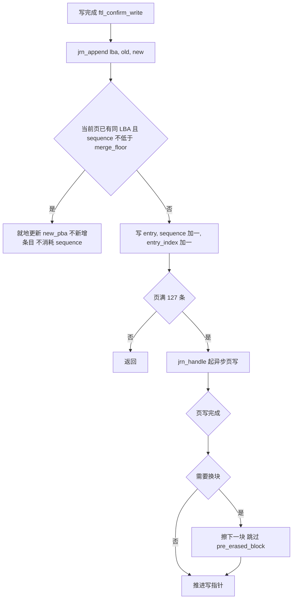

**host 写确认（capacity reserve）**：`ftl_confirm_write` 在追加前调用
`jrn_reserve(n)` 预留本页 `n` 个槽位（按 mask 最坏情况，留 1 个空槽）。不足时
`jrn_reserve` 只调用 `jrn_freeze` 起**异步**页写并返回 `false`，confirm 直接返
`FTL_AGAIN` 待入账；**confirm 内不同步刷页、不调 `ftl_sync_submit_wait` / `ftl_op_drain`**。
预留成功后追加 `n` 条不会触发页满分支，Journal 页由 `jrn_handle` 在后续 service 轮
异步落盘。Journal 模块**不提供同步刷页出口**。

**屏障**：GC/WL 先在 `MIG_WRITE_SETTLE` 用 `jrn_reserve` 预留槽位（不足则挂起），
F10 屏障走 `MIG_FLUSH_JRN`：`jrn_handle` 冲刷半满页，等 job 空闲 **且
`write_fail_pending == 0`**。
页写失败时 pending 会阻止 victim 擦除，直到一次 Checkpoint Header 成功
（其 journal 水位 ≥ 失败点）把 L2P 落盘后才清除。

#### 3.7.5 回放与恢复

```text
jrn_replay(journal, cache, cp_sequence, &entries, block_ctx)
  第一遍：扫 4 × 64 = 256 页，收集 page_seq+entry_count > cp_sequence 的页
          → replay_pages[256]（栈上 2 KiB；下标必须 uint16_t）
  第二遍：按 (page_seq, entry_idx) 递增排序，逐页读、逐条应用
          - l2p_write_sync(lba, new_pba)（开机无人 drain CQ，用同步逃生口）
          - 写成功后检查 l2p_is_region_degraded(region)：若该行是“加载失败降级”
            的空基线，说明旧映射不可信 ⇒ block_ctx->ok = 0（回退 full metadata
            rebuild，不能报 restored；RISK-L2P-04）
          - block_ctx 有效时同步维护 valid_count：new +1 / old -1
            （TRIM 只减 old；old == new 跳过）
          - materialize 失败/越界/下溢 ⇒ ok=0，调用者回退 full metadata rebuild
  jrn_resume(latest, floor=cp_sequence)：写指针落到最新页之后，序号不回退
```

**为什么必须恢复写指针**：`jrn_init` 把游标复位到 `(block0, page0)`、序号复位到 1，
但 NAND 上的环形块**没有被擦**。不接回去会有两个后果：序号从 1 重来 ⇒ 新页排到旧页之后，
下次开机回放过滤把它们整页丢弃；写指针回到已编程页 ⇒ 二次编程（AND 损坏）。

#### 3.7.6 Journal 自身的掉电保护

| 掉电点 | 现象 | 保护 |
|---|---|---|
| A：RAM 缓冲未落盘 | 丢当前页 ≤ 127 条 | 写确认路径已把映射更新交给 Journal；丢的是最近一页，属容忍窗口 |
| B：页编程中途 | 页面部分烧录 | FC per-CW CRC + ECC；坏页整页丢弃 |
| C：编程成功但返回途中掉电 | 不知是否成功 | magic + `entry_count` 精确定位；sequence 连续性检查 |

四层：FC 的 CRC/ECC（下层）、Header magic + entry_count、单调 sequence、
多块环形轮换（不是双写）。Journal 条目本身无独立 CRC——16 B 已被字段占满，
完整性靠整页 CRC/ECC + 页序判定。

#### 3.7.7 失败语义

| 情况 | 结果 | 数据影响 |
|---|---|---|
| 环形写满且 CP 未完成 | `emergency=1`，强制 CP | 前台写入可能被背压 |
| 截断水位不覆盖全部已写条目 | `JRN_TRUNC_NO_TRUNCATE`，不截断 | 最旧块仍持有回放条目，安全 |
| 页写失败 | 条目已随页缓冲丢弃；置 `write_fail_pending` + `checkpoint_needed/emergency` | 迁移侧中止且不擦 victim；CP 把当前 L2P 落盘后清 pending |
| 回放某页读失败 | 跳过该页 | 该页条目丢失；映射回退一版 |
| 回放基线 region 降级 | `l2p_is_region_degraded()` 命中 ⇒ `block_ctx->ok=0` | 旧映射不可信：回退 full metadata rebuild，不报 restored（`RISK-L2P-04`） |
| 序号不连续 | 在该处截断 | 之后的页不应用 |
| 顺序页确认坐标断裂 | `jrn_seq_ready` 刷页并返 false ⇒ 确认待入账重试（落新页） | 无丢失；确认 FIFO 保证重试时同批仍连续（§3.16.5） |

#### 3.7.8 常量与出处

| 常量 | 值 | 来源 |
|---|---|---|
| `JOURNAL_BLOCKS` | `CW_NUM` = 4 | `include/ftl/metadata.h` |
| `JRN_PAGE_SIZE` | 2048 | `include/ftl/journal.h` |
| `JRN_HEADER_SIZE` | 16 | 同上 |
| `JRN_ENTRIES_PER_PAGE` | 127 | 同上 |
| `JRN_SEG_ENTRIES_PER_PAGE` | 508 | 同上 |
| `JRN_FULL_THRESHOLD` | 85% | `src/ftl/journal.c` |
| `JRN_CRITICAL` | 95% | `src/ftl/journal.c` |
| `JRN_MAGIC` | `0x524F554A` ("JOUR") | `include/ftl/journal.h` |
| `JRN_MAGIC_SEG` | `0x4745534A` ("JSEG") | 同上 |
| `JOURNAL_DRAIN_SPIN_MAX` | 100,000 | `src/ftl/journal.c` |

#### 3.7.9 主流对照

“写前日志 + 定期快照截断”是数据库与闪存 FTL 共用的崩溃恢复形态；DRAM-less FTL
把 L2P 增量写进 Journal、用 Checkpoint 限定回放长度，是主流做法（DFTL 等）。
DFTL 的 mapping page 是 512 条 × 4 B、整页回写；本仓的 `JSEG` 页采用同一形态
（LBA 隐式、4 B/条），只是把它放进 Journal 环形页并由 `page_seq` 定序。
**本仓自定**的是 4 块环形、127 条通用页 / 508 条顺序页、85%/95% 水位与同 LBA 合并策略。

---

<a id="s3-8" name="s3-8"></a>

### 3.8 Checkpoint（checkpoint）

#### 3.8.1 背景与需求

Journal 只增不减。如果永远不截断，环形块很快写满，启动回放也越来越长。
Checkpoint 的作用是：

1. 把当前 L2P cache 里的脏 region **全部写回 NAND L2P 表**；
2. 写一条 Header，记录“到此为止的 Journal 水位”；
3. 截断/预擦 Journal 的旧块；
4. 顺带把**块元数据**（每块状态/有效计数/池归属）做成快照，减少开机 full metadata rebuild。

没有 Checkpoint，Journal 会溢出，掉电恢复时间无界；没有块元数据快照，每次开机都要全盘扫描
（约 250~400 ms）。

#### 3.8.2 职责与边界

- **做**：触发判定（水位/写入量/定时/紧急）、CP job 状态机、region 脏位图快照、
  目录检查点协调、块元数据快照编码与落盘、Journal 截断协调。
- **不做**：不定义 Journal 记录格式（§3.7）；不定义目录检查点页格式（§3.5）；
  不决定 L2P 写回细节（§3.6）。
- **调用者**：后台 `bg_task_cp_trigger` / `bg_task_cp_emergency` / `bg_task_cp_join`；
  boot 的 `cp_pool_find_latest` / `load_block_table`。

#### 3.8.3 结构与不变量

**`cp_header_t`（恰好 2048 B）**：

| 字段 | 大小 | 含义 |
|---|---:|---|
| `magic` | 4 B | `CP_MAGIC` |
| `sequence` | 4 B | 本池自己的单调序号 |
| `timestamp` | 4 B | 观测 |
| `region_count` | 4 B | 本 CP 覆盖的 region 数 |
| `region_bitmap[64]` | 256 B | 本 die 的局部 2048-bit 位图 |
| `journal_sequence` | 4 B | 截断/回放水位 |
| `layout_version` | 4 B | 介质版本 |
| `block_word_count` | 4 B | 块元数据 word 数（0 = 无快照） |
| `block_word_bytes` | 4 B | 每 word 字节数（2） |
| `block_page_count` | 4 B | 块元数据页数（4） |
| `block_crc32` | 4 B | 块元数据 words 的 CRC |
| `wear_entry_count` / `wear_entry_bytes` / `wear_page_count` | 4 + 4 + 4 B | 磨损快照几何（4096 / 8 / 16） |
| `wear_page_crc[16]` | 64 B | 每页磨损快照的 CRC |
| `record_pages` | 4 B | 1 + 4 + 16 |
| `padding` | 1672 B | 补齐一页 |

**一条 record = 21 页**：块元数据快照 4 页（16-bit/块 × 4096 = 8 KiB）+ 磨损快照 16 页
（8 B/块 × 4096 = 32 KiB）+ Header 1 页。
**Header 是 commit 页**：块元数据页 + 磨损页必须先写，Header 最后写。

块元数据快照只存**块元数据**需要的量：`valid_count` / `state` / `temp` / 池归属；
磨损快照存 `erase_count` / `read_count` / `rr`（last_ecc / rising_count / health）。
`last_pe_ts` 不存（刻意 volatile，上电后从 0 开始）。

**块元数据 word 位域**（小端、显式移位）：

```text
valid_count(10) | state(3) | temp(1) | pool(2)
pool: 0=NONE / 1=OP / 2=SPARE
```

**`cp_handle_t`**：

| 字段 | 含义 |
|---|---|
| `active` / `phase` / `waiting` | 单飞行 / 阶段 / 有命令在飞 |
| `failed` / `fail_phase` / `stall_ms` / `timed_out` | 中止原因与提交 deadline |
| `region_bitmap[64]` | **job 起点**的本 die 局部脏位图快照 |
| `journal_seq` | job 起点取定的 Journal 水位 |
| `dir_ckpt_*` | 目录检查点池几何、基址、槽位、序号、页序、擦除判定 |
| `hdr_*` | Header 池几何、地址、槽位、序号、擦除判定 |
| `block_page` / `block_ok` / `block_words[4096]` | 块元数据快照进度与缓冲 |
| `wear_page` / `wear_page_crc[16]` / `wear_page_buf` | 磨损快照进度 / 每页 CRC / 组页缓冲 |
| `trunc_addr` / `trunc_next` | Journal 预擦块 |
| `cp_state` | `cp_state_t`：池 unique 序号 / 上次 CP 水位 / 写游标 / 游标有效位 / advance_next |
| `last_ms` | T3 定时基准（上次触发时刻） |
| `cache` / `journal` / `metadata_dir` / `alloc` / `topo` | 窄指针；total_writes 原端口字段无人读，已删 |

**不变量**：

1. **快照点在 job 起点**：脏位图与 `journal_sequence` 一起取定。异步 CP 跨多轮，
   若取“CP 末尾”的水位，CP 期间完成的 host 写会两边都不认（不 flush、不回放）⇒ 丢映射。
2. **顺序不可换**：flush regions → 目录检查点 → 块元数据快照 → 磨损快照 → Header → 截断 Journal。
   Header 一旦落盘，boot 就信 `region_bitmap` 里的 region 已在 NAND 上。
3. **flush 失败 ⇒ 中止**：不写 Header。否则 boot 会预载未落盘的 region。
4. **Header 写无论成败都推进池游标**：半编程槽不可复用。
5. **截断必须覆盖全部已写条目**：水位不足时拒绝截断，最旧块可能仍持有回放条目。
6. **完成服务函数不推进状态机**：`CP_DIR_CKPT_PREP` / `CP_HDR_PREP` 可能含同步定位，
   在完成泵里跑会嵌套泵；推进留给下一轮 `cp_handle`。

#### 3.8.4 触发条件

| 触发 | 条件 | 行为 |
|---|---|---|
| **T1 水位** | Journal ≥ 85% | 设 `checkpoint_needed`，后台执行 |
| **T1 紧急** | Journal ≥ 95% | 设 `emergency`，任何档位都执行 |
| **T2 写入量** | `total_writes % 1024 == 0` | 后台执行 |
| **T3 定时** | 距上次 ≥ 10 s 且 Journal 增量 ≥ 64 | 后台执行（轻载不写空 CP） |

#### 3.8.5 阶段与顺序契约

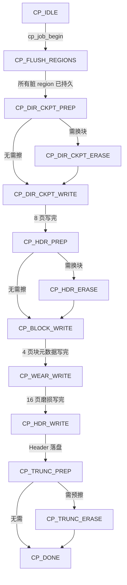

| phase | 动作 | 失败 |
|---|---|---|
| `CP_FLUSH_REGIONS` | 按快照位图逐条 kick L2P flush，等 `flush_inflight` 归零 | 中止，不写 Header |
| `CP_DIR_CKPT_PREP` | 定位目录检查点游标 + 取槽 + 判定擦除 | 中止 |
| `CP_DIR_CKPT_ERASE` | 换块先擦 | 中止 |
| `CP_DIR_CKPT_WRITE` | 逐页写 8 页目录检查点 | 任一分页失败 ⇒ 整条作废，仍推进 |
| `CP_HDR_PREP` / `CP_HDR_ERASE` | 定位 Header 槽 / 换块擦 | 中止 |
| `CP_BLOCK_WRITE` | 逐页写 4 页块元数据快照 | 失败 ⇒ 中止，不写 Header |
| `CP_WEAR_WRITE` | 逐页写 16 页磨损快照（每页 CRC 存 Header） | 失败 ⇒ 中止，不写 Header |
| `CP_HDR_WRITE` | 写 1 页 Header（commit） | 无论成败推进游标；失败中止 |
| `CP_TRUNC_PREP` | 水位判定，算预擦块 | 水位不足 ⇒ 不截断 |
| `CP_TRUNC_ERASE` | 预擦 Journal 最旧块 | 失败仅 LOGW，仍记账（预擦只是磨损优化） |
| `CP_DONE` | 清 active，记日志 | — |

#### 3.8.6 关键流程

1. `cp_job_begin`：单飞行检查 → memset job → 快照局部脏位图 + `journal_seq` →
   `active=1; phase=CP_FLUSH_REGIONS` → `cp_job_step` 推进第一步即返回。
2. 每轮 `cp_handle` 续跑；有命令在飞时只打心跳。
3. 完成由 `ftl_checkpoint_callback` 按 phase 记结果、release、改 phase；**不**调用 kick。
4. `CP_FLUSH_REGIONS` 用 `md_is_busy` 区分“压缩在推进”与“真卡死”，
   不把正常的长压缩计成 CP stall。

#### 3.8.7 失败语义

| 情况 | 结果 | 数据影响 |
|---|---|---|
| L2P flush 失败 | 中止，不写 Header | boot 用上一个 CP + Journal 回放，一致 |
| 目录检查点分页失败 | 整条目录检查点作废，保留 dirty | 旧目录检查点仍有效 |
| 块元数据快照失败 | 不写 Header | 本次 CP 未提交；下次重来 |
| 磨损快照失败 | 不写 Header | 本次 CP 未提交；计数窗口延长，用户数据不受影响 |
| Header 写失败 | 游标仍推进；中止 | 旧 Header 仍有效 |
| Journal 截断失败 | 只记日志 | 预擦是磨损优化，不影响一致性 |
| 提交侧长期背压 | `stall_ms > FTL_SUBMIT_TIMEOUT_MS` 中止 | 下轮重试；不丢映射 |

#### 3.8.8 常量与出处

| 常量 | 值 | 来源 |
|---|---|---|
| `CP_MAGIC` | `0xCCCCCCCC` | `include/ftl/checkpoint.h` |
| `CHECKPOINT_POOL_BLOCKS` | 8 | `include/ftl/metadata.h` |
| 一条 record | 21 页（1 Header + 4 块元数据 + 16 磨损） | `include/ftl/metadata.h` |
| `CP_WRITE_INTERVAL` | 1024 | `include/ftl/ftl.h` |
| `CP_TIME_INTERVAL_MS` | 10,000 | 同上 |
| `CP_T3_MIN_JOURNAL_DELTA` | 64 | `src/ftl/checkpoint.c` |
| `FTL_SUBMIT_TIMEOUT_MS` | 10 | 提交/等待 deadline（`ftl_module.h`） |

#### 3.8.9 主流对照

“全量快照 + 日志截断 + 崩溃安全的提交顺序”是主流 FTL/数据库的通用恢复模型。
块元数据快照（per-block metadata snapshot）对应企业级 SSD 的 block descriptor/accounting
snapshot。**本仓自定**的是 16-bit/块 + 8 B/块的紧凑编码、21 页/record 与 T1/T2/T3 阈值。

---

<a id="s3-9" name="s3-9"></a>

### 3.9 Host 提交 / group / pending（ftl.c + pending.c）

#### 3.9.1 背景与需求

一条 host 请求可能覆盖很多连续 LBA（CLI 可一次写 8 个 LBA，接口允许更长）。
FTL 不能把它当成一条 NAND 命令：

- 读要按 L2P 映射分组：连续 LBA 可能落在不同页/plane；
- 写要按 wbuf 窗口攒页，一个窗口最多 8 个 LBA；
- 子操作异步完成，完成顺序与提交顺序无关；
- 上层只想要**一次**完成通知，而不是每个子操作一次；
- 资源不足时要能“待入账”，下轮继续，而不是丢请求或阻塞主循环。

**group + pending + owners** 就是为这五件事存在的。

#### 3.9.2 职责与边界

- **做**：参数/LBA 校验、完成组分配、`ftl_drain_group` 循环、`ftl_issue_subop` 读写拆分、
  pending 槽登记、组完成聚合（`next==total && outstanding==0`）、待入账项管理。
- **不做**：不建 FC 命令链（§3.15）；不决定 L2P 映射（§3.6）；不执行搬移/恢复（§3.13/§3.14）。
- **上游**：controller / CLI；**下游**：L2P cache、wbuf、allocator、FC 接口。

#### 3.9.3 结构与不变量

**术语**（本节后面反复出现）：

| 术语 | 含义 |
|---|---|
| 子操作 | 一次 `ftl_op_submit` 对应的一个 pending 槽（一条 FC 命令） |
| 组 | 一条 host 请求的完成单元（`pend_group_t`）；完成通知只触发一次 |
| 槽 | `pending_ctx_t.slots[]` 的一项（`pend_req_t`） |
| 窗口 | 一次 wbuf / cache 序列提交的资源单位；**不是**序列边界 |
| 序列（run） | 跨窗口保持的 cache 读/写序列，见 §3.16 |
| D4 | 非所有者提交被门控拒绝 ⇒ 序列在下一窗口边界收尾，见 §3.16 |

**`ftl_io_req_t`**（`ftl_type.h`）：`lba`（uint64）、`buffer`、`count`、
`complete_flag`、`status_out`、`on_complete`、`ctx`。`count` 是**连续 LBA 数**；
plane 配对由 FTL 内部决定，不暴露 `pages`。

**`pend_group_t`**（32 项）：

| 字段 | 含义 |
|---|---|
| `used` / `op` | 组占用 / READ 或 WRITE |
| `lba` / `buffer` | host 起始 LBA / 基缓冲 |
| `next` / `total` | 已下发到的 LBA 偏移 / 总 LBA 数（uint32，可达 868,352） |
| `cmd_remaining` | 同一 host 命令在本请求之后还剩的 LBA 数（0 = 命令末尾；只用于 END 落点） |
| `outstanding` | 已下发、未完成的子操作数 |
| `stalls` | 连续无进展 drain 轮数（上限 8） |
| `agg_status` | 粘性错误：任一子操作失败即非 OK |
| `complete_flag` / `status_out` / `on_complete` / `on_complete_ctx` | 完成通知 |

**`pend_req_t`**（32 项）：

| 字段 | 含义 |
|---|---|
| `used` / `command_id` | 槽占用 / FC 命令 id；待入账时 = `FTL_PENDING_CMD_NONE` |
| `owners` | 贡献本子操作的组位掩码（bit gi） |
| `op` | READ / WRITE / READ_RECOVERY / WRITE_CONFIRM / READ_CACHE / WRITE_CACHE |
| `n_cw` / `cw_bitmap` | 搬运的 CW 数 / 写页的有效 CW 位图 |
| `lba` | 子操作起始**全局** LBA；写页打包时是窗口基址 |
| `buffer` | 读的写回地址；写页打包恒 NULL（数据在 wbuf） |
| `new_pba` / `new_pba1` | 新分配的 plane0/plane1 页 PBA |
| `cache_role` | cache program 序列中的页角色（NONE = 其他写） |
| `cache_gen` | 所属写序列代号；与 `cache_stream.seq.gen` 不一致 ⇒ 迟到完成，不得确认映射（RISK-CACHE-19） |
| `retry_count` | 写失败后已重试次数（透明重试） |
| `park_ms` | 待入账超时预算起点（内部字段，外部不要读） |

⚠ **两套表的分工**：`pend_req_t` 是「命令 → 组」的追踪表（完成派发据此找组）；
`cache_stream.seq.wr` 是「已编程页 → FAIL_CACHE 结论」的 FIFO（早回执后，命令完成 ≠
页结论，页的最终成败由下一命令的 FAILC 给出，见 §3.16.5）。同一页会同时出现在两处，
但两者回答的问题不同：前者回答「这个组还差几次完成」，后者回答「这一页的映射能不能确认」。

**不变量**：

1. **读写必须显式带 `op`**。不能用 `buffer != NULL` 判别：写请求的 buffer 是数据源，
   对写恒非空；旧实现因此让写分支成死代码。
2. **一条 host 请求 = 一个组**；完成通知只在 `next==total && outstanding==0` 时触发一次。
3. **写页可能由多个组拼成**：`owners` 记录贡献组，完成时逐组递减 outstanding。
4. **待入账项不与 FC 命令挂钩**：`command_id = NONE`，防止命令 id 复用后误撞。
5. **组进度按 LBA 偏移计**，不是“子操作序号”：一个子操作最多消费 8 个 LBA，
   消费几个由 `ftl_issue_subop` 现场决定。

#### 3.9.4 提交流程

```text
ftl_submit_read/write
 ① 校验：LBA 范围 / count ≠ 0 / buffer 非空（host 输入 ⇒ 返回码，不转断言）
 ② pend_group_alloc：建组、填通知字段与 total
 ③ 循环（直到 next == total）：
     ftl_issue_subop 按读/写分支消费 1..8 个 LBA
       ├─ 成功：pending 槽登记 → ftl_op_submit → outstanding++
       ├─ FTL_AGAIN：保留 next，本轮结束、下轮重试
       └─ 连续 8 轮无进展（stalls 达 FTL_DRAIN_STALL_MAX）：弃未下发子操作、组报 IO_ERROR
 ④ 命令完成 → pend_group_complete_subop_multi：outstanding--、粘 agg_status
 ⑤ next == total && outstanding == 0 → 通知一次
     （写 status_out、置 complete_flag、调 on_complete，最后才释放组）
```

要点：提交侧只负责「把子操作交出去」，完成侧只负责「把组收齐」；两者靠 pending 表 +
组号连接，提交路径**不同步等待**任何 NAND 完成。

#### 3.9.5 读子操作

```text
ftl_issue_subop(read) 对每个 LBA：
  ① wbuf 命中（该窗口尚未 flush）⇒ 直接从 wbuf.data 拷出，消费 1 个 LBA
  ② 否则 l2p_read(global_lba)
       - FTL_AGAIN（region 未驻留）⇒ `l2p_defer` 由 `l2p_cache_any_inflight()` 派生，
         停止本子操作、下轮重试
       - FTL_OK + INVALID（未映射）⇒ 零填充，消费 1 个 LBA
       - FTL_OK + PBA ⇒ 按 (physical plane, page) 分组
  ③ 页变化/plane 变化时收缩子操作范围
  ④ 校验 PBA 的 plane 与 LBA 低 3 位的 plane 位一致
  ⑤ pend_alloc → 填 read 字段 → outstanding++ → ftl_op_submit
```

`l2p_defer` 的作用：**确实有** region 加载/写回命令在飞时是“有进展”，不能计入 `stalls`；
否则一次正常的随机读会吃掉 8 轮预算，被误判成卡死。

⚠ **判据必须是「在飞命令」，不是「我刚才想加载」**（主流判据：进展 = 已提交命令的完成，
见 `fc_nand_design.md §26` 的队列/完成模型；请求无资源时进 allocation/retry 队列、其它工作照跑，
`docs/reference/README.md` 的 Cosmos+ `request_schedule/allocation.c` / SPDK FTL）。
`l2p_load_start()` 会因**无空闲行**或**提交被拒**而失败并返回 false，此时没有加载在飞；
若仍宣称"在飞"，`ftl_drain_group` 的 stall 检测永久失效 ⇒ 组永不结束 ⇒ cache 序列永不关闭 ⇒
`ftl_op_seq_gate` 持续拒绝后台提交 ⇒ 脏行排不出去（RISK-HOST-14 的环形等待）。
因此 `l2p_defer` 一律由 `l2p_cache_any_inflight(cache)`（`load_inflight || flush_inflight`）派生；
「序列收尾」这类进展由 `bg_progress` 里的 `seq_closing` 表达，不借 `l2p_defer`。

**cache 读序列（选读）**：`ftl_drain_group` 在下发普通子操作前先尝试
`ftl_cache_read_try()`——命中时整窗按 `45h/46h/47h` 批量提交；窗口只是资源边界，
序列可跨窗口、跨 host 命令保持。开序列条件（顺序流检测、pair 对齐、两 plane 物理
连续）、lookahead、128 pair 单段上限、门控与 D4、放弃语义**全部见 §3.16.4**。
本节只保留与提交/pending 相关的两点：序列打开期间后台提交被门控（非所有者被拒置
`break_requested`）；序列状态在 `ftl->cache_stream.seq`（per 实例）。

#### 3.9.6 写子操作

写路径不在 `issue_subop` 里建 NAND 命令，而是交给 wbuf（§3.11）：

```text
ftl_issue_subop(write)：
  wb_handle(APPEND)(ftl, lba, buffer)
    ├─ 窗口变化 ⇒ 先 flush 旧窗口
    ├─ 打开/复用窗口；逐 CW 拷进 wbuf.data[plane*CW_NUM+cw]
    ├─ occupied 置位；owners |= 1<<gi；group.outstanding 加一
    └─ 页满 ⇒ 尽力 flush（失败不影响已受理）
```

真正的 NAND 写、pending 登记、L2P/Journal 确认都在 `wb_handle(FLUSH)` 与完成路径里。

wbuf 写 **page0** 时按 full pair 写（缺失 plane 补零、映射仍按原 CW 位图），保证同 SB
的 page>0 写屏障与恢复 page0 捷径成立。**cache 写序列**也会自己打开新块并写 page0
（`own_page0`）：它靠有序管线保证 page0 失败会中止其后所有页，不依赖「page0 成功后才写
page>0」的提交点屏障；成功结算时记 `page0_programmed`（§3.16.5）。

#### 3.9.7 组完成与脱钩态

```text
pend_group_complete_subop_multi(owners, status)
  ├─ 每个贡献组：agg_status 粘错误；outstanding--
  └─ 每组：used && next==total && outstanding==0
        ⇒ 写 status_out、置 complete_flag、调 on_complete
        ⇒ 最后才 used=0（回调可能重入 submit 再申请组）
```

两种**脱钩态**（FC 命令已释放、组 `outstanding` 不递减；两者都复用 pending 表，但语义不同）：

| 脱钩态 | 触发 | 语义 | 谁推进 |
|---|---|---|---|
| `READ_RECOVERY` | 读 NAND 失败 | **错误恢复**：子操作托管给 RR job；恢复成功则拷回，失败则 IO_ERROR | `rr_handle`（§3.14） |
| `WRITE_CONFIRM` | 写 NAND 成功、L2P region 未就绪 | **待入账**（deferred write completion）：映射入账延后到 region 就绪 | `ftl_confirm_service`（每轮的**写确认结算**步） |

⚠ `READ_RECOVERY` 属于错误恢复，不是「待入账」——复用同一张表只是为了不重复建队列；
两者的推进者和超时语义都不同。脱钩项的 `command_id = NONE`、组 `outstanding` 不递减，
收尾时由各自的推进者统一结算。

**WRITE_CONFIRM 的超时预算是「无进展时长」而不是「待入账时长」**（RISK-HOST-05 支路 (a)）：
写完成路径在依赖**确实有待推进的工作**时刷新 `park_ms`——
`ftl_confirm_progress_pending()`：L2P region 加载在飞 / region 写回在飞 / Journal 页写在飞 /
Journal 换块擦除待做（`need_erase`，此时 `phase` 仍是 IDLE）/ Journal 待刷条目；
全都没有时不刷新，`FTL_GROUP_DRAIN_TIMEOUT_MS`（100 ms）到期按 IO_ERROR 结算。这样后台拥塞（CP 提交被门控、Journal 擦除排队）不会把**有限**的
等待变成 host 写失败，而结构性卡死仍然有界。

#### 3.9.8 失败语义

| 情况 | 结果 | 数据影响 |
|---|---|---|
| 参数非法 / LBA 越界 | 立即 `FTL_ERROR` | 无 |
| pending/组槽满 | `FTL_ERROR`（隐式背压） | 请求被拒，host 自行重试 |
| 子操作遇到 `FTL_AGAIN` | 保留 `next`，下轮重试 | 无 |
| 连续 8 轮无进展 | 弃未下发子操作，组报 IO_ERROR | 已下发子操作照常完成 |
| 读 NAND 失败 | 脱钩（托管给 RR）；不递减 outstanding | 恢复成功则拷回，失败则 IO_ERROR |
| 读成败判据 | **全错误位**（`fc_cmd_status_has_error`），非仅 `NAND_FAIL` | UNC / MATA 只置 `DATA_ERROR`/`MATA_ERROR`，单看 `NAND_FAIL` 会把加扰页当成功搬给 host |
| 读 desc 链短于请求 | 立即 `SSD_STATUS_IO_ERROR` | 尾部缓冲未写，不得当数据交给 host |
| cache program 批次任一成员失败 | 关闭目的 SB；整批不确认映射；已完成的成员立即 IO_ERROR，在飞成员等各自完成回调 | 未确认页成为无映射垃圾，由 GC 回收；host 可重试 |
| 写 NAND 失败 | 关 SB + 标坏；L2P 不动 | 自动回滚到旧数据 |
| 写成功但 L2P 未就绪 | 待入账 → `ftl_confirm_service` | 下轮补齐，不重复记账 |

#### 3.9.9 常量与出处

| 常量 | 值 | 来源 |
|---|---|---|
| `FTL_PENDING_MAX` / `FTL_GROUP_MAX` | 32 / 32 | `include/ftl/pending.h` |
| `FTL_PENDING_CMD_NONE` | `0xFFFF` | 同上 |
| `FTL_DRAIN_STALL_MAX` | 8 | `include/ftl/ftl.h` |
| `FTL_LBA_PER_PAIR` | 8（2 plane × 4 CW） | `include/ftl/ftl_config.h` |
| `FTL_LBA_MAX` | `FTL_HOST_DATA_BLOCKS_PER_INSTANCE × PAGES_PER_BLOCK × CW_NUM × FTL_DIM_TOTAL`（= 868,352） | `include/ftl/ftl.h` |

#### 3.9.10 主流对照

“请求拆分 + 完成组 + 子操作表 + 背压/待入账”是主控固件数据面的标准形态：host 命令被拆成
介质命令，完成按命令 id 回收，组完成只通知一次。**本仓自定**的是 32 项固定表、
8 轮 stall 预算与页打包的 `owners` 位掩码。

#### 3.9.11 FLUSH / TRIM（相邻控制面命令）

**FLUSH 语义边界**（`ftl_flush_begin/step`）：把 wbuf、L2P 脏 region、Journal 刷到 NAND，
**不是** NVMe barrier——返回时不保证已产生新的 Checkpoint；掉电后仍靠“上一个 CP + Journal
回放”恢复。USB 侧 FLUSH 走异步 job（不在 SCSI 回调里自旋），并有 1 s 墙钟上限做
best-effort 完成，避免主机永远等不到 CSW。TRIM 也改为异步 job
（`ftl_trim_begin/step`）：Controller 每轮按 run 推进，L2P region 未就绪或 Journal
容量不足时返 `FTL_AGAIN`，由下一轮 service 继续。

---

<a id="s3-10" name="s3-10"></a>

### 3.10 完成派发面（ftl_op：ctx 旁表 + 实例路由 + op dispatch）

#### 3.10.1 背景与需求

FTL 的命令是异步的：`ftl_op_submit` 返回后，命令在 FC/NAND 里执行，完成后从 CQ 出来。
FTL 需要回答两个问题：

1. 这条完成属于**哪个 FTL 实例**？（多 LUN 下每个实例有自己的 pending/group）
2. 完成后该调用**哪个服务函数**？（host IO、L2P 加载、Journal 刷页、CP、迁移……）

没有这层，提交路径就只能同步等待，前台会被 NAND 延迟钉住；或者在完成回调里靠
“命令类型猜服务函数”，多实例下会路由错。

#### 3.10.2 职责与边界

- **做**：`command_id → ctx` 旁表、`(ch,ce,lun) → ftl_ctx_t` 路由表、
  `ftl_op_submit`（打 op tag + 登记）、`ftl_op_dispatch`（取 ctx + 路由 + 调服务函数）、
  同步等待器。
- **不做**：不拥有各服务函数（各模块自己实现，`g_op_callbacks[]` 只登记）；不做 NAND 调度
  （FC 层）。
- **入口**：`ftl_service_pump` 的 `ftl_op_drain`；**出口**：`g_op_callbacks[tag]`。

#### 3.10.3 结构与不变量

| 结构 | 字段 | 说明 |
|---|---|---|
| `ftl_op_ctx_entry_t` | cmd_id / ctx | `FTL_OP_CTX_TABLE_SIZE` 项旁表（容量推导见 §3.10.7） |
| `g_op_route[CH][CE][LUN]` | `ftl_ctx_t *` | 实例路由 |
| `ftl_op_id_e` | `FTL_OP_HOST_IO / L2P / JOURNAL / CHECKPOINT / METADATA / GC / WL / BBT / READ_RECOVERY / ...` | `g_op_callbacks[]` 下标 |
| `ftl_sync_waiter_t` | cmd_id / done / status | 同步逃生口的等待器 |

**不变量**：

1. **先 take 再 dispatch**：`ftl_op_ctx_take(cmd_id)` 先摘链，防止服务函数重入踩项。
2. **按命令自身的 ch/ce/lun 路由**，不是按提交者；跨实例命令必须回到正确实例。
3. **op tag 必须是 `g_op_callbacks[]` 的合法下标**；未知 tag 按孤儿处理。
4. **服务函数不得自旋完成泵**：`l2p_sync_pump` 有 `ftl_op_is_in_dispatch()==0` 断言；
   服务函数只能提交命令或改状态，推进留给下一轮。
5. **ctx 生命周期覆盖命令在飞期**：同步等待器用栈，其余用静态 job/line/pending 槽。
6. **同一 cmd_id 至多一条表项**：由 `ftl_op_ctx_add` 唯一闸门保证——它先全表查
   cmd_id，命中则**原地覆盖 ctx** 并 `LOGW`，未命中才取空槽。
   理由：`ftl_op_ctx_take` 取的是**首个**匹配项；若允许两条，泄漏（如 FC 的 CQ 满
   强制完成、FTL 观测不到）之后 cmd_id 被复用，`take` 就会把**别人的 ctx** 交给服务函数，
   而本命令自己的表项永久泄漏。

#### 3.10.4 完成路径

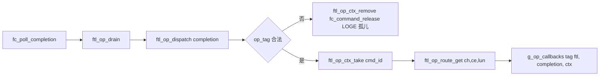

#### 3.10.5 关键流程

1. `ftl_op_submit(cmd, tag, ctx)`：
   - `ftl_op_ctx_add(cmd->id, ctx)`（ctx 可为 NULL，如 host IO）；
   - 设置命令的 `op_tag`；
   - 提交到 FC SQ；失败则 remove + release。
2. `ftl_op_dispatch`：
   - 读 `completion->op_tag`，查 `g_op_callbacks`；
   - 不合法 ⇒ 孤儿：remove + release + LOGE；
   - 合法 ⇒ take ctx → 按 completion 的 ch/ce/lun 路由到实例 → 调服务函数。
3. 同步等待（只给开机/CLI/`fl`）：`ftl_sync_wait_callback` 登记 waiter，自旋泵直到 done 或超时；
   服务函数禁止使用。

#### 3.10.6 失败语义

| 情况 | 结果 | 数据影响 |
|---|---|---|
| 完成是孤儿（无表项/未知 tag） | release + LOGE | 该命令的资源不泄漏；上层 job 可能停摆，由 stall 计数兜底 |
| 路由表项为空 | 路由函数**原样返回 NULL**；ASSERT 在**被调方**服务函数入口 | debug 停机；release 下 NULL 解引用留现场。消费者已全覆盖：6 个服务函数 `ASSERT(ftl != NULL)`，journal / bbt 不用 ftl，sync_wait 与实例无关 |
| 服务函数里调同步逃生口 | `ASSERT(ftl_op_is_in_dispatch()==0)` | debug 立刻暴露嵌套泵 |
| 提交失败 | remove + release，返回错误/背压 | 调用者保留状态，下轮重试 |

#### 3.10.7 常量与出处

| 常量 | 值 | 来源 |
|---|---|---|
| `FTL_OP_CTX_TABLE_SIZE` | `FC_COMMAND_POOL_DEPTH`（= 64） | `include/ftl/ftl_op.h`。**推导**：表按 `command_id` 键 ⇒ 表项数 ≤ 同时在飞命令数 ≤ FC 命令池深度。原值 32 < 池深 64，满则 `ftl_op_submit` 返 `FTL_ERROR`（非背压）⇒ 结构性不可达；`src/ftl/ftl_op.c` 有 `_Static_assert(FTL_OP_CTX_TABLE_SIZE >= FC_COMMAND_POOL_DEPTH)` 防池深漂移 |
| `g_op_callbacks[]` 槽位 | 按 `ftl_op_id_e` 顺序 | `src/ftl/ftl_op.c` |
| 同步自旋预算 | `L2P_SYNC_GUARD_MAX` / 各 job 的 stall 上限 | `include/ftl/l2p_cache.h` 等 |

#### 3.10.8 主流对照

“提交队列 + 完成队列 + 命令 id 旁表 + 按队列/实例路由”是 NVMe/主控数据面的基本模型；
本仓把 NVMe 的 SQ/CQ 简化为 FC 的队列 + 全局完成表，op tag 对应完成服务函数选择器。
**本仓自定**的是固定容量旁表与“先 take 再 dispatch”的防重入顺序。

---

<a id="s3-11" name="s3-11"></a>

### 3.11 页打包写缓冲（wbuf）

#### 3.11.1 背景与需求

CW 级映射下，一次 512 B 写只覆盖一个 CW；而 NAND 按**页**编程（4 CW，双 plane 共 8 CW）。
如果每个子操作都分配一对新页，利用率只有 12.5%~50%：

```text
一次 512B 写 ⇒ 分配 plane0 的 4 个 CW 槽，只用 1 个 ⇒ 75% 浪费
plane0/plane1 各写 1 个 CW ⇒ 一对页只用 2/8 ⇒ 75% 浪费
```

页打包写缓冲把**同一 pair 窗口**内的多次 host 写攒成一页，窗口填满/切换/显式 flush/
空闲时一次编程；两 plane 都有数据就走 multi-plane。页内利用率回到 100%，写指针按页推进。

#### 3.11.2 职责与边界

**实现位置**：`src/ftl/wbuf.c`（`wb_handle` typed 入口 + `wb_has/read` 查询 +
`static wb_flush`（编程）/ `wb_append`（攒入）），
结构体与接口声明在 `include/ftl/wbuf.h`。它是 FTL 层唯一**独立成文件**的子模块中
最晚抽出的一支（其余子模块各自成文件）；`ftl.c` 只调用其接口，不碰 `wb_handle_t` 内部。

- **做**：按窗口累积 CW（`slot = plane*CW_NUM + cw`）、记录占用位图与贡献组、切换窗口时
  flush、空闲 flush、页满尽力 flush、构造一条页写命令。
- **不做**：不决定 L2P 更新（完成路径做，§3.9）；不分配块（调用 allocator，§3.2）；
  不做 GC（分配失败时起紧急 GC，§3.13）。
- **读路径**也用它：未 flush 的窗口数据还在 wbuf，读要先从这里拿（§3.9）。
- **对外接口**：`wb_has` / `wb_read`（读路径，命中即拷贝）/
  `wb_handle(DROP)`（TRIM 丢弃单槽）/ `wb_handle(APPEND)` / `wb_handle(FLUSH)` /
  `wb_handle(MAYBE_FLUSH_IDLE)` / `wb_handle(RESET)`（介质被擦净后整体作废）。
  ⚠ 缓冲的**内部不变量**（清空窗口 ⇒ 结算 `owners`）由 `wb_handle(DROP)` / `wb_handle(RESET)`
  在模块内收口，**不**由调用者手工维护（CLAUDE.md §3.1 / C3）。

#### 3.11.3 结构与不变量

| 字段 | 含义 |
|---|---|
| `data[8][512]` | 4 KiB 页镜像；slot = `plane*CW_NUM + cw` |
| `occupied` | 8 位；bit i = 槽 i 有数据 |
| `open` | 1 = 正持有某窗口 |
| `base` | 窗口基址（低 3 位清零） |
| `owners` | bit gi = 组 gi 贡献过本页 |
| `flushed_pages` / `drop_count` / `error` | 单调观测计数 / 最近一次失败归因 |
| `alloc` / `pending` / `migrate` | 窄指针（init 绑定；无端口结构体） |

**不变量**：

1. `slot` 编码与 LBA 低 3 位同构（plane 位 + CW 位），不另立坐标；位图里的位一律由
   `ftl_cw_bit(plane, cw)` 构造（与全仓所有 CW 位图同一构造器，C9），
   `ftl_lba_pair_slot` 只用作 `data[]` 的**数组下标**（不是位）。
2. **只有提交成功后才清 wbuf**：提交失败（命令池/描述符池满）保留数据，下轮重试。
3. **一页可能由多个组拼成**：`owners` 必须逐组记录，完成时逐组递减；
   每个贡献组对该窗口**至多一次** append（`ftl_issue_subop` 把 `n` 夹到窗口边界）。
4. **窗口切换先 flush**：不同窗口的 LBA 不能混进同一页。
5. **页满尽力 flush**：失败不回滚已受理的写，留给后续 flush/空闲 flush。
6. **`occupied` 清空 ⟺ `owners` 必须结算**：窗口被丢弃（TRIM 清空 / 介质擦净复位）时，
   必须对贡献组按对应状态码逐组递减在飞数（TRIM ⇒ OK，复位 ⇒ IO_ERROR）；只清 `owners`
   会让那些组的在飞数永不归零、host 写组挂死。该不变量由 `wb_handle(DROP)` / `wb_handle(RESET)`
   在模块内收口（§3.1：不变量不得靠外部模块手工维护）。
7. **取数函数必须匹配 `data[]` 布局**：wbuf 的 `data[]` 是 **plane-major pair 镜像**
   （slot = `plane*CW_NUM + cw`），页写必须用 `ftl_cmd_write_data_pair_cw`。
   `ftl_cmd_write_data_cw` 的契约是**单页镜像**（mirror / GC / WL：两个 plane 共用
   `cw*512` 偏移）；误用它会让 plane1 的 4 个 CW 复制 plane0 的前 2KB，表现为
   host 大文件“每 4KB 的后 2KB 重复前 2KB”（`RISK-WB-06`）。
   ⚠ 回归判据不能用 CLI 的 `wr/rd` 固定 pattern（每 2KB 相同，缺陷不可见），
   必须用每 2KB 互不相同的数据（见 `docs/design/usb_msc_verification.md` USB-V05）。

#### 3.11.4 流程

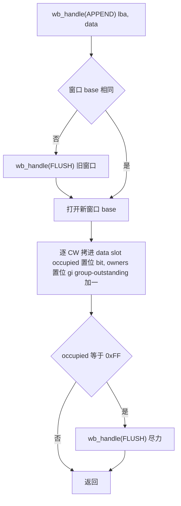

**`wb_handle(FLUSH)`**（资源获取顺序：先做**不占资源**的余量检查，再取页对；
命令/desc/buffer 由 `ftl_async_write_pair_cmd` 在页对之后分配，失败由统一出口归还页对）：

```text
① host 预算检查 ftl_fc_host_budget_ok()（不足 ⇒ FTL_AGAIN；此时未占用任何资源）
② pending 表余量检查（pend_slot_get_count >= FTL_PENDING_MAX ⇒ FTL_AGAIN）
③ alc_super_open_alloc_pair(ALC_SUPER_ALLOC_HOT, pba)
     失败 ⇒ mig_gc_request_urgent() + FTL_AGAIN（未占用资源）
④ page0 异步写屏障：本页覆盖的 plane 中 page>0 且该 plane 的 page0 未完成
     ⇒ alc_super_open_rewind_pair + FTL_AGAIN
⑤ nplanes = ftl_cw_bitmap_plane_count(occupied)；n_cw = ftl_cw_bitmap_popcount(occupied)
     page0 ⇒ 缺失 plane 补零、write_bitmap = FTL_CACHE_FULL_CW
⑥ ftl_async_write_pair_cmd：命令头 + ftl_cmd_setup_ppa_pair_cw + ftl_cmd_write_data_pair_cw
     （plane-major pair 镜像）；命令/desc/buffer 在此分配（失败 ⇒ 错误出口）
⑦ pend_alloc：逐字段填 owners / op / n_cw / cw_bitmap / lba / new_pba*；pend_validate
⑧ ftl_op_submit(FTL_OP_HOST_IO)（失败 ⇒ pend_remove + 错误出口）
⑨ 提交成功后才清 wbuf（open=false / occupied=0 / owners=0）；打一行 LOGD 观测

错误出口（④~⑧ 任一失败，H8 的唯一 goto 出口）：
     fc_command_release（cmd 非空时）+ alc_super_open_rewind_pair（归还那对页）
     缓冲原样保留 ⇒ 下轮重试
```

⚠ 取到页对后**任何**失败都必须 `alc_super_open_rewind_pair` 归还：命令从未提交 ⇒ 页从未被编程，
归还是安全的；不归还则每次重试白烧 2 页，表现为**容量无声流失**（CLAUDE.md §3.1）。

**空闲 flush**：`wb_handle(MAYBE_FLUSH_IDLE)` 在 `ftl_service` 的 **wbuf 空闲 flush** 步检查“是否还有写组
指向当前窗口”；没有就 flush，确保 host 收尾不会无限等待。

#### 3.11.5 失败语义

| 情况 | 结果 | 数据影响 |
|---|---|---|
| 分配不到页 | 释放命令槽 + `FTL_AGAIN` + 紧急 GC | 数据仍在 wbuf，下轮重试 |
| 命令池满（`fc_command_alloc` NULL） | `FTL_AGAIN`（尚未取页对） | 同上 |
| pending 表满 | `FTL_AGAIN` + 归还页对 | 同上 |
| 命令提交失败（SQ 满） | 先摘 pending，再归还页对 + `FTL_AGAIN` | 同上 |
| 建链/填数据失败 | `FTL_ERROR` / 原样上抛 + 归还页对 | 同上（缓冲保留，但永久错误不再重试） |
| PROGRAM 失败 | 关 SB + 标坏；L2P 不动 | 自动回滚旧数据 |
| TRIM 清空窗口 / 介质擦净复位 | `wb_handle(DROP)` / `wb_handle(RESET)` 结算 `owners` | 未落盘写被丢弃（TRIM 无映射变更；复位按写失败收尾） |
| 中途掉电 | wbuf 是 RAM，丢失未提交页 | 这些 host 写尚未 acked，属容忍窗口 |

#### 3.11.6 常量与出处

| 常量 | 值 | 来源 |
|---|---|---|
| `FTL_LBA_PER_PAIR` | 8 | `include/ftl/ftl_config.h` |
| wbuf 数据 | 8 × 512 = 4096 B | `wb_handle_t.data` |
| `occupied` | 8 bit | 同上 |
| `owners` | 32 bit（`FTL_GROUP_MAX`） | 同上 |

#### 3.11.7 主流对照

写缓冲/页打包是主控数据面的常规优化：消费级用 SLC cache/写缓冲，企业级用 write
coalescing。本仓没有 SLC cache（介质本身就是 SLC），只做**同窗口页打包**；
**本仓自定**的是 8-CW 窗口与 owners 位掩码的完成聚合方式。

---

<a id="s3-12" name="s3-12"></a>

### 3.12 FTL service 与后台调度器（ftl.c + bg_scheduler）

#### 3.12.1 背景与需求

FTL 是单线程 superloop：没有 RTOS 任务，没有抢占。每转一圈它必须同时做三件事：

1. **推进 NAND**：FC 的命令引擎与完成队列是全局的，每轮只能推一次；
2. **服务 host IO**：补发未下发的子操作，处理待入账的写确认；
3. **跑后台**：Journal 刷页、L2P 写回、CP、GC、WL、BBT 持久化、读恢复。

如果后台按“每轮全跑”实现，host 忙时会被拖慢；如果后台完全让路，GC 不推进，Free Pool
耗尽后写会永久失败。于是需要一份**确定性的前台保护规则**：按负载分档，给每档固定的
任务集合与预算。

**先记住这个模型，本节其余内容都是它的推论**：

> **所有 kick 都是“提交一步就返回”。** 任务函数被调一次，只做一件事——把一条命令
> 挂到 FC 队列 / 推进状态机一步，然后立刻返回。真正的耗时（tNAND 读、写、擦）发生在
> **下一轮**或**完成回调**里。

由此得到两个直接结论：

- **“预算”按工作量单位记，不按时间。** 一次 kick 通常 = 一条命令 ≈ 1 个 unit；
  每档位给固定配额（IDLE/NORMAL 4、BUSY 1），配额不足即截断。L2P 一次 kick 的具体
  条数由模块内档位表（`L2P_FLUSH_MAX_*`）再收一层。
- **确定性保护靠“档位 → 允许哪些任务 / 配额几条”，不靠计时。** 时间只做单轮墙钟
  兜底（`BG_ROUND_HARD_LIMIT_US`，只在任务之间检查、不能抢占）：机器快慢不影响
  配额，兜底只防某个 kick 异常膨胀。

#### 3.12.2 术语

本节几个行话，首次出现即此义：

| 术语 | 含义 |
|---|---|
| **kick** | 调用一次任务函数：只提交一步 / 一条命令就返回，不等完成 |
| **档位** | 按 host 繁忙度选出的三档负载：`IDLE` / `NORMAL` / `BUSY` |
| **预算（工作量）** | 本轮预算任务可用的工作量单位；每次 kick 扣 `units`，不足即截断 |
| **must-run** | 正确性关键任务：无条件每轮执行，**不 gate、不占配额** |
| **表序** | `s_bg_tasks[]` 中的位置。**表序 = 执行序 = 优先级**，没有独立的 `priority` 字段 |

#### 3.12.3 职责与边界

- **`ftl_service_pump()`**（实例无关，每轮一次）：`fc_service()` ≤ 4 次 + 完成表抽干。
- **`ftl_service(ftl)`**（每实例一次）：
  - 实例步骤（按执行序，唯一定义见 `include/ftl/ftl.h` 的 `ftl_service()` 契约）：
    **元数据候选池重算**（`md_pool_service`）→ **写确认结算**（`ftl_confirm_service`）→
    **cache 序列确认**（`ftl_cache_wr_confirm_step`）→ **host 补发**（`ftl_drain_group`）→
    **序列收尾**（`ftl_cache_seq_idle_guard` / `_close_step`）→
    **wbuf 空闲 flush**（`wb_handle(MAYBE_FLUSH_IDLE)`）→ **后台调度**（`bg_scheduler_service`）。
- **`bg_scheduler.c/h`**：一个模块承载两层内容——
  - **引擎**：必跑任务 + 预算任务 + 配额截断（函数本身零 kick 知识，
    不认识任何具体任务）；
  - **FTL 策略段**：10 个 `static` 适配器把异构 kick 包成 `void(ftl_ctx_t *)` + 任务表
    `s_bg_tasks` + 档位配额表 `s_bg_level_cfg` + `bg_scheduler_init` /
    `bg_scheduler_level_select` / `bg_scheduler_service`。

  两层同放一个 `.c` 是刻意的：引擎的接口就是“一张 `bg_task_t` 表”，把策略段拆出去只会让
  引擎多一层间接；而“档位是 FTL 域策略”这条边界，靠**引擎不决定档位**（档位由策略段在同轮
  先写入 `sched->level`）来保证。
- **GC / WL / predict 的求值节拍**在 migrate handle 内自持，不单列成任务。
- **不做**：不实现各后台任务（各模块的 `*_handle`）；引擎函数不决定档位。

#### 3.12.4 结构与不变量

`bg_task_t`：`func` / `mask` / `units`（工作量单位）/ `must_run`（`bool`）。
`bg_scheduler_t`：`tasks[BG_TASK_COUNT]`（当前 10） / `task_count` / `cfg`（本轮生效的档位配置，
引擎在 `run` 起点发布，任务读它而不各自反查档位表） / `level`（本轮档位，模块入口
直接读取）。
`bg_level_cfg_t`：每轮工作量配额 / 任务掩码（预算任务位集合）。

⚠ **表序 = 执行序 = 优先级**：`bg_task_t` **没有** `priority` 字段——表序已是优先级坐标，
再加一个平行数字就是第二套坐标（C9），且必然漂移。任务掩码位由表项 `.mask` 显式声明
（`BG_TASK_*`），表序不再兼职位号。加任务 = 在 `s_bg_tasks` 里插一行并给 `.mask` 新位 +
视需要加入 `BG_*_TASKS` 预设 + 同步 `BG_TASK_COUNT`，并确认对应档位的 `total_units`
足够容纳新任务（配额不够会被截掉）。表项数由 `_Static_assert` 在编译期
锁死为 `BG_TASK_COUNT`（不等即编译失败，避免越界写 `tasks[]` / 漏装载）。

**must-run 的归纳判据（6 项同一条）**：**有前台请求或在飞 job 正在等它**——不跑就死锁或
host 挂起。逐项理由见下表“语义”列，不必逐个记。

**10 项任务**（任务位宏 `BG_TASK_*`；表序 = 执行序 = 优先级）。只列预算任务的配额（must-run 不占配额）：

| 表序 | 任务 | 类型 | 配额（units） | 语义 |
|---:|---|---|---:|---|
| 0 | Checkpoint 推进 | must-run | — | `cp_handle(ADVANCE)`：在飞 CP 跨档位走完 |
| 1 | RR 推进 | must-run | — | `rr_handle`：host 读在等结果 |
| 2 | 搬移推进 + 求值 | must-run | — | `mig_handle`：推进在飞 job；自持 GC 10 ms / WL 5 s / predict 1 s（仅 IDLE，BUSY 不评估） |
| 3 | 元数据目录 | must-run | — | `md_handle`：压缩请求由前台置位，不推进即永久 FTL_AGAIN |
| 4 | Journal 预擦 | must-run | — | `jrn_handle(ERASE_ONLY)`：新环形块没擦不能写 |
| 5 | 紧急 CP | must-run | — | `cp_handle(EMERGENCY)`：Journal ≥95% 每轮响应 |
| 6 | L2P flush | 预算 | 1 | `l2p_handle`；条数上界由模块内档位表决定 |
| 7 | Journal 刷页 | 预算 | 1 | `jrn_handle(FLUSH)`；BUSY 被掩掉 |
| 8 | BBT 持久化 | 预算 | 1 | `bbt_handle`：攒批写（磨损计数随 CP） |
| 9 | CP 触发 | 预算 | 1 | `cp_handle(TIMER)`：T1/T2/T3 |

**档位**：

| 档位 | 条件（`bg_scheduler_level_select`） | 总配额 | 允许的预算任务 |
|---|---|---:|---|
| IDLE | `pending == 0 && queued == 0` | 4 | 表序 6..9 全开 |
| NORMAL | 非 IDLE，且 `pending <= FTL_PENDING_MAX/2` 且 `queued == 0` | 4 | 表序 6..9 全开 |
| BUSY | `pending > FTL_PENDING_MAX/2` 或 `queued != 0` | 1 | **仅表序 6（L2P flush）** |

（`pending` = 待下发子操作数 `pend_slot_get_count`；`queued` = 未完成组数
`pend_group_get_count`；`FTL_PENDING_MAX = 32`，故分界当前为 16。**判据写表达式不写数字**：
池尺寸一改，写死的数就错了。）

**不变量**：

1. **pump 每轮只调一次**：NAND 引擎与完成表是全局单份，逐实例调用会重复消耗配额。
2. **每个实例都要调 `ftl_service`**：漏一个，它的 Journal/CP/BBT/GC 永不推进。
3. **must-run 不 gate、不占配额**：它们是防死锁/防 host 挂起的动作。
4. **确定性保护靠“档位 → 掩码/条数”**，不靠 `elapsed` 计时（理由见 §3.12.1）。
5. **时钟缺失退化**：`time_us` 缺失或恒 0 ⇒ 墙钟兜底失效（配额仍生效，任务照常按
   配额截断）；防刷屏靠各任务内部单飞行/事件门。
   ⚠ 本板 `ssd_platform_register` **拒绝** `time_us == NULL` ⇒ 该分支在本板**不可达**、
   从未被运行验证（见 `known_risks.md` RISK-BG-03）。
6. **`bg_suspend` 最先 return**：全片擦除后 RAM 状态已陈旧，任何后台写都是往干净芯片倒垃圾。
   判定收在 `bg_scheduler_service` 首行（早于必跑任务）。

#### 3.12.5 一轮走查（host 正在连续写）

把上面的规则跑一遍，数字取典型值，只为说明形状：

```text
前提：host 连续写，pending = 20 ⇒ pending > FTL_PENDING_MAX/2（=16）⇒ 本轮档位 = BUSY
      cfg = { total_units = 1, task_mask = BG_TASK_L2P_FLUSH }

① 必跑任务（must-run，表序 0..5，全部执行，不计配额）
  cp_handle(ADVANCE)        → 在飞 CP 推进一步（没有在飞则空操作）
  rr_handle                 → 读恢复：无待恢复页则空操作
  mig_handle                → 在飞 GC/WL 推进一步（BUSY 档不发起新的求值）
  md_handle                 → 目录压缩（有 compact_wanted 才动）
  jrn_handle(ERASE_ONLY)    → 新环形块没擦过就补一次擦
  cp_handle(EMERGENCY)      → journal 未到 95% 则空操作
  ⇒ 最坏 6 次 kick，每次只提交 ≤1 条命令

② 预算任务（按表序 + 工作量配额；另有 4 ms 墙钟兜底）
  units_left = 1
  表序 6 L2P flush : 掩码允许、units = 1 ≤ 1 → 执行
                     l2p_handle 按档位踢 ≤ L2P_FLUSH_MAX_BUSY(1) 条写回
                     units_left -= 1 ⇒ 0
  表序 7 Journal   : 掩码不含 → 跳过
  表序 8 BBT       : 掩码不含 → 跳过
  表序 9 CP 触发   : 掩码不含 → 跳过
  ⇒ 本轮实际发生：最多 6 次 must-run kick（多数是空操作）+ 1 条 L2P 写回命令
```

对照 **IDLE** 档（host 空闲）：`total_units = 4`、四项预算任务全开 ⇒ L2P 写回、
Journal 刷页、BBT、CP 触发各执行一次，配额用尽即截断；单轮墙钟超过 4 ms 也会兜底截断。
host 空闲时后台跑满。

**BUSY 档为什么只留 L2P 写回**：写回是**释放 L2P 缓存行**的唯一途径——它是写路径的
依赖项，不是“可选优化”。其余三项（Journal 刷页 / BBT / CP 触发）停在 BUSY 不会让 host
卡住：Journal 页满时 `jrn_append` 自己会起刷页（§3.9.4），BBT 攒批、CP 有紧急水位兜底。

#### 3.12.6 主循环

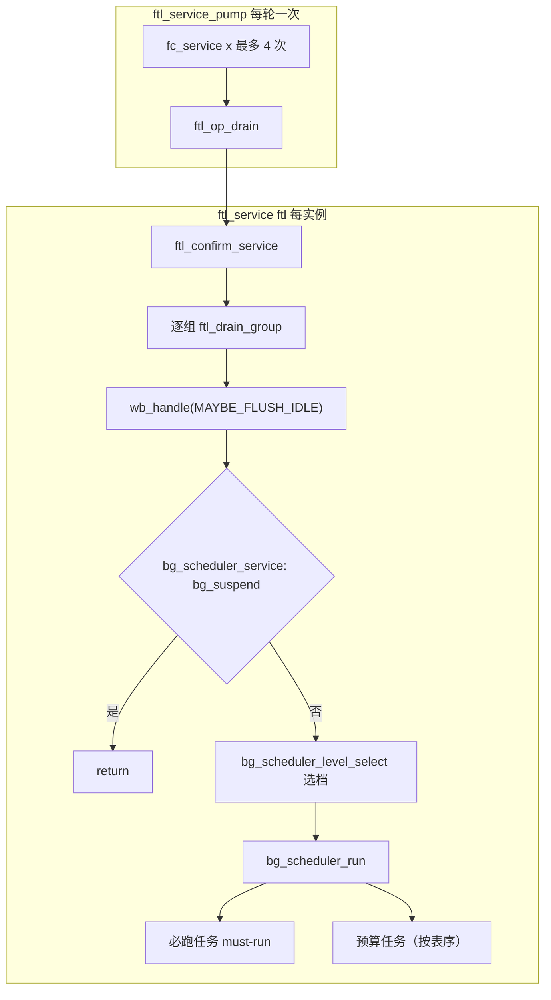

#### 3.12.7 关键流程

1. 主循环：`cli_service_poll` → `ftl_service_pump` → 逐实例 `ftl_service`。
2. 档位选择：`inflight = pend_slot_get_count + pend_group_get_count`；0 → IDLE；
   `pending > FTL_PENDING_MAX/2` 或 `queued != 0` → BUSY；否则 NORMAL。
3. 先跑必跑任务：按表序跑所有 `must_run`，无条件、不计配额。
4. 再跑预算任务：按表序扫；**本档位掩码允许且配额够**才跑（每次扣 `units`）；
   单轮墙钟超过 `BG_ROUND_HARD_LIMIT_US`（4 ms）即兜底截断（不抢占）。
5. 每个 kick 只提交一步/一条命令，真正的推进在下一轮或完成回调里。

#### 3.12.8 与相邻章节的关系（读本节前先看这三条）

| 相邻章节 | 关系 |
|---|---|
| **§3.9.5 读子操作 / `l2p_defer`** | 前台 `ftl_drain_group` 能否推进，取决于 L2P region 是否驻留；`l2p_defer` 是它给 drain 的“有进展”信号。⚠ 该信号**必须由在飞命令派生**（`l2p_cache_any_inflight`），否则 drain 永不判卡死、host 组永不结束，本节的后台任务会被序列门控长期挡住（RISK-HOST-14 的环形等待） |
| **§3.10 完成派发面（`ftl_op`）** | `ftl_op_seq_gate` 决定**后台提交能否成功**：cache 序列 `active/draining` 期间只放行所有者；被拒的 kick 返回 FTL_AGAIN，本轮白跑、下轮重试 |
| **§3.11 页打包写缓冲（wbuf）** | `wb_handle(MAYBE_FLUSH_IDLE)` 属于 **wbuf 空闲 flush** 步（host IO 收尾），不在本节的**后台调度**步；它是“没有写组会再 append 时就把缓冲编掉”的确定性动作 |

#### 3.12.9 失败语义

| 情况 | 结果 | 影响 |
|---|---|---|
| 某任务提交被背压 | kick 保留状态，下轮重试 | 后台变慢，不影响正确性 |
| must-run 任务自身卡死 | 心跳日志（job phase/age）暴露 | 由各 job 的 stall 上限中止 |
| 时钟缺失 | 墙钟兜底失效（配额仍生效） | 靠内部事件门防刷屏 |
| `bg_suspend` 置位 | **后台调度**步整体跳过 | 只能复位恢复（诊断/擦片后） |

#### 3.12.10 常量与出处

| 常量 | 值 | 来源 |
|---|---|---|
| `NAND_SUBMIT_BUDGET` | 4 | `include/ftl/ftl.h` |
| `L2P_FLUSH_MAX_NORMAL` / `L2P_FLUSH_MAX_BUSY` | 4 / 1 | `include/ftl/l2p_cache.h` |
| `GC_EVAL_INTERVAL_MS` | 10 | `include/ftl/gc.h` |
| `GC_LOG_INTERVAL_MS` | 1000 | `include/ftl/gc.h` |
| `RR_SCAN_INTERVAL_MS` | 1000 | `include/ftl/read_recovery.h` |
| `BG_TASK_COUNT` | 10 | `include/ftl/bg_scheduler.h` |
| `FTL_PENDING_MAX` | 32（档位分界 = 它的一半） | `include/ftl/pending.h` |
| 档位配额 | 4 / 4 / 1（工作量单位） | `src/ftl/bg_scheduler.c` |
| `BG_ROUND_HARD_LIMIT_US` | 4000 | `src/ftl/bg_scheduler.c` |

#### 3.12.11 主流对照

“主循环 + 独立后台调度器 + 每任务配额/优先级”是主控固件的常见形态
（SPDK core poller、企业级后台核）。**本仓自定**的是 10 项任务表、三级负载→固定配额
（不是连续带宽调节）与 must-run 集合的划分。

<a id="s3-13" name="s3-13"></a>

### 3.13 GC 策略与迁移引擎（gc + migrate）

#### 3.13.1 背景与需求

异地更新会不断产生无效数据：一个 Closed SB 里可能只剩 10% 的有效 CW。空间要回收，
就必须把有效 CW 搬到新位置、更新 L2P，再擦掉旧块。没有 GC，Free Pool 只出不进，
写最终永久失败。

搬移本身很贵：最多 64 页 × 2 plane 的读 + 写 + 2 次擦，同步执行会阻塞完成泵数十毫秒。
而它有一个**在完成回调里**的入口（写路径分配不到页时的紧急 GC）。因此搬移必须是
**异步 job**：每轮只推进一条命令，host IO 与后台搬移在 superloop 上重叠。

#### 3.13.2 职责与边界

- **`gc.c`（策略）**：触发判定（空间压力 + 磨损）、victim 四维加权选择、共用读原语
  （`gc_read_page_with_lba` / `gc_decode_cw_lba`）。
- **`migrate.c`（引擎）**：`mig_handle_t` 状态机；GC / 静态 WL / 预测性退役共用一台。
- **不做**：不决定块元数据（allocator）；不决定坏块（BBT）；不做读恢复（RR）。
- **入口**：`mig_handle`（自持节拍，内部才调 `mig_gc_begin` / `mig_wl_begin` / `mig_predict_begin`）；`mig_gc_request_urgent()` 只登记紧急原因；完成服务
  `ftl_migrate_callback`（GC 与 WL 共用）。

#### 3.13.3 结构与不变量

`mig_handle_t`：

| 字段 | 含义 |
|---|---|
| `active` / `waiting` / `aborted` | 单飞行 / 有命令在飞 / 中止 |
| `phase` | `MIG_READ → READ_SETTLE → (WRITE → WRITE_SETTLE | WRITE_BATCH → WRITE_SETTLE_BATCH) → FLUSH_JRN → ERASE → DONE` |
| `kind` / `post` | GC/WL/PREDICT；GC+WL=FREE，PREDICT=RETIRE |
| `page` / `plane` | 当前页/plane |
| `victim` | **按值拷贝**的 SB（closed 列表 swap-remove，不能持指针） |
| `cw_bitmap[plane]` / `base` / `cw_lba` / `src` / `dst` | 本页逐 CW 有效位、页基址、META LBA、源/目标 PBA |
| `migrated` | 已搬有效 CW 数（>0 才需要 F10 屏障） |
| `page_buf[plane][2048]` | 页镜像（异步读落此、写从此取） |
| `alloc` / `journal` / `cache` / `total_writes` / `topo` | 窄指针（init 绑定；无端口结构体） |
| `stall_ms` / `wait_ms` | 提交背压 / 等外部模块的 deadline 起点 |
| `timed_out` / `timeout_phase` | 超时归因（status 上报） |
| `fail_gblock[plane]` / `fail_count[plane]` | **每个 plane 源块**的连续读失败计数（跨 job 保留；整块迁移成功或标 BAD 才清） |
| `read_fail_streak` / `paused` | 系统性读失败熔断计数 / 已熔断标志（跨 job 保留；整块迁移成功才清零 `RISK-GC-10`） |
| `gc_eval_last_ms` / `wl_eval_last_ms` / `predict_last_ms` | handle 自持的求值节拍 |
| `reclaimed_count` / `novictim_count` | 单调进展计数（外部经 `migrate_*_count()` 查询） |
| `urgent_gc` | `mig_gc_request_urgent()` 的登记位 |
| `error` | 最近一次中止归因 |

**不变量**：

1. **顺序**：先写新页 → 改 L2P + Journal → 等 Journal 落盘（F10）→ 擦旧块。
2. **分配不到目标页 ⇒ 中止且不擦 victim**。先擦后搬会丢掉尚未搬移的有效页。
3. **擦除失败不退役**：擦不掉的块归 BBT；同时标 RETIRED 自相矛盾。
4. **单飞行**：每实例同时一个 migrate handle；GC/WL/predict 由调度器顺序与各自触发门控协调。
5. **有效性唯一真值是 META + L2P 反查**：没有常驻位图；`cw_bitmap` 是本次 job 的临时结果。
6. **源块 gblock 不缓存**：快路径（valid_total==0）不经过 READ；缓存字段会是 0。
   真值始终是 `victim.plane_blocks[plane]`。
7. **完成错误即中止**：READ / WRITE 完成带 `FC_CMD_STATUS_ERROR_MASK`（或数据拷出失败）
   ⇒ 中止 job，victim 不擦。只有**擦除页**（FC 的 desc 报 `FC_CW_STATUS_EMPTY`，即整条 CW 1 比特占比 ≥99%）才允许跳过；
   擦除页不是读错误——全 0xFF 的 CW 解码必然失败，FC 单独识别后按空页上报（`RISK-GC-11`）。
8. **提交时重查 L2P**：READ_SETTLE 到 WRITE_SETTLE 之间 host 写/TRIM 可能已改映射；
   只有 L2P 仍指向源 CW 才迁移，被抢先的 CW 跳过（不再引用 victim）。
9. **Journal 失败即中止**：`jrn_append` 返回 false、`l2p_write` 失败、
   或 Journal 页写失败 pending ⇒ 中止 job，victim 不擦；pending 直到 CP 确认 L2P 落盘。
10. **读失败按 plane 源块累计**：单页读成功**不**清零；同一源块累计
    `MIG_VICTIM_READ_FAIL_MAX`（3）次 ⇒ `bbt_mark_bad` + 摘除该 plane 的 Closed 条目，
    让 GC 换候选（`RISK-GC-07` / `RISK-MIG-02`）。否则坏页之前的页每轮先成功读一遍，
    阈值永远达不到 ⇒ 永久重选同一 victim、容量不再增长。两个 plane 块号不同，必须
    分开计数（交替失败不能互相清零）。
11. **只读已编程页**：搬移按 `victim.next_page` 截断扫描区间 `[0, next_page)`。
    半写块（提前关闭 / GC 目的块）的空洞页物理上是擦除态，既不该读、也不能因此判坏块
    （`RISK-GC-11`）。重建条目无法得知真实写指针时按满 64 处理，由 FC 的 `BLANK` 识别兜底。
12. **系统性读失败熔断**：连续 `MIG_SYSTEMIC_READ_FAIL_MAX`（8）个不同 victim 被标 BAD
    ⇒ `paused = true`，停止 GC/WL/predict 直到重启。计数与 `paused` **跨 job 保留**
    （`mig_job_start` 的 memset 不得清掉），只在**整块迁移成功**时清零；逐 plane 擦除成功
    不算整块成功（`RISK-GC-10`）。
13. **空间 GC 必须有收益判据**（`RISK-GC-13`）：只按水位无脑搬 96–98% 有效的块会让
    GC 在满盘只读时无限空转（实测 `free` 卡在 10–12、校验速度 297→192 KB/s）。
    选块前逐候选过滤：
    - host **不在写**（`total_writes` 近 2 s 无变化）且 `free > 8`：`valid > 80%` 不搬；
    - `free ≤ 8`（紧急）：可回收 `< 1%` 不搬；
    - host **正在写**：不筛（`GC_BENEFIT_OFF`）。
    80% / 1% / 500 ms / 2 s 均为本仓自拟。过滤在 cost 评分**之前**做（否则可能因为
    「最差的块仍太有效」而漏掉更稀疏的候选）。
14. **无收益结论要退避，且能变成 NO_SPACE**：`GC_SELECT_NOT_WORTHWHILE` ⇒ 置
    `gc_nogain` 并按 `GC_NOGAIN_BACKOFF_MS` 退避（有新建写 / 进入紧急水位 / 时钟缺失
    时立即重扫）；紧急水位下目的页也分配不到（`no free block`）同样置 no-gain。
    写路径在失速预算耗尽后据此报 `IO_ERROR`（不再无限 `FTL_AGAIN`）。

#### 3.13.4 触发与选块

| 触发 | 条件 | 语义 |
|---|---|---|
| T1 水位 | `free_count < 32` **或任一 plane 的 free < `FREE_POOL_PLANE_LOW`(4)** | 主动补池 |
| T4 紧急 | `free_count ≤ 8` | 最后手段；写路径也兜底 |

> **单 plane 水位（本仓自拟，RISK-ALLOC-09）**：分配按 plane 成对取块，总水位不能代表成对
> 分配能力——`free=264` 但一侧为 0 时仍无法开新 SB。per-plane 计数由 allocator 的两个闸门
> （`alc_free_push` / `alc_free_remove`）维护，O(PLANE_NUM) 查询。

> 磨损均衡不在 GC 触发表中：由 `wear_leveling` 的 UBI 判据
> （`max_free_ec − min_used_ec ≥ WL_THRESHOLD`）在 host 空闲时独立启动。

**收益判据模式**（只对空间 GC）：

| 条件 | 模式 | 选块规则 |
|---|---|---|
| `free ≤ 8` | `EMERGENCY` | 可回收 ≥ 1% 才搬，否则记 `no-gain` |
| `free < 32` 且 host 正在写（2 s 窗口内 `total_writes` 有变化） | `OFF` | 不筛（满盘写必须靠搬移腾空间） |
| `free < 32` 且 host 不在写 | `IDLE` | `valid ≤ 80%` 才搬 |

`no-gain` 结论由 `mig_handle_t.gc_nogain` 保存，退避 `GC_NOGAIN_BACKOFF_MS`（500 ms）；
新建写、进入紧急水位、或时钟缺失（`now_ms == 0`）时立即重扫。紧急水位下若连目的页都分配
不到（`mig_job_abort("no free block")`）同样记 `no-gain`——否则会陷入「选中 → 分配失败 →
abort」的循环。写路径的 `ftl_drain_group` 在连续无进展后把组判为 `IO_ERROR`，并打
`[FTL] no space: GC no-gain` 归因行。

victim 评分（cost 取小）：

```text
cost = 500·valid_ratio + 200·erase_ratio + 200·cold_penalty + 100·youth_penalty
```

- `valid_ratio`：有效 CW 占比（核心项）；
- `erase_ratio`：擦除次数 / 全表最大（避开临近寿命的块）；
- `cold_penalty`：HOT=0 / COLD=1000（HOT 数据自然死亡快，优先回收）；
- `youth_penalty = 1000 - age_ratio`（越久没擦越优先，保证公平）。

平手取 `valid_count` 更小者；退化单 plane 条目跳过哨兵 plane。

**plane 平衡偏好（本仓自拟，RISK-ALLOC-09）**：成对条目回收后两 plane 各 +1；单 plane 条目
只补一侧。当某 plane 的 free 低于 `FREE_POOL_PLANE_LOW` 且两 plane 不均衡时，victim 选择分成
两组——「成对条目 + 饥饿 plane 的单条目」优先，只有该组为空才退回「富 plane 的单条目」。
两 plane 都健康（`min ≥ 4` 或持平）时不引入偏好，保持原贪心。

> 单 plane 条目的来源是**恢复路径**（CP 快照 word 只有 16 bit，不含 `sb_id`，
> 见 `pfr_closed_sb_add`）。彻底消除需要持久化 block→SB 归属（`known_iss.md` ISS-FTL-17），
> 本轮用「水位 + 偏好」把不平衡限制在可恢复范围内。

#### 3.13.5 搬移状态机

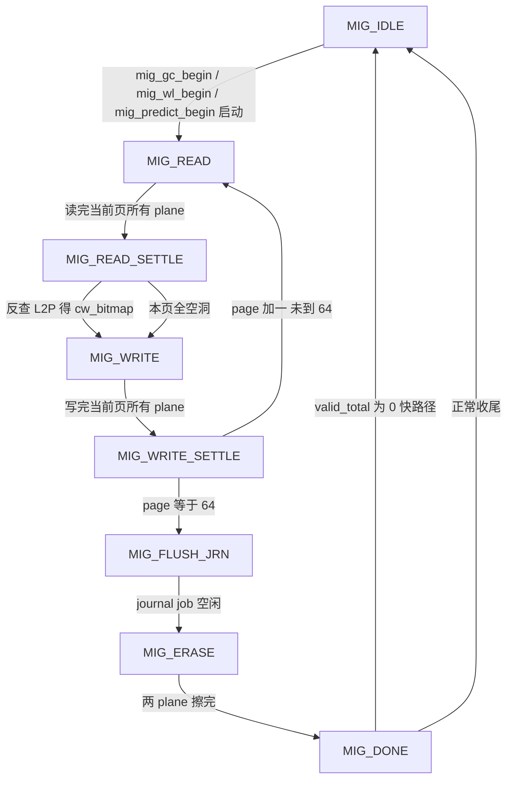

#### 3.13.6 关键流程

1. 触发求值在 migrate 内部 `mig_gc_evaluate`（`gc_should_trigger`）；`mig_gc_begin`（内部）只
   `gc_select_victim` → `mig_job_start(GC)`（post 由 kind 决定）。
2. `MIG_READ`：逐页逐 plane 异步读 victim；完成时解 META 得 `cw_lba`，
   记 `rr_record_ecc` / `read_count`（预测性退役闭环）。**读错误 ⇒ 中止**（该 plane
   源块的 `fail_count++`；累计 3 次标 BAD + 摘除 Closed plane）；只有“无错误 +
   `FC_CW_STATUS_EMPTY`”的空页才跳过。
3. `MIG_READ_SETTLE`：**先 `l2p_is_ready` 前置**，全部就绪后才逐 CW 反查 L2P；
   仍指向本物理 CW 才置 `cw_bitmap`。半途而废会让 bitmap 一半有一半没有。
4. `MIG_WRITE`：本页有有效 CW ⇒ `alc_super_open_alloc_pair(ALC_SUPER_ALLOC_COLD)` → 提交 CW 子集写。
   **写错误 ⇒ 中止**（victim 不擦）。
5. `MIG_WRITE_SETTLE`：先就绪前置；再逐 CW **重查 L2P**（host 写/TRIM 可能已抢先），
   仍指向源 CW 才 `jrn_append` → `l2p_write` → 源块 `sub_valid` / 新块
   `add_valid`。append/L2P 失败 ⇒ 中止。
   **cache program 批次**：读仍逐页走 READ/READ_SETTLE；当 cold SB 的 page0 已成功、
   余量 ≥4 页且非静态 WL high-wear 时，把最多 4 页攒进 `batch_buf`。满 4 页或到 victim
   末尾后进入 `MIG_WRITE_BATCH`：一次连续分配 N 个目的页对，提交 N 条 pair 命令
   （N≥2：首页只查 FAIL 的 15h、其余中间页查 FAILC 的 15h、末条 10h；N=1：普通
   op31），经 `ftl_op_submit_batch()` 一次
   全进 SQ。**中间页完成不记账**；全部成功后进入 `MIG_WRITE_SETTLE_BATCH`，先对 N 页
   做统一 L2P 就绪 + Journal 总容量预留，再逐页 `jrn_append → l2p_write → valid_count`。
   任一成员失败 ⇒ 关闭 cold SB、不擦 victim、不提交任何映射。
   **静态 WL 的 high-wear 目标选块**（每次强制新 SB、首块 page0）暂不批，走普通逐 plane 路径。
   **page0 补全**：wbuf 写 page0 时按 full pair 补零；GC 某 plane 的 page0 无数据时，
   在写该 plane 的 page>0 之前先写一页零。这样 page0 屏障可满足，full rebuild 的
   「page0 空白⇒整块空白」捷径始终成立。（**cache 写序列**例外地由有序管线自证：
   page0 失败会中止其后所有页，见 §3.16.5；独立程序者仍必须走这里的两道屏障。）
6. `MIG_FLUSH_JRN`：等 Journal job 空闲 **且 `write_fail_pending == 0`**（F10）。
   `jrn_handle` 冲刷半满页；页写失败时 pending 会阻止擦除，直到 CP 把 L2P 落盘。
7. `MIG_ERASE`：逐 plane 擦；成功走 `alc_bst_note_erase`（erase_count / last_pe_ts /
   clear_valid）；`post==FREE` ⇒ 归还 Free Pool；`post==RETIRE` ⇒ 出池 + `rr_retire_block`；
   擦除失败且未 BAD ⇒ `bbt_mark_bad`，置 `erase_failed`。
8. `MIG_DONE`：移除 Closed 条目；只有擦除成功且条目确实移除才
   内部 `reclaimed_count++`（外部经 `mig_reclaimed_count()` 读）/ 打 predict 日志；复位 job。

#### 3.13.7 失败语义

| 情况 | 结果 | 数据影响 |
|---|---|---|
| 分配不到目标页 | 中止，不擦 victim | 已搬移页指向新页；未搬移页仍指向 victim；下轮重来 |
| NAND 读失败 | 中止，不擦 victim；该 plane 源块 `fail_count++` | 源数据仍在；空页（无错误 + `FC_CW_STATUS_EMPTY`）才跳过 |
| 同一 plane 源块读失败累计 3 次 | `bbt_mark_bad` + 摘除该 plane 的 Closed 条目 | 坏块被隔离，GC 换候选；该块上不可读的数据本就无法恢复 |
| NAND 写失败 | 中止，不擦 victim | 该 plane 的 L2P 未动；源数据仍有效，下轮再搬 |
| Journal append 丢弃 / L2P 写失败 | 中止，不擦 victim | 该 CW 的映射未持久化；前一 CW 的迁移保持有效 |
| Journal 页写失败 | 置 `write_fail_pending`，中止 F10 | pending 阻止一切 victim 擦除，直到 CP 确认 L2P 落盘 |
| 提交侧超过 `FTL_SUBMIT_TIMEOUT_MS` 无进展 | 中止（`timed_out`） | 数据无损；命令在飞由 NAND 超时保证完成 |
| 擦除失败 | 未 BAD 则标坏一次；`erase_failed` | 数据由 BBT/GC 处理；不计入 `mig_reclaimed_count()` |
| 掉电 | 最多一个孤悬块 | Journal 回放恢复映射；victim 未擦或已擦但 L2P/CP 已落盘 |

#### 3.13.8 常量与出处

| 常量 | 值 | 来源 |
|---|---|---|
| `GC_WEIGHT_VALID/ERASE/TEMP/AGE` | 500/200/200/100 | `src/ftl/gc.c` |
| `GC_TRIGGER_WATERMARK/EMERGENCY` | 0x01/0x08 | 同上 |
| `FTL_SUBMIT_TIMEOUT_MS` | 10 | `include/ftl/ftl_module.h`（migrate 提交 deadline） |
| `FTL_WAIT_TIMEOUT_MS` | 50 | 同上（migrate 等 L2P/Journal） |
| 页镜像 | 2 × 2048 B | `mig_handle_t.page_buf` |

#### 3.13.9 主流对照

GC 触发看自由块水位、victim 按有效性比例选、后台异步回收，是主流 FTL 的共同形态
（SPDK 的 free band 水位、DRAM-less 的空间压力触发）。本仓额外加了磨损/温度/年龄三项，
**这是本仓自定**的评分权重；它们不冒充“行业标准公式”。与 SPDK 的一个刻意差异：
本仓写路径在分配不到页时会**就地起紧急 GC**，SPDK 的写路径直接返回 NULL、GC 全在
poller 里——这条差异已登记。

---

<a id="s3-14" name="s3-14"></a>

### 3.14 读恢复（read_recovery）

#### 3.14.1 背景与需求

NAND 读会失败：retention、read disturb、编程干扰都表现为 ECC 纠正位数上升，最终超过
纠错能力。直接向 host 返回 IO 错误太早——即使数据读不回来，也应该先搬走其余有效数据、
再退役这块，而不是让整块数据一起坏掉。同时用 ECC 趋势预测“还没坏但正在变坏”的块，
提前搬移。

主流企业级 SSD 的恢复管线是 read retry（切读电压/soft-decode）→ 邻居页辅助 →
XOR/RAID。**本仓器件/配置下前两级无效**：MT29F4G08 的 read-retry feature（0x89）
是保留地址、SLC 无 retry table、邻居页无法恢复目标页、RAID 关闭。因此本仓只保留：
**一次正常读 + 仅 `CRC_ERROR` 重读一次**；UNC / NAND_FAIL / TIMEOUT / MATA_ERROR
直接按失败结算并块退役。

#### 3.14.2 职责与边界

- **做**：读失败后的异步恢复状态机；per-block ECC 趋势（`rr` 在 BST）；预测巡检；
  退役（RETIRED）。
- **不做**：不做 XOR/RAID 恢复（未实现）；不执行搬移（调用 `mig_predict_begin`）；
  不决定坏块持久化（BBT）。
- **托管模型**：host 读失败时，把 pending 子操作托管给 RR job（保留 pending 项、
  不递减组在飞数）；job 一次只提交一条命令，完成由 `ftl_read_recovery_callback` 推进。

#### 3.14.3 结构与不变量

| 结构 | 字段 | 说明 |
|---|---|---|
| `rr_handle_t` | `stage` / `waiting` / `plane` / `attempt` / `pending_idx` / `page` / `recovered` / `all_ok` / `stall_ms` | 单 job |
| | `owner` / `has_owner` / 窄上下文 | `rr_trigger` 登记的 owner；cache/alloc/topo/page_scratch/pending 窄指针 |
| | `planes_recovered` / `planes_failed` / `error` | 观测计数与最近一次 abort 归因 |
| `rr_ecc_track_t`（BST） | `last_ecc` / `rising_count` / `health` | 每块 |
| `rr_block_health_e` | HEALTHY / WARNING / CRITICAL / DYING | 只升不降 |

**不变量**：

1. **`stage` 表示“当前该做/正在等的那一步”**；判“有无命令在飞”用 `waiting`，
   因为提交可能因背压失败（stage 不变但无命令）。
2. **一次只提交一条命令**；恢复不阻塞完成泵。
3. **托管项不递减组 outstanding**；恢复成功/失败由 job 统一结算。
4. **提交侧超过 `FTL_SUBMIT_TIMEOUT_MS` 无进展 ⇒ 按失败收尾**，不标坏块（避免把命令池泄漏当介质问题）。
5. **退役不是坏块**：RETIRED 仍可读、不再分配、不标坏；有效数据已搬走。

#### 3.14.4 状态机

```mermaid
flowchart TD
    IDLE["IDLE"]
    PLANE["PLANE"]
    READ["READ"]
    PLANEEND["PLANE_END"]
    FINISH["FINISH"]
    IDLE -- "领走托管的 pending 项" --> PLANE
    PLANE -- "找到本 plane 目标页" --> READ
    PLANE -- "本子操作不覆盖本 plane" --> PLANE
    READ -- "读成功" --> PLANEEND
    READ -- "仅 CRC_ERROR 且首次" --> READ
    READ -- "UNC/NAND/META/重试用尽" --> PLANEEND
    PLANEEND -- "plane 加一" --> PLANE
    PLANEEND -- "plane 等于 PLANE_NUM" --> FINISH
    PLANE -- "提交侧长期无进展（清零缓冲）" --> FINISH
```

#### 3.14.5 关键流程

1. host 读完成回调检测到**任一错误位**（`fc_cmd_status_has_error`：NAND_FAIL / FAIL_CACHE /
   TIMEOUT / DATA_ERROR / MATA_ERROR 全集——UNC/CRC/RAID 合并为 DATA_ERROR，MATA 单独；
   单看 NAND_FAIL 会把加扰页当成功交给 host）：pending 项 `op = READ_RECOVERY`、
   `command_id = NONE`，命令释放，`rr_handle`。
2. `rr_handle` 领走托管项，进入 `PLANE`；选本 plane 目标页（L2P region 加载中则原地等）。
3. `READ`：读目标页一次；**只有 `CRC_ERROR`** 允许再读一次（attempt=2）。
4. 其余错误（UNC / NAND_FAIL / TIMEOUT / MATA_ERROR），或 CRC 重读仍失败 ⇒ 直接 `PLANE_END`。
5. `PLANE_END`：成功则把 scratch 按 CW 偏移拷回 host buffer；失败则清零并按失败结算。
6. `FINISH`：释放 pending 槽 + 组聚合；失败且确认不可恢复 ⇒ `bbt_mark_bad` + 数据迁移。
7. **预测巡检**：`rr_predictive_scan` 找 health ≥ CRITICAL 的 Closed 块 →
   `mig_predict_begin`（搬空并退役）。

#### 3.14.6 失败语义

| 情况 | 结果 | 数据影响 |
|---|---|---|
| 首次读成功 | 拷回数据；ECC 趋势更新 | host 读成功 |
| CRC 重读成功 | 同上 | host 读成功 |
| 全部失败 | 清零 + 标坏 + 迁移 | 该页数据不可恢复；其余有效数据被搬走 |
| 提交侧超过 `FTL_SUBMIT_TIMEOUT_MS` 无进展 | 按失败收尾，不标坏 | 避免误伤；由上层报 IO 错误 |
| 预测搬移中分配不到页 | 中止，不擦 victim | 数据无损，下轮重来 |
| 退役块被再次分配 | 不变量违例 | `MIG_POST_RETIRE` 必须先出池 |

⚠ **器件约束**：`0x89` 在 MT29F4G08 是**保留地址**，SLC 也没有 read-retry table
（见 §7.2，用户明确不处理）。⇒ 多级读电压重试与邻居页辅助在本板上没有物理意义，
已移除；失败即块退役。

#### 3.14.7 常量与出处

| 常量 | 值 | 来源 |
|---|---|---|
| `RR_ECC_RISING_THRESHOLD` | 4 | `include/ftl/read_recovery.h` |
| `RR_ECC_HIGH_WATER` | 6 | 同上 |
| `RR_ECC_MAX` | 15 | 同上 |
| `RR_READ_DISTURB_THRESHOLD` | 1000 | 同上 |
| `FTL_SUBMIT_TIMEOUT_MS` | 10 | 同上（RR 提交 deadline） |

#### 3.14.8 主流对照

read retry（soft-decode）、邻居页辅助、RAID/XOR 是企业级 SSD 读恢复的常见组成。
本仓**裁剪**为「单次读 + CRC 重读一次 + 块退役」是器件/配置约束（0x89 保留、SLC
无 retry table、RAID 关闭），不是对这些机制的否定。**本仓自定**的是 4 级健康状态
与 1000 次 read-disturb 阈值。

---

<a id="s3-15" name="s3-15"></a>

### 3.15 FTL↔FC 接口（ftl_fc_interface + ftl_config）

#### 3.15.1 背景与需求

FTL 不能直接操作 NAND：NAND 命令有严格的时序、地址周期、ECC/CRC/加扰配置；
FTL 只应该表达“读写哪一页/哪些 CW、数据在哪”。FC 层负责：

- 把 FTL 的请求翻译成 ONFI 命令链（含 Multi-Plane、ISSUE/WAIT/FETCH）；
- 对数据做 CRC、BCH ECC、随机加扰；
- 管理命令池/描述符池/缓冲池/SQ/CQ；
- 在完成时给出 per-CW 状态（成功/ECC 位数/NAND_FAIL）。

没有这层，FTL 会被 NAND 时序与数据保护细节淹没，且无法复用 FC 的多平面/流水线能力。

#### 3.15.2 职责与边界

- **做**：CW 子集的描述符链构造、数据拷贝、PBA→PAA 转换、同步/异步页原语、
  同步等待器。
- **不做**：不实现 NAND 引擎/时序；不决定 FTL 的映射与空间管理；不拥有完成路由
  （§3.10）。
- **调用者**：FTL 所有需要碰 NAND 的模块（L2P、Journal、CP、Metadata、GC/WL、RR、BBT、PFR）。

#### 3.15.3 结构与约束

| 配置 | 用户数据 | 元数据 |
|---|---|---|
| `operation` | normal/multi-plane program/read | 同左 |
| `crc` | ENABLE | ENABLE |
| `random` | ENABLE（加扰） | DISABLE |
| `ldpc` | BCH | BCH |
| `page_type` | LP（SLC） | LP |
| `meta` | 本命令的扇区 LBA | 不填/0 |

关键字段与易错点：

- **没有 `cmd->lba`**：LBA 走 `cmd->meta`；FC 侧按 `(meta & ~PLANE_CW_MASK) | (plane<<2) | cw`
  铸出逐 CW 的扇区 LBA。
- **`ftl_cmd_configure_descriptors(cmd, cw_bitmap)` 是两参**：位图由 FTL 的
  `ftl_cw_span_mask` / `ftl_cmd_plane_span_cw_bitmap` 算出；`config.cw` 不参与建链。
- **`cmd->paa` 只能是 `pba_to_paa()` 的结果**；FTL 业务层不手写 PAA 位运算。
- **`cmd->config.ch/ce/lun` 从 PBA 高位拆出**；多实例下命令必须回到正确芯片。

#### 3.15.4 写序列

```text
① alc_super_open_alloc_pair → 各 plane 的新 PBA
② cmd->config.operation = (nplanes==2) ? MULTI_PLANE : NORMAL
   cmd->config.multi_plane = nplanes
   cmd->config.crc/random/ldpc/page_type 按上表
   cmd->meta = 窗口基址
③ ftl_cmd_setup_ppa_pair_cw(cmd, new_pba, cw_bitmap)   // desc 链
④ ftl_cmd_write_data_pair_cw(cmd, wbuf.data, cw_bitmap) // 按 plane-major 槽位散射取数
⑤ ftl_op_submit(cmd, FTL_OP_HOST_IO, NULL)
⑥ 完成：检查 per-CW status/ECC；成功才走 confirm 路径
```

#### 3.15.5 读序列

```text
① l2p_read 得到 PBA（或 wbuf 命中）
② 按 (plane, page) 分组；CW 子集由 LBA 在页内的位置决定
③ ftl_cmd_setup_ppa_pair_cw / ftl_cmd_read_data
④ ftl_op_submit(tag=HOST_IO 或 L2P，ctx=pending/line)
⑤ 完成：数据已拷进 buffer/line；状态检查
```

#### 3.15.6 不变量与禁止项

| 约束 | 原因 |
|---|---|
| 不直接调 `nand_read_page` / `nand_program_page` | 绕过 CRC/ECC/加扰与队列 |
| 不直接操作 NAND 引擎状态机/寄存器 | 破坏 FC 的时序与多命令调度 |
| 不手动分配描述符 | 必须走 `ftl_cmd_configure_descriptors` |
| 不在 FTL 业务层手写 PAA/地址掩码 | PBA/PAA 位序不同，现场转换已多次算错 |
| 不把 `ASSERT` 当运行时错误处理 | FC 配置错误可能静默损坏介质；需要 release 拒绝 |

#### 3.15.7 失败语义

| 情况 | 结果 | 数据影响 |
|---|---|---|
| 命令池/描述符池/缓冲池满 | `FTL_AGAIN` | 调用者保留状态，下轮重试 |
| SQ/HSQ 满 | `FTL_AGAIN` | 同上 |
| per-CW NAND_FAIL | 完成状态返回失败 | 写：关 SB + 标坏；读：进 RR |
| ECC 超限 | 完成状态返回 UNC | 读：进 RR；写：视为失败 |
| 命令超时 | `FC_CMD_STATUS_TIMEOUT` | job 的 stall 计数兜底 |
| 建链/配置错误 | debug ASSERT；release 可能静默 | 这是 FC 层最贵的一类，必须用负例验证 |

#### 3.15.8 常量与出处

| 常量 | 值 | 来源 |
|---|---|---|
| 命令池 | 64 | `include/fc/fc.h` |
| 描述符池 | 256 | 同上 |
| 缓冲池 | 128 × 528 B | 同上 |
| SQ / HSQ / CQ | 64 / 16 / 64 | 同上 |
| `FTL_PAGE_CFG_META/DATA/DATA_ANY` | 见头文件 | `include/ftl/ftl_fc_interface.h` |

#### 3.15.9 主流对照

“FTL 只表达逻辑请求、HAL/FC 负责介质命令与数据保护”是主控分层的通用形态；
描述符链 + 完成状态是 NVMe/ONFI 数据面的常见实现。**本仓自定**的是 CW 子集位图建链、
`cmd->meta` 携带扇区 LBA 的方式与 FC 池深度。

---

<a id="s3-16" name="s3-16"></a>

### 3.16 cache 序列（cache_batch：cache read / cache program）

#### 3.16.1 背景与需求

主机通过 USB MSC 按 16 KiB 传输段交付数据，一段 = 32 LBA = 4 个 pair 页；Windows/Linux
的 USB 存储驱动还会把一次大 `WriteFile` 拆成 ~57 KiB 一条的 SCSI WRITE 命令
（板端实测 `wr chunk calls / 写序列 starts ≈ 3.58`）。若每个传输段 / 每条命令都重开
设备序列，NAND 的 cache program 管线不断被打断，命令开销（`80h-地址-数据-10h` 启动、
每页 `tPROG` 前的握手）无法与数据重叠。

本仓把"连续访问"做成**两层**，边界都由 FTL 自己判定：

| 层 | 延续判据 | 主动断点 |
|---|---|---|
| **设备 cache 序列**（START/SEQ/END） | `cache_stream.seq.next_lba == 下一段起始 LBA`——**跨 host 传输段、跨 host 命令、跨物理 block**延续 | Journal 顺序页写满（≈63 pair / 252 KiB）/ LBA 不连续 / 空闲 / flush / 收尾块时开不出新块 |
| **Journal 顺序页**（JSEG） | 同上（LBA 连续且页内有空间） | 页写满（504 条）/ LBA 不连续 / 空间不足一个窗口 |

为什么设备序列能跨 host 命令：控制器改成 **volatile write cache** 语义——**所有**写
段落（含一条命令的最后一段）在提交后立即回执，主机不必等最后一页的 `FAIL_CACHE` 就能
发下一条命令。写段的最终失败不再属于那一条已回执的命令，而是作为 **deferred error**
由**下一条能承载状态的命令**（READ / WRITE / SYNC CACHE）上报一次。这对应主流 SSD 的
"写缓存 + 延迟错误"模型（见 §3.16.9）。

与相邻模块的分工：

- **控制器**：槽管理、提交即回执（volatile write cache）、deferred error 转发、
  `cmd_remaining`（命令末尾事实）。
- **FTL**：顺序流检测、设备序列开关与延续、padding END 有序收尾、Journal 顺序页配额、
  `FAIL_CACHE` 逐页确认。
- **FC**：只提供"链"把窗口命令原子、连续入队；start/middle/end 的语义在 FTL。

#### 3.16.2 职责与边界

- **做**：顺序流检测（`cache_stream.rd/wr`）、窗口收集/构建、序列状态机、门控旁路、
  `FAIL_CACHE` 逐页确认、**padding END 有序收尾**、Journal 顺序页跨命令续用与页满断点、
  `info` 的 `cr=` / `cw=` / `sw=` / `pc=` / `jf=` / `d4=` 计数。
- **不做**：FC 序列句柄 / tag；IRQ 驱动；多 LUN 交织（序列 per 实例）；器件 opcode 顺序；
  控制器槽管理（在 `usb_msc.c`）。
- **调用者**：`ftl_drain_group()` 在读 / 写子操作路径最前面各试一次；`ftl_service`
  **序列收尾**步每轮调 `ftl_cache_seq_close_step()`。

#### 3.16.3 结构与约束

`ftl->cache_stream.seq`（per 实例）承载全部序列状态，`ftl->cache_stream.rd/wr` 承载检测器：

| 字段 | 含义 |
|---|---|
| `kind` | READ / WRITE / NONE |
| `active` | 设备侧序列打开（START 已发、END 未发） |
| `draining` | 读序列已放弃但命令仍在飞：门控继续关到所有者组在飞归零；超过 `FTL_CACHE_SEQ_DRAIN_STALL_MS` 强制放锁并留 WRN（命令卡死兜底） |
| `owner_submit` | 序列所有者正在提交窗口（门控旁路） |
| `break_requested` | 非所有者提交被门控拒绝 ⇒ 请 service 收尾序列 |
| `close_requested` | 写序列需要**有序收尾**（LBA 不连续 / 空闲 / flush / 前台等待） |
| `closing` | padding END 已在飞：门控继续关，新窗口等待 |
| `owner_gi` / `next_lba` | 最近持有序列的组 / **续序列的唯一判据** |
| `wr{unconf,head,count}` | 写序列的逐页确认 FIFO（深度 `FTL_CACHE_SEQ_RING`） |
| `stream_{rd,wr}` | 顺序流检测器：`last_end` / `run` / `active` |

已定决策：

| 决策 | 原因 / 说明 |
|---|---|
| 控制器对所有写段**提交即回执** | 主机命令完成不再依赖最后一页的 FAIL_CACHE ⇒ 设备序列可跨命令 |
| 写失败 = **deferred error**（下一条命令上报） | 已回执命令的 CSW 无法改写；主流写缓存语义（无自定义 sense，用"下一条命令失败"近似） |
| 序列延续只看 `next_lba` | host 传输段 / 命令身份都不是 FTL 语义边界 |
| 主动断点 = Journal 顺序页写满（508 条 → 504 整 pair） | 顺序序列占用 plane cache 寄存器，元数据只能在断点落盘；页可跨命令续用 |
| padding END 收尾 | 器件没有"无数据 END"；用一个不映射的零页给最后一页提供 FAIL_CACHE 结算点（≤每 252 KiB 一次） |
| 读序列同样跨命令 | LAST 只在物理/region 断点 / 命令尾不足一对 / D4；放弃不发 LAST（RISK-IF-09）。⚠ 同步主机（等 `complete_flag` 才发下一条）在序列挂着期间会多等空闲守卫 1 s —— 见 RISK-CACHE-25（本仓信息项，目标主机 USB 不受影响） |
| 后台元数据被门控但不置 `break_requested` | 否则序列退回逐窗口长度 |
| 后台提交 deadline 在「序列打开 **或** 主机组在飞」时挂起 | 主机持续提交时 FC 池/SQ 占满是预期等待；不让后台把 CP/L2P 写回/迁移每 10 ms 中止一次（否则元数据永远排不上队 → 写确认待入账超时 → host 写失败）。`mig_job_wait`（等外部命令）不适用 |
| FC 不加序列句柄 | 只用 FC 现有链 + FTL 门控 |

易错点：

- **deferred error 的归属**：写段失败时那条命令的 CSW 已经发出；错误必须留到**下一条**
  能承载状态的命令，不能对已回执命令补发状态。
- **padding END 的 FIFO 语义**：它不映射任何页；完成时只用 `FAIL_CACHE` 结算 FIFO 里的
  最后一页（`NAND_FAIL` 是 padding 页自身，忽略）。理论上 FIFO 只剩 1 页（更早的页已由
  各自后继命令结算）；代码对 >1 做防御性按失败结算。
- **padding 页落在新块 page0**：成功必须 `alc_super_open_note_page_programmed`（否则
  `get_room` 恒 0，后续窗口全被拒）；失败关 hot SB（与 cache 成员失败同口径）。
- **命令边界不是断点**：`cmd_remaining` 只用来判"命令尾不足一个 pair"（提前收尾，
  避免尾段还要 padding）；`at_cmd_end` 不再结束序列。
- **`owner_submit` 是门控唯一旁路**：padding END 由 service 提交，也要临时置位。
- **「提交完」≠「序列结束」**：读序列的 `draining` 不变量不变。

**① 序列状态与门控**

```mermaid
flowchart TD
    I["IDLE：门控开"] -- "开窗口（检测器判为顺序流）" --> W["WINDOW_OPEN：active=true，门控关（owner_submit 旁路）"]
    W -- "窗口尾 MORE：跨窗口 / 跨传输段 / 跨命令继续" --> W
    W -- "页满 / block 头 / 命令尾不足一对（数据页 END）" --> I
    W -- "读：LAST，或放弃（无 LAST）" --> D["DRAINING：门控关到排空"]
    W -- "写：无新数据（空闲 / LBA 不连续 / flush / 前台等待）" --> P["PADDING：提交零页 END，closing=true"]
    P -- "FAIL_CACHE 结算最后一页" --> I
    D -- "所有者组在飞归零 / 1 s 守卫" --> I
```

#### 3.16.4 读序列

```text
① 组收到读（g->next 处）→ ftl_cache_read_try()
② 开序列条件：检测器判为顺序读 + 请求起点 pair 对齐 + ≥2 个 pair
③ 预加载 lba 与 lba+511 所在 region（≤2 行）**+ 本实例的下一个 region**
   （`lba_next_region_base()` + `l2p_region_prefetch()`：best-effort，自带
   thrashing / 在飞 / FC 预算节流，不踢脏行、不挤 host load；序列期间 L2P
   加载被门控，所以只在 START 前做。序列上限 128 pair = 2 个 region，预取只有一段：
   再下一个 region 靠 lookahead 安全降级——未驻留就在边界 LAST）
   末窗口 lookahead 只查 8 条 LBA 驻留
④ 收集：两 plane 同页，且下一对是**同 block 的 page+1** 或**两 plane 都跨到 block+1
   的 page 0**；每窗口上限 FTL_CACHE_READ_MAX_PAIRS
⑤ 末 pair lookahead：下一 pair 仍在**本实例的键空间**（路由/范围）、region 驻留且物理
   连续（同 ④ 的两种形态）⇒ 本窗口 MORE，否则 LAST。**命令边界不在这里**
⑥ 建链：START(45) / SEQ(46) / LAST(47)，整批 ftl_op_submit_batch()
⑦ 收尾：end_seq（物理断点 / D4 / 命令尾不足一对 / **单段上限 128 pair**）⇒
   active=false 且 draining=true；否则 active=true 等下一段（下一段起始 LBA 必须等于
   next_lba，可跨 host 命令、可跨物理 block）
⑧ 放弃：方向不同 / 续接点不符 / 空闲 1 s ⇒ 只清 RAM，**不发 LAST**
```

器件语义（`include/nand/onfi_1_0.h:256-282` + `docs/reference/datasheet_mt29f_cache_ops.md`）：
`31h` **不带地址**，输出的是器件内部自增取到的下一页；自增到 block 末页后进入**下一个
logical block 的 page 0**（同 die；禁止跨 die/LUN）。所以「物理连续」= 同 block page+1 或
两 plane 同时 block+1/page0，两者都要判。序列期间元数据提交被门控，旧页不会被擦 ⇒
预取页内容仍等于当前映射内容；窗口内 `collect + submit` 无泵插入。

实测（2026-10-31，v1.06）：`cr=27435/105840/2583/430/0` ⇒ 段长 **41 pair/start**；预取 started=hits=2891（100% 命中），128 pair 上限与 region 边界都不是限制——限制在**物理不连续**（分配器按动态 WL 选块，见 `known_iss.md` ISS-FTL-13）。

#### 3.16.5 写序列

```text
① 开序列条件：检测器判为顺序写 + 请求起点 pair 对齐 + ≥1 个 pair（块尾 1..3 页也要能
   开序列续上）+ wbuf 空闲 + 无普通写确认在飞 + 上一段 cache 页全部确认 + jrn_seq_begin 成功
② jrn_seq_begin(lba, need)：若顺序页还有空间且 lba == base + 已填条数 ⇒ **跨命令续用**，
   不刷页；否则刷出旧页并切新顺序页（元数据落盘的唯一时机）
③ 预加载窗口 region **+ 本实例的下一个 region**（`lba_next_region_base()` +
   `l2p_region_prefetch()` best-effort：跨 region 续接的配套；序列 ≤ JSEG 页容量
   63 pair < 64 pair/region，最多跨一个）；
   窗口大小 = min(remain, block 剩余, 4 页, ring 余量, **顺序页剩余**)
   （block 剩余只用于**窗口 clamp**——一次构建不跨 SB，保 `alc_super_open_rewind_pair`
   的回滚前提；**序列本身跨 block**：窗口吃干当前 SB 后，下一个窗口由 `alloc_pair`
   关旧块、开新块后继续同一序列。`alc_super_open_get_room_seq` 的语义：**新块允许由
   本序列自己打开**，新块 page0 计入本序列；page0 尚未确认时本序列可继续写 page>0——
   有序管线保证 page0 失败会中止其后所有页，rebuild 的 page0 空白捷径不被击穿）
④ 命令：首窗口首条 49（FIRST）/ 中间 44（15h）/ 断点末条 48（10h）
⑤ 逐页结论：第 i 页的结论由第 i+1 条命令的 FAIL_CACHE 给出；末页由 END 的 FAIL 给出
   （与 block 无关：跨 block 的下一对同样给出上一页的 FAILC）。结论落在
   `cache_stream.seq.wr` 的**结论游标**（pend_idx）上，不是队头——确认可能背压滞后，
   队头会停在「已证明、等确认」的页（见 §3.16.5「volatile write cache」）
⑥ **早回执**：页在**自身命令完成**时就结算子操作（组完成 ⇒ host 可见完成），
   不再等下一命令的 FAILC；组完成与确认/证明解耦（RISK-CACHE-27）
⑦ 确认路径：cache 页走 JSEG 顺序页（jrn_seq_ready + jrn_append_seq，4B/条隐式 LBA），
   由 `ftl_cache_wr_confirm_step()` 每轮 service 按提交序推进（背压 = 下轮再来）
⑧ 断点（在**数据页**上 END）：
   · Journal 顺序页写满（本窗口吃干剩余空间，≈63 pair / 252 KiB）
   · 命令尾不足一个 pair（用 cmd_remaining 提前收尾，尾段走 wbuf）
   · D4（前台提交被门控拒绝）
   · **收尾块时分配器开不出新块**（`alc_super_can_open` 为 false）：保持序列打开会让
     门控挡住 GC、padding END 也无页可分配 ⇒ 退回旧语义在 block 边界 END（RISK-CACHE-15）
   · 物理 block 边界**不是**断点：44/48h 每条自带地址（datasheet §5/§6）
⑨ 有序收尾（没有数据页可 END 时 → **padding END（本仓自拟）**）：
   LBA 不连续 / 下一命令方向不同 / 空闲 1 s / flush / 前台等待
   ⇒ service 提交一个**不映射的零页**（页头 META=UNKNOWN）作为 48h，
   用它的 FAIL_CACHE 结算最后一页，然后 active=false。
   ⚠ padding 页落在新 SB 的 page0 时，成功回调必须用**逐 plane 的真实 PBA**
   （`cache_stream.seq.pad_pba[]`）记 page0 屏障：Policy B 下两 plane 块号不同，用
   `pba_with_plane(plane0, 1)` 推导会让 plane1 的屏障永久漏记（RISK-CACHE-24）
⑩ 失败：任一错误位 ⇒ 中止序列；器件**已证明**的页保留（正常确认并弹出），
   其余未证明页按 IO_ERROR 结算、关 hot SB；FAILC 落点页立即把其 region 置 degraded；
   **deferred error** 由控制器在下一条命令上报（RISK-CACHE-28 / RISK-USBC-01）
⑪ 读可见性：已编程、尚未确认的页由**读覆盖层**直读刚编程的 PBA（不等 L2P 确认）；
   已判失败、撤销未完成的页读直接 IO_ERROR（绝不返回可疑页内容）
```

**volatile write cache（早回执）**

写段的 CSW 不再等「上一页被证明」：页命令完成即入表并结算组。代价是三条新语义，
必须一起看：

| 问题 | 处理 | 依据 |
|---|---|---|
| 已回执但未确认的页，读怎么看到新数据 | 读路径在 `wb_read` 之后、`l2p_read` 之前查「已编程页表」，命中直读该页 PBA；cache 读批量对含未确认 LBA 的 pair 判不可批量 | RISK-CACHE-27 |
| 后来 FAILC 判失败怎么办 | 撤销该页（Journal + L2P `NAND_PBA_INVALID`）、**立即**置 region degraded、粘性 deferred error；撤销完成前的读也报 IO_ERROR | RISK-CACHE-28 |
| flush 什么时候算完成 | 等「已编程页表」全部证明并确认进 L2P（`wr.count == 0`）**且没有在飞成员**（`wr_inflight == 0`，页在完成时才入表）+ Journal/L2P/wbuf 空闲 | RISK-CACHE-18 / RISK-CACHE-29 |

**在飞成员计数（`wr_inflight`）**：页在**完成时**才入表 ⇒ 只数 `wr.count` 会把「已下发、
仍在 NAND 里编程」的页当成不存在。flush 屏障与「开新序列」都要求它归零；窗口构建
（环余量 / Journal 顺序页余量）也必须把它算进「在飞」，否则完成后集中入表即溢出。

**迟到完成**：序列中止后仍在飞的 cache 命令，完成时会带**序列代号**（`pend_req_t.cache_gen`
vs `cache_stream.seq.gen`）；不一致 ⇒ 只按 IO_ERROR 结算组，页一律不入表、不确认映射。没有这一层，
中止后的迟到页会被确认进 L2P，击穿 RISK-CACHE-19 的 page0 捷径（rebuild 跳过 page0 空白的块）。

**confirmed 不等于 proven**：确认（Journal→L2P→BST）只要页已编程就推进，证明要等下一
命令的 FAILC。两者顺序都按提交序；结论游标（pend_idx）独立于队头，避免「队头已证明、
等确认」时新结论打错页（环排不空 ⇒ flush 超时）。

**控制器配合（双槽 / 早回执）**：chunk k 的尾页要由 chunk k+1 的首条命令确认 ⇒
`usb_msc.c` 用两个槽（volatile write cache）：所有写 chunk（**含末 chunk**）提交后立即
流控回执，主机不等最后一页的 `FAIL_CACHE`；写失败作为 deferred error 由下一条命令上报。
两槽都占用时返回 `TUD_MSC_RET_BUSY`。

**③ 写窗口：逐页 FAIL_CACHE 滞后一页 + 跨命令序列**

```mermaid
sequenceDiagram
    participant H as Host (WRITE N, N+1…)
    participant U as USB MSC
    participant F as FTL cache_seq
    participant N as NAND
    H->>U: 命令 N 的各传输段
    U->>F: 提交即回执（含末段）
    F->>N: 49 FIRST + 44×n …（序列跨命令保持打开）
    U-->>H: CSW success（命令 N 已回执）
    H->>U: 命令 N+1（LBA 连续）
    U->>F: 提交即回执
    F->>N: 44×m …（同一序列，无 START；命令 N 的末页由本窗口首条 FAILC 结算）
    Note over F,N: 顺序页填满 504 条 ⇒ 在数据页上 END；下一次 START 时刷页
    Note over F,N: LBA 不连续 / 空闲 / flush ⇒ padding END（零页）结算最后一页
    Note over F,N: 每页命令完成即早回执（VWC）；FAILC 晚一条命令到 ⇒ 撤销 + deferred error
```

**Journal 顺序映射页**：顺序流的确认条目按提交序到达，LBA = `base_lba + 下标`，每条 4 B
`new_pba`。页头 16 B（magic + page_seq + entry_count + block_seq + base_lba）。页**跨 host
命令续用**：START 时若 `lba == base_lba + entry_count` 且剩余空间 ≥ 一个窗口 ⇒ 不刷页。
回放时 `old_pba` 从 L2P 基线现读（与确认路径"完成时重查 L2P"同源）。

#### 3.16.6 不变量与禁止项

| 约束 | 原因 |
|---|---|
| 窗口提交完置 `draining`（读），门控在 `active`/`draining`/`closing` 期间都关闭 | 器件管线未走完时插入别的命令会劈开序列（RISK-CACHE-14） |
| 写序列**不得 abort** 于有序收尾路径（空闲 / LBA 不连续 / flush） | 写段已对 host 提前回执；abort 会把已确认数据当错误丢弃。只用 padding END 收尾。**唯一例外**：无空闲页、连 padding 页都分配不到时（盘满），为避免「序列门控 ↔ GC 等 Journal 容量」互相等待，放弃序列（未确认页 IO_ERROR + deferred error），让 GC 能跑 |
| padding END 必须落在**数据页**上（零页也是页），且其 `NAND_FAIL` 不映射 | 器件没有无数据 END；padding 页不被 L2P 引用 |
| padding 页成功且为 page0 ⇒ 记 `page0_programmed`；失败 ⇒ 关 hot SB | 否则 allocator 的 `get_room` 恒 0 / 继续写可疑块 |
| 序列延续只看 `next_lba`，与 SCSI 命令身份 / 传输段边界无关 | 命令末尾由 `cmd_remaining` 单独表达（尾段提前收尾） |
| 序列只在 pair 对齐的 host 段上开启 | 段长是 pair 整数倍；未对齐命令的跨段续接点必然对不上 |
| 顺序页专用于顺序流；普通条目遇到它就刷页换页（空页也刷） | 顺序条目不携带 LBA，混装会破坏隐式坐标 |
| 顺序页 `base_lba` 由首条确认落定 | 确认按提交序到达；上一段尾页的迟到确认不能与 START 冲突 |
| 读序列放弃不发 LAST | 放弃时下一页 PBA 未知；新 START 重置（RISK-IF-09） |

#### 3.16.7 失败语义

| 情况 | 结果 | 数据影响 |
|---|---|---|
| 读命令级失败（UNC / CRC / MATA / TIMEOUT） | 逐页上报组 IO_ERROR、序列关闭；RR 不介入 | 该页不可用 |
| 写任一错误位（NAND_FAIL / TIMEOUT / DATA_ERROR） | 序列中止：本页按 IO_ERROR 当场结算（尚未回执），其余未证明页按 IO_ERROR 结算、关 hot SB；**deferred error** 由下一条命令上报 | 失败页及其后不确认；已回执命令的 CSW 不改写 |
| 写命令的 FAIL_CACHE（判**前一页**失败） | 前一页标失败 + **整个序列中止**（同一条可疑管线；保住 RISK-CACHE-19 的 page0 捷径）；本页也按 IO_ERROR 结算 | 器件已证明的页保留；失败页撤销 + region degraded |
| 已回执页后来被判失败 | 撤销：Journal + L2P 写 `NAND_PBA_INVALID`；region **立即**置 degraded；读该 region 的未映射 LBA / 失败页覆盖的 LBA 报 IO_ERROR | 主机可见地失败（不是零填、不是旧数据）；同 region 其它未映射 LBA 也报错（RISK-CACHE-28 的已知取舍） |
| padding END 失败 | 最后一页按 IO_ERROR 结算；关 hot SB | 该页映射不确认（deferred error） |
| 顺序页预留失败 / 页满 | 本窗口 END（页满断点） | 无 |
| 空闲 / LBA 不连续 / flush | padding END 有序收尾 | 无（最后一页正常结算） |
| 盘满：padding 页也分配不到 | 放弃序列（未确认页 IO_ERROR、关 hot SB、deferred error），放开 L2P 让 GC 回收 | 未确认页映射丢失（±1 页） |
| deferred error 被下一条命令取走 | 该命令 CSW 失败一次；主机重试 | 失败写的数据丢失；无 sense 指明 LBA（本仓近似） |
| 请求不足 2 个 pair（读）/ 不足窗口（写） | 回退普通读 / wbuf 写 | 无 |

#### 3.16.8 常量与出处

| 常量 | 值 | 来源 |
|---|---|---|
| `FTL_STREAM_MIN_LBAS` | 64（32 KiB = 两个 16 KiB 传输段） | `include/ftl/ftl.h` |
| `FTL_CACHE_READ_MIN_PAIRS` | 2 | `include/ftl/cache_batch.h` |
| `FTL_CACHE_WRITE_MAX_PAGES` | 4 | 同上 |
| `JRN_SEG_ENTRIES_PER_PAGE` | 508（`(2048 − 16) / 4`；按整 pair 用到 504 = 63 pair ≈252 KiB） | `include/ftl/journal.h` |
| `FTL_CACHE_SEQ_RING` | 16 | `include/ftl/ftl.h` |
| `FTL_CACHE_SEQ_IDLE_MS` | 1000 | 同上 |
| `FTL_CACHE_SEQ_DRAIN_STALL_MS` | 1000 | 同上（draining 卡死兜底，与空闲等待分开） |
| `FTL_SUBMIT_TIMEOUT_MS` | 10 | `include/ftl/ftl_op.h` |

#### 3.16.9 主流对照

设备 cache 序列（`0x31/0x3F`、`15h/10h`）的器件语义见 Linux MTD rawnand 与 MT29F4G08
datasheet（`docs/reference/README.md` §F1 / §C4；`include/nand/onfi_1_0.h:230-282`）。

主机侧写缓存语义（volatile write cache）与延迟错误（deferred error）来自 SCSI 的
写缓存模型：写命令在数据进入设备缓冲后即可完成，NAND 提交失败不在原命令上报。
⚠ **本仓出处层没有 SPC/SBC 原文**（`docs/reference/` 未收录），因此这里**不把具体
实现写成行业标准形态**：`padding END` 与"下一条能承载状态的命令直接失败一次"都是
**本仓自拟**。与公开 SCSI 语义的差异：TinyUSB MSC 不支持自定义 sense data，所以本仓
无法给出 CHECK CONDITION + deferred sense（具体 ASC 不作断言），只能用命令级失败近似
（RISK-USBC-01）。

**早回执（volatile write cache）**：写命令在页编程完成（不是提交）后即可完成——与
DRAM 型/DRAM-less 主控都把「完成点」放在设备侧缓冲写完之后同型；差异是本仓**不做**
RAM 里的写合并缓存，未确认数据直接落在 NAND 页里，靠读覆盖层保证可见性。掉电窗口
因此是「已编程未证明的页 + 未落盘的 Journal 映射」，量化见 RISK-CACHE-18。

**FUA（不实现，用户裁决 2026-11-01）**：WRITE(10) 的 CDB byte1 bit3 是 FUA（T10 SBC-3
§5.26：FUA=1 ⇒ 设备不得在数据真正写到介质前返回 GOOD，见 `docs/reference/README.md`
§外部规范）。本仓**忽略**该位，依赖主机 fsync 的后续 `SYNCHRONIZE CACHE` 作为持久性
屏障；取舍与恢复要点见 `known_risks.md` RISK-USB-05。

`SYNCHRONIZE CACHE` 在正常路径会先把序列 padding 收尾，并等 Journal 与 L2P 都落盘；
L2P 区域写回现在按 **WAL 次序**等覆盖其映射的 Journal 条目先落盘（§3.6 不变量 8），
所以正常完成的 flush 是「日志 + 数据」的完整屏障。只有**超时路径**仍是 best-effort
（`FTL_FLUSH_TIMEOUT_MS`，元数据真卡死时主机不能永不完成），那一路不是绝对屏障。

Journal 顺序映射页的形态出处（DFTL translation page）与差异见 §3.7.9 / §3.16.5。

#### 3.16.10 端到端分层限制表

| 层 | 限制来源 | 实际值 | 依据 |
|---|---|---|---|
| host 驱动 | host 驱动选择的 SCSI 命令大小 | ~57 KiB / 命令（板端 3.58 × 16 KiB） | 板端 `wr chunk calls / sw starts`；具体驱动参数未在仓内查证 |
| USB | `CFG_TUD_MSC_EP_BUFSIZE` | 16 KiB / 传输段 | `include/tusb_config.h` |
| 控制器 | 双槽 + 提交即回执 | 段边界不截断序列；末段也提前回执 | `usb_msc_udisk.md` |
| FTL 窗口 | `FTL_CACHE_WRITE_MAX_PAGES` | 4 pair / 窗口 | `cache_batch.h` |
| **FTL 写序列** | **Journal 顺序页剩余空间** | **≈63 pair = 252 KiB / 段**（页可跨命令续用；block 边界不是断点） | `jrn_seq_room()` |
| **FTL 读序列** | 后台元数据让步上限 | **128 pair = 512 KiB / 段**（31h 可跨 block，同 die） | `cache_batch.h` `FTL_CACHE_READ_MAX_RUN_PAIRS` |
| FTL 序列（收尾） | padding END | LBA 不连续 / 空闲 / flush 时 +1 零页 | §3.16.5 |
| 器件 | END 必须落在数据页 | 断点必须在窗口末条 | `onfi_1_0.h` 15h/10h |

**验收判据（上板）**：
- 写：`info` 的 `cw=… sw=starts/page_ends pc=pad_closes jf=journal_page_writes`；
  `cache_stream.wb_pages / cache_stream.wb_starts` 在**跨 region 预加载 + 跨 block 续写**后应接近 63
  （JSEG 页容量仍是硬上限）；`wr − cw pages`（wbuf 页数）应接近 0（块尾页不再回退 wbuf）；
  `pc` 只随 LBA 不连续 / flush 出现（少量）；`jf` 应接近 pairs/63——块尾 wbuf 页走普通
  Journal 条目（`JRN_PAGE_LBA`）会先把当前 JSEG 页冻结，块尾页进序列后 JSEG 页才能填满。
- 读：`cr=batches/pairs/starts/declines/fallbacks`，`pairs/starts` 应显著大于改前的
  ~32 pair（跨 region 预加载 → 跨 block 续写；受 128 pair 单段上限与 region 驻留限制，
  预期 65~128）。跨命令、跨 block 不断。
- **WAL 次序（RISK-L2P-09）**：`info` 的 `cw=` 行 `wd=`（区域写回被 WAL 闸门退让的次数）
  应 >0（证明闸门在真实路径上生效）；GC 压力 + 掉电后 `dng=0`、`rrab=0`、verify 0 错误。
- **未上板前不得声称"流式已达成"**（R1）。

<a id="s4" name="s4"></a>

## 4. 端到端场景

> 本节把 §3 的模块串起来。每个场景给：**触发条件 → 时序/流程 → 状态变化 → 失败分支**。
> 图中节点省略了错误处理，失败分支在每小节末尾的表里列。

### 4.1 首次上电 / 介质版本不匹配 → 格式化

**触发**：`ssd_ftl_boot` 调 `pfr_media_check_format()`；判据来自
`cp_media_status_probe()` 的四态：

| CP 介质状态 | 判定 |
|---|---|
| `CP_MEDIA_CURRENT` | 不格式化，正常启动 4.2 / 4.3 |
| `CP_MEDIA_NO_RECORD`（空片 / 上次格式化中断） | 需要格式化 |
| `CP_MEDIA_VERSION_MISMATCH` | 需要格式化（介质布局版本变化） |
| `CP_MEDIA_IO_ERROR`（CP 池读不通） | **拒绝格式化**，`FTL_ERROR`，停止启动 |

```mermaid
flowchart TD
    A["上电 ftl_init 完成"] --> B["pfr_media_check_format"]
    B -- "CURRENT" --> C["正常启动 4-2 4-3 节"]
    B -- "NO_RECORD / VERSION_MISMATCH" --> D["pfr_media_format"]
    B -- "IO_ERROR" --> H["拒绝格式化 / 启动失败"]
    D --> D1["bbt_format_erase 阶段①：置 FORMAT_IN_PROGRESS + bbt_save"]
    D1 -- "save 失败" --> H2["中止（不擦用户块）"]
    D1 --> D2["阶段②：擦除 BBT 池之外的块，失败标 BAD"]
    D2 --> D3["阶段③：best-effort bbt_save 并入新 BAD"]
    D3 --> D4["md_init 复位 Directory"]
    D4 --> D5["写初始目录检查点 + cp_initial_record_write（块元数据 + 磨损 + Header）"]
    D5 --> D6["CP 读回成功 ⇒ 清 FORMAT_IN_PROGRESS 并落盘（提交点）"]
    D6 --> E["后续正常启动"]
```

**状态变化**：

| 对象 | 变化 |
|---|---|
| BST | 除 BBT 池外的块被擦除；擦除失败标 BAD |
| BBT | 先追加当前坏块图（带 `FORMAT_IN_PROGRESS`），擦除后再追加新 BAD；BBT 池旧 record 保留，新 record 以更高 sequence 胜出 |
| Directory | 固定层重建，动态层清空 |
| Checkpoint | 写一条当前版本、`sequence=1` 的**完整 21 页 record**：4 页 per-block metadata + 16 页磨损快照 + Header（Header 最后 commit）。首次掉电可用这份快照 + journal 恢复，不再 full metadata rebuild |
| Journal | `jrn_init` 的初始游标；环形块已被擦 |

**失败分支**：

- 阶段① save 失败 ⇒ 直接返回 `FTL_ERROR`，不擦任何用户块。
- 擦除失败 ⇒ 该块标坏；格式化继续。
- 擦除之后的任一步失败（`format --verify` 的 BBT 落盘、目录检查点写入、`cp_initial_record_write`、
  CP 读回）⇒ 保持 `FORMAT_IN_PROGRESS` 并返回 `FTL_ERROR`；下次开机会再次格式化
  （`cp_media_status_probe` 继续返回 `NO_RECORD`，中断的格式化可续做）。
- 复位/掉电发生在「擦除完成、CP 落盘之前」⇒ 同上，下次开机自动续做，
  **不会**停在「有 BBT、无 CP」的 `IO_ERROR` 状态（RISK-BBT-14）。
  完整 initial CP 的块/磨损页在 Header 之前写；任一分页失败都不会留下有效 record。
- 旧介质上由旧固件写出的空 initial CP（`block_word_count=0`）仍走 clean-start 的
  initial-CP 快速路径（跳过 full metadata rebuild + carve）；新 format 写出的完整快照
  则走 `restore → probe → build_pools`。
- 版本只在 DIM>1 时比 DIM=1 高 1；DIM=1 的旧介质不会被误格式化。

### 4.2 干净启动（clean start）

**触发**：有当前版本 Checkpoint，且
`ring.page_seq + ring.entry_count <= cp.journal_sequence`（Journal 已全部落入 L2P）。

```mermaid
sequenceDiagram
    participant B as boot
    participant J as Journal
    participant C as Checkpoint
    participant A as Allocator
    participant L as L2P cache

    B->>J: jrn_page_scan_latest 只读
    B->>C: cp_pool_find_latest
    C-->>B: Header 池游标
    B->>C: cp_block_table_load
    alt 块元数据快照有效
        C-->>B: block_words
        B->>A: restore_blocks（PFR 内部 static；先全量校验再应用）
        B->>L: 按 CP region_bitmap 逐 region 预载 F4
        B->>A: probe_blocks 池块 page0（PFR 内部 static）
        B->>A: build_pools（PFR 内部 static）
    else 快照无效
        B->>A: reset → full metadata rebuild（认领写过块）→ carve（只入池 state==NONE）
    end
    B->>A: Spare 补池（Free → Spare，逐 plane）
    B->>J: jrn_resume floor 为 cp_seq
    B-->>B: Controller 到 Ready
```

> **PFR 公开边界**：公开头只保留 `pfr_media_check_format` / `pfr_media_format` /
> `pfr_boot_recovery` 三个顶层入口；fresh / clean / power-failure 子流程与 full metadata rebuild 原语
> （restore / probe / build_pools / reset / page_is_blank / scan_write_pointer /
> close_block / carve / rebuild_closed_sb_list）全部为 `static`（RISK-ARCH-09）。

**状态变化**：

| 对象 | 初始状态 |
|---|---|
| L2P cache | 空（INVALID）；按需加载 |
| BST | 来自块元数据快照（state/valid/temp/池归属）；OPEN→CLOSED |
| Free/OP/Spare | 由 `build_pools` 按快照重建 |
| Closed 列表 | 快照恢复；退化单 plane 条目 |
| Journal | 写指针接回最新页之后；序号 ≥ cp_seq |
| Directory | 从目录检查点池加载（§3.5） |

⚠ **clean 也要 probe 池块**：本仓无关机 journal flush，“末页丢失”与干净关机在介质上
不可区分。probe 只读池块 page 0，成本可控。

**失败分支**：快照 CRC 失败/不一致 ⇒ reset → full metadata rebuild → carve（顺序不可颠倒：carve 只把
`state == NONE` 的块入池，否则写过块会同时是池成员与 Closed 条目）；full metadata rebuild 中读失败 ⇒ 跳过该块。

### 4.3 掉电恢复（power-failure start）

**触发**：有 Checkpoint，但 Journal 有 `page_seq + entry_count > cp_seq` 的页。

```mermaid
sequenceDiagram
    participant B as boot
    participant A as Allocator
    participant J as Journal
    participant L as L2P cache
    participant P as Pools

    B->>A: restore_blocks 若快照有效
    B->>J: jrn_replay cp_seq
    J->>J: 第一遍收集晚于 cp_seq 的页
    J->>L: 第二遍按 page_seq 与 entry_idx 应用
    J->>A: block_ctx new 加一 old 减一
    B->>L: F4 按 region_bitmap 逐 region 预载
    B->>A: probe build_pools → Spare 补池
    alt 任一步不一致
        B->>A: reset → full metadata rebuild → carve → Spare 补池
    end
    B->>J: jrn_resume floor 为 cp_seq
```

**状态变化**：

| 对象 | 变化 |
|---|---|
| L2P cache | 回放写入的行标 DIRTY；其余空 |
| BST.valid_count | 回放按 `new/old` 增量维护；TRIM 只减 old |
| Closed 列表 | 快照恢复或 full metadata rebuild |
| Journal | 回放完后 resume；写指针在最新页之后 |

**失败分支**：

- 某页读失败 ⇒ 跳过该页，继续其余页（该页条目丢失）。
- `materialize` 的 PBA 非法（越界 / ch-ce-lun 与拓扑不符）或 valid 下溢 ⇒
  `block_ctx.ok=0`，块元数据回退 full metadata rebuild。
- full metadata rebuild 中某块读失败 ⇒ 跳过；该块数据不可恢复。

⚠ **回放必须覆盖所有 `page_seq > cp_seq` 的页**，不能只回放最大一页；跨多页掉电时
其余条目会静默丢失。

### 4.4 主机读

**入口**：`ftl_submit_read(ftl, req)`。

```mermaid
flowchart TD
    A["ftl_submit_read"] --> B["校验 建组"]
    B --> C["ftl_drain_group 到 issue_subop"]
    C --> D{"该 LBA 在 wbuf"}
    D -- "是" --> E["从 wbuf-data 拷出 消费 1 LBA"]
    D -- "否" --> F["l2p_read"]
    F -- "FTL_AGAIN LOADING" --> G["l2p_defer 为 1 停止本子操作,下轮重试"]
    F -- "FTL_OK INVALID" --> H["零填充 消费 1 LBA"]
    F -- "FTL_OK PBA" --> I["按 plane,page 分组 建 pending 提交读"]
    I --> J["ftl_host_io_callback 拷回 buffer rr_record_ecc read_count 加一"]
    J --> K{"NAND_FAIL ECC 超限"}
    K -- "是" --> L["待入账 到 READ_RECOVERY rr_handle 3-14 节"]
    K -- "否" --> M["组完成 递减 outstanding"]
    E --> M
    H --> M
    G --> C
```

**状态变化**：

| 对象 | 读命中 | 读 miss | 未映射 |
|---|---|---|---|
| cache 行 | `access_count++` / `fresh` 消费 | `LOADING → CLEAN` | 不涉及 |
| pending | 登记/释放 | 登记/释放 | 不登记 |
| BST | `read_count++`（数据页） | 同左 | 无 |
| Journal/L2P | 无 | 无（load 只读） | 无 |

**失败分支**：region 加载失败 ⇒ 行 CLEAN + 全 INVALID（视为未映射）；ECC 失败 ⇒ RR；
组连续 8 轮无进展 ⇒ 弃未下发子操作并报 IO_ERROR。

### 4.5 主机写

**入口**：`ftl_submit_write(ftl, req)`。

```mermaid
sequenceDiagram
    participant H as Host
    participant F as ftl_submit_write
    participant W as wbuf
    participant A as Allocator
    participant N as NAND
    participant C as completion
    participant L as L2P cache
    participant J as Journal

    H->>F: req 请求
    F->>F: 校验 建组
    F->>W: wb_append 按窗口
    alt 窗口切换 / 页满 / 空闲
        W->>A: alc_super_open_alloc_pair HOT
        A-->>W: new_pba plane
        W->>N: PROGRAM 单 双 plane
        W->>C: 清 wbuf 提交成功后
    end
    N-->>C: 完成
    C->>C: ftl_host_io_callback
    alt 写成功且非中间页
        C->>L: 第一遍 ready 页对 + jrn_reserve(n)
        alt region 未就绪 或 Journal 容量不足
            C->>C: 待入账 WRITE_CONFIRM 下轮 ftl_confirm_service
        else 就绪且已预留
            loop 每个有效 CW
                C->>J: jrn_append
            end
            C->>L: l2p_entries_write 批量
            loop 每个有效 CW
                C->>C: valid_count 新加一 旧减一
            end
            C->>J: checkpoint_journal_watermark
            C->>C: total_writes 加一
        end
    else 写失败
        C->>A: close_open_sb HOT
        C->>C: bbt_mark_bad 失败 plane 块
        C->>C: L2P 不动 为 回滚
    end
```

**状态变化**：

| 对象 | 变化 |
|---|---|
| wbuf | 累积窗口；flush 成功后清空 |
| BST | 新位置 `valid_count +1`；覆盖写旧位置 `-1`（旧块 BAD / count==0 时跳过：`ftl_block_sub_valid_if_live`） |
| L2P cache | 行 `CLEAN/DIRTY → DIRTY`；全局 region 脏位置位 |
| Journal | 追加条目（或同 LBA 合并） |
| Journal 水位 | 85% 设 `checkpoint_needed`；95% 设 `emergency` |

**失败分支**：

- 分配不到页 ⇒ 紧急 GC + `FTL_AGAIN`；数据仍在 wbuf。
- 提交失败 ⇒ 保留 wbuf，下轮重试。
- PROGRAM 失败 ⇒ 关 SB + 标坏；L2P 不动（旧数据仍可达）。
- L2P region 未就绪 ⇒ 待入账 `WRITE_CONFIRM`；`ftl_confirm_service` 下轮重试，不重复记账。
- Journal 容量不足 / 页写在飞 / 换块待擦 ⇒ `jrn_reserve` 返 `false` ⇒ 同样待入账
  `WRITE_CONFIRM`；confirm 内**不同步**刷 Journal，由 `jrn_handle` 异步推进后再重试。

### 4.6 L2P 脏 region 回写与 Directory commit

**触发**：CLOCK 驱逐、后台 L2P flush、`ftl_flush`（HIL）、Checkpoint 的
`CP_FLUSH_REGIONS`。

```mermaid
sequenceDiagram
    participant S as 触发者
    participant C as L2P cache
    participant D as Directory
    participant A as Allocator
    participant N as NAND

    S->>C: l2p_flush_kick
    C->>C: 非 DIRTY 已在 FLUSHING 则 返回
    C->>C: flush_inflight 达上限 则 FTL_AGAIN
    C->>D: md_slot_pair_append
    alt 当前日志块剩余 ≥ 2 页
        D-->>C: 两 plane 各一页 PBA（主/备）
    else 剩余不足 2 页
        D->>D: 登记 l2p_live 为 0 的 LOG 块到 reclaim_pending（不擦）
        D->>A: alloc_log_block
        A-->>D: 新块
        D-->>C: 新块 page 0 PBA
    end
    C->>C: state 为 FLUSHING
    C->>N: 写主副本页 异步
    N-->>C: 完成
    C->>N: 写备副本页 异步（主成功后串行）
    N-->>C: 完成
    alt 两份都成功
        C->>D: commit_region_pair
        D->>D: 更新 region 的主/备 pba, l2p_live 增减, dirty
        C->>C: state 为 CLEAN, 清全局脏位
    else 任一副本失败
        C->>C: state 为 DIRTY, Directory 不登记
    end
```

**状态变化**：

| 对象 | 成功 | 失败 |
|---|---|---|
| cache 行 | FLUSHING → CLEAN | FLUSHING → DIRTY |
| Directory entry | 指向新 PBA | 保持旧 PBA |
| `l2p_live` | 旧块 -2 / 新块 +2（每 region 主备两份） | 不变 |
| 全局 region 脏位 | 清 | 保持 |
| 旧日志块 | `l2p_live==0` ⇒ 登记回收目标 | — |

**失败分支**：`append_slot_pair` 失败（池空/整理 job 在飞）⇒ 行保持 DIRTY，下轮重试；
写失败 ⇒ 同上；两者都不丢映射（Journal 有记录）。

### 4.7 Checkpoint

**触发**：T1 水位 85%/95%、T2 每 1024 次写、T3 10 s 且 Journal 增量 ≥64。

```mermaid
sequenceDiagram
    participant T as 触发者
    participant CP as cp_handle
    participant L as L2P cache
    participant D as Directory
    participant J as Journal

    T->>CP: cp_job_begin
    CP->>CP: 单飞行检查 memset
    CP->>L: snapshot_owner_bitmap 全局 到 局部
    CP->>J: 记录 journal_seq job 起点
    CP->>L: CP_FLUSH_REGIONS 逐个 kick,等 flush_inflight 为 0
    CP->>D: CP_DIR_CKPT_PREP 到 可选 ERASE 到 WRITE x8 到 commit
    CP->>CP: CP_HDR_PREP 到 可选 ERASE 到 CP_BLOCK_WRITE x4 到 CP_WEAR_WRITE x16
    CP->>CP: CP_HDR_WRITE commit
    CP->>J: CP_TRUNC_PREP 到 可选 TRUNC_ERASE 到 commit
    CP->>CP: CP_DONE
```

**状态变化**：

| 对象 | 变化 |
|---|---|
| L2P region | 快照内的脏 region 全部落盘 |
| 目录检查点 | 新 record（Directory 全量快照） |
| Checkpoint | 新 Header（含 `journal_sequence`、块元数据 CRC、磨损页 CRC） |
| Journal | 水位标志复位；最旧块预擦 |

**失败分支**：flush 失败 ⇒ 中止，不写 Header；目录检查点分页失败 ⇒ 整条作废；
块元数据/磨损失败 ⇒ 不写 Header；Header 失败 ⇒ 游标仍推进，旧 Header 有效；截断失败只记日志。

### 4.8 GC / WL / 预测性迁移

**触发**：GC 水位/紧急/磨损；WL 擦除差值（UBI 模型）；RR 预测巡检。

```mermaid
flowchart TD
    A["mig_handle 的自持求值（GC/WL/predict）"] --> B["选 victim"]
    B --> C["mig_job_start 拷贝 victim,清 job"]
    C --> D{"valid_total 等于 0"}
    D -- "是" --> E["快到 MIG_ERASE"]
    D -- "否" --> F["MIG_READ 逐页逐 plane 读"]
    F --> G["解 META 得 cw_lba 记 ECC read_count"]
    G --> H["MIG_READ_SETTLE ready 前置 反查 L2P 得 cw_bitmap"]
    H --> I{"本页有有效 CW"}
    I -- "否" --> J["page 加一,继续"]
    I -- "是" --> K["MIG_WRITE alloc_pair COLD 写 CW 子集"]
    K --> L["MIG_WRITE_SETTLE l2p_write jrn_append valid 加一或减一"]
    L --> J
    J --> M{"page 等于 64"}
    M -- "否" --> F
    M -- "是" --> N["MIG_FLUSH_JRN 等 journal 空闲 F10"]
    N --> O["MIG_ERASE 逐 plane 擦"]
    O --> P{"post 类型"}
    P -- "FREE GC 或 WL" --> Q["alc_free_push 入池"]
    P -- "RETIRE 预测性退役" --> R["remove_from_free RETIRED"]
    Q --> S["MIG_DONE 移除 closed 条目 计数"]
    R --> S
    E --> N
```

**状态变化**：

| 对象 | 变化 |
|---|---|
| 新页 | 有效 CW 写入；BST `valid_count +1` |
| 源块 | 每搬走一个 CW `valid_count -1`；擦除后清零 |
| L2P | 逐 CW 指向新 PBA |
| Journal | 每条搬移映射一条记录；F10 屏障后落盘 |
| Closed 列表 | victim 移除；GC 计数 +1 |
| BST 状态 | GC / 静态 WL：FREE；预测性退役：RETIRED |

**失败分支**：分配不到目标页 / 提交侧超 `FTL_SUBMIT_TIMEOUT_MS` / 等外部模块超 `FTL_WAIT_TIMEOUT_MS` ⇒ 中止，不擦 victim；
写失败 ⇒ 该 plane L2P 不动；擦除失败 ⇒ 标坏；掉电 ⇒ 最多一个孤悬块，Journal 回放恢复。

### 4.9 后台调度一轮

**触发**：每轮 `ftl_service(ftl)` 的**后台调度**步。

```mermaid
flowchart TD
    A["host 补发完成"] --> B{"bg_suspend"}
    B -- "是" --> Z["return"]
    B -- "否" --> C["level 为 select pending groups"]
    C --> D["bg_scheduler_run"]
    D --> E["必跑任务 must-run 按表序"]
    E --> E1["cp_handle"]
    E --> E2["rr_handle"]
    E --> E3["mig_handle"]
    E --> E4["md_handle"]
    E --> E5["journal need_erase"]
    E --> E6["emergency CP"]
    E1 --> F["预算任务（表序 + 配额）"]
    F --> F1{"掩码允许"}
    F1 -- "否" --> G["下一任务"]
    F1 -- "是" --> F2{"配额 ≥ units"}
    F2 -- "否" --> H["截断"]
    F2 -- "是" --> F3["执行 kick 提交即返回"]
    F3 --> F4["units_left -= units"]
    F4 --> F5{"墙钟 > 4ms"}
    F5 -- "是" --> H
    F5 -- "否" --> G
    G --> F1
```

**状态变化**：这一轮的 kick 只提交/推进**一步**：GC 可能起一个 job；Journal 可能起一页写；
CP 可能推进一个 phase；RR 可能提交一条命令。真正的完成在下一轮 pump 或完成回调里。

**失败分支**：提交被背压 ⇒ kick 保留状态，下轮重试；must-run 卡死 ⇒ 心跳日志 +
各 job 的 stall 上限；时钟缺失 ⇒ 无门控（每轮跑，内部事件门防刷屏）。

---

<a id="s5" name="s5"></a>

## 5. 数据与状态模型

### 5.1 结构体关系

```mermaid
flowchart TB
    subgraph "设备级 启动时一次"
        ROUTE["g_op_route CH CE LUN 实例路由"]
        CT["ftl_op ctx 旁表 cmd_id 到 ctx"]
        LC["g_l2p_cache CH CE 共享 L2P cache"]
    end

    subgraph "每实例 g_ftl dim 描述符,DTCM"
        CTX["ftl_ctx_t topo cache* pending groups wbuf* table_refs alloc journal* metadata_dir* cp_handle* mig_handle* rr_handle rr_page_scratch* bg"]
        TAB["ftl_table_refs_t → blocks / free / op / spare / closed"]
        MD["md_dir_cache_t entries l2p_live job"]
        JRN["l2p_jrn_t page_buf ring job"]
        CPJ["cp_handle_t phase bitmap block_words cp_state"]
        MIG["mig_handle_t phase victim page_buf timers/counters"]
        WB["wb_handle_t data occupied owners alloc/pending/migrate"]
        RRS["rr_page_scratch 2KB"]
    end

    subgraph "内存域 main-c 静态数组"
        D12["SRAM12 g_ftl_blocks / g_ftl_free_blocks / g_ftl_op_blocks / g_ftl_spare_blocks / g_ftl_closed_sb_list"]
        D3["SRAM3 g_ftl_checkpoint_handle"]
        AX["AXI g_ftl_migrate g_ftl_rr_page_scratch g_l2p_cache CLI buffer"]
        DT["DTCM g_ftl g_ftl_wbuf g_ftl_journal FC command/desc pools + queues BCH static tables"]
    end

    CTX --> TAB
    CTX --> MD
    CTX --> JRN
    CTX --> CPJ
    CTX --> MIG
    CTX --> WB
    CTX --> RRS
    CTX --> LC
    CTX --> ROUTE
    CT -.->|完成回调| CT
    TAB --- D12
    CPJ --- D3
    JRN --- D3
    MD --- D4
    MIG --- AX
    WB --- AX
    RRS --- AX
    CTX --- AX
    LC --- AX
```

**所有权**：

- `ftl_ctx_t` 是描述符：只持有指针与热状态；`ftl_storage_t` 提供
  `tables` / `metadata_dir` / `journal` / `cp_handle` / `migrate` / `wbuf` /
  `rr_page_scratch`，`main.c` 决定落哪个域。
- **装配挂载块**：`mig_handle_t` / `wb_handle_t` / `rr_page_scratch` 已从
  `ftl_ctx_t` 内嵌改为 `ftl_storage_t` 指针：`g_ftl` / `g_ftl_wbuf` / `g_ftl_journal`
  落 DTCM（CPU-only 热数据），`g_ftl_migrate` / `g_ftl_rr_page_scratch` 落 AXI；`ftl_init` 只绑定指针并
  显式 memset。**挂指针不减少总 RAM**，收益是 `ftl_ctx_t` 变小、放置可控、handle
  挂载形态统一。
- `alloc` 内部指针直接绑到 `table_refs` 的五项，多数下游走 `ftl->alloc.blocks/...`，不经过 `ftl->table_refs`。
- 共享 cache 的生命周期覆盖全程；它的 `ctx`（cache line）会进完成表，不能是栈对象。
- 完成表的 `ctx` 可以是 `NULL`（host IO）、cache line、job、pending 槽；生命周期必须覆盖命令在飞期。
- **模块执行状态 vs 共享数据面**：`ftl_ctx_t` 是 device 描述符，持有共享账本与
  per-instance 模块 handle；模块只拥有执行状态（FSM / 单飞行 / 计时器 / 进度计数）。
  主流程通过 typed `*_handle(module_handle, trigger, status)` 推进模块，
  **不得读/写** `*.handle.phase` / `waiting` / `active`，只经 poll/status/查询；
  跨模块字段走 owner API 或只读实例字段（无端口结构体）。完整契约见 `docs/archive/ftl_module_contracts.md`。

### 5.1.1 模块 handle 契约

公共类型在 `include/ftl/ftl_module.h`（设计与落地状态见本节 §5.1.1/§5.1.2；
全文归档在 `docs/archive/ftl_module_contracts.md`）：

| 类型 | 关键字段 | 用途 |
|---|---|---|
| `ftl_mod_state_e` | IDLE / RUNNING / WAITING / BLOCKED / FAILED | 模块状态（现仅 `wb_status_t` 使用） |
| `ftl_mod_status_t` | state / critical / wants_run / progress / next_ms / error | 公共 status 前缀（现仅 `wb_status_t` 使用） |

模块入口只做**动作**（提交/推进，提交即返回），不回报状态：

| 模块 | handle / 上下文 | 入口 | 查询 |
|---|---|---|---|
| BBT | `alloc->bbt.handle` | `bbt_handle(alloc)` | — |
| Journal | `l2p_jrn_t.handle` | `jrn_handle(j, trigger)` | `jrn_is_idle` / `jrn_can_erase_victim` / `jrn_sequence_get` / `jrn_watermark_get` / `jrn_has_write_failure` |
| Metadata | `md_dir_cache_t.handle` | `md_handle(dir)` | `md_is_busy` |
| Migrate | `mig_handle_t` | `mig_handle(h, level)` / `mig_gc_request_urgent(h)` | 调用方读 `mig_handle_t` 字段 |
| RR | `rr_handle_t` | `rr_handle(h)` / `rr_trigger(h, owner)` | — |
| Checkpoint | `cp_handle_t` | `cp_handle(h, trigger)` | `cp_is_active` |
| L2P cache | `l2p_cache_t` | `l2p_handle(cache, dim, level)` | 行查询/失效原语 |
| Wbuf | `wb_handle_t` | `wb_handle(h, trigger, out)` | `wb_status_t`；`wb_has/read` |

主流程只走查询接口（如 `jrn_is_idle`、`cp_is_active`），**不读**
`*.handle.phase` / `waiting` / `active`。

**时间与超时**：模块自持 `now_ms` 节拍；提交背压用 `FTL_SUBMIT_TIMEOUT_MS`（10 ms），
等外部模块（L2P / Journal）用 `FTL_WAIT_TIMEOUT_MS`（50 ms），confirm park 用
`FTL_GROUP_DRAIN_TIMEOUT_MS`（100 ms）。⚠ **cache 序列打开时的门控等待不计时**：
提交 deadline 与外部等待 deadline 都归零（写序列由 Journal 配额 / 命令尾收尾、读序列由
128 pair 单段上限收尾，等待必然在段边界结束）；否则一段 ~300 ms 的长顺序写会让
GC/WL 每 50 ms 中止一次。
超时统一走 `FTL_TIMEOUT`（模块内部记录 error，不再有统一的 status 上报）。时钟缺失时 deadline 不生效；本板
`ssd_platform_register` 强制 `time_us` 非空 ⇒ 该分支不可达。

### 5.1.2 字段所有权与单写者

模块契约的核心不是“接口签名”，而是**谁唯一写**。共享数据面账本保持 device 级共享
context；模块 handle 只拥有执行状态（FSM / 单飞行 / 计时器 / 进度计数）。

| 字段 / 资源 | owner（唯一写者） | 读者 / 接口 |
|---|---|---|
| L2P cache / region 映射 | `l2p_cache.c` | `l2p_cache_read/ready/write`、owner 回调 |
| BST / allocator / 池 | `allocator.c` / `bst.h` | `allocator_*`、`ftl_block_*` |
| journal 持久性状态 | `journal.c` | `jrn_append` / 查询 |
| metadata directory | `metadata.c` / `metadata_job.c` | `metadata_dir_*` / `md_is_busy` |
| pending / groups | `pending.c` | `pend_*`（含 `pend_view_op` / `pend_group_has_window_pending`） |
| 完成派发面 | `ftl_op.c` | `ftl_op_*`、`g_op_callbacks` |
| 各 job FSM | 各模块 handle | 查询接口 |
| 调度定时器 | 各模块 handle | 模块内部 `now_ms` + 查询 |
| 观测计数 | 各模块 handle | 查询 / log |

规则：

1. 每个共享字段**只有一个写者**；其他模块只读，写必须走 owner API
   （不再有 `*_port_t` 结构体）。
2. `ftl_ctx_t` 是 device 描述符，不承载业务状态；`ftl_storage_t` 持有大数组/共享
   handle 的挂载指针（`tables` / `metadata_dir` / `journal` / `checkpoint_handle` /
   `migrate` / `wbuf` / `rr_page_scratch`），`main.c` 决定内存域。
3. 主流程只读 status / 查询（`jrn_is_idle`、`cp_is_active`、`mig_reclaimed_count`…），
   **不读** `*.handle.phase` / `waiting` / `active`。
4. 超时四层归属：NAND/FC 操作超时在引擎；FTL 模块等待用自持 ms deadline；
   周期触发用 `last_run_ms` / `next_ms`；系统 liveness 用 IWDG（30 s，不在 ISR 喂狗）。
5. 契约落地状态以 `known_risks.md` RISK-ARCH-10/11 与 `known_iss.md`
   ISS-ARCH-01/02 为准（RISK-ARCH-06 已于 2026-10-25 闭合，明细见
   `docs/archive/known_risks_batches.md` §2026-10-25）；逐模块细节归档在
   `docs/archive/ftl_module_contracts.md`。

### 5.2 状态机总表

| 状态机 | 状态 | 转移条件 | 谁推进 |
|---|---|---|---|
| **完成组** | `used=0 → used=1 → 完成 → used=0` | `next==total && outstanding==0` | `pend_group_*` |
| **pending 项** | READ/WRITE → READ_RECOVERY / WRITE_CONFIRM → 释放 | 读失败 / 写成功但 L2P 未就绪 | `rr_handle` / `ftl_confirm_service` |
| **L2P 行** | INVALID → LOADING → CLEAN → DIRTY → FLUSHING → CLEAN/INVALID | miss / 写 / flush / 驱逐 | `l2p_cache_*` / `ftl_l2p_callback` |
| **Journal job** | IDLE → WRITE → （ERASE）→ IDLE | 页满 / 换块 | `jrn_handle` / `ftl_journal_callback` |
| **CP job** | IDLE → FLUSH_REGIONS → DIR_CKPT_* → HDR_* → TRUNC_* → DONE | phase 完成 | `cp_handle` / `ftl_checkpoint_callback` |
| **md job** | IDLE → RECLAIM → IDLE；IDLE → CP_READ ⇄ CP_WRITE → DIR_CKPT_* → CP_RECLAIM → DONE | 回收目标 / 压缩请求 | `md_handle` / `ftl_metadata_callback` |
| **块** | NONE / FREE / OPEN / CLOSED / LOG / RETIRED / BAD | 分配 / 写满 / 搬移 / 标坏 | allocator / migrate / bbt |
| **mig job** | IDLE → READ → READ_SETTLE → WRITE → WRITE_SETTLE → FLUSH_JRN → ERASE → DONE | 页/plane 推进 | `mig_handle` / `ftl_migrate_callback` |
| **RR job** | IDLE → PLANE → SF_SET → READ → … → FINISH | 读结果 / 重试耗尽 / 提交卡死 | `rr_handle` / `ftl_read_recovery_callback` |
| **后台档位** | IDLE / NORMAL / BUSY | `pending + groups` | `bg_scheduler_level_select` |

**状态机的统一约定**：

- “阶段”只表示**当前该做/正在等的那一步**；是否有一条命令在飞，用独立的 `waiting` 判断
  ——提交可能因背压失败（阶段不变但无命令）。
- 纯计算阶段只从 kick/step 进入，跑完立刻转下一个；提交阶段提交命令后原地停留，
  等完成服务函数改写。
- 完成服务函数**不**推进状态机（避免嵌套泵），推进留给下一轮 kick。
- 所有单飞行 job 都有绝对 ms 提交 deadline（`FTL_SUBMIT_TIMEOUT_MS`），只兜“提交不出去”，不强拆在飞命令。

### 5.3 持久化对象与恢复来源

| 持久对象 | 谁写 | 谁读 | 丢失/损坏后果 | 恢复来源 |
|---|---|---|---|---|
| 用户数据页 | `wb_flush` / migrate | host 读 / GC | 数据丢失 | 无（由 ECC/读恢复兜底） |
| 页内 META | FC（`cmd->meta`） | GC / full metadata rebuild / RR | 无法判有效 CW | 整页作废 |
| L2P region 页 | L2P flush | L2P load | 映射回退一版 | Journal 回放 |
| Directory entry（SRAM） | `commit_region` / load | lookup | 位置丢失 | 目录检查点（无目录检查点 = 全部未映射）|
| 目录检查点记录 | CP / md job | boot | Directory 回退到旧快照 | 旧目录检查点 / full metadata rebuild |
| Journal 页 | Journal job | boot replay | 增量丢失 | 旧 L2P 表（回退一版） |
| Checkpoint Header | CP | boot | 水位/块元数据丢失 | 上一个 CP / full metadata rebuild |
| 块元数据快照 | CP | boot | 块元数据回退 | full metadata rebuild |
| BBT record | BBT job | boot | 坏块表回退 | 运行时失败兜底 |
| CP 磨损快照 | CP job | boot | 计数回退（软状态） | 从 0 开始（精度下降） |
| 介质版本 | CP Header / 目录检查点页 | boot | 误读旧格式 | 自动格式化 |

**恢复顺序**（不可换）：

```text
介质版本检查 → 块元数据快照 → Journal 回放 → F4 预载 → probe + build_pools
```

### 5.4 单实例 / 多实例与全局坐标

| 概念 | 定义 | 用途 |
|---|---|---|
| `FTL_DIM_TOTAL` | `CH_NUM × CE_NUM × LUN_NUM` | 设备实例数 |
| 全局 LBA | host LBA | 数据通路唯一坐标 |
| 全局 region | `LBA >> 9` | cache 行键、脏位图键 |
| 局部 region | `global_region / FTL_DIM_TOTAL` | 映射页在 owner die 的落盘位置 |
| owner | `lba_route_*` / `ftl_op_route_get` | 全局 region → 实例 |
| 实例 | `g_ftl[ch][ce][lun]` | 独立 L2P / 池 / Journal / CP / MD |
| 共享 cache | `g_l2p_cache[ch][ce]` | 同 `(ch,ce)` 下所有 LUN 共用 |

不变量：

1. **数据通路一律全局 LBA**；只有“映射页落盘位置”用局部 region，转换只在
   `l2p_global_to_local_region()`。
2. **cache 行/脏位图用全局 region**；load/flush/commit 解析 owner 后，用 owner 的
   `metadata_dir` / `alloc` / `topo`。
3. **`l2p_init` 是设备级、每个 `(ch,ce)` 一次**；不能放进逐实例 `ftl_init`
   （第二个实例会清掉第一个实例的行）。
4. **介质版本在 DIM>1 时 +1**：同一个 LBA 的编码与旧格式不同，首启格式化一次。

**多 LUN 实施状态**：Phase A/B/C 已实现（默认 1×1×1 行为逐位不变；N=2 仅影子构建链接），
实机未验。`ftl_ctx_t` 只持有描述符，五张表与共享 cache 由设备级对象持有并按内存域散列
（AXI_RAM 384 KB + DTCM 128 KB + ITCM 64 KB 预算；DTCM 放 `g_ftl`/wbuf/journal/md/FC
命令热数据，ITCM 放 host 数据路径/FC/NAND 热代码；明细见
`docs/archive/multi_lun_generalization.md` §5 与 §8）。
跨 LUN superblock 条带 / 跨 LUN GC/WL **未实现**（`known_iss.md` ISS-FTL-12 / ISS-ML-04）。

### 5.5 不变量清单

| 模块 | 不变量 | 谁维护 | 违反后果 |
|---|---|---|---|
| Allocator | 四类池各有唯一闸门 | `allocator_*` | 容量无声流失 |
| Allocator | `state == FREE` ⟺ 在 Free Pool | 入池/出池闸门 | 重复分配/漏账 |
| Allocator | BAD 永不进池 | `alc_free_push` | 坏块被当空闲块 |
| Allocator | Closed 列表 swap-remove，指针不跨调用 | `allocator_*_closed_*` | 悬空指针指向别的条目 |
| Allocator | 退役先出池再 RETIRED | `migrate.c` | 退役块被再次分配 |
| BST | `valid_count` = CW 级真值 | 写/搬移/TRIM/擦除 | GC 选错 victim |
| BST | `state` 与 `temp` 正交 | setter | 温度被状态转移清掉 |
| L2P | 同一 region 只有一行 | `l2p_line_find` | 两行分叉、映射不一致 |
| L2P | FLUSHING 可读不可写；LOADING 不可读写 | 三态检查 | 落盘旧快照/RAM 新值分叉 |
| L2P | 写路径先 ready 再 write | `ftl_confirm_write` | 静默丢更新 |
| Journal | 回放判据是整页 `page_seq+entry_count` | `jrn_replay` | 跨水位条目丢失 |
| Journal | 同 LBA 合并受 `merge_floor` 约束 | `jrn_append` | 块元数据增量漏记 |
| Journal | 同一块每圈只擦一次 | `pre_erased_block` | 双倍磨损 |
| CP | 快照点在 job 起点 | `cp_job_begin` | 两边都不认，丢映射 |
| CP | flush → 目录检查点 → 块元数据 → 磨损 → Header → 截断 | `cp_job_step` | boot 预载未落盘 region |
| Metadata | append_slot 只取槽；commit 才登记 | `l2p_cache` | Directory 指向未写页 |
| Metadata | 目录检查点先于 victim 擦除 | `md_job` phase | 掉电后映射永久丢失 |
| Metadata | 固定层永不写 | `append_slot` | 反向映射到擦除态页 |
| Migrate | 写新页 → 改 L2P/Journal → F10 → 擦旧块 | `mig_job_step` phase | 掉电丢数据 |
| Migrate | 分配不到目标页 ⇒ 不擦 victim | `mig_job_abort` | 擦掉未搬的有效页 |
| RR | 托管项不递减组 outstanding | `rr_handle` / `ftl_host_io_callback` | 组提前完成/丢通知 |
| wbuf | owners 逐组记录，完成逐组递减 | `wb_flush` / pending | 组完成计数错乱 |
| Service | pump 每轮一次；每实例都 service | `main.c` | NAND 预算重复/实例饿死 |

---

<a id="s6" name="s6"></a>

## 6. 策略决策记录（ADR）

> 每条 ADR 只记录**当前选择、理由、代价与重估触发**，不按时间叙事。
> 出处口径：能引公开资料/规范的标出处；不能的标「本仓自定」，不写成行业标准。
> 对齐的是 **DRAM-less** 分支；有 DRAM 的企业级形态只作对照。

### ADR-1 映射粒度：纯 CW 级页映射

| 项 | 内容 |
|---|---|
| 背景 | NAND 只能异地更新；映射粒度决定表大小、写放大、GC 复杂度 |
| 选项 | 块映射 / 混合映射（BAST/FAST）/ 纯页映射（4 KiB 或 CW） |
| 选择 | **纯页映射，粒度 = 1 CW = 512 B** |
| 理由 | 写放大最小（1.0~1.3×）；与 FC 的 ECC/CRC/加扰单位完全对齐，无粒度折算；GC 可只搬页内有效 CW |
| 主流 | 现代 SSD 普遍纯页映射；UFS/eMMC 也是页级（见 §1.6） |
| 代价 | 表最大（4 MiB）；GC 逐 CW 搬移，实现复杂 |
| 重估触发 | 若改用 4 KiB IU，表缩小 8×，但页内小写会放大写放大；当前器件 512 B CW，不换 |

### ADR-2 L2P 存放：NAND 全表 + SRAM region cache

| 项 | 内容 |
|---|---|
| 背景 | 4 MiB 表装不进 SRAM；外置 DRAM 本板不可用 |
| 选项 | 全表 DRAM / 全表 SDRAM / 全表 SRAM / NAND + SRAM cache |
| 选择 | **NAND 存全表 + 64 行 SRAM region cache（DRAM-less）** |
| 理由 | 与 UFS/eMMC 的 DRAM-less 形态同构；SRAM 预算可支撑 64 行；掉电一致性由 Journal/CP 保证 |
| 主流 | UFS 4.0 / eMMC / 消费级 DRAM-less 均为“L2P on NAND + SRAM cache” |
| 代价 | 全盘随机访问命中率低（64 行 ≈ 3%）；需要 thrashing 降级 |
| 寿命核算 | 上界模型：一次全盘写 ≈ 1.8 万次 region flush；L2P 元数据区寿命约 5.7 TB 写入；**Journal（4 块）约 1.6 TB，是更短的瓶颈**。开发/学习负载（≤100 MB/天）有充足余量 |
| 重估触发 | 增加 DRAM/SDRAM；或 cache 行数显著增加（需重算 SRAM 预算） |

### ADR-3 RAID 不实现

| 项 | 内容 |
|---|---|
| 背景 | 跨 die/plane 的 XOR 恢复可提高可靠性，但增加 GC/parity 管理复杂度 |
| 选择 | **`CONFIG_FC_RAID = 0`，不实现** |
| 理由 | 当前 SLC 单盘 BER 较低；学习主控优先把分层/队列/映射做对；RAID 会显著增加 GC 与元数据复杂度 |
| 主流 | 企业级常用；消费级 DRAM-less 通常不做 |
| 代价 | 单 die/页不可纠错时只能标坏/丢数据 |
| 重估触发 | 换 TLC/QLC 或需要企业级可靠性 |

### ADR-4 FTL 通过 FC 接口访问 NAND

| 项 | 内容 |
|---|---|
| 背景 | NAND 时序、地址周期、ECC/CRC/加扰必须统一管理 |
| 选择 | **FTL 只调用 `ftl_fc_interface` 的 helper / 同步异步原语** |
| 理由 | 数据保护链完整；多平面/流水线能力复用；FTL 不感知 NAND 时序 |
| 主流 | 主控固件的标准分层（FTL / HAL / 介质） |
| 代价 | 每次读写有 alloc/submit/poll/release 开销 |
| 重估触发 | 不重估；这是分层底线 |

### ADR-5 Cache 替换：CLOCK

| 项 | 内容 |
|---|---|
| 背景 | 64 行 cache 需要近似 LRU，且不能有动态内存/链表开销 |
| 选项 | LRU（链表）/ FIFO / CLOCK / 2Q |
| 选择 | **CLOCK（二次机会）** |
| 理由 | 命中率接近 LRU；O(1) amortized；只需一个整数字段；无动态分配 |
| 主流 | 嵌入式/DRAM-less 常用 |
| 代价 | 不如 LRU 精确；顺序/随机混合负载下略差 |
| 重估触发 | 若命中率成为瓶颈，可评估 CLOCK-pro / 自适应预取（见 §7.2） |

### ADR-6 Super Block：跨 plane 条带化

| 项 | 内容 |
|---|---|
| 背景 | 双 plane 可并行编程/擦除；按单块管理会浪费并行度 |
| 选择 | **跨各 plane 的逻辑 SB；各 plane 独立选块（Policy B）** |
| 理由 | Multi-Plane 提升吞吐；擦除/GC 以 SB 为粒度；坏块导致两块编号不同不影响并行 |
| 主流 | 企业级跨 die、消费级跨 plane 的通用形态 |
| 代价 | allocator 配对/关闭逻辑更复杂；退化单 plane 条目需要哨兵 |
| 重估触发 | 换多 die 封装或 plane 数变化 |

### ADR-7 温度分区：Hot / Cold 双 Open SB

| 项 | 内容 |
|---|---|
| 背景 | 热数据无效页增长快，冷数据几乎不变；混写会降低 GC 效率 |
| 选择 | **两个 Open SB：HOT（host 写）/ COLD（GC 搬移）** |
| 理由 | HOT 块很快变成高无效比例，GC 回收便宜；COLD 块几乎不用回收；纯软件 |
| 主流 | 消费级 2~4 温区；企业级多级温度 |
| 代价 | allocator 维护两个 SB；写路径要指定温度 |
| 重估触发 | 容量/负载需要更多温区 |

### ADR-8 OP 预留 10%

| 项 | 内容 |
|---|---|
| 背景 | GC 需要空闲块缓冲；坏块替换需要储备；无 OP 时写压力会直接撞 GC |
| 选择 | **10%（每 plane 204 块，共 408）** |
| 理由 | 给 GC 足够缓冲，前台写入不因 GC 断崖；坏块替换后用户容量不变 |
| 主流 | 消费级 7~15%，企业级 7~28% |
| 代价 | 用户可见容量 **424 MiB**（512 MiB − 固定元数据 24.5 − OP 51 − Spare 12.5） |
| 重估触发 | 容量/性能目标变化；`FTL_OP_PERCENT` 可配 0~28 |

### ADR-9 Free Pool：一个已擦除池 + 三级水位 + 独立 OP/Spare

| 项 | 内容 |
|---|---|
| 背景 | 需要“前台零等待”和“后台补池”，但不能把擦除放到关键路径 |
| 选项 | 三个物理池（预擦/普通/紧急）/ 一个池 + 水位 + 独立保留池 |
| 选择 | **一个已擦除池 + 三级水位（32/8/0）+ 独立 OP/Spare 池** |
| 理由 | 搬移是“先擦后归还”⇒ 池内没有未擦块，无法按擦除状态分区；前台零等待靠水位，不靠第二个池 |
| 主流 | 真实主控同样是“一个 free pool + 软/硬水位 + 独立保留池” |
| 代价 | 水位阈值是本仓经验值，需要按容量/OP 调整 |
| 重估触发 | 换更大容量或不同 OP 比例 |

### ADR-10 不实现 SLC Cache

| 项 | 内容 |
|---|---|
| 背景 | SLC cache 是 TLC/QLC 的写加速技术 |
| 选择 | **不实现** |
| 理由 | 介质本身就是 SLC；没有“慢速 TLC 写”需要掩盖 |
| 主流 | SLC 介质不需要；TLC/QLC 才用 |
| 代价 | 无 |
| 重估触发 | 换 TLC/QLC 介质 |

### ADR-11 坏块管理：出厂扫描 + 运行时隔离 + Block Sparing

| 项 | 内容 |
|---|---|
| 背景 | 坏块不可用；出厂标记会被擦除毁掉；运行时还会新增坏块 |
| 选项 | Block Skip / Block Remap Table / Block Sparing |
| 选择 | **出厂扫描（仅空片）+ 运行时标坏 + Spare Pool 按 plane 补充** |
| 理由 | 不需要两层映射；PAA 直接物理；坏块配对异号不影响 Multi-Plane；Spare 保容量水位 |
| 主流 | 企业级也用 sparing + 数据迁移，不用 remap 表 |
| 代价 | 出厂扫描约 250 ms；Spare 池占用 100 块 |
| 重估触发 | 坏块率显著高于预期，或需要在线替换策略 |

### ADR-12 多 LUN：共享 L2P cache + 全链路全局 LBA

| 项 | 内容 |
|---|---|
| 背景 | 每个 `(ch,ce,lun)` 一个实例；若每实例一份 cache，SRAM 装不下；若数据通路用局部 LBA，跨实例语义复杂 |
| 选项 | 每实例独立 cache + 局部 LBA / 每 `(ch,ce)` 共享 cache + 全局 LBA |
| 选择 | **每 `(ch,ce)` 一份共享 cache；数据通路全链路全局 LBA；映射页落盘用 owner 的局部 region** |
| 理由 | cache 容量按 `(ch,ce)` 而不是按 LUN 增长；全局 LBA 让 host/Journal/META 只有一套坐标；owner 解析把“落盘位置”收在单一漏斗 |
| 主流 | 主流多 LUN 主控共享 L2P cache；全局 LBA + 分片是常见形态（具体实现本仓自定） |
| 代价 | owner 解析回调、全局脏位图、CP/recovery/flush 都要按 owner 过滤 |
| 重估触发 | 换多 die 芯片；或 cache 命中率需要 per-LUN 隔离 |
| 出处 | [`../archive/multi_lun_generalization.md`](../archive/multi_lun_generalization.md)；`include/ftl/l2p_cache.h` 的全局坐标注释 |

### ADR-13 实例描述符化 + 内存域散列

| 项 | 内容 |
|---|---|
| 背景 | `ftl_ctx_t` 原本内嵌大数组；N=2 时约 480 KB，装不进 AXI 384 KB |
| 选项 | 继续内嵌 / 全部放 SDRAM / 描述符 + linker 域散列 |
| 选择 | **描述符只留指针 + 热状态；tables→SRAM12、cp_handle→SRAM3；g_ftl/wbuf/journal/FC 命令热数据 + BCH 静态表→DTCM；g_ftl_md→SRAM4** |
| 理由 | 片内装下 N=2；表的所有权仍属 FTL；DTCM 0 wait 放每 I/O 热数据，ITCM 放 host I/O/FC/NAND 热代码；域映射由 linker 决定 |
| 主流 | 主控固件用 descriptor + 表指针，由 linker/scatter 决定落 DRAM/SRAM/TCM（OpenSSD/SPDK 同思路） |
| 代价 | NOLOAD 段必须显式 memset；DTCM 与 stack 共用（预留 20 KB）；DMA 不能访问 TCM；ITCM 代码需启动复制 |
| 重估触发 | 维度继续增加；或表结构显著变大 |
| 出处 | [`../archive/multi_lun_generalization.md`](../archive/multi_lun_generalization.md) §3.5；`src/main.c` 的域数组与 `_Static_assert`；STM32H743 ITCM/DTCM 0-wait 平台特性（本仓平台选择，非 SSD 主控行业标准） |

### ADR-14 主机背压：三态返回，不内部排队

| 项 | 内容 |
|---|---|
| 背景 | 多个提交者（host / GC / metadata）竞争有限的命令/描述符/缓冲/pending 资源 |
| 选项 | ① 直接返回错误 ② 内部重试队列 ③ 动态 budget ④ 主机级 doorbell 流控 |
| 选择 | **①：pending 表满/资源不足即返回 `FTL_AGAIN` 或 `FTL_ERROR`** |
| 理由 | 零额外 SRAM；资源回滚路径完整；本仓 host 是 UART CLI（两段式等待），不需要 doorbell；内部重试队列与 DRAM-less 目标冲突 |
| 主流 | 消费级 DRAM-less 常见；企业级会用 credit/动态 budget |
| 代价 | 无优先级/公平性；极端竞争下 host 可能看到错误 |
| 重估触发 | 多 LUN 并发导致 pending 经常打满；或接入 NVMe host |
| 出处 | 旧 D6 分析（现并入本节）；`include/ftl/pending.h` 的隐式背压注释 |

### ADR-15 NAND 流水线：Multi-Plane + 受限 Cache Program

| 项 | 内容 |
|---|---|
| 背景 | 需要重叠 NAND 延迟；三种技术：Multi-Plane、Cache Program、ISSUE/WAIT/FETCH |
| 选项 | 只用单命令 / Multi-Plane / + Cache Program / + ISSUE/WAIT |
| 选择 | **写用 Multi-Plane；host 16 KiB 与 GC/WL 顺序搬移使用受限 Cache Program 批次；读在 LUN>1 时走 ISSUE/WAIT/FETCH** |
| 理由 | 器件支持 `80h-11h-80h-15h`（中间页）与 `80h-11h-80h-10h`（末页）；15h 完成只代表 cache 可复用、tPROG 仍在后台。**不提前确认**：中间页只释放命令，只有末页 10h 成功且 FAILC/FAIL 均无错误后才统一更新 L2P/Journal，因此不违反 先编程后映射（program-before-map）。掉电时未确认页没有映射，恢复会关闭部分写块（不续写），安全。 |
| 主流 | 主流主控用 Multi-Plane + 流水线；cache program 属器件特性，批次策略是**本仓自拟**，不是行业标准形态 |
| 代价 | 需要 FAILC 状态检查；批次失败只能关闭目的 SB（不能 rewind）；GC 批次多占约 16 KiB SRAM |
| 重估触发 | 引入 HSQ / FC chain 或跨 LUN batch；或器件 datasheet 的 FAILC 语义变化 |
| 出处 | Micron MT29FxG08xAA datasheet Figure 74（Two-Plane Program Page Cache）与状态寄存器 FAILC 说明；`include/nand/onfi_1_0.h` op44/op48；FC Phase V |

> ⚠ 15h 后状态寄存器 bit1 = `FAILC` 表示**上一页** cache program 的成败；只检查 bit0
> `FAIL` 会把中间页失败静默当成成功。op44 与末页 op48 都使用 `CHECK_FAIL_CACHE`
> （FAIL | FAILC）；首页用 op49 只查 FAIL，避免残留 FAILC 误判。
> **host 16 KiB 正常路径已上板**（2026-10-23 H2testw 415/423 MB 通过、843/889 KB/s，
> `cw` 24906/99624/0 abort）；无 cache program 基线为 765/884 KB/s ⇒ **写 +10%、读不变**。
> 2026-10-25 cache read 修复后复测仍为 843/889（`cr` 已生效但读速无增益，RISK-PERF-03）。
> **FAILC 负例、失败注入、掉电注入仍未做**，不得据此声称 cache program 全部已验证。

### ADR-16 后台调度：工作量配额 + must-run

| 项 | 内容 |
|---|---|
| 背景 | 单线程 superloop，后台任务多；既要防饿死，又要防 host 被拖慢 |
| 选项 | 每轮全跑 / 固定顺序三级服务 / 每任务时间预算 + must-run / 每任务工作量配额 + must-run |
| 选择 | **10 项任务表：6 must-run（不 gate、不占配额）+ 4 预算任务；三级负载→固定配额/掩码** |
| 理由 | must-run 只放“不跑会死锁/挂起”的动作；预算任务按表序/工作量配额截断；时间只做单轮墙钟兜底——前台保护是确定性的（条数/掩码），不依赖计时 |
| 主流 | 主控固件常见“poller + 后台调度器 + 每队列/每任务配额”；本仓用固定分档而非连续带宽调节 |
| 代价 | 分档粒度粗；时钟缺失时墙钟兜底失效（配额仍生效） |
| 重估触发 | 多核/RTOS；或需要更细的带宽比例控制 |
| 出处 | [`storage_controller_design_essentials.md`](storage_controller_design_essentials.md) 的调度形态；SPDK core poller 对照；`include/ftl/bg_scheduler.h` |

### ADR-17 读写 run：FTL 构链，FC 执行 chain

| 项 | 内容 |
|---|---|
| 背景 | cache read / cache program 的 45h…47h / 49h…48h 必须在器件 cache 管线上连续执行；任一条被其他命令插入就会破坏序列 |
| 选项 | 依赖“全 FTL 命令走 SQ 且连续入队”的全局假设 / FTL 逐条提交并 defer 插入者 / **整条 run 标成 FC chain，控制器锁 LUN** |
| 选择 | **FTL 决策并构链**：L2P 前向扫描决定 run 边界，按位置选 45h/46h/47h（写 49h/44h/48h），末条 `FC_CHAIN_END`、其余 `FC_CHAIN_MORE`，`ftl_op_submit_batch()` 原子连续入队；**FC 执行**：`fc_poll_chain_length` 每趟最多取 `FC_SCHEDULER_CHAIN_MAX`（= per-LUN FIFO 深度 4，**填充窗口**），批尾 MORE 时 `chain_owner` 跨轮次保留、另一队列回推，END 才解锁 |
| 理由 | 链总长 = run 页数，不受 FIFO 深度限制；跨轮次的 owner 状态解决“HSQ 插入劈开序列”（ISS-CACHE-01）；FC 侧复用既有 chain 机制，**无新增功能代码** |
| 主流 | 分层上 FTL 决定读写连续性与映射，控制器执行 NAND 序列；公开项目（Cosmos+ / Jasmine / SimpleSSD）未给出 cache read/program 的源码级序列实现，**具体 chain 机制是本仓自拟**（`fc_scheduler.h`），不是行业标准形态 |
| 代价 | 链跨轮次会推迟同 LUN 另一队列的命令到链结束；每 4 条填充窗口之间 FIFO 排空，窗口边界暴露一次 tR（当前 USB FS 下可忽略） |
| 重估触发 | USB HS / DMA 使 host 传输 > 16 KiB；RR 改走 HSQ；或需要“失败即停”（当前 D7 = 失败页报错、其余成员继续执行） |
| 出处 | ONFI / MT29F4G08 Two-Plane Read Cache 45h/46h/47h、Cache Program 49h/44h/48h（`include/nand/onfi_1_0.h`）；`include/fc/fc_scheduler.h:28-68`；`src/fc/fc.c` 的 `fc_poll_fill_queue` / `fc_poll_chain_length`；`src/ftl/cache_batch.c` |

> 链契约：一条 chain 的成员必须同优先级、末条 `FC_CHAIN_END`、经
> `fc_submit_batch` 原子入队；`fc_submit_batch` 在提交前拒绝违反者
> （debug `ASSERT` + release 返回 `FC_STATUS_INVALID_ARGUMENT`，见 `RISK-IF-07`）。
>
> ⚠ **状态：已改、未上板**（2026-10-30）。FC 侧无功能改动，只同步了“生产路径恒 END”
> 相关注释；chain 路径此前仅 UT 覆盖，首启用必须上板验证跨轮次 owner / HSQ 回推 /
> 失败页状态（R2：建链类改动）。
>
> ⚠ chain 写路径不处理 RAID stripe encode（RAID 关闭；启用前见 `known_risks.md` RISK-IF-06）。

---

<a id="s7" name="s7"></a>

## 7. 已知限制与待办

> 这是全文**唯一的待办出口**。各模块正文只描述当前设计，未实现/未验证项统一列在这里。

### 7.1 未验证状态

| 项 | 状态 | 说明 |
|---|---|---|
| 多 LUN 阶段 A/B/C（器件配置分层 / 共享 cache / 描述符化与域散列） | **已提交、未上板** | DIM=1 的构建与 DIM=2 的影子链接通过；**不得**据此声称多 LUN 可用 |
| 介质版本 9 布局（哨兵层删除 / 固定元数据 P0+P1 镜像 / Journal multi-plane 擦 / 磨损并入 CP） | **已提交、未上板** | 老介质首启自动格式化是预期；**不得**据此声称掉电恢复与磨损持久化已验证 |
| 介质版本 10：固定 L2P 日志区 + 容量 429 MiB（`RISK-MD-07` / `RISK-CAP-02`） | **已提交、未上板（rev33）** | 首启自动格式化（v9→v10，20–40 s）；需验 429 MiB、`live=` 有界、H2testw 全量写满 |
| 介质版本 11：元数据 shared spare（78..81）+ 候选块池 + 精确容量 + OP 坏块替换 + 写失败重试 | **已改、未上板（2026-10-21）** | 首启自动格式化（v10→v11）；需验 `[BLK] bad areas` 保留 282 data BAD、`pool` 候选池、`[CAP]` ≈ 392.75 MiB、`bbt fault` 负例、H2testw 全盘 |
| 介质版本 12：L2P region 主备双副本（日志区 96 块、目录检查点 16 页、容量 424 MiB） | **已上板（2026-10-22）** | 首启自动格式化 v11→v12；全盘 H2testw 415/423 MB 写+校验通过、`bad=0`；掉电/故障注入未做（见 `known_risks.md`） |
| DIM=1 上板回归 | **部分完成（2026-10-22）** | 已覆盖：格式化启动、全盘写+校验、GC/CP、容量；未覆盖：掉电重启、格式化中断、故障注入 |
| 阶段 D（审计/文档/验证） | 未开始 | 不是新功能；见 §7.3 |
| FTL UT | **已重建并上板；cache read 修复后已重跑全量（2026-10-25）** | `test /ftl/` 85 次运行全过（63 个函数 + 参数化，61.05 s；修复后 debug 01:09:23 镜像 **85/85、61.20 s**）；用例与风险矩阵见 `docs/design/ftl_ut_design.md`。⚠ 每次完整 media 运行会永久标坏 1 块（RISK-UT-06） |
| 文档重构 | 本文 | 文档改动不涉及固件，不需要上板；不得写成“功能已验证” |
| v0.83 回收前目录检查点 + L2P 降级可见性（`RISK-MD-06` / `RISK-L2P-04`） | **已提交、未专项上板** | 编译三关通过；需按 `known_risks` 的 64-region 复现 / 故障注入；**不得**据“普通读写通过”声称已验证 |
| v0.94 cache program（host 16 KiB + GC/WL 批次） | **host 正常路径已上板；GC batch/负例未验** | H2testw 415/423 MB 通过，`cw=24906/99624/0 abort`；`mb=0`（GC batch 未触发）；FAILC 负例、失败注入、掉电注入仍见 `known_risks` RISK-CACHE-02..07 |
| v0.97 DTCM/ITCM 热路径 | **正常路径已上板；压力/掉电未覆盖** | 页缓冲 AXI_NOCACHE 后 `format` + H2testw **840/885 KB/s、415/423 MB 无错误**（`.dtcm_data` 58,952 B、BCH SRAM4）。交换版：BCH 42,656 B→DTCM、`g_ftl_md`→SRAM4，`.dtcm_data`=67,832 B、free≈63 KB；release 额外 ITCM 集使 `.ssd_code_high` 29,728→61,384 B（debug 61,992 B 不变）。2026-10-23 该组合 H2testw **843/887 KB/s、415/423 MB 0 错误**，`bad=0`；相对 840/885 为噪声级，且 `mig=0/0`/`gcm=0` ⇒ 额外 ITCM 集收益未证实（RISK-TCM-05/09） |
| v0.98 可读性重构 | **未上板** | BBT helper、allocator close/refill 收薄、cache read/write 长函数拆分、`bst_wear_t` 快照、bg 时钟去重；行为目标不变。ITCM release 61,296 B / debug 62,064 B；`make all/release/tests UT=FC` 零新告警；当时 UT=FTL 因冻结测试源失败（**2026-10-24 已重建，85 次全过**） |
| v1.00 cache read 判据修正 | **已上板（2026-10-25）** | `cache_read_collect` 跨 plane 改用 `pba_to_page()`、连续性改为页号 +1；修复前 cache read 自实现以来从未生效（`batches` 恒 0）。`/speed/ftl_rw` 2/2、`rd_path=cache`、`rdc batches=1600`；全量 `/ftl/` 已在修复后镜像上重跑 **85/85（61.20 s）** |
| `RISK-MIG-02` / `RISK-GC-07` 迁移读失败活锁 | **已修；rev32 上板已观测 3 次标坏** | 改为按 plane 源块累计失败计数、单页读成功不清零；rev32 实机出现 `x3 — mark BAD` 并继续换候选。rev33（固定日志区）未上板 |
| cache read/write run 的 FC chain（ADR-17） | **已改、未上板（2026-10-30）** | 读 run 长度改由 FC 资源决定（不再等于 FIFO 深度）、整条 run 标 `FC_CHAIN_MORE`/`END`、`ftl_op_submit_batch` 原子入队；cache program 与 GC/WL batch 同标。编译三关零新告警；**必须上板**验证跨轮次 owner / HSQ 回推 / 失败页状态（R2 建链类改动） |
| P1 cache 读流式序列 | 正常路径已上板（2026-10-30 debug：H2testw 415/423 MB 0 错误；**release -O2（23:14 镜像）H2testw 415/422 MB 0 错误、写 867 / 读 887 KB/s**，`cr=26475/104138/1793/0`（declines 上升 = `draining` 门控让其他组退避）；format 后空盘基线读 887 KB/s，确认上一轮 779 是 GC 竞争；cr=26.4k 窗口/103.7k pair、fallback=0）；命令 trace / 中止负例未做 | 序列状态跨窗口/跨 chunk（`ftl_cache_seq_t` + `pend_group_t.cmd_start/cmd_total`）；START 一次、中间 SEQ、LAST 只在断点；8 条 LBA 驻留 lookahead（不触发加载）；同 LUN 门控 + D4 `break_requested`；孤儿序列 1s 守卫（`ftl_cache_seq_idle_guard`，放 `.ssd_code_fast`）。编译四关（`all`/`release`/`tests UT=FTL`/`tests UT=FC`）零新告警；boot-only 代码（`ftl_init`/`ftl_contract_audit`/`contract_check_*`/`l2p_init`/`fc_init_internal`/`fc_bch_init`/`build_mod8_tables`）移 `.ssd_code_fast` 后 debug `.ssd_code_high` 57,168 B（余量 8,368 B），release 61,344 B。**必须上板**：45 一次 / 46×N / 47 一次且跨 chunk 无插入、读中途中止后再读、中止后 CP/journal 不饿死（RISK-IF-09/10）；顺带修 `request.c` io 模板残留（RISK-USB-07） |
| P2 cache 写流式序列 | 正常路径已上板（2026-10-30 debug：写 869 KB/s、cw=25.5k 窗口/100.8k 页、abort=0、全盘 0 错误；**release -O2（23:14 镜像）：写 867 KB/s、`cw=25538/100912/7983/0`（abort=0）、全盘 0 错误**）；程序失败 / 掉电注入未做 | 写序列跨窗口/跨 chunk（首 49/中间 44/断点 48）；逐页确认 FIFO（第 i 页由 i+1 的 `FAIL_CACHE` 确认、末页由 END）；窗口前 L2P 预加载 + journal 预留，失败即以 END 收尾；控制器双槽（1 chunk lookahead、非末 chunk 立即流控回执、`TUD_MSC_RET_BUSY` 背压）。编译四关零新告警；debug `.ssd_code_high` 58,664 B（余量 6,872 B），DTCM 84,528 B。**必须上板**：写 trace（49 一次 / 44×N / 48 一次、跨 chunk 无插入）、H2testw、程序失败/掉电注入（RISK-IF-11/12/13） |
| P3 门控 / 后台 / RR 审计 | 审计结论 + deadline 挂起 + 限流均上板验证（2026-10-30 新镜像：无 submit-stalled 刷屏，GC/CP/journal 推进；`d4=13882` 空盘 vs 24820 满盘） | `src/ftl` 下无绕过 `ftl_op_submit*` 的 `fc_submit` ⇒ 门控覆盖 host / GC / WL / CP / journal / metadata / L2P / RR；各后台路径把门控拒绝当 `FTL_AGAIN` 重试（迁移/RR 释放命令后下轮重试），被拒提交置 `break_requested`，序列在下一窗口收尾；`info` 新增 `d4=` 计数。BOT 串行下 RR（host 读触发）与写序列不共存。 |
| 上板刷屏（META/CP/MIG/RR submit stalled、JRN erase kick、L2P load fail） | 已上板验证（2026-10-30 新镜像 17:33：JRN/L2P 单行带 suppressed、无 META 刷屏） | 后台提交 deadline（10 ms）短于 USB chunk 间隔（~19 ms），写序列门控期间四类 job 每 10 ms abort + WRN 刷屏；另有 `[JRN] erase kick failed`（无节流 ERR）与 `[L2P] load start failed` 的 64 条计数突发。修复：① `ftl_op_cache_seq_active()` 在序列打开时挂起四类 job 的提交 deadline；② 限流策略统一为**时间优先**（有钟按 5 s/1 s，无钟才用 64 条兜底）——`ftl.c` 共享限流、META abort、L2P load/evict；③ gate 造成的 L2P 加载失败降为 5 s 慢节拍；④ JRN erase-kick 日志加 5 s 限流 + suppressed。2026-10-30 上板 H2testw（未 format，417/423 MB）：META 刷屏消失，`JRN`/`L2P` 仍见旧镜像的节流前日志；四关零新告警，待新镜像复测 |
| P4 文档合并 / 旧路径清理 | **已完成（2026-10-30，未上板）** | 临时设计稿并入 §3.16 并删除；删除 `cache_wb_t` 旧整批状态机、`FTL_CACHE_WRITE_LBAS` 死宏、`wr.abort` 死字段；四关零新告警；上板回归清单见 §7.1。**上板前 review 又修 2 处**：① USB 槽回收 `memset` 后 `bounce` 指针变 NULL ⇒ 保存/恢复；② 写 END 完成回调过早清 `kind` / 断言 FIFO 空 ⇒ 改为只验证本页已摘除（多子序列共存） |
| **v1.04 设计 A：FTL 顺序流 + Journal 顺序映射页** | **已改、未上板（2026-10-31）** | 序列开启改由 `cache_stream.rd/wr` 检测器（连续 LBA ≥64）判定；延续只看 `next_lba`（传输段不是断点）；`cmd_remaining` 只给 END 落点；写段配额 = 一张 JSEG 页 504 条（63 pair 页 ≈252 KiB）；后台元数据被门控但不请求断点。介质版本 **v13（首启自动格式化）**。四关（`all`/`release`/`tests UT=FTL`/`tests UT=FC`）零新告警。**上板判据**：`info` 的 `cw=`/`sw=` ⇒ `pages/starts` 接近 63；跨段只有一次 START；掉电重启回放 JSEG。见 §3.16.10 与 `known_risks.md` RISK-CACHE-15/16/17 |

| **v1.05 设备序列跨 host 命令（volatile write cache）** | **已改、未上板（2026-10-31）** | 写段（含末段）提交即回执；设备序列跨命令延续；主动断点 = Journal 顺序页写满（63 pair ≈252 KiB）；padding END 收尾无数据断点；写失败 = deferred error（下一条命令失败一次）。`info`：`sw=starts/page_ends pc=pad_closes jf=page_writes`。四关零新告警。**上板判据**：`pages/starts≈63`、`jf≈sw+断点`、`pc` 少量、deferred 注入可见、断电窗口符合 RISK-CACHE-18。见 §3.16 与 `known_risks.md` RISK-CACHE-15/16/18、RISK-USBC-01 |

> 上表中 v1.05 之前的行是**当时**的验证记录（保留原话）；其中 `cmd_start/cmd_total`、
> `FTL_CACHE_READ_TRIAL_LBAS` 已在 v1.04 删除；v1.05 又取消了「命令边界 END」，当前口径
> 以 §3.16 与 v1.05 行为准。
> 符号级演进见 `ftl_revision_history.md` v1.04。

> `RISK-WB-06`（wbuf pair 镜像填装）已于 **rev27 上板验证**：Windows FAT 格式化 +
> `notepad.exe` / 16KB 非均匀 pattern 写入 → `Write-VolumeCache` → 拔插 USB →
> SHA256 与 2KB 块指纹一致。验证步骤见 `docs/design/usb_msc_verification.md`。

**cache 流式序列（P1/P2）上板清单**（未执行；R1：执行前不得声称已验证）

1. 命令 trace（逻辑分析仪 / FC 日志）：读 `45` 一次 / `46` N−1 / `47` 一次；写 `49` 一次 /
   `44` N−1 / `48` 一次；窗口之间无其他命令插入。
2. 大文件顺序读写（H2testw / `dd`）：读速与写速不劣于 v1.03 基线；`info` 的
   `cr=`（读窗口/pair/段数/回退）与 `cw=`（写窗口/页/回退/中止）+ `sw=`（写段数/
   配额断点）非零，且 `batches/starts`（读）、`pages/starts`（写）明显大于 4，
   证明 cache 路径**确实生效且跨传输段延续**（C8 / §3.16.10）。
3. D4：大顺序 I/O 期间后台（GC/CP/journal）有进展；`d4=` > 0 且无 `IO_ERROR`。
4. 读中止：读中途中止/拔线 → 再读同一/相邻 LBA，逐字节比对（RISK-IF-09/10）。
5. 写失败注入：单/双 plane 中间页 program 失败 ⇒ 失败页及其后不确认、之前页已确认；
   CSW 报错（RISK-IF-11、RISK-USB-08）。
6. 掉电注入：写中途断电 → 重启后 Journal/Checkpoint 恢复、部分写块关闭、无陈旧映射。
7. free pool 低位压测：大顺序写下观察最长写停顿与 `IO_ERROR`（RISK-IF-12）。

### 7.2 已知限制

**恢复与元数据**

| 限制 | 影响 | 触发条件/备注 |
|---|---|---|
| 同页双 plane 合并回写未实现 | region 写回逐条追加，单 plane 编程 | 当前设计不追求配对；配对会与“尽快落盘”冲突 |
| Checkpoint 批量写未实现 | 每个 region 各写一页，元数据 GC 开销未摊薄 | 与元数据写模型相关，非当前优先级 |
| 无 shutdown journal flush | 干净启动也要 probe 池块 | “末页丢失”与干净关机在介质上不可区分 |
| full metadata rebuild 启动 ~400–550 ms（空片）/ 2–4 min（312 MiB 介质） | 快照损坏时恢复较慢 | 快照路径 ~150–250 ms + 日志区恢复 ~0.3–1 s；rebuild 是兜底 |
| 日志区固定 96 块（12 MiB） | 碎片会让 live 块逼近上限、压缩腾挪空间有限 | 容量已扣；压缩按活块水位（>64）触发，一次退多个稀疏 victim |
| 目录检查点/元数据池磨损集中 | 目录检查点磨损约为数据块的 8× | 本仓磨损不是约束；池大小是为启动/形态而非磨损优化 |
| 介质版本不符即全片格式化 | 升级会擦掉旧数据 | 判据是“老固件介质在新固件下会否被误读”；这是有意的安全兜底 |

**数据面与性能**

| 限制 | 影响 | 备注 |
|---|---|---|
| CLOCK-pro / 自适应预取未实现 | 热点命中率有提升空间 | 顺序读单 region 预取已实现；自适应/多 region 预取未做；见 §3.6 |
| 读路径不查 Journal overlay | thrashing 下多一次 region load | 独立改造，未纳入当前范围 |
| GC Bitmap（Layer 2）未实现 | 掉电后 GC 从头重搬 | 用“擦除前 flush Journal”闭合等价窗口 |
| Cache Program 仅限 host 16 KiB / GC 全 pair 批次 | 小请求、静态 WL、跨块边界仍走普通 multi-plane | 15h 中间页不确认；失败关闭目的 SB；掉电注入未做（见 `known_risks` RISK-CACHE-02） |
| N=4 未就绪 | SRAM12/3/4 装不下 4 实例 | 需要表瘦身或 SDRAM；N=2 已能链接 |
| SDRAM 未启用 | 无外置大缓冲 | 链接脚本无 SDRAM 段；`sdram_init` 无调用点 |
| 无 NVMe host / RTOS | host 入口是 UART CLI | 有意不实现；学习主控的两段式等待足够 |

**读恢复**

| 限制 | 影响 | 备注 |
|---|---|---|
| `RR_FEATURE_READ_RETRY = 0x89` 在本器件是保留地址 | read-retry 的 SET_FEATURES 路径空转 | **用户明确不处理**；恢复实际依赖邻居页/ECC/标坏搬移 |
| Stage 3（XOR/RAID）未实现 | 单页不可纠错时只能标坏/丢数据 | 与 ADR-3 一致 |
| 预测巡检只扫 Closed 块 | Open 块劣化要等关闭后才搬 | 在写块不搬，避免与写指针冲突 |

**接口与测试**

| 限制 | 影响 | 备注 |
|---|---|---|
| FTL API 未定稿 | `include/ftl/*.h` 的签名/枚举/访问器仍会变 | 用户已明确会换 API；文档不复制签名 |
| UT 冻结 | 部分用例编译失败 | 不为 UT 回退生产代码；测试源由用户维护 |
| 共享 cache 的跨 LUN 公平性未实测 | 某 LUN 可能占满 flush credit | 当前 `flush_inflight` 是共享 credit 池；后续按实测调 |

### 7.3 后续阶段

| 阶段 | 内容 | 出口判据 |
|---|---|---|
| **DIM=1 上板回归** | 启动三分支、读写、flush、map、CP、断电重启、GC | 串口日志 + CLI 结果；覆盖 fresh/clean/PF |
| **阶段 D 审计** | 文档/代码一致性、不变量与负例、未验证分支清单 | 每条不变量有“能失败的输入”；文档引用可解析 |
| **多 LUN 实机** | 多 die/多 LUN 的并发、共享 cache、owner 过滤 | 有对应硬件后再做；当前只有 DIM=2 链接证明 |
| **API 定稿** | 按新接口重构调用点与文档 | 用户发话后再动 |
| **性能/容量优化** | CLOCK 升级、GC bitmap、CP 批量写、N=4 表瘦身 | 有实测瓶颈后再排优先级 |

### 7.4 明确不实现

| 项 | 原因 |
|---|---|
| RAID / XOR 恢复 | `CONFIG_FC_RAID` 保持 0；SLC 单盘优先级低（ADR-3） |
| SLC Cache | 介质本身是 SLC（ADR-10） |
| Cache Program 的提前确认 / write-back | 15h 不确认映射；见 ADR-15 的受限批次 |
| NVMe host / doorbell 流控 | 学习主控不实现 NVMe；host = UART CLI（ADR-14） |
| RTOS | 单线程 superloop + ISR 足够；主控常见形态 |
| SDRAM 参与 FTL | 当前链接脚本未启用；DRAM-less 设计不依赖它 |
| `RR_FEATURE_READ_RETRY=0x89` 修正 | 本器件保留地址；用户明确不处理 |

---

<a id="s8" name="s8"></a>

## 8. 附录

### 8.A 常量/阈值总表

> 值为当前代码定义；来源给出头文件/源文件。改阈值前先读对应模块的“背景与需求”，
> 确认它解决的是什么问题。

#### 几何与地址

| 常量 | 值 | 来源 |
|---|---|---|
| `PAGE_MAIN_SIZE` | 2048 | `include/nand/nand_config.h` |
| `CW_SIZE` | 528 | 同上 |
| `CW_NUM` | 4 | 同上 |
| `PAGES_PER_BLOCK` | 64 | 同上 |
| `BLOCKS_PER_PLANE` | 2048 | 同上 |
| `PLANE_NUM` | 2 | 同上 |
| `FTL_BLOCK_TOTAL` | 4096 | `include/ftl/bst.h` |
| `FTL_IU_BYTES` | 512 | `include/ftl/ftl_config.h` |
| `FTL_IU_TOTAL` | 1,048,576（**映射表寻址空间，非主机容量**） | 同上 |
| `FTL_DIM_TOTAL` | `CH_NUM × CE_NUM × LUN_NUM` | 同上 |
| `L2P_REGION_SHIFT` | 9（512 entry/region） | 同上 |
| `FTL_LBA_PER_PAIR` | 8 | 同上 |
| PBA 位序 | `CW(0) / PLANE(2) / PAGE(3) / BLOCK(9) / LUN / CE / CH` | 同上 |
| PAA 位序 | `CW(0) / PAGE(2) / PLANE(8) / BLOCK(9) / LUN` | `include/nand/nand_config.h` |

#### L2P cache

| 常量 | 值 | 来源 |
|---|---|---|
| `L2P_CACHE_SIZE` | 64 | `include/ftl/l2p_cache.h` |
| `L2P_FLUSH_MAX_INFLIGHT` | 4 | 同上 |
| `L2P_SYNC_GUARD_MAX` | 100,000 | 同上 |
| `L2P_THRASH_WINDOW` | 256 | 同上 |
| `L2P_THRASH_ENTER_PCT` / `EXIT_PCT` | 90 / 70 | 同上 |
| `L2P_ENTRIES_PER_REGION` | 512 | `include/ftl/ftl_config.h` |

#### Host / pending

| 常量 | 值 | 来源 |
|---|---|---|
| `FTL_PENDING_MAX` | 32 | `include/ftl/pending.h` |
| `FTL_GROUP_MAX` | 32 | 同上 |
| `FTL_PENDING_CMD_NONE` | `0xFFFF` | 同上 |
| `FTL_DRAIN_STALL_MAX` | 8 | `include/ftl/ftl.h` |
| `FTL_LBA_MAX` | `FTL_HOST_DATA_BLOCKS_PER_INSTANCE × PAGES_PER_BLOCK × CW_NUM × FTL_DIM_TOTAL`（= 868,352） | 同上 |
| `FTL_OP_CTX_TABLE_SIZE` | `FC_COMMAND_POOL_DEPTH`（= 64） | `include/ftl/ftl_op.h`。**推导**：表按 `command_id` 键 ⇒ 表项数 ≤ 同时在飞命令数 ≤ FC 命令池深度。原值 32 < 池深 64，满则 `ftl_op_submit` 返 `FTL_ERROR`（非背压）⇒ 结构性不可达；`src/ftl/ftl_op.c` 有 `_Static_assert(FTL_OP_CTX_TABLE_SIZE >= FC_COMMAND_POOL_DEPTH)` 防池深漂移 |

#### Journal

| 常量 | 值 | 来源 |
|---|---|---|
| `JOURNAL_BLOCKS` | `CW_NUM` = 4 | `include/ftl/metadata.h` |
| `JRN_PAGE_SIZE` | 2048 | `include/ftl/journal.h` |
| `JRN_HEADER_SIZE` | 16 | 同上 |
| `JRN_ENTRIES_PER_PAGE` | 127 | 同上 |
| `JRN_SEG_ENTRIES_PER_PAGE` | 508 | 同上 |
| `JRN_FULL_THRESHOLD` / `CRITICAL` | 85% / 95% | `src/ftl/journal.c` |
| `JRN_MAGIC` / `JRN_MAGIC_SEG` | `0x524F554A` / `0x4745534A` | `include/ftl/journal.h` |
| `JRN_BLOCK_NONE` | `0xFF` | `include/ftl/journal.h` |

#### Checkpoint

| 常量 | 值 | 来源 |
|---|---|---|
| `CHECKPOINT_POOL_BLOCKS` | 8 | `include/ftl/metadata.h` |
| `FTL_CHECKPOINT_BLOCK_WORD_BYTES` | 2 | 同上 |
| `FTL_CHECKPOINT_BLOCK_WORDS_PER_PAGE` | 1024 | 同上 |
| `FTL_CHECKPOINT_BLOCK_PAGES` | 4 | 同上 |
| `FTL_CHECKPOINT_RECORD_PAGES` | 21 | 同上 |
| `FTL_CHECKPOINT_WEAR_ENTRY_BYTES` | 8 | 同上 |
| `FTL_CHECKPOINT_WEAR_ENTRIES_PER_PAGE` | 256 | 同上 |
| `FTL_CHECKPOINT_WEAR_PAGES` | 16 | 同上 |
| `CP_MAGIC` | `0xCCCCCCCC` | `include/ftl/checkpoint.h` |
| `CP_WRITE_INTERVAL` | 1024 | `include/ftl/ftl.h` |
| `CP_TIME_INTERVAL_MS` | 10,000 | 同上 |
| `CP_T3_MIN_JOURNAL_DELTA` | 64 | `src/ftl/checkpoint.c` |
| `FTL_SUBMIT_TIMEOUT_MS` | 10 | 提交/等待 deadline（`ftl_module.h`） |
| 块元数据 word 位域 | valid 10 / state 3 / temp 1 / pool 2 | 同上 |

#### Metadata

| 常量 | 值 | 来源 |
|---|---|---|
| `DIR_CKPT_POOL_BLOCKS` | 32 | `include/ftl/metadata.h` |
| `DIR_CKPT_ENTRIES_PER_PAGE` | 256 | 同上 |
| `DIR_CKPT_PAGE_COUNT` | 16（主 8 + 备 8） | 同上 |
| `DIR_CKPT_RECORDS_PER_BLOCK` | 4 | 同上 |
| `BBT_POOL_BLOCKS` | 2 | 同上 |
| `METADATA_DIR_ENTRIES` | 2048 | 同上 |
| `md_entry_t` | 7 B | 同上 |
| `md_dir_ckpt_page_t` | 2048 B | 同上 |
| `FTL_MEDIA_LAYOUT_VERSION` | 12（DIM=1）/ 13（DIM>1） | 同上 |
| 目录检查点触发 | `dirty` 置位（元数据 job 异步） | `src/ftl/metadata_job.c` |
| `FTL_SUBMIT_TIMEOUT_MS` | 10 | `include/ftl/ftl_module.h`（metadata 提交 deadline） |

#### Allocator / BST

| 常量 | 值 | 来源 |
|---|---|---|
| `FREE_POOL_TARGET` | 32 | `include/ftl/allocator.h` |
| `FREE_POOL_EMERGENCY` | 8 | 同上 |
| `FTL_OP_PERCENT` | 10%（204 块/plane） | 同上 |
| `FTL_SPARE_POOL_PER_PLANE` | 50 | 同上 |
| `SUPER_BLOCK_LIST_MAX` | `FTL_BLOCK_TOTAL` = 4096 | 同上 |
| `bst_block_t` | 20 B | `include/ftl/bst.h` |
| 块状态 | NONE/FREE/OPEN/CLOSED/LOG/RETIRED/BAD | 同上 |
| 温度 | HOT=0 / COLD=1 | `allocator.h` |

#### GC / WL / 迁移

| 常量 | 值 | 来源 |
|---|---|---|
| `GC_WEIGHT_VALID/ERASE/TEMP/AGE` | 500/200/200/100 | `src/ftl/gc.c` |
| `GC_TRIGGER_WATERMARK/EMERGENCY` | 0x01/0x08 | 同上 |
| `FTL_SUBMIT_TIMEOUT_MS` | 10 | `include/ftl/ftl_module.h`（migrate 提交 deadline） |
| `FTL_WAIT_TIMEOUT_MS` | 50 | 同上（migrate 等 L2P/Journal） |
| `WL_THRESHOLD` | 200（UBI 模型；默认值本仓自拟） | `include/ftl/wear_leveling.h` |
| `WL_MIN_WRITES` | 1000 writes（启动门，一次性） | 同上 |
| `WL_MIN_VALID_RATIO` | 70% | 同上 |
| `WL_EVAL_INTERVAL_MS` | 5000 ms（调度器求值节拍） | 同上 |

#### CP 磨损快照 / BBT

| 常量 | 值 | 来源 |
|---|---|---|
| `FTL_CHECKPOINT_WEAR_ENTRY_BYTES` | 8 | `include/ftl/metadata.h` |
| `FTL_CHECKPOINT_WEAR_PAGES` | 16 | 同上 |
| `CP_WEAR_RISING_MASK` / `CP_WEAR_HEALTH_MASK` | `0x0F` / `0x03` | `src/ftl/checkpoint.c` |
| `BBT_MAGIC` | `0x424254AB` | `include/ftl/bbt.h` |
| `BBT_BITMAP_SIZE` | 512 B（4096 bit） | `include/ftl/metadata.h` |
| 出厂标记列 | 2048 | `src/ftl/bbt.c` |

#### 读恢复

| 常量 | 值 | 来源 |
|---|---|---|
| `RR_ECC_RISING_THRESHOLD` | 4 | `include/ftl/read_recovery.h` |
| `RR_ECC_HIGH_WATER` / `MAX` | 6 / 15 | 同上 |
| `RR_READ_DISTURB_THRESHOLD` | 1000 | 同上 |
| `FTL_SUBMIT_TIMEOUT_MS` | 10 | 同上（RR 提交 deadline） |
| `RR_FEATURE_READ_RETRY` | 0x89（本器件保留，空转） | 同上 |

#### 后台调度

| 常量 | 值 | 来源 |
|---|---|---|
| `BG_TASK_COUNT` | 10 | `include/ftl/bg_scheduler.h` |
| `NAND_SUBMIT_BUDGET` | 4 | `include/ftl/ftl.h` |
| `L2P_FLUSH_MAX_NORMAL` / `BUSY` | 4 / 1 | `include/ftl/l2p_cache.h` |
| `GC_EVAL_INTERVAL_MS` | 10 | `include/ftl/gc.h` |
| `GC_LOG_INTERVAL_MS` | 1000 | `include/ftl/gc.h` |
| `RR_SCAN_INTERVAL_MS` | 1000 | `include/ftl/read_recovery.h` |
| 档位配额 | IDLE 4 / NORMAL 4 / BUSY 1（工作量单位） | `src/ftl/bg_scheduler.c` |
| `BG_ROUND_HARD_LIMIT_US` | 4000 | `src/ftl/bg_scheduler.c` |

#### FC 资源

| 常量 | 值 | 来源 |
|---|---|---|
| 命令池 | 64 | `include/fc/fc.h` |
| 描述符池 | 256 | 同上 |
| 缓冲池 | 128 × 528 B | 同上 |
| SQ / HSQ / CQ | 64 / 16 / 64 | 同上 |

#### 内存占用（DIM=1 实测）

| 对象 | 大小 | 域 |
|---|---:|---|
| `g_ftl`（描述符） | 8,984 B | DTCM |
| `g_ftl_migrate` | 21,032 B | AXI |
| `g_ftl_wbuf` | 4,132 B | DTCM |
| `g_ftl_rr_page_scratch` | 2,048 B | AXI |
| `g_l2p_cache` | 133,700 B | AXI |
| 五张表（`g_ftl_blocks` / `free` / `op` / `spare` / `closed`，合计） | 123,896 B | SRAM12（各自独立对象） |
| `g_ftl_checkpoint_handle` | 10,816 B | SRAM3 |
| `g_ftl_journal` | 2,116 B | DTCM |
| `g_ftl_md` | 33,752 B | SRAM4 |
| CLI `g_wr_buf` | 16,384 B | AXI `.bss` |
| FC 命令池/描述符池 + 队列（DTCM P1） | ~9 KB + 776 B | DTCM |
| `g_nand_channel_page_buffer` | 4,224 B | AXI_NOCACHE（DTCM 会破坏 multi-plane program） |
| BCH 静态表（`s_bch`，含 roots bitmap） | 42,656 B | DTCM |
| `.ssd_code_high`（ITCM 热代码，release / debug） | 61,344 / 57,168 B | ITCM（release 额外模块按 `release/obj/` 路径选择；boot-only 函数逐函数标 `SSD_CODE_FAST` 下放到内部 Flash） |
| `.dtcm_data` 合计（release） | 67,832 B | DTCM |

⚠ `.sram*_data` 是 NOLOAD，启动代码不清零；`ftl_init` 必须显式 memset 五张表与六个 storage 对象
（`blocks` / `free` / `op` / `spare` / `closed` / `metadata_dir` / `journal` / `cp_handle` / `migrate` / `wbuf` / `rr_page_scratch`）。漏一个字段就是随机启动行为。

### 8.B 当前结构索引

| 结构 | 定义 | 关键字段/用途 |
|---|---|---|
| `ftl_ctx_t` | `include/ftl/ftl.h` | 描述符：topo / cache* / pending（含 groups） / **wbuf*** / **table_refs** / alloc / journal* / metadata_dir* / cp_handle* / **mig_handle*** / read_recovery_handle / **rr_page_scratch*** / bg |
| `ftl_storage_t` | 同上 | table_refs* / metadata_dir* / journal* / cp_handle* / **migrate*** / **wbuf*** / **rr_page_scratch*** |
| `ftl_io_req_t` | `include/ftl/ftl_type.h` | lba / buffer / count / 完成通知 |
| `pend_req_t`（32 B） | `include/ftl/pending.h` | owners / op / n_cw / cw_bitmap / lba / new_pba / new_pba1 |
| `pend_group_t`（48 B） | 同上 | next / total / outstanding / agg_status |
| `l2p_cache_t` / `l2p_cache_line_t` / `l2p_owner_t` | `include/ftl/l2p_cache.h` | 行状态 / entries / clock / 脏位图；owner 回调 `{dim, metadata_dir, alloc, topo}` |
| `l2p_jrn_t` / `jrn_handle_t` | `include/ftl/journal.h` | 页缓冲 / 游标 / sequence / merge_floor / pre_erased_block / 失败观测 / `alloc`（坏块走 owner API） |
| `cp_header_t` / `cp_handle_t` | `include/ftl/checkpoint.h` | Header / 块元数据快照 / 磨损快照 / phase / 快照位图 / `cp_state` / `last_ms` / 窄上下文 |
| `md_entry_t` / `md_dir_ckpt_page_t` / `md_ring_t` / `md_dir_cache_t` / `md_handle_t` | `include/ftl/metadata.h` | Directory / 目录检查点 / 池几何 / 回收压缩 job / `alloc`+`total_writes` 窄指针 |
| `bst_block_t` / `ftl_table_refs_t` / `alc_t` / `super_block_t` | `include/ftl/bst.h` / `allocator.h` | BST / 表引用 / 四类池计数 / SB |
| `mig_handle_t` | `include/ftl/migrate.h` | phase / kind / post / victim / cw_bitmap / page_buf / 窄上下文 / GC-WL-predict 节拍 / reclaimed-novictim 计数 |
| `rr_handle_t` | `include/ftl/read_recovery.h` | stage / waiting / pending_idx / page / owner / 窄上下文 |
| `wb_handle_t` | `include/ftl/wbuf.h` | data / occupied / owners / open / base / 窄上下文 |
| `ftl_mod_state_e` / `ftl_mod_status_t` | `include/ftl/ftl_module.h` | 模块状态 / 公共 status 前缀（现仅 wbuf） |
| `bg_scheduler_t` / `bg_task_t` | `include/ftl/bg_scheduler.h` | 任务表 / 预算 / 档位（10 项） |
| `bbt_header_t` / `bbt_state_t` | `include/ftl/bbt.h` / `allocator.h` | 坏块位图 / 池游标 / 异步持久化 handle |
| `cp_wear_entry_t` | `src/ftl/checkpoint.c` | CP 磨损快照条目（8 B/块；内部类型）|

### 8.C 静默失效与证据判据清单

> 这一节是读代码/上板时的“先质疑证据”清单。以下现象**能通过编译、甚至通过断言**，
> 但功能实际未生效。

#### 编译期无声的三类量

| 类型 | 例子 | 为什么编译期无声 | 判据 |
|---|---|---|---|
| **建链** | 描述符链覆盖错 CW / plane | 位图/索引是运行期值 | 必须上板读回数据 |
| **位图** | plane 1 的 CW0 是 `bit 4`，不是 `bit 0` | `1U << cw` 是 plane 盲位图；值错仍合法 | 用负例：plane 1 单 CW 写/读 |
| **地址** | PBA/PAA 位序相反 | 字段类型相同，编译期不校验语义 | 用 `pba_to_paa` 单一漏斗；上板验证 |

#### 常见的“假通过”

| 现象 | 真相 |
|---|---|
| `crc_check` 恒通过 | CRC 基址写错 ⇒ `fc_crc_compute` 恒返 0 ⇒ `0 == 0` |
| 写状态字节被静默丢弃 | `fc_complete_from_nand` 从不读 `nand_status` |
| 所有命令都寻址 block 0 | `plane_paa[]` 未填，`cmd->paa` 白设 |
| 测试“碰巧通过” | `expected_byte` 用 `(block<<8|page<<4|plane)` 后截断成 `uint8_t`，block 参数完全不影响结果 |
| 只验了 page 0 | 其余 63 页的损坏全被漏掉 |
| “cache read 已启用” | `cache_read_collect` 跨 plane 比较 `pba_page()`（保留 plane/block 位）⇒ `complete` 恒 false ⇒ `cache_stream.read_batches` 恒 0，读静默回退普通路径；必须看计数器/断言给出“确实生效过”的证据（C8） |
| `ASSERT` 在 release 下“保护”了 | `NDEBUG` 下展开为 `((void)0)`；后果若是静默介质破坏，必须另补 release 拒绝 |
| `ASSERT(HAL_...())` 初始化成功 | `NDEBUG` 下表达式不求值 ⇒ 初始化根本没执行 |
| `.bin` 逐字相同 | 动了 include 图时不成立（CMSIS `optimize("Os")` 会 TU 级泄漏） |
| 调试器读到旧值 | SWD 读可缓存内存绕过 D-Cache |
| “又看到同一行故障记录” | `.noinit` 只有断电才清，不是“又崩了一次” |
| “能打出完整 banner” | 故障处理器 `for(;;)` 从不复位；banner 不代表本次没崩 |
| PC 落在某符号 | 必须用**当场那个镜像**的符号表解 |

#### 平台/工具链的坑

| 坑 | 判据 |
|---|---|
| `HAL_RCCEx_GetPeriphCLKFreq()` 对 FMC/QSPI/USART 恒返 0 | HAL 里没有这三个 case；动 HAL 前先读源码 |
| **完整 newlib**（已移除 `nano.specs`）支持 `hh/ll/j/z/t` | 若回退 nano：这些修饰符会静默错位可变参数 |
| CMSIS 头的 `optimize("Os")` 泄漏 | 只带声明无定义也会影响整个 TU |
| 上位机日志“折行” | CR 数 == LF 数 == 行数，折行不是丢数据 |

#### 断言/守卫的判据

1. **断言必须能失败**：构造一个必然让它失败的输入（负例），否则它只是“已验证”的假象。
2. **无返回码的静默 `if (p == NULL) return;`**：唯一调用点结构性恒非空 ⇒ 收口成 ASSERT；
   host 入口有返回码才保留 if-guard。
3. **release 下没有守卫**：若错误后果是静默介质破坏（漏账/写坏/静默降级），
   `ASSERT` 之外必须再补一道运行期拒绝。
4. **校验必须给出“确实生效过”的证据**：跑通、零告警、断言全绿 ≠ 功能生效；
   必须有可观测的生效证据。

---
