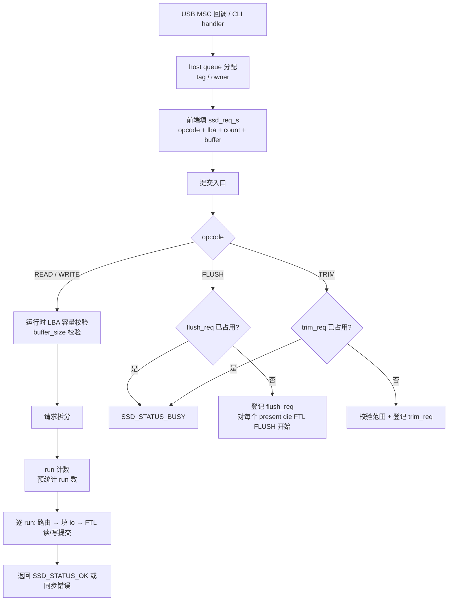
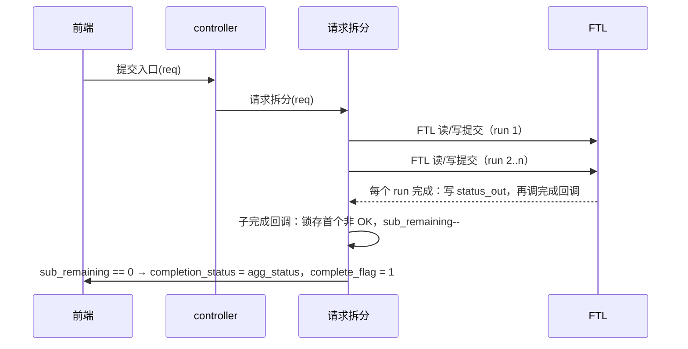

# HIL 设计（Host Interface Layer，主机接口层）

> 状态：活跃设计文档。本文描述 HIL 的**当前设计**：HIL 在 SSD 分层中的位置、
> 请求表示链、提交/完成路径、前端仲裁与失败语义。
>
> 本文是 **architecture design**；测试设计（用例、判据、缺口）见
> [`hil_ut_design.md`](hil_ut_design.md)，二者不互相复制。风险状态见
> [`known_open_items.md`](known_open_items.md)，未实现项见 [`known_open_items.md`](known_open_items.md)。
>
> 行业坐标：HIL 是 [`fc_nand_design.md`](fc_nand_design.md) §6.2 分层中的
> **HIL（Host Interface Layer）**；FTL 见 [`ftl_design.md`](ftl_design.md)，
> FC-NAND 见 [`fc_nand_design.md`](fc_nand_design.md)。本文正文不承载变更史。

---

## 0. 阅读路径

| 你想知道 | 读本文 |
|---|---|
| HIL 负责什么、不负责什么 | §1 |
| 代码在哪些文件里、主循环怎么驱动 | §2 |
| `ssd_req_s` / tag / owner / run 各是什么 | §3 |
| 一条 READ/WRITE/FLUSH/TRIM 怎么提交、怎么完成 | §4 / §5 |
| USB 和 CLI 为什么能同时在场、谁让路给谁 | §6 |
| 哪些不变量不能破、破了会怎样 | §7 |
| 和 NVMe / SATA / eMMC CMDQ 差在哪 | §8 |
| 测试和已知缺口去哪找 | §9 |

---

## 1. 层位置与职责边界

### 1.1 在 SSD 分层中的位置

`fc_nand_design.md` §6.2 的行业分层是 **HIL / FTL / FCC / DRAM + 队列·门铃·完成**。
本仓的对应关系：

| 行业部件 | 本仓实现 | 说明 |
|---|---|---|
| HIL | HIL 模块 + 主循环 | 主机前端、请求表示、路由、完成回执 |
| FTL | FTL 模块 | L2P、GC、WL、Journal、Checkpoint、BBT |
| FCC（硬件） | FC 模块 + NAND 模块 | 两者合起来才等于行业的一个硬件 FCC |
| DRAM | FC 缓冲池 + FTL 片上数组 | DRAM-less：片上缓冲即页缓冲 |
| 队列 / 门铃 / 完成 | 本仓**未实现**环形队列与门铃；用 host queue 表 + `complete_flag` 轮询替代 | 见 §8 |

### 1.2 HIL 做什么

HIL 拿到的是一条**已解析的主机请求**（地址 + 长度 + 数据缓冲 + 操作类型）。它只做
四件事：

1. **前端适配**：把 USB MSC（SCSI BOT）和 UART CLI 的命令归一成 `ssd_req_s`；
2. **入口校验**：运行时 LBA 容量、`block_count`、缓冲容量、controller 状态；
3. **路由与拆分**：按 LBA 路由到 FTL 实例，在**实例边界**把请求切成连续 run，
   每个 run 一次 FTL 读/写提交；
4. **完成回执**：聚合多个 run 的状态，经 `complete_flag` / `completion_status`
   交回前端；FLUSH / TRIM 作为异步单飞行命令由 controller 每轮推进。

### 1.3 HIL 不做什么

以下属于 FTL 或 FCC，**不得**在 HIL 里重复实现：

- 访问哪些物理 plane / block、单 plane 还是双 plane 编程；
- L2P 查表、GC / WL / Journal / Checkpoint、坏块管理；
- ECC、加扰、NAND 命令时序、通道仲裁；
- 数据在 NAND 上的实际搬运。HIL 只持有主机缓冲指针。

判据出处：§6.2.1「设备侧固件拿到的是已解析的请求；访问哪些物理单元、数据怎么搬
归固件」。拆分逻辑用同一句话约束。

### 1.4 两个前端

| 前端 | 入口 | 协议形态 | 特点 |
|---|---|---|---|
| USB MSC | USB MSC 回调 | USB BOT + SCSI READ/WRITE/SYNCHRONIZE CACHE/UNMAP/FUA | 面向 PC 文件系统；异步回调模型；允许写 lookahead |
| UART CLI | UART CLI 命令表 | 行命令 `wr/rd/tr/fl` 等 | 调试前端；命令 handler 内自带 runtime pump 同步等待 |

两个前端共用同一个 controller、同一张 host queue 和同一套完成通道；差异只在
“命令怎么进来、结果怎么回去”。

---

## 2. 模块布局与主循环

### 2.1 模块职责

| 模块 | 职责 | 契约 |
|---|---|---|
| Controller | 生命周期、入口校验、路由、run 拆分编排、FLUSH/TRIM 异步 job | controller 初始化 / 提交入口 / 服务 / 撤销 / 路由 |
| Request | 按 FTL 实例边界统计并提交 run；子请求完成聚合 | 请求拆分 / run 完成推进 / 子完成回调 |
| Host queue | 请求归属与 tag 分配（固定 tag 表） | 分配 / 释放 |
| CLI | UART CLI 解析、命令表、host IO 与诊断命令 | 轮询 / busy 查询 / host 提交 |
| USB MSC | TinyUSB MSC 回调 + SCSI → controller 适配 | 任务 / busy 查询 / 回调 |
| Runtime | 后台服务统一推进顺序 | runtime pump |
| Main | 启动编排 + 超级循环 | 主循环 |

模块依赖方向：**前端模块 → controller / host queue 契约 → FTL 公共接口**。FTL 不反向引用 HIL；controller 只通过 FTL 的提交 / FLUSH / TRIM 接口交互。

### 2.2 主循环推进顺序

主循环：

```text
while (1) {
    栈哨兵检查;
    CLI 轮询;         // 解析并执行 CLI 命令
    runtime pump;     // 后台服务一次推进
}
```

runtime pump 的**固定顺序**：

```text
① FTL/FC 泵
   未 ready：FC 服务
   已 ready：全局 NAND 泵 + 完成表抽干；每个 die 推进实例服务（host 补发 + 后台调度）
② controller 服务（FLUSH / TRIM）
③ USB MSC 任务（检查在飞请求）
④ USB 设备任务（TinyUSB 协议栈）
⑤ timer 调度器
```

顺序不变量：**controller 必须在 USB 任务之前推进**，USB 前端才能在同一轮看到
`complete_flag` 并回 CSW / 回数据。CLI 的同步命令在自己的 handler 里调用同一个
runtime pump，因此“CLI 等待”也走同一套顺序，不另抄一份。

---

## 3. 请求表示链

### 3.1 六行契约（P10）

```text
1. 坐标：host 全局 LBA（QWORD）+ block_count（DWORD，单位 = IU = 512 B）；
         buffer 是主机字节缓冲（READ 回填 / WRITE 数据源）。
2. 表：ssd_host_queue_s.entries[SSD_HOST_QUEUE_DEPTH]，entry 内含 ssd_req_s；
        tag = 数组下标；owner = 前端（USB / CLI）。
3. 计数：queue.used（BYTE，上界 8）；request.sub_remaining（DWORD，run 数）；
        io.cmd_remaining（每次 split 临时使用，不跨命令保留）。
4. 归属：HIL 层；entry 由前端分配，完成由前端释放；controller 只写
        completion_status / complete_flag。
5. 表示链：ssd_req_opcode_e → ssd_req_s → ssd_host_entry_s → ssd_ctl_s.host_queue
        → host queue 分配/free → 提交入口 → 前端轮询。
6. 判据：主流 NVMe 的 SQ slot / command tag / CQ entry 在本仓按 BOT 串行简化
        （host queue 契约）；层归属按 fc_nand_design.md §6.2.2。
```

### 3.2 `ssd_req_s` 字段所有权

| 字段 | 写入者 | 读者 | 语义 |
|---|---|---|---|
| `opcode` | 前端 | controller | READ / WRITE / FLUSH / TRIM |
| `start_lba` / `block_count` | 前端 | controller / request.c | host 全局 LBA；count 是 IU 数（不是页数） |
| `buffer` / `buffer_size` | 前端 | controller / FTL | 主机数据缓冲与容量；controller 入口校验 |
| `completion_status` | controller / FTL 完成（`status_out`） | 前端 | 完成状态；多 run 时最终写回聚合值 |
| `agg_status` | 子完成回调 | 子完成回调 / controller 失败路径 | 多 run 聚合：**首个非 OK 胜出** |
| `complete_flag` | 子完成回调 / controller 各完成点 | 前端轮询 | 1 = 请求已完成；**唯一完成信号** |
| `sub_remaining` | 请求拆分 / 子完成回调 / 提交失败路径 | 同上 | 尚未完成的 run 数 |
| `io` | controller / request.c | FTL | 子请求模板；每 run 只改 `lba/buffer/count/cmd_remaining` |

`complete_flag` / `sub_remaining` 是普通字段：前端轮询与完成写入都在主循环上下文
（本仓没有完成中断），不需要 `volatile`（H16）。

### 3.3 host entry / tag / owner

`ssd_host_queue_s` 是**固定 tag 表**，不是 NVMe SQ/CQ 的软件模型：

```text
host entry（tag = 下标）  ≈ SQ slot / command tag
entry->request            ≈ 已解析的主机请求
request.complete_flag     ≈ CQ 条目（前端轮询）
owner                     ≈ 提交队列来源（USB / CLI）
```

- 深度 `SSD_HOST_QUEUE_DEPTH = 8`，`used` 计数；
- `tag` 恒等于数组下标，分配时写入；
- `owner` 只用于归属，不参与调度；
- 表满时 host queue 分配返回 NULL，前端按“资源耗尽”拒绝命令；
- 释放必须由**分配该 entry 的前端**在请求完成后执行（USB 槽释放 /
  CLI pending 回收）。

### 3.4 run 与 `io` 模板

**run（连续提交段，本仓自拟术语）**：从某个 LBA 起、路由到同一 FTL 实例的最长
连续 LBA 区间。主流的对应概念是“按设备/通道边界切分后的 sub-command”；本仓用
`run` 命名，粒度由 `L2P_REGION_SHIFT`（512 LBA / region）与 `DIE_MAX` 决定。

- 路由键是 **region 序号**：`die = (lba >> 9) % DIE_MAX`；
- 一个 region 整体属于同一实例，所以 run 只可能在 region 边界结束；
- run 完成推进逐 region 前进，不逐 LBA 试探；
- 每个 run 调用一次 FTL 读/写提交，长度交给 FTL，**plane 配对由 FTL 决定**。

`request->io` 是**跨命令复用**的模板（USB 每次 `memset` 请求，CLI 是 static 对象）。
因此：

- `io.complete_flag` 在 split 前置 NULL，子请求用完成回调聚合；
- `io.status_out` 指向 `request->completion_status`；
- `io.cmd_remaining` 只在本次 split 内有效，split 结束后必须还原模板值；
- 缓冲区步进按 `FTL_IU_BYTES = 512 B`（CW 级映射，1 LBA = 1 CW = 1 扇区）。

---

## 4. 提交路径

### 4.1 总流程



### 4.2 controller 状态机

```text
RESET → INITIALIZING → READY
                    ↘ FAILED（终态）
READY → FAILED（运行时致命错误，预留）
```

- controller 初始化在入口做 `RESET → INITIALIZING`，逐 die 校验槽位与拓扑，
  全部通过 → `READY`，任一失败 → `FAILED`；
- 非 READY 状态下提交入口拒绝请求，返回
  `SSD_STATUS_INVALID_ARGUMENT`；
- 非法转换被忽略（保持现态）；FAILED 不响应任何转换。

实现当前要求**全部 `DIE_MAX` 个 die 都有实例**；“支持稀疏拓扑”的注释与实现相反，稀疏拓扑尚未实现。

### 4.3 入口校验

HIL 是 host 入口，host 输入按不可信处理（H29）：

| 校验 | 位置 | 失败返回 |
|---|---|---|
| controller 状态 | 提交入口 | `SSD_STATUS_INVALID_ARGUMENT` |
| LBA 区间 `[lba, lba+count) ⊆ [0, host_lba_max)` | LBA 区间校验 | `SSD_STATUS_INVALID_ARGUMENT` |
| `buffer_size ≥ block_count × 512 B` | 提交入口 | `SSD_STATUS_INVALID_ARGUMENT` |
| `buffer == NULL` | **未校验** | 由 FTL 兜底，状态分类可能错误 |
| FLUSH / TRIM 单飞行 | 提交入口 | `SSD_STATUS_BUSY` |
| 未知 opcode | 提交入口 `default` | `SSD_STATUS_NOT_SUPPORTED` |

容量口径：`host_lba_max` 是**运行时**上限（按实际坏块扣减），不是编译期
`FTL_LBA_MAX`；L2P 表仍按 `FTL_LBA_MAX` 定尺寸。这是本仓自拟的容量折中：
主流是固定容量 + OP 吸收坏块，不动态缩容。

### 4.4 READ / WRITE 拆分

请求拆分的步骤与不变量：

1. **先统计** `total_runs = run 计数`，再置 `sub_remaining`。
   原因：某个 run 可能**同步**完成并触发子完成回调；计数为 0 时会被提前
   置完成。
2. 逐 run 提交；每次提交前填 `io.lba` / `io.buffer` / `io.count` / `io.cmd_remaining`。
3. 提交失败时：本 run 及其后所有 run 都不会提交 ⇒
   `sub_remaining -= (total_runs - submitted)`；不能覆盖成 `submitted`
   （已同步完成的 run 也计入 `submitted`，覆盖会永久等待）。
4. 首个非 OK 锁存到 `agg_status`；后续成功 run 不得覆盖。
5. 返回值的语义：

| 情形 | 返回 | `complete_flag` |
|---|---|---|
| 全部 run 受理 | `SSD_STATUS_OK` | 0（等完成） |
| 部分 run 受理后失败 | `SSD_STATUS_OK`（已受理） | 0（错误走聚合，全 run 完成后回执） |
| 第一个 run 就失败（无在飞） | 具体错误 | 1（同步完成） |
| 入参非法 / opcode 不支持 | `INVALID_ARGUMENT` / `NOT_SUPPORTED` | 1 |

判据：**只要还有 run 在飞，调用者就不能释放请求对象或数据缓冲**，错误也不能同步
回执。相关判定与修复见 §7.4。

### 4.5 FLUSH / TRIM 异步命令

- **FLUSH**：`submit` 只登记 `flush_req`，并对每个 present die 启动 FTL FLUSH；立即返回 `OK`，`complete_flag` 由 service 置位。
  这样 host 回调（TinyUSB 任务内）不再自旋，USB 事件队列不会被饿死。
- **TRIM**：`submit` 只登记范围（`trim_req` / `trim_lba` / `trim_started`）；
  controller 服务每轮按 run 调 FTL TRIM 启动/推进，全部完成后回执。
- 两者都是**单飞行**：同类请求已有一条在飞时返回 `SSD_STATUS_BUSY`。

---

## 5. 完成路径

### 5.1 数据请求的完成聚合



关键契约：

- FTL 在回调前把**本 run 的状态**写进 `io.status_out`（即
  `request->completion_status`）；子完成回调必须在这里把它锁存进
  `agg_status`，否则后续成功 run 会覆盖错误；
- 一次已提交的 run **恰好调用一次**完成回调；
- `sub_remaining == 0` 时才写 `completion_status = agg_status`，再置
  `complete_flag = 1`；
- 前端只以 `complete_flag` 为完成判据（完成查询，
  NULL 视为已完成）。

### 5.2 FLUSH 的完成

FLUSH 服务每轮：

1. 对**全部** present die 调 FTL FLUSH 推进；
2. 任一个未完成 ⇒ 本轮返回，下一轮继续；
3. 全部完成 ⇒ `flush_req->completion_status = SSD_STATUS_OK`，
   `complete_flag = 1`，清 `flush_req`。

不变量：**必须先推进全部实例再判完成**。某一实例未完成时直接 return，会让后面的
实例永远得不到推进（多实例下 FLUSH 卡死）。

### 5.3 TRIM 的完成

TRIM 服务每轮处理一个 run：

1. 取当前 `trim_lba` 的 run 终点与路由实例；
2. 未 `begin` 时调 FTL TRIM 开始；`FTL_AGAIN` ⇒ 下一轮重试；
3. FTL TRIM 推进；`FTL_AGAIN` ⇒ 下一轮继续；
4. 完成后 `trim_lba = run_end`，全部到终点 ⇒ 置 `completion_status = OK` 与
   `complete_flag`。

TRIM 没有 `cancel_trim`：只靠 FTL 的 1 s 无进展超时或复位结束。这是当前范围决策，
不是遗漏（`known_open_items.md` 的 TRIM/cancel 矩阵条目）。

### 5.4 FLUSH 撤销

FLUSH 撤销用于主机复位 / 拔出：

- 摘掉 `flush_req` 回执指针；
- 对每个 die 调 FTL FLUSH 撤销清 job 标志；
- **不回滚数据操作**；数据槽有自己的异步路径。

不撤销会造成：旧 job 在请求对象被复用后才完成，把回执写到新请求上。

---

## 6. 前端仲裁与并发

### 6.1 host busy gate（本仓自拟）

同一时刻只允许**一个 host 前端**向 controller 提交命令，避免调试命令与 PC 文件
系统操作互相插队。实现是两边互相检查：

| 检查点 | 作用 |
|---|---|
| CLI dispatcher：`UART_CLI_FLAG_BUSY` 命令提交前查 CLI busy 或 USB busy | CLI 不在 USB 在飞时提交 |
| USB `WAIT_GATE` 状态：USB MSC 任务等 CLI busy 为假再提交 | USB 不在 CLI 占用时提交 |
| CLI busy = CLI 在飞记录.busy 或直连在飞计数 | CLI 自身 pending + `wp` 直连 FTL 的在飞组 |

这不是单一闸门：同一不变量由 5 处手工维护，需要收口。当前 BOT 串行
且各路径自检，正常路径未见并发。

`wp` 是例外：它绕过 controller 直接调 FTL 写提交（为了在飞多个组把页打包
写缓冲填满），因此不计入 CLI 在飞记录，但必须计入 CLI busy。

### 6.2 CLI 前端

- CLI 在飞记录：单条在飞记录；handler 提交后，CLI 等待自旋
  runtime pump + CLI pending 回收 + 看门狗喂狗，
  完成后打印并释放 host entry；
- 命令级 host 冲突策略只在 dispatcher **一处**执行（`UART_CLI_FLAG_BUSY`）；
  各 handler 不再重复检查；
- `wp` 有自己的在飞计数（直连在飞计数）与完成回调，但泵仍是
  runtime pump。

### 6.3 USB MSC 槽状态机

3 个槽：2 个数据槽（各带 16 KiB bounce）+ 1 个控制槽（FLUSH / UNMAP，无数据缓冲）。
控制槽存在的理由：两个写 chunk 都在飞时，主机紧跟的 SYNCHRONIZE CACHE / UNMAP
仍能排队并异步完成，而不是被 host busy 门拒掉。

```text
FREE → WAIT_GATE → IN_FLIGHT → FREE
```

- `WAIT_GATE`：数据/参数已收到，等 CLI 释放 host busy gate；
- `IN_FLIGHT`：已提交 controller，等 FTL 完成；
- **会话代次（session generation）**：TinyUSB mount 回调 / TinyUSB umount 回调（TinyUSB
  task 上下文）各推进一次；bus reset 必然重新枚举并走到 mount，因此不需要
  ISR 参与应用状态机。会话代次应用消费代次：
  - `WAIT_GATE` 槽直接归还（未提交，无 controller 请求；不调异步完成）；
  - `IN_FLIGHT` FLUSH 槽撤销 controller job 后立即归还；
  - `IN_FLIGHT` 数据 / UNMAP 槽保留到 FTL 完成，完成路径按 `session_gen` 判 stale
    并丢弃结果（不配对异步完成，避免误配给新会话的命令）。
- TinyUSB 未就绪（挂起，会话未变）：命令作废并按原 ASYNC 配对。

回调模型：

1. MSC 回调提交请求后返回 ASYNC 返回码（协议栈保持 pending 状态）；
2. 主循环每轮先跑 FTL 服务，再由 USB MSC 任务检查 `complete_flag`；
3. 完成时回填 READ 数据并调异步完成回调，随后 USB 设备任务
   发出数据 / CSW。

**不要改成 BUSY 返回码**：TinyUSB 会在同一个 TinyUSB 任务调用里立即重入
回调，单线程主循环下 FTL 得不到推进机会（饿死）。

### 6.4 volatile write cache 语义

USB 写路径按主流 SSD 的 **volatile write cache（VWC）** 语义：

| 路径 | 回执时机 | 失败上报 |
|---|---|---|
| WRITE(10) 非 FUA | **提交即回执**（`ack_sent`），主机可立刻发下一段 / 下一条命令 | 回执后的失败置 **deferred error**，由后续能承载状态的命令以 MEDIUM ERROR / WRITE ERROR sense 报一次 |
| WRITE(10) FUA | FTL 完成才回执 | 本条命令直接 CSW failed，不置 deferred |
| READ(10) | FTL 完成 → 拷回端点缓冲 → 回执 | 本条命令 |
| SYNCHRONIZE CACHE | FLUSH job 完成 | 本条命令 |
| UNMAP | 内部 FLUSH 屏障 + 逐 range TRIM，全部完成才回 CSW | 本条命令 |

VWC 让 cache 序列可以跨 host 命令连续（FTL 只在 Journal 顺序页满 / block 头 /
空闲 / LBA 不连续时主动收尾）。deferred error 是对 SCSI deferred error 的近似，
不是完整实现。

`cmd_remaining`：同一 SCSI 命令在本 chunk 之后还剩多少 LBA，FTL 只用它判断
cache 序列的 END 落点；传输段本身的边界不是 FTL 的序列边界。

---

## 7. 不变量与失败语义

### 7.1 不变量

| 编号 | 不变量 | 执行点 | 破了会怎样 |
|---|---|---|---|
| I1 | 请求对象与数据缓冲必须活到 `complete_flag == 1` | 前端；controller 注释契约 | 在飞 run 持有悬垂指针 ⇒ UAF / 数据踩踏 |
| I2 | host entry 由分配它的前端在完成后释放，且恰好一次 | USB 槽释放 / CLI pending 回收 | 表泄漏或重复归还 |
| I3 | 先写 `completion_status`，再置 `complete_flag` | 所有完成点 | 前端看到“完成”但状态仍是旧值 |
| I4 | 每个已提交 run 恰好一次子完成回调 | FTL 组完成契约 | 计数不归零 ⇒ 永久等待；归零过早 ⇒ 提前释放 |
| I5 | FLUSH / TRIM 同类单飞行 | 提交入口 | 回执指针被覆盖，旧请求永远完不成 |
| I6 | FLUSH 每轮推进全部 present die | FLUSH 服务 | 后面的实例得不到推进 ⇒ FLUSH 卡死 |
| I7 | split 结束后还原 `io` 模板的 per-run 字段 | 请求拆分 | 下一条命令继承上一条的剩余长度 |
| I8 | 两个 host 前端不同时提交 controller | host busy gate | 调试命令与 PC IO 互相插队，FTL 单飞行假设被破坏 |
| I9 | VWC 回执后的写失败必须记录 deferred | USB 槽完成 | 静默丢错误，主机不知道数据没落盘 |

### 7.2 状态码语义

`ssd_status_e`：

| 值 | 含义 | HIL 中的典型来源 |
|---|---|---|
| `SSD_STATUS_OK` | 成功 / 已受理 | 提交受理、完成成功 |
| `SSD_STATUS_INVALID_ARGUMENT` | 入参 / 状态 / 范围 / 缓冲非法 | controller 入口校验 |
| `SSD_STATUS_NO_SPACE` | 写路径资源不足 | run 提交失败（写） |
| `SSD_STATUS_IO_ERROR` | 设备侧失败 | run 提交失败（读）、TRIM 失败 |
| `SSD_STATUS_NOT_SUPPORTED` | 未知 opcode | 提交入口 `default` |
| `SSD_STATUS_BUSY` | 同类请求已有在飞 | 第二条 FLUSH / TRIM |
| `SSD_STATUS_TIMEOUT` | 请求超过 `SSD_REQUEST_TIMEOUT_MS` | 请求级 deadline（§7.4） |

注意：**“部分 run 受理后失败”返回 `OK`**，最终错误只出现在
`completion_status`。这是 HIL 的异步契约，不是错误被吞掉。

### 7.3 失败后的资源归属

- run 提交失败：未提交的 run 数从 `sub_remaining` 扣除；已提交 run 继续完成；
  错误锁存 `agg_status`；
- 前端放弃（复位 / 拔出）：会话代次推进，旧槽标 stale；WAIT_GATE 立即归还，
  FLUSH 槽撤销 controller 回执，数据操作完成后丢弃、不回滚；
- host queue 满：命令被拒绝，不分配 entry；
- FLUSH / TRIM 在飞：返回 `BUSY`，请求对象立即完成，前端自行释放。

### 7.4 请求级超时（tombstone）

每个请求在提交入口记录 `start_ms`；前端（USB slot / CLI pending）
用 `SSD_REQUEST_TIMEOUT_MS` 判断请求是否超时。超时只做两件事：

1. 标记超时：置 `timed_out`、`completion_status =
   SSD_STATUS_TIMEOUT`、`complete_flag = 1`；USB 对未回执的命令回
   `ABORTED COMMAND`，CLI 打印超时；非 FUA 写已提前回执，不再发 host 错误。
2. **延迟释放**：`entry` / USB 槽 / bounce 必须等
   可回收判据为真才能归还：
   - READ/WRITE：`sub_remaining == 0`（FTL 的 run 全部完成）；
   - FLUSH：`flush_req != request`（超时路径调用 FLUSH 撤销）；
   - TRIM：`trim_req != request`（没有中止接口，继续推进到 FTL 收尾）。

迟到完成不得覆盖 `TIMEOUT` / `complete_flag`：子完成回调对 `timed_out`
只递减 `sub_remaining`；controller 的 FLUSH/TRIM 完成只摘指针、不写状态。
非 FUA 写的迟到失败在 reclaim 时补记 deferred。

**B（best-effort abort）已实现**：

- READ/WRITE：FTL 请求中止把该请求在所有实例上的组置 `next = total`、
  `agg_status = TIMEOUT` 并试触发完成；在飞 NAND 命令完成后组照常回调（HIL 的
  `timed_out` 分支只递减 `sub_remaining`），随后即可 reclaim；
- TRIM：controller 超时路径对该实例调 FTL TRIM 中止，只清 job 状态；
  已提交的 Journal/L2P 命令自然完成；
- FLUSH：FLUSH 撤销。

⚠ 残余：若**单条在飞 NAND/FC 命令永远不完成**，组的 `outstanding` 不归零，
slot / entry 仍会一直占着。B 不能强制丢弃仍在硬件队列里的命令；这种情况需要
控制器复位。

---

## 8. 与主流 HIL 的对照

### 8.1 概念映射

| 主流机制 | NVMe | SATA AHCI | eMMC CMDQ | 本仓 |
|---|---|---|---|---|
| 提交队列 | SQ（多队列） | 命令列表 | Task Descriptor List | `ssd_host_queue_s` 固定 tag 表 |
| 门铃 | SQ tail doorbell | 命令 issue | `CMD44/45` | **无** |
| 命令标识 | command tag | tag | task tag | `entry->tag`（= 数组下标） |
| 完成队列 | CQ | 命令完成 | Task 完成 | `request.complete_flag` 轮询 |
| 完成通知 | MSI-X 中断 | 中断 | 中断 | **无中断**，主循环轮询 |
| 数据描述符 | PRP / SGL | 数据地址 | 数据地址 | CPU 指针（`buffer`） |
| 并发度 | 多队列 / 多大 tag | NCQ 深度 | 多 task | 一个前端在飞 + USB 2 数据槽 + 1 控制槽 |
| 超时 / 中止 | abort / timeout | 超时 | — | **无** |

共同点（本仓已对齐）：设备侧拿到的是**已解析请求**；HIL 只负责排队、执行、回完成；
物理访问与数据搬运归 FTL/FCC。

### 8.2 本仓缺什么、为什么现在不补

- **SQ/CQ 环形 + doorbell**：USB BOT 本身串行（CBW → data → CSW），没有第二个
  消费者；host queue 契约明确要求接 NVMe 时在**本模块**扩展环形队列 / 完成队列，不要把 USB MSC 的槽状态再复制一份。
- **MSI-X / 中断完成**：本仓完成全部在主循环轮询；数据面本来就是主循环驱动。
- **PRP / SGL**：主机缓冲是指针，没有 IOMMU / 页表；USB bounce 缓冲已由前端管理。
- **多 outstanding + 仲裁**：当前只有两个 host 前端、一个 BOT 通道。
- **host 命令超时 / 中止**：当前未实现；FTL 各 job 有自己的超时兜底，
  但 HIL 层没有 deadline。

### 8.3 接 NVMe 时的扩展点（设计方向，未实现）

1. `host_queue` 扩成 SQ/CQ 环形，tag 从 8 扩到设备支持深度；
2. controller 增加 doorbell 处理与 CQ 写入；
3. 完成通道从 `complete_flag` 轮询改为 CQ 条目 + 中断 / 轮询模式；
4. buffer 从裸指针改为 PRP list / SGL 解析；
5. 前端仲裁从“一个前端在飞”升级为按 tag / 队列的并发调度。

以上是扩展方向，不是当前实现；不要在 USB MSC 模块里预造 NVMe 结构。

---

## 9. 测试入口与已知缺口

### 9.1 测试

- 测试设计、用例矩阵、覆盖缺口：`docs/design/hil_ut_design.md`；
- 用例注册表见板端 UT 文档；
- 板端运行入口：`docs/guides/testing_guide.md`。

本文不复制用例名与运行结果，避免与测试文档漂移（H6）。

### 9.2 已知缺口（只给入口，状态见风险表）

已知缺口：host 前端互斥不是单一闸门、没有 host 命令超时/中止、多 run 中途失败的状态聚合、稀疏拓扑与实现不一致、submit 未校验 `buffer == NULL`、HIL UT 覆盖不足、USB 主机侧矩阵未覆盖。

这些缺口的状态与证据见 [`known_open_items.md`](known_open_items.md) 模块 14 与 [`../guides/usb_msc_verify.md`](../guides/usb_msc_verify.md)；本文不再维护风险编号。
