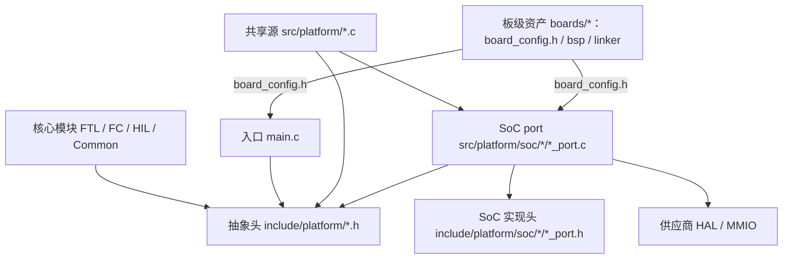
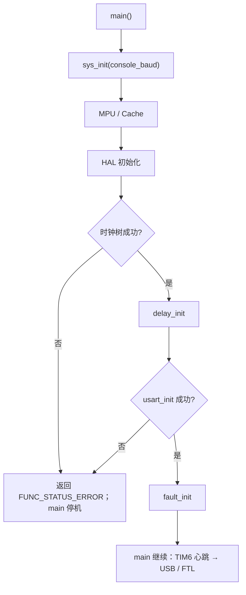

# 平台层设计（Platform Design）

> **目标**：核心模块（FTL / FC / HIL / Common）只依赖抽象头；SoC 与板级差异全部落在
> port / board 层。换 SoC = 新增 `src/platform/soc/<soc>/` 并切换 `FIRMWARE_PLATFORM`；
> 换板 = 新增 `src/platform/boards/<board>/` 并切换 `FIRMWARE_BOARD`；业务层逻辑不动。
> 当前 target：`stm32h743` + `apollo_v2`。
>
> 本文只写平台层自身的分层、服务映射与 port 判据。硬件侧（引脚 / 内存域 / 时钟）见
> `docs/hardware_contract.md`；timer 时间基准见 `docs/design/common/timer.md`；
> NAND 层的当前例外见 §2。

<a id="s0" name="s0"></a>

## 0. 本文回答什么

| 你要做什么 | 先读 |
|---|---|
| 新增 SoC / 换板 | [§1](#s1) 四个部分 → [§3](#s3) 判据 → [附录 A](#sa) / [附录 B](#sb) |
| 查某个服务归哪一层、由谁实现 | [§2](#s2) 服务映射 |
| 判断一次改动是否守住平台边界 | [§3](#s3) 判据 A–E、§3.6 生命周期 |
| 确认哪些不做、可移植承诺到哪 | [§4](#s4) 边界与非目标 |

<a id="s1" name="s1"></a>

## 1. 分层与依赖方向

### 1.1 四个部分

平台层由四个部分组成：抽象头、共享源、SoC port、板级资产。依赖方向是单向的：
核心模块只看到抽象头；port 由链接期提供实现；板级资产只进入口与 port。

这张图回答：四个部分之间的依赖边应该长什么样，哪条边一出现就说明分层被破坏。



读图要点：

1. 核心模块只有一条出边：到抽象头。出现指向 `soc/` 或 `boards/` 的边即为方向违规。
2. 共享源调用 port，但不 include SoC 实现头；port 实现头原则上只由 port 自己包含
   （NAND 层是已知例外：`nand_fmc.h` / `nand_board.c` 直接包含 `sys_port.h`）。
3. `board_config.h` 只到入口与 port，不到抽象头与共享源；共享源通过参数拿到板级值。

| 部分 | 路径 | 允许内容 | 谁包含 |
|---|---|---|---|
| 抽象头 | `include/platform/<svc>.h` | 公开 API + port 接口声明；零 HAL 类型 | 核心模块、共享源、port |
| 共享源 | `src/platform/<svc>.c` | 跨 target 逻辑；零 SoC 头 | — |
| SoC port | `src/platform/soc/<soc>/<svc>_port.c` | HAL / MMIO / 寄存器 / 中断 | 链接期同名符号 |
| SoC 实现头 | `include/platform/soc/<soc>/*_port.h` | 允许 HAL 类型；按需存在 | port 自己；NAND 例外 |
| 板级资产 | `src/platform/boards/<board>/` | `board_config.h`、`bsp/`、`linker/` | 入口、port、构建 |

板级常量走 `board_config.h`，由板级消费者（`main.c`、`sys_port.c`、`usart_port.h`）
包含；共享层不包含板级头。例如控制台波特率由 `sys_init(console_baud)` 传入，而不是
在共享层直接读宏。

### 1.2 绑定机制

**同名 port 函数 + 链接期解析**：抽象头声明 `xxx_port_*()`，共享 `.c` 直接调用，
`src/platform/soc/<soc>/<svc>_port.c` 提供唯一定义。不使用运行期 vtable，也不使用
弱符号。函数签名固定、无间接调用开销；未引用的实现由 `--gc-sections` 裁掉。

### 1.3 构建期选择 target

- `FIRMWARE_PLATFORM`（默认 `stm32h743`）→ `src/platform/makefile.mk` 只 include
  `soc/<soc>/makefile.mk` → 只编译该 SoC 的 `*.c` 与供应商 HAL。
- `FIRMWARE_BOARD`（默认 `apollo_v2`）→ 只 include `boards/<board>/makefile.mk`，
  `LINKER_DIR` 跟着板走。
- 链接参数 `-ffunction-sections -fdata-sections -Wl,--gc-sections` 已裁掉未引用函数，
  因此**本仓服务不做 HAL 式逐服务开关**：开关只会让配置更杂，不省镜像。
- 核心模块的 `MODULE_INCS` **不得**包含 `platform/soc` 或 `platform/boards`；否则裸名
  `#include "crc.h"` 会静默落到实现目录，形成不可见耦合。

> [!NOTE]
> NAND 层是当前已知例外：`src/nand` 直接使用 FMC 与 HAL，其 `makefile.mk` 仍加入
> SoC 头路径（§2、§4）。判据 A 的人工核对要显式排除 `src/nand`，其余核心模块无例外。

<a id="s2" name="s2"></a>

## 2. 通用接口与服务映射

下表是「服务 → 抽象契约 → port → 主要消费者」的唯一映射。port 列为 `—` 的服务只要求
共享源，不要求 `*_port.c`。

| 服务 | 抽象契约（头 / 共享源） | port | 主要消费者 |
|---|---|---|---|
| 平台装配 | `platform.h` / `platform.c` | — | `main.c`、`log.c`、`ftl_sched.c` |
| 系统 | `sys.h` / `sys.c` | `sys_port.c` | 启动、Cache / MPU / VTOR |
| 延时 / 时间戳 | `delay.h` / `delay.c` | `delay_port.c` | NAND、FC、FTL、日志、UT |
| 定时调度器 | `timer.h` / `timer.c` | `timer_port.c` | watchdog、FTL 后台、`[STAT]` |
| 看门狗 | `watchdog.h` / `watchdog.c` | `watchdog_port.c` | 长同步操作、CLI |
| UART 传输 | `usart.h` / `usart.c` | `usart_port.c` | 日志 sink、CLI |
| CRC | `crc.h` / `crc.c` | `crc_port.c` | FC 数据面、boot、FTL 元数据、lifecycle |
| DMA | `dma.h` / `dma.c` | `dma_port.c` | UART TX（NAND 数据面当前 PIO） |
| USB device | `usb.h` / —（入口由 port 实现） | `usb_port.c` | HIL / TinyUSB |
| 故障捕获 | `fault.h` / `fault.c` | `fault_port.c` | HardFault / 断言现场、崩溃记录 |

**分层说明**：

- `syscalls.h` / `syscalls.c` 是 target 无关的 newlib 桩（`_sbrk`，含堆上界 / 栈顶
  检查），没有 port。
- QSPI 与 RNG 保留抽象，没有调用点：`qspi.h` / `qspi.c` / `qspi_port.c` 与
  `rng.h` / `rng.c` / `rng_port.c` 随构建编译但未启用；接口保留供将来外挂 NOR 或
  硬件随机数。UT 使用软件 PRNG，不依赖 RNG port。
- MPU 只有 SoC 实现：`sys_port_mpu_config()` 的区域表就是唯一入口，没有「跨 target
  MPU 服务」这一层（不存在第二个消费者）。
- NAND 层直接访问 FMC 与 HAL，是当前分层例外：`src/nand/nand_fmc.c` 写 FMC 窗口；
  `src/nand/nand_board.c` 定义 `HAL_NAND_MspInit`（板级 FMC / GPIO 接线）；
  `src/nand/devices/mt29f___g08a.c` 只调用供应商 HAL 的 `HAL_NAND_Init` 并执行 ONFI
  流程，不再自建第二套寄存器访问。
- CRC 服务：`crc.h` + `crc.c` 提供 ISO-HDLC（软件 fallback + 硬件选择）；FC 的
  `fc_crc_engine.c` 只保留 CW 数据面的 CRC-32/MPEG-2。`PLATFORM_CRC_HW_SUPPORTED=1`
  且硬件初始化成功时 ISO-HDLC 走 `crc_port.c`；否则走共享软件实现。stm32h743 的
  `makefile.mk` 默认置 1；仿真平台保持 0。两个后端必须在已知向量上 bit-exact。
- SDRAM 的 BSP `.c` 当前未编入构建（没有消费者），源码保留供后续移植。

<a id="s3" name="s3"></a>

## 3. port 契约与判据

A–E 是平台边界的硬判据。下表的命令除特别注明外，**输出为空即通过**；每条同时说明
失败含义，避免把「命令跑过」当成「边界成立」。

| 判据 | 检查对象 | 失败含义 |
|---|---|---|
| A 方向 | 核心模块的 include 路径与 `MODULE_INCS` | 层间耦合，换 SoC 时核心模块被迫改动 |
| B 抽象头纯净 | `include/platform/*.h` 的 HAL / CMSIS 符号 | HAL 类型泄漏到接口，抽象失效 |
| C 实现完整 | 每个抽象头在当前 target 有实现 | 链接失败，或裸名静默落到错误实现 |
| D 共享源纯净 | `src/platform/*.c` 的 HAL / SoC 符号 | 共享源绑死单个 SoC，无法跨 target 编译 |
| E port 唯一定义 | 每个 `*_port_*` 声明恰好一个定义 | 多重定义或缺失，到链接期才暴露 |

### 3.1 判据 A（方向）

核心模块不得出现指向 `platform/soc` / `platform/boards` 的 include 路径，也不得把这两个
目录加入 `MODULE_INCS`；裸名 include 只能解析到抽象头（实现头是 `*_port.h`，不在抽象
头里引用）。

```bash
# A1：非 platform 目录源码里不得出现指向 soc/boards 的 include 路径
grep -rnE '^\s*#\s*include\s*[<"][^">]*platform/(soc|boards)' src include \
  | grep -vE '^(src|include)/platform/'

# A2：非 platform 模块的 MODULE_INCS 不得加入 soc/boards（src/nand 为 §2 已知例外）
grep -rnE 'MODULE_INCS.*platform/(soc|boards)' src --include=makefile.mk \
  | grep -vE '^(src/platform|src/nand)/'
```

A1 只查 include 行，因此 `src/common/stack_guard.c` 注释里提到板级链接脚本路径不会
误报；这是有意的：注释不是依赖。

### 3.2 判据 B（抽象头纯净）

`include/platform/*.h` 不得出现 `HAL_` / `__HAL_` / `HandleTypeDef` / `stm32h7xx` /
CMSIS 符号，**含注释**。注释里出现这些符号同样算失败：否则机械 grep 会因「注释豁免」
而失去区分力。

```bash
grep -nE 'HAL_|__HAL_|stm32h7xx|CMSIS|HandleTypeDef' include/platform/*.h
```

### 3.3 判据 C（实现完整）

每个抽象头在当前 target 下都有实现：要么有共享源，要么有 `*_port.c`（见 §2 的 port
列）。新增 target 时缺实现必须在 `docs/design/known_open_items.md` 显式登记。

```bash
ls include/platform/*.h
ls src/platform/*.c src/platform/soc/stm32h743/*_port.c
```

对照 §2 表人工核对：port 列为 `—` 的服务只要求共享源；其余必须存在对应
`*_port.c`。缺实现时构建通常在链接期失败；若裸名解析到别的同名头，则可能静默
编入错误实现。

### 3.4 判据 D（共享源纯净）

`src/platform/*.c` 不得出现 HAL / CMSIS / SoC 头，也不得 include SoC 头（**含注释**）。
共享源连 CMSIS core 也不用：寄存器访问、`__get_MSP()` 等全部下沉为 port 函数。

```bash
grep -nE 'HAL_|__HAL_|HandleTypeDef|stm32h7xx|CMSIS|core_cm7|sys_port\.h|ftl/|controller/|nand/' src/platform/*.c
```

### 3.5 判据 E（port 有定义）

抽象头里每个 `*_port_*` 声明，在 `src/platform/soc/<soc>/*_port.c` 里**恰好有一个**
定义。下面的脚本只列出不合法的项；无输出即通过。

```bash
for fn in $(grep -rhoE '^[A-Za-z_][^;]*_port_[a-z0-9_]+[[:space:]]*\(' include/platform/*.h \
              | grep -oE '[a-z][a-z0-9_]*_port_[a-z0-9_]+' | sort -u); do
  n=$(grep -rcE "^[A-Za-z_][A-Za-z0-9_ *]*\b${fn}\s*\(" \
        src/platform/soc/stm32h743/*_port.c 2>/dev/null \
      | awk -F: '{sum += $2} END {print sum + 0}')
  [ "$n" -eq 1 ] || printf 'FAIL %-40s defs=%s\n' "$fn" "$n"
done
```

脚本从抽象头的声明行提取名字，再数 SoC port 里的定义行。注释里的路径（如
`rng_port.h`）不参与提取；返回值类型可以是 `void` / `bool` / `BYTE` / `DWORD` /
`func_status_e` 等任意大小写形式。

### 3.6 签名、生命周期与状态

- **命名**：port 函数统一 `xxx_port_*`，只在抽象头里声明；`soc/<soc>` 侧的 `*_port.h`
  不重复声明（`-Wredundant-decls` 会挡）。
- **类型**：抽象头与 port 签名只用裸类型（`BYTE/WORD/DWORD/QWORD`、`bool`、结构体
  指针），不出现 `*_HandleTypeDef`、HAL 枚举或 CMSIS 类型。
- **初始化顺序**：`sys_init(console_baud)` 依次完成 MPU / Cache / HAL / 时钟树 /
  `delay_init` / `usart_init` / `fault_init`；时钟树或 UART 失败返回
  `FUNC_STATUS_ERROR`，由 `main.c` 停机；成功后由 `main.c` 启动 TIM6 心跳与 USB。
  UART sink 可以早绑定；USB 必须在 48 MHz 内核时钟就绪后初始化。
- **失败语义**：初始化失败返回 `bool` / `func_status_e` 并记录；不允许「返回 void 且
  静默失败」。DMA 不可用属于降级（TXE 回退），不算初始化失败。
- **ISR 归属**：每个 ISR 定义在拥有该外设的 `*_port.c`；ISR 只做有界、可重入动作
  （置标志、递增计数、完成 DMA 握手），**禁止** `LOG*` / `ASSERT` / 阻塞等待 / FTL
  事务。
- **DMA 与 Cache**：缓冲区按 32 字节对齐；CPU→设备 Clean，设备→CPU Invalidate。
  当前 NAND/FC 池在 `.noncacheable_buffer` 段。
- **静态状态**：每个 `static` 变量只落在一个 TU；HAL 句柄 / 寄存器影子 → port，
  任务表 / 环形缓冲 / 状态机 → 共享源。拆分时同一次改动内完成旧源文件与 port 的增删。

初始化顺序与失败出口：



读图要点：

1. 两个失败出口都在 `sys_init` 内产生，由 `main.c` 统一处理；port 不自行挂死。
2. `fault_init` 放在 UART 之后，保证故障捕获已经具备输出通道。
3. USB 与 FTL 不属于 `sys_init`；它们在时钟树就绪后由 `main.c` 继续启动。

<a id="s4" name="s4"></a>

## 4. 边界与非目标

- 不引入运行期 vtable 作为主机制；`ssd_platform_ops_s` 只保留为已存在的小 seam，不扩张。
- 不增加第三层概念目录；四个部分（抽象头 / 共享源 / SoC port / 板级资产）就是落地面。
- 抽象头只放声明与契约，不放实现、不放 HAL 类型。
- 共享源不 include SoC 头，不用 CMSIS core。
- port 不实现业务策略；策略留在 FC / FTL / HIL。
- 不为「看起来分层」拆一行转发函数；分层判据是接口与依赖方向。
- 不为每个服务加编译开关；裁剪交给 `--gc-sections`。
- **可移植承诺 = usart / timer / delay / watchdog / crc / dma 的服务骨架**；`sys` /
  `fault` / `syscalls` 是 ARM Cortex-M 专用服务（NVIC / VTOR / MSP / 异常入口），不承诺
  跨架构。
- 已知残留（换 SoC 前必须处理）：`fault.c` 的栈扫描仍使用 stm32h743 内存映射常量
  （Flash / DTCM / ITCM），换 target 时下沉为 port 查询；NAND 层仍直接使用 FMC / HAL
  （Stage 3 未收口，见 §2）。

<a id="sa" name="sa"></a>

## 附录 A：新增 SoC

适用：新增 `src/platform/soc/<soc>/`。完成判据 = 第 2、7 步的 §3 A–E 全部通过，
第 8 步的构建三关与上板 smoke 有结果；未验证项登记台账。

1. 新建 `src/platform/soc/<soc>/` 与 `makefile.mk`，在 `src/platform/makefile.mk` 允许
   `FIRMWARE_PLATFORM`。
2. 按 §2 的 port 列为每个有 port 的服务实现 `*_port.c`；先让判据 C/E 通过，再接业务。
3. 提供启动文件与供应商库接入；`sys_port.c` 完成 VTOR / Cache / MPU。
4. 实现 `usart_port.c` 并接通共享 UART 与日志 sink；保证启动早期能出 banner。
5. 实现 `timer_port.c` / `delay_port.c` 时间源；确认 `timer_scheduler_tick` 与
   `platform_now_ms` 一致。
6. 如启用 watchdog / USB / NAND，分别实现对应 port 并做板端 smoke。
7. 核心模块 `MODULE_INCS` 不加入 `platform/soc`；跑 §3 判据 A–E。
8. 跑构建三关 + 上板 smoke；在 `docs/design/known_open_items.md` 登记未验证项。

<a id="sb" name="sb"></a>

## 附录 B：新增板

适用：新增 `src/platform/boards/<board>/`。完成判据 = 构建通过、`make -n` 的 `-T`
指向新板链接脚本、上板 smoke 有结果；未验证项登记台账。

1. 新建 `src/platform/boards/<board>/`：`makefile.mk`、`board_config.h`、`linker/`，
   按板需要加 `bsp/`。
2. `board_config.h` 只放板决定的量：调试串口实例 / 引脚、控制台波特率、心跳定时器、
   看门狗参数；HSE 频率沿用 `stm32h7xx_hal_conf.h` 的 `HSE_VALUE`，不另立第二套。
3. 链接脚本目录随板；`config.mk` 的 `LINKER_DIR` 自动跟随 `FIRMWARE_BOARD`。
4. 时钟树若随板变化，改板对应的 `sys_port_clock_init()`（SoC port 内按板配置组装）。
5. 跑构建三关；`make -n` 确认 `-T` 指向新板链接脚本；上板 smoke 后登记台账。
