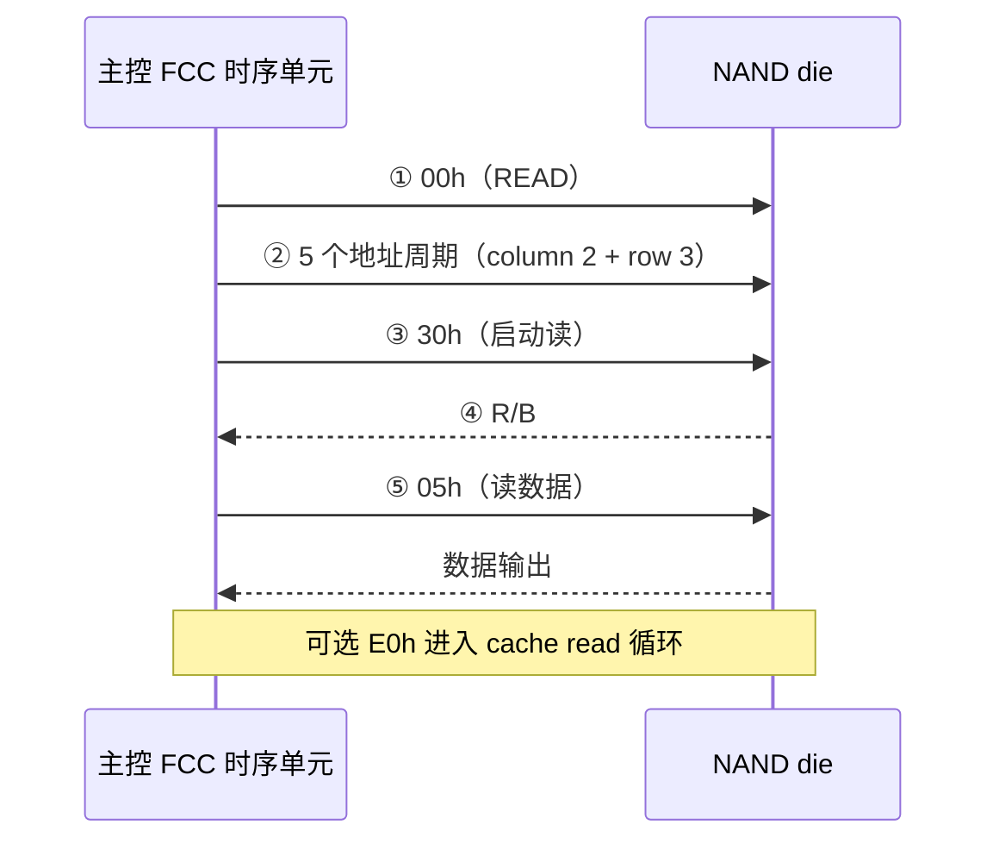
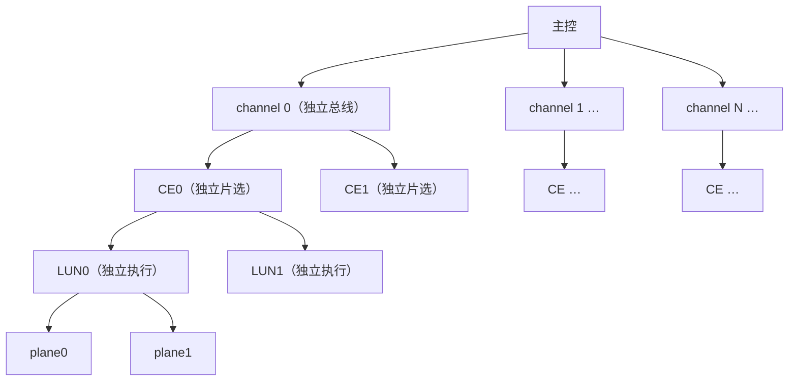
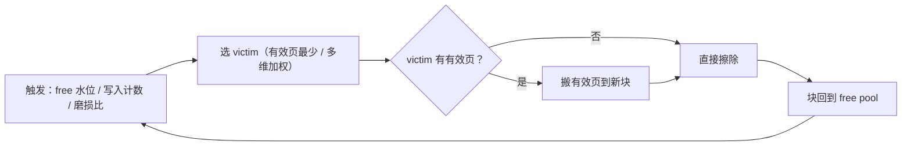
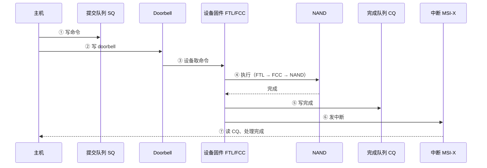

# 存储主控设计要点

> **本文档性质**：存储主控（SSD / flash controller）**设计要点手册**——按 §6.2 分层组织，
> 逐层给出「要决定什么 / 主流怎么做 / 场景差异 / 代价」。
>
> 本仓的落地设计以 [`fc_nand_design.md`](fc_nand_design.md)（FC/NAND）与
> [`ftl_design.md`](ftl_design.md)（FTL）为准；本文是知识参照，不是本仓设计文档。
>
> 组织原则：**分层**（HIL / FTL / FCC / DRAM + 队列 + 门铃 + 完成）、
> **三条主线**（数据面 / 控制面 / 可靠性面）、**场景轴**（消费 / 企业 / 移动 / 嵌入式 / ZNS）。
>
> ⚠ 协议细节以规范原文为准：本文对命令码/时序/字段的描述是导航性质，不替代 ONFI/JEDEC/NVMe 原文。

## 阅读路径

| 阅读目的 | 从这里开始 |
|---|---|
| 快速总览 | §〇 一页速览 |
| 查器件 / 协议 | §二 器件、§三 NAND 接口 |
| 查 FC / FTL / HIL | §四 FCC、§五 FTL、§六 HIL |
| 查调度 / 可靠性 | §七 调度与 QoS、§八 可靠性 |
| 做设计审查 | §十一 取舍 checklist |
| 找开源项目 / 论文 | [`../reference/README.md`](../reference/README.md)（链接 + 逐份分析） |

---

## 〇、一页速览

```
        Host  ── NVMe / SATA / eMMC / UFS / SD ──┐
                                                 │  ① 主机接口（协议 + 队列 + 门铃 + 完成）
 ┌───────────────────────────────────────────────▼──────────────────────────────┐
 │ HIL  主机接口层    协议解析 · 队列管理 · 门铃响应 · 中断 · 描述符(PRP/SGL)      │
 ├──────────────────────────────────────────────────────────────────────────────┤
 │ FTL  闪存转换层    L2P 映射 · GC · 磨损均衡 · 坏块管理 · 掉电恢复 · 缓冲调度    │  ② 固件
 ├──────────────────────────────────────────────────────────────────────────────┤
 │ FCC  闪存通道控制器 通道/CE/LUN/plane 时序 · 描述符链 · ECC · 加扰 · CRC · DMA │  ③ 硬件（或软 FCC）
 ├──────────────────────────────────────────────────────────────────────────────┤
 │ DRAM/SRAM         映射表驻留 · 命令队列 · 数据缓冲（DRAM-less 时 SRAM+NAND 兜底）│
 └───────────────────────────────────────────────┬──────────────────────────────┘
        ONFI / Toggle 总线  ─────────────────────┘  ④ 器件总线
                    NAND die ── channel → CE → LUN/die → plane → block → page → CW
```

| 层 | 一句话职责 | 核心决策 | 本文档 |
|---|---|---|---|
| 器件 | 存数据、会磨损 | SLC/MLC/TLC/QLC、几何、可靠性 | §二 |
| NAND 接口 | 主控与 die 之间的语言 | ONFI/Toggle、命令集、时序、并行 | §三 |
| FCC | 把「一条命令」变成「总线上的时序」 | 拓扑并行、描述符链、ECC/加扰/CRC/DMA | §四 |
| FTL | 把「裸 NAND」变成「逻辑块设备」 | 映射、GC、WL、坏块、掉电恢复 | §五 |
| HIL | 把「主机请求」变成「设备内部请求」 | 协议、队列、门铃、完成、描述符 | §六 |
| 调度/QoS | 决定「谁先走、谁等多久」 | 仲裁、读饥饿、尾延迟、后台协同 | §七 |
| 可靠性 | 保证端到端不丢不坏 | ECC/RAID/副本/端到端 CRC | §八 |

**一句话**：主控 = **翻译机**（HIL 协议 ↔ 内部请求） + **调度器**（队列/门铃/完成） + **可靠性引擎**（ECC/RAID/恢复）
+ **映射管理器**（FTL 把逻辑地址翻译成物理地址）。

---

## 一、全景：主控做什么、分几层、有哪些形态

### 1.1 主控的本质

一块 SSD 主控要做三件**主机看不见**的事：

1. **地址翻译**：主机说「读 LBA 1000」，主控要决定「读哪个 die/block/page」——因为 NAND **不能原地覆写**
   （写只能写到已擦除的页，擦除以块为单位）。这条翻译就是 FTL 的存在理由。
2. **可靠性**：NAND 天然会出错（读干扰、保持性衰减、磨损），主控要用 ECC/RAID/重试把裸误码率
   从 1e-3 级别压到主机可接受的 1e-15 级别。
3. **并行与调度**：单颗 NAND 慢（tR ~25μs、tPROG ~600μs），主控靠**多通道 × 多 CE × 多 LUN × 多 plane**
   的并行把带宽堆上去，并靠队列/调度保证延迟与公平。

### 1.2 主机接口形态（§6.2.1 三种代表 + 扩展）

| 形态 | 提交 | 完成 | 描述符 | 典型场景 |
|---|---|---|---|---|
| **NVMe** | SQ 写命令 + doorbell | CQ + MSI-X 中断 | PRP/SGL 指数据缓冲 | 数据中心 / 高端消费 |
| **SATA (AHCI)** | 命令表 (FIS) + 寄存器 | 完成 + 中断 | 内嵌 PRD 列表 | 消费级 / 老平台 |
| **eMMC CMDQ** | Task Descriptor List (`CMD44/45`) | Task 完成 + 中断 | 描述符含地址/方向/块数 | 移动 / 嵌入式 |
| **UFS** | SCSI 命令 + MCQ 队列 | 完成 + 中断 | UPIU 承载 | 移动旗舰 |
| **ZNS / OCSSD** | 裸写指针 / zone append | 完成队列 | 极简，设备侧几乎无 FTL | 数据中心（主机托管 FTL） |

**共同点**（§6.2.1）：设备侧固件最终拿到的都是**一条「已解析的请求」**——
目标 LBA/地址 + 数据缓冲指针 + 操作类型。「访问哪些物理单元、数据怎么搬」全是**固件**的事；
硬件接口只负责「把请求排队、按序执行、回一个完成」。

### 1.3 三条主线

| 主线 | 内容 | 一句话 |
|---|---|---|
| **数据面** | host 缓冲 → FC 缓冲 → 加扰 → ECC → NAND → 原路返回 | 数据**怎么走** |
| **控制面** | 请求排队 → 调度 → 下发起步 → 完成回收 | 命令**怎么排** |
| **可靠性面** | ECC 纠错 · CRC 校验 · RAID 恢复 · 坏块替换 · 掉电恢复 | 出错**怎么救** |

> 自检：任意一个功能，能不能**归到「哪条主线的哪一层」**？能，说明理解到位。

### 1.4 主控固件 ≠ 应用/OS 编程（先破一个误区）

主控固件是**裸机 / RTOS + 固定向量表**：

- 中断向量**编译期固定**（向量表在 startup），不能运行期挂 handler；
- 内存**静态分配**（池子 + 固定数组），没有动态堆；
- 并发靠**状态机 + 轮询**，不是线程/锁。

> ⚠ 这决定了很多「往 OS 靠」的做法在主控语境里是**反向**的（例：`request_irq`/运行期注册/`malloc`）。
> 判据始终是 §6.2 的**硬件 FCC 形态**，不是 Linux 怎么写。

---

## 二、Flash 器件知识（器件层）

> 这一层是**物理约束的来源**——FTL 的一切复杂度，都是为了让主机看不见下面的这些「不完美」。

### 2.1 存储单元：从浮栅到 3D

| 概念 | 要点 |
|---|---|
| **单元类型** | 浮栅 (FG) vs **电荷陷阱 (CT/3D)**；现代 3D NAND 基本是 CT |
| **每单元比特数** | SLC(1) / MLC(2) / TLC(3) / QLC(4) / PLC(5) |
| **读写单位** | **页 (page)** 读/写；**块 (block)** 擦除——**擦除粒度 >> 写粒度**，这是 FTL 的根 |
| **3D NAND** | 垂直堆叠层数（层数↑= 容量↑，但工艺难度↑）；CT 天然适合 3D |

**每单元比特数的代价**（越密越便宜，但越脆）：

| 类型 | 每单元 | P/E 寿命（量级） | 读速度 | 典型用途 |
|---|---|---|---|---|
| SLC | 1 bit | ~10万 | 最快 | 企业缓存 / 元数据 |
| MLC | 2 bit | ~3千~1万 | 快 | 老企业级 / 混合 |
| TLC | 3 bit | ~1千~3千 | 中 | **消费级主流** |
| QLC | 4 bit | ~几百~1千 | 慢 | 大容量冷数据 |
| PLC | 5 bit | 更低 | 最慢 | 研究中 |

> **关键取舍**：容量/成本 ↔ 寿命/性能/可靠性。企业级常**混合介质**（SLC 缓存 + TLC/QLC 容量），
> 或用 **SLC 缓存模式**（新写入先落 SLC，空闲再折叠成 TLC）。

### 2.2 几何层级（地址怎么算）

```
channel（通道，主控的一组数据总线）
 └─ CE / chip（片选，一个封装）
     └─ LUN / die（逻辑单元，可独立执行命令的最小实体）
         └─ plane（2 或 4 个/ die，可并行但共享部分外围电路）
             └─ block（擦除单位）
                 └─ page（读/写单位）
                     └─ CW（codeword，ECC 单位；常 512B~1KB 用户数据 + 校验）
```

- **并行度来源**：channel（独立总线）× CE（片选）× LUN/die（独立执行）× plane（die 内并行）。
- **block 内**：低编号页（LSB 页）比高编号页（MSB 页）更可靠（TLC/QLC 尤其明显）——影响数据放置。
- **OOB / spare 区**：每页主区之外的一段（本仓器件为 64B/页），通常放 ECC 校验、元数据、坏块标记。
  ⚠ 有的设计（如 dhara）**不占 OOB**，全留给 ECC——是取舍。

### 2.3 三种操作的物理机制与不对称性

| 操作 | 单位 | 机制 | 时间量级（本仓器件） |
|---|---|---|---|
| **Program（写）** | 页 | 注入电荷抬高阈值电压 | tPROG ~600μs |
| **Erase（擦）** | 块 | 抽出电荷 | tERASE ~3ms |
| **Read（读）** | 页 | 施加参考电压判断阈值 | tR ~25μs |

**三条硬约束**（FTL 的复杂度全源于此）：
1. **写不能原地覆写**：一个页只能写一次（写过的页再写会破坏相邻单元）。⇒ 更新 = **写新页 + 失效旧页**。
2. **擦除是块级**：要回收一个失效页，必须整块擦除——但块里可能还有有效页。⇒ 需要 **GC（搬有效页 → 擦整块）**。
3. **擦有寿命**：每块 P/E 次数有限。⇒ 需要 **磨损均衡 (WL)**，让擦除次数摊平。

### 2.4 四大可靠性问题

| 问题 | 成因 | 表现 | 对策 |
|---|---|---|---|
| **P/E 磨损** | 反复擦写损伤氧化层 | 寿命耗尽、误码上升 | 磨损均衡、写放大控制、OP |
| **读干扰 (read disturb)** | 读某页时对同块其它页施加电压 | 同块其它页误码累积 | 定期刷新、读计数、GC 搬移 |
| **保持性 (retention)** | 电荷随时间泄漏 | 长期存放后误码 | 刷新 (refresh)、数据巡检 (scrub) |
| **编程干扰 (program disturb)** | 写某页影响相邻页 | 相邻页误码 | 加扰、写序优化、ECC |

### 2.5 关键参数（选器件/配时序要看）

- **时序**：tPROG / tERASE / tR / tRC / tCCS / tWHR……（ONFI 参数页给原值）。
- **耐久**：P/E 次数（per block），决定 TBW（总写入字节）。
- **ECC 要求**：器件 datasheet 会给出「需 ECC 强度」——TLC/QLC 要求 LDPC 软判决。
- **on-die ECC**：现代器件内置 ECC（对主控透明或半透明），主控 ECC 是**第二道**。
- **RBER / UBER**：原始误码率 / 不可纠误码率——是 ECC 选型的输入。

### 2.6 前沿与新型

- **ZNS（Zoned Namespace）**：把「顺序写约束」暴露给主机，设备侧 FTL 大幅简化（见 §6.4）。
- **FDP（Flexible Data Placement, NVMe TP4146）**：主机用「放置指令」告诉设备数据该放哪类介质/如何分组——是 ZNS 思路的通用化。
- **SLC 缓存 / 动态介质**：同一块 TLC 在缓存模式下当 SLC 用。
- **可计算存储 (Computational Storage)**：把计算下推到盘内（与主控设计正交，但影响 HIL 形态）。

---

## 三、NAND 接口协议（器件 ↔ 主控）

> 主控与 die 之间的「语言」。两条主流路线：**ONFI** 与 **Toggle Mode**。

### 3.1 两条主流物理接口

| 维度 | **ONFI** | **Toggle Mode** |
|---|---|---|
| 主导方 | Intel/Sony/Micron 等（开放标准，onfi.org） | 三星/东芝（现 Kioxia） |
| 时钟 | 同步模式带 **CLK**；也有异步模式 | **无时钟**，用 **DQS** 选通 |
| 电平 | NV-DDR / NV-DDR2 / NV-DDR3 | Toggle 1.0 / 2.0 / 3.0 |
| 关系 | 二者**信号语义趋同**，现代器件多双支持 | 同上 |

> **本仓是 ONFI 1.0**（见 `fc_nand_design.md` §3.10）。⚠ 注意：**ONFI 1.0 全文无 "plane" 一词**，
> multi-plane 是**器件侧特性**，不是 1.0 协议内容。

### 3.2 命令集（导航用，具体码以器件/规范为准）

| 类别 | 常见命令 | 说明 |
|---|---|---|
| 复位 | `FFh` | 复位器件 |
| 读 ID | `90h` | 读厂商/器件 ID |
| 读状态 | `70h` | 读 status register（R/B#、写保护、失败位） |
| **页读** | `00h`–`30h` | 发地址 → 30h 启动 → 等 R/B# → 读数据 |
| **缓存读** | `05h`–`E0h` | 读数据寄存器（cache read 流程） |
| **页写** | `80h`–`10h` | 发地址 + 数据 → 10h 启动 |
| **多 plane 写** | `80h`–`11h` | 双 plane 同时写（器件特性） |
| **擦除** | `60h`–`D0h` | 块擦除 |
| **Set/Get Features** | `EFh` / `EEh` | 配/读器件特性（时序模式、驱动强度等） |
| **读参数页** | `ECh` | 读 ONFI 参数页（几何/时序/ECC 要求） |
| **读唯一 ID** | `EDh` | 读器件唯一 ID |
| **Copy-Back** | `00h`–`35h` / `85h`–`10h` | 片上搬移（GC 优化） |

> ⚠ 命令码/可用性**随规范版本与器件型号不同**——写驱动前查手上型号的 datasheet 命令表。
> 本仓实现见 `fc_nand_design.md` §3.10（ONFI 1.0 命令表）与 `src/nand/`。

### 3.3 一次页读的完整序列（判据动作）



> **判据动作**：能不看资料写出这五步（含命令码与地址周期）。

### 3.4 并行与加速机制

| 机制 | 是什么 | 收益 |
|---|---|---|
| **Multi-plane** | 一个 die 内多 plane 同时读写 | die 内并行（器件侧特性） |
| **Multi-die / LUN 交错** | 多个 die 交错执行（`11h` Interleaved 在本仓 ONFI 1.0 语境） | 掩藏 tR/tPROG |
| **Cache Program/Read** | 数据寄存器与阵列操作重叠 | 流水化，提升吞吐 |
| **Copy-Back** | 片上搬移，不经过主控 | GC 搬数据省带宽 |

> ⚠ 这些是**器件能力**，不是所有器件都有；主控要**探测能力**再启用（读参数页 / 试命令）。

### 3.5 时序模式

- 器件支持多种时序模式（不同 tRC/tADL/tWC 组合），**模式越高越快但信号完整性要求越高**。
- 主控在初始化时用 `Set Features` 切到目标模式；切之前要按默认模式读参数页。
- ⚠ 本仓现状：`CONFIG_NAND_TIMING_MODE=5`，启动全程 Mode 0，FTL boot/恢复完成后切 Mode 5
  （3.3V 专用的 Mode 5；Table 29/31 的 3.3V AC 参数对应 Mode 5。Table 32 的 1.8V 参数
  对应 Mode 4；本板 3.3V，故不用 Mode 4）。见 `fc_nand_design.md` §3.14。

### 3.6 ECC 与器件的契约

- 器件 datasheet 给出「**每多少字节需要多少 bit 纠错**」——主控 ECC 强度必须 ≥ 此值。
- **on-die ECC** 是器件内置的第一道；主控 ECC 是第二道（也负责把器件 ECC 失败的情况救回来）。
- 现代 TLC/QLC 要求 **LDPC**（软判决）；老 SLC/MLC 用 **BCH** 足够。

---

## 四、FC / FCC：闪存通道控制器（主控硬件层）

> §6.2 里 FCC 是**硬件**：通道时序、描述符链、ECC、加扰、DMA。
> 本仓用**软 FCC**（`src/fc/` + `src/nand/` 合起来 = 行业的一个硬件 FCC）。

### 4.1 FCC 的职责边界（§6.2.3 判据）

**判据**：拿 FC 的每个对外函数去比对**硬件 FCC 的寄存器表**——**有对应项则留，无则剔**。

| 硬件 FCC 的对应物 | 本仓保留的接口 |
|---|---|
| 复位/配置寄存器 | `fc_init` |
| 命令槽取/还 | `fc_command_alloc` / `release` |
| 填一条描述符 | `fc_command_configure_descriptor`（唯一建链入口） |
| 写门铃 | `fc_submit` |
| 控制器自跑 | `fc_service` |
| 读 CQ | `fc_poll_completion` |
| 数据缓冲 | `fc_buffer_alloc/release/…` |
| 完成聚合寄存器 | `fc_get_cmd_ecc_max` |
| 状态寄存器 | `fc_get_resource_stats` |
| **无此寄存器**（描述符链是固件填的） | ~~`fc_command_configure_descriptors`~~ → **上移 FTL** |
| **无此寄存器**（数据是固件 DMA 搬的） | ~~`fc_write_cmd_data`~~ → **上移 FTL** |

> **原则**：**越靠近硬件，接口越只谈机制；策略越往上放**（§6.2.4）。
> OCSSD/ZNS 这类「设备侧极简 FTL」方向印证同一点。

### 4.2 拓扑：并行的来源



- **每增加一层并行 = 一条独立的时序执行能力**：channel 独立总线、CE 独立片选、LUN 独立命令执行、plane die 内并行。
- **仲裁**：多条命令争用同一通道时，靠调度器排队（见 §七）。
- **代价**：并行度越高，功耗/PCB/引脚越复杂——所以**消费级常单通道，企业级多通道**。

### 4.3 描述符链执行模型

- 一条「逻辑操作」（如 multi-plane 写 4 CW）被拆成**描述符链**：每条描述符 = 一个 CW 的数据缓冲 + 地址。
- FCC **顺序执行**链：逐条把数据搬到器件、发命令、等完成。
- **原子性**：链要么整体提交，要么不提交；失败要能**回滚**（释放已建的链）。

### 4.4 ECC 编解码（可靠性面的核心）

| 方案 | 类型 | 适用 | 特点 |
|---|---|---|---|
| **BCH** | 硬判决，代数译码 | SLC/MLC、误码低 | 实现简单、确定性延迟、纠错能力有限 |
| **LDPC** | 迭代译码，可软判决 | TLC/QLC、误码高 | 纠错强、接近香农限；**延迟不确定**、需软信息 |
| **RS / 卷积码** | 老方案 | 遗留 | 现代基本被 BCH/LDPC 取代 |

**软判决 LDPC 与 read retry 的配合**（读恢复阶梯）：
1. **L1**：正常读，ECC 直接纠错；
2. **L2**：ECC 失败 → **read retry**（换参考电压重读）/ **软判决 LDPC**（多次读 + 置信度）；
3. **L3**：仍失败 → **RAID/XOR 重建**（用同条带其它页反推）。

> ⚠ 本仓 `read_recovery` 落 L1/L2，**L3（XOR）因 `CONFIG_FC_RAID=0` 不实现**（见 §八、§十一）。

### 4.5 加扰（Scrambler）

- **目标**：把数据随机化，避免「全 0/全 1」等最坏模式引起的**单元间干扰**，并让数据**统计独立**（利于 ECC）。
- **做法**：LFSR 生成伪随机序列 XOR 数据；读回时同序列 XOR 还原。
- **要点**：序列必须**确定性可复现**（用 LBA 作种子），否则读不回来。

### 4.6 CRC

- **目标**：检测数据在**传输/搬运**过程中是否被破坏（与 ECC 纠错互补：CRC 检错、ECC 纠错）。
- **位置**：常加在用户数据段，端到端保护（见 §八）。
- ⚠ 本仓踩坑：CRC 硬件基址曾写错导致**自始静默失效**——硬件外设接错基址不会报错。

### 4.7 数据通路：DMA vs PIO

| 方式 | 谁搬数据 | 优点 | 缺点 |
|---|---|---|---|
| **PIO** | CPU 逐字节/字搬 | 简单、可控 | 占 CPU、慢 |
| **DMA** | DMA 引擎搬 | 释放 CPU、快 | 复杂（一致性/缓存）、调试难 |

> ⚠ 本仓 NAND/FMC 数据面**固定 PIO**（FMC NAND 无专用 DMA 请求线）；DMA 抽象只保留 UART TX。PIO 路径有 `__DMB` 内存屏障约束，顺序敏感处必须显式屏障。

### 4.8 时序执行单元（微码状态机）

- 一条 NAND 命令 = 一串**微操作 (uop)**：发命令码 → 发地址周期 → 等 R/B# → 读写数据。
- **issue / wait / fetch 三段拆分**（本仓）：把「发起」与「等待」解耦，才能让多个 LUN 并发（等 A 的 R/B# 时去发起 B）。
- **R/B# 等待**：可轮询 GPIO 或 70h 状态；本仓落**纯 GPIO 轮询 + 显式延迟**。

### 4.9 RAID / XOR 恢复

- **思路**：把 N 个页的数据 XOR 出一个校验页；任一页读失败，用其余页 + 校验反推。
- **代价**：额外写放大（每 N 页多写 1 页）、GC 时校验页也要搬。
- **场景**：企业级（高可靠性要求）常用；消费级常省。
- ⚠ **本仓 `CONFIG_FC_RAID` 必须保持 0**（用户明确）——见 §十一 边界。

---

## 五、FTL 层（把裸 NAND 变成逻辑块设备）

> §6.2 定义 FTL = **逻辑→物理映射、GC、WL、坏块管理、掉电恢复、缓冲调度**。
> 这是主控固件里**最复杂**的一层，也是各家差异最大的地方。

### 5.1 映射方案谱系

| 方案 | 映射粒度 | 表大小 | 写放大 | 适用 |
|---|---|---|---|---|
| **块级 (BFTL)** | 逻辑块 → 物理块 | 小 | 高（改一页搬整块） | 极简/小内存 |
| **页级** | 逻辑页 → 物理页 | 大 | 低 | 主流 SSD |
| **混合 (FAST)** | 数据块用块级 + 日志块用页级 | 中 | 中 | 折中 |
| **DFTL** | 页级表按需分页到 SRAM（页级映射的一种缓存实现） | 可控 | 低 | **DRAM-less** |
| **学习式 (LeaFTL)** | 用回归预测映射 | 极小 | 视情况 | 研究前沿 |

> **本仓**：纯页级 + DRAM-less（SRAM region cache + NAND 兜底）。
> 本仓自 2026-10-13 起映射粒度 = **CW（512B）**，与 FC 码字粒度一致；
> 布局与理由见 `ftl_design.md` §2.2（详细推导在 `../archive/cw_level_mapping_design.md`）。

### 5.2 L2P 表放哪（最核心的取舍）

| 路线 | 表驻留 | 优点 | 缺点 | 场景 |
|---|---|---|---|---|
| **DRAM 型** | 全表常驻 DRAM | 快、简单 | 吃 DRAM、贵 | 企业级 |
| **DRAM-less** | SRAM 缓存 + NAND 兜底 | 省 DRAM、便宜 | 表访问有代价、cache 未命中慢 | 消费级/UFS/eMMC |
| **混合/HMB** | 用主机内存 (HMB) 当缓存 | 折中 | 依赖主机配合 | 部分消费级 NVMe |

> **对照**：SPDK FTL 只缓存最近用的 2GiB，其余换页到 cache 设备——它是「DRAM 型 + 换页」；
> 本仓是「SRAM 数组 + NAND 兜底 + CLOCK 淘汰」。**问：我敢不敢花这块 DRAM？**

### 5.3 L2P cache 算法

| 算法 | 要点 |
|---|---|
| **LRU** | 简单，但顺序扫描会污染 |
| **CLOCK** | 近似 LRU，用引用位，实现省内存 |
| **CLOCK-pro** | 区分冷热，抗扫描 |
| **自适应 / ARC** | 动态平衡 |
| **thrashing 检测** | 命中率骤降时切 write-through，避免「淘汰→刷→再读」活锁 |

> 本仓用 **CLOCK + write-back + journal**；thrashing 检测已落地（P1-4，窗口 miss 率 + 滞回），
> 见 `ftl_design.md` §3.5。

### 5.4 GC（垃圾回收）

- **触发**：free 块水位、写入计数、定时器、磨损比、碎片率（多级触发）。
- **victim 选择**：从「有效页最少」的贪心，到**多维加权**（有效比 + 磨损 + 温度 + 年龄）。
- **预擦除池 (pre-conditioned pool)**：后台提前擦好一批块，前台 IO 不用等 GC。
- **成本-收益 (cost-benefit)**：`(1-valid) × age / (1+erase_count)` 类公式。
- **场景**：消费级容忍 GC 抖动；企业级要**稳态性能**（GC 不能拖垮尾延迟）。

**GC 循环**



> 本仓 victim 已改为**多维加权**（valid / erase / temp / age，P1-1 已落地），
> 见 `ftl_design.md` §3.12。

### 5.5 磨损均衡 (WL)

| 类型 | 做法 | 作用 |
|---|---|---|
| **动态 WL** | 写入时选擦除次数少的块 | 摊平热数据 |
| **静态 WL** | 主动搬移长期不动的冷数据 | 摊平冷数据 |

> **前提**：擦除计数必须**持久化**，否则跨重启归零、WL 失效。
> ⚠ 本仓擦除计数**已持久化**：随 Checkpoint 磨损快照落盘（当前介质版本 **12**；自版本 9 起），
> 开机 `checkpoint_load_wear_table` 回填 BST。

### 5.6 坏块管理

- **出厂坏块**：初始化时扫描（读每块首页的坏块标记），建 **BBT (Bad Block Table)**。
- **增长坏块**：运行期擦/写失败后标记，用**备用块 (spare pool)** 替换。
- **粒度**：常按**物理块**（per-plane），与 Super Block 配对方式相关。

### 5.7 掉电恢复（可靠性面最硬的一环）

| 机制 | 做法 | 代价 |
|---|---|---|
| **Journal** | 写前先记日志，恢复时重放 | 额外写、日志本身有寿命瓶颈 |
| **Checkpoint** | 周期性落盘全量/增量映射 | 恢复快，但 checkpoint 间隔内仍需 journal |
| **P2L 重放** | 每个 band 尾部存物理→逻辑，按序重建 | 无 journal，但依赖顺序写 |
| **全盘扫描** | 扫描所有页重建映射 | 慢，但最兜底 |

- **目标**：任何掉电点，恢复后映射表**一致**（不能丢已确认的写，不能认未确认的写）。
- ⚠ 本仓：Journal + Checkpoint + closed SB 重建扫描（见 `ftl_design.md` §3.7/§3.8）。

### 5.8 写放大 (WAF) 与 OP

- **WAF = NAND 实际写入 / 主机写入**；GC 搬移是主要来源。
- **OP（over-provisioning）**：预留容量换取低 WAF/长寿命。消费级 ~7%，企业级 ~28%。
- **关系**：OP↑ ⇒ GC 压力↓ ⇒ WAF↓ ⇒ 寿命↑。这是「容量 vs 耐久」的直接权衡。

### 5.9 数据放置 / 多流 / 温区

- **Hot/Cold 分离**：热数据与冷数据写不同块，避免 GC 时「热块搬冷数据」。
- **多流 (Multi-Stream)**：主机给「流 ID」，设备按流分块（NVMe 支持）。
- **ZNS/FDP**：把放置决策**上移主机**（见 §6.4）。

---

## 六、HIL：主机接口层

> §6.2 里 HIL = 协议解析、队列管理、doorbell 响应。**这是本仓离真主控最远的一层**
> （本仓是 USB MSC BOT + UART CLI 调试前端，没有 SQ/CQ、doorbell 与完成中断；见 `docs/design/hil_design.md`）。

### 6.1 协议栈全景

| 物理层 | 传输/命令层 | 典型 |
|---|---|---|
| **PCIe** | NVMe | 数据中心 / 高端消费 |
| **SATA** | AHCI → ATA/SCSI | 消费级 / 老平台 |
| **M-PHY** | UniPro → UFS (SCSI) | 移动旗舰 |
| **并行/SD** | eMMC / SD 命令 | 移动 / 嵌入式 |

### 6.2 队列 + 门铃 + 完成 + 中断（所有现代接口的共同骨架）



- **NVMe**：多对 SQ/CQ，门铃寄存器，MSI-X 中断，PRP/SGL 描述数据缓冲。
- **SATA (NCQ)**：命令队列深 32，FIS 承载命令，内嵌 PRD 列表。
- **eMMC CMDQ**：Task Descriptor List，`CMD44/45` 提交，Task 完成中断。
- **UFS MCQ**：多循环队列。

### 6.3 描述符：数据缓冲怎么指

- **PRP (Physical Region Page)**：物理页列表（NVMe）。
- **SGL (Scatter-Gather List)**：分散/聚集列表，支持更复杂的内存布局。
- **要点**：描述符只谈**机制**（数据在哪、多长、什么方向），不谈**策略**（放哪个物理单元）。

### 6.4 ZNS / OCSSD / FDP：把 FTL 上移主机

| 形态 | 核心思想 | 设备侧 | 状态 |
|---|---|---|---|
| **OCSSD** | 暴露物理页，主机管 FTL | 极简 | **已从 Linux 移除（5.15）** |
| **ZNS** | 分区顺序写，写指针 | 无 GC/无随机写 | 主流方向 |
| **FDP** | 放置指令分组数据 | 部分 FTL | NVMe TP4146，新 |

> **要点**：把「顺序写约束」或「放置意图」用软件栈表达（`libzbd`/`zonefs`/`btrfs`）。
> 对本仓 HIL 的**约束表达**有参照意义（不是照抄）。

### 6.5 中断 vs 轮询

| 方式 | 优点 | 缺点 |
|---|---|---|
| **中断 (MSI-X)** | 低延迟、省 CPU | 高频中断开销大、抖动 |
| **轮询** | 确定性强、无中断风暴 | 占 CPU |

> 主控固件常**混合**：前台 IO 用中断，后台任务用轮询；本仓是**轮询驱动模型**（`fc_service`）。

---

## 七、实时调度与 QoS

> 主控是**软实时**系统：不追求硬实时（μs 级保证），但追求**有界的尾延迟**与**公平**。

### 7.1 为什么主控需要调度

- 资源有限（通道、NAND 并行度），请求多于资源 ⇒ 必须决定**谁先走**。
- 目标冲突：**吞吐** vs **延迟** vs **公平** vs **耐久**（GC 要占资源）。

### 7.2 调度目标

| 目标 | 含义 | 场景 |
|---|---|---|
| **吞吐** | 单位时间完成最多 IO | 顺序大 IO |
| **延迟 / 尾延迟** | 单请求响应时间；关注 P99/P99.9 | 数据库 / 在线服务 |
| **公平** | 各流/租户均分 | 多租户 |
| **读优先** | 读通常延迟敏感 | 通用 |
| **耐久** | 控制 WAF | 全场景 |

### 7.3 仲裁算法谱系

| 算法 | 要点 |
|---|---|
| **RR（轮询）** | 各队列轮流，简单公平 |
| **WRR（加权轮询）** | 按权重分配 |
| **优先级** | 高优先级先走 |
| **EDF（最早截止优先）** | 按 deadline 排序，实时性好 |
| **信用制 (credit-based)** | 类似 DRAM 控制器，按信用配额 |

> NVMe 多队列的仲裁就有 RR / WRR / Urgent Priority 三种。

### 7.4 读饥饿保护

- **问题**：写/GC 洪泛时，读被无限推迟（读延迟爆炸）。
- **做法**：给读**保留通道带宽/时间片**；写达到一定量后强制让读先行。
- 本仓**当前没有专门的读饥饿保护**——单 LUN 平台上写/擦占住唯一 LUN，软件层没有切换余地；
  现状与重启条件见 `fc_nand_design.md` §7.2。

### 7.5 队列深度与并发

- **队列深度**决定能同时在飞的命令数；深度不足则并行度上不去。
- **本仓**：SQ/CQ 深 64、HSQ 16、pending 32、per-LUN FIFO 深 4。

### 7.6 前台 IO 与后台任务（GC/WL）的协同

- **冲突**：GC 要占 NAND 带宽，会拖慢前台 IO。
- **做法**：三模式调度（IDLE/NORMAL/BUSY）——空闲时激进 GC，繁忙时让路。
- **本仓**：`ftl_service` 的 IDLE/NORMAL/BUSY 三模式（见 `ftl_design.md`）。

---

## 八、可靠性面：端到端保护链

> 数据从主机到 NAND 再回来，每一段都要有保护；**整条链的强度 = 最弱一环**。

### 8.1 保护链全景

```
主机数据
  │  ① 端到端 CRC（可选）：主机算、设备验，防传输/搬运损坏
  ▼
FC 缓冲
  │  ② 加扰（Scrambler）：随机化，利于 ECC
  │  ③ ECC 编码（BCH/LDPC）：加校验
  ▼
NAND die（写入时可能再叠 on-die ECC）
  ⋮  读回时逆序：
  ▼
  │  ③' ECC 解码（失败 → read retry / 软判决 LDPC → L3 RAID 重建）
  │  ②' 解扰
  │  ①' CRC 校验
  ▼
主机数据
```

### 8.2 各层冗余手段

| 手段 | 保护对象 | 粒度 | 代价 |
|---|---|---|---|
| **ECC** | 单页/单 CW 的位错误 | CW | 校验开销、编解码延迟 |
| **RAID / XOR** | 整页丢失 | 条带（多页） | 写放大、GC 搬校验页 |
| **副本 / 多份元数据** | 关键元数据 | 表 | 空间 |
| **端到端 CRC** | 传输/搬运损坏 | 用户数据段 | 算力 |

### 8.3 失效模式与降级

| 失效 | 应对 |
|---|---|
| 单 CW 超 ECC 能力 | read retry → 软判决 → RAID 重建 |
| 整块失效 | 坏块标记 + 备用块替换 |
| 掉电 | journal/checkpoint 恢复 |
| 元数据损坏 | 冗余副本（dir_ckpt 页） |

---

## 九、场景 × 方案对照（"分清主流和应用场景"）

> 同一层，不同场景答案不同。**读这张表时问：我的场景是哪一列？**

| 维度 | 消费级 SSD | 企业级 SSD | 数据中心 NVMe | 移动 (UFS/eMMC) | 嵌入式 (raw NAND / SPI-NOR) | ZNS |
|---|---|---|---|---|---|---|
| **主机接口** | SATA/NVMe | NVMe/SAS | NVMe (PCIe 4/5) | UFS / eMMC | 无标准 / SPI | NVMe ZNS |
| **介质** | TLC/QLC | SLC 缓存 + TLC/QLC | TLC/QLC | TLC/QLC | SLC/MLC / NOR | TLC/QLC |
| **L2P 驻留** | DRAM-less（HMB） | DRAM 常驻 | DRAM 常驻 | DRAM-less | SRAM / 块级 | 设备侧极简 |
| **FTL 复杂度** | 中 | 高（稳态性能） | 高 | 中（省电） | 低（SPIFTL/dhara） | **极低**（无 GC） |
| **GC 关注** | 抖动可容忍 | **稳态性能**、尾延迟 | 尾延迟、QoS | 省电、抖动 | 简单 WL | **无 GC** |
| **耐久/OP** | ~7% OP | ~28% OP、DWPD 指标 | 高 DWPD | 中 | 视器件 | 由主机决定 |
| **QoS 重点** | 延迟基本够 | 尾延迟 P99.9 | **多租户公平**、隔离 | 省电 | 无 | 顺序带宽 |
| **可靠性** | ECC | ECC + RAID + 掉电保护 | ECC + RAID + 端到端 | ECC | ECC（简单） | ECC |
| **功耗** | 中 | 高 | 高 | **极敏感** | 极敏感 | 中 |
| **成本敏感度** | 高 | 低 | 低 | 高 | 极高 | 中 |

**几条主线结论**：

1. **消费级 vs 企业级**：差别不在「有没有 FTL」，而在**是否要求稳态性能**。消费级容忍 GC 抖动；
   企业级必须让 P99.9 尾延迟可预测 ⇒ 更激进的 OP、预擦除池、读优先。
2. **移动 vs 桌面**：移动**极敏感于功耗**，且 DRAM-less 是常态 ⇒ L2P cache 效率是关键。
3. **嵌入式**：容量小、无 DRAM ⇒ **极简 FTL**（dhara 的「完美 WL + 原子写 + 不占 OOB」是范式）。
4. **ZNS/FDP**：把 FTL 上移主机，设备侧几乎无 GC——是**方向性**的变化，不是优化。

---

## 十、算法速查（按层归位）

| 层 | 算法/机制 | 主流选择 | 备注 |
|---|---|---|---|
| 器件 | 介质类型选择 | TLC 主流、QLC 冷数据 | 容量 vs 寿命 |
| NAND 接口 | 时序模式 / 并行机制 | 按器件能力探测 | multi-plane 是器件特性 |
| FCC | ECC | BCH（低误码）/ LDPC（高误码） | 软判决需多次读 |
| FCC | 加扰 | LFSR（LBA 作种） | 保证统计独立 |
| FCC | 数据通路 | DMA（性能）/ PIO（简单） | — |
| FTL | 映射 | 页级（主流）/ 混合 / DFTL | 粒度 vs 表大小 |
| FTL | L2P cache | CLOCK / CLOCK-pro / 自适应 | 抗扫描 + thrashing |
| FTL | GC victim | 加权评分（有效比+磨损+温度+年龄） | 贪心是最简版 |
| FTL | WL | 动态 + 静态 | 需持久化擦除计数 |
| FTL | 掉电恢复 | Journal + Checkpoint / P2L 重放 | 一致性不变量 |
| HIL | 队列/门铃/完成 | SQ/CQ + doorbell + MSI-X | 三形态本质相同 |
| 调度 | 仲裁 | RR / WRR / 优先级 / EDF / 信用制 | 尾延迟 vs 吞吐 |
| 调度 | 读饥饿 | 保留读带宽 / 强制让路 | 读延迟敏感 |

---

## 十一、设计取舍清单（checklist）

> 设计/审查一个主控时，逐条过。**每条问：我的选择是什么？代价是什么？**

**器件与接口**
- [ ] 介质类型（SLC/MLC/TLC/QLC）？混合介质？
- [ ] 并行拓扑（channel × CE × LUN × plane）？
- [ ] ONFI 还是 Toggle？时序模式？
- [ ] 启用哪些加速机制（multi-plane / cache op / copy-back）？

**FCC**
- [ ] ECC 方案（BCH/LDPC）？软判决支持？
- [ ] 加扰？（几乎必做）
- [ ] 端到端 CRC？
- [ ] 数据通路 DMA/PIO？
- [ ] RAID/XOR？（本仓 **= 关**）

**FTL**
- [ ] 映射粒度（块级/页级/混合/DFTL）？
- [ ] L2P 驻留（DRAM / DRAM-less / HMB）？
- [ ] L2P cache 算法 + thrashing 降级？
- [ ] GC victim 策略 + 触发条件 + 预擦除池？
- [ ] 磨损均衡（动态/静态）+ **计数持久化**？
- [ ] 坏块管理（BBT + 备用块）？
- [ ] 掉电恢复（Journal/Checkpoint/重放/扫描）？
- [ ] OP 大小？WAF 目标？

**HIL**
- [ ] 主机协议（NVMe/SATA/eMMC/UFS/ZNS）？
- [ ] 队列深度 / 门铃 / 完成 / 中断形态？
- [ ] 描述符（PRP/SGL）？

**调度/QoS**
- [ ] 仲裁算法？
- [ ] 读饥饿保护？
- [ ] 前台/后台（GC）协同？
- [ ] 中断 vs 轮询？

**可靠性**
- [ ] 保护链每一环的强度？
- [ ] 失效降级路径？

---

## 十二、术语表

| 术语 | 全称 / 含义 |
|---|---|
| **HIL** | Host Interface Layer，主机接口层 |
| **FTL** | Flash Translation Layer，闪存转换层 |
| **FCC** | Flash Channel Controller，闪存通道控制器（硬件） |
| **L2P / P2L** | Logical-to-Physical / Physical-to-Logical 映射 |
| **GC** | Garbage Collection，垃圾回收 |
| **WL** | Wear Leveling，磨损均衡 |
| **WAF** | Write Amplification Factor，写放大 |
| **OP** | Over-Provisioning，预留空间 |
| **CW** | Codeword，ECC 编解码单位 |
| **LUN** | Logical Unit，可独立执行命令的 die |
| **RBER/UBER** | Raw/Uncorrectable Bit Error Rate |
| **P/E** | Program/Erase cycle，擦写次数 |
| **SQ/CQ** | Submission/Completion Queue |
| **PRP/SGL** | Physical Region Page / Scatter-Gather List |
| **MSI-X** | 中断机制 |
| **ZNS** | Zoned Namespace |
| **FDP** | Flexible Data Placement |
| **OCSSD** | Open-Channel SSD（已被 ZNS 取代） |
| **BBT** | Bad Block Table |
| **DFTL** | Demand-based FTL（页级表按需分页） |
| **HMB** | Host Memory Buffer |

---

# 附录：参考资料

> 外部资料的完整链接清单、逐份分析与获取失败登记统一在
> [`../reference/README.md`](../reference/README.md)。本附录只保留「按层该看什么」的
> 设计结论；需要原文/代码时按 reference 的条目 ID（A1~F2）取用。

## 按层的对照结论

| 层 / 主题 | 对照对象（reference ID） | 结论 |
|---|---|---|
| 完整分层 | Cosmos+ OpenSSD（A1） | 唯一能对照本仓 HIL+FTL+FCC 全栈的开源固件；看 host 接口 / 地址转换 / 调度 / GC 的边界 |
| FTL 算法 | Jasmine（A2） | Greedy / FASTer / DAC / Tutorial 四种参考实现；传统 DRAM 型，做取舍对照 |
| 软件定义固件 | SoftSSD（A3） | 与本仓最接近的原型；看分层与事件驱动模型 |
| 生产级 FTL | SPDK FTL（A4） | L2P 驻留与 P2L/band 的工业级参照；用其 DRAM 开销反照本仓 DRAM-less |
| 仿真 / 分层模型 | SimpleSSD / Amber（B3/B4） | HIL / FTL / PAL 分层与资源清单，校验本仓分层完整性 |
| 队列 / 调度 | MQSim（B2） | 多队列 / 门铃 / 仲裁建模参照 |
| FCC 硬件 | OpenCores NAND Controller（C1）、NandFlashController（C2）、BlueFlash（C3）、OCOWFC（C4） | 硬 FCC 的寄存器 / FIFO / 队列形态；BlueFlash 把 GC/WL 上移、总线/ECC 留在控制器 |
| 极简 FTL | SPIFTL / dhara（D2） | 小内存 FTL 的最小机制集；dhara 的完美 WL 与掉电回滚可对照 |
| 映射缓存 | AppL（D4） | DFTL fine/coarse cache 与 CMT 整页写回的出处 |
| 规范 / 生态 | ONFI（E1）、Zoned Storage（E2） | 协议 / 时序以原文为准；ZNS 生态对照 HIL 的约束表达 |

## 设计判断（不在 reference 重复）

- **OpenExpress / BlueFlash**：FCC 硬件化的对照；本仓是 STM32 上的「软 FCC」，
  重点看哪些事硬件替本仓做了、哪些是软件在补。
- **F2FS**：文件系统层不是 FTL，但分段 + GC + ZNS 感知对 Allocator 有参考价值。
- **经典与前沿**：DFTL / Greedy FTL 是映射与 GC 的原始参照；LeaFTL、FDP、ZNS+ 属研究
  前沿，按需跟踪。
- **一手规范 > 论文 > 别人代码 > 二手博客**：任何「协议要求……」先查规范原文
  （本仓曾吃过凭记忆断言协议的亏）。

---

*本文是存储主控设计要点手册；本仓落地设计以 [`fc_nand_design.md`](fc_nand_design.md) 与 [`ftl_design.md`](ftl_design.md) 为准。*

---

## 附：相关文档索引

| 主题 | 文档 |
|---|---|
| 本仓分层判据（§6.2） | [`fc_nand_design.md`](fc_nand_design.md) §6.2 |
| 本仓 FC/NAND 设计 | [`fc_nand_design.md`](fc_nand_design.md) |
| 本仓 FTL 设计 | [`ftl_design.md`](ftl_design.md)、[`revision_history/ftl_revision_history.md`](revision_history/ftl_revision_history.md) |
| FTL 优化方向 | [`../archive/ftl_optimization_plan.md`](../archive/ftl_optimization_plan.md) |
| 参考资料（链接 / 分析） | [`../reference/README.md`](../reference/README.md) |
| 架构 / 硬件契约（含 NAND 模型） | [`../architecture.md`](../architecture.md)、[`../hardware_contract.md`](../hardware_contract.md) |
