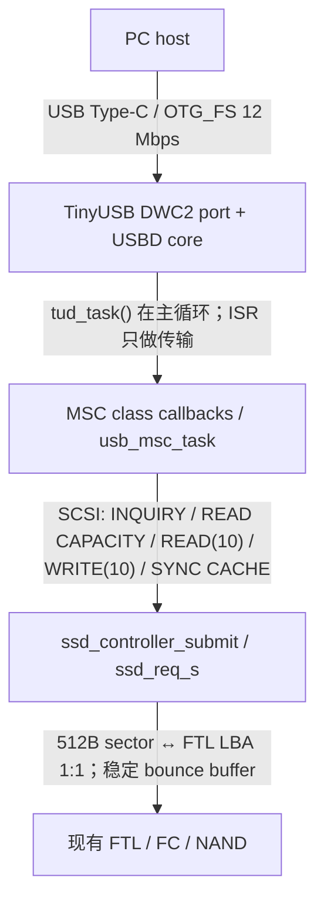

# USB MSC U 盘设计与上板验证

> 本文合并原 `docs/archive/usb_msc_udisk.md`（设计/可行性）与
> `docs/archive/usb_msc_verification.md`（上板验证手册）。
>
> - **Part A**：目标、可行性、协议栈、架构、BOT 限制、与主控差距、实施阶段、风险。
> - **Part B**：上板验证矩阵、步骤、脚本、故障排查、实测记录。

---

## Part A — 设计

> 状态：**枚举 + 基础数据面已上板通过（rev30）；v12 全盘 H2testw 通过（release + 16 KB EP + `-O2` + cache program/read，2026-10-25：写 843 KB/s / 读 889 KB/s，415/423 MB 无错误；`cw`/`cr` 均已生效）；掉电/多分区待测**。
> 目标平台：阿波罗 V2 核心板（STM32H743IIT6 + MT29F4G08 + Type-C USB）。
> 编译：`make all` / `make release` / `make tests UT=FC` 零新告警。
> 上板证据（rev27）：Windows 识别 USB 磁盘 → MBR 分区 → FAT 格式化 →
> 写入 `notepad.exe`（360448B）与 16KB 非均匀 pattern → `Write-VolumeCache` →
> 拔插 USB 后 SHA256 与 2KB 块指纹一致。
> rev30 已确认：Windows `Get-Disk` = **449,839,104 B（429 MiB）**，FAT 格式化，
> `usb_verify write/check` 拔插后 `RESULT=PASS`（含 2KB 块指纹）。
> ⚠ 介质版本 12（2026-10-22）起 L2P 日志区扩为 96 块（每 region 主+备两份），
> 编译期上限 `FTL_LBA_MAX` 变为 **868,352（424 MiB）**；运行时按实际坏块取
> min(plane)/min(instance)，以 boot `[CAP]` / USB READ CAPACITY 为准。
> 上文 rev30 的 429 MiB 是历史证据，不重写。
> 大文件/GC 压力、`dd` 吞吐、写过程中掉电恢复仍未验证（R1）；H2testw 吞吐与内部/器件上限的分层对照见 [`testing_guide.md`](testing_guide.md) §7.5 与 `known_risks.md` RISK-PERF-04。

---

> 分层测试流程、工具、性能方法与实测结果：见 [`testing_guide.md`](testing_guide.md)。

### A.1 目标与硬件

#### A.1.1 现有核心板资源

| 资源 | 规格 |
|---|---|
| CPU | STM32H743IIT6，2 MB flash，1060 KB SRAM |
| NAND | MT29F4G08，512 MB，ONFI 1.0，page 2048+64，block 64 pages |
| SDRAM | 32 MB（W9825G6KH / EM63A165TS-6G 等） |
| USB | Type-C，USB SLAVE/HOST（OTG） |
| 串口 | USART1，PA9/PA10 |
| 调试 | SWD |

#### A.1.2 目标

让 PC 通过 Type-C 把本板识别成 **424 MiB 的 USB 大容量存储设备（U 盘）**，可分区、
格式化、读写文件；底层仍由本仓 FTL 管理 NAND。

#### A.1.3 v1 范围

- **USB FS 12 Mbps**（不是 HS 480 Mbps）
- **固定 424 MiB**、**512 B block**、**单 LUN**
- SCSI 最小命令集：`INQUIRY` / `TEST UNIT READY` / `REQUEST SENSE` /
  `READ CAPACITY(10)` / `READ(10)` / `WRITE(10)` / `SYNCHRONIZE CACHE(10/16)` /
  `UNMAP(0x42)` / `MODE SENSE(6)`
- **不做** removable eject、多 LUN、CD-ROM

---

### A.2 可行性结论

**能搭，但不是一个小 patch。** 属于中等规模的 HIL/传输层集成。

#### A.2.1 硬件侧

- STM32H743II 有 OTG_FS 与 OTG_HS 两个 USB 核（`third_party/stm32h743/cmsis-device/stm32h743xx.h`）。
- Type-C 先按 **PA11/PA12（OTG_FS，AF10）**；若枚举失败，再查 **PB14/PB15**
  （OTG_HS 内嵌 FS PHY，AF12）。
- **ULPI 高速不做**：PC0/PC2/PC3 与 SDRAM/FMC 冲突，PB0/PB1 是 LED，板上没有 ULPI PHY。
- ⚠ **PA9 是 `OTG_FS_VBUS`，但本仓已用作 USART1_TX** ⇒ 必须
  `vbus_sensing_enable = DISABLE`，不能用 VBUS  sensing。
- USB 需要 48 MHz 内核时钟；HSI48 已在 `src/platform/stm32h743/sys_port.c` 打开，
  但尚未选为 USB 内核时钟。

#### A.2.2 仓库侧

| 项 | 现状 |
|---|---|
| USB HAL 源文件 | `stm32h7xx_hal_pcd.c` / `stm32h7xx_hal_pcd_ex.c` / `stm32h7xx_ll_usb.c` 存在，但**未编入** `third_party/stm32h743_vendor.mk` |
| USB Device middleware | **没有**（无 `usbd_*`、无 MSC 类） |
| USB 时钟/引脚/IRQ/MSP | **没有** |
| FTL 块设备接口 | **有**，且与 MSC 512B sector 天然对齐 |

#### A.2.3 FTL 后端匹配度

- `FTL_LBA_MAX = 868,352`（424 MiB / 512 B；已扣除固定元数据/L2P 日志区/OP/Spare）
- `FTL_IU_BYTES = 512`，1 LBA = 1 CW = 512 B
- `ftl_submit_read` / `ftl_submit_write` 是**异步**的：提交后由
  `complete_flag` / `on_complete` 通知完成
- 控制器层 `ssd_controller_submit` 已经提供 host 语义
  （`opcode` / `start_lba` / `block_count` / `buffer` / `complete_flag` / `status`）

⇒ **不需要改 FTL 的映射/GC/journal 逻辑**；只需要一个 USB → controller/FTL 的适配前端。

---

### A.3 USB 协议栈选择

**不重写 USB 协议栈。** 只写 MSC class 回调 + FTL adapter。

| 项目 | 许可 | 适配度 | 说明 |
|---|---|---|---|
| **TinyUSB** | MIT | **选定** | 有 STM32H7 DWC2 port、MSC device class、bare-metal `OPT_OS_NONE`；`tud_task()` 在主循环跑，MSC 回调**不在 ISR**，最适合本仓 |
| STM32Cube USBD | ST 免费许可 | 备选 | 官方 Core + MSC 类；但 MSC `Read/Write` 回调默认在 OTG 中断里执行，FTL 不能进 ISR ⇒ 必须改成主循环 deferred/pending |
| CherryUSB | Apache-2.0 | 备选 | 轻量、DWC2 port、MSC device/host，国内资料多；设备任务在主循环 |
| LUFA / libopencm3 | — | 不适用 | AVR / 非 H7 DWC2，移植成本高 |
| ChibiOS/NuttX/Zephyr USB | — | 不适用 | 需要 RTOS/大集成，和本仓 superloop 不匹配 |

#### A.3.1 为什么选 TinyUSB

- `tud_task()` 在**主循环**执行，MSC 回调不是 ISR 上下文 ⇒ 可以在回调里等待 FTL 完成；
- DWC2 是 STM32H7 的 USB 控制器，TinyUSB 已有 port；
- MIT 许可，代码量比 Cube 小，便于学习；
- 协议栈本身（枚举、控制传输、BOT、SCSI 子集）不用自己写。

#### A.3.2 FTL 适配方式：TinyUSB 异步回调

TinyUSB 的 MSC 回调支持 `TUD_MSC_RET_ASYNC` + `tud_msc_async_io_done()`。
本仓用它实现**非阻塞 adapter**，不在回调里自旋：

```text
tud_msc_read10_cb / write10_cb
  → 提交 ssd_controller_submit(...)，返回 TUD_MSC_RET_ASYNC
主循环下一轮：
  ftl_service_pump() + ftl_service()   （FTL 正常推进）
  usb_msc_task()                       （完成则回填 READ 数据 → async_io_done）
  usb_device_task()                    （tud_task_ext(0) 发出数据/CSW）
```

为什么不返回 `TUD_MSC_RET_BUSY`：TinyUSB 会在**同一个 `tud_task()` 调用**里
立即重入回调（伪造一次传输完成事件），单线程主循环下 `ftl_service` 永远轮不到，
表现为 `tud_task` 内死循环 + 看门狗复位。

为什么需要 bounce buffer：USB 端点缓冲在主机复位/拔出后会被协议栈立刻复用
（重新收 CBW）。FTL 只持有本模块的静态 bounce buffer，完成时再拷回端点缓冲。

---

### A.4 推荐架构



#### A.4.1 分层职责

| 层 | 职责 |
|---|---|
| USB PCD/DWC2 | 端点、FIFO、中断；只做传输 |
| TinyUSB USBD core | 枚举、控制传输、BOT 状态机 |
| MSC class / `usb_msc.c` | SCSI 命令解析、数据阶段、CSW；调用块后端 |
| controller / FTL | 512B sector 读写、组完成、journal/CP |

#### A.4.2 关键约束

- **USB IRQ 只做传输**；SCSI/FTL 在主循环。
- 不在 ISR 调 `ftl_*`；不在 FTL completion callback 调 `ftl_flush` / `ftl_trim`
  （它们是同步自旋路径）。
- `ftl_service_pump()` 每轮只调一次，且在 `usb_msc_task()` / `usb_device_task()` 之前。
- **CLI 与 USB 共用 host busy 闸门**：同一时刻只允许一个 host 前端提交
  `ssd_controller_submit`（`cli_host_busy()` / `usb_msc_host_busy()`）。
- `SYNCHRONIZE CACHE` 只在前序写完成后调用 `ftl_flush`（主循环上下文）。
- 主循环顺序：`cli_service_poll` → `ftl_service_pump` + 逐实例 `ftl_service`
  → `usb_msc_task` → `usb_device_task` → `timer_scheduler_poll`。

#### A.4.3 缓冲与并发

- **单条 SCSI 命令在飞**（BOT 串行）；但同一条 WRITE(10) 的**两个 chunk** 可以同时在飞
  —— 写路径需要 1 chunk lookahead：缓存程序序列里 chunk k 的最后一页由 chunk k+1 的
  第一条命令的 `FAIL_CACHE` 确认（`docs/design/ftl_design.md` §3.16）。
- 三个槽（`usb_msc_slot_s`）：0/1 是数据槽，各带 16 KiB bounce（AXI `.bss` / DTCM，
  CPU-only）+ 一个 `ssd_req_s`；2 号是无 bounce 的控制槽（FLUSH/UNMAP）。
  bounce 必须活到该槽的 FTL 完成（FTL 可能因背压延后消费）。
- WRITE = **volatile write cache**：端点缓冲 → 拷进槽 bounce → 提交 → **立即回流控回执**
  （`tud_msc_async_io_done(length)`，**含一条命令的最后一段**）。主机因此不必等
  最后一页的 `FAIL_CACHE` 就能发下一条命令 ⇒ FTL 的设备 cache 序列可以跨 host 命令延续
  （`ftl_design.md` §3.16.5）。槽位保留到 FTL 完成（只回收缓冲，不再发 CSW）。
  FTL 侧对应地把**组完成点**提前到「页编程完成」（早回执，RISK-CACHE-27）：同一 LBA 在
  FTL 组完成后立刻读，读覆盖层直读刚编程的页。
  已回执的写段之后失败 ⇒ 置 **deferred error**，由**下一条** READ/WRITE/FLUSH 命令的 CSW
  失败一次。`usb_msc_take_deferred_error()` **先问各 FTL 实例**（`ftl_take_deferred_error`），
  再落回控制器自己的标志——早回执后 FAILC 的结论只存在于 FTL 的粘性标志里。
  （承载错误的那条命令会设置 MEDIUM ERROR / WRITE ERROR sense；TinyUSB 侧补丁保证
  应用设置的 sense 不被默认 NOT READY 覆盖，见 `known_risks.md` RISK-USBC-01。）
  两槽都占用时写回调返回 `TUD_MSC_RET_BUSY`（数据留在端点缓冲重投）。
- 打开中的写序列会占用一个槽直到 FTL 收尾（空闲 1 s / 下一条命令 / flush 触发 padding
  END）⇒ `usb_msc_host_busy()`（CLI 用）在此期间为 true，CLI 命令需重试。
- READ：USB 端点缓冲 → 提交到槽 bounce → 完成 → 拷回端点缓冲 → USB IN（不需要 lookahead）。
- 主机复位/拔出时在飞槽标记 `discard`：完成后只收尾，不回写 USB 缓冲。
- 不支持多 LUN；支持 SCSI UNMAP（逐 range 走 controller 的异步 TRIM，全部 range
  完成后才回 CSW，保证与后续写的顺序）。

---

### A.5 BOT 为什么不能多命令在飞

- USB MSC **Bulk-Only Transport（BOT）** 的状态机是：

```text
CBW (Command Block Wrapper) → data → CSW (Command Status Wrapper)
```

  同一个 interface 同时只有一条命令；下一条 CBW 必须等上一条 CSW。
- 这不是“没有命令集”：MSC 有完整的 SCSI 命令集，限制在**传输层**。
- 支持命令队列的是 **UASP（USB Attached SCSI Protocol）**，依赖 USB 3.0 / bulk streams；
  STM32H743 只有 USB 2.0（FS/HS），**本板不可用**。
- 因此：这块板上的 U 盘前端**无法让多条 host 命令在飞**。
- FTL 内部仍可把**一条**大的 READ/WRITE 拆成多个子操作并行（现有 group/pending 模型），
  但 host 侧是串行的。

> 协议出处：USB Mass Storage Class Bulk-Only Transport 1.0；USB Attached SCSI Protocol
> (UASP) 1.0。本仓 `docs/reference/` 未存档这两份规范原文，本文按**协议事实**引用，
> 不冒充本仓出处（R12）。

---

### A.6 与真实存储主控的差距

**U 盘 = USB-to-NAND bridge，不是 SSD 主控。**

| 维度 | 当前（TinyUSB U 盘） | 主流 SSD 主控 |
|---|---|---|
| Host 接口 | USB MSC BOT（CBW/CSW），单命令 | NVMe over PCIe：多 SQ/CQ、doorbell、MSI-X、PRP/SGL、Admin/IO 命令集 |
| 数据面 | STM32 FMC 单通道、PIO、512B | 多 channel / 多 die / 多 plane，ONFI/Toggle，DMA，硬件 ECC/LDPC 流水线 |
| FTL 映射 | L2P + journal/checkpoint，无 P2L | L2P + P2L（band/chunk），SLC cache，复杂 GC/WL/read-retention |
| DRAM | DRAM-less：SRAM + NAND 快照 | DRAM 表 + nvcache；或 DRAM-less 分支 |
| 掉电 | journal/CP，无超级电容 PLP | PLP/supercap、完整元数据一致性、原子写 |
| ECC | BCH 4-bit | LDPC、RAID/parity、端到端保护 |
| 性能 | USB FS ≈ 1 MB/s | PCIe Gen4/5，GB/s，10 万~百万 IOPS |
| 固件架构 | 裸机 superloop + 轮询 | 多核/协处理器、硬件调度器、RTOS/实时队列 |
| 特性 | 裸块设备；支持 UNMAP；无 SMART/sanitize | namespace、TRIM/UNMAP、SMART、sanitize、secure erase |

#### A.6.1 已经对齐的部分

- HIL / FTL / FCC / DRAM 分层（`docs/design/fc_nand_design.md §26`）
- 命令/完成模型（FTL op tag + completion table）
- L2P / GC / WL / journal / checkpoint / 掉电恢复
- DRAM-less 方向（SRAM + NAND 快照）
- 512B IU ↔ USB MSC 512B sector 的 1:1 映射

#### A.6.2 差距最大的部分

- **NVMe 队列/门铃/多命令在飞**：USB BOT 串行，UASP 需要 USB 3.0。
- **多通道并行**：本板单 FMC 通道、单 die。
- **硬件 ECC/LDPC、RAID/parity**：本仓是软件 BCH，无 RAID。
- **PLP**：无超级电容，只有 journal/CP。
- **P2L / DRAM 表**：本仓是 DRAM-less + checkpoint 快照；P2L 是另一条主流分支。
- **性能**：FS 12 Mbps 与 PCIe Gen4/5 差几个数量级。

#### A.6.3 学习定位

- U 盘适合当**测试夹具**：把 FTL 暴露给 PC，方便跑文件系统、格式化、掉电、性能测试。
- 如果目标是学习**存储主控**，下一步应做：
  - **NVMe 风格 SQ/CQ + doorbell**（本板无 PCIe，只能软件模型）；
  - 或 **P2L / 多通道模型**；
  - 而不是把 USB MSC 当主控核心。

---

### A.7 实施阶段

#### Phase 0：确认硬件接线（**✅ rev30 已确认**）

- 查核心板原理图/万用表确认 Type-C 的 D+/D- 接的是 PA11/PA12 还是 PB14/PB15。
- 本文先按 PA11/PA12 实现；枚举失败再改 PB14/PB15（OTG_HS 内嵌 FS PHY，AF12）。
- 确认 VBUS sensing 必须 disable（PA9 是 USART1_TX）——已通过
  `CFG_TUD_VBUS_DETECT_HW = 0` 落实。

#### Phase 1：USB 传输 bring-up（**✅ rev30 已上板**）

- 引入 `third_party/tinyusb`（MIT），使用 DWC2 port。
- `tusb_config.h`：`CFG_TUD_MSC=1`、`CFG_TUSB_OS=OPT_OS_NONE`。
- `src/platform/stm32h743/sys_port.c`：`RCC_PERIPHCLK_USB` +
  `RCC_USBCLKSOURCE_HSI48`。
- 新增 `src/platform/stm32h743/usb_port.c`：
  - `tusb_init()`；
  - PA11/PA12 AF10（或 PB14/15 AF12）；
  - `OTG_FS_IRQn` / `OTG_FS_IRQHandler`；
  - VBUS sensing disable。
- 先只枚举出设备（不接存储），确认 PC 能识别。

#### Phase 2：MSC class + FTL adapter（**✅ rev30 已上板**）

- 新增 `src/hil/usb_msc.c` / `include/hil/usb_msc.h`：
  - `tud_msc_read10_cb` / `tud_msc_write10_cb`：登记到 `ssd_req_s`，
    提交后返回 `TUD_MSC_RET_ASYNC`；
  - `usb_msc_task()`：完成时回填 READ 数据并 `tud_msc_async_io_done()`；
  - `tud_msc_capacity_cb`：424 MiB / 512B block / `FTL_LBA_MAX`；
  - `tud_msc_inquiry_cb` / `tud_msc_start_stop_cb` / `tud_msc_test_unit_ready_cb`；
  - SCSI SYNCHRONIZE CACHE → `SSD_REQUEST_FLUSH`（`ftl_flush`，仅主循环上下文）；
  - SCSI UNMAP → 解析参数表，逐 range 提交 `SSD_REQUEST_TRIM`；全部完成才回 CSW；
  - `tud_event_hook_cb`：总线复位/拔出时把在飞请求标记 `discard`。
- 0/1 是 16 KiB bounce 数据槽；2 号是无 bounce 控制槽（FLUSH/UNMAP）。

#### Phase 3：主循环与仲裁（**✅ rev30 已上板**）

- `src/main.c` 主循环在 `ftl_service()` 之后调用 `tud_task()` / `usb_msc_task()`。
- CLI 与 USB 共用 host busy 闸门。
- 所有 `ftl_flush` / `ftl_trim` 只在主循环调用。

#### Phase 4：主机侧验证（**✅ 基础项已通过；掉电/吞吐/多分区待测**）

- Windows：设备管理器出现“USB 大容量存储设备”；磁盘管理显示 424 MiB；
  格式化 FAT32/exFAT；复制/读回文件。
- Linux：`lsusb`、`dmesg`、`lsblk`/`fdisk -l`；`dd` 读写；`sync`；`fsck`。
- 掉电：USB 写过程中断电，重启后 FTL 恢复，盘可重新挂载。
- 性能：记录 `dd` 吞吐，和 NAND/FTL 上限对照。

---

### A.8 关键文件（实现时）

| 文件 | 作用 |
|---|---|
| `third_party/tinyusb/`（新增，已裁剪） | MIT USB 协议栈；只保留 device + MSC + DWC2 编译闭包（见其 `README.soft_ssd.md`） |
| `third_party/tinyusb_vendor.mk`（新增） | 编入源文件与包含路径 |
| `include/tusb_config.h`（新增） | TinyUSB 编译期配置（H7 / OPT_OS_NONE / MSC / 16 KB EP） |
| `include/platform/usb.h`（新增） | `usb_device_init` / `usb_device_task` 抽象 |
| `src/platform/stm32h743/usb_port.c`（新增） | USB2_OTG_FS 时钟/引脚/IRQ、`tusb_time_millis_api` |
| `src/platform/stm32h743/sys_port.c` | USB kernel clock = HSI48 |
| `src/hil/usb_msc.c`（新增） | 描述符、MSC/SCSI 回调、异步请求状态机 |
| `include/hil/usb_msc.h`（新增） | `usb_msc_init` / `usb_msc_task` / `usb_msc_host_busy` |
| `src/main.c` | `usb_msc_init` + `usb_device_init`；主循环 `usb_msc_task` → `usb_device_task` |
| `src/hil/cli.c` | CLI 与 USB 共用 host busy（`cli_host_busy`） |
| `docs/hardware_contract.md` | 补 USB 引脚/时钟/VBUS |

---

### A.9 风险与未确认

| 风险 | 说明 | 缓解 |
|---|---|---|
| PA11/PA12 接线未确认 | 无原理图；也可能 PB14/PB15 | 上板枚举失败先换 AF/引脚；用万用表确认 |
| TinyUSB MSC 异步回调 | 已改用 `TUD_MSC_RET_ASYNC` + `tud_msc_async_io_done`；主机复位时需丢弃在飞结果 | `discard` 标志 + `tud_ready()` 守卫；未上板 |
| `ftl_flush` 非 barrier | 只 best-effort，不能承诺绝对掉电持久 | SYNCHRONIZE CACHE 只在前序写完成后调用；文档写清 |
| WRITE(10) FUA（2026-11-05 用户改判实现） | FUA 写 chunk 不回早回执，等 FTL 组完成（program + 映射确认）后才回 CSW；失败直接 CSW failed | 非 FUA 写仍是 volatile write cache 早回执；上板验证 FUA 回执延迟与断电读回（RISK-USB-05） |
| `.noncacheable_buffer` 放置 | 链接器匹配模式漏前导点，`g_nand_channel_page_buffer` 落在可缓存 AXI RAM | **不在 USB 补丁内修**；已登记 `RISK-PLAT-01`（待决策，改地址必须上板） |
| CLI/USB 双前端 | 无全局锁 | 共用 host busy 闸门 |
| FS 12 Mbps | ≈1 MB/s；HS 需 ULPI，本板不可行 | v1 接受；性能另测 |
| UNMAP 验证 | 逐 range 的异步 TRIM；多 range/顺序/主机复位未上板 | 已实现（RISK-USB-14）；**未向主机广告**（无 VPD B0/B2 / LBPME），普通 `fstrim` 可能不下发，见 RISK-USB-15 |
| USB 中间件体积 | TinyUSB 代码/缓冲计入 flash/RAM | 实现前算预算 |

---

### A.10 非目标（v1）

- USB HS 480 Mbps / ULPI
- 多 LUN / CD-ROM / removable eject
- 文件系统解析（U 盘由 PC 格式化，固件只暴露块设备）
- 量产级 USB 认证 / 复合设备

---

> 上板验证步骤、判据与脚本见本文 Part B（原 `docs/archive/usb_msc_verification.md`）。

### A.11 出处

- 分层：`docs/design/fc_nand_design.md §26`
- FTL / DRAM-less / 算法 / 取舍：`docs/design/storage_controller_design_essentials.md §九~§十一`
- SPDK FTL / P2L / band metadata：`docs/reference/pages/spdk_ftl.html`
- 论文清单：`docs/reference/README.md`
- USB BOT / UASP：USB Mass Storage Class Bulk-Only Transport 1.0；
  USB Attached SCSI Protocol (UASP) 1.0（本仓未存档原文，按协议事实引用）
- TinyUSB：https://github.com/hathach/tinyusb（MIT）
- CherryUSB：https://github.com/cherry-embedded/CherryUSB（Apache-2.0）
- STM32CubeH7：https://github.com/STMicroelectronics/STM32CubeH7

---

## Part B — 上板验证

> 状态：**基础数据面已上板通过（rev30）；2026-10-22 v12 全盘 H2testw 通过（release + 16 KB EP：写 673 KB/s / 读 758 KB/s，415/423 MB 无错误，`bad=0`）；掉电/多分区待测**。
>
> 415/423 MB 的差额是 **H2testw 自带的约 2% 安全余量**（用 8 KB 簇格式化后仍是 415），
> 不是容量算错、也不是文件系统元数据；盘容量以 boot `[CAP]` / `Get-Disk Size` 为准。
> 目标平台：阿波罗 V2 核心板（STM32H743IIT6 + MT29F4G08 + Type-C USB）。
> rev30 已确认：Windows `Get-Disk` = 449,839,104 B（429 MiB），FAT 格式化，
> `usb_verify -Step write/check` 拔插后 `RESULT=PASS`、2KB 块指纹全对。
> ⚠ 介质版本 12（2026-10-22）起容量口径变为编译期 **868,352（424 MiB）**、运行时按实际
> 坏块动态取 min(plane)/min(instance)；以 boot `[CAP]` 与 USB READ CAPACITY 为准。
> 上文 rev30 的 429 MiB 是历史证据，不重写。
> 大文件/GC、掉电恢复、吞吐仍未验证（R1）。
> ⚠ rev33（v11，2026-10-21）：**128 MB 分区 H2testw 写入+校验通过**（127 MB，写 261 KB/s /
> 读 296 KB/s）。该结果只覆盖 407 MiB 的约 1/3，且**未重启**，不满足全盘/GC/掉电判据。
> ⚠ 同夜第二个 279 MB 分区**复现失败**：GC 启动后 `mark BAD` 156→420、`dng=55`、
> Free/OP/Spare 耗尽、写入冻结（`RISK-MIG-07` / `RISK-GC-10`）。全盘判据仍未通过。
> 配套脚本：`tools/usb_verify/`（`usb_verify.ps1` / `usb_rebuild_mbr.ps1`）。
> 设计与取舍：本文 Part A。已知风险：`docs/design/known_risks.md`。

本文把「把板子当 U 盘用」拆成**可独立判定**的步骤。每一步都写清：验证什么、
执行什么、看什么、期望什么、证据是什么。不要把「枚举」「格式化」「数据完整性」
「掉电恢复」混在一次操作里——混在一起时，失败无法归因。

---

> 分层测试流程、工具、性能方法与实测结果：见 [`testing_guide.md`](testing_guide.md)。

### B.1 范围

#### B.1.1 本手册覆盖

- USB 设备枚举（`USB2_OTG_FS`，全速 12 Mbps）
- SCSI 容量 / 分区 / FAT 格式化（host 侧）
- 主机多页、非均匀数据的写 → flush → 拔插 → 读回校验
- FTL 在 host 数据面上的基本正确性（L2P / wbuf / journal）
- 失败时的判据与恢复动作

#### B.1.2 本手册不覆盖（见 B.8）

- 大文件/GC 压力、`dd` 吞吐
- 写过程中掉电恢复
- `RISK-MD-06`（回收旧日志块 vs 目录检查点落盘）的专项复现
- `RISK-MIG-02`（predictive 迁移活锁）的修复验证
- UASP / TRIM / 多 LUN / HS 480 Mbps（v1 非目标）

---

### B.2 环境与前置

| 项 | 要求 |
|---|---|
| 板子 | STM32H743 + MT29F4G08，USB Type-C 接 **PA11/PA12（OTG_FS，AF10）** |
| 固件 | 含本手册对应功能的 `debug.elf`；数据面实测为 **rev27**，容量修正为 **rev29（待复测）** |
| 主机 | Windows 10/11（原生），管理员窗口仅用于分区/格式化/raw MBR 恢复 |
| 串口 | USART1 115200，用于看板端日志（`[USB]` / `[FTL]` / `[L2P]` / `[MIG]`） |
| 脚本 | `tools/usb_verify/usb_verify.ps1`、`usb_rebuild_mbr.ps1` |

#### B.2.1 关于 WSL 与脚本运行

WSL 里的 `lsblk` **看不到** Windows 已枚举的 USB 大容量存储设备（`Virtual Disk`
是 WSL 虚拟盘）。两个选择：

1. **推荐**：验证在 Windows 原生做（本手册）；
2. 需要在 Linux 工具（`mkfs.vfat` / `fsck.vfat` / `dd` / `fio`）下做时，先用
   `usbipd-win` 把设备 attach 给 WSL；这会把它从 Windows 摘走，测完 `detach` 归还。

脚本运行注意：

- **把 `tools/usb_verify/` 复制到 Windows 本地再运行**。直接从 WSL 的 UNC 路径
  （`\\wsl.localhost\...`）运行会被 Windows PowerShell 的 `RemoteSigned` 拒绝；
- 脚本是 **UTF-8 with BOM**（Windows PowerShell 5.1 读无 BOM 的 UTF-8 中文注释会
  吞换行，导致语法错误）。编辑后保持 BOM。

#### B.2.2 烧写后的第一证据

串口横幅必须显示**当次**镜像：

```text
=========== soft_ssd rev=27 built ... ===========
```

⚠ 不看横幅就报「验证通过」不算证据（CLAUDE.md R1 / §3.3）：`.noinit` 崩溃记录、
Windows 磁盘缓存、旧镜像都会制造假象。

---

### B.3 安全规则

1. **脚本认 `FriendlyName=*SOFTSSD*`、`BusType=USB`，容量按 424 MiB ±64 MiB 窗口**
   （主机容量按实际坏块动态扣减，精确相等只在 0 坏块时成立，RISK-CAP-03）；
   任一不符立即中止。手工操作时也必须先用 `Get-Disk` 确认。
2. **不要碰系统 NVMe**（Number 0/1）。`format` / `usb_rebuild_mbr.ps1` 都是破坏性的。
3. 主机操作期间**不要同时敲板子 CLI**：两者共用 host busy gate，会互相让路或报 busy。
4. 板端 CLI 的 `format`（FTL 格式化）完成后必须**断电重启**（命令会打印
   `POWER-CYCLE NOW`）；这与 Windows 侧格式化不是一回事。
5. 写测试文件期间不要拔板子电源（掉电测试单独做，见 B.8）。

---

### B.4 验证矩阵

| ID | 验证什么 | 执行 | 期望 | 状态 |
|---|---|---|---|---|
| USB-V01 | USB 枚举与 MSC 挂载 | 上电，看串口 + `Get-Disk` | `[USB ] mounted`；Windows 出现 429MiB USB 磁盘 | ✅ rev30 |
| USB-V02 | 容量 / 扇区 / 总线 | `-Step inspect` 或 `Get-Disk`/`Get-Volume` | Size=449,839,104；512/512 字节扇区；BusType=USB | ✅ rev30 |
| USB-V03 | MBR 分区 + FAT 格式化 | 管理员 `-Step format`（或磁盘管理） | 新建主分区 + FAT，卷 Healthy/OK | ✅ rev30 |
| USB-V04 | 非均匀多页写 → 读回 | `-Step write` | `SRC_HASH == DST_HASH` | ✅ rev30 |
| USB-V05 | 4KB pair 镜像 / 2KB 块指纹 | `-Step check` | pattern 的 2KB 块 0..7 内容分别为 0..7 | ✅ rev30 |
| USB-V06 | SYNCHRONIZE CACHE + 拔插持久性 | `write` → `Write-VolumeCache` → 拔插 → `check` | `RESULT=PASS`，哈希不变 | ✅ rev30 |
| USB-V07 | 大文件 + GC/CP 压力 | 写 32–64MB 随机文件，flush，拔插，哈希 | 哈希一致；无 `[MIG]` 风暴 / 无 ASSERT | ✅ 2026-10-22 全盘 H2testw（GC/CP 覆盖） |
| USB-V08 | 写过程中掉电 | 写 32–64MB 中途拔电，重启后挂载并读回 | 卷可挂载；已写入部分哈希一致；无 `[FTL] dangling` | ⬜ 待测（`known_iss` ISS-USB-01） |
| USB-V09 | 吞吐基线 | `dd`/H2testw 记录顺序写读 | 与 RISK-NAND-04 的瓶颈结论一致 | ⬜ 待测（`known_iss` ISS-USB-02） |
| FTL-V01 | `RISK-MD-06` 回收前目录检查点 | 填满一个元数据日志块（64 个 region）后冷启动 | 无 `[L2P] load failed`；`dir_ckpt_seq > cp_seq` | ⬜ 待测 |
| FTL-V02 | `RISK-MIG-02` predictive 活锁 | 观察串口 `[MIG] abort kind=2 ... victim read failed` | 不应反复重选同一 victim；坏块应被隔离 | ⬜ 待测 |

> USB-V01/V02 的 `429 MiB / 449,839,104` 是 **rev30 历史证据**；当前 v12 期望为
> **424 MiB / 444,596,224**（0 坏块）或按 `[CAP]` 动态值，见 B.5 与 `known_iss.md`。
>
> 2026-11-13 rev33 复验（debug 镜像 `18:38:28`，固件 `format` + POR，41 个出厂坏块 ⇒
> `[CAP] lba_max=854528`）：`inspect` = 437,518,336 B / 512+512 字节扇区 / BusType=USB；
> `format` 走 `diskpart clean → create partition primary → NTFS` 成功（437,448,704 B）；
> `write` `SRC_HASH==DST_HASH`、`FLUSH_OK`；拔插后 `check` **`RESULT=PASS`**。
> 对应 USB-V01~V06 正常路径无回归；V08（写中掉电）/ V09（吞吐）仍未测。

---

### B.5 详细步骤

#### USB-V01 枚举

**验证什么**：PA11/PA12 接线、HSI48 时钟、VBUS sensing 关闭、描述符与
`SET_CONFIGURATION` 全部成立。

**执行**：

1. 上电，串口应出现：

```text
[INF] [USB ] device stack ready (USB2_OTG_FS, full speed)
[INF] [USB ] mounted (MSC BOT, 868352 sectors x 512 bytes)
```

2. Windows：

```powershell
Get-Disk | Where-Object BusType -eq 'USB' | Format-Table Number,FriendlyName,Size,PartitionStyle,BusType
```

**期望**：

- 设备侧有 `[USB ] mounted`；
- 磁盘 `FriendlyName = SOFTSSD NAND U-DISK`、`Size = 444596224`、`BusType = USB`。

**证据**：串口原文 + `Get-Disk` 输出。⚠ 只有 `mounted` 不能证明数据面可用，继续 V02。

---

#### USB-V02 容量与扇区

**验证什么**：SCSI READ CAPACITY / 扇区大小与 FTL 坐标一致（1 LBA = 512B，
`FTL_LBA_MAX = 868,352`（424 MiB））。

**执行**：

```powershell
powershell -NoProfile -File .\usb_verify.ps1 -Step inspect
```

或手工：

```powershell
Get-Disk | Where-Object BusType -eq 'USB' | Format-List Number,FriendlyName,Size,LogicalSectorSize,PhysicalSectorSize,PartitionStyle
Get-Volume | Where-Object DriveType -eq 'Removable' | Format-Table DriveLetter,FileSystemLabel,FileSystem,HealthStatus,Size
```

**期望**：

- `Size = 444596224`（424 MiB，主机可见容量）；
- `LogicalSectorSize = PhysicalSectorSize = 512`；
- 格式化后的卷约为 424 MiB 减去分区表/对齐开销。

> 为什么不是 512 MiB：原始 NAND 主区是 512 MiB，但固定元数据（含 L2P 日志区）
> 196 块（24.5 MiB）、OP 预留 408 块（51 MiB）、Spare 100 块（12.5 MiB）不可用于用户数据。
> 数据块 = 4096 − 196 − 408 − 100 = 3392 块 = 424 MiB；
> 见 `include/ftl/ftl.h` 的 `FTL_HOST_DATA_BLOCKS_PER_INSTANCE` / `FTL_LBA_MAX`。
> 对外上报这个数，避免主机把盘写满后 GC 无块可搬。

---

#### USB-V03 分区 + FAT 格式化

**验证什么**：主机写出的 MBR/分区表/FAT 引导扇区能被设备正确保存并读回；
也就是 host 多页、非均匀写路径正确。

**执行（管理员）**：

```powershell
powershell -NoProfile -File .\usb_verify.ps1 -Step format
```

⚠ **不要用磁盘管理**：固件 `format` 后介质是 partitionless，磁盘管理把它显示成合成的 `offset=0` RAW「主分区」，「删除卷」返回「不支持这个请求」⇒ 无法走「新建简单卷」。需要手建分区时用管理员 `diskpart`：
```text
select disk N
clean
create partition primary
exit
```
然后在分区上格式化（`format fs=fat32 quick label=SOFTSSD`，或资源管理器右键格式化）。

**期望**：

- `New-Partition` / `Format-Volume` 成功；
- `Get-Volume`：`FileSystem = FAT/FAT32`、`HealthStatus = Healthy`、
  `OperationalStatus = OK`；
- 资源管理器能打开盘符、能新建文件夹。

**失败时先看串口**：

- `[USB ] unsupported SCSI opcode=0xXX` → 主机用了未实现的 SCSI 命令（记录 opcode）；
- `[MIG] abort kind=2 ... victim read failed` 反复出现 → 见 `RISK-MIG-02`，
  先 CLI `format` + 断电重启；
- 哈希/格式化在**重插后**才失败 → 见 USB-V05 的 pair 镜像判据。

**分区表异常**（offset 0 / Logical 分区 / `Not enough available capacity`）：

```powershell
# 管理员
powershell -NoProfile -File .\usb_rebuild_mbr.ps1
```

它会对 `\\.\PhysicalDriveN` 前 1MB 写零、重建 MBR、再按 `-FileSystem`（默认 NTFS）格式化；要 FAT32 用 `-FileSystem FAT32`。

---

#### USB-V04 非均匀文件写 + 读回

**验证什么**：host 多页写、wbuf 页打包、L2P 映射、读回路径在**数据内容不均匀**时正确。
这是对 `RISK-WB-06`（plane-major pair 镜像被单页函数填装）的回归。

**执行**：

```powershell
powershell -NoProfile -File .\usb_verify.ps1 -Step write
```

脚本会：

- 复制 `C:\Windows\System32\notepad.exe` → `F:\test.bin`（360448 B，内容非均匀）；
- 生成 `F:\pattern.bin`：16KB，每 2KB 块内容 = 块号 0..7；
- 计算源/盘上 SHA256；
- `Write-VolumeCache`（SYNCHRONIZE CACHE）；
- 状态写入 `%TEMP%\softssd_usb_verify_state.json`。

**期望**：

```text
SRC_HASH == DST_HASH
FLUSH_OK
```

⚠ 立即读回一致**还不够**：Windows 可能从缓存返回刚写的数据。必须做 V06 的拔插。

---

#### USB-V05 2KB 块指纹

**验证什么**：4KB 写入（= 2 plane × 2KB）中 plane1 的数据没有被 plane0 覆盖。
这是 `RISK-WB-06` 的直接判据。

**执行**：在 V04 之后、拔插之后运行 `-Step check`（脚本会自动做块指纹）。

或手工：

```powershell
$a = [IO.File]::ReadAllBytes('F:\pattern.bin')
for ($i=0; $i -lt 8; $i++) {
    $ok = $true
    for ($j=0; $j -lt 2048; $j++) {
        if ($a[$i*2048+$j] -ne [byte]$i) { $ok=$false; break }
    }
    "block=$i all_match=$ok"
}
```

**期望**：8 个块全部 `all_match=True`，且块号与内容一致。

**为什么不能用 CLI `wr 0 32 c` 代替**：CLI pattern 每 2KB 相同（0x55/0xAA），
plane1 复制 plane0 时**完全看不出来**。必须用每 2KB 互不相同的数据。

---

#### USB-V06 flush + 拔插持久性

**验证什么**：host `SYNCHRONIZE CACHE` 路径、FTL journal/L2P 持久化、重新枚举后读回一致。

**执行**：

1. V04 已完成（`Write-VolumeCache` OK）；
2. **拔掉 USB 线、重新插上**；
3. 运行：

```powershell
powershell -NoProfile -File .\usb_verify.ps1 -Step check
```

**期望**：

```text
DST_HASH == EXPECTED_DST_HASH
PAT_HASH == EXPECTED_PAT_HASH
PATTERN_BLOCKS_OK=True
RESULT=PASS
```

失败时返回码 1。

---

### B.6 脚本速查

先把 `tools/usb_verify/` 复制到 Windows 本地（UNC 直接运行会被执行策略拒绝），然后：

```powershell
# 1) 只读
powershell -NoProfile -File .\usb_verify.ps1 -Step inspect

# 2) 格式化（管理员）
powershell -NoProfile -File .\usb_verify.ps1 -Step format

# 3) 写测试数据
powershell -NoProfile -File .\usb_verify.ps1 -Step write

# 4) 拔插后校验
powershell -NoProfile -File .\usb_verify.ps1 -Step check

# 分区表损坏时（管理员）
powershell -NoProfile -File .\usb_rebuild_mbr.ps1
```

显式指定盘：

```powershell
powershell -NoProfile -File .\usb_verify.ps1 -Step inspect -DiskNumber 2 -DriveLetter F
```

脚本细节、日志位置、UTF-8 BOM 与执行策略说明见 `tools/usb_verify/README.md`；
每个脚本都带 comment-based help，可 `Get-Help .\usb_verify.ps1 -Full` 查看。

---

### B.7 故障排查

| 症状 | 先查什么 | 动作 |
|---|---|---|
| Windows 完全看不到盘 | 串口是否有 `[USB ] mounted`；设备管理器有无未知设备 | 无 mounted：查 PA11/PA12、HSI48、VBUS sensing；有 mounted 无磁盘：查 SCSI 容量/inquiry |
| 能看到盘，格式化失败 | ① 串口 `[USB ] unsupported SCSI opcode=0xXX`；② `Get-Partition` 的 `Offset`（0 = partitionless 超级软盘）；③ 真分区上 `Format-Volume`/diskpart 是否在 **0%** 报 `ERROR_NOT_SUPPORTED` / `ERROR_INSUFFICIENT_BUFFER` | ① 有 opcode ⇒ 记录并补对应 SCSI 命令（`0x91` = SYNCHRONIZE CACHE(16)、`0x2F` = VERIFY(10)、`0x42` = UNMAP）；② `Offset=0` ⇒ 先 `diskpart clean → create partition primary`（真实 MBR，offset=64KiB）再格式化：FAT32 只在真分区上可用，超级软盘上 FAT16 可用、FAT32 失败；③ 真分区上 FAT32 仍失败 ⇒ 查 Windows 累积更新（KB5132688/KB5132061），回滚后恢复（2026-11-12 验证） |
| **卷可用空间只有一半**（如 219/427 MB）；「删除卷」报「不支持该请求」且串口**没有** SCSI opcode 日志 | 旧 FAT / 卷状态残留（多次测试后 Windows 侧缓存），固件侧 `free` 正常、`rd` 读回为未映射零 | 固件 CLI `format` → 断电重启 → `usb_verify.ps1 -Step format`（内置 `diskpart clean` + NTFS）；实测恢复 **425 MB 可用 / 共 425 MB**（2026-10-22，当时用 FAT） |
| 固件 `format` 后 Windows 显示 `offset=0` 分区 /「无法格式化」 | `Get-Partition` 的 `Offset`；资源管理器里的文件系统选项 | 介质是 partitionless（无分区表），Windows 合成为 `offset=0` 的 RAW「主分区」，磁盘管理「删除卷」返回「不支持这个请求」⇒ **纯 GUI 无法建分区**。处理：管理员 `diskpart clean → create partition primary` 后在分区上格式化 FAT32（2026-11-12 验证；同一介质 raw 读写、FAT16 全盘 H2testw 0 错误）。详见 RISK-USBC-02 |
| 格式化失败且串口有 `[MIG] ... victim read failed` 风暴 | `RISK-MIG-02` | 先 CLI `format` + 断电；仍复现则修 predictive 失败计数/黑名单 |
| 重插后哈希不一致 | V05 的 2KB 块指纹 | 若块 1=块 0：`RISK-WB-06`（pair 镜像填装）；确认 rev 已含 `ftl_cmd_write_data_pair_cw` |
| 分区表 offset 异常 / Logical 分区 / Not enough capacity | `Get-Partition` 的 Offset/MbrType | 跑 `usb_verify.ps1 -Step format`（内置 `diskpart clean`，失败自动 raw 清零前 1MB 重试）；只需重建 MBR 时用 `usb_rebuild_mbr.ps1 -DiskNumber N` |
| `Write-VolumeCache` 拒绝访问 | 是否普通窗口 | 改用 Windows“安全删除硬件”后再拔插 |
| WSL `lsblk` 看不到 | 是否在 WSL 里 | 用 Windows 原生，或 `usbipd-win` attach |
| 串口反复 `[MIG] kind=1` | 是否 WL 在收敛 | 观察是否自行停止；长时间不停按 WL 活锁单独排查 |

---

### B.8 本轮实测记录（2026-10-20）

| 固件/步骤 | 结果 | 说明 |
|---|---|---|
| rev24 枚举 | ✅ | 串口 `[USB ] mounted`；确认 PA11/PA12 可用 |
| rev24/25 host 格式化 | ❌ | Windows 报“无法完成格式化 / track 0 bad”；串口出现 `[L2P] region 0 load failed`、`[MIG]` 风暴；期间定位了 `RISK-L2P-04` / `RISK-MD-06` / `RISK-MIG-02` |
| rev26 MBR 重建 + 文件测试 | ❌ | 能分区/挂载，但 `notepad.exe` 拔插后哈希不一致；2KB 块指纹显示块 1=源块 0、块 3=源块 2 ⇒ 定位 `RISK-WB-06` |
| rev27 pair 镜像修复 | ✅ | FAT 格式化成功；`notepad.exe` 源/盘哈希一致；16KB pattern 的 2KB 块 0..7 全匹配；`Write-VolumeCache` OK；拔插后 `RESULT=PASS` |
| rev28 dangling 减计数守卫 | ⏳ 未单独复现 | 需在 predictive 标坏后覆盖写同一 LBA，确认只打 `[FTL] dangling`、不再断言 |
| rev29/rev30 容量修正 | ✅ | Windows `Get-Disk Size=449,839,104`（429 MiB）、FAT 格式化、`usb_verify write/check` 拔插后 `RESULT=PASS`；`lba_max=878592 (429MiB)` |

#### 2026-10-21 rev33（v11，运行时 407 MiB）

| 步骤 | 结果 | 说明 |
|---|---|---|
| 介质恢复 | ✅ | `make format-image` 开卡后换回正常镜像（`.build_cfg=0/0`）；`[CAP] lba_max=833536 (407MiB)`，与磁盘管理 407 MB 一致 |
| 128 MB 分区 | ✅ | 磁盘 2（可移动，407 MB）：128 MB 主分区 + 279 MB 未分配 |
| H2testw（127 MB，写 + 校验） | ✅ | “Test finished without errors”；写 8:17 / 读 7:19；写 261 KB/s / 读 296 KB/s（USB-V09 首个数据点） |
| 第二个 279 MB 分区 H2testw | ❌ | `free` 1178→32 触发 GC 后，`mark BAD` 156→**420**（+264，全部 UNC）、`dng=55`、`op=11/0`、`spare=0/29`，写指针停在 `wr=53120`，USB 反复重挂载 ⇒ 死锁。悬空 LBA 自 262346 起（第二分区起点）。归入 `RISK-MIG-07` / `RISK-GC-10` |

**适用边界（不能当全盘结论）**：

- 只写 127 MB ⇒ Free Pool 基本没被压低，**GC / 迁移路径几乎没跑**（boot `free=3268` 未见显著下降）；
- H2testw **不重启** ⇒ 上次的失败形态（`[L2P] region 49 load failed` → full metadata rebuild）
  是重启读回元数据时才暴露的，本次未覆盖；
- 介质是刚开卡格式化的干净状态，旧的元数据损坏已被清除。
- 因此 `RISK-MD-07` / `RISK-CAP-02` 的“全盘写到分区末端”判据**仍未满足**。

**脚本形态的验证**：

| 脚本步骤 | 状态 | 说明 |
|---|---|---|
| `usb_verify.ps1 -Step inspect` | ✅（rev27/28，旧容量） | 自动识别 SOFTSSD/USB；⚠ 脚本的 ExpectedSize 现为 444,596,224（424 MiB ±64 MiB 窗口），旧容量盘会被拒绝（预期） |
| `usb_verify.ps1 -Step write` | ✅（rev27/28） | 写 `test.bin` + `pattern.bin`，`SRC_HASH==DST_HASH`，`FLUSH_OK` |
| `usb_verify.ps1 -Step check` | ✅（逻辑） | 哈希 + 2KB 块指纹 `RESULT=PASS`；真实拔插判据用同一套检查手工做过 |
| `usb_verify.ps1 -Step format` | ⚠ 未在最终脚本形态重跑 | 其步骤与手工验证过的“删分区→Clear-Disk→MBR→FAT32”一致；当前盘已被手工格式化，未再破坏性重跑 |
| `usb_rebuild_mbr.ps1` | ⚠ 未在最终脚本形态重跑 | 手工版（raw 清零前 1MB → 重建 MBR）已执行成功；脚本是其整理版 |

**已上板验证的结论**：

- rev27：USB MSC 枚举、MBR 分区、FAT 格式化、非均匀多页写、读回、SYNCHRONIZE CACHE、
  拔插持久性通过；**但容量是旧 512 MiB 超卖值**。
- rev30：容量修正为 429 MiB，Windows 确认 `449,839,104 B`；格式化 + `usb_verify` 写/拔插/读回通过。
- `RISK-WB-06` 已修并上板验证（基础数据面）。

**仍未验证**：

- 大文件/GC/CP 压力、`dd` 吞吐、写过程中掉电（USB-V07/V08/V09）。
- `RISK-MD-06` 的回收前目录检查点专项（FTL-V01）。
- `RISK-MIG-02` 的 predictive 活锁（FTL-V02）。

---

### B.9 下一步

**2026-10-21 起的优先顺序**（先把范围逐步放大，再谈“修复”结论）：

1. H2testw “verify them again”：**断电重启后**重读 127 MB（约 7 分钟）→ 覆盖 L2P / journal 恢复路径。
2. 256 MB 分区重跑 H2testw（约 30 分钟）；同时看串口 `[STAT]` 的 `dng/rrab/mig` 与 `info` 的 `live=`。
3. 全盘 407 MiB H2testw（约 1 小时）——这才是 `RISK-MD-07` / `RISK-CAP-02` 的判据。

以下为原矩阵项：

4. **USB-V07**：写 32–64 MB 随机文件（`fsutil`/PowerShell 生成）→ flush → 拔插 → 哈希。
5. **USB-V08**：写临时文件时断板子电源 → 重启重挂载 → 检查 FTL 恢复日志
   （`boot type` / `journal_entries` / `[L2P]`）。
6. **USB-V09**：记录大文件复制耗时，换算 MB/s。
7. **FTL-V01**：按 `RISK-MD-06` 的 64-region 方法验证回收前目录检查点。
8. **FTL-V02**：若 `victim read failed` 风暴复现，修 `RISK-MIG-02`。

---

### B.10 相关文档

- 方案/取舍/BOT vs UASP/与主控差距：本文 Part A
- 已知风险与登记：`docs/design/known_risks.md`
  （`RISK-WB-06` / `RISK-MIG-02` / `RISK-MD-06` / `RISK-L2P-04` / `RISK-USB-01`）
- 脚本用法：`tools/usb_verify/README.md`
- 分层判据：`docs/design/fc_nand_design.md §26`
- 协议事实：USB Mass Storage Class BOT 1.0、SCSI transparent command set
  （本仓未存档原文，按协议事实引用，R12）
