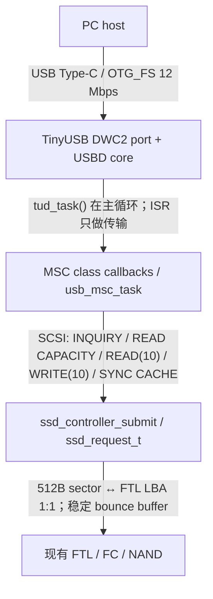

# USB MSC U 盘 — 可行性、架构与实施计划

> 状态：**枚举 + 基础数据面已上板通过（rev30）；v12 全盘 H2testw 通过（release + 16 KB EP：写 673 KB/s / 读 758 KB/s，无错误）；掉电/多分区待测**。
> 目标平台：阿波罗 V2 核心板（STM32H743IIT6 + MT29F4G08 + Type-C USB）。
> 编译：`make all` / `make release` / `make tests UT=FC` 零新告警。
> 上板证据（rev27）：Windows 识别 USB 磁盘 → MBR 分区 → FAT 格式化 →
> 写入 `notepad.exe`（360448B）与 16KB 非均匀 pattern → `Write-VolumeCache` →
> 拔插 USB 后 SHA256 与 2KB 块指纹一致。
> rev30 已确认：Windows `Get-Disk` = **449,839,104 B（429 MiB）**，FAT 格式化，
> `usb_verify write/check` 拔插后 `RESULT=PASS`（含 2KB 块指纹）。
> ⚠ 介质版本 12（2026-10-22）起 L2P 日志区扩为 96 块（每 region 主+备两份），
> 编译期上限 `FTL_LBA_MAX` 变为 **868,352（424 MiB）**；运行时按实际坏块取
> min(plane)/min(instance)，以 boot `[CAP]` / USB READ CAPACITY 为准。
> 上文 rev30 的 429 MiB 是历史证据，不重写。
> 大文件/GC 压力、`dd` 吞吐、写过程中掉电恢复仍未验证（R1）。

---

> 分层测试流程、工具、性能方法与实测结果：见 [`testing_guide.md`](testing_guide.md)。

## 1. 目标与硬件

### 1.1 现有核心板资源

| 资源 | 规格 |
|---|---|
| CPU | STM32H743IIT6，2 MB flash，1060 KB SRAM |
| NAND | MT29F4G08，512 MB，ONFI 1.0，page 2048+64，block 64 pages |
| SDRAM | 32 MB（W9825G6KH / EM63A165TS-6G 等） |
| USB | Type-C，USB SLAVE/HOST（OTG） |
| 串口 | USART1，PA9/PA10 |
| 调试 | SWD |

### 1.2 目标

让 PC 通过 Type-C 把本板识别成 **424 MiB 的 USB 大容量存储设备（U 盘）**，可分区、
格式化、读写文件；底层仍由本仓 FTL 管理 NAND。

### 1.3 v1 范围

- **USB FS 12 Mbps**（不是 HS 480 Mbps）
- **固定 424 MiB**、**512 B block**、**单 LUN**
- SCSI 最小命令集：`INQUIRY` / `TEST UNIT READY` / `REQUEST SENSE` /
  `READ CAPACITY(10)` / `READ(10)` / `WRITE(10)` / `SYNCHRONIZE CACHE(10)` /
  `MODE SENSE(6)`
- **不做** TRIM/UNMAP、removable eject、多 LUN、CD-ROM

---

## 2. 可行性结论

**能搭，但不是一个小 patch。** 属于中等规模的 HIL/传输层集成。

### 2.1 硬件侧

- STM32H743II 有 OTG_FS 与 OTG_HS 两个 USB 核（`third_party/stm32h743/cmsis-device/stm32h743xx.h`）。
- Type-C 先按 **PA11/PA12（OTG_FS，AF10）**；若枚举失败，再查 **PB14/PB15**
  （OTG_HS 内嵌 FS PHY，AF12）。
- **ULPI 高速不做**：PC0/PC2/PC3 与 SDRAM/FMC 冲突，PB0/PB1 是 LED，板上没有 ULPI PHY。
- ⚠ **PA9 是 `OTG_FS_VBUS`，但本仓已用作 USART1_TX** ⇒ 必须
  `vbus_sensing_enable = DISABLE`，不能用 VBUS  sensing。
- USB 需要 48 MHz 内核时钟；HSI48 已在 `src/platform/stm32h743/sys_port.c` 打开，
  但尚未选为 USB 内核时钟。

### 2.2 仓库侧

| 项 | 现状 |
|---|---|
| USB HAL 源文件 | `stm32h7xx_hal_pcd.c` / `stm32h7xx_hal_pcd_ex.c` / `stm32h7xx_ll_usb.c` 存在，但**未编入** `third_party/stm32h743_vendor.mk` |
| USB Device middleware | **没有**（无 `usbd_*`、无 MSC 类） |
| USB 时钟/引脚/IRQ/MSP | **没有** |
| FTL 块设备接口 | **有**，且与 MSC 512B sector 天然对齐 |

### 2.3 FTL 后端匹配度

- `FTL_LBA_MAX = 868,352`（424 MiB / 512 B；已扣除固定元数据/L2P 日志区/OP/Spare）
- `FTL_IU_BYTES = 512`，1 LBA = 1 CW = 512 B
- `ftl_submit_read` / `ftl_submit_write` 是**异步**的：提交后由
  `complete_flag` / `on_complete` 通知完成
- 控制器层 `ssd_controller_submit` 已经提供 host 语义
  （`opcode` / `start_lba` / `block_count` / `buffer` / `complete_flag` / `status`）

⇒ **不需要改 FTL 的映射/GC/journal 逻辑**；只需要一个 USB → controller/FTL 的适配前端。

---

## 3. USB 协议栈选择

**不重写 USB 协议栈。** 只写 MSC class 回调 + FTL adapter。

| 项目 | 许可 | 适配度 | 说明 |
|---|---|---|---|
| **TinyUSB** | MIT | **选定** | 有 STM32H7 DWC2 port、MSC device class、bare-metal `OPT_OS_NONE`；`tud_task()` 在主循环跑，MSC 回调**不在 ISR**，最适合本仓 |
| STM32Cube USBD | ST 免费许可 | 备选 | 官方 Core + MSC 类；但 MSC `Read/Write` 回调默认在 OTG 中断里执行，FTL 不能进 ISR ⇒ 必须改成主循环 deferred/pending |
| CherryUSB | Apache-2.0 | 备选 | 轻量、DWC2 port、MSC device/host，国内资料多；设备任务在主循环 |
| LUFA / libopencm3 | — | 不适用 | AVR / 非 H7 DWC2，移植成本高 |
| ChibiOS/NuttX/Zephyr USB | — | 不适用 | 需要 RTOS/大集成，和本仓 superloop 不匹配 |

### 3.1 为什么选 TinyUSB

- `tud_task()` 在**主循环**执行，MSC 回调不是 ISR 上下文 ⇒ 可以在回调里等待 FTL 完成；
- DWC2 是 STM32H7 的 USB 控制器，TinyUSB 已有 port；
- MIT 许可，代码量比 Cube 小，便于学习；
- 协议栈本身（枚举、控制传输、BOT、SCSI 子集）不用自己写。

### 3.2 FTL 适配方式：TinyUSB 异步回调

TinyUSB 的 MSC 回调支持 `TUD_MSC_RET_ASYNC` + `tud_msc_async_io_done()`。
本仓用它实现**非阻塞 adapter**，不在回调里自旋：

```text
tud_msc_read10_cb / write10_cb
  → 提交 ssd_controller_submit(...)，返回 TUD_MSC_RET_ASYNC
主循环下一轮：
  ftl_service_pump() + ftl_service()   （FTL 正常推进）
  usb_msc_task()                       （完成则回填 READ 数据 → async_io_done）
  usb_device_task()                    （tud_task_ext(0) 发出数据/CSW）
```

为什么不返回 `TUD_MSC_RET_BUSY`：TinyUSB 会在**同一个 `tud_task()` 调用**里
立即重入回调（伪造一次传输完成事件），单线程主循环下 `ftl_service` 永远轮不到，
表现为 `tud_task` 内死循环 + 看门狗复位。

为什么需要 bounce buffer：USB 端点缓冲在主机复位/拔出后会被协议栈立刻复用
（重新收 CBW）。FTL 只持有本模块的静态 bounce buffer，完成时再拷回端点缓冲。

---

## 4. 推荐架构



### 4.1 分层职责

| 层 | 职责 |
|---|---|
| USB PCD/DWC2 | 端点、FIFO、中断；只做传输 |
| TinyUSB USBD core | 枚举、控制传输、BOT 状态机 |
| MSC class / `usb_msc.c` | SCSI 命令解析、数据阶段、CSW；调用块后端 |
| controller / FTL | 512B sector 读写、组完成、journal/CP |

### 4.2 关键约束

- **USB IRQ 只做传输**；SCSI/FTL 在主循环。
- 不在 ISR 调 `ftl_*`；不在 FTL completion callback 调 `ftl_flush` / `ftl_trim`
  （它们是同步自旋路径）。
- `ftl_service_pump()` 每轮只调一次，且在 `usb_msc_task()` / `usb_device_task()` 之前。
- **CLI 与 USB 共用 host busy 闸门**：同一时刻只允许一个 host 前端提交
  `ssd_controller_submit`（`cli_host_busy()` / `usb_msc_host_busy()`）。
- `SYNCHRONIZE CACHE` 只在前序写完成后调用 `ftl_flush`（主循环上下文）。
- 主循环顺序：`cli_service_poll` → `ftl_service_pump` + 逐实例 `ftl_service`
  → `usb_msc_task` → `usb_device_task` → `btim_scheduler_poll`。

### 4.3 缓冲与并发

- 单命令在飞；静态 bounce buffer（`CFG_TUD_MSC_EP_BUFSIZE = 16384 B`）必须活到
  FTL `complete_flag`。
- READ：USB 端点缓冲 → 提交到 bounce → 完成 → 拷回端点缓冲 → USB IN。
- WRITE：USB OUT 数据先拷进 bounce → 提交 → 完成 → 发 CSW。
- 主机复位/拔出时在飞请求标记 `discard`：完成后只收尾，不回写 USB 缓冲。
- 不支持多 LUN；不支持 TRIM。

---

## 5. BOT 为什么不能多命令在飞

- USB MSC **Bulk-Only Transport（BOT）** 的状态机是：

```text
CBW (Command Block Wrapper) → data → CSW (Command Status Wrapper)
```

  同一个 interface 同时只有一条命令；下一条 CBW 必须等上一条 CSW。
- 这不是“没有命令集”：MSC 有完整的 SCSI 命令集，限制在**传输层**。
- 支持命令队列的是 **UASP（USB Attached SCSI Protocol）**，依赖 USB 3.0 / bulk streams；
  STM32H743 只有 USB 2.0（FS/HS），**本板不可用**。
- 因此：这块板上的 U 盘前端**无法让多条 host 命令在飞**。
- FTL 内部仍可把**一条**大的 READ/WRITE 拆成多个子操作并行（现有 group/pending 模型），
  但 host 侧是串行的。

> 协议出处：USB Mass Storage Class Bulk-Only Transport 1.0；USB Attached SCSI Protocol
> (UASP) 1.0。本仓 `docs/reference/` 未存档这两份规范原文，本文按**协议事实**引用，
> 不冒充本仓出处（R12）。

---

## 6. 与真实存储主控的差距

**U 盘 = USB-to-NAND bridge，不是 SSD 主控。**

| 维度 | 当前（TinyUSB U 盘） | 主流 SSD 主控 |
|---|---|---|
| Host 接口 | USB MSC BOT（CBW/CSW），单命令 | NVMe over PCIe：多 SQ/CQ、doorbell、MSI-X、PRP/SGL、Admin/IO 命令集 |
| 数据面 | STM32 FMC 单通道、PIO、512B | 多 channel / 多 die / 多 plane，ONFI/Toggle，DMA，硬件 ECC/LDPC 流水线 |
| FTL 映射 | L2P + journal/checkpoint，无 P2L | L2P + P2L（band/chunk），SLC cache，复杂 GC/WL/read-retention |
| DRAM | DRAM-less：SRAM + NAND 快照 | DRAM 表 + nvcache；或 DRAM-less 分支 |
| 掉电 | journal/CP，无超级电容 PLP | PLP/supercap、完整元数据一致性、原子写 |
| ECC | BCH 4-bit | LDPC、RAID/parity、端到端保护 |
| 性能 | USB FS ≈ 1 MB/s | PCIe Gen4/5，GB/s，10 万~百万 IOPS |
| 固件架构 | 裸机 superloop + 轮询 | 多核/协处理器、硬件调度器、RTOS/实时队列 |
| 特性 | 裸块设备；v1 无 TRIM | namespace、TRIM/UNMAP、SMART、sanitize、secure erase |

### 6.1 已经对齐的部分

- HIL / FTL / FCC / DRAM 分层（`docs/design/fc_nand_design.md §26`）
- 命令/完成模型（FTL op tag + completion table）
- L2P / GC / WL / journal / checkpoint / 掉电恢复
- DRAM-less 方向（SRAM + NAND 快照）
- 512B IU ↔ USB MSC 512B sector 的 1:1 映射

### 6.2 差距最大的部分

- **NVMe 队列/门铃/多命令在飞**：USB BOT 串行，UASP 需要 USB 3.0。
- **多通道并行**：本板单 FMC 通道、单 die。
- **硬件 ECC/LDPC、RAID/parity**：本仓是软件 BCH，无 RAID。
- **PLP**：无超级电容，只有 journal/CP。
- **P2L / DRAM 表**：本仓是 DRAM-less + checkpoint 快照；P2L 是另一条主流分支。
- **性能**：FS 12 Mbps 与 PCIe Gen4/5 差几个数量级。

### 6.3 学习定位

- U 盘适合当**测试夹具**：把 FTL 暴露给 PC，方便跑文件系统、格式化、掉电、性能测试。
- 如果目标是学习**存储主控**，下一步应做：
  - **NVMe 风格 SQ/CQ + doorbell**（本板无 PCIe，只能软件模型）；
  - 或 **P2L / 多通道模型**；
  - 而不是把 USB MSC 当主控核心。

---

## 7. 实施阶段

### Phase 0：确认硬件接线（**✅ rev30 已确认**）

- 查核心板原理图/万用表确认 Type-C 的 D+/D- 接的是 PA11/PA12 还是 PB14/PB15。
- 本文先按 PA11/PA12 实现；枚举失败再改 PB14/PB15（OTG_HS 内嵌 FS PHY，AF12）。
- 确认 VBUS sensing 必须 disable（PA9 是 USART1_TX）——已通过
  `CFG_TUD_VBUS_DETECT_HW = 0` 落实。

### Phase 1：USB 传输 bring-up（**✅ rev30 已上板**）

- 引入 `third_party/tinyusb`（MIT），使用 DWC2 port。
- `tusb_config.h`：`CFG_TUD_MSC=1`、`CFG_TUSB_OS=OPT_OS_NONE`。
- `src/platform/stm32h743/sys_port.c`：`RCC_PERIPHCLK_USB` +
  `RCC_USBCLKSOURCE_HSI48`。
- 新增 `src/platform/stm32h743/usb_port.c`：
  - `tusb_init()`；
  - PA11/PA12 AF10（或 PB14/15 AF12）；
  - `OTG_FS_IRQn` / `OTG_FS_IRQHandler`；
  - VBUS sensing disable。
- 先只枚举出设备（不接存储），确认 PC 能识别。

### Phase 2：MSC class + FTL adapter（**✅ rev30 已上板**）

- 新增 `src/controller/usb_msc.c` / `include/controller/usb_msc.h`：
  - `tud_msc_read10_cb` / `tud_msc_write10_cb`：登记到 `ssd_request_t`，
    提交后返回 `TUD_MSC_RET_ASYNC`；
  - `usb_msc_task()`：完成时回填 READ 数据并 `tud_msc_async_io_done()`；
  - `tud_msc_capacity_cb`：424 MiB / 512B block / `FTL_LBA_MAX`；
  - `tud_msc_inquiry_cb` / `tud_msc_start_stop_cb` / `tud_msc_test_unit_ready_cb`；
  - SCSI SYNCHRONIZE CACHE → `SSD_REQUEST_FLUSH`（`ftl_flush`，仅主循环上下文）；
  - `tud_event_hook_cb`：总线复位/拔出时把在飞请求标记 `discard`。
- 静态 bounce buffer；单命令在飞。

### Phase 3：主循环与仲裁（**✅ rev30 已上板**）

- `src/main.c` 主循环在 `ftl_service()` 之后调用 `tud_task()` / `usb_msc_task()`。
- CLI 与 USB 共用 host busy 闸门。
- 所有 `ftl_flush` / `ftl_trim` 只在主循环调用。

### Phase 4：主机侧验证（**✅ 基础项已通过；掉电/吞吐/多分区待测**）

- Windows：设备管理器出现“USB 大容量存储设备”；磁盘管理显示 424 MiB；
  格式化 FAT32/exFAT；复制/读回文件。
- Linux：`lsusb`、`dmesg`、`lsblk`/`fdisk -l`；`dd` 读写；`sync`；`fsck`。
- 掉电：USB 写过程中断电，重启后 FTL 恢复，盘可重新挂载。
- 性能：记录 `dd` 吞吐，和 NAND/FTL 上限对照。

---

## 8. 关键文件（实现时）

| 文件 | 作用 |
|---|---|
| `third_party/tinyusb/`（新增，已裁剪） | MIT USB 协议栈；只保留 device + MSC + DWC2 编译闭包（见其 `README.soft_ssd.md`） |
| `third_party/tinyusb_vendor.mk`（新增） | 编入源文件与包含路径 |
| `include/tusb_config.h`（新增） | TinyUSB 编译期配置（H7 / OPT_OS_NONE / MSC / 16 KB EP） |
| `include/platform/usb.h`（新增） | `usb_device_init` / `usb_device_task` 抽象 |
| `src/platform/stm32h743/usb_port.c`（新增） | USB2_OTG_FS 时钟/引脚/IRQ、`tusb_time_millis_api` |
| `src/platform/stm32h743/sys_port.c` | USB kernel clock = HSI48 |
| `src/controller/usb_msc.c`（新增） | 描述符、MSC/SCSI 回调、异步请求状态机 |
| `include/controller/usb_msc.h`（新增） | `usb_msc_init` / `usb_msc_task` / `usb_msc_host_busy` |
| `src/main.c` | `usb_msc_init` + `usb_device_init`；主循环 `usb_msc_task` → `usb_device_task` |
| `src/controller/cli.c` | CLI 与 USB 共用 host busy（`cli_host_busy`） |
| `docs/hardware_contract.md` | 补 USB 引脚/时钟/VBUS |

---

## 9. 风险与未确认

| 风险 | 说明 | 缓解 |
|---|---|---|
| PA11/PA12 接线未确认 | 无原理图；也可能 PB14/PB15 | 上板枚举失败先换 AF/引脚；用万用表确认 |
| TinyUSB MSC 异步回调 | 已改用 `TUD_MSC_RET_ASYNC` + `tud_msc_async_io_done`；主机复位时需丢弃在飞结果 | `discard` 标志 + `tud_ready()` 守卫；未上板 |
| `ftl_flush` 非 barrier | 只 best-effort，不能承诺绝对掉电持久 | SYNCHRONIZE CACHE 只在前序写完成后调用；文档写清 |
| WRITE(10) 的 FUA 位被忽略 | 主机要求“本条写必须落盘”时，v1 只把数据交给 FTL，不额外 flush | 主流主机 fsync 会随后发 SYNCHRONIZE CACHE；若实测有只发 FUA 的场景，在写完成回调里加 flush |
| `.noncacheable_buffer` 放置 | 链接器匹配模式漏前导点，`g_nand_channel_page_buffer` 落在可缓存 AXI RAM | **不在 USB 补丁内修**；已登记 `RISK-PLAT-01`（待决策，改地址必须上板） |
| CLI/USB 双前端 | 无全局锁 | 共用 host busy 闸门 |
| FS 12 Mbps | ≈1 MB/s；HS 需 ULPI，本板不可行 | v1 接受；性能另测 |
| 无 TRIM | `ftl_trim` 逐 LBA 同步自旋，不适合 USB 回调 | v1 不做 UNMAP |
| USB 中间件体积 | TinyUSB 代码/缓冲计入 flash/RAM | 实现前算预算 |

---

## 10. 非目标（v1）

- USB HS 480 Mbps / ULPI
- 多 LUN / CD-ROM / removable eject
- SCSI UNMAP/TRIM
- 文件系统解析（U 盘由 PC 格式化，固件只暴露块设备）
- 量产级 USB 认证 / 复合设备

---

## 11. 验证

> 上板步骤、判据与脚本：见 `docs/design/usb_msc_verification.md` 与 `tools/usb_verify/`。

### 11.1 编译（2026-10-20：`make all` / `make release` / `make tests UT=FC` 通过，零新告警）

```bash
make all
make release
make tests UT=FC
```

> **2026-10-24 更新**：FTL UT 已按 `docs/design/ftl_ut_design.md` 重建，
> `make tests UT=FTL` 编译通过并在板上 `test /ftl/` 全过（63 个用例函数 / 85 次运行）；
> 旧冻结测试源 `RISK-MD-03` 已闭合，本节的 UT 阻塞不再存在。

### 11.2 板端

1. ✅ **已通过（2026-10-20）**：烧写后设备侧打印 `[USB ] mounted`，说明
   PA11/PA12（OTG_FS）接线、HSI48 时钟、VBUS sensing 关闭、描述符与
   `SET_CONFIGURATION` 全部成立。
2. ✅ **已通过（rev30）**：Windows `Get-Disk` 显示 **449,839,104 B（429 MiB）**、BusType=USB。
3. ✅ **已通过（rev30）**：Windows 新建分区 + FAT 格式化；写入 `notepad.exe`
   （360448B）与 16KB 非均匀 pattern，`Write-VolumeCache` 后拔插 USB，
   SHA256 与 2KB 块指纹一致（`RESULT=PASS`）。
4. ⬜ `dd` 顺序读写；`sync`（大文件/GC 压力）。
5. ⬜ USB 写过程中断电，重启后盘可重新挂载，FTL journal/CP 恢复。
6. ⬜ 记录 `dd` 吞吐。

### 11.3 判定

- 枚举成功、容量正确、读写/格式化/掉电恢复通过；
- 无 ASSERT/HardFault；
- 性能符合 FS 12 Mbps 预期。

---

## 12. 出处

- 分层：`docs/design/fc_nand_design.md §26`
- FTL / DRAM-less / 算法 / 取舍：`docs/design/storage_controller_design_essentials.md §九~§十一`
- SPDK FTL / P2L / band metadata：`docs/reference/pages/spdk_ftl.html`
- 论文清单：`docs/reference/README.md`
- USB BOT / UASP：USB Mass Storage Class Bulk-Only Transport 1.0；
  USB Attached SCSI Protocol (UASP) 1.0（本仓未存档原文，按协议事实引用）
- TinyUSB：https://github.com/hathach/tinyusb（MIT）
- CherryUSB：https://github.com/cherry-embedded/CherryUSB（Apache-2.0）
- STM32CubeH7：https://github.com/STMicroelectronics/STM32CubeH7
