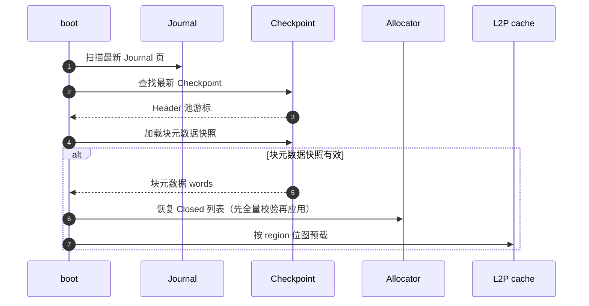
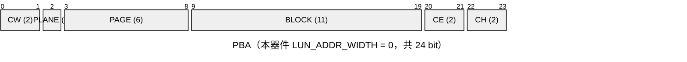

# 文档编写规则

> **适用范围**：`docs/` 下的活跃文档——design / platform / verification / ledger /
> revision / guide / README。归档文档不改写，但新写内容遵循本规则。
>
> **与 `docs/README.md` 的分工**：README 管「内容放哪一层」，本文件管「这一层怎么写」。
> 分层表与 doc policy 不在本文件重复（H6）。

## 1. 目标与判据

文档的目标不是记录实现，而是让读者能回答：现在是什么设计、为什么这样选、改哪里 / 看哪里 / 验证什么。

**判据**：换平台、重构或换实现后，哪些段落必须改？必须改的越少，文档越稳定。
因此：契约、不变量、失败语义、策略取舍留在设计文档；实现坐标、当前测量、历史、
风险状态放到各自归属层。

## 2. 单一权威位置

每个事实只允许一个权威出处；其他位置只写摘要或链接。

| 内容 | 唯一归属 | 其他文档怎么处理 |
|---|---|---|
| 架构选择、替代方案、主流对照、器件/平台选型 | `design/controller_target_features.md` | 设计文档只留「设计取舍」摘要并链接 |
| 当前设计、契约、不变量、状态机、失败语义、数据流 | `design/*_design.md` | 其他文档引用章节，不复述 |
| API / 结构体 / 字段 / 常量定义 | 公共头 / 内部头 | 设计文档只写名称、值、语义 |
| 风险、缺口、验证状态 | `design/known_open_items.md` | 设计文档不写编号，只在「限制」章链接 |
| 版本决策史、被否方案 | `design/revision_history/` | 设计文档不写日期、版本号、变更叙事 |
| 测试用例、上板结果、吞吐 | `*_ut_design.md` / `guides/testing_guide.md` | 设计文档不写测量值 |

## 3. 文档类型与写法

| 类型 | 回答的问题 | 写法要点 |
|---|---|---|
| **design** | 当前设计是什么、契约与不变量 | 稳定描述；不写实现坐标、测量、历史、风险编号 |
| **architecture / 选型** | 为什么选它、主流怎么做、替代方案差在哪 | 完整论证；设计文档只留摘要（§2 / §4.3） |
| **platform** | 当前平台怎么落地 | 可写具体 SoC / 内存域 / 引脚 / 时序 |
| **verification** | 怎么测、结果如何 | 可写日期、seed、计数、日志片段 |
| **ledger** | 哪些风险 / 缺口未闭合 | 五要素；只追加，不写设计正文 |
| **revision** | 某版本改了什么、为什么 | 按时间追加；不改写旧条目 |
| **guide / README** | 怎么操作、先读什么 | 导航与操作步骤；不复制设计内容 |

## 4. 结构与模板

### 4.1 设计文档骨架

1. 摘要（问题 / 方案要点 / 范围与非目标 / 约定）
2. 需求、约束与总体设计
3. 数据模型（地址、布局、结构）
4. 模块设计（按模块七段模板）
5. 端到端场景
6. 数据与状态模型
7. 设计取舍（决策摘要；完整论证链接架构文档）
8. 已知限制
9. 附录（术语、跨模块常量）

### 4.2 模块七段模板

每节顺序固定，缺一不可；不适用写「不适用 + 理由」：

1. **背景与需求**：没有它会怎样；要满足什么约束；不做什么。
2. **职责与边界**：做 / 不做 / 上下游。
3. **结构与不变量**：数据结构、字段语义、所有权、不变量。
4. **流程**：图 + 关键步骤；没有图要说明原因。
5. **失败语义**：错误、掉电、背压、超时、重试。
6. **设计取舍**：当前选择 + 主要替代 + 与主流的主要区别；完整论证链接架构文档。
7. **常量与阈值**：名称 / 值 / 语义；不写代码位置。

第 7 段之后不再放正文；额外的对照表、限制表前移到第 6 段之前。

### 4.3 选型 / ADR 模板

完整条目放架构文档，字段固定：

`背景 / 选项 / 选择 / 理由 / 与主流的主要区别 / 代价 / 重估触发 / 出处`

设计文档只保留一行式摘要：「选择 X；主要替代 Y；与主流差异 Z；见架构文档」。

## 5. 引用规则

### 5.1 允许

- 文档级引用：`fc_nand_design.md`、`controller_target_features.md`、`known_open_items.md`；
- 稳定锚点：本文 `§x.y`；跨文档「文档名 §x.y」；
- 公开资料名：SPDK FTL、UBI、DFTL、Cosmos+、器件 datasheet 节名；
- 设计契约必需的数值：`1 CW = 512 B`、`64 页/块`、`4 MiB 表`。

### 5.2 少用

- 函数 / 变量 / 宏 / 字段名：**不是禁止**。它们对理解数据空间与数据结构有帮助时保留；
  但只在「锚点」处出现，不列调用点清单，不逐函数解释。
  - 结构表可以列字段名与语义；
  - 流程只引必要的入口 / 状态符号；
  - 同一段最多 1~2 个实现符号。
- 具体实现名与设计概念同时出现时，先给概念，再给符号。

### 5.3 禁止

- `file:line`、`src/...`、`include/...` 路径；
- 规则编号（H/R/C/P）与 `CLAUDE.md` 章节号——把规则本身讲清楚，不引编号；
- `RISK-*` / `ISS-*`——只在「限制」章链接台账；
- 版本号、日期、测试计数、seed、精确字节数（设计契约必需的常量除外）。

## 6. 术语规则（全项目通用）

### 6.1 首次出现格式

`English term (中文专业译名)`：

- 名词：`garbage collection (垃圾回收)`、`wear leveling (磨损均衡)`、
  `write amplification (写放大)`；
- 动作 / 策略：`write-back (写回)`、`program-before-map (先编程后映射)`、
  `deferred write completion (待入账)`；
- 缩写：`logical-to-physical (L2P) mapping (逻辑到物理映射)`，后续可单用 `L2P`。

首次出现给双语，其后可用英文或中文，但**同一文档内保持一致**。

### 6.2 自造词

- 有主流对应：`本仓自定：X（主流术语 Y；差异：…）`；
- 无主流对应：`本仓自定（无主流对应）`，并给出机制一句话；
- 不得把自造词写成行业标准。

### 6.3 一致性

- 一个概念只保留一个规范译名；同义词只保留一个。
- 附录术语表是权威；正文第一次出现给双语，后续按术语表。
- 禁止无定义混用：`region` / `区域`、`block` / `块`、`page` / `页`。
- 大小写：普通名词小写；专有名按官方写法；复合形容词用连字符
  （`write-back cache (写回缓存)`），动词短语不用（`write back (写回)`）。

## 7. 去重与边界

- 摘要只写一页；第 1 章展开需求与约束，不重复摘要表格。
- 场景章只做端到端串联与失败点，不重新解释模块内部。
- 状态机总表只做索引（状态机 / 谁推进 / 章节），细节留模块。
- 附录常量表保留**所有能解释策略的常量**（名称 / 值 / 语义），重点是不重复字段表、不冗余；模块私有且无策略含义的常量留在头文件。
- 附录结构表只做「结构 → owner → 章节」的地图；字段语义只在模块节出现。
- 决策摘要与完整 ADR 的分工见 §2 / §4.3，本节不重复。

## 8. 导航与锚点

- `docs/README.md`：按任务导航；`docs/design/README.md`：按文档 / 阅读顺序。
- 设计正文不放阅读路径；TOC 覆盖 H2 + H3，锚点稳定。
- 跨引用格式：本文 `§x.y`；跨文档「文档名 §x.y」；不写「见上文 / 下文」。
- 锚点命名：`s<章>` / `s<章>-<节>`；重排章节时优先修锚点，不重排正文。
- 长文档（>500 行）必须有完整 TOC。

## 9. 图表与表格

### 9.1 选型

| 要表达什么 | 用什么 | 说明 |
|---|---|---|
| 模块之间的调用 / 数据流转 | `sequenceDiagram` | 模块交互默认图型 |
| 状态机 | `stateDiagram-v2` | 状态 + 转移条件 |
| 判断 / 处理流程 | `flowchart` | 分支、汇合、失败出口 |
| 数据结构关系（包含 / 归属 / 指针） | `classDiagram` / `erDiagram` | 不用于位域 |
| 位域 / 字段条 | `packet-beta` + bit 偏移表 | `bitsPerRow` 控制每行宽度 |
| 整页 / 记录布局（DW/Byte 网格） | `block-beta` | 跨列 + `......` 压缩重复；实验性 |
| 字段顺序（不适合上述时） | `flowchart LR` 字段条 + 偏移表 | 无向 `---`；不是流程 |
| 硬件 / 模块框图 | `flowchart` 子图 | `block-beta` 为实验性，稳定优先 |
| 系统上下文 / 容器 | `C4Context` / `C4Container` | 放架构文档；实验性，先验证 GitHub 渲染 |
| 需求追踪 | `requirementDiagram` | 可选：需求 → 设计节 → 测试节 |
| 时间线 | `timeline` | 只用于 revision history，不进设计文档 |
| 取舍对比 | `quadrantChart` | 慎用；容易过度简化，结论仍以正文为准 |

### 9.2 sequenceDiagram（模块交互默认）

- **participant = 模块**，按数据流顺序排列；不放函数名、文件名。
- **消息 = 动作**（动词短语）；必须写符号时最多 1 个，放在括号里。
- **必须加 `autonumber`**；正文可以引用「步骤 5」。
- 分支用 `alt` / `loop`，不靠注释画分支；返回用虚线 `-->>`。
- 一图一场景；超过 7 个 participant 或 15 条消息就拆图。
- 图前一句说明「这张图回答什么」，图后给 3 条读图要点。

示例：



### 9.3 stateDiagram-v2 / flowchart

- 状态机用 `stateDiagram-v2`：状态是名词，转移写「事件 [守卫] / 动作」。
- 处理流程用 `flowchart`：每个失败出口都要画出来，不允许「其余情况略」。
- 不要用 `flowchart` 画模块间时序；那是 `sequenceDiagram` 的职责。

### 9.4 classDiagram / erDiagram

- 只表达结构关系：谁包含谁、指针归属、记录之间的引用。
- `classDiagram` 不画位域；位域见 §9.5。
- 落盘记录之间的关系用 `erDiagram`；字段语义仍以正文为准。

### 9.5 packet-beta（位域 / 寄存器）

- 位域主图用 `packet-beta`，并配一张 **bit 偏移表**。
- **方向必须标注**：`packet-beta` 按网络约定 **bit 0 在左**，与 C 代码低位在右相反。
- `packet-beta` **默认每行 32 bit**，可在 YAML frontmatter 用 `config.packet.bitsPerRow` 调整：

  ```yaml
  ---
  config:
    packet:
      bitsPerRow: 128
  ---
  ```

  `bitsPerRow: 128` 时每行 16 B，4 个 4 B 字段横排；`512` 时每行 64 B，
  2 KB 页压到 32 行。图标题里写明“每行 X B”。
- **一个结构尽量一张图**，不要拆成“头 packet + 其余表 + 多个读图要点”：
  - 纯位域 / 字段条用 `packet-beta`，数组用一个跨行字段表示；
  - 整页 / 整条记录的 DW/Byte 网格用 `block-beta`：`columns 5` = DW 行号 + Byte 3..0，
    字段用 `:n` 跨列；重复数组保留一行代表 + 一行 `......`；
  - `......` 行必须写清**重复范围 + 元素数 + 总字节**，不能只写省略号；
  - padding 同样压成 `......` 行，不要逐行画。
- `block-beta` 是实验性图种：语法可做跨列 / 行列头，但发布前必须实际验证 GitHub 渲染；
  渲染不稳定时退回一张连续布局表。
- 位宽随器件变化的字段（如 `LUN`）给出通用形式或注明「本器件值」。
- 示例（PBA，本器件 `LUN_ADDR_WIDTH = 0`）：



| 字段 | 位宽 | 本器件 bit 偏移 |
|---|---:|---:|
| CW | 2 | 0–1 |
| PLANE | 1 | 2 |
| PAGE | 6 | 3–8 |
| BLOCK | 11 | 9–19 |
| LUN | 0（本器件） | — |
| CE | 2 | 20–21 |
| CH | 2 | 22–23 |

### 9.6 ASCII 备用（位域）

`packet-beta` 不渲染、或方向容易误解时，用 ASCII，**低位在右**：

```text
bit 23 22   21 20   19                      9   8          3   2   1 0
    ┌──────┬──────┬──────────────────────────┬─────────────┬───┬─────┐
    │  CH  │  CE  │         BLOCK            │    PAGE     │PL │ CW  │
    │  2b  │  2b  │          11b             │     6b      │1b │ 2b  │
    └──────┴──────┴──────────────────────────┴─────────────┴───┴─────┘
```

### 9.7 通用约束

- 图只表达结构、顺序、状态；不堆实现符号；节点建议 ≤15。
- 图前一句「回答什么」，图后 3 条读图要点；图不替代正文契约。
- 图与正文冲突时以正文为准，图随正文更新。
- 关键图配 ASCII 或表回退；只有图、没有文字契约的段落视为不完整。
- Mermaid 渲染约束见 `guides/mermaid_authoring.md`。
- 表格规则见 §11.8（表头单位、列/行上限、空值 `—`）。

## 10. GitHub Markdown 能力

以下能力 GitHub 原生渲染，优先使用；不引入需要外部服务的语法。

### 10.1 Alerts（提示块）

用 GitHub Alerts，不用手写 `⚠` 或自定义提示样式：

```markdown
> [!NOTE]
> 补充说明，不影响契约。

> [!WARNING]
> 会导致静默数据丢失的约束。
```

- 常用：`[!NOTE]`、`[!TIP]`、`[!IMPORTANT]`、`[!WARNING]`、`[!CAUTION]`。
- 一个提示块只讲一件事；不嵌套；不放进 Mermaid 图。
- 设计文档只对「会造成错误实现」的内容用 `WARNING/CAUTION`，其余用普通段落。

### 10.2 脚注（引用）

公开资料、datasheet、外部标准用脚注，正文不被长 URL 打断：

```markdown
SPDK FTL 采用固定根 + 顺序 chunk 的形态[^a4]。

[^a4]: SPDK Flash Translation Layer，<https://spdk.io/doc/ftl.html>。
```

- 脚注只用于**出处**，不用于代码符号或章节引用。
- 同一出处只定义一次；正文可多次引用同一个脚注。
- 与引用式链接二选一，不混用。

### 10.3 数学公式

容量推导、写放大、GC 代价等公式可用 GitHub KaTeX：

```markdown
写放大：$WA = \frac{NAND\ write}{host\ write}$

$$
WA = \frac{valid + invalid + metadata}{host\ write}
$$
```

- 公式后必须给一句话结论，不要求读者自己推导。
- 符号首次出现给定义；纯整数估算可以继续用文字。
- 不要用公式替代契约表。

### 10.4 折叠块

`<details>` 只用于长替代方案、长附录，不用于契约正文：

```markdown
<details>
<summary>被否方案：块映射</summary>

……完整论证……

</details>
```

- 设计文档慎用；架构文档可用来收纳完整比较。
- 折叠内容仍要能被搜索到；关键结论不要只放在折叠里。

### 10.5 引用式链接

URL 集中到文末，正文只写短标签：

```markdown
见 [SPDK FTL][spdk]。

[spdk]: https://spdk.io/doc/ftl.html
```

- 同一文档内不要同时用脚注和引用式链接承载同一类出处。
- 链接标签保持稳定，改名时全局搜索。

### 10.6 任务列表

`- [ ]` 只用于检查清单（verification / checklist），不进设计正文。

## 11. 语言、风格与可读性

> 可读性的判据不是「写得漂亮」，而是目标读者能用最少时间回答三个问题：
> 这节的选择是什么？为什么？改哪里？

### 11.1 写作前的三问

1. **读者是谁**：新加入的固件工程师 / 维护该模块的人 / 只查契约的调用者？
2. **读完要能回答什么**：一个设计选择、一条不变量、一个失败分支，还是操作步骤？
3. **哪些可以不写**：不影响决策的实现细节、历史、测量、调用点清单。

三问答不出来，先不要动笔。

### 11.2 结构可读性

- **先总览后细节**：每章第一段告诉读者这一章回答什么；长章先给 3~5 行结论或一张表。
- **标题写对象或结论**，不写「其它」「杂项」「补充」。反例：「其它说明」；正例：「掉电窗口与恢复顺序」。
- **固定顺序**：背景 → 契约 → 流程 → 失败 → 取舍 → 常量。读者一旦熟悉顺序，就能跳读。
- **一段一个主题**：一段只承载一个判断或一条契约；超过 5 行考虑拆段或改列表。
- **并列用列表，枚举用表格，因果用段落**。三者不要互相替代。
- **每节结尾给「本节结论」**（长节适用）：一句话说出选择与代价。
- **前提先行**：算法 / 流程前写「前提：……」；没有前提的隐式假设最容易导致误实现。

### 11.3 句子与段落

- **一句话一个判断**。避免一句话里塞三个转折。
- **主语明确**：谁做什么；少用「被」「由……进行」这类无主语句。
- **先旧信息，后新信息**：先提读者已知的对象，再给新结论。
- **用动词，不堆名词化**：写「分配页」，不写「页的分配动作的执行」。
- **括号最多一层**；插入语超过一行就改成独立句。
- **先定义后使用**；缩写首次出现展开（见第 6 节）。
- 用「本仓 / 本文」，不用「我们 / 你」；不用营销词（「强大」「完美」「极致」）。
- 中英文之间加半角空格；数字与单位之间加空格（`64 页`、`4 MiB`）。
- 避免双重否定；必须否定时直接写「不得」「不支持」。

### 11.4 纯文字段落

四件套是**信息顺序**，不是排版模板；正文不写「主题句 / 展开 / 例子 / 结论」这些标签。

默认落在一段：

1. **主题句**：先给结论，说明这一段回答什么。
2. **展开**：机制 / 原因 / 步骤 / 对比。
3. **例子**：一个具体输入→输出或一次流程；没有有意义的例子可省略。
4. **结论**：一句约束、代价或边界。

示例（同一内容，两种排版）：

**单段版**（一条因果、无并列项）：

> 固定元数据池的副本策略分两类。目录检查点、CP、BBT 用 P0+P1 镜像：同一条 record 写两份，任一份可读即可恢复，代价是元数据写放大 ×2；Journal 按 P0/P1 页号交错，保持单副本。磨损计数不单独成块，随 CP 记录落盘，因此单 plane 损坏只丢一个副本，不改变磨损快照的语义。

**拆段版**（展开是 3 个并列项，改用列表）：

> 固定元数据池的副本策略分两类：
> - 目录检查点 / CP / BBT：P0+P1 镜像，同一条 record 写两份；
> - Journal：P0/P1 页号交错，单副本。
>
> 磨损计数不单独成块，随 CP 记录落盘；因此单 plane 损坏只丢一个副本，不改变磨损快照的语义。

两种写法信息量相同，区别是**可扫读性**。默认用单段，句号 / 分号分隔，最多 5 行、分号最多一两个；满足任一条就拆开：

| 条件 | 排版 |
|---|---|
| 展开是 ≥3 个并列项 | 列表 |
| 例子需要对照、或超过一句 | 独立段或表 |
| 例外 / 警告与主结论性质不同 | 独立段或 GitHub Alert |
| 超过 5 行 | 拆段 |
| 参考型内容需要跳读 | 拆段 + 小标题 |

**降级规则**：

- 短契约（一条不变量、一行限制）：用「结论 + 理由」两件即可。
- 没有有意义的例子：停在「主题句 + 展开 + 结论」三件。
- 禁止伪例子：「例如某些情况下……」「比如一般情况下……」；例子必须具体（某 region、某页、某序号）。

**拆分示例**（WAL 次序）：主结论一段，例外独立成段或 Alert：

> 区域页写回必须等 Journal 先把对应映射落盘。每行记录它依赖的 Journal 序号上界；只有持久化水位追上该序号，才允许提交区域页，否则返回瞬态背压。

> [!WARNING]
> 例外：Journal 页写失败时放行——失败条目已丢，继续等待会让 Checkpoint 与失败标记互相卡死；此时由 CP 兜底。

### 11.5 信息密度

- 每段只承载**一个决策或一条契约**；无关的实现细节删掉。
- 不写「众所周知」「显而易见」「显然」；要么给依据，要么删。
- 表格用于枚举与对照，不把长句塞进单元格。
- 删除不影响设计决策的细节：调用点清单、逐函数解释、日志格式、精确行号。

### 11.6 强调与格式

- 粗体只用于**结论**与**风险**；一段最多 1~2 处。
- 代码格式只用于标识符、命令、文件名、常量；不用于普通名词。
- 警告用 GitHub Alerts（§10.1），不用手写 `⚠`；不要用感叹号堆强调。
- 列表用于并列与步骤；连续三段以上再考虑改列表，不要把段落切碎。
- 标题层级不超过四级；四级以下用粗体标签代替。

### 11.7 图的可读性

规则见 §9.7；本节不重复。

### 11.8 表格的可读性

- 表头带单位（`大小 (B)`、`值 (ms)`）；数值右对齐。
- 列数建议不超过 5；超了拆表或改列表。
- 行数建议不超过 10；超了按维度拆表。
- 空值统一写 `—`；不要留空。
- 单元格里不写长句；长解释放表下注释。

### 11.9 交叉引用

- 就近引用：在需要的地方给链接，不写「见上文 / 见下文」。
- 引用时给一句理由：为什么去那里看。
- 只引稳定章节号；章节重排时先修锚点，不靠读者记忆。
- 跨文档引用写「文档名 §x.y」；本文内部写 `§x.y`。

### 11.10 可读性自查（10 条）

1. **5 分钟测试**：新读者读摘要 + 本节标题，能否说出设计选择？
2. **标题测试**：只看标题，能否知道每节讲什么？
3. **术语测试**：是否有未定义或混用的术语？
4. **符号测试**：一段是否超过 2 个实现符号？
5. **段落测试**：是否有超过 5 行的段落？
6. **表格测试**：是否有列数 > 5 或行数 > 10 的表？
7. **重复测试**：同一事实是否在别处又讲了一遍？
8. **引用测试**：每个「见 §x.y」是否给了理由？
9. **图测试**：每张图是否有「回答什么」与读图要点？
10. **删减测试**：删掉这段，读者会失去哪个决策信息？答不出就删。

### 11.11 本仓常见反例

| 反例 | 问题 | 改法 |
|---|---|---|
| 长括号套括号，句中插入三层解释 | 读者断句困难 | 拆成独立句或表下注释 |
| 一段出现 5 个实现符号 | 符号汤，概念被淹没 | 先写概念，只留 1~2 个锚点符号 |
| 「重构前是 32 块，现在 96 块」 | 变更史混入设计 | 只写当前值：96 块（12 MiB） |
| 「见 §3.5.8 的 `reclaim_pending` 位图」 | 实现名 + 无理由引用 | 「见 §3.5.8 的待回收位图（回收前置条件）」 |
| 表格单元格里写三行解释 | 表失去对照功能 | 单元格写结论，解释放表下 |
| 标题写「其它」 | 读者无法跳读 | 写成具体对象或结论 |

### 11.12 规范用语

全文统一四个词，避免「应该 / 建议 / 最好 / 尽量」混用：

- **必须 / 不得**：契约级；违反即错误。
- **应当**：默认做法；偏离要写理由。
- **可以**：允许的实现选择。
- **建议**：非约束性的工程提示，不进契约。

## 12. 变更与维护

- 改设计先改权威处，再改引用处；不允许两处各改一半。
- 版本、日期、被否方案只进 revision history。
- 风险、缺口、验证状态只进台账。
- 删除内容不留墓碑；历史由 git / revision 承担。

## 13. 工具与检查

### 13.1 本仓已有

```sh
make docs-check          # 分层 / 平台 / 代码坐标 / 日期 / 尺寸 / 台账引用
make docs-report         # 按文档/类别列计数
make docs-test           # 检查器自检
make review-marks-check  # 评审标记格式与台账引用
```

规则框架：文档规则在 `tools/rulecheck/docs/`（与 C 规则共用 `rulecheck.registry`）；
加规则只加模块 + 注册，不改 CLI。

### 13.2 可引入的工具

| 工具 | 用途 | 建议 |
|---|---|---|
| `markdownlint-cli2` | 标题层级、重复标题、代码块语言、表格格式 | 可选；只开少量规则，避免全文件重排 |
| `lychee` / `markdown-link-check` | 链接检查 | 已有自定义检查；不重复引入 |
| `mmdc`（Mermaid CLI） | 校验 Mermaid 语法、离线渲染 | 可选 CI 任务；依赖 Chromium，较重 |
| `textlint` + `prh` | 术语格式、禁用词 | 规则稳定后再考虑；先用 Python 自定义检查 |
| `codespell` | 英文拼写 | 可选；缩写要白名单 |
| TOC 校验脚本 | TOC 与锚点一致 | 建议用 Python 自写，不引入 Node |
| `prettier` / `mdformat` | 统一 Markdown 格式 | **不建议**：全文件重排，diff 不可读 |

原则：**GitHub 原生能渲染 / 本仓已有检查的，不重复引入**；外部 DSL（PlantUML、D2、
Graphviz、WaveDrom）不默认引入，确需时预渲染 SVG 并注明来源。

### 13.3 规则与检查

warning 不阻塞 `docs-check`；`--strict` 可升级为失败：

- `DOC-REF`：设计文档中的 `CLAUDE.md` / 括号规则编号；
- `DOC-SYMBOL`：一行 ≥3 个裸符号的密度提示 + `tools/doc_symbols_allow.txt` + 段内例外；
- `DOC-ADR`：ADR 字段完整性；
- `DOC-MODULE`：模块七段模板完整性；
- `DOC-TERM`：常用术语首次出现的中文译名（全称术语；缩写由术语表负责）；
- `DOC-GLOSSARY`：术语表必须覆盖核心缩写（L2P / PBA / PAA / META / SB / BBT / GC / WL / CP / VWC）；
- `DOC-LINK`：内部链接与锚点（归档跳过）。

```sh
make docs-check
make docs-report
make docs-test
make docs-mermaid   # 可选，需 mmdc
python3 tools/check_docs.py --path docs/design/ftl_design.md --strict
```

## 14. 例外

- 分层例外用 `<!-- doc-policy: allow <category> -->` … `<!-- /doc-policy -->` 包住，
  并写一句为什么例外。
- 设计契约必需的数值 / 符号不算例外，直接写。

## 15. 已定事项

### 15.1 规则决定

1. **附录常量表**：保留所有能解释策略的常量（名称 / 值 / 语义），重点是提升可读性、
   不重复字段表、不冗余。
2. **术语表**：留在各设计文档附录，不单独建 `docs/glossary.md`。
3. **不拆分** FTL 设计文档。

### 15.2 裸标识符检查

**已定：集中清单 + 段内例外。** 契约级符号进 `tools/doc_symbols_allow.txt`，局部必要的
符号用 `<!-- doc-policy: allow symbols -->` 包住；检查器对清单外的裸符号只提示、不失败，
规则稳定后再考虑升级为硬拦。这样既避免 `FTL_AGAIN`、`l2p_cache_s` 这类必要符号被误报，
也保留审计入口。
